> 종목: 한화오션 (042660.KS / 한화오션주식회사 / Hanwha Ocean Co., Ltd. / 구 대우조선해양 DSME)
>
> 섹터: 조선 (섹터 T2 주도 후보) / 서브섹터: 조선
>
> 작성 시각: 2026-11-14 KST (**v1.2** — DART 3Q26 분기보고서 확정치·IR 실적발표 19건·DART 원문 보강 / v1.1 (2026-11-03) — OpenDART 재무 API 검증 / v1.0 (2026-11-03) — 신규 작성)
>
> 적용 구조: v4.8 (6개 섹션 + 12종 표준 차트 + 보조 chart3 부문별 연간 매출·chart13 47분기 전사 시계열)
>
> 데이터: 12년 연결 연간(2014~2025, DART OpenAPI 재무제표 정확값) + 47분기 전사 시계열(1Q15~3Q26, 3Q26 DART 확정) + 19분기 사업부별(1Q22~3Q26, IR 실적발표) + 20분기 사업부문 매출·매출총이익(1Q17~4Q21, DART 분기·반기·사업보고서 부문정보) + 수주·수주잔고 시계열(2014~2026.9, IR) + 20년 Yahoo 시가총액 시계열
>
> 출처: **DART OpenAPI fnlttSinglAcntAll (corp_code 00111704, 연결 CFS) 사업·분기·반기보고서 22건** + **DART 원문 document.xml 5건** (2016 사업보고서 정정 rcpNo 20171019000329 / 2019 사업보고서 20200330003583 / 2022 사업보고서 20230313000849 / 2025 사업보고서 정정 20260317000644 / 2026 반기보고서 20260812000829 — 사업부문별 매출·연구개발·주주·임원·직원·신용등급·소송) + **한화오션 IR 실적발표 PDF 6건** (3Q23·4Q23·3Q24·4Q24·3Q25·4Q25·3Q26, hanwhaocean.com/investors/ea) + **Yahoo Finance 042660.KS 월간 시계열** + 사용자 제공 컨센서스(2026E~2028E)
>
> **v1.2 추가 출처**: **DART 3Q26 분기보고서 (rcept 20261111000263, 2026-11-11 제출)** 연결 재무 JSON + 원문 / **DART 정기보고서 원문 document.xml 57건** (2014~2026, 분기·반기·사업보고서 — 부문정보 주석·직원현황·임원·수주잔고) / **IR 실적발표·IR Presentation PDF 19건** (irgo.co.kr, 2018.05 IR ~ 2026-10-27 3Q26) / **DART 2025 사업보고서 API** (company·최대주주·임원·직원·배당·자기주식·주식총수)
>
> **데이터 기준 시점**: 손익·재무상태·현금흐름 = **3Q26 DART 분기보고서 확정치** (2026-11-11 제출. 2026-10-27 잠정실적과 매출·영업이익·순이익 억원 단위까지 동일). 사업부별 손익은 DART가 2026년부터 '해양/기타' 단일 부문으로 공시해 IR 3Q26 사업부 값 유지
>
> **Fact verify cutoff**: 재무 2026-11-14 (DART 3Q26 분기보고서) / 시가총액·주가 2026-11-03 (Yahoo Finance 장중가 53,800원 기준 — v1.2에서 미갱신). 점유율·피어 OPM은 다음 갱신 시 재검증 필요

# 한화오션 기업 개요 (v1.2 — 조선 T2 주도 후보, Primary 사이클 + 구조조정 턴어라운드 완료 국면)

## 기업 분류

① Primary / Secondary 분류

(1) 결론

→ **Primary: 사이클 (조선 수주-인도 장기 사이클 + 2015~2022 구조조정을 거친 턴어라운드형 사이클)**

→ **Secondary: 특수선(잠수함·수상함)·미국 MRO/MASGA 방산 optionality + EPU(해양·플랜트) 프로젝트 변동성 — 지속성장 근거는 아직 미확정 (특수선 9M26 누적 영업손실 -942억)**

(2) Primary 근거

→ 12년(2014~2025) OPM range **-39.1%(2021) ~ +10.6%(2018) = 49.7%pt** — cutoff ±10%pt의 약 5배. 메모리 3사(SK하이닉스·MU)급 진폭

→ 12년 중 영업적자 **6개년** (2014·2015·2016·2021·2022·2023), 순손실 6개년 — 조선 수주 사이클(2011~2014 해양 고점 수주 → 2015~2016 손실) + 저가 수주 사이클(2019~2020 수주 → 2021~2022 강재가 급등 손실)이 손익에 2~3년 lag로 반영되는 전형적 구조

→ 매출 12년 CAGR **-1.8%** (155,616억 → 127,835억) — 2014년 해양플랜트 매출 고점 대비 아직 미회복. 반면 2021 → 2025 4년 CAGR **+29.9%** (상선 LNGC 고선가 물량 인도)

(3) Secondary 근거

→ 특수선 매출 2025년 12,840억(연결조정 전 매출의 약 9%), 장보고-Ⅲ·울산급 Batch-Ⅲ 등 국내 함정 + 미국 MRO(Hanwha Philly Shipyard 지분 40%, 2026.9.18 전량 처분 결정)·캐나다 CPSP(2026.7 탈락)·NATO 수출 optionality

→ 단 특수선 분기 OPM이 1Q26 -6.5% → 2Q26 -0.9% → 3Q26 -19.4%로 악화 — "방산 secular" 프리미엄을 정량으로 정당화할 단계가 아님

→ EPU(해양+E&I)는 2Q26 P-79 FPSO 일괄 인식으로 매출 20,579억 → 3Q26 5,275억, OPM -27.7% ~ +17.3% 분기 변동 — 사이클 noise 확대 요인

(4) Entity 구조 (IR 2026년 기준 사업부)

→ **상선** — 9M26 매출 87,474억 (연결조정 전 70%), 영업이익 17,079억 (OPM 19.5%) — LNGC·컨테이너·VLCC·VLGC/VLAC

→ **특수선** — 9M26 매출 10,084억 (8%), 영업이익 -942억 — 잠수함·수상함·MRO

→ **EPU (Energy Plant Unit, 구 해양 + E&I)** — 9M26 매출 28,064억 (22%, P-79 일괄 인식 포함), 영업이익 402억 — FPSO·FLNG·Drillship·WTIV·해상풍력·화공/발전 플랜트 (2024.7 ㈜한화 플랜트, 2024.12 풍력 영업양수)

→ **주요 종속·관계사** — 연결 종속회사 21개(주요 6개): 한화오션에코텍(선박블록), 한화해양공정(산동)유한공사(블록), DSME Kazakhstan LLP, Hanwha Ocean USA Holdings 등. 지분법: Hanwha Offshore Singapore(구 Dyna-Mac, 27%), Hanwha Philly Shipyard(40%, 처분 결정), NextDecade(6.6%, 기타 금융자산)

② Summary Box (12년 연결 시계열 + 사이클 통계)

(1) 12년 평균·정점·저점

| 지표 | 12년 평균 (2014~2025) | 정점 | 저점 | 2025년 | 9M26 (DART 확정) |
|---|---|---|---|---|---|
| 매출 (연결, 억원) | 100,228 | **155,616 (2014)** | 44,866 (2021) | **127,835** | 120,670 |
| 영업이익 (연결, 억원) | -3,480 | **11,676 (2025)** | -21,245 (2015) | **11,676** | 16,629 |
| 당기순이익 (연결, 억원) | -5,297 | **12,459 (2025)** | -27,895 (2016) | **12,459** | 13,377 |
| OPM (%) | -5.8% (단순) / -3.5% (매출가중) | **10.6% (2018)** | -39.1% (2021) | **9.1%** | **13.8%** |

(2) 1번 섹션 표준 6지표

| 지표 | 값 |
|---|---|
| 매출 CAGR (12년, 2014→2025) | **-1.8%** (4년 2021→2025 **+29.9%**) |
| OPM 평균 (12년) | **-5.8%** (단순 평균) |
| OPM 정점 평균 | **+9.9%** (2018 10.6% / 2025 9.1%) — 현재 사이클은 9M26 13.8%로 정점 갱신 진행 중 |
| OPM 저점 평균 | **-26.5%** (2015 -13.8% / 2021 -39.1%) |
| 사이클 주기 | **약 6~7년** (저점 2015 → 2021 = 6년, 정점 2018 → 2025~26 = 7~8년). 상위 장기 조선 슈퍼사이클은 2007~2008 정점 → 2025~2026 재정점 (약 18년) |
| 사이클 회수 (12년) | **정점 2회 / 저점 2회** |

(3) 12년 손익 사이클 history book (억원, K-IFRS 연결, DART)

```
[한화오션(구 대우조선해양) 12년 연결 손익 시계열 (억원)]
연도    매출       OP        OPM      NI
2014  155,616   -5,651    -3.6%   -8,527   ← 해양플랜트 매출 정점. 당초 흑자 공시 → 2016~17 분식회계 정정으로 적자 재작성
2015  154,436  -21,245   -13.8%  -22,092   ← 1차 저점: 해양 PJT 손실 일괄 반영(빅배스), 산은·수은 4.2조 지원, 부채비율 2,951%
2016  128,192  -15,308   -11.9%  -27,895   ← 수주절벽 + 자본잠식, 2016.7 거래정지, 12월 감자·출자전환
2017  111,018    7,330     6.6%    6,458   ← 2017.3 2.9조 신규지원 + 채무재조정(출자전환) → 흑자전환
2018   96,444   10,248    10.6%    3,201   ← 1차 정점: OPM 12년 최고 (대손충당금 환입으로 판관비 마이너스)
2019   83,587    2,928     3.5%     -465   ← 2019.3 현대중공업(現 HD한국조선해양) 인수 본계약, 매출 감소 지속
2020   70,302    1,534     2.2%      866   ← 코로나 + 2016~17 수주절벽 물량 소진, 저선가 수주 확대
2021   44,866  -17,547   -39.1%  -16,998   ← 2차 저점: 강재가 급등 공사손실충당금(2Q21 -1.0조) + Drillship 손상
2022   48,602  -16,136   -33.2%  -17,448   ← 2022.1 EU 합병 불허 → 인수 무산, 6~7월 하청노조 파업, 해양 손실(3Q22)
2023   74,083   -1,965    -2.7%    1,600   ← 2023.5 한화그룹 편입(2조 제3자배정) + 사명 변경 + 11월 1.5조 주주배정 증자
2024  107,760    2,379     2.2%    5,282   ← 연간 흑자전환, 2021~22 고선가 LNGC 매출 인식 본격화
2025  127,835   11,676     9.1%   12,459   ← 정점 진입: 상선 OPM 10.4%, 이연법인세 효과로 NI > OP
9M26  120,670   16,629    13.8%   13,377   ← (DART 3Q26 분기보고서 확정) 상선 OPM 19.5%, 2Q26 P-79 일괄 인식(약 1.5조). 3Q26 환율·특수선 손실로 컨센 -10% 하회
2026E 158,301   22,126    14.0%   19,529   ← 컨센서스 (사용자 제공)
2027E 151,164   24,114    16.0%   19,278   ← 컨센서스
2028E 162,336   27,660    17.0%   22,122   ← 컨센서스

OPM range: -39.1% ~ +10.6% = 49.7%pt (cutoff ±10%pt의 약 5배 → 사이클 분류 확정)
사이클 회수: 정점 2회(2018, 2025~) / 저점 2회(2015, 2021)
```

→ **교차검증**: 사용자 화면 연간 값(2014~2025 매출·OP·NI 12년)과 DART OpenAPI 연결 재무제표 값이 **12개년 모두 억원 단위까지 일치** (NI = 비지배 포함 당기순이익 기준. 지배주주 NI는 2014 -7,736 / 2015 -20,975 / 2016 -27,341 / 2017 6,215 / 2018 3,447억으로 차이)

→ 2006~2013년 연간은 사용자 제공 범위(2014~2025)와 DART OpenAPI 재무 API(2015 사업연도~) 밖이라 **미확보** — Version Log 잔여 보완 후보

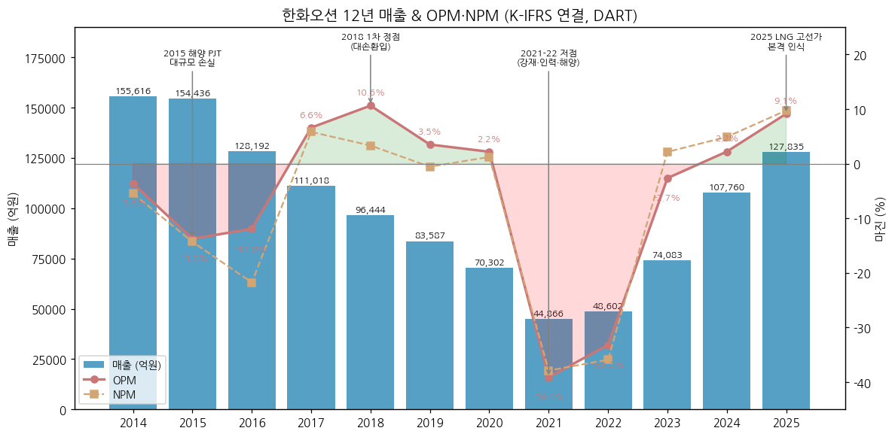

③ 정량적 분류 근거

→ **수주-인도 lag 구조**: 계약부채(선수금 성격) 2021말 20,942억 → 2022말 46,816억(LNGC 대량 수주) → 2025말 51,959억, 계약자산 55,061억 — 2~3년 전 수주 선가가 현재 OPM을 결정

→ **상선 비중 상승 = 사이클 순도 상승**: 연결조정 전 매출 중 상선 비중 2014년 34% → 2021년 82% → 2025년 78% (해양플랜트 축소). 해양 손실 사이클이 빠지고 상선 선가 사이클이 Primary driver로 단일화

→ **수주잔고**: 2026.9말 인도기준 **362.2억$ / 165척·기** (상선 268.3억$ — LNGC 55척 140.5억$) — 매출 약 3년치 visibility (IR 3Q26) / DART 3Q26 원화 수주잔고 **31.7조원** (2025말 34.5조). 인도기준 잔고는 2018.4 227.6억$ → 2021말 원화 매출잔량 19.0조 → 2022.10 315.3억$ → 2024.1 281.6억$ 저점 → 2026.9 362.2억$ (비즈니스 모델 ①(4))

→ **분기 OPM 진폭**: 47분기 중 최저 2Q21 **-94.2%**, 최고 2Q17 **19.2%** / 최근 1Q26~3Q26 13.5~14.2% — 사이클 정점권

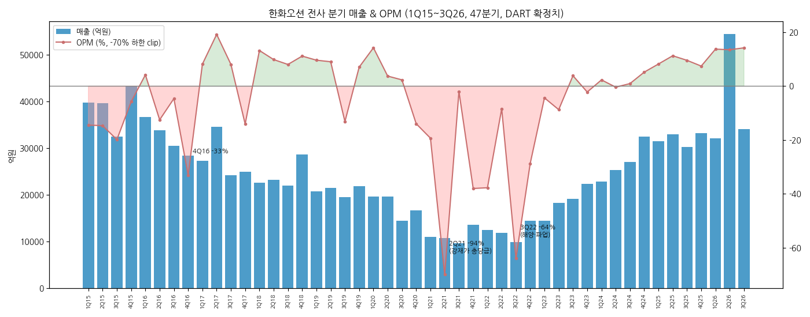

④ 산업 분류

→ **DART 업종코드** — 3111 (선박 및 보트 건조업 / 강선 건조업 계열, DART 기업개황 induty_code)

→ **KRX 업종** — 유가증권시장 운송장비·부품

→ **워치리스트 섹터** — 조선 (섹터 T2 주도 후보), 서브섹터 조선

→ **비교 피어** — 국내 HD현대중공업(HD한국조선해양 자회사)·삼성중공업 / 해외 중국 CSSC 계열, 일본 이마바리 등

⑤ 분류 결정 논리 (4단계 sub-logic)

(1) **가장 매출 큰 사업부 기준** — 상선 9M26 매출 70% · 영업이익 103%(특수선·EPU 합산 손실 상쇄) → 상선 선가·수주 사이클이 Primary driver → **사이클**

(2) **secular 변수 sub-rule** — 특수선(방산)·미국 MRO가 secular 후보이나 매출 비중 8%, 9M26 적자 → secular 격상 조건(매출 비중 20%+ & 흑자 4분기 연속) 미충족. LNG 운반선 장기 수요(미국 LNG 수출 증설, NextDecade Train 4~8)는 사이클 진폭을 줄이는 요인이나 선가 사이클 자체를 제거하지 못함 → **사이클 유지**

(3) **Boundary case 처리** — 2015~2022 구조조정(산은 관리, 출자전환 2회, 인수합병 무산 2회)은 "구조적 Turnaround" 성격도 있으나, 2023 한화 편입 + 2024~2025 흑자 정착으로 턴어라운드는 완료 국면 → Primary를 Turnaround로 두지 않고 **Primary 사이클 + "턴어라운드 완료" 태그**로 처리. 특수선 방산은 Secondary 노트로만 표기

(4) **피어 cross-reference** — HD현대중공업 FY25 OPM 11.6%(증권사 4Q25 리뷰 기준) / 삼성중공업 FY25 가이던스 OP 6,300억·매출 10.5조(약 6%, 실적 확정치 미검증) vs 한화오션 FY25 9.1% → 국내 3사 모두 같은 LNGC·고선가 사이클을 공유. 한화오션은 3사 중 진폭이 가장 큰 종목(2021 -39.1%)이자 특수선 비중이 HD현대중공업 다음 수준 → **동일 Primary 사이클, Secondary만 방산 optionality로 차별화**

⑥ 적정 밸류에이션 방법 (사업부 mix → method 다이얼)

(1) 1순위 — **P/B 밴드 (사이클 기준)**

→ 상선 영업이익 비중 100%+ = 선가 사이클 종목 → 이익 변동성이 커서 PER은 정점에서 낮아 보이고 저점에서 무의미(12년 중 적자 6년). 자본은 2022말 7,450억 → 3Q26 74,328억으로 증자·이익으로 10배 회복해 밴드 기준점이 안정화

→ 현재(2026-11-03, 53,800원, 시총 16.5조): **P/B 2.2x** (3Q26 자본 74,328억 기준) / 2025말 자본 기준 2.7x. 2026-01 월말 고점(141,200원, 시총 43.3조) 당시 2025말 자본 기준 **7.0x**

(2) 2순위 — **Forward PER (정점 이익 할인)**

→ 컨센 2026E NI 19,529억 기준 **PER 8.4x**, 2027E 8.6x, 2028E 7.5x — 사이클 정점 이익이라 저PER 자체가 매수 근거가 아님(정점 PER 함정). 2026-01 고점 당시 2026E PER 약 22x

(3) 3순위 — **수주잔고 cross-check**

→ 시가총액 / 수주잔고(362.2억$, 원화 약 51조 @1,400원) ≈ 0.32x, 잔고 마진(상선 OPM 17~23%) 지속 기간으로 이익 하방을 점검하는 보조 지표

(4) 희석 변수

→ 산업은행 보유 영구전환사채(신종자본증권 2조 3,328억, 전환가 40,350원, 전환가능주식 57,814,925주 = 발행주식의 18.9%) — 주가가 전환가를 크게 웃돌 때 P/B·EPS 희석 overhang. 현 주가 53,800원은 전환가 대비 +33%

(5) **삼성전자 대비**: 삼성전자는 DS 사이클 비중으로 PBR + PER 혼합, 한화오션은 상선 단일 사이클이라 **PBR 단독 우선 + PER은 정점 확인용 보조** — 방산(특수선)이 흑자로 비중 20%+에 도달하기 전까지 방산 PER 프리미엄(한화에어로스페이스식) 적용 불가

⑦ 분기 재평가 트리거 (분류 변경 조건 — 실적 추적 변수는 6번 섹션)

→ ① **특수선 + 해외 MRO/함정 매출 비중 20%+ & 특수선 흑자 4분기 연속** 시 → Secondary 방산을 **Primary 사이클 + 지속성장 boundary**로 격상 (PER 프리미엄 혼합 검토)

→ ② **상선 신규수주 2개년 연속 -30% 이상 감소 + 상선 OPM 2분기 연속 하락** 시 → 사이클 "정점 → 하강 국면" 재태깅 (P/B 밴드 하단 적용, 2018→2021 패턴 재현 경계)

→ ③ **EPU 또는 특수선 대형 공사손실충당금(분기 OP -3,000억 이상) 재발** 시 → "턴어라운드 완료" 태그 철회, **Primary 구조적 Turnaround 재분류 검토** (2015·2021 손실 패턴 재현 여부)

→ ④ **산은 영구전환사채 전환 또는 한화그룹 지분 구조 재편(지분율 30% 미만)** 시 → 지배구조 리스크 재평가 (분류 영향은 Secondary 노트)

---

## 회사 개요

① 기본 사항

| 항목 | 내용 |
|---|---|
| 회사명 (한글) | 한화오션주식회사 (2023.5.23 대우조선해양 → 한화오션 사명 변경) |
| 회사명 (영문) | Hanwha Ocean Co., Ltd. |
| 종목코드 | 042660 (KRX 유가증권시장, 2001.02.02 재상장) |
| 설립일 | **2000년 10월 23일** (대우중공업에서 분할 신설) / 모태 옥포조선소 1973.10.11 (IR 기재 설립일) |
| 본사 | 경상남도 거제시 거제대로 3370 (아주동) / 서울사무소 중구 청계천로 86 한화빌딩 / 시흥 R&D캠퍼스 |
| 홈페이지 | www.hanwhaocean.com |
| 대표이사 | **김희철** (1964.10, Washington Univ. in St. Louis MBA·서울대 화학공학, 전 한화에너지·한화솔루션 큐셀부문·한화토탈 대표, 2024.10 선임 → **2026.3.19 정기주총 재선임, 임기 2029.3.31**) — DART 기업개황 대표자명 김희철 (2026-11 기준) |
| 발행주식수 | **306,413,394주** (2026.9말, IR) |
| 비전 | Global Ocean Solution Provider (선박·해양플랜트·특수선 + 친환경/디지털·해상 플랫폼) |
| 사업 한 줄 정의 | LNG선·컨테이너선·VLCC 등 상선 + 잠수함·수상함 특수선 + FPSO·해상풍력·플랜트를 건조하는 종합 조선·해양 기업 |
| 최대주주 | **한화에어로스페이스 30.44% + 한화시스템 7.24% = 37.68%** (2026.6말, DART 반기보고서) |
| 2대 주주 | 한국산업은행 15.25% (+ 영구전환사채 2.33조 보유) |
| 신용등급 | **회사채 A- / CP A2-** (NICE 2025.11.28, 한국기업평가 2025.11.20 상향, 직전 BBB+ / A3+) |
| 연결 종속회사 | 21개 (주요 6개, 2025말) |
| 임직원 | 직영 11,036명 + 외주 14,366명 = 25,402명 (2026.9말, IR) / DART 직원 11,178명 (2025말: 정규직 9,865 + 기간제 1,313, 남 10,452·여 726) |
| 자기주식 | 16,207주 (2025말, 기타취득 — 유통주식 306,397,187주) |
| 배당 | 2025 사업연도 무배당 (DART 배당에 관한 사항 — 현금·주식배당 '-', 연결 EPS 4,007원) |

② 12년 손익·자본 추이 (연결, DART OpenAPI 확정값, 억원)

| 연도 | 매출 | 영업이익 | OPM | 당기순이익 | 자본총계 | 자산총계 | 비고 |
|---|---|---|---|---|---|---|---|
| 2014 | 155,616 | -5,651 | -3.6% | -8,527 | 20,268 | 177,358 | 분식 정정 재작성 |
| 2015 | 154,436 | -21,245 | -13.8% | -22,092 | 6,189 | 188,803 | 1차 저점 |
| 2016 | 128,192 | -15,308 | -11.9% | -27,895 | 6,594 | 150,648 | 거래정지·감자 |
| 2017 | 111,018 | 7,330 | 6.6% | 6,458 | 29,907 | 114,468 | 출자전환·흑전 |
| 2018 | 96,444 | 10,248 | 10.6% | 3,201 | 38,402 | 119,185 | 1차 정점 |
| 2019 | 83,587 | 2,928 | 3.5% | -465 | 37,549 | 112,761 | 현대重 인수 계약 |
| 2020 | 70,302 | 1,534 | 2.2% | 866 | 38,690 | 103,208 | 코로나 |
| 2021 | 44,866 | -17,547 | -39.1% | -16,998 | 22,176 | 106,232 | 2차 저점 |
| 2022 | 48,602 | -16,136 | -33.2% | -17,448 | 7,450 | 122,357 | 합병 무산·파업 |
| 2023 | 74,083 | -1,965 | -2.7% | 1,600 | 43,122 | 139,448 | 한화 편입 |
| 2024 | 107,760 | 2,379 | 2.2% | 5,282 | 48,633 | 178,438 | 흑자전환 |
| **2025** | **127,835** | **11,676** | **9.1%** | **12,459** | **61,750** | **201,409** | 정점 진입 |
| 3Q26 (DART 확정) | 9M 120,670 | 9M 16,629 | 13.8% | 9M 13,377 | 74,328 | 203,743 | 3Q26 분기보고서 |

→ (출처: DART OpenAPI fnlttSinglAcntAll 연결 — 2016·2019·2022·2025 사업보고서 3개년 비교 컬럼. 3Q26은 DART 3Q26 분기보고서 (rcept 20261111000263) — IR 잠정치(2026-10-27)와 손익·자산·자본 전 항목 억원 단위 일치)

→ 12년 자본 CAGR **+10.7%** (20,268억 → 61,750억) — 단 2015~2016 자본잠식 직전(6,189억) → 2017 출자전환(+383%) → 2022 재잠식 위기(7,450억) → 2023 한화 증자(+479%)의 **두 번의 외부 수혈** 결과

→ 2025 ROE(지배, 평균자본) **22.6%** — 2017년(34.1%, 출자전환 직후 저자본 효과) 이후 최고

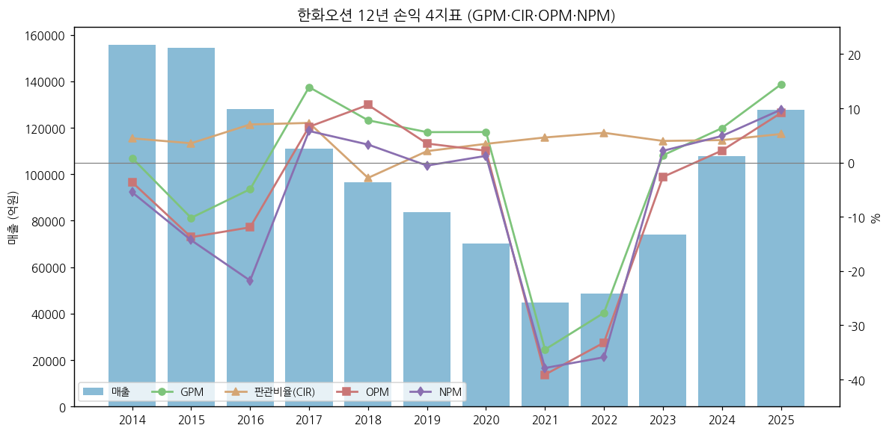

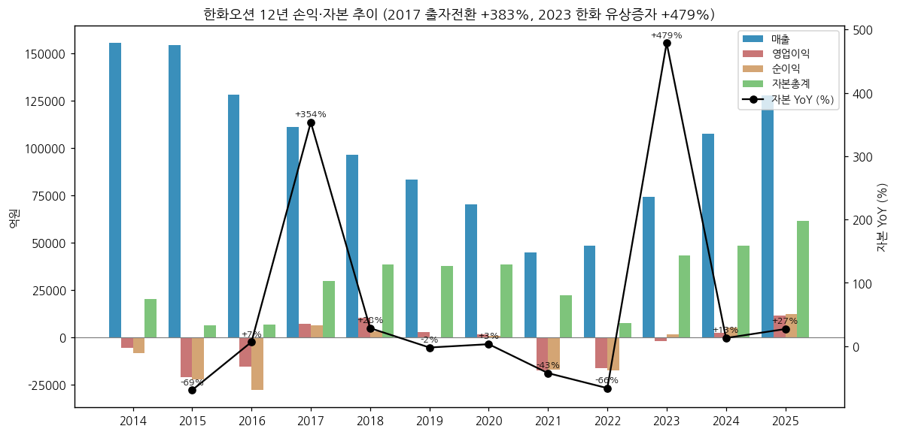

③ 회사 주가 역사 (시가총액 20년)

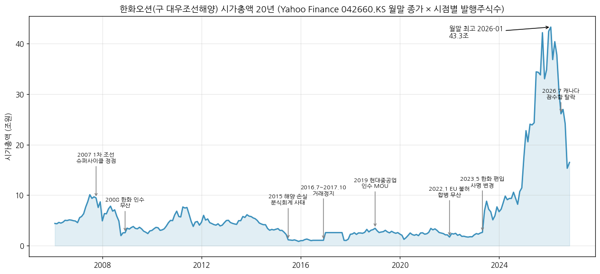

→ (출처: Yahoo Finance v8 042660.KS 월간 종가 2006.01~2026.11 × 시점별 발행주식수. Yahoo는 2016.12 1:10 주식병합을 과거 가격에 소급 조정 → 병합 전 주식수도 1/10로 환산. 주식수는 DART 자본금/액면 5,000원 및 증자 내역(2023.5.24 +104,438,643주, 2023.6.2 +5,144,087주, 2023.11.17 +89,485,500주)으로 단계 적용한 **근사치**)

(1) 구간별 narrative

(1-1) 2006~2008 1차 조선 슈퍼사이클

→ 2007.6말 월말 시총 약 **10.1조** (20년 중 2024년 이전 최고) — 산업은행 관리 하 매각 추진, 2008.10 한화그룹 우선협상대상자 선정 → 2009.1 금융위기로 인수 무산

(1-2) 2010~2014 해양플랜트 붐

→ 2010~2011 시총 6~8조 회복, 해양플랜트(FPSO·Drillship·Fixed Platform) 대량 수주 — 이후 2015 손실의 원인이 된 저가·고위험 수주가 이 시기에 집중

(1-3) 2015~2017 손실·분식·거래정지

→ 2015.7 해양 손실 대규모 반영 → 2015.12 월말 시총 약 **1.0조** (20년 최저권). 분식회계 사태 → **2016.7~2017.10 거래정지** (차트의 평탄 구간), 2016.12 1:10 감자

(1-4) 2018~2022 매각 재추진·무산

→ 2019.3 현대중공업 인수 본계약 → 2022.1.13 EU 집행위 기업결합 불허로 무산. 2020.2 월말 시총 약 1.25조

(1-5) 2023~2026.1 한화 편입 + 조선 2차 슈퍼사이클

→ 2023.5 한화그룹 편입 → 2024말 시총 약 17.5조 → 2025말 42.4조 → **2026.1말 월말 종가 141,200원, 시총 약 43.3조 (20년 월말 최고)**. 미국 조선 협력(MASGA)·LNGC 고선가·방산 기대가 동시 반영

(1-6) 2026.2~ 급락 구간

→ 2026.7.7~8 캐나다 잠수함(CPSP) 수주 탈락 소식에 2거래일 약 -30% (에너지경제신문, 2026-07) → 2026.9말 50,000원(시총 약 15.3조) → **2026-11-03 53,800원, 시총 16.5조 (1월 고점 대비 -62%)**. 9월 급락 원인은 본 v1.0에서 미검증(잔여 보완 후보)

④ 주요 연혁

→ **1973.10** 옥포조선소 기공(대한조선공사) → 1978 대우그룹 인수(대우조선공업)

→ **2000.10.23** 대우중공업 분할, 대우조선공업 신설 → **2001.02.02** 재상장, 2002 대우조선해양으로 사명 변경 (산업은행 최대주주)

→ **2008.10** 한화그룹 우선협상대상자 선정 → 2009.1 인수 무산

→ **2015.7** 해양 PJT 손실 대규모 인식, 2015.10 산은·수은 4.2조 지원 결정

→ **2016.7** 분식회계 관련 거래정지 (~2017.10), **2016.12** 감자 및 출자전환 (영구전환사채 8회차 1조원 발행, 2016.12.29)

→ **2017.3** 2.9조 신규지원 + 채무재조정 (사채권자 집회), 9회차 영구전환사채 1조 2,848억 (2017.6.28)

→ **2019.3** 현대중공업그룹 인수 본계약 → **2022.1.13** EU 불허로 무산

→ **2022.6~7** 하청노조 도크 점거 파업 (51일)

→ **2022.9~12** 한화그룹 2조원 유상증자 MOU·본계약

→ **2023.5.23** 한화에어로스페이스 외 4개사 제3자배정 104,438,643주(주당 19,150원, 약 2조) 납입 → 최대주주 산업은행 → 한화에어로스페이스 외 4인, 사명 한화오션으로 변경

→ **2023.11.17** 주주배정 유상증자 89,485,500주 (주당 16,730원, 약 1.5조)

→ **2024.4** ㈜한화 플랜트(2,144억)·풍력(1,881억) 영업양수 결정 (양수일 2024.7.1 / 2024.12.1)

→ **2024.6~12** Hanwha Philly Shipyard 인수 (한화시스템 60% + 한화오션 40%, 총 1억$), **2024.11** Dyna-Mac(現 Hanwha Offshore Singapore) 27% 인수(약 2,350억), NextDecade 6.6% 투자(1,803억)

→ **2024.12.1** 한화오션디지털 흡수합병

→ **2025.3** 한화그룹 내 보유지분 한화에어로스페이스로 통합 (특별관계자 간 22,375,216주 매매)

→ **2025.11** 신용등급 BBB+ → **A-** 상향 (NICE·한국기업평가)

→ **2026.3.19** 제26기 정기주총: 대표이사 김희철 사내이사 재선임(임기 2029.3), 독립이사 김영삼·이효진 신규 선임 (안완기·현낙희 임기만료), 정관 변경(이사 임기 3년 등)

→ **2026.4** 한화시스템 보유 13,281,250주 PRS 계약 매도 (지분 11.57% → 7.24%)

→ **2026.7** 2Q26 매출 5조 4,432억(사상 최대, P-79 일괄 인식) / 캐나다 CPSP 우선협상 탈락

→ **2026.9.18** Hanwha Philly Shipyard 지분 전량 처분 결정 (Hanwha Defense USA Shipbuilding LLC 대상, 10월말 예정)

→ **2026.10.27** 3Q26 잠정실적: 매출 34,139억(+12.9% YoY) / OP 4,857억(+67.6% YoY, OPM 14.2%) / NI 1,451억(-46.1% YoY)

→ **2026.11.11** 3Q26 분기보고서 제출 — 잠정치와 동일하게 확정 (매출 34,139억 / OP 4,857억 / NI 1,451억)

---

## 비즈니스 모델

① 실적 추이 통합 표 (사업부별 연간, IR 실적발표 기준, 억원)

| 구분 | 2022 | 2023 | 2024 | 2025 | 9M26 |
|---|---|---|---|---|---|
| **매출액 (연결)** | **48,602** | **74,083** | **107,760** | **127,835** | **120,670** |
| 상선 | 42,162 | 58,180 | 86,819 | 105,250 | 87,474 |
| 특수선 | 5,033 | 8,834 | 10,527 | 12,840 | 10,084 |
| 해양 (→ 2026 EPU) | 2,024 | 9,771 | 10,909 | 7,098 | 28,064 (EPU) |
| E&I (플랜트·풍력, 2024.7~) | - | - | 3,369 | 8,195 | (EPU 포함) |
| 기타·연결조정 | -617 | -2,702 | -3,864 | -5,548 | -4,951 |
| **영업이익 (연결)** | **-16,136** | **-1,965** | **2,379** | **11,676** | **16,629** |
| 상선 | -11,054 | -4,828 | 1,256 | 10,920 | 17,079 |
| 특수선 | 641 | 821 | 1,258 | 916 | -942 |
| 해양 (→ EPU) | -6,501 | 1,465 | 83 | -108 | 402 (EPU) |
| E&I | - | - | -50 | -386 | (EPU 포함) |
| 기타·연결조정 | 778 | 577 | -168 | 334 | 90 |
| **OPM (연결)** | **-33.2%** | **-2.7%** | **2.2%** | **9.1%** | **13.8%** |
| 상선 OPM | -26.2% | -8.3% | 1.4% | 10.4% | 19.5% |
| 특수선 OPM | 12.7% | 9.3% | 12.0% | 7.1% | -9.3% |

→ (출처: 4Q23 실적발표 p.18(2022~2023), 4Q24 p.18(2024), 4Q25 p.18(2025), 3Q26 p.6(9M26). 사업별 정보는 내부 관리기준 제품군별 손익으로 K-IFRS 1108호 영업부문 공시가 아님 — IR 각주)

→ **양식 변경 매핑**: 2022~2Q24 상선/특수선/해양 3분류 → 3Q24 플랜트 신설 → 4Q24~4Q25 E&I(플랜트·풍력) → **2026~ 상선/특수선/EPU(해양+E&I)**. 3Q26 IR에서 연결 자회사 귀속 기준 세분화로 1Q26·2Q26 상선/EPU/기타 재분류(연결 총액 불변) — 본 문서는 재분류 후 값 사용

(1) 사업부문별 연간 매출 12년 (DART 사업보고서 '매출실적', 연결조정 전, 억원)

| 연도 | 상선 | 해양 및 특수선 | E&I(플랜트·풍력)/건설 | 기타 | 연결조정 | 연결 매출 | 상선 비중 |
|---|---|---|---|---|---|---|---|
| 2014 | 57,416 | 92,360 | 6,681 | 10,233 | -11,074 | **155,616** | 34% |
| 2015 | 63,871 | 86,705 | 4,914 | 9,138 | -10,191 | **154,436** | 39% |
| 2016 | 70,565 | 53,429 | 4,638 | 7,688 | -8,128 | **128,192** | 52% |
| 2017 | 73,381 | 39,097 | 1,977 | 1,721 | -5,158 | **111,018** | 63% |
| 2018 | 66,070 | 30,657 | - | 951 | -1,234 | **96,444** | 68% |
| 2019 | 57,585 | 26,377 | - | 1,211 | -1,585 | **83,587** | 68% |
| 2020 | 52,173 | 18,739 | - | 951 | -1,561 | **70,302** | 73% |
| 2021 | 37,340 | 7,397 | - | 980 | -851 | **44,866** | 82% |
| 2022 | 42,163 | 7,056 | - | 1,227 | -1,844 | **48,602** | 84% |
| 2023 | 58,180 | 18,605 | - | 1,317 | -4,020 | **74,083** | 74% |
| 2024 | 86,756 | 21,436 | 3,368 | 954 | -4,754 | **107,760** | 77% |
| 2025 | 105,234 | 20,309 | 8,194 | 1,407 | -7,308 | **127,835** | 78% |

→ (출처: DART 사업보고서 II-4 '매출실적' — 2014~2016은 2016 사업보고서 정정본(선박/해양 및 특수선/건설/기타), 2017~2019는 2019 사업보고서, 2020~2022는 2022, 2023~2025는 2025. 2017~2019 연결조정은 연결 매출 - 부문 합으로 역산. 2014~2016 '건설'은 대우조선해양건설 등 당시 종속회사 매출, 2024~ 'E&I'는 ㈜한화 영업양수분)

→ **품목 비중 (DART 2025)**: 상선(LNGC·LPGC·컨테이너·COT) 77.3% / 해양 및 특수선(FPSO·Fixed Platform·Drillship·WTIV·잠수함/수상함) 15.6% / E&I 6.4% / 기타 0.7%

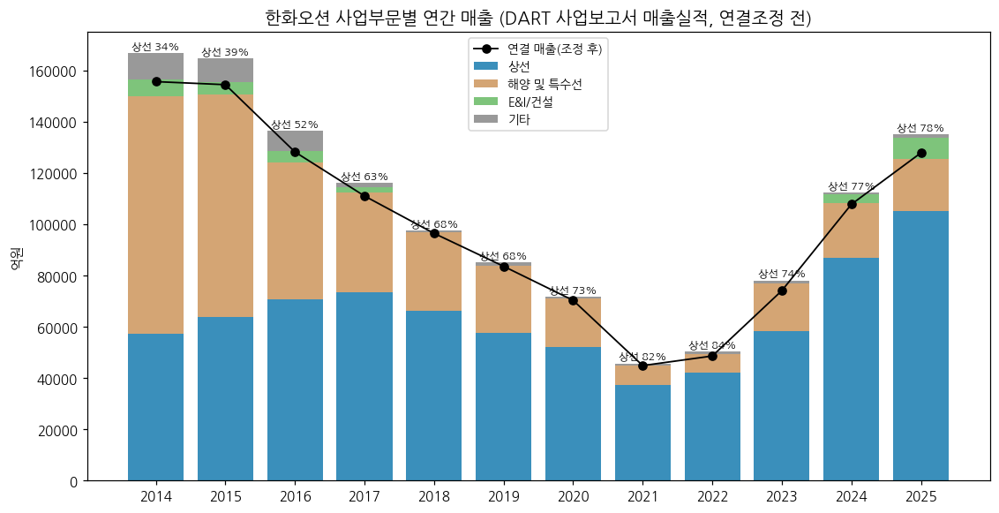

(2) 사업부별 분기 시계열 (1Q22~3Q26, 19분기, IR 실적발표, 억원)

| 분기 | 상선 매출 | 상선 OP | 상선 OPM | 특수선 매출 | 특수선 OP | 특수선 OPM | 해양·EPU 매출 | 해양·EPU OP | 해양·EPU OPM |
|---|---|---|---|---|---|---|---|---|---|
| 1Q22 | 10,799 | -5,002 | -46.3% | 1,261 | 75 | 5.9% | 421 | 46 | 10.9% |
| 2Q22 | 10,566 | -660 | -6.2% | 814 | 36 | 4.4% | 590 | -563 | -95.4% |
| 3Q22 | 9,536 | -1,398 | -14.7% | 1,060 | -77 | -7.3% | -593 | -4,979 | n.m. |
| 4Q22 | 11,261 | -3,994 | -35.5% | 1,898 | 607 | 32.0% | 1,606 | -1,005 | -62.6% |
| 1Q23 | 11,446 | -1,010 | -8.8% | 1,288 | -3 | -0.2% | 1,972 | 276 | 14.0% |
| 2Q23 | 13,751 | -1,618 | -11.8% | 2,429 | 54 | 2.2% | 2,390 | -176 | -7.4% |
| 3Q23 | 15,095 | -152 | -1.0% | 2,265 | -76 | -3.4% | 2,762 | 825 | 29.9% |
| 4Q23 | 17,888 | -2,048 | -11.4% | 2,852 | 846 | 29.7% | 2,647 | 540 | 20.4% |
| 1Q24 | 19,441 | 182 | 0.9% | 1,422 | 57 | 4.0% | 2,774 | 184 | 6.6% |
| 2Q24 | 21,120 | -434 | -2.1% | 3,289 | 734 | 22.3% | 1,990 | -476 | -23.9% |
| 3Q24 | 21,707 | 364 | 1.7% | 1,961 | 137 | 7.0% | 4,349 | -326 | -7.5% |
| 4Q24 | 24,550 | 1,145 | 4.7% | 3,855 | 330 | 8.6% | 5,165 | 650 | 12.6% |
| 1Q25 | 25,686 | 2,333 | 9.1% | 3,034 | 413 | 13.6% | 3,839 | -178 | -4.6% |
| 2Q25 | 28,068 | 3,771 | 13.4% | 2,368 | 183 | 7.7% | 4,598 | -68 | -1.5% |
| 3Q25 | 24,639 | 3,071 | 12.5% | 3,750 | 287 | 7.7% | 2,713 | -526 | -19.4% |
| 4Q25 | 26,858 | 1,745 | 6.5% | 3,688 | 32 | 0.9% | 4,143 | 277 | 6.7% |
| 1Q26 | 27,942 | 5,006 | 17.9% | 3,183 | -208 | -6.5% | 2,209 | -611 | -27.7% |
| 2Q26 | 32,382 | 7,355 | 22.7% | 3,272 | -29 | -0.9% | 20,579 | 98 | 0.5% |
| 3Q26 | 27,150 | 4,718 | 17.4% | 3,630 | -706 | -19.4% | 5,275 | 914 | 17.3% |

→ (출처: 4Q23 p.18 (1Q22~4Q23), 3Q24 p.16·4Q24 p.18 (2024), 4Q25 p.18 (2025), 3Q26 p.16 (3Q25~3Q26). 3Q24~4Q25 '해양·EPU' = 해양 + 플랜트/E&I 합산으로 2026 EPU 기준에 맞춤. 3Q22 해양 매출 -593억은 공사 계약가 조정에 따른 음(-)의 매출)

(2-1) 사업부문별 분기 매출·매출총이익 (1Q17~4Q21, 20분기, DART 부문정보, 억원)

| 분기 | 상선 매출 | 상선 GP | 상선 GPM | 해양및특수선 매출 | 해양및특수선 GP | 해양및특수선 GPM | 연결 매출 | 연결 GP |
|---|---|---|---|---|---|---|---|---|
| 1Q17 | 18,278 | 2,345 | 12.8% | 9,436 | 629 | 6.7% | 27,305 | 3,047 |
| 2Q17 | 20,100 | 3,160 | 15.7% | 14,286 | 7,475 | 52.3% | 34,576 | 10,600 |
| 3Q17 | 16,450 | 1,125 | 6.8% | 8,779 | 2,122 | 24.2% | 24,206 | 3,613 |
| 4Q17 | 18,554 | -943 | -5.1% | 6,597 | -906 | -13.7% | 24,931 | -1,820 |
| 1Q18 | 16,449 | 1,465 | 8.9% | 6,224 | 1,092 | 17.5% | 22,561 | 2,584 |
| 2Q18 | 17,813 | 2,007 | 11.3% | 5,449 | 101 | 1.9% | 23,257 | 2,817 |
| 3Q18 | 14,775 | 838 | 5.7% | 7,210 | 487 | 6.8% | 21,973 | 1,592 |
| 4Q18 | 17,032 | -1,235 | -7.3% | 11,774 | 2,040 | 17.3% | 28,652 | 524 |
| 1Q19 | 13,686 | 963 | 7.0% | 6,790 | 1,434 | 21.1% | 20,721 | 2,619 |
| 2Q19 | 14,721 | 159 | 1.1% | 7,271 | 1,916 | 26.4% | 21,504 | 1,754 |
| 3Q19 | 13,235 | -2,018 | -15.2% | 6,288 | -245 | -3.9% | 19,475 | -1,967 |
| 4Q19 | 15,942 | 782 | 4.9% | 6,027 | 1,265 | 21.0% | 21,887 | 2,283 |
| 1Q20 | 14,133 | 1,079 | 7.6% | 5,412 | 2,133 | 39.4% | 19,581 | 3,287 |
| 2Q20 | 13,520 | -1,239 | -9.2% | 6,128 | 2,506 | 40.9% | 19,658 | 1,453 |
| 3Q20 | 12,040 | 1,541 | 12.8% | 2,857 | -796 | -27.9% | 14,414 | 924 |
| 4Q20 | 12,481 | -3,379 | -27.1% | 4,342 | 1,524 | 35.1% | 16,648 | -1,705 |
| 1Q21 | 9,074 | -1,631 | -18.0% | 2,025 | -284 | -14.0% | 11,018 | -1,789 |
| 2Q21 | 9,122 | -6,786 | -74.4% | 1,531 | -2,894 | -189.0% | 10,694 | -9,590 |
| 3Q21 | 7,715 | -1,047 | -13.6% | 1,796 | 1,300 | 72.4% | 9,597 | 379 |
| 4Q21 | 11,430 | -4,577 | -40.0% | 2,045 | -94 | -4.6% | 13,557 | -4,471 |

→ (출처: DART 분기·반기·사업보고서 'II. 사업의 내용 – 사업부문별 재무정보' 및 연결 주석 '부문정보'의 누적 값을 차분해 분기화. 4Q = 사업보고서 연간 - 3분기 누적. 2017년 '선박/해양 및 특수선/건설/기타' → 2018~ '상선/해양 및 특수선/기타' 분류. 연결 매출은 전사 분기 시계열과 전 분기 일치 확인. 연결 GP에는 기타·건설·연결조정 포함)

→ **영업이익이 아닌 매출총이익(GP) 기준** — DART 부문정보는 영업손익·감가상각·자산을 "상선 부문과 해양 및 특수선 부문으로 구분 불가"로 상선에 합산 공시 → 사업부별 영업이익은 2017~2021 구간 **미확보**. '해양 및 특수선'은 해양과 특수선을 합산한 값으로 IR(2022~)의 특수선/해양 분리와 기준이 다름

→ 패턴: 상선 GPM은 2017~2018 저선가 물량 + 4Q 충당금으로 4분기마다 마이너스 반복, **2020.4Q -27.1% → 2Q21 -74.4%** (강재가 급등 공사손실충당금)로 2021 저점 형성. 해양및특수선은 2Q17 52.3% (일회성 여부·원인 미검증)·2020년 30~40%대 고GPM 구간이 있으나 2Q21 -189% (Drillship 손상)

→ 1Q15~4Q16은 **미확보** — 원 분기보고서(2015·2016)는 2017년 분식 정정 이전 값이라 정정 후 연결 총액(전사 분기 시계열)과 불일치 (예: 1H15 원보고 61,362억 vs 정정 후 79,401억). 연간 부문 매출은 (1) 12년 표의 정정 후 값 사용

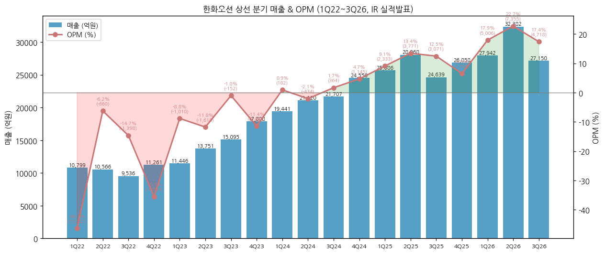

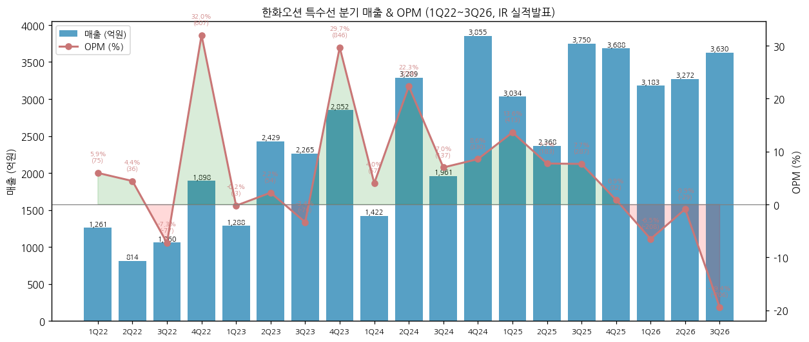

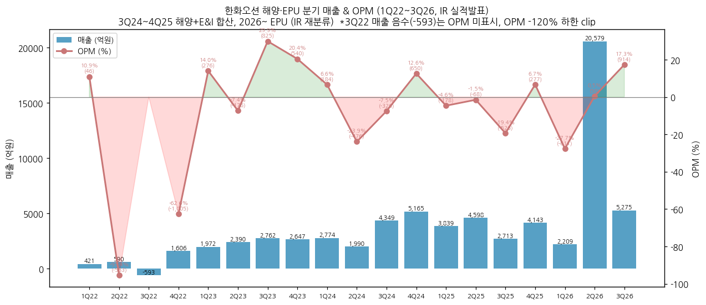

(3) 전사 분기 시계열 (1Q15~3Q26, 47분기, 억원)

| 분기 | 매출 | 영업이익 | OPM | 순이익 | 매출 YoY | OP YoY |
|---|---|---|---|---|---|---|
| 1Q15 | 39,796 | -5,754 | -14.5% | -3,754 | - | - |
| 2Q15 | 39,605 | -5,821 | -14.7% | -4,308 | - | - |
| 3Q15 | 32,516 | -6,462 | -19.9% | -11,498 | - | - |
| 4Q15 | 43,224 | -2,503 | -5.8% | -175 | - | - |
| 1Q16 | 36,645 | 1,542 | 4.2% | 1,855 | -7.9% | 흑전 |
| 2Q16 | 33,880 | -4,236 | -12.5% | -12,209 | -14.5% | 적지 |
| 3Q16 | 30,531 | -1,413 | -4.6% | -2,382 | -6.1% | 적지 |
| 4Q16 | 28,460 | -9,396 | -33.0% | -13,618 | -34.2% | 적지 |
| 1Q17 | 27,305 | 2,233 | 8.2% | 2,336 | -25.5% | +45% |
| 2Q17 | 34,576 | 6,647 | 19.2% | 12,547 | +2.1% | 흑전 |
| 3Q17 | 24,206 | 1,959 | 8.1% | 749 | -20.7% | 흑전 |
| 4Q17 | 24,931 | -3,510 | -14.1% | -9,174 | -12.4% | 적지 |
| 1Q18 | 22,561 | 2,986 | 13.2% | 2,263 | -17.4% | +34% |
| 2Q18 | 23,257 | 2,294 | 9.9% | 2,062 | -32.7% | -65% |
| 3Q18 | 21,973 | 1,770 | 8.1% | -3,239 | -9.2% | -10% |
| 4Q18 | 28,652 | 3,198 | 11.2% | 2,114 | +14.9% | 흑전 |
| 1Q19 | 20,721 | 1,996 | 9.6% | 1,952 | -8.2% | -33% |
| 2Q19 | 21,504 | 1,948 | 9.1% | 1,453 | -7.5% | -15% |
| 3Q19 | 19,475 | -2,563 | -13.2% | -2,964 | -11.4% | 적전 |
| 4Q19 | 21,887 | 1,546 | 7.1% | -906 | -23.6% | -52% |
| 1Q20 | 19,581 | 2,790 | 14.2% | 2,425 | -5.5% | +40% |
| 2Q20 | 19,658 | 734 | 3.7% | 515 | -8.6% | -62% |
| 3Q20 | 14,414 | 336 | 2.3% | -292 | -26.0% | 흑전 |
| 4Q20 | 16,648 | -2,325 | -14.0% | -1,782 | -23.9% | 적전 |
| 1Q21 | 11,018 | -2,129 | -19.3% | -2,347 | -43.7% | 적전 |
| 2Q21 | 10,694 | -10,074 | -94.2% | -10,122 | -45.6% | 적전 |
| 3Q21 | 9,597 | -190 | -2.0% | -545 | -33.4% | 적전 |
| 4Q21 | 13,557 | -5,153 | -38.0% | -3,984 | -18.6% | 적지 |
| 1Q22 | 12,455 | -4,701 | -37.7% | -4,918 | +13.0% | 적지 |
| 2Q22 | 11,841 | -995 | -8.4% | -1,761 | +10.7% | 적지 |
| 3Q22 | 9,815 | -6,278 | -64.0% | -6,466 | +2.3% | 적지 |
| 4Q22 | 14,492 | -4,161 | -28.7% | -4,303 | +6.9% | 적지 |
| 1Q23 | 14,398 | -628 | -4.4% | -1,204 | +15.6% | 적지 |
| 2Q23 | 18,207 | -1,590 | -8.7% | -2,372 | +53.8% | 적지 |
| 3Q23 | 19,168 | 741 | 3.9% | 2,316 | +95.3% | 흑전 |
| 4Q23 | 22,309 | -488 | -2.2% | 2,861 | +53.9% | 적지 |
| 1Q24 | 22,836 | 529 | 2.3% | 510 | +58.6% | 흑전 |
| 2Q24 | 25,361 | -97 | -0.4% | -274 | +39.3% | 적지 |
| 3Q24 | 27,031 | 256 | 0.9% | -748 | +41.0% | -65% |
| 4Q24 | 32,532 | 1,690 | 5.2% | 5,794 | +45.8% | 흑전 |
| 1Q25 | 31,431 | 2,586 | 8.2% | 2,157 | +37.6% | +389% |
| 2Q25 | 32,941 | 3,717 | 11.3% | 1,485 | +29.9% | 흑전 |
| 3Q25 | 30,234 | 2,898 | 9.6% | 2,694 | +11.8% | +1,033% |
| 4Q25 | 33,230 | 2,475 | 7.4% | 6,123 | +2.1% | +46% |
| 1Q26 | 32,099 | 4,411 | 13.7% | 5,000 | +2.1% | +71% |
| 2Q26 | 54,432 | 7,361 | 13.5% | 6,926 | +65.2% | +98% |
| **3Q26** | **34,139** | **4,857** | **14.2%** | **1,451** | **+12.9%** | **+68%** |

→ (출처: 1Q15~3Q26 DART OpenAPI 분기·반기·사업보고서 연결 3개월 값 (quarterly_summary_CFS 2026-11-14 생성분), 4Q = 연간 - 3Q 누적. 3Q26 = DART 3Q26 분기보고서 확정치 (잠정치와 차이 0). 2015·2016 분기 합계는 2017 정정공시 재작성 영향으로 연간 대비 각 +705억·+1,324억 차이 — 정정 전후 비교 기준 불일치, 연간은 정정 후 값 우선)

→ **4Q26E 컨센 역산** (2026E - 9M26): 매출 약 37,631억 / OP 약 5,497억 (OPM 약 14.6%) / NI 약 6,152억

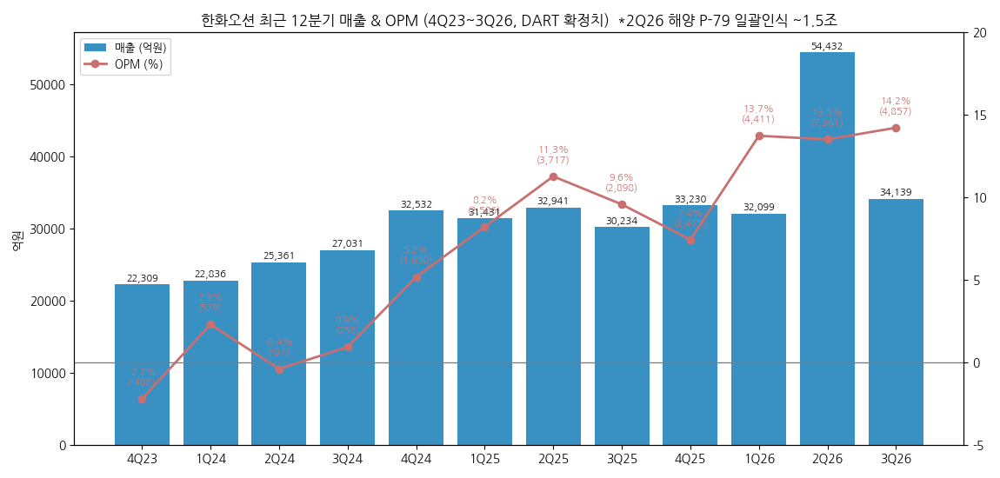

(4) 수주·수주잔고 시계열 (IR 실적발표·IR Presentation, 억$)

(4-1) 연간 신규수주

| 연도 | 전사 척/기 | 전사 금액 | 상선 척수 | 상선 금액 | 해양(EPU) | 특수선 및 기타 | 연간 수주목표 | 출처 |
|---|---|---|---|---|---|---|---|---|
| 2014 | 69 | 149.2 | 65 | 120.5 | 1기 26.9 | 3척 1.8 | - | IR 2019.06 p.8 |
| 2015 | 31 | 44.7 | 30 | 44.4 | - | 1척 0.3 | - | 〃 |
| 2016 | 11 | 15.4 | 9 | 11.1 | - | 2척 4.3 | - | 〃 |
| 2017 | 26 | 29.8 | 24 | 26.9 | - | 2척 2.8 | - | 〃 |
| 2018 | 49 | 68.1 | 41 | 57.3 | - | 8척 10.8 | 73.0 | IR 2018.05 p.9 / 2019.06 p.8 |
| 2019 | **미확보** | - | - | - | - | - | 83.7 | IR 2019.06 (1~5월 25.0억$) |
| 2020 | 35 | 56.4 | 31 | 54.1 | 0.4 | 4척 1.9 | - | IR 2022.05 p.8 |
| 2021 | 61 | 108.6 | 55 | 76.3 | 4기 22.7 | 2척 9.6 | - | 〃 |
| 2022 | 47 | 103.8 | 44 | 94.9 | 1기 5.6 | 2척 3.3 | 89.0 | 4Q23 p.17 (4Q22 IR 기준은 46척 104.8) |
| 2023 | 22 | 35.2 | 10 | 19.0 | - | 12척 16.2 | 69.7 | 4Q23 p.17 / 4Q22 IR p.7 |
| 2024 | 48 | 91.1 | 38 | 76.1 | 2 / 3.4 (EPU) | 8척 11.6 | - | 1Q26 IR (2025.1 4Q24 IR 기준 64척 89.8) |
| 2025 | 75 | 115.8 | 50 | 95.5 | 5 / 17.7 (EPU, 풍력 13.4 포함) | 5척 2.6 | - | 1Q26 IR (4Q25 IR 기준 72척 100.5) |
| 9M26 | 44 | 77.2 | 38 | 61.8 | 4 / 9.2 (EPU, WTIV 5.3 포함) | 2척 6.2 | - | 3Q26 IR p.17 |

→ 2024~2025는 2026.1Q부터 E&I(풍력·플랜트)를 EPU에 편입한 재작성 기준 (양수 이후 수주만 반영). 특수선 척수는 재작성 기준(4Q24 IR은 2024 21척, 4Q25 IR은 2025 19척 — 금액 동일). 상선 중 LNGC 수주: 2024 19척 47.2억$ → 2025 13척 32.6억$ → 9M26 8척 20.0억$ (탱커 18척 23.5억$로 이동). 2019 연간 수주실적은 19개 IR 자료 어디에도 없어 미확보

→ **수주 사이클**: 상선 수주 2014 120.5억$ (LNGC 37척) → 2016 11.1억$ (수주절벽, -91%) → 2021~2022 76~95억$ (LNGC 고선가 대량 수주) → 2023 19.0억$ (선별 수주) → 2025 95.5억$. 2~3년 lag로 2016 절벽 → 2019~2021 매출 감소, 2021~2022 수주 → 2024~2026 이익 정점과 대응

(4-2) 인도기준 수주잔고

| 시점 | 척/기 | 금액 (억$) | 상선 | 해양(EPU) | 특수선 및 기타 | 출처 |
|---|---|---|---|---|---|---|
| 2018.4말 | 96 | 227.6 | 74척 126.1 | 7기 63.8 | 15척 37.6 | IR 2018.05 |
| 2019.5말 | 101 | 216.6 | 76척 116.1 | 5기 50.9 | 20척 49.6 | IR 2019.06 |
| 2022.4말 | 129 | 274.1 | 103척 168.3 | 10기 50.1 | 16척 55.7 | IR 2022.05 |
| 2022.10말 | 143 | 315.3 | 119척 210.9 | 9기 48.8 | 15척 55.5 | 3Q22 IR |
| 2023.4말 | 135 | 303.4 | 113척 212.1 | 9기 48.3 | 13척 43.0 | 1Q23 IR |
| 2024.1말 | 124 | 281.6 | 99척 197.1 | 6기 34.4 | 19척 50.1 | 4Q23 IR |
| 2024.12말 | 132 | 310.3 | 109척 226.6 | 6기 30.1 | 18척 51.9 | 4Q24 IR |
| 2025.12말 | 147 | 321.8 | 126척 259.3 | 3기 10.0 | 18척 52.5 | 4Q25 IR |
| 2026.3말 | 159 | 348.6 | 127척 260.2 | 16 / 35.9 (EPU) | 16척 52.5 | 1Q26 IR (E&I 잔고 편입) |
| 2026.6말 | 153 | 337.7 | 125척 252.5 | 13 / 36.5 | 15척 48.7 | 2Q26 IR |
| **2026.9말** | **165** | **362.2** | **136척 268.3** | **12 / 39.1** | 17척 54.8 | 3Q26 IR |

→ 원화 매출잔량(연결, IR): 2019말 101,267억 (상선 60,720) → 2020말 86,405억 (상선 59,722) → **2021말 189,970억** (상선 132,800) → 2022.9말 307,320억 (상선 239,119) / DART 수주잔고: 2025말 34.5조 → **2026.9말 31.7조원**

→ 2020말 원화 잔량 8.6조가 2016~2017 수주절벽의 바닥 — 2021~2022 수주로 1년 만에 2.2배 회복

(5) 회사 연간 전망 이력 (IR 4Q 실적발표 '익년 전망', 정성 가이던스 — 수치 가이던스 미제시)

→ **2024 전망** (4Q23 IR): 상선 전사 매출 약 80%, 고선가 LNGC 연속건조로 "연간 흑자전환" / 특수선 잠수함·MRO 중심 매출 확대 / 해양 전사 매출 약 10% — **실적: 연간 OP 2,379억 흑자전환 (달성)**

→ **2025 전망** (4Q24 IR): 상선 전사 매출 60~70%, 컨테이너 적자호선 해소로 이익 확대 / 특수선 "연간 매출 1조원 이상" / 해양 "24년 수준 매출, 연간 흑자" — **실적: 상선 OPM 10.4%, 특수선 매출 12,840억 (달성), 해양 OP -108억 (흑자 미달)**

→ **2026 전망** (4Q25 IR): 상선 "전사 매출 70% 이상 유지, 고선가 기조로 소폭 증가", 손익 견조 / 특수선 "매출 소폭 증가", 해외 수주로 수익성 개선 기대 / EPU "고정비 부담으로 손익 악화 예상" — **9M26: 상선 OPM 19.5% (상회), 특수선 OP -942억 (하회), EPU OP +402억**

→ 수주목표: 2018 73억$ → 2019 83.7억$ → 2022 89억$ (실적 103.8억$, 초과) → 2023 69.7억$ (실적 35.2억$, 미달). 2024년 이후 IR에서 연간 수주목표 미제시

② 사업부별 개요 (매출 비중 큰 순서, 9M26 기준)

(1) 상선 — 매출 70% / 영업이익의 100% 이상

→ LNG운반선(174K CBM) 중심 + 컨테이너선(LNG DF 15~16.5K TEU, 22~24K TEU)·VLCC·VLGC/VLAC

→ 수주잔고 268.3억$ / 136척 (LNGC 55척 140.5억$, 컨테이너 29척 61.2억$, 탱커 41척 53.4억$, 암모니아/LPG 11척 13.0억$) — IR 3Q26 p.15

(2) EPU — 매출 22% (2Q26 P-79 일괄 인식 효과)

→ FPSO·FLNG·고정식 플랫폼·Drillship(용선 수익 포함)·WTIV·해상풍력·화공/발전 플랜트

→ 수주잔고 39.1억$ / 12기·건 (풍력 15.9억$, 플랜트 13.2억$, WTIV 5.3억$, FP 2.7억$)

(3) 특수선 — 매출 8%

→ 잠수함(장보고-Ⅲ Batch-Ⅰ·Ⅱ), 수상함(울산급 Batch-Ⅲ), 군수지원함, 해외 MRO

→ 수주잔고 54.8억$ / 17척 (특수선 및 기타)

③ 사업부별 디테일

(1) 상선 — 이익 엔진

(1-1) 고선가 물량의 매출 인식

→ 2024년 이후 수주한 고수익 프로젝트의 매출 비중 확대 + 원가절감 → 상선 OPM 2Q26 **22.7%** (19분기 최고), 3Q26 17.4% (조업일수 감소·환율 하락 영향) — IR 3Q26 p.8

→ Clarksons 기준 174K LNGC 선가 2023 265.0 → 2024 260.0 → 2025 248.0백만$ (DART 2025 '가격변동 추이') — 선가 정점 통과 신호는 2027~2028 매출에 반영될 변수

(1-2) 수주 흐름

→ 상선 수주 2024년 38척 76.1억$ → 2025년 50척 95.5억$ → 2026.9말 누계 38척 61.8억$ (VLCC·컨테이너 비중 확대, LNGC 8척 20.0억$로 둔화)

→ IR 2026 전망: "VLCC/컨테이너선 증가 등 P-Mix 변화에도 고선가 수주잔고 기반 매출 전년 대비 상승", 단 임단협 일시타결금·성과급 등 일회성 비용은 별도

(2) EPU — 변동성 원천

(2-1) 2Q26 P-79 일괄 인식

→ 2Q26 EPU 매출 20,579억 = 해양 프로젝트 매출 약 1.5조 일괄 반영 (회사 설명, 증권가는 P-79 FPSO 인도 관련 일회성으로 해석) → 연결 매출 +65.2% YoY

(2-2) 손익 구조

→ 3Q26 OPM 17.3% = FPSO Change Order 인식 + Drillship 용선 수익. 2026 전망은 "진행공사 인도·신규수주 순연에 따른 고정비 부담으로 손익 저조 예상, C/O·Incentive 협상으로 개선 추진" — IR 3Q26 p.10

(2-3) 역사적 손실 원천

→ 2015 해양 PJT 손실, 2021 Drillship 손상, 3Q22 해양 영업손실 -4,979억 — 해양은 한화오션 손익 저점의 반복 원인

(3) 특수선 — 기대 대비 실적 괴리

(3-1) 실적

→ 분기 매출 3,000억대 안정(3Q26 3,630억) 이나 OPM 1Q26 -6.5% → 3Q26 **-19.4%** — "고정비 부담 및 일부 프로젝트 예정원가 상승" (IR 3Q26 p.9)

(3-2) 파이프라인

→ 장보고-Ⅲ Batch-Ⅱ 2번함(2026 진수 예정)·3번함, 울산급 Batch-Ⅲ 5·6번함 공정 조기화, 장보고N(핵추진잠수함) 사업 공식화 대응, 미 해군 MRO

→ 해외: 캐나다 CPSP 탈락(2026.7), Hanwha Philly Shipyard 지분 처분 결정(2026.9) — 미국 현지 거점 전략의 그룹 내 재배치

④ 주요 경쟁사 (사업부별)

(1) 상선 (LNGC·컨테이너·VLCC)

→ 국내 — HD현대중공업·HD현대삼호·HD현대미포 (HD한국조선해양 계열), 삼성중공업

→ 해외 — 중국 CSSC 계열(후동중화·장난·다롄), 일본 이마바리·JMU

(2) 특수선 (잠수함·수상함)

→ 국내 — HD현대중공업 (장보고-Ⅱ·Ⅲ 일부 건조, IR 3Q26 p.24 국내 잠수함 실적표)

→ 해외 — 독일 TKMS (캐나다 CPSP 경쟁 승자), 프랑스 Naval Group, 스페인 Navantia, 미국 HII·General Dynamics

(3) EPU (FPSO·해상풍력·플랜트)

→ 국내 — 삼성중공업 (FLNG·FPSO), HD현대중공업 해양

→ 해외 — 싱가포르 Seatrium, 중국 COOEC·위슨, 일본 MODEC(FPSO 운영)

⑤ 주요 매출처

→ DART 2025 사업보고서: 매출 10% 이상 고객 **1곳, 13,857억 (10.8%)** — 고객명 비공시 / 2023년(제24기)은 10% 이상 고객 4곳 합계 34,373억(46.4%)

→ DART 3Q26 분기보고서: 9M26 매출 10% 이상 고객 **2곳, 28,154억 (23.3%)** — 고객명 비공시, 집중도 상승 원인 미검증

→ 선주명은 DART 의무 공시 대상이 아니어서 **고객별 순위 미확보** — 2023 4곳 46.4% → 2025 1곳 10.8% → 9M26 2곳 23.3%

→ **매출 지역 (DART 3Q26)**: 9M26 해양(선박·해양구조물·잠수함) 수출 106,380억 / 내수 19,241억 (2025 수출 113,993억 / 내수 19,743억) — 연결조정 전 기준 수출 비중 약 85%

→ **수주잔고 (DART)**: 2025말 상선 26.0조 + 해양 및 특수선 6.3조 + 플랜트 2.2조 = **34.5조원** → 2026.9말 **31.7조원** (해양 단일 부문, 수주총액 43.7조 - 기납품 12.0조) / **IR 2026.9말 인도기준 362.2억$**

⑥ 생산 CAPA + 임직원 추이

(1) 생산 설비 (IR 3Q26 p.27, DART 2025)

| 항목 | 내용 |
|---|---|
| 거제 사업장 면적 | 490만㎡ |
| 도크 | Dry Dock 2기 + Floating Dock 3기 + Heavy Zone 2기 |
| 연간 건조능력 | 선박 36척 / 특수선 잠수함 4척·수상함 2척(동시 건조) / 해양 2기 |
| 생산능력 상선 (천CGT) | 2023 1,970 → 2024 2,796 → 2025 2,655 |
| 상선(산동) (천CGT) | 2023 333 → 2024 336 → 2025 391 |
| 상선(에코텍) (톤) | 2023 80,310 → 2024 92,610 → 2025 67,513 |
| 해양 및 특수선 (천MH) | 2023 4,892 → 2024 6,334 → 2025 3,987 |

(2) 임직원 (DART 직원 현황, 기간제 포함)

| 연도말 | 직원 수 | 평균 근속 | 1인 평균급여 | 소속 외 근로자 |
|---|---|---|---|---|
| 2016 | 11,261 | - | - | - |
| 2017 | 10,226 | 17.6년 | 60백만원 | - |
| 2018 | 9,938 | 18.1년 | 70백만원 | - |
| 2019 | 9,767 | 18.5년 | 74백만원(남) | 18,904 |
| 2020 | 9,439 | 18.3년 | 72백만원 | 12,935 |
| 2021 | 8,802 | 19.0년 | 67백만원 | 12,351 |
| 2022 | 8,629 | 19.0년 | 73백만원 | 14,108 |
| 2023 | 8,892 | 18.5년 | 83백만원 | 18,788 |
| 2024 | 10,202 | 17년 | 89백만원 | 20,656 |
| 2025 | **11,178** | 15.9년 (남 16.6 / 여 6.0) | **97백만원** (남 99 / 여 69) | 17,804 |
| 2026.9 (IR) | 직영 11,036 | - | - | 외주 14,366 |

→ (출처: DART 사업보고서 'IX. 임원 및 직원 등에 관한 사항 – 직원 등 현황' 각 연도 원문 (2017은 2018.5 정정본). 2017~2024 v1.2 추가. 2025는 DART API 직원현황 — 정규직 9,865 + 기간제 1,313, 연간 급여총액 10,145억원)

→ IR 기재 총 인원(직영+협력사): 2018.4말 26,872명 / 2019.5말 26,209명 (직영 9,523·협력사 16,686) / 2022.10말 직영 8,404명 → 2026.9말 25,402명 (직영 11,036·외주 14,366)

→ 직원 수 2017 10,226 → **2021 8,802 → 2022 8,629 (저점)** — 산은 관리 하 인력 축소. 2022 → 2025 +2,549명(+30%) — 한화 편입 후 생산인력 재확충. 평균급여 2021 67 → 2025 97백만원(+45%)으로 인건비 단가 상승은 고정비 부담 요인

---

## 재무 구조

① 손익계산서 (12년 연결, 억원)

| 연도 | 매출 | 매출총이익 | 판관비 | 영업이익 | 당기순이익 | NI(지배) | GPM | CIR | OPM | NPM |
|---|---|---|---|---|---|---|---|---|---|---|
| 2014 | 155,616 | 1,300 | 6,951 | **-5,651** | -8,527 | -7,736 | 0.8% | 4.5% | **-3.6%** | -5.5% |
| 2015 | 154,436 | -15,756 | 5,489 | **-21,245** | -22,092 | -20,975 | -10.2% | 3.6% | **-13.8%** | -14.3% |
| 2016 | 128,192 | -6,303 | 9,005 | **-15,308** | -27,895 | -27,341 | -4.9% | 7.0% | **-11.9%** | -21.8% |
| 2017 | 111,018 | 15,441 | 8,111 | **7,330** | 6,458 | 6,215 | 13.9% | 7.3% | **6.6%** | 5.8% |
| 2018 | 96,444 | 7,517 | -2,732 | **10,248** | 3,201 | 3,447 | 7.8% | -2.8% | **10.6%** | 3.3% |
| 2019 | 83,587 | 4,690 | 1,762 | **2,928** | -465 | -465 | 5.6% | 2.1% | **3.5%** | -0.6% |
| 2020 | 70,302 | 3,959 | 2,425 | **1,534** | 866 | 866 | 5.6% | 3.4% | **2.2%** | 1.2% |
| 2021 | 44,866 | -15,471 | 2,075 | **-17,547** | -16,998 | -16,998 | -34.5% | 4.6% | **-39.1%** | -37.9% |
| 2022 | 48,602 | -13,469 | 2,667 | **-16,136** | -17,448 | -17,448 | -27.7% | 5.5% | **-33.2%** | -35.9% |
| 2023 | 74,083 | 988 | 2,953 | **-1,965** | 1,600 | 1,599 | 1.3% | 4.0% | **-2.7%** | 2.2% |
| 2024 | 107,760 | 6,839 | 4,460 | **2,379** | 5,282 | 5,281 | 6.3% | 4.1% | **2.2%** | 4.9% |
| 2025 | 127,835 | 18,403 | 6,727 | **11,676** | 12,459 | 12,458 | 14.4% | 5.3% | **9.1%** | 9.7% |

→ 판관비 = 매출총이익 - 영업이익 (대손상각비·대손충당금 환입 포함). **2018 판관비 -2,732억 = 대손충당금 환입**으로 OP > GP — 2018 OPM 10.6%는 일회성 포함 정점

→ 2023~2025 NI > OP — 이연법인세자산 인식(법인세수익 2023 2,763억·2024 3,472억·2025 4,036억) 효과. 2025말 이연법인세자산 9,500억 → 향후 법인세 비용 정상화 시 NPM 하락 가능


② 재무상태표 (12년 연결, 억원)

| 연도말 | 자산총계 | 부채총계 | 자본총계 | 부채비율 | 유동비율 | 현금성자산 | 총차입금 | 순차입금 | 계약자산 | 계약부채 | 이익잉여금(결손금) |
|---|---|---|---|---|---|---|---|---|---|---|---|
| 2014 | 177,358 | 157,090 | **20,268** | 775% | 89% | 1,388 | 76,328 | 74,941 | - | - | - |
| 2015 | 188,803 | 182,615 | **6,189** | 2,951% | 68% | 12,359 | 91,554 | 79,195 | - | - | - |
| 2016 | 150,648 | 144,055 | **6,594** | 2,185% | 65% | 2,243 | 66,305 | 64,063 | - | - | - |
| 2017 | 114,468 | 84,561 | **29,907** | 283% | 108% | 2,058 | 37,117 | 35,059 | - | - | -922 |
| 2018 | 119,185 | 80,783 | **38,402** | 210% | 137% | 3,512 | 31,811 | 28,299 | 43,724 | 18,713 | 6,470 |
| 2019 | 112,761 | 75,212 | **37,549** | 200% | 143% | 20,122 | 29,300 | 9,178 | 22,109 | 18,023 | 5,584 |
| 2020 | 103,208 | 64,518 | **38,690** | 167% | 115% | 13,436 | 26,922 | 13,486 | 21,759 | 12,457 | 6,753 |
| 2021 | 106,232 | 84,056 | **22,176** | 379% | 87% | 17,789 | 27,017 | 9,228 | 19,365 | 20,942 | -10,013 |
| 2022 | 122,357 | 114,907 | **7,450** | 1,542% | 73% | 6,597 | 26,872 | 20,275 | 25,661 | 46,816 | -27,007 |
| 2023 | 139,448 | 96,326 | **43,122** | 223% | 124% | 17,993 | 21,912 | 3,919 | 25,179 | 43,662 | -28,682 |
| 2024 | 178,438 | 129,805 | **48,633** | 267% | 109% | 5,883 | 52,659 | 46,776 | 49,866 | 43,153 | 2,364 |
| 2025 | 201,409 | 139,659 | **61,750** | 226% | 108% | 7,785 | 56,463 | 48,679 | 55,061 | 51,959 | 15,519 |
| 2Q26 | 201,462 | 126,180 | **75,282** | 168% | 121% | 14,462 | 60,375 | 45,913 | 58,998 | 37,480 | 27,037 |
| **3Q26** | **203,743** | **129,415** | **74,328** | **174%** | **118%** | **6,444** | **57,449** | **51,005** | **58,615** | **38,537** | **28,365** |

→ (출처: DART OpenAPI 연결 BS. 총차입금 = 단기차입금 + 유동성장기차입금·사채 + 사채 + 장기차입금 (2023~ '차입금 및 사채' 통합 계정). 2Q26 = 반기보고서, 3Q26 = 3Q26 분기보고서 (v1.2에서 IR 요약 BS → DART 확정치로 교체 — 자산·부채·자본·총차입금 동일, 현금은 IR이 단기금융상품 포함 6,690억이라 순차입금이 IR 50,760억 → DART 현금 기준 51,005억). 2014~2017 계약자산·부채는 K-IFRS 1115호 도입(2018) 전 계정이라 미기재)

→ 3Q26 계약부채 38,537억 — 2025말 51,959억 대비 -13,422억 (대부분 1Q26 50,107억 → 2Q26 37,480억 구간에서 감소), 계약자산 58,615억 (+3,554억). 계약자산 > 계약부채 격차 2.0조 = 헤비테일 인도 대금 미수 구조

→ **자본 변천**: 2014 20,268억 → **2015 6,189억 (부채비율 2,951%, 자본잠식 직전)** → 2017 출자전환 29,907억 → 2021~2022 손실로 **7,450억 (부채비율 1,542%)** → 2023 한화 증자 43,122억 → 3Q26 74,328억

→ **신종자본증권 2조 3,328억** (자본 계정, 산업은행 보유 영구전환사채 8·9·10회차, 만기 2046~2048, 전환가 40,350원) — 자본의 31%가 영구채. 신종자본증권 이자 연 233억 지급

→ 이익잉여금: 2023말 -28,682억(결손) → 2024 +2,364억 → 2025 **+15,519억** — 배당가능이익 확보 (DART 2025 '최근 2개 사업연도 연속 흑자로 배당가능이익 확보' 기재)

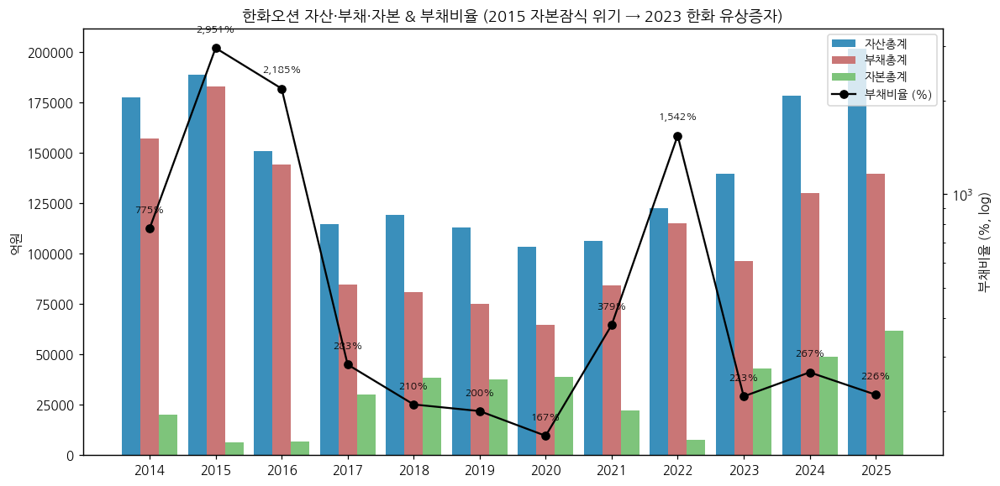

③ 현금흐름표 (12년 연결, 억원)

| 연도 | OCF | ICF | CFF | 유형 CapEx | 무형 CapEx | FCF | 배당 지급 |
|---|---|---|---|---|---|---|---|
| 2014 | -5,602 | -1,992 | 5,207 | 3,916 | 238 | **-9,756** | 574 |
| 2015 | -8,430 | 1,721 | 17,729 | 1,820 | 139 | **-10,389** | 291 |
| 2016 | -5,310 | -2,827 | -2,009 | 1,198 | 64 | **-6,573** | 0 |
| 2017 | -10,199 | 227 | 9,879 | 1,088 | 76 | **-11,363** | 0 |
| 2018 | 7,251 | -132 | -5,659 | 1,481 | 44 | **5,727** | 0 |
| 2019 | 25,421 | -4,845 | -3,951 | 1,552 | 18 | **23,851** | 0 |
| 2020 | -4,585 | 1,378 | -3,081 | 1,899 | (합산) | **-6,483** | 0 |
| 2021 | 4,858 | 1,013 | -1,570 | 1,003 | (합산) | **3,855** | 0 |
| 2022 | -10,654 | 880 | -1,298 | 1,219 | (합산) | **-11,873** | 0 |
| 2023 | -19,392 | 1,967 | 28,852 | 1,307 | 33 | **-20,732** | 0 |
| 2024 | -29,046 | -11,101 | 28,030 | 3,736 | 57 | **-32,840** | 0 |
| 2025 | 13,147 | -14,489 | 3,298 | 7,096 | 70 | **5,980** | 0 |
| 9M25 | 5,077 | -5,845 | -779 | 3,917 | 55 | 1,105 | 0 |
| **9M26** | **6,724** | **-9,773** | **1,775** | **5,381** | **41** | **1,302** | 0 |

→ (출처: DART OpenAPI 연결 CF. 2020~2022 '유ㆍ무형자산의 취득' 단일 계정. FCF = OCF - 유·무형 CapEx. 9M26 = 3Q26 분기보고서 누적, v1.2 추가)

→ 9M26: OCF 1H26 +10,402억 → 3Q26 단독 -3,678억 (9M 누적 6,724억). ICF -9,773억 중 관계기업·공동기업 투자 취득 3,975억 + 유형 CapEx 5,381억. CFF +1,775억 (사채 3,382억·단기차입 5,770억 차입, 단기차입 6,415억·사채 1,280억 상환, 신종자본증권 이자 175억, 자기주식 취득 51억)

→ **12년 누적 FCF -7.1조** — 헤비테일(인도 시 대금 집중) 계약 구조로 OCF가 건조량 증가기(2023~2024)에 대규모 마이너스. 2023~2024 OCF -4.8조를 유상증자 3.5조 + 차입으로 조달

→ 2025 OCF **+13,147억** 흑전 — 고선가 LNGC 인도 대금 유입 시작. 2025 ICF -14,489억 중 관계기업 투자 7,560억 (HOS·Philly·NextDecade 등) + 유형 CapEx 7,096억

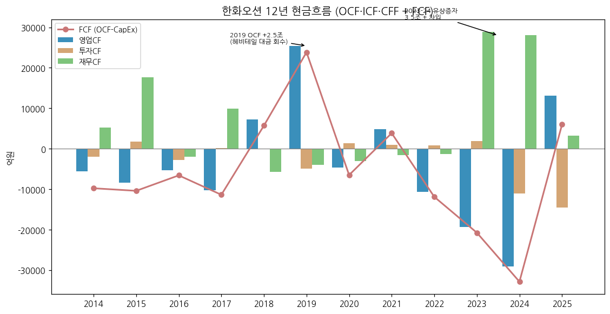

④ CapEx (12년)

→ 2014 4,154억 → 2016~2023 연 1,000~1,900억 (산은 관리 하 투자 최소화) → **2024 3,793억 → 2025 7,166억** (한화 편입 후 도크·설비·스마트야드 투자 재개)

→ CapEx/매출 2017~2023 평균 약 2% → 2025 5.6%

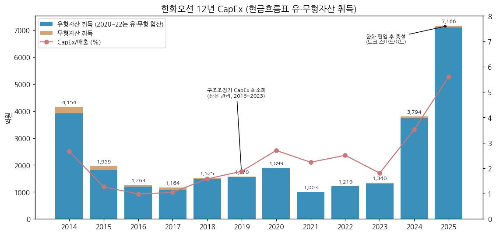

⑤ 부채구조 + 채무증권 발행

(1) 차입 구조

→ 총차입금 2015 **9.2조**(정점) → 2023 2.2조(증자 상환) → 2025 5.6조 → 3Q26 5.7조 (단기 33,191억 + 장기 24,258억, DART) / 순차입금 3Q26 **51,005억** (DART 현금 기준, 순차입금/자본 69%) — IR 기준(단기금융상품 포함) 50,760억, 68%

→ 9M26 이자 지급 1,779억 → 이자보상배율(OP/이자지급) **9.3x** (2025 6.8x)

→ 2025 재무활동: 단기차입 6,806억 차입·12,700억 상환, 장기차입 4,362억, 사채 2,809억 발행, 공급자금융약정 3,513억 차입

(2) 신용등급 history (DART)

→ 2018 회사채 CCC (NICE·한기평), 기업신용 BB~BB+ → 2019.7 기업신용 BBB- → 2024.11~2025.7 회사채 **BBB+** → **2025.11 A- / CP A2-** (NICE·한국기업평가 동시 상향)

(3) 지분증권 발행 history

| 일자 | 형태 | 주식수 | 발행가 | 대상 |
|---|---|---|---|---|
| 2016.12.29 | 영구전환사채 8회차 | (전환가능 24,783,147주) | 1조원 | 산업은행 |
| 2017.06.28 | 영구전환사채 9회차 | (전환가능 31,840,768주) | 1조 2,848억 | 산업은행 |
| 2018.03.14 | 영구전환사채 10회차 | (전환가능 1,191,010주) | 481억 | 산업은행 |
| 2023.05.24 | 제3자배정 유상증자 | 104,438,643주 | 19,150원 | 한화에어로스페이스 외 4개사 |
| 2023.06.02 | 제3자배정 유상증자 | 5,144,087주 | 27,467원 | 한국수출입은행 (채권 상계) |
| 2023.11.17 | 주주배정 유상증자 | 89,485,500주 | 16,730원 | 우리사주·구주주·일반 |
| 2024.07.11 | 제3자배정 유상증자 | 54,495주 | 40,350원 | 회사채투자자 (채권 상계) |

→ (출처: DART 2025 사업보고서 III-7 '증권의 발행을 통한 자금조달')

⑥ 배당·자사주

→ 현금흐름표 배당 지급: 2014 574억 / 2015 291억 → **2016~2025 10년 연속 무배당** (DART 2025 '배당에 관한 사항': 2023~2025 현금배당 '-', 연결 EPS 2023 736원 → 2024 1,648원 → 2025 4,007원)

→ 자기주식: 2025말 16,207주 (기타취득, 기초=기말 — 배당가능이익 내 직접·신탁 취득 이력 없음). 단 2026 CF에 '자기주식의 취득' 51억 (1Q26 49억·2Q26 누계 51억) 기재 — 취득 목적·주식수는 미확인

→ 2025 사업보고서: "별도 배당 목표 없음, 중장기적으로 배당 포함 주주환원 정책 검토" / 2025.3 주총에서 배당기준일 이사회 결정 정관 변경 완료

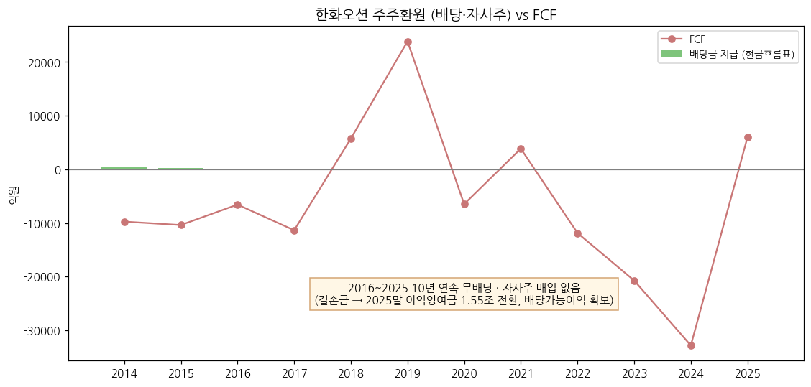

⑦ 재무비율 (12년 연결)

| 연도 | ROE(지배) | ROA | 부채비율 | 유동비율 | 이자보상배율(OP/이자지급) | 순차입금/자본 |
|---|---|---|---|---|---|---|
| 2014 | -38.2% | -4.8% | 775% | 89% | -2.4x | 370% |
| 2015 | n.m. | -12.1% | 2,951% | 68% | -8.5x | 1,280% |
| 2016 | n.m. | -16.4% | 2,185% | 65% | -5.8x | 972% |
| 2017 | 34.1% | 4.9% | 283% | 108% | 4.5x | 117% |
| 2018 | 10.1% | 2.7% | 210% | 137% | 9.2x | 74% |
| 2019 | -1.2% | -0.4% | 200% | 143% | 2.8x | 24% |
| 2020 | 2.3% | 0.8% | 167% | 115% | 1.9x | 35% |
| 2021 | -55.9% | -16.2% | 379% | 87% | -28.0x | 42% |
| 2022 | -117.8% | -15.3% | 1,542% | 73% | -20.9x | 272% |
| 2023 | 6.3% | 1.2% | 223% | 124% | -1.4x | 9% |
| 2024 | 11.5% | 3.3% | 267% | 109% | 1.5x | 96% |
| 2025 | **22.6%** | **6.6%** | **226%** | **108%** | **6.8x** | **79%** |
| 9M26 (3Q26말) | - | - | 174% | 118% | 9.3x | 69% |

→ ROE·ROA = 평균 자본·자산 기준, 이자보상배율 = 영업이익 / 현금흐름표 이자 지급액. 2015·2016 ROE는 자본잠식 직전 분모로 n.m.

---

## 지배 구조

① 그룹·계열 관계

→ **한화그룹** 계열 (공정거래법상 기업집단 '한화', 2025말 국내 계열 119개사 — 상장 12 / 비상장 107)

→ 지배 경로: ㈜한화 (최상위 지배기업) → 한화에어로스페이스 (차상위 지배기업, 최대주주 30.44%) + 한화시스템 (7.24%) → 한화오션. 한화에어로스페이스는 지분율 30.44%이나 "주주간 약정에 따라 과반수 이사 선임 권리 보유 → 실질 지배력"으로 지배기업 분류, 한국산업은행은 '유의적 영향력 행사 기업' (DART 3Q26 분기보고서 특수관계자 주석). ㈜한화 → 한화에어로스페이스 간 지분율 수치는 여전히 미검증

→ 그룹 내 조선·방산 밸류체인: 한화에어로스페이스(지상방산·엔진), 한화시스템(함정 전투체계), 한화엔진(선박엔진, 2024.4 그룹 편입 — 원재료 공급처), Hanwha Philly Shipyard(한화시스템 60%), Hanwha Offshore Singapore(한화에어로 73%·한화오션 27%)

② 주주 구분

| 주주 | 주식수 (2026.6말) | 지분율 | 비고 |
|---|---|---|---|
| **한화에어로스페이스(주)** (최대주주) | 93,277,036 | **30.44%** | 2025.3 계열 지분 통합 매입 |
| 한화시스템(주) (특수관계인) | 22,169,660 | 7.24% | 2026.4 13,281,250주 PRS 매도 (11.57% → 7.24%) |
| **최대주주·특수관계인 계** | 115,446,696 | **37.68%** | 2023.5 편입 당시 49.33% |
| 한국산업은행 | 46,738,211 | 15.25% | + 영구전환사채 2.33조 (전환 시 57.8백만주) |
| 국민연금 | 20,553,796 | 6.71% | 2025말 6.37% |
| 우리사주조합 | 802,143 | 0.26% | |
| 외국인 (IR 2026.9말) | - | 9.9% | IR 3Q26 p.27 |
| 개인 및 기타 (IR 2026.9말) | - | 30.8% | |
| **발행주식총수** | **306,413,394** | 100% | |

→ (출처: DART 2026 반기보고서 VII. 주주에 관한 사항 / IR 3Q26 p.27 '주주현황 2026년 9월말 기준')

→ 최대주주 측 지분 변동: 2023.5 49.33% (한화에어로·한화시스템·Hanwha Impact Partners·한화컨버전스·Hanwha Energy Singapore 5개사) → 2025.3 한화에어로로 22,375,216주 통합 → 2025.9 Hanwha Impact Partners 13,075,691주 매도 → 2025말 42.01% → 2026.4 한화시스템 PRS 매도 → **37.68%**

→ 소액주주 670,774명, 소액주주 지분 37.57% (2025말)

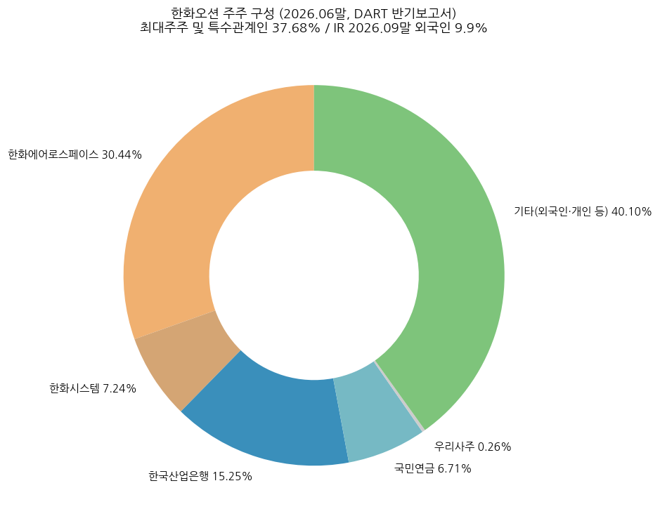

③ 임원·이사회 (DART 2025 사업보고서 VIII, 2025.12.31 기준)

(1) 등기임원 (8명: 사내 2 + 기타비상무 1 + 사외 5)

| 성명 | 직위 | 출생 | 주요 경력 | 임기만료 |
|---|---|---|---|---|
| **김희철** | 대표이사 (사내이사) | 1964.10 | Washington Univ. in St. Louis MBA, 서울대 화학공학 학·석사 / 전 한화에너지·한화임팩트·한화솔루션 큐셀부문·한화토탈·한화종합화학 대표이사 | 2026.03.19* |
| **Philippe Levy** | 사장 (사내이사, President of EPU) | 1968.05 | 전 SBM Offshore President Americas·Group BD Director, CNOOC/Exxon / 현 Hanwha Drilling·Hanwha Ocean Global Operation Center | 2027.03.31 |
| **김동관** | 기타비상무이사 | 1983.10 | Harvard 정치학 / 현 ㈜한화·한화에어로스페이스·한화솔루션·한화임팩트 대표이사 | 2027.03.31 |
| 안완기 | 사외이사 | 1964.03 | 전 한국생산성본부 회장, 한국가스공사 부사장 | 2027.03.31 |
| 김봉환 | 사외이사 (감사위원장·보상위원장·사추위원장) | 1969.06 | 서울대 행정대학원 교수, Washington Univ. 회계학 박사 | 2027.03.31 |
| 조지 P. 부시 | 사외이사 | 1976.04 | 전 Texas Land Commissioner, Michael Best & Friedrich LLP Partner | 2027.03.31 |
| 현낙희 | 사외이사 (ESG위원장) | 1980.01 | 성균관대 법학전문대학원 부교수, 전 대법원 재판연구관 | 2027.03.31 |
| 최훈 | 사외이사 | 1968.12 | 전 주 싱가포르 대사, 금융위원회 상임위원 | 2027.03.31 |

→ *김희철 대표 임기는 2025말 기준 2026.3.19 만료 → **2026.3.19 제26기 정기주총에서 사내이사 재선임, 임기 2029.3.31** (DART 2026 반기보고서 '경영진의 중요한 변동'·임원 현황, v1.2 확인)

→ **2026.3.19 주총 이사회 변동** (DART 2026 반기보고서): 독립이사 **김영삼** (1964.12, 전 산업통상자원부 무역투자실장·한국전자기술연구원 원장, 현 케이이아이씨 대표 — 내부거래위원장) · **이효진** (1975.08, 성균관대 법학전문대학원 부교수, 전 검사 — ESG위원장) 신규 선임 / 안완기·현낙희 임기만료 퇴임. 정관 변경으로 신규 선임 이사 임기 3년. 등기이사 수 8명·사외(독립) 5명 구성 유지

→ 이사회 사외이사 비중 5/8 = 62.5%, 미국 정계 출신(조지 P. 부시) 사외이사 — 미국 조선·방산 협력 대응 포석

(2) 주요 미등기임원

→ **어성철** 사장 (특수선사업부장, 전 한화시스템 대표이사)

→ **정인섭** 사장 (경영지원실장, 전 한화에너지 대표이사)

→ **손영창** 부사장 (제품전략기술원장 겸 상선/해양개발담당, 전 한화파워시스템 대표)

→ **이길섭** 부사장 (AX사업부장, 전 한화오션 제조총괄)

→ **정승균** 부사장 (특수선해외사업단장)

→ **유동완** 부사장 (HR실 산하, 전 한화시스템 Air Space사업부문장)

(3) 경영진 변동 (DART 2025 연혁)

→ 2019.3.29 대표이사 이성근 취임 (IR 2019.06) → 2022 대표이사 박두선 (IR 2022.11) → 2023.5.23 한화 편입 임시주총: 대표이사 박두선 → **권혁웅**, 기타비상무이사 김동관 선임 → 2024.10.18 권혁웅 사임, **김희철** 선임 → 2025.3.20 Philippe Levy 사내이사 선임 → **2026.3.19 김희철 재선임**, 독립이사 김영삼·이효진 선임

---

## 기타 팩트

① R&D 인프라

| 연도 | 연구개발비용 계 (억원) | R&D/매출 |
|---|---|---|
| 2014 | 917 | 0.6% |
| 2015 | 798 | 0.5% |
| 2016 | 604 | 0.5% |
| 2017 | 467 | 0.4% |
| 2018 | 650 | 0.7% |
| 2019 | 675 | 0.8% |
| 2020 | 722 | 1.0% |
| 2021 | 723 | 1.6% |
| 2022 | 745 | 1.5% |
| 2023 | 762 | 1.0% |
| 2024 | 666 | 0.6% |
| 2025 | **738** | **0.6%** |

→ (출처: DART 사업보고서 '연구개발비용' — 2016(2014~2016)·2019(2017~2019)·2022(2020~2022)·2025(2023~2025). 2014~2016 R&D/매출 비율은 DART 기재값, 그 외는 연결 매출 대비 재계산)

→ **조직**: 제품전략기술원 (거제·시흥·서울 — 기본성능연구센터, 에너지솔루션연구센터(CCS·CHS·추진시스템), 제조혁신연구센터(용접·도장), 기술지원개발센터, 공정개발팀) + 특수선사업부 방산기술연구센터 (함정성능·함정체계)

→ 시흥 R&D캠퍼스 (경기 시흥시 배곧2로 96)

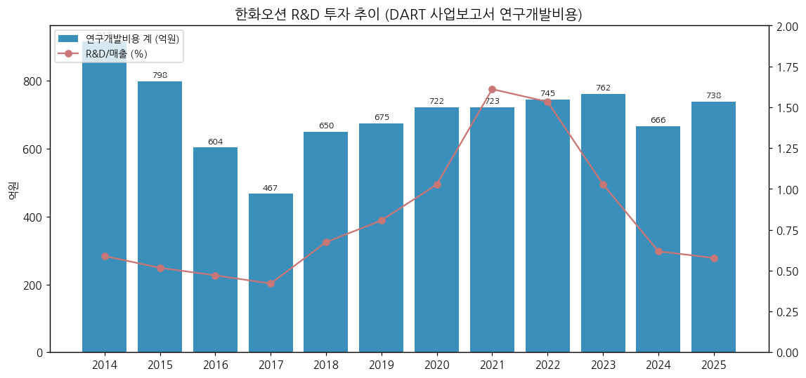

② 진행 중 corporate action (10년)

→ 2015~2017 산은·수은 채권단 지원 (2015 4.2조 + 2017 2.9조) + 출자전환·영구전환사채 2.33조

→ 2019.3~2022.1 현대중공업 인수 → EU 불허로 무산

→ 2023.5 한화그룹 편입 (2조 제3자배정) + 2023.11 1.5조 주주배정 증자

→ 2023.10 보증사업 한화파워시스템에 영업양도(25억) / 2024.11 스마트십·자율운항 분야 한화에어로스페이스에 영업양도(59억)

→ 2024.7 ㈜한화 플랜트(2,144억)·2024.12 풍력(1,881억) 영업양수 → E&I → 2026 EPU 편입

→ 2024 해외 투자: NextDecade 6.6%(1,803억, Rio Grande LNG — LNGC 20척+ 신조 수요 연계), Hanwha Philly Shipyard 40%(574억), Dyna-Mac/HOS 27%(약 2,350억)

→ 2024.12.1 한화오션디지털 흡수합병 / 2025.3 그룹 업무용 항공기 지분 양수(103.2억)

→ **2026.9.18 Hanwha Philly Shipyard 지분 전량 처분 결정** (신사업 유동성 확보 목적, 10월말 예정 — 종결 여부 미검증. DART 3Q26 분기보고서상 2026.9말 관계기업 지분율 40.0% 유지, 지분법 적용 중지 상태 — 9말 이후 종결 여부는 2026 사업보고서로 확인 필요)

③ R&D 마일스톤 (DART 연구개발실적 최근 3개년 과제 기준)

→ 극저온 화물창·연료탱크 및 탈탄소 선박 기술 (LNG·암모니아 추진)

→ 가스선 연료추진시스템·재액화/재기화시스템

→ 용접 자동화·신소재/신공법 — 스마트야드·로봇 자동화 (IR 'AI Transformation': Digital Twin, 차세대 CAD)

→ 천연가스 액화 공정 (FLNG Total Solution)

→ 함정 통합생존성·스마트 함정 핵심체계 국산화

→ 연도별 개별 특허·인증 마일스톤은 **미확보**

④ 주요 리스크

(1) 소송·우발부채 (DART 2025 연결 주석 36)

→ **피고(피소)**: 손해배상 등 43건 소송금액 1,278억원 (분식회계 재무제표를 신뢰해 손해를 입었다는 투자자 손해배상청구 포함) + 중재 5건 USD 878.5백만

→ **원고(제소)**: 손해배상 등 23건 5,772억원, 계약금액 정산·추가 공사원가 2건 499억원, 특허 1건 EUR 123.29백만

→ 피고 소송·이행보증 등 예상손실 최선의 추정치 **1,274억원을 충당부채로 계상**

(2) 환율

→ 외화 계약(USD) 구조 — 3Q26 영업이익 4,857억이 컨센(FnGuide 5,415억)을 10.3% 하회한 주요인이 원/달러 환율 하락 (언론 보도, 2026.10)

(3) 노무·고정비

→ 2022 하청노조 51일 파업(3Q22 손실 확대), 2026 임단협 일시타결금·성과급 일회성 비용 (IR 3Q26 상선 전망 각주), 직원 1인 평균급여 2022 73백만 → 2025 97백만원

(4) 프로젝트 원가

→ 해양(EPU)·특수선 예정원가 상승 재발 리스크 — 3Q26 특수선 OPM -19.4%, 2015·2021 손실 사례

(5) 수주·정책

→ 캐나다 CPSP 탈락(2026.7), LNGC 대량 인도 예정(선대의 약 33%, 281척 — IR 3Q26 p.12)에 따른 LNGC 발주 둔화, IMO 탄소 규제(GFI) 채택 1년 연기(2026.12 MEPC 결정 예정)

(6) 희석·지분 매각 overhang

→ 산은 영구전환사채 전환 가능 57.8백만주(18.9%), 산은 보통주 15.25%, 한화시스템 PRS 매도분(13.3백만주)

⑤ ESG 등급

→ **미확보** (KCGS·MSCI 등급 미조회 — 잔여 보완 후보)

→ 이사회 내 ESG위원회 운영 (위원장 현낙희 사외이사 → 2026.3~ 이효진 독립이사)

⑥ 인증·라이선스

→ 방산 함정 건조 (국내 잠수함 장보고-Ⅰ·Ⅱ·Ⅲ 건조 실적, 해외 수출: 인도네시아 잠수함 3+(3)척, 영국 군수지원함 4척, 노르웨이 군수지원함, 태국 호위함, 방글라데시 호위함 등 — IR 3Q26 p.24)

→ 선급·방산 인증 개별 목록은 **미확보**

---

## Version Log

**v1.2 (2026-11-14)** — 3Q26 확정치 반영 + 미확보 항목 보강

→ **3Q26 잠정 → 확정**: DART 3Q26 분기보고서 (rcept 20261111000263) 연결 손익 매출 34,139억 / OP 4,857억 / NI 1,451억 — 2026-10-27 IR 잠정치와 **차이 0**. 'IR 잠정' 표기를 Summary Box·12년 표·47분기 표·연혁·차트(chart10·chart13 제목)에서 확정으로 교체

→ **3Q26 BS·CF 채움 (DART)**: 재무상태표 3Q26 행을 IR 요약 → DART 확정 (자산·부채·자본·총차입금 동일, 현금 6,690*→6,444억, 순차입금 50,760→51,005억, 계약자산 58,615·계약부채 38,537·이익잉여금 28,365억 신규). 2Q26 행도 반기보고서 값으로 교체 (현금 14,717*→14,462억, 순차입금 45,658→45,913억, 계약자산·부채·이익잉여금 신규). 현금흐름표 9M25·9M26 행 신규 (9M26 OCF 6,724 / CapEx 5,422 / FCF 1,302억), 재무비율 9M26 행, 이자보상배율 9.3x

→ **사업부별 분기 1Q17~4Q21 (20분기) 채움**: DART 분기·반기·사업보고서 원문 부문정보 (dart_download_reports로 정기보고서 57건 원문 확보) — 상선 / 해양및특수선 매출·매출총이익. 단 DART가 영업손익을 부문 분리하지 않아 **영업이익 대신 GP** 기준. IR PDF 19건은 2019.06 이전 분기 사업부 표가 없어 사업부 분기 보강에는 사용 불가 (IR은 수주·잔고·가이던스로 활용)

→ **수주·수주잔고 시계열 신설** (비즈니스 모델 ①(4)): IR 2018.05·2019.06·2022.05·2Q22·3Q22·4Q22·1Q23·4Q23~3Q26 — 연간 신규수주 2014~2018·2020~9M26, 인도기준 잔고 11개 시점 (2018.4 227.6억$ → 2026.9 362.2억$), 원화 매출잔량 2019~2022.9, 연간 수주목표 (2018·2019·2022·2023)

→ **가이던스 이력 신설** (①(5)): 4Q23·4Q24·4Q25 IR '익년 전망' (정성) vs 실적 대조

→ **지배구조·임원**: 김희철 대표 2026.3.19 재선임 (임기 2029.3.31), 독립이사 김영삼·이효진 신규·안완기·현낙희 퇴임 (DART 2026 반기보고서 원문), 한화에어로 '실질 지배력' 분류 근거, 역대 대표이사(이성근·박두선) / 자기주식 16,207주, 2025 무배당·EPS 확인 (DART 2025 API) / 2026 CF 자기주식 취득 51억 기재

→ **임직원**: 2017·2018·2020·2021·2023·2024 직원 수·평균근속·평균급여·소속외 근로자 (DART 사업보고서 원문), 2025 정규/기간제·성별 분해, IR 총인원 (2018.4·2019.5·2022.10)

→ **기타**: 9M26 매출 10% 이상 고객 2곳 23.3%, 수출/내수 매출, DART 원화 수주잔고 31.7조 (3Q26), Philly Shipyard 9말 지분 40% 유지 확인

→ **수치 변경 요약**: 손익 수치 변경 없음 (잠정=확정). 변경은 2Q26·3Q26 현금·순차입금 (IR 단기금융상품 포함 → DART 현금성자산 기준) 뿐. 2022 수주는 4Q23 IR 재작성치(47척 103.8억$)를, 2024·2025 수주는 1Q26 IR EPU 재작성치(48척 91.1억$ / 75척 115.8억$)를 사용

→ 차트 재생성: chart10 (12분기), chart13 (47분기) — 제목 '잠정' → 'DART 확정치'. 그 외 차트는 데이터 변경 없음

잔여 보완 후보 (v1.2 갱신)

→ 2006~2013 연간 손익 — DART 원문에 2008~2013 [기재정정] 사업보고서(2017.5 분식 정정본) 확보됨, 다음 버전에서 파싱 가능

→ 1Q15~4Q16 사업부별 분기 (원 보고서가 분식 정정 전 값이라 정정 후 총액과 불일치), 1Q17~4Q21 사업부별 **영업이익** (DART 부문 OP 비분리)

→ 2019 연간 신규수주 실적, 2020~2021 연말 인도기준 수주잔고 (억$)

→ 2026.9 주가 급락 원인 검증, 시가총액·주가 갱신 (v1.2 미갱신, 2026-11-03 기준 유지), 일별 ATH 검증

→ HD현대중공업·삼성중공업 FY25 확정 OPM 피어 비교 교체

→ ㈜한화 → 한화에어로스페이스 지분율, Philly Shipyard 처분 종결 여부 (2026 사업보고서), 2026 자기주식 취득 51억의 목적·주식수

→ ESG 등급(KCGS·MSCI), 선급·방산 인증 목록, 연도별 R&D 마일스톤

→ 주요 매출처(선주) 실명 — DART 비공시로 증권사 자료 필요

→ 2016말 이전 직원 평균근속·급여, 2019·2022 외 연도 남녀 분해

**v1.1 (2026-11-03)** — OpenDART `dart_financials` 검증

→ 연결 연간 12개년 (2014~2025) 손익·재무상태·OCF와 분기 매출·OP 84건을 신규 재무 API (연결) 값과 대조 → 전 항목 일치, 수치 변경 없음

→ 3Q26은 여전히 잠정실적 기준 — DART 3Q26 분기보고서 미제출 (기한 11/16)

v1.0 (2026-11-03)

→ 신규 작성 — v4.8 6개 섹션 + 1번 섹션 표준 5요소 (Summary Box 6지표, 손익 history book annotation, 분류 sub-logic 4단계, 밸류에이션 다이얼 + 삼성전자 비교, 분류 변경 트리거)

→ 데이터: DART OpenAPI 연결 재무 12년(2014~2025) + 전사 47분기(1Q15~3Q26) + IR 사업부별 19분기(1Q22~3Q26) + Yahoo 20년 시가총액. 사용자 제공 연간 12년 값과 DART 전 항목 일치 확인

→ 차트 PNG 16개: 표준 12종(chart1·1b·2 상선/특수선/해양EPU·4·5·6·7·8·9·10·11·12) + 보조 chart3(부문별 연간 매출)·chart13(47분기 전사 시계열)

→ 기준 시점: 3Q26 잠정실적(2026-10-27). DART 3Q26 분기보고서 공시(11월 중순) 후 3Q26 BS·CF 상세 및 사업부 확정치 반영 필요

잔여 보완 후보

→ 2006~2013 연간 손익 (사용자 화면 값 미제공 + DART API 범위 밖) — 1차 조선 슈퍼사이클(2007~2008) 정점 OPM을 Summary Box에 반영하려면 필요

→ 1Q15~4Q21 사업부별 분기 매출·영업이익 (DART 분기보고서 부문정보 주석 파싱)

→ 2026.9 주가 급락(9월말 50,000원) 원인 검증, 시가총액 일별 ATH 검증 (현재는 월말 종가 기준 2026-01 43.3조)

→ HD현대중공업·삼성중공업 FY25 확정 OPM으로 피어 비교 교체 (동시 작성 중인 두 기업개요와 정합)

→ ㈜한화 → 한화에어로스페이스 지분율 등 그룹 지배구조 수치, 김희철 대표 2026.3 재선임 여부, Philly Shipyard 지분 처분 종결 여부

→ ESG 등급(KCGS·MSCI), 선급·방산 인증 목록, 연도별 R&D 마일스톤

→ 주요 매출처(선주) 실명 — DART 비공시로 증권사 자료 필요

→ 2016말 이전 직원 평균근속·급여, 2017~2018·2020~2021 직원 수

→ 3Q26 DART 분기보고서 공시 후 3Q26 현금흐름·계약자산/부채·사업부 확정치 업데이트 (v1.1)
