# 현대건설 — 기업 개요 (v1.0)

> 마지막 update: 2026-11-03 (3Q26 잠정실적 IR 2026-10-30 반영)
> 입력 source: OpenDART fnlttSinglAcntAll (연결·별도, 2014~2Q26, 86개 JSON) + DART 정기공시 원문 XML 45건 (사업보고서 2013~2025, 분기·반기 1Q16~2Q26) + 현대건설 IR (1Q22·2Q25·3Q25·FY25·1Q26·2Q26·3Q26 실적자료, 기업가치제고 이행현황 2025-12) + hdec.kr 투자정보 + Yahoo Finance (000720.KS, 2000~2026-11-03) + 증권사 리포트 13건 (iM·하나·하이·신한·교보·현대차·IBK 등)
> 갱신 주기: 매분기 (실적 리뷰 모드 호출 시)
> 워치리스트: 원전 섹터 (T2) / 서브섹터: 원전 시공 (EPC)
> **Fact verify cutoff**: 2026-11-03 (주가·시총·지분율·컨센서스 = 2026-11-02~03 조회값. 3Q26은 잠정치, 분기보고서 제출 전)

---

## 1. 기업 분류

- **Primary 분류: 사이클** (Cyclical — 수주·원가율 사이클, 저마진 EPC)
- **Secondary 노트: 꿈(원전 EPC 옵션) 일부 섞임** — 2025~2026 주가는 실적이 아니라 대형원전·SMR 수주 기대로 움직임

### ① 정량 근거

**📊 Summary Box (12년, 2014~2025 연결):**

| 지표 | 값 |
|------|-----|
| 매출 CAGR (2014→2025, 11년) | **+5.5%** (17.3조 → 31.1조) |
| OPM 평균 | **3.6%** (2024 제외 시 4.3%) |
| OPM 정점 평균 | **5.2%** (2016 6.2% · 2021 4.2%) |
| OPM 저점 평균 | **-0.3%** (2020 3.2% · 2024 -3.9%) |
| 사이클 주기 | 약 4~5년 (peak-to-peak 2016→2021) |
| 사이클 회수 (12년) | 정점 2회 / 저점 2회 |

```
[전사 OPM 시계열 (12년, 연결, DART)]
연도   매출(조)  영업이익  순이익   OPM    NPM
2014     17.3     0.83     0.48    4.8    2.8   ← 현대엔지니어링·현대엠코 합병(2014-04) 후 외형 확대
2015     19.2     1.09     0.66    5.7    3.5
2016     18.8     1.16     0.73    6.2    3.9   ← OPM 정점 (영업이익 1조 클럽 2년차)
2017     16.9     0.99     0.37    5.8    2.2   ← 해외 매출 감소 국면 진입
2018     16.7     0.84     0.54    5.0    3.2
2019     17.3     0.86     0.57    5.0    3.3
2020     17.0     0.55     0.23    3.2    1.3   ← 코로나·해외현장 손실, 1차 저점
2021     18.1     0.75     0.55    4.2    3.1   ← 국내 주택 회복 (소정점)
2022     21.2     0.57     0.47    2.7    2.2   ← 원자재·인건비 급등 (원가율↑)
2023     29.7     0.79     0.65    2.6    2.2   ← 외형 급증 (사우디 자푸라·아미랄, 국내 주택)
2024     32.7    -1.26    -0.77   -3.9   -2.3   ← 2차 저점: 4Q24 -1.78조 (HEC 해외·별도 플랜트 손실)
2025     31.1     0.65     0.56    2.1    1.8   ← 흑자전환

OPM range: -3.9% ~ 6.2% = 10.1%pt  (매출 변동 대비 이익 변동 큰 전형적 EPC 사이클)
```

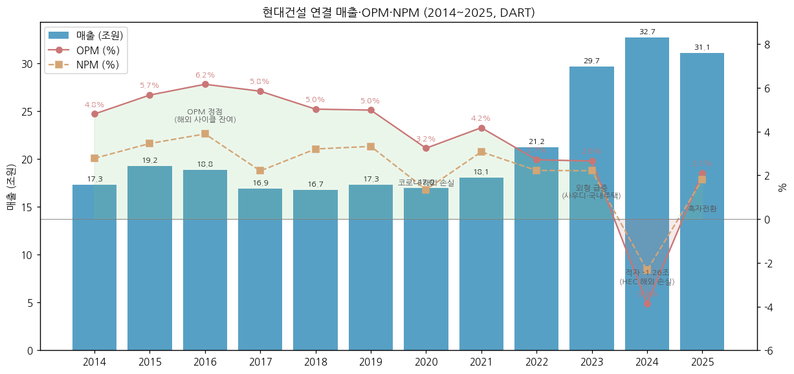

(2014 수치는 2015 사업보고서의 전기 재작성값. 2015-01 잠정공시는 매출 17.39조·영업이익 9,589억이었으나 K-IFRS 영업이익 정의 변경으로 재작성 8,292억)

### ② 산업 분류

- 산업: **건설 (종합건설·EPC)** — 사이클 산업 list 포함 (국내 주택 분양 사이클 + 해외 플랜트 수주 사이클)
- DART 업종: 종합 건설업 / KRX 건설 / WICS 건설
- 워치리스트 섹터: **T2 — 원전** / 서브섹터: **원전 시공** (대형원전 APR1400·AP1000, SMR-300 EPC)

### ③ 분류 결정 논리

(1) **가장 매출 큰 사업부 기준** 적용 시: 별도 건축/주택 (2025 별도 매출의 56%) → 국내 주택 분양 사이클에 직결 → 사이클
(2) **사이클 사업부 이익 비중 우선 sub-rule**: 연결 영업부문 주석(DART) 기준 2024 플랜트/전력 매출총이익 **-1.49조** (4Q24 단독 -1.62조) vs 건축/주택 +0.93조 → 이익 변동을 지배하는 것은 사이클형 해외 플랜트. 건축/주택 GPM도 2016~2021 13~17% → 2024 4.2%로 주택 사이클을 그대로 탐 → **사이클 유지**
(3) **Boundary case 처리**: 원전(대형원전·SMR)은 아직 매출 미미 (수주잔고·매출 공시 비중 미미, 2026-09 기준 본계약 0건). 그러나 2026-04 주가 고점 시 iM증권 SOTP에서 원전 사업가치 18.1조 vs 기존사업 5.6조로 **기업가치의 76%가 원전 옵션** → **Primary 사이클 + Secondary 꿈(원전)** 병기
(4) **피어 대비**: 국내 대형 건설사(GS건설·DL이앤씨·대우건설) = 주택 사이클 단독 / 두산에너빌리티 = 원전 주기기(고마진 제조) / **현대건설 = 주택 사이클 + 원전 EPC 옵션** — 같은 원전 테마라도 이익 레버리지는 주기기사보다 낮음 (EPC OPM 가정 10%, iM 2026-04)

### ④ 적정 밸류에이션 방법

- **PBR (사이클 기준) 우선** — 본업은 ROE 2~7%대 저수익 사이클 (2021~2025 평균 P/B 0.61배, 저점 0.44배 / 고점 0.76배, iM 2026-11)
- **SOTP 보조 (원전 옵션)** — 원전 수주가 본계약으로 전환되는 시점에만 원전 가치 가산 (iM 2026-04: 원전 18.1조 + 본업 5.6조 = 23.7조, 목표 210,000원 → 2026-11 175,000원으로 축소)
- **PER은 참고만** — 이익 레벨이 낮아 PER 변동 과대 (2026-11 컨센 2026E EPS 4,063원 → PER 21.8배)
- 사이클 밴드: 본업 P/B 0.35배(2024-12 저점) ~ 1.1배(2025 고점) / 원전 프리미엄 구간 P/B 2.3배 (2026-04)
- 두산에너빌리티는 PER(원전 주기기 이익 가시성) 중심, **현대건설은 PBR + 원전 SOTP** — 원전 매출이 아직 없기 때문

### ⑤ 분기 재평가 트리거 (분류 변경 조건)

- 원전 매출(대형원전+SMR)이 **연결 매출의 10%+ 도달** 시 → Secondary 꿈 → 지속성장(원전 EPC 백로그) 격상 검토
- 원전 **본계약 수주잔고 10조원+** 확보 시 (불가리아 코즐로듀이 EPC·펠리세이즈 SMR 본계약 등) → Secondary 격상
- 2개 연도 연속 **OPM 5%+ 및 OPM range 2%pt 이내** 시 → 사이클 → 지속성장 transition 후보
- 원전 수주 무산·장기 지연 (2027년까지 본계약 0건) 시 → Secondary 꿈 삭제, 순수 사이클 복귀

---

## 2. 회사 개요

### ① 기본 사항

- **회사명**: 현대건설주식회사 (Hyundai Engineering & Construction Co., Ltd., HDEC) / KRX 000720 (보통주), 000725 (우선주)
- **본사**: 서울특별시 종로구 율곡로 75 (현대빌딩)
- **설립**: 1947년 현대토건사 → 1950-01 현대건설 설립 / 1984 유가증권시장 상장
- **그룹**: 현대자동차그룹 (2011-04 편입, 현대차 외 5인 34.92%)
- **비전**: "Global Leader in Energy & Infrastructure" 방향 — 2025-03 CEO Investor Day에서 2030 매출 40조+, 이익률 8%+, ROE 12%+α, 원전 밸류체인 주도 제시 (기업가치제고 계획)
- **사업 한 줄 정의**: 국내 1위권 주택(힐스테이트·디에이치) + 해외 플랜트·인프라 EPC + APR1400(국내·UAE 바라카) 시공 실적과 AP1000(Westinghouse) 협력을 동시에 가진 종합건설사. 연결 종속 45개사 (주요 9개, DART 사업보고서(2025.12)) — 현대엔지니어링 지분 38.62% (유효지분율 40.47%, DART 반기보고서(2026.06))

### ② 최근 12년 손익·자본 추이 (조원, 연결, DART)

| 연도 | 매출 | YoY | 영업이익 | 순이익 | 자본총계 | 자본 YoY |
|---|---|---|---|---|---|---|
| 2014 | 17.3 | - | 0.83 | 0.48 | 6.79 | - |
| 2015 | 19.2 | +11.3% | 1.09 | 0.66 | 7.39 | +8.9% |
| 2016 | 18.8 | -2.1% | 1.16 | 0.73 | 8.12 | +9.9% |
| 2017 | 16.9 | -10.3% | 0.99 | 0.37 | 8.47 | +4.3% |
| 2018 | 16.7 | -0.9% | 0.84 | 0.54 | 8.29 | -2.1% |
| 2019 | 17.3 | +3.3% | 0.86 | 0.57 | 8.71 | +5.1% |
| 2020 | 17.0 | -1.8% | 0.55 | 0.23 | 8.77 | +0.6% |
| 2021 | 18.1 | +6.5% | 0.75 | 0.55 | 9.43 | +7.6% |
| 2022 | 21.2 | +17.6% | 0.57 | 0.47 | 9.92 | +5.2% |
| 2023 | 29.7 | +39.6% | 0.79 | 0.65 | 10.46 | +5.4% |
| 2024 | 32.7 | +10.2% | -1.26 | -0.77 | 9.67 | -7.5% |
| 2025 | 31.1 | -4.9% | 0.65 | 0.56 | 10.11 | +4.6% |

(연결 기준, OpenDART. 2017 자본은 2018 사업보고서 기준 재작성값)

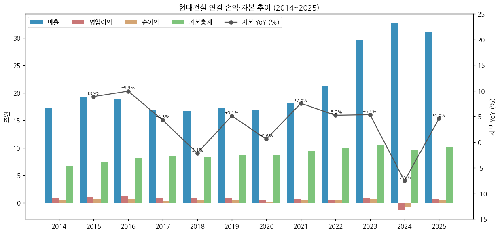

### ③ 회사 주가 역사 ★ narrative 영역

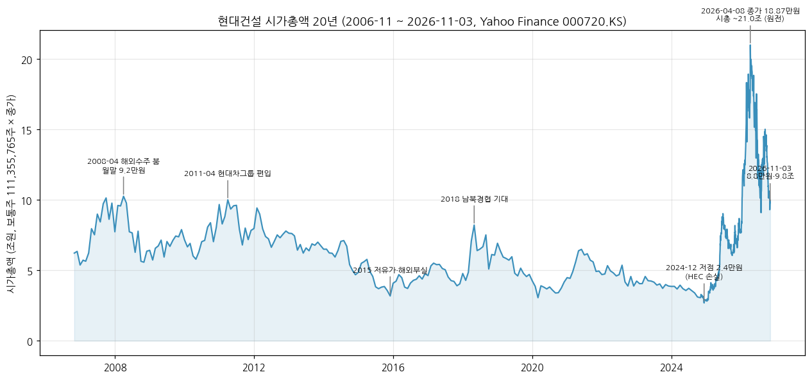

**시가총액 데이터:** 2006-11 ~ 2026-11-03 (Yahoo Finance 000720.KS 월간 종가 + 2024-11 이후 일간 종가, 보통주 111,355,765주 고정 가정)
- 2026-11-03 종가 **88,000원 → 시총 약 9.8조원** (네이버 증권 표시 시총 9조 8,661억, 2026-11-03)
- **사상 최고 (종가 기준): 2026-04-08 188,700원 → 시총 약 21.0조원** / 장중 최고 198,400원 (2026-04-08)
- 직전 최고 (월말 종가): 2008-04 92,200원 (해외 수주 붐, 시총 약 10.3조)
- 최근 저점: 2024-12-09 종가 24,100원 (시총 약 2.7조, 4Q24 대규모 적자 직전)
- 2024-12 저점 → 2026-04 고점 **+683%** (원전 리레이팅) → 2026-11-03 고점 대비 **-53%**
- 1Y 수익률 +27.6% / 6M -44.6% (FnGuide, 2026-11-02)

**사이클 history:**

```
[2007-2008] 해외 플랜트 수주 붐 (중동 오일머니)
  · 2008-04 월말 92,200원 — 2026년 이전 최고가
  · 2008-10 금융위기 급락

[2011-04] 현대차그룹 인수 (채권단 → 현대차 컨소시엄)
  · 2011 상반기 9만원대 재근접 후 장기 하락

[2013-2016] 해외 저가수주 후유증 + 저유가
  · 2015-12 28,550원 (중동 발주 급감)

[2018-05] 남북경협 기대 (P/B 1.4배 — 2026년 이전 최고 P/B)

[2020-2024] 주택·해외 수익성 저하
  · 2022 원자재 급등, 2024 HEC 해외현장 손실
  · 2024-12-09 24,100원 (P/B 0.34배)

[2025-2026-04] 원전 리레이팅
  · 2025-05 대형원전·SMR 파이프라인 부각 (iM TP 52,000→70,000원)
  · 2025-10 Fermi America 대형원전 4기 FEED, 불가리아 EPC 기대
  · 2026-01 2025-06 전고점 돌파 (92,000원), 2026-04 이란 전쟁 → 에너지 안보 → 188,700원 (P/B 2.3배)

[2026-05~11] 원전 계약 지연 → 프리미엄 소멸
  · 펠리세이즈 SMR 부분계약 지연, 불가리아 FID 지연, 체코 팀코리아 시공 이견
  · 2026-07-15 101,400원 (고점 대비 반토막), 2026-10-30 83,600원
  · 2026-11-02 3Q26 발표 후 증권사 15곳 중 12곳 목표가 하향 (평균 149,238원)
```

### ④ 회사의 주요 연혁

```
1947-05   현대토건사 설립 (정주영)
1950-01   현대건설 설립
1965      태국 파타니-나라티왓 고속도로 — 한국 건설사 최초 해외 수주
1976      사우디 주베일 산업항 (당시 9.3억$, 중동 진출 상징)
1971      고리 1호기 원전 시공 착수 (1978 준공) — 국내 원전 시공 시작
1984      유가증권시장 상장
2001      유동성 위기 → 채권단 공동관리 (출자전환)
2009      UAE 바라카 원전 1~4호기 (APR1400) 시공 수주 — 한국형 원전 첫 수출
2011-04   현대자동차그룹 편입 (현대엔지니어링 동반 편입)
2014-04   현대엔지니어링–현대엠코 합병 (연결 외형 확대)
2021-11   미국 Holtec과 SMR 협력 (SMR-160 → SMR-300)
2022-01   현대엔지니어링 IPO 철회
2024-11   불가리아 코즐로듀이 7·8호기 (AP1000) 설계 계약 (Westinghouse 컨소시엄)
2024      연결 영업손실 1.26조 (4Q24 해외 플랜트·HEC 손실 일괄 반영)
2024-04   신한울 3·4호기 (APR1400) 주설비공사 착공 (한수원, 도급 1.60조)
2025-03   CEO Investor Day — 2030 매출 40조+·이익률 8%+, 최소 DPS 800원
2025-10   미국 Fermi America 대형원전 4기 기본설계(FEED) 계약 — 국내 최초 美 대형원전
2026-1H   미국 전기로 제철소 5.4조 수주, 연결 수주잔고 103.98조 (사상 최대, 2Q26)
2026-04   주가 사상 최고 188,700원 (시총 21.0조)
```

---

## 3. 비즈니스 모델

### ① 실적 추이 (연결 → 별도/현대엔지니어링 → 공종 3단계 위계)

**연간 5년 통합 표 (조원):**

| 항목 | 2021 | 2022 | 2023 | 2024 | 2025 |
|------|------|------|------|------|------|
| **연결 매출액** | **18.07** | **21.24** | **29.65** | **32.67** | **31.06** |
| └ 법인별 | | | | | |
| &nbsp;&nbsp;&nbsp;&nbsp;└ 현대건설 별도 | 10.25 | 11.98 | 15.78 | 16.73 | 16.51 |
| &nbsp;&nbsp;&nbsp;&nbsp;└ 현대엔지니어링 | - | 8.81 | 13.06 | 14.76 | 13.90 |
| &nbsp;&nbsp;&nbsp;&nbsp;└ 기타 종속·연결조정 | - | 0.45 | 0.80 | 1.18 | 0.65 |
| └ 별도 공종별 | | | | | |
| &nbsp;&nbsp;&nbsp;&nbsp;└ 건축/주택 | - | 7.84 | 10.72 | 10.94 | 9.32 |
| &nbsp;&nbsp;&nbsp;&nbsp;└ 플랜트/전력 (원전 포함) | - | 2.41 | 3.15 | 3.88 | 5.15 |
| &nbsp;&nbsp;&nbsp;&nbsp;└ 토목/인프라 | - | 1.61 | 1.78 | 1.80 | 1.86 |
| └ 지역별 (연결) | | | | | |
| &nbsp;&nbsp;&nbsp;&nbsp;└ 국내 | - | - | - | 19.40 | 18.76 |
| &nbsp;&nbsp;&nbsp;&nbsp;└ 해외 | - | - | - | 13.28 | 12.30 |
| **연결 영업이익** | **0.75** | **0.57** | **0.79** | **-1.26** | **0.65** |
| &nbsp;&nbsp;&nbsp;&nbsp;└ 현대건설 별도 | 0.31 | 0.35 | 0.34 | -0.22 | 0.25 |
| &nbsp;&nbsp;&nbsp;&nbsp;└ 현대엔지니어링 | - | 0.12 | 0.26 | -1.24 | 0.27 |
| &nbsp;&nbsp;&nbsp;&nbsp;└ 기타 | - | 0.12 | 0.19 | 0.19 | 0.14 |
| **매출 YoY (%)** | **+6.5** | **+17.6** | **+39.6** | **+10.2** | **-4.9** |
| &nbsp;&nbsp;&nbsp;&nbsp;└ 별도 YoY | +9.9 | +16.9 | +31.7 | +6.0 | -1.3 |
| &nbsp;&nbsp;&nbsp;&nbsp;└ 현대엔지니어링 YoY | - | - | +48.2 | +13.0 | -5.8 |
| **영업이익 YoY (%)** | **+37.3** | **-23.7** | **+36.6** | **적전** | **흑전** |
| **OPM 전사 (%)** | **4.2** | **2.7** | **2.6** | **-3.9** | **2.1** |
| &nbsp;&nbsp;&nbsp;&nbsp;└ 별도 OPM | 3.0 | 2.9 | 2.2 | -1.3 | 1.5 |
| &nbsp;&nbsp;&nbsp;&nbsp;└ 현대엔지니어링 OPM | - | 1.3 | 2.0 | -8.4 | 2.0 |
| **원가율 (별도 공종 GPM)** | | | | | |
| &nbsp;&nbsp;&nbsp;&nbsp;└ 건축/주택 GPM | - | 9.4 | 5.4 | 4.1 | 6.4 |
| &nbsp;&nbsp;&nbsp;&nbsp;└ 플랜트 GPM | - | 4.7 | 3.1 | -8.7 | 1.3 |
| &nbsp;&nbsp;&nbsp;&nbsp;└ 토목 GPM | - | -1.3 | 4.3 | 8.7 | 6.0 |

(출처: 연결·별도 매출·영업이익 = OpenDART. 현대엔지니어링·공종별 = 증권사 집계(하이투자 2024-01, iM 2025-01·2026-04, DART 기반) — 2023 공종은 iM 재분류값. 지역별 = 현대건설 IR FY25. 2021 별도 공종·HEC 분리치는 DART 미공시(DART는 연결 공종만 공시 → 아래 13년 표))

**연결 공종별 매출·GPM 13년 (조원, DART 사업보고서 '사업부문별 요약 재무현황'(2013~2021) / 연결 영업부문 주석(2022~2025)):**

| 연도 | 건축/주택 | 토목/인프라 | 플랜트/전력 | 기타 | 연결조정 | 합계 | 건축 GPM | 토목 GPM | 플랜트 GPM | 기타 GPM | 플랜트 비중 |
|---|---|---|---|---|---|---|---|---|---|---|---|
| 2013 | 3.40 | 3.06 | 7.68 | 0.27 | -0.47 | 13.94 | 9.3% | 11.1% | 7.0% | 10.3% | 55% |
| 2014 | 5.67 | 3.48 | 7.85 | 0.80 | -0.41 | 17.39 | 10.6% | 8.2% | 7.4% | 10.1% | 45% |
| 2015 | 6.61 | 3.57 | 8.32 | 0.89 | -0.27 | 19.12 | 11.8% | 4.2% | 7.1% | 10.4% | 44% |
| 2016 | 7.37 | 3.26 | 7.51 | 0.93 | -0.32 | 18.74 | 14.6% | 1.5% | 8.6% | 8.0% | 40% |
| 2017 | 8.20 | 2.61 | 5.52 | 0.97 | -0.41 | 16.89 | 16.9% | 1.3% | 4.8% | 9.2% | 33% |
| 2018 | 8.07 | 2.57 | 5.50 | 1.17 | -0.58 | 16.73 | 14.8% | 1.0% | 6.1% | 9.3% | 33% |
| 2019 | 8.26 | 3.16 | 5.09 | 1.17 | -0.40 | 17.28 | 15.2% | 3.3% | 5.3% | 10.5% | 29% |
| 2020 | 8.92 | 2.36 | 4.80 | 1.09 | -0.20 | 16.97 | 13.6% | 0.4% | 0.8% | 14.5% | 28% |
| 2021 | 10.32 | 2.12 | 4.63 | 1.29 | -0.30 | 18.07 | 14.2% | -2.1% | 4.3% | 14.8% | 26% |
| 2022 | 12.50 | 2.41 | 5.42 | 1.31 | -0.40 | 21.24 | 10.0% | 1.3% | 1.4% | 13.5% | 26% |
| 2023 | 19.70 | 2.74 | 6.57 | 1.34 | -0.69 | 29.65 | 6.3% | 3.7% | 3.2% | 16.2% | 22% |
| 2024 | 22.00 | 2.78 | 6.83 | 1.49 | -0.43 | 32.67 | 4.2% | 3.1% | -21.8% | 16.8% | 21% |
| 2025 | 17.03 | 2.75 | 9.93 | 1.63 | -0.26 | 31.06 | 7.6% | 5.2% | 2.7% | 15.2% | 32% |

(합계는 각 연도 사업보고서 당기값 — 2014·2015는 이후 재작성 전 원값이라 DART fnltt 재작성값(17.28·19.23조)과 소폭 차이. 2019~2021 '인프라/환경' = 토목)

→ 플랜트/전력 비중 2013 55% → 2024 21% (해외 플랜트 축소·주택 확대) → 2025 32% 반등 (사우디 아미랄·자푸라, 샤힌, 이라크) / 건축/주택 GPM 2017 16.9% 정점 → 2024 4.2% 저점 → 2Q26 13.2% 회복

**연결 공종 × 국내/해외 매출 (억원, DART 사업보고서(2025.12) II-4 매출실적, 내부거래 제거 전):**

| 공종 | 2023 국내 | 2023 해외 | 2024 국내 | 2024 해외 | 2025 국내 | 2025 해외 |
|---|---|---|---|---|---|---|
| 토목 | 13,008 | 14,392 | 11,043 | 16,759 | 10,570 | 16,889 |
| 건축/주택 | 154,276 | 42,724 | 159,578 | 60,414 | 139,718 | 30,545 |
| 플랜트/뉴에너지 | 7,289 | 58,402 | 16,783 | 51,521 | 28,276 | 71,006 |
| 기타 | 9,731 | 3,631 | 10,558 | 4,367 | 10,975 | 5,299 |

**별도 공종 2025 구성 (IR FY25, 억원):** 건축/주택 93,196 (56.4%) / 플랜트·뉴에너지 51,487 (31.2%) / 토목 18,560 (11.2%) / 기타 1,882
**현대엔지니어링 2025 구성 (IR FY25):** 플랜트/인프라 77,607 (55.8%) / 건축/주택 48,095 (34.6%) / 기타 13,263 — 합계 138,965

**공종·법인별 분기 시계열 (연결 공종 42분기 = 1Q16~2Q26 DART 영업부문 주석 누적값 차분 / 별도 43분기 = 1Q16~3Q26 DART / 현대엔지니어링·별도 공종 15분기 = 1Q23~3Q26 IR·증권사):**

각 차트 = 매출 (bar, 좌축) + OPM/GPM (line, 우축). 연결−별도 = 현대엔지니어링 + 기타 종속 + 연결조정 (DART로 43분기 전체 산출 가능한 proxy).

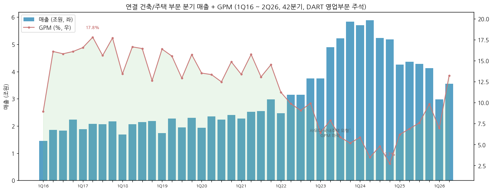
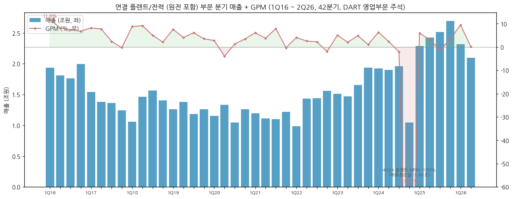
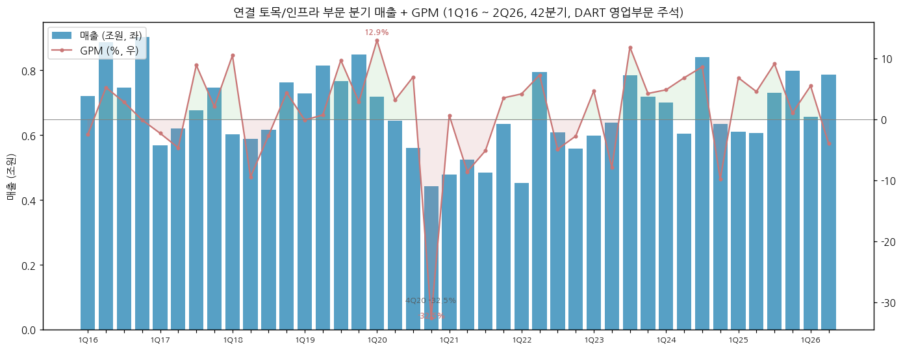
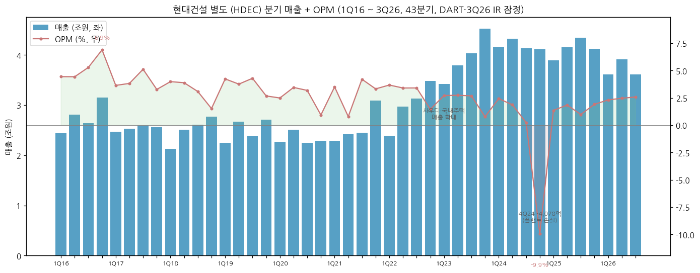
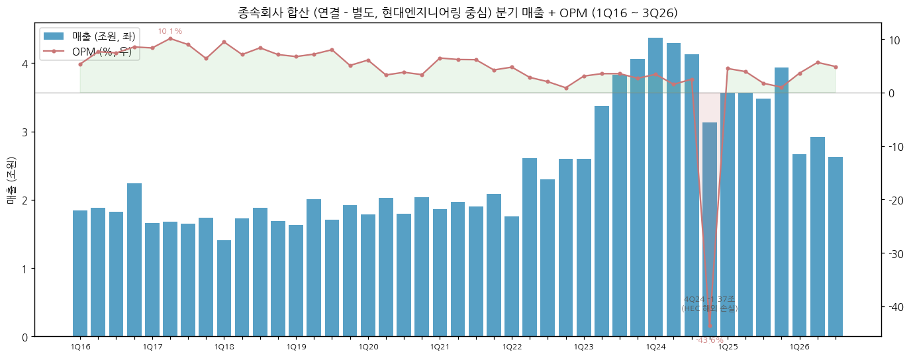
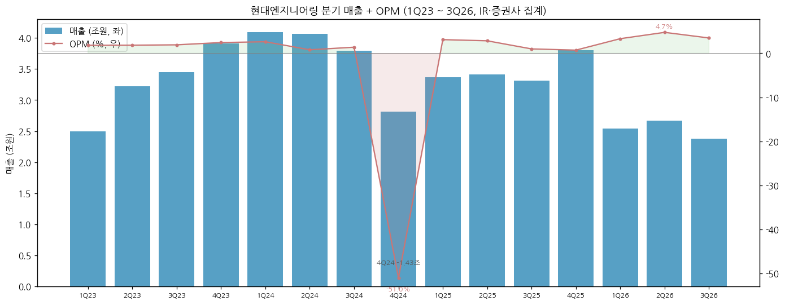
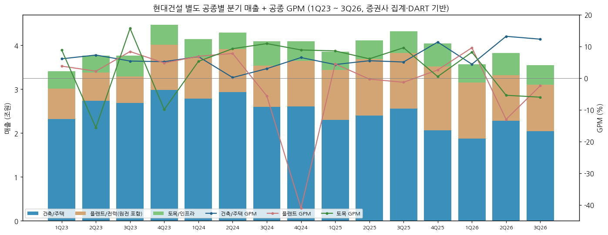

**연결 공종별 최근 12분기 (억원, DART 영업부문 — 3Q26 공종 데이터는 분기보고서 제출 후 반영):**

| 분기 | 건축/주택 | 토목 | 플랜트/전력 | 기타 | 합계 | 건축 GPM | 토목 GPM | 플랜트 GPM | 전사 GPM |
|---|---|---|---|---|---|---|---|---|---|
| 2023-3Q | 52,185 | 7,842 | 16,526 | 3,217 | 78,585 | 5.9% | 11.8% | 4.8% | 6.6% |
| 2023-4Q | 58,307 | 7,177 | 19,334 | 4,265 | 85,984 | 5.2% | 4.2% | 1.1% | 4.8% |
| 2024-1Q | 57,023 | 7,006 | 19,257 | 3,352 | 85,453 | 5.9% | 4.8% | 6.3% | 6.2% |
| 2024-2Q | 58,896 | 6,051 | 19,014 | 4,001 | 86,212 | 3.5% | 6.8% | 2.4% | 4.0% |
| 2024-3Q | 52,325 | 8,398 | 19,578 | 3,213 | 82,569 | 4.8% | 8.6% | -2.1% | 4.2% |
| 2024-4Q | 51,747 | 6,346 | 10,455 | 4,359 | 72,469 | 2.7% | -9.8% | **-154.7%** | -19.9% |
| 2025-1Q | 42,566 | 6,111 | 22,880 | 3,453 | 74,556 | 6.2% | 6.8% | 6.0% | 6.9% |
| 2025-2Q | 43,629 | 6,057 | 24,260 | 3,882 | 77,207 | 6.9% | 4.5% | 3.2% | 6.1% |
| 2025-3Q | 42,798 | 7,312 | 25,173 | 3,932 | 78,265 | 7.6% | 9.1% | -1.3% | 5.0% |
| 2025-4Q | 41,270 | 7,978 | 26,968 | 5,005 | 80,601 | 9.8% | 1.0% | 3.4% | 7.5% |
| 2026-1Q | 29,738 | 6,562 | 23,180 | 4,035 | 62,813 | 6.9% | 5.5% | 9.5% | 8.0% |
| 2026-2Q | 35,477 | 7,871 | 20,964 | 4,768 | 68,423 | 13.2% | -4.0% | 0.2% | 8.0% |

**연결 분기 매출·영업이익 매트릭스 (억원, DART / 2026-3Q = IR 잠정):**

| 연도 | 1Q 매출 | 2Q | 3Q | 4Q | 1Q OP | 2Q OP | 3Q OP | 4Q OP | 분기합 매출 | 연간(DART) |
|---|---|---|---|---|---|---|---|---|---|---|
| 2016 | 42,879 | 46,866 | 44,641 | 53,864 | 2,072 | 2,684 | 2,751 | 4,083 | 188,250 | 188,250 |
| 2017 | 41,297 | 42,081 | 42,431 | 42,965 | 2,286 | 2,664 | 2,811 | 1,946 | 168,773 | 168,871 |
| 2018 | 35,382 | 42,401 | 44,863 | 44,663 | 2,185 | 2,209 | 2,379 | 1,627 | 167,309 | 167,309 |
| 2019 | 38,777 | 46,819 | 40,878 | 46,315 | 2,052 | 2,451 | 2,392 | 1,702 | 172,788 | 172,788 |
| 2020 | 40,589 | 45,442 | 40,425 | 43,254 | 1,653 | 1,539 | 1,398 | 899 | 169,709 | 169,709 |
| 2021 | 41,496 | 43,835 | 43,519 | 51,805 | 2,009 | 1,410 | 2,204 | 1,913 | 180,655 | 180,655 |
| 2022 | 41,453 | 55,794 | 54,308 | 60,835 | 1,715 | 1,754 | 1,537 | 743 | 212,391 | 212,391 |
| 2023 | 60,311 | 71,634 | 78,585 | 85,984 | 1,735 | 2,236 | 2,439 | 1,445 | 296,514 | 296,514 |
| 2024 | 85,453 | 86,212 | 82,569 | 72,469 | 2,509 | 1,473 | 1,143 | -17,759 | 326,703 | 326,703 |
| 2025 | 74,556 | 77,207 | 78,265 | 80,601 | 2,137 | 2,170 | 1,035 | 1,188 | 310,629 | 310,629 |
| 2026 | 62,813 | 68,423 | 62,406 | - | 1,809 | 2,618 | 2,217 | - | 193,642 (9M) | - |

(4Q = 연간 − 3Q 누적. 2017 분기합 −98억 차이 = 2017 1~3Q 원공시값과 연간 재작성값 차이. 2026 9M 영업이익 6,645억 = IR 일치)

**별도 분기 매출·영업이익 (억원, DART / 2026-3Q = IR 잠정):**

| 연도 | 1Q 매출 | 2Q | 3Q | 4Q | 1Q OP | 2Q OP | 3Q OP | 4Q OP | 연간 매출 | 연간 OPM |
|---|---|---|---|---|---|---|---|---|---|---|
| 2016 | 24,438 | 28,061 | 26,429 | 31,482 | 1,085 | 1,244 | 1,398 | 2,170 | 110,411 | 5.3% |
| 2017 | 24,715 | 25,329 | 25,941 | 25,597 | 900 | 968 | 1,328 | 838 | 101,680 | 4.1% |
| 2018 | 21,272 | 25,096 | 26,060 | 27,733 | 848 | 975 | 804 | 423 | 100,161 | 3.0% |
| 2019 | 22,448 | 26,740 | 23,823 | 27,135 | 951 | 1,005 | 1,023 | 727 | 100,147 | 3.7% |
| 2020 | 22,735 | 25,122 | 22,480 | 22,864 | 566 | 868 | 716 | 214 | 93,201 | 2.5% |
| 2021 | 22,857 | 24,174 | 24,482 | 30,950 | 802 | 191 | 1,030 | 1,029 | 102,463 | 3.0% |
| 2022 | 23,929 | 29,675 | 31,304 | 34,877 | 879 | 1,010 | 1,067 | 507 | 119,785 | 2.9% |
| 2023 | 34,274 | 37,900 | 40,306 | 45,309 | 930 | 1,038 | 1,083 | 354 | 157,788 | 2.2% |
| 2024 | 41,683 | 43,212 | 41,301 | 41,105 | 1,012 | 808 | 103 | -4,078 | 167,301 | -1.3% |
| 2025 | 38,909 | 41,543 | 43,423 | 41,249 | 528 | 766 | 429 | 789 | 165,125 | 1.5% |
| 2026 | 36,130 | 39,185 | 36,090 | - | 836 | 967 | 932 | - | (9M 111,404) | - |

**3Q26 핵심 (분기 데이터만 반영, 연간 합산은 FY26 결산 후 v2.0에서 갱신):**
- 연결 매출 **6조 2,406억** (-20.3% YoY, -8.8% QoQ) / 영업이익 **2,217억** (+114.2% YoY, OPM 3.6%) — 컨센서스 2,119억 부합 (하나증권)
- 순이익 464억 (-31.7%) — 환 관련 평가손실·법인세 증가
- 별도 영업이익 932억: 건축/주택 GPM **12.3%** (+7.2%p YoY, 주택 원가율 86.4% 정상화) vs 플랜트 GPM -2.4% (샤힌 공정촉진) · 토목 GPM -6.0% (싱가포르 남북도로 비용 약 800억)
- 현대엔지니어링 영업이익 825억 (+152%) — 솔로몬제도 수력발전 비용 430억에도 그룹사 공장·주택 준공 정산이익 500억
- 9M26 누적: 매출 19.36조 (연간 계획 27.4조의 70.7%) / 영업이익 6,645억 (계획 8,000억의 83.1%)
- 2023년 이후 착공 주택 현장 매출 비중: 2025말 46% → 2026-09말 76% (iM, 2026-11-02)

**12분기 시계열 (4Q23 ~ 3Q26, 억원):**

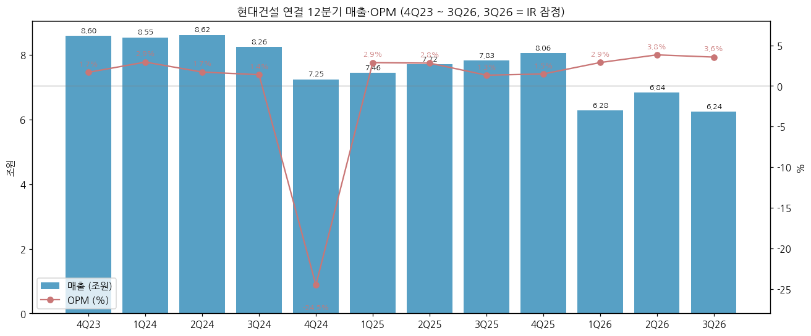

| 분기 | 매출 | 영업이익 | OPM | 별도 매출 | 별도 OP | 종속(연결−별도) OP | 메모 |
|---|---|---|---|---|---|---|---|
| 2023-4Q | 85,984 | 1,445 | 1.7% | 45,309 | 354 | 1,091 | 분기 매출 정점권 |
| 2024-1Q | 85,453 | 2,509 | 2.9% | 41,683 | 1,012 | 1,497 | |
| 2024-2Q | 86,212 | 1,473 | 1.7% | 43,212 | 808 | 665 | |
| 2024-3Q | 82,569 | 1,143 | 1.4% | 41,301 | 103 | 1,040 | |
| 2024-4Q | 72,469 | -17,759 | -24.5% | 41,105 | -4,078 | -13,681 | **HEC 해외(인니 발릭파판·사우디 자푸라) + 별도 플랜트 손실 일괄 반영** |
| 2025-1Q | 74,556 | 2,137 | 2.9% | 38,909 | 528 | 1,609 | 흑자전환 |
| 2025-2Q | 77,207 | 2,170 | 2.8% | 41,543 | 766 | 1,404 | |
| 2025-3Q | 78,265 | 1,035 | 1.3% | 43,423 | 429 | 607 | 플랜트·HEC 비용 |
| 2025-4Q | 80,601 | 1,188 | 1.5% | 41,249 | 789 | 399 | HEC 본드콜 이슈 |
| 2026-1Q | 62,813 | 1,809 | 2.9% | 36,130 | 836 | 973 | 외형 축소 시작 |
| 2026-2Q | 68,423 | 2,618 | 3.8% | 39,185 | 967 | 1,652 | 주택 GPM 13.2% |
| **2026-3Q** | **62,406** | **2,217** | **3.6%** | **36,090** | **932** | **1,285** | **IR 잠정, 주택 마진 개선 > 토목·플랜트 비용** |

**수주·수주잔고 (연결):**

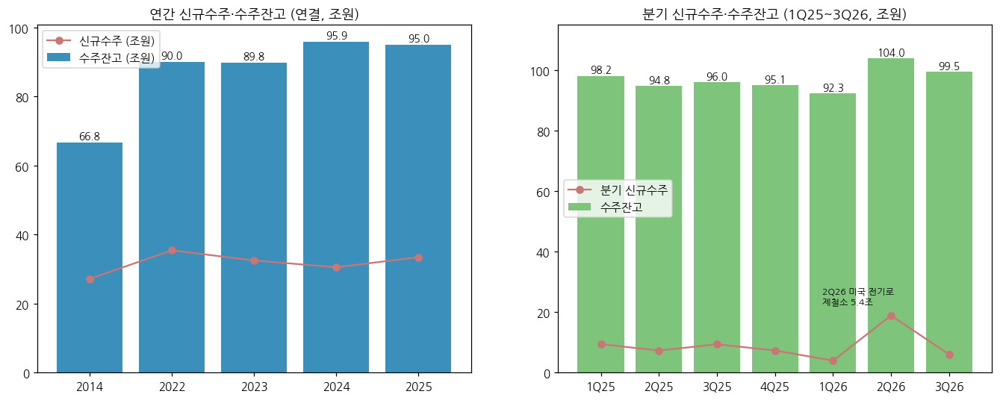

**DART 수주상황 계약잔액 (조원, 연말, 사업보고서 II-4 '수주상황' 국내/해외 합계):**

| 연말 | 현대건설 국내 | 현대건설 해외 | 현대건설 계 | 현대엔지니어링 | 합계(2사) | 해외 비중(현대건설) |
|---|---|---|---|---|---|---|
| 2013 | 15.35 | 25.44 | 40.79 | 10.35 | 51.14 | 62% |
| 2014 | 15.06 | 29.48 | 44.54 | n/a | - | 66% |
| 2015 | 16.62 | 25.69 | 42.31 | 24.31 | 66.62 | 61% |
| 2016 | 19.66 | 20.57 | 40.23 | 25.35 | 65.58 | 51% |
| 2017 | 23.37 | 16.72 | 40.10 | 26.40 | 66.50 | 42% |
| 2018 | 23.92 | 8.06 | 31.97 | 23.55 | 55.53 | 25% |
| 2019 | 26.01 | 8.83 | 34.84 | 21.88 | 56.72 | 25% |
| 2020 | 28.34 | 14.01 | 42.35 | 23.16 | 65.50 | 33% |
| 2021 | 21.90 | 13.78 | 35.68 | 28.07 | 63.75 | 39% |
| 2022 | 42.95 | 15.32 | 58.27 | 29.73 | 88.00 | 26% |
| 2023 | 44.52 | 13.98 | 58.50 | 30.91 | 89.41 | 24% |
| 2024 | 46.46 | 14.44 | 60.91 | 34.82 | 95.73 | 24% |
| 2025 | 55.40 | 14.34 | 69.74 | 24.63 | 94.36 | 21% |

(DART 계약잔액은 공사별 '기본도급액−완성공사액' 합계로, 회사 IR 수주잔고(시공권·기타 종속 포함 기준)와 정의가 다름. 2014 HEC 해외 합계 미추출. 2025 현대건설 계약잔액 69.74조 중 해외법인 명의 제외 별도 69.40조)

→ 2017→2018 해외 잔고 16.7조 → 8.1조 반토막 (중동 저가수주 정리 후 해외 수주 공백) → 2022 국내 주택 잔고 42.9조로 2배 (2021→2022 +21조) → 2025 국내 55.4조. **현대건설 잔고는 2018년 이후 국내 주택 중심 구조**

**IR 기준 수주·수주잔고 (연결):**

| 시점 | 신규수주 (조원) | 수주잔고 (조원) | 국내 잔고 | 해외 잔고 | 출처 |
|---|---|---|---|---|---|
| 2014 | 27.17 | 66.77 | - | - | 2015-01 잠정실적 보도 |
| 2022 | 35.43 | 90.03 | - | - | 2023-01 잠정실적 보도 |
| 2023 | 32.49 | 89.75 | 67.15 | 22.60 | hdec.kr 주요 경영실적 |
| 2024 | 30.53 | 95.93 | 69.69 | 26.23 | hdec.kr |
| 2025 | 33.44 | 95.04 | 74.33 | 20.71 | hdec.kr (IR FY25 95.09) |
| 1Q26 | 3.96 | 92.32 | 73.04 | 19.29 | IR 1Q26 |
| 2Q26 | 18.87 | **103.98** | 73.83 | 30.16 | IR 2Q26 (미국법인 포함, 사상 최대) |
| 3Q26 | 6.05 | 99.53 | 74.52 | 25.01 | IR 3Q26 (약 3.6년치) |

- 9M26 누적 수주 28.87조 (연간 계획 33.4조의 86.5%): 미국 전기로 제철소 5.4조, 복정역세권 3.0조, 카자흐스탄 가스처리 2.4조(HEC), 포항 AI 데이터센터 0.4조, 군산 AI 데이터센터 0.3조(HEC)
- 별도 수주잔고 73.46조 중 주택 37.20조 + 시공권 확보(잔고 미포함) 28.38조 (압구정 3구역 5.6조 등)
- 2Q26→3Q26 잔고 -4.45조: 해외 잔고 30.16조 → 25.01조 (해외 기성·환율·잔고 조정, 회사 상세 설명 미확인)

### ② 사업부별 개요 (매출 비중 큰 순서)

**현대건설 별도 (HDEC) — 2025 연결 매출의 53%**

"국내 주택과 해외 대형 플랜트·원전·인프라를 직접 수행하는 본체."

- **건축/주택** (별도의 56%): 힐스테이트 (주거 브랜드), 디에이치 (THE H, 하이엔드 — 디에이치 클래스트·방배·반포주공1단지 재건축 3.48조), 오피스·호텔·복합개발 (마곡 더그리드 1.6조, 복정역세권 2.7조), 데이터센터 (포항 AI DC)
- **플랜트/전력·뉴에너지** (31%): 사우디 아미랄 PKG4·자푸라 PKG2 (아람코 가스·석유화학), 울산 S-OIL 샤힌, 이라크 해수처리(4.7조 잔고), 송변전 (사우디 쿠라이스·후마이즈), **대형원전·SMR·원전해체**, 해상풍력 (신안우이 0.7조), 미국 텍사스 태양광
- **토목/인프라** (11%): 도로·교량·터널·항만 (싱가포르 남북도로, 국내 GTX 등)

**현대엔지니어링 (HEC, 지분 38.62%) — 2025 연결 매출의 45%**

"현대차그룹 공장과 해외 화공 플랜트를 수행하는 종속회사."

- **플랜트/인프라** (HEC의 56%): 그룹사 공장 (미국 현대차 메타플랜트·LG배터리·LS전선 해저케이블), 카자흐스탄 카라차가낙 가스처리 (2.1조 잔고), 사우디 아미랄 PKG1, 폴란드 올레핀, 솔로몬제도 수력
- **건축/주택** (35%): 힐스테이트 공동 브랜드 — **2026년 신규 주택 수주 중단** (IR 3Q26)
- 2024 영업손실 1.24조 (인니 발릭파판 정유·사우디 자푸라 등 해외현장), 2025-02 세종-안성 고속도로 교량 붕괴 사고 (iM 2025-02-26)

**기타 종속 (47개사)**: 현대스틸산업, 현대도시개발, 현대에코에너지, 송도랜드마크시티, 미국법인 등 — 2025 매출 0.65조

### ③ 사업부별 디테일

**현재 가장 잘나가는 사업 (top-seller):**
- **국내 건축/주택 (별도)** — 2026 2Q·3Q GPM 13.2%·12.3% (2024 연간 4.1% 대비 정상화), 2023 이후 착공분(고분양가·원가 반영) 매출 비중 76%
- **그룹사 공장 EPC (HEC)** — 미국 전기로 제철소 5.4조 (2026-1H, 미국법인 포함)

**향후 큰 매출 기대 사업 (growth — 원전 파이프라인, 2026-11 기준):**

| 프로젝트 | 노형·규모 | 파트너 | 현재 상태 (2026-11) | 기대 시점 |
|---|---|---|---|---|
| 불가리아 코즐로듀이 7·8호기 | AP1000 1.1GW×2 | Westinghouse | 2024-11 설계(ESC) 계약 → ESC 2차 계약 추진, FID 지연 (불가리아 정부 고정비용 검토 요청 2026-04) | EPC 본계약 2027 (iM·하나) |
| 미국 Fermi America (Project Matador, 텍사스 아마릴로) | AP1000급 대형원전 4기 (캠퍼스 11GW) | Fermi America | 2025-10 FEED 계약, 부지배치·냉각설계 단계, 고객 자금·PPA 지연으로 부분계약 전환 | 미정 |
| 미국 Holtec 펠리세이즈 SMR | SMR-300 300MW×2 (미시간) | Holtec | NRC 인허가 진행, 2026 연말 약 2억$ 부분계약 전망, 본계약 2028 (하나 2026-11-02) | 2026말 부분 / 2028 본계약 |
| 미국 TerraPower | Natrium SMR | TerraPower | 원자로 조립공사 계약 우선 추진, EPC 2027말 목표 (iM 2026-11-02) | 2027 |
| 네덜란드 신규원전 | 대형원전 2기 | Westinghouse | FEED1 계약 체결 (iM 2026-11-02) | 2028 |
| 핀란드·슬로베니아·스웨덴 | 대형원전 | - | 핀란드 사전업무 (2025-06), 슬로베니아 기술타당성 완료 (2025-08) | 2027~2028 |
| 미국 대미투자 프레임 | AP1000 6기 + APR1400 2기 | 팀코리아/WEC | 구체화 대기 — 양 노형 시공 경험 보유 강점 | - |
| 미국 TNC Prosperity One (켄터키) | AP1000 6기 | Westinghouse 노형 | 2028 착공 목표 발표 (하나 2026-11-02) | - |

- 원전 관련 인력 약 1,000명 (국내 최다, iM 2026-04-15)
- iM 가정: 대형원전 1.2GW당 사업비 10조, 현대건설 지분 50%, OPM 10% / SMR 300MW당 4조, 지분 60%
- **2026-11-03 현재 원전 EPC 본계약 수주잔고 반영분은 확인되지 않음** (설계·FEED·부분계약 단계)

**이익 outlier (2026 9M 별도 공종 원가율, IR 3Q26):**
- 건축/주택 89.8% (-5.2%p YoY) — 이익 개선 주도
- 토목 101.3% (+8.9%p, 적자) — 싱가포르 남북도로
- 플랜트/뉴에너지 100.6% (+1.4%p, 적자) — 샤힌 등 고원가 현장 (2026말 종료 예정)
- 현대엔지니어링 90.3% (-3.3%p) / 건축·주택 85.7%

### ④ 주요 경쟁사 (사업부별)

| 사업부 | 주요 경쟁사 |
|--------|-------------|
| 국내 주택·재건축 | 삼성물산(래미안), GS건설(자이), DL이앤씨(아크로), 대우건설(푸르지오), 포스코이앤씨 |
| 해외 플랜트 (중동 가스·화공) | 삼성E&A, GS건설, Saipem, Technip Energies, Tecnicas Reunidas, 중국 EPC |
| 대형원전 시공 | 대우건설·삼성물산 (팀코리아), Bechtel (미국 AP1000 Vogtle), Fluor |
| SMR | Bechtel·Fluor(NuScale), 삼성물산·두산에너빌리티(NuScale·X-energy) |
| 인프라 | 삼성물산, 대우건설, DL이앤씨 |

### ⑤ 주요 매출처

> DART는 고객별 매출액을 공시하지 않음. 아래는 DART 사업보고서(2025.12) 연결 영업부문 주석의 부문별 '주요 고객'과 II-4 수주상황의 계약잔액 상위 현장.

**부문별 주요 고객 (DART 영업부문 주석):**

| 부문 | 주요 고객 |
|---|---|
| 건축/주택 | 현대자동차(주), 루사일부동산개발회사(카타르) 외 |
| 토목 | 국가철도공단, 한국도로공사, 쿠웨이트 공공사업성, 카타르 공공사업청 외 |
| 플랜트/전력 | 한국수력원자력(주), 한국전력공사(주), Saudi Arabian Oil Company 외 |
| 기타 | 한국전력공사(주) 외 |

**계약잔액 상위 현장 (현대건설 별도, 2025-12-31, 억원, DART 수주상황):**

| 현장 | 발주처 | 기본도급액 | 계약잔액 | 완공예정 |
|---|---|---|---|---|
| 이라크 해수처리시설 | TotalEnergies EP Ratawi HUB | 45,510 | 44,982 | 2029-12 |
| 디에이치 클래스트 (반포주공1단지) | 반포주공1단지 정비사업조합 | 39,319 | 29,436 | 2027-11 |
| 현대차그룹 GBC 신축 | 현대차·기아·현대모비스 | 17,923 | 16,514 | 2026-12 |
| 강서 가양동 CJ부지 개발 | 인창개발 | 16,267 | 15,252 | 2029-08 |
| **신한울 3·4호기 주설비공사** | **한국수력원자력** | **16,028** | **14,376** | **2033-10** |
| 필리핀 남부철도 4·5·6공구 | 필리핀 교통부 | 16,598 | 12,964 | 2028-03 |
| 사우디 아미랄 PKG4 | Saudi Aramco | 28,172 | 12,127 | 2027-05 |
| 밀레니엄 힐튼 부지 개발 | 와이디427PFV | 11,878 | 11,774 | 2032-04 |
| 파나마 메트로 3호선 | Metro de Panama | 31,743 | 9,508 | 2028-10 |
| 사우디 자푸라 PKG2 | Saudi Aramco | 16,953 | 9,489 | 2027-06 |
| 사우디 쿠드미-리야드 HVDC | Saudi Electricity | 10,384 | 9,058 | 2027-01 |
| UAE 원전 (바라카) | 한국전력공사 | 41,478 | 31 | 2026-03 (완공) |

- 데이터센터: 팀북투 DC 7,340억·안산 성곡동 DC 6,107억·PUS05 (마이크로소프트) 4,363억 — 건축 부문 신성장 상품
- 현대엔지니어링 상위: S-OIL 샤힌 PKG-1·2 (계약잔액 3,236억·1,358억), 현대차 GBC 7,102억, 신광교 지식산업센터 6,104억 (DART 2025.12)

### ⑥ 생산 CAPA + 임직원

- 수주산업으로 생산 CAPA 개념 대신 **수주잔고 99.5조 (약 3.6년치 매출)** 가 CAPA 지표
- 연구·실험 시설: 그린스마트 이노베이션 센터 (용인 마북), 구조실험동, 환경실험동, H 사일런트 랩 (hdec.kr)
**임직원 추이 (현대건설 별도, DART 사업보고서 VIII):**

| 연도 | 직원 수 | 평균 근속(년) | 급여총액(억원) | 1인 평균(백만원) |
|---|---|---|---|---|
| 2014 | 7,226 | 9.4 | 5,249 | 73 |
| 2015 | 7,131 | 10.0 | 5,181 | 73 |
| 2016 | 7,034 | 10.3 | 5,111 | 73 |
| 2017 | 6,797 | 10.8 | 5,084 | 75 |
| 2018 | 6,500 | 13.2 | 5,560 | 86 |
| 2019 | 6,360 | 13.3 | 5,270 | 83 |
| 2020 | 6,303 | 13.5 | 5,356 | 85 |
| 2021 | 6,324 | 13.6 | 6,097 | 97 |
| 2022 | 6,902 | 13.4 | 6,750 | 101 |
| 2023 | 7,204 | 13.3 | 7,518 | 105 |
| 2024 | 7,147 | 13.6 | 7,935 | 109 |
| 2025 | 6,900 | 13.9 | 8,107 | 112 |

- 2025말 부문별 (DART): 토목 854 / 건축 639 / 주택 1,297 / 플랜트·NewEnergy 1,639 / 지원 2,471 — 정규직 4,627 · 기간제 2,273 (기간제 비중 33%, 현장 계약직)
- 미등기임원 76명 (1인 평균 3.48억)

---

## 4. 재무 구조

> **재무제표 수치: OpenDART fnlttSinglAcntAll (연결 CFS·별도 OFS), 2026-11-03 조회.** 2014 = 2015 사업보고서 전기(재작성) 컬럼. 2024 = 2025-10-17 정정 사업보고서 기준. 3Q26 = 회사 IR 잠정치 (분기보고서 제출 전). **2026년 회계정책 변경 (DART 분기보고서(2026.03) 주석 2.3):** ① 투자부동산 원가모형 → 공정가치모형 (소급 재작성: 2025말 연결 자산 27.79조 → 28.11조, 자본 10.11조 → 10.44조, +3,233억) ② 유형자산 토지 재평가모형 (전진 적용, 1Q26 기타자본구성요소 2,097억 → 6,780억). 아래 12년 표는 원공시(변경 전) 기준, 2Q26·3Q26 행은 변경 후 기준

### ① 손익계산서 (12년 연결, 조원)

| 연도 | 매출 | 매출원가 | 매출총이익 | GPM | 판관비 | CIR | 영업이익 | OPM | 세전이익 | 순이익 | NPM | 지배순이익 | EPS(원) |
|---|---|---|---|---|---|---|---|---|---|---|---|---|---|
| 2014 | 17.28 | 15.86 | 1.41 | 8.2% | 0.58 | 3.4% | 0.83 | 4.8% | 0.67 | 0.48 | 2.8% | 0.33 | 2,947 |
| 2015 | 19.23 | 17.51 | 1.73 | 9.0% | 0.64 | 3.3% | 1.09 | 5.7% | 0.90 | 0.66 | 3.5% | 0.42 | 3,745 |
| 2016 | 18.83 | 16.90 | 1.93 | 10.3% | 0.77 | 4.1% | 1.16 | 6.2% | 0.98 | 0.73 | 3.9% | 0.57 | 5,089 |
| 2017 | 16.89 | 15.11 | 1.78 | 10.5% | 0.79 | 4.7% | 0.99 | 5.8% | 0.55 | 0.37 | 2.2% | 0.20 | 1,794 |
| 2018 | 16.73 | 15.07 | 1.66 | 9.9% | 0.82 | 4.9% | 0.84 | 5.0% | 0.90 | 0.54 | 3.2% | 0.38 | 3,395 |
| 2019 | 17.28 | 15.55 | 1.73 | 10.0% | 0.87 | 5.0% | 0.86 | 5.0% | 0.80 | 0.57 | 3.3% | 0.41 | 3,624 |
| 2020 | 16.97 | 15.57 | 1.40 | 8.2% | 0.85 | 5.0% | 0.55 | 3.2% | 0.40 | 0.23 | 1.3% | 0.12 | 1,088 |
| 2021 | 18.07 | 16.27 | 1.80 | 9.9% | 1.04 | 5.8% | 0.75 | 4.2% | 0.85 | 0.55 | 3.1% | 0.41 | 3,625 |
| 2022 | 21.24 | 19.73 | 1.51 | 7.1% | 0.94 | 4.4% | 0.57 | 2.7% | 0.75 | 0.47 | 2.2% | 0.41 | 3,637 |
| 2023 | 29.65 | 27.95 | 1.70 | 5.7% | 0.92 | 3.1% | 0.79 | 2.6% | 0.94 | 0.65 | 2.2% | 0.54 | 4,767 |
| 2024 | 32.67 | 32.89 | -0.22 | -0.7% | 1.05 | 3.2% | -1.26 | -3.9% | -0.99 | -0.77 | -2.3% | -0.17 | -1,500 |
| 2025 | 31.06 | 29.08 | 1.98 | 6.4% | 1.33 | 4.3% | 0.65 | 2.1% | 0.65 | 0.56 | 1.8% | 0.37 | 3,320 |

(EPS = 지배순이익 / 발행주식 112,410,458주(보통+우선) 근사. DART 공시 보통주 기본EPS: 2025 3,319원)

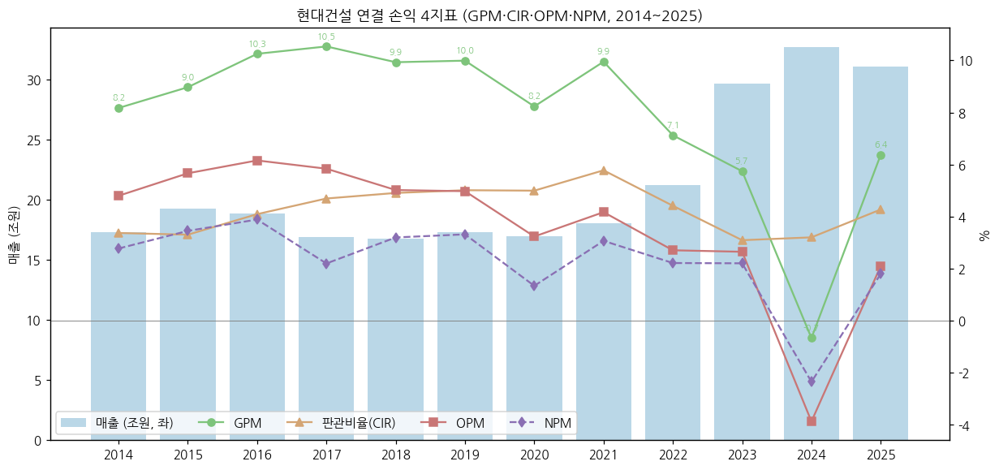

**별도 vs 연결 (억원, DART) — 현대엔지니어링 등 종속 기여:**

| 연도 | 별도 매출 | 별도 OP | 별도 OPM | 연결 매출 | 연결 OP | 종속 기여 매출(연결−별도) | 종속 기여 OP |
|---|---|---|---|---|---|---|---|
| 2014 | 106,671 | 3,702 | 3.5% | 172,765 | 8,292 | 66,094 | 4,590 |
| 2015 | 107,163 | 5,162 | 4.8% | 192,332 | 10,893 | 85,168 | 5,732 |
| 2016 | 110,411 | 5,897 | 5.3% | 188,250 | 11,590 | 77,839 | 5,692 |
| 2017 | 101,680 | 4,188 | 4.1% | 168,871 | 9,861 | 67,191 | 5,673 |
| 2018 | 100,161 | 3,049 | 3.0% | 167,309 | 8,400 | 67,148 | 5,351 |
| 2019 | 100,147 | 3,706 | 3.7% | 172,788 | 8,597 | 72,641 | 4,891 |
| 2020 | 93,201 | 2,364 | 2.5% | 169,709 | 5,490 | 76,507 | 3,126 |
| 2021 | 102,463 | 3,051 | 3.0% | 180,655 | 7,535 | 78,192 | 4,484 |
| 2022 | 119,785 | 3,463 | 2.9% | 212,391 | 5,749 | 92,606 | 2,286 |
| 2023 | 157,788 | 3,405 | 2.2% | 296,514 | 7,854 | 138,725 | 4,449 |
| 2024 | 167,301 | -2,155 | -1.3% | 326,703 | -12,634 | 159,402 | -10,479 |
| 2025 | 165,125 | 2,512 | 1.5% | 310,629 | 6,530 | 145,504 | 4,018 |

→ 2014~2023 종속(주로 HEC)이 연결 영업이익의 55~70%를 기여 → 2024 종속 -1.05조로 적자 주도 → 현대건설 연결 이익은 **HEC 의존도가 구조적으로 높음**

### ② 재무상태표 (12년 연결, 조원)

| 연도 | 자산총계 | 부채총계 | 자본총계 | 지배지분 | 자본 YoY | 부채비율 | 유동비율 |
|---|---|---|---|---|---|---|---|
| 2014 | 18.24 | 11.46 | 6.79 | 5.29 | - | 168.8% | 163.1% |
| 2015 | 19.35 | 11.96 | 7.39 | 5.72 | +8.9% | 161.8% | 165.9% |
| 2016 | 19.87 | 11.75 | 8.12 | 6.33 | +9.9% | 144.6% | 170.7% |
| 2017 | 18.43 | 9.96 | 8.47 | 6.47 | +4.3% | 117.5% | 183.5% |
| 2018 | 18.05 | 9.76 | 8.29 | 6.27 | -2.1% | 117.7% | 194.4% |
| 2019 | 18.23 | 9.51 | 8.71 | 6.66 | +5.1% | 109.1% | 194.5% |
| 2020 | 17.94 | 9.17 | 8.77 | 6.63 | +0.6% | 104.6% | 207.2% |
| 2021 | 19.64 | 10.21 | 9.43 | 7.22 | +7.6% | 108.3% | 190.8% |
| 2022 | 20.91 | 10.99 | 9.92 | 7.69 | +5.2% | 110.7% | 177.2% |
| 2023 | 23.71 | 13.26 | 10.46 | 8.14 | +5.4% | 126.8% | 179.7% |
| 2024 | 27.01 | 17.34 | 9.67 | 8.03 | -7.5% | 179.3% | 143.9% |
| 2025 | 27.79 | 17.68 | 10.11 | 8.26 | +4.6% | 174.8% | 147.9% |
| 2Q26 | 28.63 | 17.41 | 11.22 | 9.27 | - | 155.2% | 148.2% |
| 3Q26 (IR) | 27.28 | 16.35 | 10.93 | - | - | 149.5% | 152.2% |

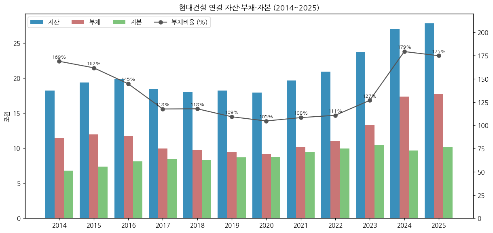

### ③ 현금흐름표 (12년 연결, 억원)

| 연도 | 영업CF | 투자CF | 재무CF | CapEx(유형) | CapEx(무형) | 배당지급 | FCF |
|---|---|---|---|---|---|---|---|
| 2014 | 4,260 | 3,246 | -802 | 1,881 | 84 | 1,037 | 2,296 |
| 2015 | 5,960 | -11,738 | 307 | 1,865 | 98 | 1,091 | 3,997 |
| 2016 | 10,865 | -7,752 | -1,769 | 1,787 | 86 | 1,084 | 8,993 |
| 2017 | 5,144 | -163 | -3,809 | 498 | 37 | 1,086 | 4,609 |
| 2018 | 2,495 | -920 | -373 | 1,919 | 28 | 1,069 | 549 |
| 2019 | 4,789 | -1,512 | 153 | 1,099 | 150 | 1,078 | 3,540 |
| 2020 | 17,297 | -12,192 | 955 | 734 | 171 | 1,321 | 16,392 |
| 2021 | 10,094 | -7,983 | -4,926 | 976 | 245 | 1,318 | 8,873 |
| 2022 | -1,435 | 18,533 | -6,582 | 1,484 | 184 | 1,150 | -3,103 |
| 2023 | -7,147 | 5,626 | 3,660 | 2,221 | 149 | 948 | -9,518 |
| 2024 | -1,188 | 2,117 | 7,337 | 1,789 | 205 | 949 | -3,181 |
| 2025 | -7,483 | 252 | 4,342 | 1,072 | 87 | 689 | -8,641 |

(FCF = 영업CF − 유·무형자산 취득. 배당지급 = 연결 CF상 지급액, 비지배주주 배당 포함)

→ **2022~2025 4년 연속 영업CF 적자 (누적 -1.73조)** — 매출채권 1.79조(2022)→6.84조(2025), 해외 현장 기성 미회수 + 주택 PF 관련 운전자본 증가. 투자CF(+)는 단기금융상품 회수(2022 +1.85조)로 메움

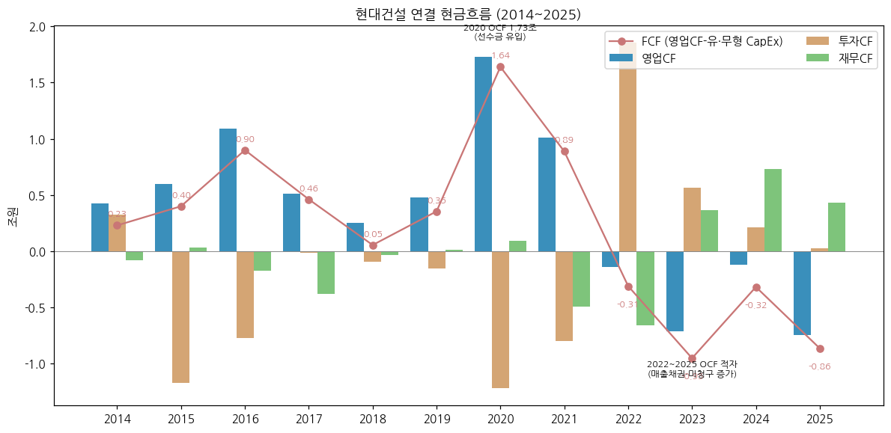

### ④ CapEx 추이 (12년, 억원)

| 연도 | 유형 | 무형 | 총 CapEx | CapEx/매출 |
|---|---|---|---|---|
| 2014 | 1,881 | 84 | 1,964 | 1.14% |
| 2015 | 1,865 | 98 | 1,963 | 1.02% |
| 2016 | 1,787 | 86 | 1,872 | 0.99% |
| 2017 | 498 | 37 | 535 | 0.32% |
| 2018 | 1,919 | 28 | 1,947 | 1.16% |
| 2019 | 1,099 | 150 | 1,249 | 0.72% |
| 2020 | 734 | 171 | 905 | 0.53% |
| 2021 | 976 | 245 | 1,221 | 0.68% |
| 2022 | 1,484 | 184 | 1,668 | 0.79% |
| 2023 | 2,221 | 149 | 2,370 | 0.80% |
| 2024 | 1,789 | 205 | 1,993 | 0.61% |
| 2025 | 1,072 | 87 | 1,159 | 0.37% |

- 수주산업 특성상 CapEx는 매출의 0.3~1.2% — 사이클 판단 지표로는 CapEx보다 **수주잔고·운전자본(미청구/매출채권)** 이 중요

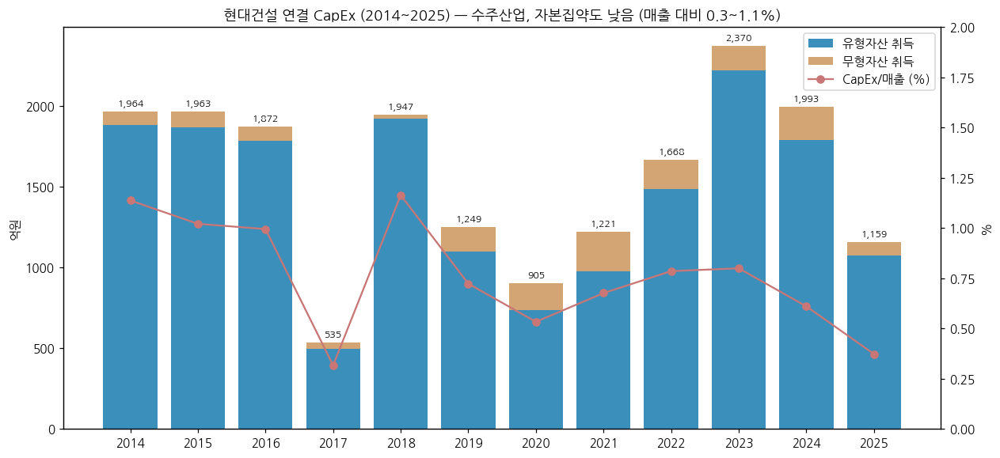

### ⑤ 부채구조 + 운전자본 (12년, 억원)

| 연도 | 유동부채 | 비유동부채 | 총차입금 | 현금+단기금융상품 | 순현금(+) | 미청구공사 | 초과청구공사 | 매출채권 |
|---|---|---|---|---|---|---|---|---|
| 2014 | 82,408 | 32,165 | 25,974 | 28,266 | +2,292 | 48,899 | 11,610 | 17,923 |
| 2015 | 85,753 | 33,842 | 26,327 | 30,297 | +3,970 | 41,633 | 14,828 | 24,948 |
| 2016 | 87,496 | 29,992 | 25,599 | 35,952 | +10,353 | 35,958 | 19,105 | 25,552 |
| 2017 | 72,190 | 27,399 | 22,818 | 34,639 | +11,821 | 28,964 | 17,819 | 19,664 |
| 2018 | 68,609 | 29,019 | 24,067 | 40,661 | +16,595 | 26,797 | 14,617 | 21,767 |
| 2019 | 67,709 | 27,411 | 25,890 | 42,972 | +17,082 | 22,825 | 18,863 | 19,842 |
| 2020 | 64,677 | 27,052 | 25,098 | 55,356 | +30,258 | 22,868 | 21,457 | 15,016 |
| 2021 | 76,132 | 25,948 | 21,598 | 52,784 | +31,186 | 32,474 | 25,563 | 16,348 |
| 2022 | 87,574 | 22,300 | 17,352 | 47,413 | +30,061 | 37,347 | 27,643 | 20,158 |
| 2023 | 103,566 | 29,023 | 23,006 | 45,815 | +22,809 | 53,352 | 19,557 | 33,787 |
| 2024 | 146,638 | 26,722 | 32,466 | 53,964 | +21,498 | n/a | 34,704 | 53,192 |
| 2025 | 148,429 | 28,359 | 38,510 | 51,768 | +13,257 | 39,374 | 31,944 | 68,423 |

(총차입금 = 단기차입금 + 유동성장기부채 + 사채 + 장기차입금. 2024 미청구공사는 DART 계정명 변경으로 미추출. 3Q26 차입금 45,162억·현금/예금 34,850억 (IR) → 순차입 전환 근접)

**신용등급:** 회사채 AA- (Stable) — 한국기업평가·NICE신용평가·한국신용평가 3사 동일 (2023~2025, hdec.kr)

**부동산 PF 우발부채 (연결, 백만원 → 조원, DART 반기보고서(2026.06) 주석 24):**

| 구분 | 2025말 | 2Q26말 |
|---|---|---|
| 부동산 PF(대출) 보증금액 합계 | 13.94조 | **14.18조** |
| └ 단독사업 | 13.89조 | 14.13조 |
| └ 컨소시엄 | 0.05조 | 0.05조 |
| 특수관계자 보증·담보 제공 | 1.83조 | 1.91조 |
| 우발부채 → 충당부채 전환액 | 0 | 0 |

- 2Q26 단독사업 보증 14.13조 = 정비사업(재건축·재개발 조합 본PF) 7.66조 + 기타사업 6.48조 / 대출잔액 12.67조 (정비 6.46조 + 기타 6.21조) — 같은 시점 연결 자본 11.22조를 상회
- 기타사업 중 브릿지론 대출잔액 1.74조 (만기 1년 이내 집중) — 본PF 전환·착공 지연 시 리스크 노출 구간

### ⑥ 배당·자사주 추이 (12년)

| 연도 | DPS 보통주(원) | 연결 배당지급(억) | 지배순이익(억) | 배당/지배순이익 (근사) |
|---|---|---|---|---|
| 2014 | 500 | 1,037 | 3,313 | 17.0% |
| 2015 | 500 | 1,091 | 4,210 | 13.4% |
| 2016 | 500 | 1,084 | 5,721 | 9.8% |
| 2017 | 500 | 1,086 | 2,017 | 27.9% |
| 2018 | 500 | 1,069 | 3,816 | 14.7% |
| 2019 | 600 | 1,078 | 4,074 | 16.6% |
| 2020 | 600 | 1,321 | 1,223 | 55.2% |
| 2021 | 600 | 1,318 | 4,075 | 16.6% |
| 2022 | 600 | 1,150 | 4,089 | 16.5% |
| 2023 | 600 | 948 | 5,359 | 12.6% |
| 2024 | 600 | 949 | -1,687 | 적자 |
| 2025 | 800 | 689 | 3,731 | 24.1% |

(DPS = 회사 배당현황·증권사 재무요약, 우선주는 +50원. 배당/지배순이익 = (보통 DPS×111.36M + 우선 DPS×1.05M) / 연결 지배순이익. 회사 공시 배당성향(별도 기준): 2021 23.6% / 2022 19.5% / 2023 18.1% / 2024 38.8% / 2025 38.9%, 배당총액 675억(600원)·900억(800원))

- **주주환원 정책 (2025-03 기업가치제고):** 2025~2027 총주주환원율 25%+ (별도 조정당기순이익 기준), **최소 DPS 800원**. 자사주 매입·소각 이력 없음
- 2026E DPS 컨센 824원 (FnGuide, 2026-11-02)

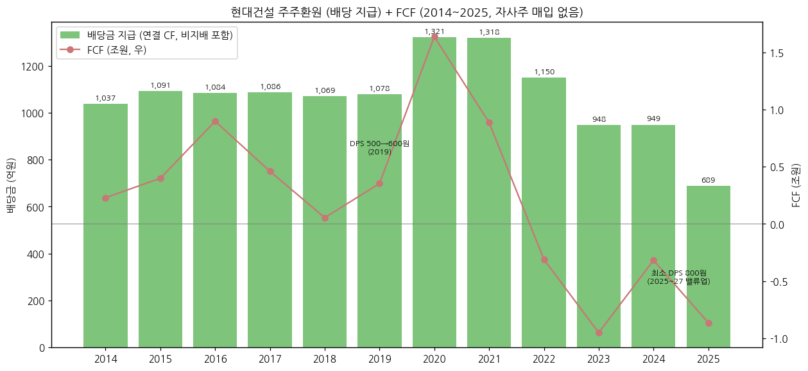

### ⑦ 재무 비율 (12년)

| 연도 | ROE(지배) | ROA | 부채비율 | 유동비율 | OP/금융원가 |
|---|---|---|---|---|---|
| 2014 | 6.3% | 2.6% | 168.8% | 163.1% | 4.8x |
| 2015 | 7.6% | 3.5% | 161.8% | 165.9% | 4.3x |
| 2016 | 9.5% | 3.7% | 144.6% | 170.7% | 5.8x |
| 2017 | 3.2% | 1.9% | 117.5% | 183.5% | 3.3x |
| 2018 | 6.0% | 2.9% | 117.7% | 194.4% | 4.9x |
| 2019 | 6.3% | 3.2% | 109.1% | 194.5% | 5.8x |
| 2020 | 1.8% | 1.3% | 104.6% | 207.2% | 2.7x |
| 2021 | 5.9% | 3.0% | 108.3% | 190.8% | 6.0x |
| 2022 | 5.5% | 2.3% | 110.7% | 177.2% | 3.3x |
| 2023 | 6.8% | 2.9% | 126.8% | 179.7% | 5.6x |
| 2024 | -2.1% | -3.0% | 179.3% | 143.9% | 적자 |
| 2025 | 4.6% | 2.0% | 174.8% | 147.9% | 3.2x |

**주요 비율 의미:**
- **ROE**: 지배순이익 / 평균 지배지분 — 12년 최고 9.5%(2016), 2030 목표 12%+α 대비 큰 격차
- **ROA**: 순이익 / 평균 자산
- **부채비율**: 2020 104.6% → 2025 174.8% — 선수금·매입채무 등 영업부채 증가 (차입금 비중은 낮음, 순현금 유지)
- **OP/금융원가**: 이자비용 별도 계정 미추출로 금융원가(외환손실 포함) 대용 → 실제 이자보상배율은 이보다 높음 (2025 이자비용 1,220억 기준 5.4x, iM)

---

## 5. 지배 구조

### ① 그룹·계열 관계

- **현대자동차그룹** 계열 (2011-04 편입): 현대자동차 → 현대건설 → 현대엔지니어링 구조
- **연결 종속기업 45개사** (비상장 45, 주요종속 9, DART 사업보고서(2025.12)): 현대엔지니어링, 현대스틸산업, 현대도시개발, 송도랜드마크시티 등
- **현대엔지니어링 지분**: 현대건설 38.62% (DART 반기보고서(2026.06) — 특수관계자 약정으로 실질지배, 유효지분율 40.47%). 기타 주주 (2021-04 보도): 정의선 회장 11.72% / 현대글로비스 11.67% / 기아 9.35% / 현대모비스 9.35% / 정몽구 명예회장 4.68%
- 현대엔지니어링 2022-01 IPO 철회 이후 상장·합병 여부가 지배구조 이슈로 반복 거론

### ② 주주 구분

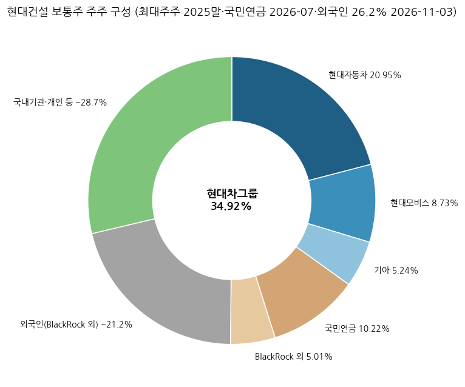

**5% 이상 주주 (보통주):**

| 주주명 | 지분율 | 기준일 / 출처 |
|--------|--------|------|
| 현대자동차 (최대주주) | 20.95% | 2025말 |
| 현대모비스 | 8.73% | 2025말 |
| 기아 | 5.24% | 2025말 |
| **현대차 외 5인 합계** | **34.92%** (38,886,931주) | FnGuide 2026-11-02 |
| 국민연금공단 | 9.98% (11,113,284주) ~ 10.22% | FnGuide 2026-11-02 / 신고일 2026-07-01 (하나증권 10.61% 표기) |
| BlackRock Fund Advisors 외 11인 | 5.01% (5,580,455주) | 신고일 2026-08-06 |

**전체 주주 구분 (추정, 2026-11):**

| 구분 | 지분율 | 비고 |
|---|---|---|
| 현대차그룹 (최대주주등) | 34.92% | 공시 |
| 외국인 | 26.2% | 네이버 증권 2026-11-03 (BlackRock 포함) |
| 국민연금 | ~10% | |
| 기타 국내기관·개인 | ~29% | 유동비율 65.08% (FnGuide) |

- 발행주식: 보통주 111,355,765주 / 우선주 1,054,693주 (액면 5,000원, 자본금 5,621억, 2025-12-31)

### ③ 임원·이사회

**대표이사:**
- **이한우 대표이사 사장** (1970년생)
    - 약력: 1994 현대건설 입사 → 전략기획사업부장 → 주택사업본부장(전무) → 2024-11-15 현대차그룹 인사에서 부사장 승진·대표이사 내정 → 2025-03 정기주총 사내이사 선임
    - 주택 출신 — 2026 주택 GPM 12~13% 회복과 원전 수주 성과가 평가 기준 ("올해 실질적 성과로 이어질 것", 2026-01)
    - 전임: 윤영준 사장 (2021~2024)

**등기임원 (DART 사업보고서(2025.12) VIII, 2025-12-31):**

| 구분 | 성명 | 직위·담당 | 주요 경력 | 임기만료 |
|---|---|---|---|---|
| 사내이사 | 이한우 (1970.09) | 대표이사 부사장 | 서울대 건축학, 전 주택사업본부장, 재직 32년 | 2028-03 |
| 사내이사 | 황준하 (1966.10) | 전무, CSO (안전관리본부장) | 전 구매본부장 | 2028-03 |
| 사내이사 | 이형석 (1972.08) | 전무, CFO (재경본부장) | 전 현대캐피탈 재경본부장 | 2027-03 |
| 사외이사 | 김재준 (1960.10) | 경영감사 | 한양대 건축공학부 교수, 전 한국BIM학회장 | 2026-03 |
| 사외이사 | 홍대식 (1965.09) | 경영감사 | 서강대 법학전문대학원 교수, 전 율촌 변호사 | 2026-03 |
| 사외이사 | 조혜경 (1964.07) | 경영감사 | 한성대 AI응용학과 교수, 삼성전자 사외이사 | 2027-03 |
| 사외이사 | 정문기 (1959.03) | 경영감사 | 성균관대 경영학과 객원교수, 전 포스코 이사회 의장 | 2028-03 |

- 이사회 사내 3 + 사외 4 / 2025년 선임 사외이사 제도 도입·사외이사회 운영·보상위원회 전원 사외이사 전환 (기업가치제고 이행현황 2025-12)

**외부감사인:** 삼일회계법인 — 제74~76기 (2023~2025) 연결·별도 모두 적정의견. 핵심감사사항: ① 투입법에 따른 수익인식 ② 손상징후가 존재하는 공사채권의 회수가능성 (DART 사업보고서(2025.12) V). 2025-12-01 외부감사인 선임공고 (hdec.kr)

---

## 6. 기타 팩트

### ① R&D 인프라

| 연도 | 2014 | 2015 | 2016 | 2017 | 2018 | 2019 | 2020 | 2021 | 2022 | 2023 | 2024 | 2025 |
|---|---|---|---|---|---|---|---|---|---|---|---|---|
| 연구개발비용 (억원) | 1,235 | 1,048 | 988 | 1,141 | 1,377 | 1,723 | 1,491 | 1,250 | 1,368 | 1,643 | 1,779 | 1,646 |
| **R&D / 별도 매출** | **1.2%** | **1.0%** | **0.9%** | **1.1%** | **1.4%** | **1.7%** | **1.6%** | **1.22%** | **1.14%** | **1.04%** | **1.06%** | **1.00%** |

(DART 사업보고서 II-6 '연구개발비용 계', 현대건설 별도 기준. 연결 판관비 내 연구개발비(iM 집계 2025 1,780억)와 범위 상이)

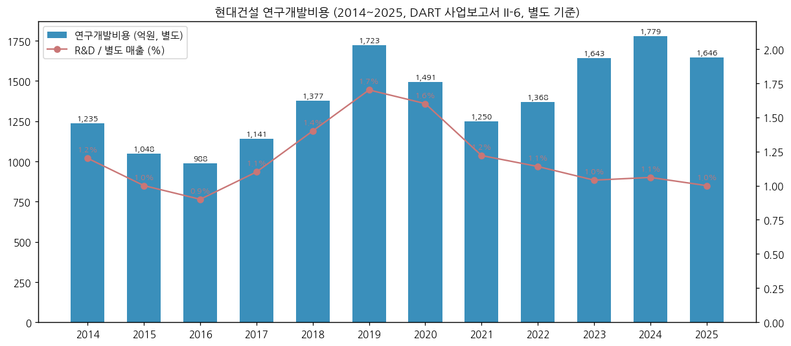

- **연구 분야** (hdec.kr): 에너지 (원전·SMR·수소·해상풍력), 미래주거, 스마트건설, 인프라
- **연구시설**: 그린스마트 이노베이션 센터, 구조실험동, 환경실험동, H 사일런트 랩
- 원전 인력 약 1,000명 (iM 2026-04-15)

### ② 진행 중 corporate action — 10년치 주요 이벤트

```
2026  · 미국 전기로 제철소 5.4조 (1H26) / 압구정 3구역 시공권 5.6조
      · 현대엔지니어링 신규 주택 수주 중단 (IR 3Q26)
      · JGC 컨소시엄 파푸아뉴기니 LNG 우선협상 (2026-03-31, iM)
2025  · CEO Investor Day + 기업가치제고 계획 (2025-03): 2030 매출 40조+, 최소 DPS 800원
      · 이라크 WIP 해수처리 4.2조 (3Q25), 마곡 더그리드 1.6조, 신안우이 해상풍력 0.7조
      · 루마니아 체르나보다 1호기 설비개선 EPC (2025-04) / 사우디 송전 EPC (2025-01)
      · 미국 텍사스 태양광 EPC (2025-06)
2024  · 4Q24 대규모 손실 인식 (연결 OP -1.78조) / 불가리아 원전 설계 계약 (2024-11)
2022  · 현대엔지니어링 IPO 철회 (2022-01)
2021  · Holtec SMR 협력 (2021-11)
2016~2020 · 해외 저가수주 정리, 주택 비중 확대 (별도 건축/주택 비중 70%대)
```

### ③ 기술·원전 마일스톤 — 10년치

```
2026  · 네덜란드 신규원전 FEED1 (Westinghouse) / TerraPower 원자로 조립 공사 추진
      · 펠리세이즈 SMR-300 부분계약 추진 (연말 약 2억$ 전망)
2025  · Fermi America 대형원전 4기 FEED (2025-10) — 국내 최초 美 대형원전
      · 핀란드 대형원전 사전업무 (2025-06), 슬로베니아 JEK2 기술타당성 완료 (2025-08)
2024  · 불가리아 코즐로듀이 AP1000 2기 설계 계약 (Westinghouse 컨소시엄)
2023  · Holtec 노형 SMR-160 → SMR-300 전환, 미시간 펠리세이즈 부지 1호기 추진
2024  · 신한울 3·4호기 (APR1400) 주설비공사 착공 (2024-04, ~2033-10, DART 수주상황)
2021  · Holtec SMR-160 독점 EPC 협력
2009~ · UAE 바라카 1~4호기 (APR1400) 시공 — 2024 4호기 상업운전으로 전 호기 완공
```

### ④ 주요 리스크

- **PF 우발채무 (부동산 PF 보증)**: 보증금액 1H25 12.30조 (IB토마토 2025-11-13) → 2025말 13.94조 → **2Q26말 14.18조** (DART 반기보고서(2026.06)) — 연결 자본 11.22조 상회. 정비사업 조합 본PF 7.66조 + 기타사업 6.48조(브릿지론 잔액 1.74조 포함). 충당부채 전환액 0 (2Q26). 상세는 4-⑤
- **해외 고원가 현장**: 별도 플랜트(사우디·샤힌) 9M26 원가율 100.6%, 토목(싱가포르 남북도로) 101.3% / HEC 솔로몬제도 수력 (3Q26 430억 비용)
- **핵심감사사항 (삼일회계법인)**: 투입법 수익인식·손상징후 공사채권 회수가능성 — 원가율 추정 변경이 일시 손실로 이어지는 구조 (2024 4Q 사례)
- **현대엔지니어링 리스크**: 2024 해외 손실 1.24조, 2025-02 세종-안성 고속도로 교량 붕괴 사고, 4Q25 본드콜 이슈 (iM 2025-11-03)
- **영업현금흐름 4년 연속 적자 (2022~2025)** — 매출채권 6.84조 (2025말)
- **원전 수주 지연 리스크**: 고객 자금조달·PPA 지연으로 Fermi·펠리세이즈 계약 부분계약 전환, 체코 팀코리아 계약자–시공사 이견 (하나 2026-11-02), 미국 금리·중간선거 불확실성 (신한 2026-10-15)
- **주택 착공 감소**: 3Q26 착공 1,373세대 (누적 4,472세대), HEC 주택 신규수주 중단 → 2026 연결 매출 가이던스 27.4조 (-11.8%)
- **환율**: 해외 매출 비중 40% (2025 12.3조/31.1조) — 3Q26 환 관련 평가손실로 순이익 -32%

### ⑤ ESG 등급

| 평가기관 | 등급 | 비고 |
|---------|------|------|
| KCGS (한국ESG기준원) | **종합 A** | 7년 연속 (2018~2024) — 환경 A / 사회 A / 지배구조 B+ (2024) |
| DJSI World | 편입 | 15년 연속 (2010~2024), 건설·엔지니어링 리더 9회 |
| S&P Global CSA | World 15년 연속 | 기업가치제고 이행현황 2025-12 |
| CDP Climate Change | 명예의 전당 | 7년 연속 (2018~2024), 플래티넘 클럽 4년 연속 |

- UNGC 가입, SBTi 지지, TCFD 가입 / 2024 온실가스 2023 대비 11만톤 감축 (Scope 1·2)
- 안전 투자 5년간 (2021~2025) 약 1조원 / 공정거래 Compliance Program AA 등급

### ⑥ 인증·라이선스

- **원전**: 국내 원전 시공 (고리 1호기~신한울), UAE 바라카 APR1400 시공 / 미국 AP1000·SMR-300 EPC 협력 (Westinghouse·Holtec)
- 회사채 신용등급 AA- (Stable) 3사 (2025)
- 웹접근성 인증, 가족친화인증기업 (hdec.kr)
- 국내 원전 주설비 수행: 신한울 3·4호기 주설비공사 (한수원, 도급 1.60조, 2024-04 착공 ~ 2033-10, DART 수주상황)

---

## Version Log

**v1.0 (2026-11-03) — 신규 작성**
- ① 데이터 수집: OpenDART fnlttSinglAcntAll (연결·별도 각 43개 JSON, 2015 FY~2Q26 + 2014 비교컬럼) → 12년 손익·재무상태·현금흐름·CapEx·배당 전부 DART 원값
- ② 회사 IR PDF 7종 (1Q22·2Q25·3Q25 NDR·FY25 경영현황·1Q26·2Q26·3Q26) + 기업가치제고 이행현황 (2025-12) + hdec.kr 투자정보 (3년 손익·재무·수주·신용등급·배당)
- ③ 증권사 리포트 13건 (iM 2025-05~2026-11, 하이 2024-01, 신한 2023-01, 교보 2021-01, 현대차 2018-01, IBK 2016-01, 하나·미래에셋 2026-11) — 현대엔지니어링·공종별 분기, 원전 파이프라인
- ④ 차트 19종: chart1·1b·2(×7: 연결 공종 3 + 별도 + 종속 + HEC + 별도공종)·4·5·6·7·8·9·10·11·12 + chart13 (수주·수주잔고, 건설업 추가)
- ⑤ 3Q26 잠정실적 반영 (분기 시계열만, 연간 표는 FY25 기준 유지)

**v1.0 보강 (2026-11-03, 동일 버전 내 1차 완성):**
- DART 정기공시 원문 XML 45건 파싱: 연결 공종별 매출·GPM 2013~2025 (연간) + 1Q16~2Q26 (42분기, 누적값 차분), 수주상황 계약잔액 2013~2025, 임직원 12년, 연구개발비 12년, 등기임원, 외부감사인, 부동산 PF 우발부채 (2Q26), 계약잔액 상위 현장·부문별 주요고객, 2026 회계정책 변경(투자부동산 공정가치·토지 재평가)
- chart2 연결 공종 3종 (건축주택·플랜트전력·토목, DART 42분기) 추가, chart7 12년 DART, chart13 DART 계약잔액 13년

**다음 갱신 (3Q26 분기보고서 제출 후, 11월 중순):**
- 3Q26 공종별 매출·GPM, PF 보증 잔액, 9월말 재무상태표를 DART 확정치로 교체 (현재 3Q26 = IR 잠정)
- 연간 표는 FY26 결산 후 v2.0
