> 종목: 현대로템 (064350.KS / 현대로템 주식회사 / HYUNDAI ROTEM COMPANY)
> 섹터: 방산 (워치리스트 섹터 T2)
> 작성 시각: 2026-11-03 KST (**v1.0** — 첫 작성, v4.8 표준 6개 섹션 + 차트 13종)
> 적용 구조: v4.8 (6개 섹션 + 12종 표준 차트 + chart3 수주잔고 추가)
> 데이터: 13년 연결 연간(2013~2025, OpenDART 전체 재무제표 CFS) + 51분기 사업부별(1Q14~2Q26 DART 영업부문 주석 + 3Q26P 잠정실적) + Yahoo Finance 064350.KS 월간 시계열(2013.11~2026.11) + 수주잔고 13년(DART 사업보고서)
> 출처: **DART 사업·반기·분기보고서 51건** (corp_code 00302926) — 최신 정성자료 2026.06 반기보고서(rcept_no 20260814002977), 2025 사업보고서(20260319001275), 2024 사업보고서 기재정정(20250321001612), 2020 사업보고서 기재정정(20210602000352), 2013 사업보고서(20140331000193) 외 / OpenDART 연결재무제표 JSON 43건(2015 FY~2026 2Q) / 3Q26 잠정실적: 딜사이트·SBS Biz 2026-10-19 보도 / 시장데이터: Yahoo Finance(2026-11-03 종가), stockhub.kr(2026-11-03), 파이낸셜뉴스(2026-10-20)

# 현대로템 기업 개요 (v1.0 — 방산 T2, 사이클 + 방산 수출 고성장 Boundary case)
> **Fact verify cutoff**: 2026-11-03 (시가총액·52주 고저·ATH는 2026-11-03 Yahoo Finance meta + stockhub.kr 교차 확인)

---

## ① 기업 분류

(1) Primary / Secondary 분류

**⚠️ Boundary Case — 수주 사이클 vs 방산 수출 고성장**

13년 OPM range **-11.4% ~ 17.2% = +28.6%pt** (cutoff ±10pp의 2.9배) — 정량적으로는 강한 사이클. 그러나 2020~2025 **6년 연속 OPM 개선**(2.9→17.2%)은 폴란드 K2 수출이라는 구조적 이벤트가 만든 것이고, 2026년 들어 3분기 연속 YoY 감익(1Q26 OP +10.5% → 2Q26 -9.8% → 3Q26P -11.0%)으로 **정점 통과 신호**가 나오고 있다.

**Primary 분류: 사이클 (수주·프로젝트 사이클, 13년 OPM range +28.6pp)**

→ 2014~2019 철도·플랜트 프로젝트 원가 초과로 적자 2회(2015 OPM -5.8%, 2019 OPM -11.4%) → 2020 흑전 → 2022.08 폴란드 K2 1차 → 2025 OPM 17.2% 정점

→ 이익이 "어떤 대형 수출 계약이 몇 년에 걸쳐 인도되느냐"에 좌우되는 구조 — 계약 사이클이 곧 이익 사이클

**Secondary 노트: 방산 수출 고성장 (K2 전차 플랫폼, 2025~2033 폴란드 2차 인도)**

→ 방산 매출 2021 8,965억 → 2025 32,153억 (**4년 3.6배**), 방산 OPM 5.1% → 29.7%

→ 폴란드 K2 2차 이행계약 8조 9,814억원(계약기간 2025.08.01~2033.12.31) 중 2025년말 누적 매출 인식 6,656억 — 잔여 물량이 2026~2033 매출의 기반 (DART 2025 사업보고서 XI. 공시내용 진행사항)

**Entity 구조 (2026.06 반기 기준, 신부문 체계)**

→ **(1) AD&RH (구 디펜스솔루션 = 방산부문)** — 1H26 매출 17,385억 (57%) — K2·K1 전차, 차륜형장갑차, 장애물개척전차, 무인체계 + **2026년부터 수소인프라·산업용 로보틱스 편입**

→ **(2) RS (구 레일솔루션 = 철도부문)** — 1H26 매출 11,280억 (37%) — 전동차·고속철(EMU-260/320)·트램, E&M, O&M

→ **(3) EP (구 에코플랜트 = 플랜트부문)** — 1H26 매출 1,970억 (6%) — 프레스, 에코 제철설비, 운반설비

→ **(4) 연결종속회사 14개** (전부 비상장, 2025말·2026.06 동일) — Hyundai Rotem USA, Hyundai EURotem(튀르키예, 50.5%), Rotem Equipments(Beijing), 브라질·말레이시아 법인 등

**부문 명칭 매핑 (시계열 연결 시 필수)**

| 기간 (DART 영업부문 주석) | 방산 | 철도 | 플랜트 | 기타 |
|---|---|---|---|---|
| 2013~2016 | **중기부문** | 철도부문 | 플랜트부문 | 그린에어(산업용 가스, 51%) 등 조정 |
| 2017~2025 | **방산부문** (사업의 내용 표기: 디펜스솔루션) | 철도부문 (레일솔루션) | 플랜트부문 (에코플랜트) | 2020.05 그린에어 매각 후 소멸 |
| 2026.06~ | **AD&RH부문** | **RS부문** | **EP부문** | — |

→ 2026 반기보고서는 "기존 방산·철도·플랜트 부문을 AD&RH·RS·EP로 재편, 비교표시 정보도 재작성"이라고 명시. 차이는 수소·로보틱스(구 에코플랜트) → AD&RH 이관. 재작성 영향 예: 1Q26 EP 매출 1,103억(구) → 947억(신), AD&RH 8,039억(구 방산) → 8,195억(신). **본 리포트 분기 시계열은 1Q26까지 구 기준, 2Q26·3Q26P는 신 기준**(chart2에 점선 표시)

(2) Summary Box (12년 연결 시계열 2014~2025 + 사이클 통계)

| 지표 | 12년 평균 (2014~2025) | 정점 | 저점 | 2025년 |
|---|---|---|---|---|
| 매출 (연결, 억원) | 33,088 | **58,390 (2025)** | 24,119 (2018) | **58,390** |
| OP (연결, 억원) | 1,226 | **10,056 (2025)** | -2,799 (2019) | **10,056** |
| NI (지배, 억원) | 525 | **7,699 (2025)** | -3,543 (2019) | **7,699** |
| OPM (연결, %) | 2.0% | **17.2% (2025)** | -11.4% (2019) | **17.2%** |

```
[현대로템 13년 연결 손익 시계열 (억원)]
연도   매출      OP       OPM     NI(지배)
2013  32,994   1,744    5.3%    1,191   ← 2013.10.30 상장 (공모가 23,000원), 플랜트 OPM 10% 시기
2014  31,911      66    0.2%     -167   ← 철도·플랜트 수익성 급락 시작
2015  33,091  -1,929   -5.8%   -3,062   ← 1차 저점: 철도 OP -1,895억 (해외 PJT 원가 초과)
2016  29,848   1,062    3.6%      218   ← 일시 회복 (철도 OPM 5.5%)
2017  27,257     454    1.7%     -474   ← 매출 감소 국면 (수주 공백)
2018  24,119  -1,962   -8.1%   -3,008   ← 플랜트 OP -1,643억 (4Q18 일회성 손실)
2019  24,593  -2,799  -11.4%   -3,543   ← 2차 저점(13년 최저): 철도 OP -2,595억, 부채비율 363%
2020  27,853     821    2.9%      310   ← 흑전 (그린에어·의왕부지 매각, CB 2,354억 전환으로 자본 확충)
2021  28,725     802    2.8%      665   ← BEP 구간, 수주잔고 10조 돌파
2022  31,633   1,475    4.7%    1,978   ← 2022.08 폴란드 K2 1차 4.50조 → 4Q22 방산 OPM 15.7%
2023  35,874   2,100    5.9%    1,610   ← 폴란드 1차 인도 본격화
2024  43,766   4,566   10.4%    4,069   ← 방산 OPM 23.8% (철도 4Q24 -1,383억 일회성)
2025  58,390  10,056   17.2%    7,699   ← 13년 정점 (방산 OPM 29.7%), 2025.08 폴란드 2차 8.98조
(2026 1~3Q: 매출 46,842억 +11.2%, OP 7,037억 -4.7% — 정점 통과 신호)

OPM range: -11.4% ~ 17.2% = +28.6%pt (cutoff ±10%pt의 2.9배 → 사이클 분류)
사이클 회수: 저점 2회 (2015·2019), 정점 2회 (2013·2025) → 13년 1.5 사이클
```

**📊 사이클 통계 (12년 연결)**

| 지표 | 값 |
|---|---|
| 매출 CAGR (11년, 2014→2025) | **+5.6%** |
| 매출 CAGR (3년, 2022→2025) | **+22.7%** (방산 수출 가속) |
| OPM 평균 (2014~2025) | **2.0%** |
| OPM 정점 평균 (2013·2016·2025) | **8.7%** |
| OPM 저점 평균 (2015·2019) | **-8.6%** |
| OPM range | **+28.6%pt** |
| 사이클 주기 | 저점→저점 약 4년 (2015→2019), 저점→정점 6년 (2019→2025) |
| 사이클 회수 (13년) | **저점 2회 / 정점 2회** |
| 사이클 cutoff (±10%pt) | **충족** → 사이클 분류, 단 2020~2025 6년 단조 개선 = Boundary |

**국내 방산 4사 OPM 비교 (FY25, 메트로신문 2026-02-24 보도 수치로 계산)**

→ **현대로템** — 매출 5조 8,390억 / OP 1조 56억 / **OPM 17.2%** — 4사 중 1위

→ **한화에어로스페이스** — 매출 26조 6,078억 / OP 3조 345억 / OPM 11.4%

→ **LIG넥스원** — 매출 4조 3,094억 / OP 3,231억 / OPM 7.5%

→ **KAI** — 매출 3조 6,964억 / OP 2,692억 / OPM 7.3%

(3) 정량적 분류 근거

→ **방산 이익 비중 95%** (FY25 부문 OP 9,563억 / 전사 10,056억) — 매출 비중(55%)보다 이익 비중이 훨씬 큼. 철도는 매출 36%지만 OP 292억(2.9%)

→ **방산 수출 비중 72%** (FY25 방산 매출 32,153억 중 수출 23,292억, DART 사업의 내용 매출실적) — 2023 6,826억 → 2025 23,292억

→ **매출 상위 고객 집중**: FY25 고객1 2조 2,017억(전사 매출의 38%), 고객2 7,444억(13%) 모두 방산 (DART 영업부문 주석 — 고객명 미공시, 고객1은 폴란드 군비청 추정)

→ **수주잔고 29.8조 (2025말)** = FY25 매출의 5.1배 → 향후 수년 매출 가시성은 높으나, 잔고 중 철도 비중이 크고(3Q26말 RS 19.0조 vs AD&RH 9.5조, 보도 기준) 철도 마진은 1%대

→ **2026 3분기 연속 YoY 감익** (OPM 15.4% → 14.5% → 15.2%P vs 2025 17~18%) — 폴란드 1차 물량 인도 막바지(1차 누적 매출 3.94조/4.50조 = 88%, 2025말) + 2차 초기 물량 전환 구간

(4) 산업 분류

→ **한국표준산업분류** — 철도장비 제조업 (DART 기업개황 기준 — ⚠️ 본 작업에서 기업개황 API 미호출, 사업목적 1번 "철도차량 및 부품 설계·제조" 기준 추정)

→ **KRX 업종** — 운수장비 (⚠️ 추정, 확인 필요)

→ **워치리스트 섹터** — **T2 방산**

→ 실질 분류: 매출 기준 방산(55%)+철도(36%) 복합, **이익 기준 순수 방산주**(OP 95%)

(5) 분류 결정 논리

(1) **가장 큰 사업부 기준** — 방산(AD&RH) 매출 55%, OP 95% → 방산 사이클이 Primary driver. 단 2013~2021엔 철도가 매출 50~58%로 최대 부문이었음 → **2023년이 최대 사업부 교체 시점**(방산 15,780억 vs 철도 15,536억)

(2) **이익 비중 sub-rule** — 방산 OP 비중 95% → 분류는 방산 기준. 방산 이익은 "수출 계약 단위" 사이클(폴란드 1차 2022~2027, 2차 2025~2033)을 따르므로 **사이클**

(3) **Boundary case 처리** — 2020~2025 6년 OPM 단조 개선 + 수주잔고 29.8조 → 고성장 성격 존재. 그러나 ① 단일 고객(폴란드) 의존, ② 2026 감익 전환, ③ 철도의 반복적 PJT 손실 이력(2015·2019·4Q24) → **Primary 사이클 + Secondary 방산 수출 고성장** 확정

(4) **국내외 피어 비교** — 국내 방산 4사 중 OPM 1위(17.2%), 단 제품 포트폴리오가 지상장비(전차) 단일 플랫폼 집중 → 한화에어로(K9·레드백·우주·조선 지분 다각화)보다 사이클 진폭 큼. 글로벌 지상장비 피어(Rheinmetall, KNDS, GDLS)와 같은 "유럽 재무장 수혜" 그룹, 철도는 Alstom·Siemens Mobility·CRRC 대비 점유율 2~3%(DART 2019 사업보고서, SCI/Verkehr 인용) 소형 플레이어

(6) 적정 밸류에이션 방법

→ **1차 — Forward PER (12MF EPS)**: 방산 이익이 전사 이익의 95% → 방산 수출 이익 가시성(폴란드 2차 인도 스케줄) 기반 PER. 2026-11-03 종가 77,100원 기준 **trailing PER 약 10.6배**(4Q25~3Q26P 연결 NI 합 7,924억 ÷ 109.1M주 = EPS 약 7,260원, **추정**; stockhub.kr 표기 16.39배는 산출 시점 불명)

→ **2차 — P/B 밴드 (사이클 분류 보조)**: 2Q26말 지배자본 34,064억 → **PBR 약 2.5배**(시총 8.41조 기준, 추정). 2019 저점(자본 8,829억, 부채비율 363%)부터 2025 자산재평가(+3,081억 OCI)까지 자본 구조가 크게 바뀌어 과거 밴드 비교 시 주의

→ **3차 — 수주잔고/시총 (EV/Backlog)**: 수주잔고 29.1조(3Q26) vs 시총 8.4조 = 0.29배 — 단 잔고의 65%가 저마진 철도(보도 기준)라 잔고 총액보다 **방산 잔고 × 방산 OPM**으로 환산해야 의미 있음

→ **DCF 미사용 근거** — 이익이 개별 수출 계약 체결 여부에 따라 계단식으로 변해 장기 FCF 추정 신뢰도 낮음 (OCF도 선수금 유입 연도에 급증: 2022·2023·2025)

→ **삼성전자 대비**: 삼성전자는 PBR 사이클, 현대로템은 **PER + 수출 계약 파이프라인** (추가 K2 수출국 — 페루 총괄합의 2025.12.10, 루마니아·중동 등 — 가 멀티플 결정)

(7) 분기 재평가 트리거 (**분류 변경 조건**)

→ ① **폴란드 외 K2 대형 수출(3조원+) 1건 이상 본계약 + 4분기 연속 방산 OPM 25%+ 유지** → Primary **고성장**으로 격상 (단일 고객 사이클 → 다국가 플랫폼 성장)

→ ② **방산 OPM 20% 하회 2분기 연속 + 연간 신규수주 < 매출** (잔고 감소 지속) → **Pure 사이클 확정**, 정점 통과 판단 (3Q26 누적 신규수주 3조 8,049억, 전년동기 대비 -74.2% — 감시 대상)

→ ③ **철도 부문 분기 영업손실 -500억 이상 재발** → 2015·2019형 PJT 손실 사이클 재진입 경고 (철도 잔고 19조가 이익 아닌 리스크로 전환)

---

## ② 회사 개요

(1) 기본 사항

| 항목 | 내용 |
|---|---|
| 회사명 (한글) | 현대로템 주식회사 |
| 회사명 (영문) | HYUNDAI ROTEM COMPANY |
| 종목코드 | 064350 (KRX 유가증권시장, 2013.10.30 상장) |
| 설립 | 창립 1977.07.01 (현대정공) / 개업 1999.07.01 (철도차량 3사 통합법인) |
| 본사 | 경상남도 창원시 성산구 창원대로 488 |
| 홈페이지 | www.hyundai-rotem.co.kr |
| 대표이사 | **이용배** 사장 (1961.04생, 경희대 경영학 석사, 현대자동차 경영기획담당 부사장·현대위아 등 거쳐 2020.03.25 대표이사 선임, 2023.03·2026.03 재선임) |
| 발행주식수 | 109,142,293주 (보통주, 자기주식 없음) |
| 연결종속회사 | 14개 (비상장, 2026.06말) |
| 최대주주 | **현대자동차 33.77%** (36,852,432주) + 특수관계인 합 33.77% (DART 2026.06 반기) |
| 5% 이상 주주 | 국민연금 8.0% (8,752,110주, DART 2026.06 반기) |
| 외국인 지분율 | 39.53% (stockhub.kr, 2026-11-03) |
| 신용등급 | **AA-(안정적)** — 2026.04 한기평·한신평·NICE 3사 정기평가 상향 (2025.10 A+(긍정적) → 2026.04 AA-) |
| 임직원 | 4,571명 (2026.06말) / 4,541명 (2025말) |

(2) 13년 손익·자본 추이 (연결, OpenDART 재무제표 — 각 연도 당해 사업보고서 최초 공시값)

| 연도 | 매출 (억) | OP (억) | OPM | NI 지배 (억) | 자본총계 (억) | 자산총계 (억) |
|---|---|---|---|---|---|---|
| 2013 | 32,994 | 1,744 | 5.3% | 1,191 | 17,895 | 42,749 |
| 2014 | 31,911 | 66 | 0.2% | -167 | 17,387 | 44,008 |
| 2015 | 33,091 | -1,929 | -5.8% | -3,062 | 14,377 | 50,439 |
| 2016 | 29,848 | 1,062 | 3.6% | 218 | 14,672 | 44,732 |
| 2017 | 27,257 | 454 | 1.7% | -474 | 14,183 | 40,839 |
| 2018 | 24,119 | -1,962 | -8.1% | -3,008 | 11,080 | 40,021 |
| 2019 | 24,593 | -2,799 | -11.4% | -3,543 | 8,829 | 40,843 |
| 2020 | 27,853 | 821 | 2.9% | 310 | 13,462 | 41,974 |
| 2021 | 28,725 | 802 | 2.8% | 665 | 12,682 | 41,072 |
| 2022 | 31,633 | 1,475 | 4.7% | 1,978 | 14,915 | 48,239 |
| 2023 | 35,874 | 2,100 | 5.9% | 1,610 | 16,470 | 52,415 |
| 2024 | 43,766 | 4,566 | 10.4% | 4,069 | 20,091 | 52,854 |
| **2025** | **58,390** | **10,056** | **17.2%** | **7,699** | **30,412** | **93,180** |

→ 출처: 2013·2014는 2015 사업보고서 비교표시(전전기·전기), 2015~2025는 각 연도 사업보고서 연결재무제표(OpenDART fnlttSinglAcntAll CFS)
→ **시계열 단절 지점**: ① 2020.05 그린에어(현대제철 당진 산업용가스, 지분 51%) 현대제철에 812억 매각 → 연결 제외(2020 매출에 1~4월분만 반영), ② 2020.08 제30회 CB 전환(24,142,293주, 전환가 9,750원) → 발행주식 85.0M → 109.1M주, ③ 2025 토지 자산재평가 이익 3,081억(기타포괄손익) → 자본·자산 급증, ④ 2025 계약부채 1.79조 → 3.97조(폴란드 2차 선수금)로 부채 급증
→ 11년 매출 CAGR +5.6% / 자본 CAGR +5.2% / 2022→2025 매출 CAGR +22.7%
→ FY25 ROE(지배, 평균자본) **30.1%**

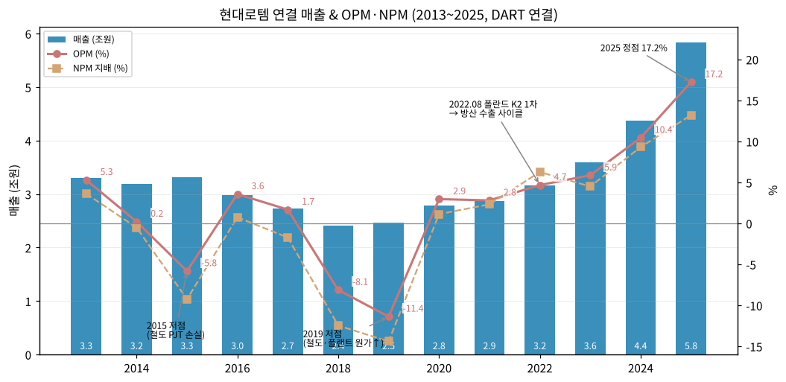

→ **사이클 위치**: 2013 상장 직후 정점(OPM 5.3%) → 2015·2019 철도·플랜트 PJT 손실 이중 저점 → 2020 재무구조 개선(자산 매각+CB) 후 흑전 → 2022 폴란드 K2 1차로 방산 수출 사이클 진입 → 2025 정점 → 2026 감익 전환

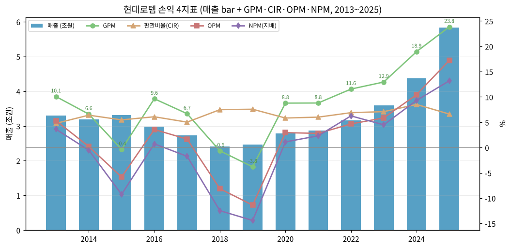

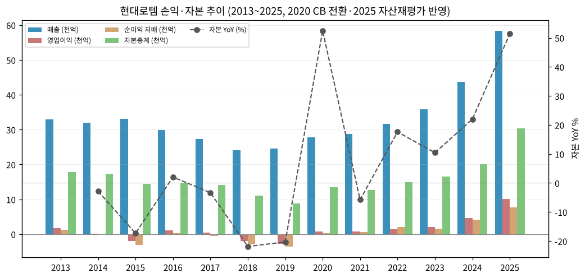

(3) 주가 역사

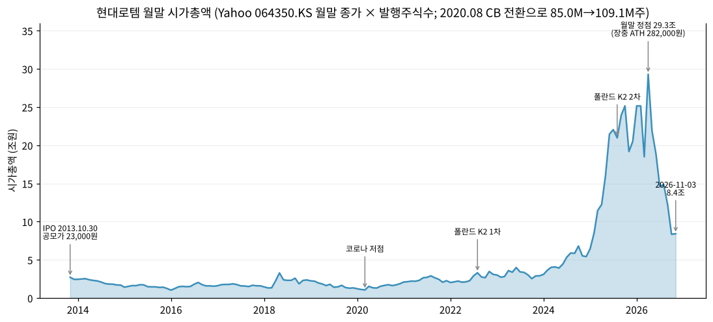

→ (출처: Yahoo Finance v8 월간 OHLC, 2013.11~2026.11. 시가총액 = 월말 종가 × 발행주식수(2020.07까지 85,000,000주, 2020.08부터 109,142,293주). ⚠️ Yahoo 월간 bar의 타임스탬프는 KST 월초 기준으로 보정함)

**시장 데이터 (2026-11-03 확인)**

| 항목 | 값 | 출처 |
|---|---|---|
| 종가 | 77,100원 (-2.16%) | Yahoo Finance meta, 2026-11-03 |
| 시가총액 | 약 8.4조원 (77,100원 × 109.1M주) / stockhub 표기 8.5조원(77,700원) | 계산 / stockhub.kr 2026-11-03 |
| 52주 최고 / 최저 | 282,000원 / 74,100원 | Yahoo Finance meta, stockhub.kr |
| 사상 최고가 (ATH) | **282,000원 (2026년 4월 장중)** — 월말 시총 정점 29.3조원 (2026.04말 268,500원) | Yahoo 월간 고가 |
| ATH 대비 | **-72.7%** | 계산 |

**주가 변천사 요약**:
- 2013.10.30: 상장(공모가 23,000원, 21,060,000주 공모)
- 2014~2019: 철도·플랜트 PJT 손실 + 수주 공백 → 장기 하락, 2020.03 코로나 저점(월중 저가 8,730원)
- 2020~2021: CB 전환·자산 매각으로 재무구조 개선, 박스권
- 2022.08: 폴란드 K2 1차 계약 → 방산주 재평가 시작
- 2025: 폴란드 2차(2025.08) + 방산 OPM 30% → 시총 20조원대 진입
- 2026.04: ATH 282,000원 / 월말 시총 29.3조원
- 2026.05~11: 2Q26 감익(-9.8%), 3Q26 잠정 OP 2,471억(-11%, 컨센 대비 -10.5%) + 수출계약 지연 우려 + 미국 방산예산 불확실성 → 2026-10-20 장중 -12.9%(87,800원, 파이낸셜뉴스), 11-03 77,100원. 삼성증권 목표가 25만→15.6만원 하향(2026-10-20 보도)

(4) 주요 연혁 (DART 사업보고서 연혁·중요사실)

| 시기 | 내용 |
|---|---|
| 1977.07 | 현대정공 창립 (현 현대로템 창립일) |
| 1999.07 | 현대정공·대우중공업·한진중공업 철도차량 부문 통합 법인 개업 (정부 중복투자 구조조정) |
| 2013.10.30 | 유가증권시장 상장 (공모가 23,000원) |
| 2020.05~06 | 그린에어 지분 51% 현대제철에 812억 매각, 의왕 토지·건물 현대모비스에 878억 매각 |
| 2020.08 | 제30회 CB 전환 → 발행주식 109,142,293주 |
| 2022.08.26 | **폴란드 K2 전차 공급 사업(1차 이행계약) 4조 4,992억원** (계약기간 ~2027.12.31) |
| 2023.02 | 튀르키예 알타이전차 양산 부품 1,741억 |
| 2023.03~04 | 코레일 EMU-320 7,100억, SR 고속철 도입·정비 1조 860억 |
| 2024.01 | 미국 LA 메트로 전동차 |
| 2024.06 | 우즈베키스탄 고속전철, 이집트 알렉산드리아 트램 |
| 2025.02 | 모로코 철도청 전동차 (약 1.2조, 진행률 수주현황 철도BK 1조 1,960억) |
| 2025.08.01 | **폴란드 K2 2차 이행계약 8조 9,814억원** (약 65억달러, 전차 180대 — 116대 국내 생산·64대 폴란드 Bumar 현지 생산(K2PL) + 계열전차 81대 + MRO·탄약, ~2033.12.31) |
| 2025.12.10 | 페루 K2 전차 및 차륜형장갑차 공급 총괄합의 체결 |
| 2026.04 | 신용등급 AA- 상향 (3사) |
| 2026.06 | 사업부문 AD&RH / RS / EP 재편 |

---

## ③ 비즈니스 모델

(1) 실적 추이 통합 표 (5년 연간, 사업부별 → 내수/수출)

| 구분 (억원) | 2021 | 2022 | 2023 | 2024 | 2025 |
|---|---|---|---|---|---|
| **연결 매출** | 28,725 | 31,633 | 35,874 | 43,766 | 58,390 |
| 방산 매출 | 8,965 | 10,592 | 15,780 | 23,652 | 32,153 |
|  ↳ 내수 / 수출 | — | — | 8,955 / 6,826 | 7,735 / 15,917 | 8,861 / 23,292 |
| 철도 매출 | 16,755 | 17,788 | 15,536 | 14,956 | 20,896 |
|  ↳ 내수 / 수출 | — | — | 5,888 / 9,648 | 7,386 / 7,570 | 8,816 / 12,080 |
| 플랜트 매출 | 3,005 | 3,253 | 4,557 | 5,158 | 5,341 |
|  ↳ 내수 / 수출 | — | — | 2,307 / 2,250 | 3,510 / 1,648 | 4,125 / 1,216 |
| **연결 OP** | 802 | 1,475 | 2,100 | 4,566 | 10,056 |
| 방산 OP (OPM) | 453 (5.1%) | 1,138 (10.7%) | 1,590 (10.1%) | 5,632 (23.8%) | 9,563 (29.7%) |
| 철도 OP (OPM) | 275 (1.6%) | 207 (1.2%) | 263 (1.7%) | -1,232 (-8.2%) | 292 (1.4%) |
| 플랜트 OP (OPM) | 74 (2.5%) | 129 (4.0%) | 247 (5.4%) | 165 (3.2%) | 201 (3.8%) |
| 수주잔고 (연말) | 101,649 | 130,890 | 175,003 | 187,578 | 297,735 |

→ 출처: 부문 매출·OP = DART 사업보고서 영업부문 주석, 내수/수출 = 2025 사업보고서 II-4 매출실적(3개년). 2021·2022 내수/수출 분리는 본 버전 미추출(⚠️ 결측)
→ 부문 합계는 2021부터 연결과 일치(조정 0). 2013~2020은 그린에어 등 "조정" 항목 별도

**연간 사업부 구성 13년 (억원, 매출/OP)**

| 연도 | 방산 | 철도 | 플랜트 | 조정·기타 | 방산 매출 비중 |
|---|---|---|---|---|---|
| 2013 | 4,728 / 272 | 17,829 / 255 | 10,575 / 1,073 | -138 / 144 | 14% |
| 2014 | 7,497 / 624 | 17,519 / -422 | 6,606 / -293 | 289 / 157 | 23% |
| 2015 | 6,567 / 278 | 16,034 / -1,895 | 9,985 / -501 | 504 / 190 | 20% |
| 2016 | 6,022 / 536 | 14,870 / 812 | 7,226 / -416 | 1,730 / 130 | 20% |
| 2017 | 5,061 / 222 | 13,153 / 608 | 7,301 / -477 | 1,741 / 102 | 19% |
| 2018 | 5,270 / 65 | 11,750 / -471 | 5,338 / -1,643 | 1,761 / 87 | 22% |
| 2019 | 5,430 / 91 | 13,056 / -2,595 | 4,263 / -391 | 1,844 / 96 | 22% |
| 2020 | 8,225 / 796 | 14,520 / -116 | 4,536 / 114 | 573 / 26 | 30% |
| 2021 | 8,965 / 453 | 16,755 / 275 | 3,005 / 74 | — | 31% |
| 2022 | 10,592 / 1,138 | 17,788 / 207 | 3,253 / 129 | — | 33% |
| 2023 | 15,780 / 1,590 | 15,536 / 263 | 4,557 / 247 | — | 44% |
| 2024 | 23,652 / 5,632 | 14,956 / -1,232 | 5,158 / 165 | — | 54% |
| 2025 | 32,153 / 9,563 | 20,896 / 292 | 5,341 / 201 | — | 55% |

→ 2013~2016 "방산" 열은 DART상 **중기부문** 수치

(1-1) 사업부별 분기 시계열 (1Q14~3Q26P, 51분기)

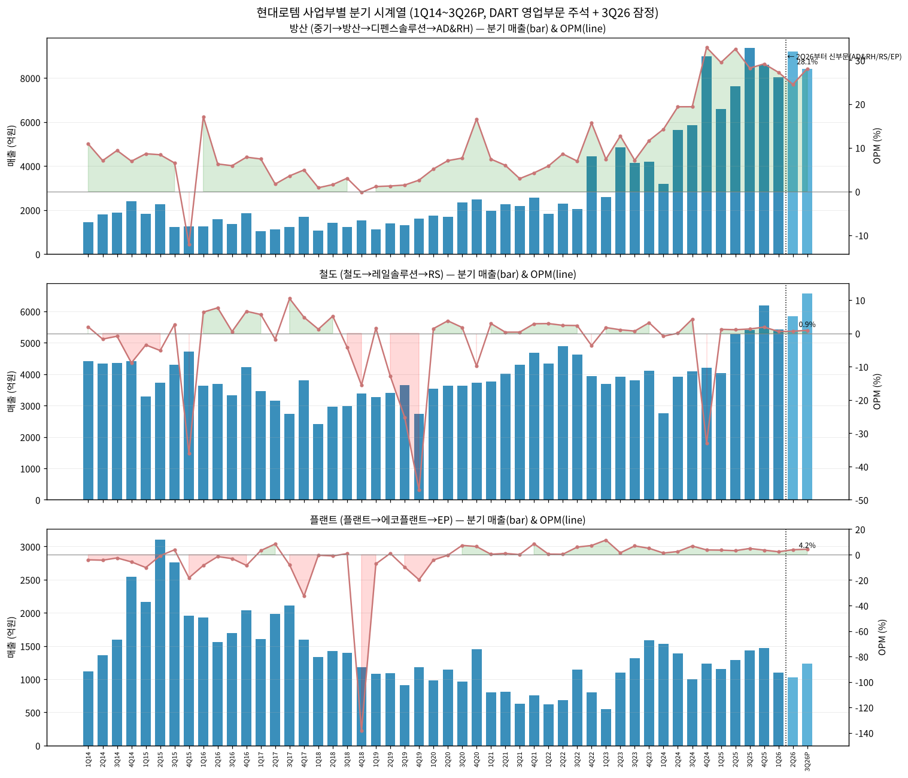

→ 분기 단독값 = DART 분기·반기보고서 영업부문 주석의 "3개월" 값, 4분기 = 사업보고서 연간 − 3분기 누적. 2Q14·3Q14·3Q17은 다음 해 동기 보고서의 전기 비교값으로 보강
→ 2Q26·3Q26P는 신부문(AD&RH/RS/EP) 기준, 3Q26P는 2026-10-19 잠정실적 보도(딜사이트) 부문 수치

**최근 19분기 사업부별 (억원)**

| 분기 | 방산 매출 | 방산 OP | 방산 OPM | 철도 매출 | 철도 OP | 철도 OPM | 플랜트 매출 | 플랜트 OP | 플랜트 OPM |
|---|---|---|---|---|---|---|---|---|---|
| 1Q22 | 1,825 | 106 | 5.8% | 4,331 | 127 | 2.9% | 618 | 2 | 0.4% |
| 2Q22 | 2,276 | 195 | 8.6% | 4,894 | 117 | 2.4% | 688 | 2 | 0.3% |
| 3Q22 | 2,057 | 143 | 6.9% | 4,624 | 108 | 2.3% | 1,144 | 68 | 5.9% |
| 4Q22 | 4,434 | 694 | 15.7% | 3,939 | -145 | -3.7% | 803 | 57 | 7.1% |
| 1Q23 | 2,600 | 192 | 7.4% | 3,692 | 64 | 1.7% | 552 | 63 | 11.4% |
| 2Q23 | 4,844 | 615 | 12.7% | 3,924 | 42 | 1.1% | 1,100 | 16 | 1.4% |
| 3Q23 | 4,142 | 296 | 7.1% | 3,808 | 25 | 0.7% | 1,320 | 90 | 6.8% |
| 4Q23 | 4,194 | 488 | 11.6% | 4,112 | 131 | 3.2% | 1,585 | 78 | 4.9% |
| 1Q24 | 3,180 | 453 | 14.2% | 2,764 | -24 | -0.9% | 1,534 | 18 | 1.2% |
| 2Q24 | 5,645 | 1,092 | 19.4% | 3,914 | 1 | 0.0% | 1,386 | 34 | 2.4% |
| 3Q24 | 5,846 | 1,132 | 19.4% | 4,084 | 174 | 4.3% | 1,005 | 68 | 6.8% |
| 4Q24 | 8,981 | 2,955 | **32.9%** | 4,194 | **-1,383** | -33.0% | 1,233 | 45 | 3.7% |
| 1Q25 | 6,580 | 1,939 | 29.5% | 4,025 | 49 | 1.2% | 1,157 | 41 | 3.5% |
| 2Q25 | 7,613 | 2,479 | 32.6% | 5,274 | 57 | 1.1% | 1,289 | 40 | 3.1% |
| 3Q25 | 9,361 | 2,638 | 28.2% | 5,406 | 71 | 1.3% | 1,429 | 69 | 4.8% |
| 4Q25 | 8,599 | 2,507 | 29.2% | 6,191 | 116 | 1.9% | 1,466 | 52 | 3.5% |
| 1Q26 | 8,039 | 2,188 | 27.2% | 5,432 | 30 | 0.5% | 1,103 | 25 | 2.2% |
| 2Q26 (신) | 9,189 | 2,248 | 24.5% | 5,848 | 36 | 0.6% | 1,024 | 39 | 3.8% |
| **3Q26P (신)** | **8,412** | **2,360** | **28.1%** | **6,561** | **59** | **0.9%** | **1,234** | **52** | **4.2%** |

→ 2Q25 신기준 재작성값(비교용): AD&RH 7,666 / 2,473, RS 5,274 / 57, EP 1,236 / 46 (DART 2026 반기보고서)
→ 3Q26P YoY: AD&RH 매출 -10.1%·OP -10.5%, RS 매출 +21.4%·OP -16.9%, EP 매출 -13.6%·OP -24.6% (딜사이트 2026-10-19)

(1-2) 전사 12분기 시계열 (rolling)

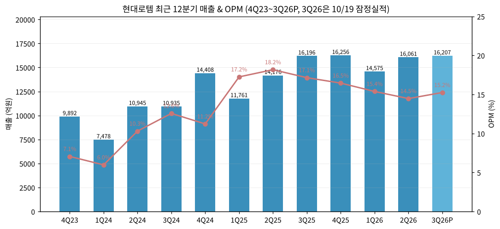

| 분기 | 매출 (억) | OP (억) | OPM | NI 연결 (억) |
|---|---|---|---|---|
| 4Q23 | 9,892 | 698 | 7.1% | 462 |
| 1Q24 | 7,478 | 447 | 6.0% | 556 |
| 2Q24 | 10,945 | 1,128 | 10.3% | 1,008 |
| 3Q24 | 10,935 | 1,374 | 12.6% | 1,038 |
| 4Q24 | 14,408 | 1,617 | 11.2% | 1,450 |
| 1Q25 | 11,761 | 2,029 | 17.2% | 1,571 |
| 2Q25 | 14,176 | 2,576 | **18.2%** | 1,895 |
| 3Q25 | 16,196 | 2,777 | 17.1% | 1,984 |
| 4Q25 | 16,256 | 2,675 | 16.5% | 2,254 |
| 1Q26 | 14,575 | 2,242 | 15.4% | 2,027 |
| 2Q26 | 16,061 | 2,324 | 14.5% | 1,863 |
| **3Q26P** | **16,207** | **2,471** | **15.2%** | **1,780** |

→ 3Q26P: 2026-10-19 연결 잠정실적(매출 +0.1% YoY, OP -11.0%, NI -10.3%). 3Q26 누적 매출 46,842억(+11.2%), OP 7,037억(-4.7%) (SBS Biz·딜사이트 2026-10-19). DART 3분기보고서 미제출 상태
→ 4Q23~3Q24 분기 단독값은 OpenDART 분기 3개월 값, 4Q = 연간 − 3Q 누적

(2) 사업부별 개요 (매출 비중 큰 순서, FY25)

| 사업부 | FY25 매출 | 비중 | FY25 OP | OPM | 주요 제품 |
|---|---|---|---|---|---|
| 디펜스솔루션 (→AD&RH) | 32,153억 | 55% | 9,563억 | 29.7% | K2 전차, K1/K1A1/K1A2 성능개량·창정비, 차륜형장갑차, 장애물개척전차, 구난·교량전차, 다목적무인차량, 다족보행로봇 |
| 레일솔루션 (→RS) | 20,896억 | 36% | 292억 | 1.4% | 고속철(EMU-260/320), 전동차, 트램(수소트램), E&M 턴키, O&M |
| 에코플랜트 (→EP) | 5,341억 | 9% | 201억 | 3.8% | 자동차 프레스·운반설비, 에코 제철설비, 수소인프라(2026년부터 AD&RH로 이관) |

(3) 사업부별 디테일

**① 디펜스솔루션 (AD&RH)**
→ **Top-seller: K2 전차 (폴란드)** — 1차(2022.08, 4조 4,992억, 180대): 2025말 누적 매출 3조 9,426억(88%), 누적 수금 4조 3,053억. 2차(2025.08, 8조 9,814억): 2025말 누적 매출 6,656억(7%), 누적 수금 3,042억 (DART 2025 사업보고서 XI). 2차 선수금 21억달러 수령 보도(다음 뉴스 "[단독]현대로템, 폴란드 2차 선수금 21억달러 받았다", 보도일 미확인 ⚠️) → 2Q26말 현금 2.53조원
→ 국내: 차륜형지휘소용차량 2차양산 7,074억, K-1 중구난·교량전차 외주정비 2,154억, K1전차 외주정비 2,427억, 장애물개척전차 2차 양산 2,500억, K2 PBL 985억 등
→ 수출 파이프라인: 페루 K2·차륜형장갑차 총괄합의(2025.12), 튀르키예 알타이 부품, 이라크 등 타진(풍문 해명 공시 2025.09~2026.01 "확정된 사항 없음")
→ 가동률 108.7% (FY25, MH 기준) / 1H26 109.8%
→ **이익 outlier**: 4Q24 방산 OPM 32.9%, 2Q25 32.6% — 폴란드 1차 수출분 집중 인식 분기

**② 레일솔루션 (RS)**
→ 진행률 적용 수주(DART 2025 사업보고서): 철도BG 1조 2,699억(2025.02, 잔고 1조 2,411억), 철도BK 1조 1,960억(2025.02 모로코, 잔고 1조 1,903억), 철도AY 1조 4,061억(2023.06 호주 QTMP, 잔고 1조 1,939억), 철도AB 1조 2,137억(2017.12 이란 디젤동차 — **기납품 281백만원, 잔고 1조 2,134억이 사실상 미이행**), 철도BD 9,439억(2024.01 LA 메트로)
→ 생산능력: 창원공장 552량/년 (의장 기준), FY25 가동률 95.1%
→ 수출 단가(량당): 2025 48억 vs 2024 23억 (최근 수주 단순 환산)
→ **리스크 outlier**: 2015(-1,895억), 2019(-2,595억), 4Q24(-1,383억) 대규모 손실 — 해외 PJT 원가 초과·지연 패턴 반복

**③ 에코플랜트 (EP)**
→ 당진 에코제철공장 10,800톤/년, 현대제철 CDQ 설비(플랜트G 3,197억, 잔고 989억), 현대차 울산 전기차 신공장 운반설비, 현대제철 LNG 자가발전사업(2024.12)
→ 계열사(현대차·현대제철) 내수 비중 높음 (FY25 내수 4,125억 / 수출 1,216억)

(4) 주요 경쟁사 (사업부별)

| 사업부 | 국내 | 해외 |
|---|---|---|
| 방산 (지상장비) | 한화에어로스페이스(K9·레드백·장갑차), 기아(전술차량), 현대위아(화포) | Rheinmetall(독), KNDS(독·프, 레오파르트2), General Dynamics Land Systems(미, 에이브럼스), Bumar(폴, K2PL 파트너) |
| 철도 | 우진산전, 다원시스 (국내 전동차 입찰 경쟁) | CRRC(중, 세계 1/3), Alstom(프), Siemens Mobility(독), Stadler(스위스) — 현대로템 세계 점유율 약 2~3% (DART 2019 사업보고서) |
| 플랜트 | 계열사 발주 중심 (경쟁사 공시 없음) | — |

(5) 주요 매출처

→ DART 영업부문 주석상 매출 10% 이상 고객 2곳 모두 방산: FY25 고객1 2조 2,017억(38%), 고객2 7,444억(13%) / FY24 고객1 1조 5,479억(35%), 고객2 6,210억(14%). 고객명 미공시
→ 추정: 고객1 = 폴란드 군비청(Agencja Uzbrojenia), 고객2 = 방위사업청 (⚠️ 추정 — 폴란드 1차 2025년 당기 인식 1조 5,361억 + 2차 6,656억 = 2조 2,017억으로 고객1 금액과 정확히 일치 → 고객1 = 폴란드 확인 수준)
→ 철도 주요 발주처: 한국철도공사, SR, 서울교통공사, 대만 철도청·도시철도국, 싱가포르 LTA, 호주 퀸즐랜드, 미국 LA Metro·MBTA, 모로코 철도청
→ 원재료 주요 매입처: 현대비앤지스틸(특수관계인) — 금속소재 2조 5,452억(FY25 별도매출 대비 45%)

(6) 생산 CAPA + 임직원 추이

| 연도 | 2013 | 2015 | 2017 | 2019 | 2020 | 2021 | 2022 | 2023 | 2024 | 2025 | 2026.06 |
|---|---|---|---|---|---|---|---|---|---|---|---|
| 임직원 (명) | 3,940 | 3,783 | 3,556 | 3,561 | 3,417 | 3,444 | 3,591 | 3,938 | 4,182 | 4,541 | 4,571 |

→ 생산실적(백만원, FY25/FY24/FY23): 방산 1,756,088 / 1,678,439 / 1,326,159, 철도 2,098,211 / 1,365,399 / 1,305,102, 플랜트 482,985 / 470,345 / 421,169
→ 방산 생산능력은 보안상 미공시. 설비투자 계획(2026~2028): 총 1조 2,099억 — 방산 2,712억(2026.06 반기 기준 2,778억), 철도 4,016억, 플랜트 231억, 지원 5,141억 (DART 2025 사업보고서)

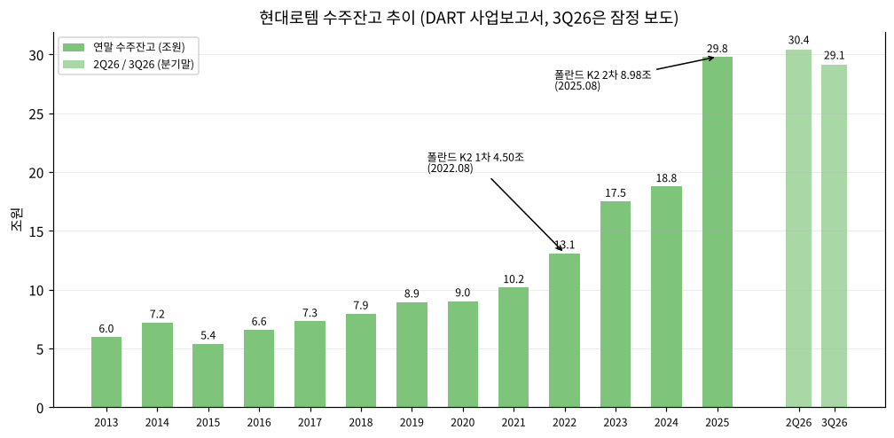

**수주잔고 추이 (억원, DART 사업보고서)**

| 연말 | 방산 | 철도 | 플랜트 | 합계 |
|---|---|---|---|---|
| 2013 | 10,917 | 41,703 | 7,001 | 59,621 |
| 2014 | 14,917 | 41,783 | 15,235 | 71,935 |
| 2015 | 11,109 | 32,790 | 10,000 | 53,898 |
| 2016 | 8,419 | 48,349 | 9,004 | 65,772 |
| 2017 | 9,372 | 56,240 | 7,368 | 72,980 |
| 2018 | 7,515 | 66,415 | 5,479 | 79,409 |
| 2019 | 10,878 | 73,383 | 5,151 | 89,412 |
| 2020 | 16,144 | 70,676 | 3,430 | 90,250 |
| 2021 | — | — | — | 101,649 |
| 2022 | — | — | — | 130,890 |
| 2023 | — | — | — | 175,003 |
| 2024 | — | — | — | 187,578 |
| 2025 | — | — | — | **297,735** |
| 2Q26 | — | — | — | 304,046 |
| 3Q26 (보도) | 95,228 (AD&RH) | 190,310 (RS) | 5,882 (EP) | 291,420 |

→ 2013은 2014 사업보고서 건설계약 주석 "기초계약잔액", 2014~2016은 동 주석 기말 수주잔고, 2017~2020은 사업의 내용 수주상황, 2021~2Q26은 사업의 내용 본문 "수주잔고는 ○○억원" 문구. 2021년 이후 부문별 잔고는 방산 비밀유지조항으로 미공시
→ 3Q26 부문별은 SBS Biz 2026-10-19 보도값(⚠️ RS 19.0조가 AD&RH 9.5조의 2배로 보도됨 — 폴란드 2차 잔여분(약 8.3조)만으로 AD&RH 잔고 대부분을 차지하는 셈이라 회사 IR 원문 확인 필요)

---

## ④ 재무 구조 (13년 시계열)

(1) 손익계산서

| 연도 | 매출 | 매출원가 | 매출총이익 | GPM | 판관비 | 판관비율 | OP | OPM | NI 지배 | NPM | EPS (원) |
|---|---|---|---|---|---|---|---|---|---|---|---|
| 2013 | 32,994 | 29,672 | 3,322 | 10.1% | 1,578 | 4.8% | 1,744 | 5.3% | 1,191 | 3.6% | — |
| 2014 | 31,911 | 29,804 | 2,107 | 6.6% | 2,041 | 6.4% | 66 | 0.2% | -167 | -0.5% | — |
| 2015 | 33,091 | 33,211 | -120 | -0.4% | 1,809 | 5.5% | -1,929 | -5.8% | -3,062 | -9.3% | -3,602 |
| 2016 | 29,848 | 26,971 | 2,877 | 9.6% | 1,815 | 6.1% | 1,062 | 3.6% | 218 | 0.7% | 257 |
| 2017 | 27,257 | 25,434 | 1,822 | 6.7% | 1,368 | 5.0% | 454 | 1.7% | -474 | -1.7% | -557 |
| 2018 | 24,119 | 24,276 | -157 | -0.6% | 1,805 | 7.5% | -1,962 | -8.1% | -3,008 | -12.5% | -3,539 |
| 2019 | 24,593 | 25,532 | -938 | -3.8% | 1,861 | 7.6% | -2,799 | -11.4% | -3,543 | -14.4% | -4,168 |
| 2020 | 27,853 | 25,408 | 2,445 | 8.8% | 1,624 | 5.8% | 821 | 2.9% | 310 | 1.1% | 326 |
| 2021 | 28,725 | 26,197 | 2,528 | 8.8% | 1,726 | 6.0% | 802 | 2.8% | 665 | 2.3% | 609 |
| 2022 | 31,633 | 27,979 | 3,654 | 11.6% | 2,179 | 6.9% | 1,475 | 4.7% | 1,978 | 6.3% | 1,812 |
| 2023 | 35,874 | 31,230 | 4,644 | 12.9% | 2,544 | 7.1% | 2,100 | 5.9% | 1,610 | 4.5% | 1,475 |
| 2024 | 43,766 | 35,476 | 8,290 | 18.9% | 3,725 | 8.5% | 4,566 | 10.4% | 4,069 | 9.3% | 3,728 |
| 2025 | 58,390 | 44,470 | 13,920 | 23.8% | 3,864 | 6.6% | 10,056 | 17.2% | 7,699 | 13.2% | 7,055 |

→ 단위: 억원 (EPS 원). 2015·2018·2019 매출총이익 적자 = 공사손실충당부채(총예정원가 > 계약수익) 인식 연도. 2013·2014 EPS는 OpenDART 비교표시에 없음(결측)


(2) 재무상태표

| 연도 | 자산 | 부채 | 자본 | 지배자본 | 현금성자산 | 차입금+사채 | 계약부채(선수금) | 부채비율 | 유동비율 |
|---|---|---|---|---|---|---|---|---|---|
| 2013 | 42,749 | 24,854 | 17,895 | 17,135 | 1,166 | — | — | 139% | 163% |
| 2014 | 44,008 | 26,622 | 17,387 | 16,610 | 1,157 | 13,749 | 2,905 | 153% | 208% |
| 2015 | 50,439 | 36,063 | 14,377 | 13,587 | 2,533 | 21,437 | 4,609 | 251% | 171% |
| 2016 | 44,732 | 30,060 | 14,672 | 13,920 | 5,802 | 18,128 | 3,183 | 205% | 177% |
| 2017 | 40,839 | 26,656 | 14,183 | 13,440 | 4,358 | 14,070 | 4,361 | 188% | 195% |
| 2018 | 40,021 | 28,942 | 11,080 | 10,440 | 3,679 | 13,921 | 5,437 | 261% | 149% |
| 2019 | 40,843 | 32,014 | 8,829 | 8,240 | 3,825 | 14,814 | 7,705 | **363%** | 118% |
| 2020 | 41,974 | 28,512 | 13,462 | 13,635 | 3,387 | 11,612 | 8,469 | 212% | 125% |
| 2021 | 41,072 | 28,389 | 12,682 | 12,931 | 3,197 | 12,334 | 9,002 | 224% | 128% |
| 2022 | 48,239 | 33,324 | 14,915 | 15,203 | 5,060 | 11,488 | 12,161 | 223% | 129% |
| 2023 | 52,415 | 35,945 | 16,470 | 16,799 | 3,961 | 5,814 | 16,248 | 218% | 115% |
| 2024 | 52,854 | 32,763 | 20,091 | 20,450 | 4,723 | 3,249 | 17,942 | 163% | 122% |
| 2025 | 93,180 | 62,768 | 30,412 | 30,790 | 9,084 | 1,099 | **39,720** | 206% | 124% |
| 2Q26 | 90,696 | 56,998 | 33,698 | 34,064 | 25,273 | — | — | 169% | — |

→ 차입금+사채 = 단기차입금 + 유동성장기부채 + 사채 + 장기차입금 (OpenDART 계정명 합산, 2020 장기차입금 계정 미매칭으로 과소 가능 ⚠️). 계약부채 = 2017 이전 "초과청구공사"
→ **부채비율 해석 주의**: 2025 부채 6.28조 중 계약부채(선수금) 3.97조 — 이자 부담 없는 선수금이 부채비율을 끌어올림. 차입금은 2015 2.14조 → 2025 0.11조로 사실상 무차입
→ 2Q26말 현금성자산 2.53조 (폴란드 2차 선수금 유입)

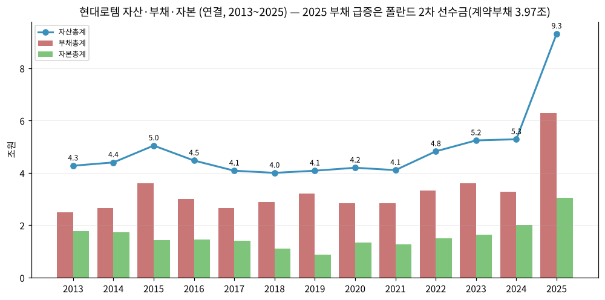

(3) 현금흐름표

| 연도 | 영업CF | 투자CF | 재무CF | CapEx(유+무형) | FCF |
|---|---|---|---|---|---|
| 2013 | -4,086 | -245 | 4,405 | 1,054 | -5,140 |
| 2014 | -1,888 | -578 | 2,455 | 879 | -2,767 |
| 2015 | -5,645 | -553 | 7,642 | 718 | -6,363 |
| 2016 | 6,111 | 556 | -3,435 | 299 | 5,811 |
| 2017 | 2,192 | 312 | -3,918 | 433 | 1,759 |
| 2018 | -142 | -381 | -195 | 400 | -542 |
| 2019 | -2,009 | -136 | 2,308 | 279 | -2,289 |
| 2020 | 564 | -751 | -216 | 450 | 114 |
| 2021 | -627 | 1,461 | -996 | 528 | -1,155 |
| 2022 | 7,162 | -4,290 | -971 | 480 | 6,682 |
| 2023 | 7,342 | -2,704 | -5,763 | 809 | 6,533 |
| 2024 | 1,425 | 2,326 | -2,997 | 1,150 | 274 |
| 2025 | 9,043 | -2,318 | -2,371 | 1,565 | 7,478 |

→ FCF = 영업CF − (유형+무형자산 취득). 2022·2023·2025 영업CF 급증 = 폴란드 1·2차 선수금 유입(계약부채 증가), 2024 영업CF 둔화 = 선수금 소진 구간
→ 13년 누적 FCF +1.04조, 그중 2022~2025 4년이 +2.10조 (2013~2021 9년 누적 -1.06조)

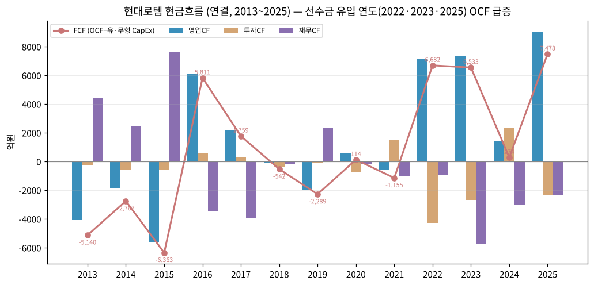

(4) CapEx

| 연도 | 2013 | 2015 | 2017 | 2019 | 2020 | 2021 | 2022 | 2023 | 2024 | 2025 |
|---|---|---|---|---|---|---|---|---|---|---|
| 유형 (억) | 835 | 550 | 280 | 186 | 305 | 442 | 325 | 547 | 810 | 1,292 |
| 무형 (억) | 220 | 168 | 153 | 93 | 145 | 86 | 155 | 262 | 340 | 272 |
| CapEx/매출 | 3.2% | 2.2% | 1.6% | 1.1% | 1.6% | 1.8% | 1.5% | 2.3% | 2.6% | 2.7% |

→ 경자산 조립산업 성격 — CapEx/매출 1~3%. 2026~2028 투자계획 1.21조(연 4,000억 수준)로 레벨업 예정 (DART 2025 사업보고서)

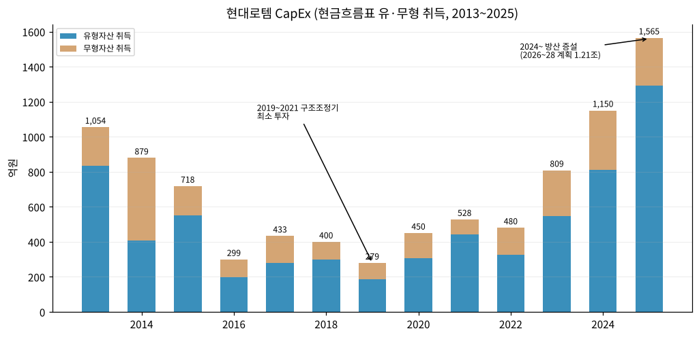

(5) 부채구조 + 채무증권

→ 2015 차입금+사채 2.14조(사채 1.02조) 정점 → 2020 CB 2,354억 주식 전환 + 자산 매각 → 2024 사채 0 → 2025 사채 497억(증가 497억), 장기차입금 110억
→ 이자보상배율(OP/금융비용): 2019 -4.8배 → 2023 4.4배 → 2025 **17.5배**
→ 신용등급: A-(긍정적, 2023.03) → A(2023.08) → A+(2025.06) → **AA-(2026.04)** — 3년 만에 3노치 상향
→ 금융보증·계약이행보증 등 최대 노출 340억(2025말, 1년 이내)

(6) 배당·자사주

| 회계연도 | 2013 | 2014~2022 | 2023 | 2024 | 2025 |
|---|---|---|---|---|---|
| DPS (원) | 125 | **무배당 (9년)** | 100 | 200 | 600 |
| 배당총액 (억) | 106 | — | 109 | 218 | 655 |
| 배당성향 (연결) | — | — | 6.8% | 5.4% | 8.5% |

→ 2026.02.26 중장기 배당정책 공시: **연결 순이익 대비 배당성향 8% 수준**, 2025~2027 결산배당 적용 + FY2025~FY2026 DPS 매년 10~50% 상향 (DART 2025 사업보고서 III-6)
→ 자기주식 취득·소각 이력 없음 (자기주식 0주)
→ 배당 재원 참고: 별도 당기순이익 FY25 7,433억 (DART 사업보고서 주요배당지표) — 별도재무제표(OFS) 시계열은 본 버전 미사용

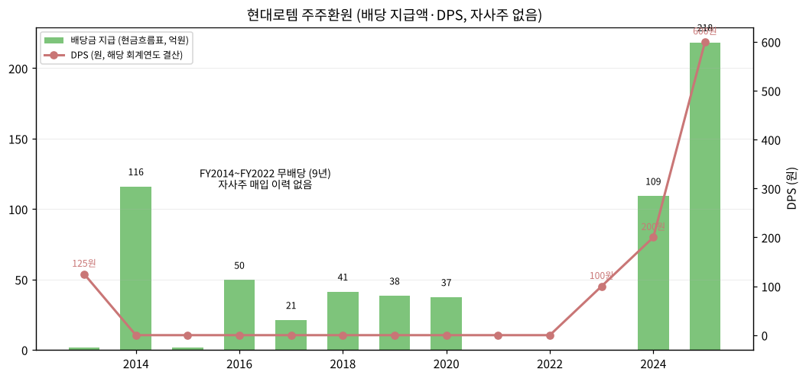

(7) 재무비율

| 연도 | ROE (지배) | ROA | 부채비율 | 유동비율 | 이자보상배율 |
|---|---|---|---|---|---|
| 2015 | -20.3% | -6.4% | 251% | 171% | -2.0x |
| 2017 | -3.5% | -1.1% | 188% | 195% | 0.6x |
| 2019 | -37.9% | -8.8% | 363% | 118% | -4.8x |
| 2020 | 2.8% | 0.5% | 212% | 125% | 1.3x |
| 2021 | 5.0% | 1.2% | 224% | 128% | 1.3x |
| 2022 | 14.1% | 4.4% | 223% | 129% | 1.9x |
| 2023 | 10.1% | 3.1% | 218% | 115% | 4.4x |
| 2024 | 21.8% | 7.7% | 163% | 122% | 8.8x |
| 2025 | **30.1%** | **10.6%** | 206% | 124% | **17.5x** |

→ ROE·ROA는 기초·기말 평균 기준, 이자보상배율 = OP / 금융비용(외환손실 등 포함 — 순수 이자비용 기준보다 낮게 나옴)

---

## ⑤ 지배 구조

(1) 그룹·계열 관계

→ **현대자동차그룹** 소속. 지배 구조: 현대모비스(22.36%) → 현대자동차(33.77%) → 현대로템. 현대모비스 최대주주 기아 18.10% (DART 2025 사업보고서 VII)
→ 계열 거래: 원재료 현대비앤지스틸(금속소재), 플랜트 발주 현대제철·현대자동차, 2020 그린에어 지분 현대제철 매각·의왕 부지 현대모비스 매각

(2) 주주 구분

| 주주 | 주식수 | 지분율 | 기준 |
|---|---|---|---|
| 현대자동차 (최대주주) | 36,852,432 | 33.77% | DART 2026.06 반기 |
| 국민연금 | 8,752,110 | 8.0% | DART 2026.06 반기 (2025말 7.8%) |
| 외국인 | — | 39.53% | stockhub.kr 2026-11-03 |
| 소액주주 | 60,860천주 | 55.8% (주주 240,625명) | DART 2025말 |

→ 외국인 지분율은 웹 출처·시점이 DART와 달라 chart5의 "기타 국내" 잔여(18.7%)는 추정치

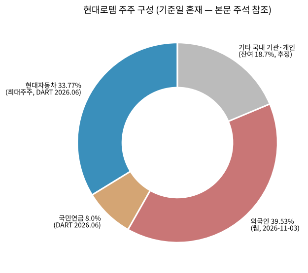

(3) 임원·이사회 (2026.06 기준)

→ 이사회 7명: 사내이사 3(이용배·조형준·정재호), 독립(사외)이사 4. 2026.03.27 정기주총에서 조형준(1974.12, 디펜스솔루션연구소장)·정재호(1970.10, 경영관리실장) 사내이사 신규 선임, 이용배 재선임 (DART 2026 반기)
→ **대표이사 이용배**: 1961.04생, 경희대 경영학 석사. 현대자동차 경영관리실장(2006~07)·경영기획담당 상무~부사장(2008~11)·기획조정3실장(2012~13), 현대위아 경영지원·재경본부(2013~15) 등 → 2020.03 현대로템 대표이사. 재무통 출신으로 2020 구조조정(자산 매각·CB 전환) 주도 시기와 겹침
→ 주요 미등기 임원: 이정엽 부사장(디펜스솔루션사업부장, 전 방산기술연구소장), 서준모 전무(유럽방산법인장, 전 폴란드사업실장), 김정훈 전무(레일솔루션사업본부장)

---

## ⑥ 기타 팩트

(1) R&D 인프라

| 연도 | 2014 | 2016 | 2018 | 2020 | 2021 | 2022 | 2023 | 2024 | 2025 |
|---|---|---|---|---|---|---|---|---|---|
| 연구개발비 (억) | 848 | 891 | 1,127 | 1,049 | 1,035 | 1,126 | 1,452 | 1,959 | 2,204 |
| R&D/연결매출 | 2.7% | 3.0% | 4.7% | 3.8% | 3.6% | 3.6% | 4.0% | 4.5% | 3.8% |

→ 출처: DART 사업보고서 연구개발비용 계(별도 기준 집계). 2014·2015는 2016 보고서 재작성값(2014 보고서 최초값 528억과 기준 상이). FY25 회계처리: 개발비 자산화 217억, 판관비 606억, 제조원가 1,380억
→ 연구조직: 의왕연구소(경기), 당진(충남), 52개 연구팀 / 지재권: 특허 652, 디자인 400 (FY25)

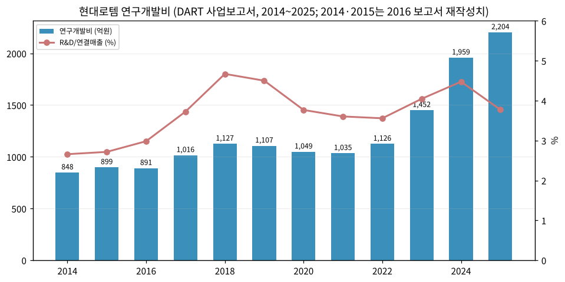

(2) 진행 중 corporate action (10년)

| 시기 | 내용 |
|---|---|
| 2016.01 | 현대로템제일차 유한회사 설립 (코레일 고속철 매출채권 ABL 2,500억, 2017.09 청산) |
| 2020.05 | 그린에어 51% 현대제철에 812억 매각 (연결 제외) |
| 2020.06 | 의왕 토지·건물 현대모비스에 878억 매각 |
| 2020.06~08 | 제30회 CB(전환가 9,750원) 발행 → 2020.08 24,142,293주 전환 |
| 2025 | Hyundai EURotem 관련 튀르키예 조인트벤처 2곳 청산 (연결대상 16→14개) |
| 2025 | 토지 자산재평가 (재평가잉여금 3,081억 OCI 인식) |
| 2026.02 | 중장기 배당정책 공시 |
| 2026.06 | 사업부문 AD&RH / RS / EP 재편 |

(3) R&D 마일스톤 (방산은 보안상 개발실적 미공시)

→ 수소: 수소전기트램 개발·실증, 3MW급 수소기관차, 5MW급 PEM 수전해, 640kg/일 수소추출기 독자 모델, 수소충전소 디스펜서
→ 철도: EMU 고속전철 PMSM 추진시스템, 370km/h 이상 고속차량 핵심기술, KTCS-2/3 신호, 하이퍼튜브 핵심기술
→ 로봇: 웨어러블 로봇 상용화, 65톤급 AGV, 다족보행로봇·다목적무인차량(방산)
(출처: DART 2025 사업보고서 II-6 연구개발 진행실적 49건)

(4) 주요 리스크

→ **고객 집중**: 폴란드 1개 고객이 FY25 매출 38% (고객1). 폴란드 정권·국방예산 변화, K2PL 현지생산(64대, Bumar) 이행 리스크
→ **철도 PJT 손실 반복**: 2015·2019·4Q24 대규모 손실. 이란 디젤동차(1.21조 잔고, 기납품 거의 0)는 제재로 사실상 미이행 상태 — 잔고 착시 요인
→ **환율**: USD 화폐성 자산 3.51조(2025말) — 원/달러 5% 변동 시 세전이익 ±1,727억 (DART 위험관리). 3Q26 실적 부진 요인 중 환율 언급(삼성증권, 2026-10-20 보도)
→ **수주 모멘텀 둔화**: 3Q26 누적 신규수주 3조 8,049억, 전년동기 대비 -74.2% (2025 폴란드 2차 기저효과). 수주잔고 2Q26 30.4조 → 3Q26 29.1조로 감소 전환
→ **정책·매크로**: 미국 중간선거 결과에 따른 방산예산 불확실성(파이낸셜뉴스 2026-10-20), 우크라이나 종전 협상 시 유럽 재무장 속도 변화
→ **방산 정보 비공개**: 방산 계약 대부분 비밀유지조항으로 개별 잔고·단가 미공시 → 외부 추정 오차 큼

(5) ESG 등급

→ 2021.10 한국ESG기준원(구 기업지배구조원) 상장기업 ESG 평가 통합등급 A 획득 (DART 연혁), 2021.07 첫 지속가능경영보고서 발간. 최신(2025~2026) 등급은 본 버전 미확인 ⚠️

(6) 인증·라이선스

→ 철도안전법(2013.03 개정)에 따른 철도차량 형식승인·제작자승인 대상, 방위사업법상 방산업체 지정. KTCS-3(ETCS Baseline 3 기반) 차상신호장치 TSI 인증 추진, IP기반 전자연동장치 SIL4 인증 개발 (DART 2025 사업보고서)

---

## Version Log

| 버전 | 일자 | 내용 |
|---|---|---|
| v1.0 | 2026-11-03 | 첫 작성. DART XML 51건 + OpenDART CFS 43건 전수 파싱, 사업부 51분기 시계열(1Q14~3Q26P), 수주잔고 13년, 차트 13종(표준 12 + chart3 수주잔고) |

**잔여 보완 후보 (다음 버전)**
- DART 3Q26 분기보고서(11월 중순 제출 예정) 반영 → 3Q26P를 확정치로 교체, 3Q26말 BS·CF 추가
- 회사 IR 실적발표 자료(분기 신규수주·부문별 잔고) 확보 → 2021년 이후 부문별 수주잔고 보강, 3Q26 보도 부문 잔고 검증
- 2021·2022 내수/수출 매출 분리(각 연도 사업보고서 II-4) 추출
- KRX 업종·표준산업분류 DART 기업개황 확인
- 최신 ESG 등급(한국ESG기준원 2025) 확인
- 별도재무제표(OFS) 기반 배당가능이익·별도 수익성 비교
