> 종목: 현대모비스 (012330.KS / 현대모비스 주식회사 / HYUNDAI MOBIS CO.,LTD)
> 섹터: 로봇 — 서브섹터 **로봇 부품** (워치리스트 대분류: 모빌리티·에너지전환)
> 작성 시각: 2026-11-14 KST (v1.0)
> 적용 구조: v4.8 (6개 섹션 + 12종 표준 차트)
> 데이터: 12년 연결 연간(2014~2025, OpenDART CFS — 2014는 2015 사업보고서 비교표시) + 43분기 연결 분기(1Q16~2Q26 OpenDART, 3Q26 회사 IR) + 사업부(모듈·핵심부품 / A/S) 연간 11년(2015~2025, DART 영업부문 주석) + 분기 11개(1Q24~3Q26, 매출 DART·OP 회사 IR) + Yahoo Finance 012330.KS 월간(2000.02~2026.11)
> 출처: **DART 정기보고서 공시원문 43건** (corp_code 00164788) — 최신 2026.06 반기보고서(2026-08-14), 2025 사업보고서(2026-03-09) / OpenDART 연결재무 JSON 43건 / **회사 IR PDF 20건(2023.3Q~2026.3Q)** — 최신 2026-10-30 「2026 3분기 경영실적」 / 시장데이터: Yahoo Finance(2026-11-13 종가) / 보도: SBS Biz·비즈워치·CEO스코어(2026-10-30), 토요경제(2026-10-22)

# 현대모비스 기업 개요 (v1.0 — 로봇 · 로봇 부품, 저마진 제조 + 고마진 A/S 캐시카우 + 액추에이터 옵션)
> **Fact verify cutoff**: 2026-11-14 (주가·시가총액·52주 고저·ATH는 2026-11-13 Yahoo Finance, 3Q26 실적은 2026-10-30 회사 IR — 감사 전)

---

## ① 기업 분류

(1) Primary / Secondary 분류

**Primary 분류: 지속성장 (A/S 부품 캐시카우가 이익의 거의 전부, 12년 OPM range 5.0pp)**

→ 12년 OPM 3.9%~8.9% — cutoff ±10pp를 크게 밑도는 저변동 구조. 2014 8.9% → 2022·2023 3.9% 저점(모듈·전동화 매출 급증에 따른 믹스 희석) → 2025 5.5%
→ 이익의 실체는 **A/S 부품**: 2025 DART 영업부문 기준 A/S OP 3조 5,035억 vs 모듈·부품제조 760억 — A/S가 부문 OP 합의 98%. 매출은 모듈·부품제조가 78%

**Secondary 노트: 꿈 (로봇 핵심부품 — 아틀라스 액추에이터, 2028 공급 목표)**

→ 2025 사업보고서: "보스턴다이나믹스의 차세대 휴머노이드 로봇 '아틀라스'에 적용되는 **액추에이터 및 주요 핵심 부품 공급을 목표로 전략적 협력 체계를 구축**하여 로봇 부품 시장 진입 기반을 확보" (DART 2025 사업보고서 II)
→ 3Q26 IR: 로보틱스 액추에이터 2종 최초 공개(2026.09), **시제품 생산(2026.11, 의왕연구소)**, 그룹 내 액추에이터 "수주 완료", 핸드그리퍼 공동개발, 퍼셉션모듈 입찰 참여 중 (회사 3Q26 IR p.12)
→ 액추에이터는 휴머노이드 재료비의 약 60% (SBS Biz 2026-10-30). 공급 시점 2028년 예상
→ **로봇 매출 분리 공시 없음** — 현재 모듈·부품제조 부문 안에 포함되며 매출 인식 전 단계

**Entity 구조 (DART 영업부문, 2개 보고부문)**

→ **(1) 모듈 및 부품제조 사업부문** — 2025 외부매출 47.8조(78%) — 샤시·칵핏·프론트엔드 3대 모듈 직서열(JIS) 공급 + 전동화(PE·배터리시스템)·전장(IVI·HUD·ADAS)·샤시안전(제동·조향·에어백)·램프 핵심부품
→ **(2) A/S용 부품 사업부문** — 13.3조(22%) — 운행 중인 현대·기아차 보수용 부품 글로벌 공급
→ 국내외 생산거점 30곳, 물류거점 41곳, 연구소 8곳 (DART 2025 사업보고서 II)
→ 램프 사업(2025 매출 2.5조) 물적분할·OPmobility 매각 진행: 2026.09.30 본계약 → 2026.11.24 분할 임시주총 → 2027.04.01 분할기일 → 2027 하반기 거래종료 목표 (회사 3Q26 IR p.11)

(2) Summary Box (12년 연결 2014~2025 + 사이클 통계)

| 지표 | 12년 평균 (2014~2025) | 정점 | 저점 | 2025년 |
|---|---|---|---|---|
| 매출 (연결, 억원) | 446,328 | **611,181 (2025)** | 351,266 (2014) | **611,181** |
| OP (연결, 억원) | 24,928 | **33,575 (2025)** | 18,303 (2020) | **33,575** |
| NI 연결 (억원) | 28,957 | **40,602 (2024)** | 15,268 (2020) | **36,647** |
| OPM (연결, %) | 5.6% | **8.9% (2014)** | 3.9% (2022·2023) | **5.5%** |

```
[현대모비스 12년 연결 손익 시계열 (억원)]
연도   매출      OP       OPM    NI(연결)
2014  351,266  31,412   8.9%   33,925   ← 12년 OPM 정점 (모듈 수익성 6% 내외 시절)
2015  360,197  29,346   8.1%   30,400   ← 한전부지 매입 분담
2016  382,617  29,047   7.6%   30,473
2017  351,446  20,249   5.8%   15,577   ← 중국 사드 → 모듈 OP 2,376억으로 급감
2018  351,492  20,250   5.8%   18,882
2019  380,488  23,593   6.2%   22,943
2020  366,265  18,303   5.0%   15,268   ← 코로나 (2Q20 OPM 2.2%)
2021  417,022  20,401   4.9%   23,625   ← 전동화(배터리 시스템) 매출 급증 시작
2022  519,063  20,265   3.9%   24,872   ← 매출 +24% vs OP 0% — 전동화 저마진 믹스
2023  592,544  22,953   3.9%   34,233   ← 매출 정점(당시), 모듈 부문 OP 적자(-1,555억)
2024  572,370  30,735   5.4%   40,602   ← EV 수요 둔화로 전동화 매출 감소 → 매출 -3%, A/S 호조로 OP +34%
2025  611,181  33,575   5.5%   36,647   ← 사상 최대 매출·OP, 모듈 흑자전환(IR 757억)
(2026 1~3Q: 매출 47.61조 +4.2%, OP 2.69조 +10.6% — 회사 IR·OpenDART)

OPM range: 3.9% ~ 8.9% = 5.0%pt (cutoff ±10%pt 미달)
```

**📊 통계 (12년 연결)**

| 지표 | 값 |
|---|---|
| 매출 CAGR (11년, 2014→2025) | **+5.2%** |
| 매출 CAGR (3년, 2022→2025) | **+5.6%** |
| OPM 평균 (2014~2025) | **5.6%** |
| OPM range | **5.0%pt** |
| A/S 부문 OPM (DART 기준) | 2015 22.5% → 2025 26.3% |
| 모듈·부품제조 OPM (DART 기준) | 2015 5.3% → 2023 -0.3% → 2025 0.2% |

(3) 정량적 분류 근거

→ **A/S = 이익 엔진** — 2025 A/S 매출 13.3조·OP 3.5조(OPM 26.3%, DART 부문 기준) / 회사 IR 기준 A/S OP 3조 2,818억, 모듈·핵심부품 757억 (회사 4Q25 IR)
→ **모듈·핵심부품 = 매출 엔진, 이익은 BEP** — 2017년 이후 모듈·부품 부문 OPM 0~1%대. 전동화·전장 비중이 오를수록 매출은 늘고 마진은 희석 → 2026년 들어 "핵심부품(전장) 중심 믹스 개선"으로 2Q26 218억·3Q26 335억 흑자 (회사 IR)
→ **캡티브 의존** — 매출 대부분이 현대차·기아 향. Non-captive 핵심부품 수주 2024 92.2억달러 → 2025 91.7억달러 → 2026 목표 89.7억달러, 3Q 누계 11.5억달러(13%) (회사 3Q26 IR p.10)
→ **로봇 = 0 → 2028 매출 시작 예정** — 현재 R&D·시제품 단계

(4) 산업 분류
→ **한국표준산업분류** — 303 자동차 신품 부품 제조업 (OpenDART 기업개황 induty_code 303)
→ **워치리스트** — 로봇 / 서브섹터 **로봇 부품**
→ 실질 분류: 매출 기준 자동차 모듈·부품, 이익 기준 A/S 부품 유통, 옵션 기준 로봇 액추에이터

(5) 분류 결정 논리
(1) 이익 비중 sub-rule — A/S가 부문 이익의 거의 전부 → A/S의 성격(운행 차량 대수 × 단가, 경기 둔감)이 분류를 결정 → **지속성장**
(2) 모듈·부품은 완성차 생산 물량 사이클을 따르지만 마진이 BEP라 전사 이익 변동에 주는 영향이 작다
(3) 로봇은 Secondary(꿈) — 2028 공급 전까지 매출 0

(6) 적정 밸류에이션 방법

→ **1차 — P/E (12MF)**: 2026-11-13 종가 355,500원 × 보통주 약 89.8M주(2025말 90.73M주 − 2026.08 소각 91만주) = **시총 약 31.9조원**. 직전 4개 분기(4Q25~3Q26) 연결 순이익 합 3.31조 기준 **trailing PER 약 9.6배** (`추정`)
→ **2차 — P/B**: 2025말 지배자본 49.2조 → **PBR 약 0.65배** (`추정`)
→ **3차 — DCF / SOTP(로봇)**: KB증권은 DCF(WACC 10.4%, 영구성장률 4.6%, 고성장 기간 2032년까지) → TP 80만원(2026-10-14), 현대차증권은 P/E 11.2배 → TP 52만원(2026-10-13) (토요경제 2026-10-22). **목표가 편차의 원인은 실적 추정이 아니라 "로봇 장기 성장"을 가치에 얼마나 넣느냐**
→ 관계기업 가치: 현대차 지분 22.36%(보통주 시총 55.2조 × 22.36% ≈ 12.3조, 2026-11-13 기준 계산) — 시총의 약 39%

(7) 분기 재평가 트리거
→ ① **로봇 부품 매출 연 1조원+ 가시화(공급계약 공시)** → 로봇 부품 sub-segment 분리, Secondary → 고성장 축
→ ② **모듈·핵심부품 OPM 2%+ 4분기 연속** → 제조 부문 구조적 정상화
→ ③ **A/S OPM 20% 하회**(관세·환율 역풍) → 지속성장 분류 재검토

---

## ② 회사 개요

(1) 기본 사항

| 항목 | 내용 |
|---|---|
| 회사명 (한글) | 현대모비스 주식회사 |
| 회사명 (영문) | HYUNDAI MOBIS CO.,LTD |
| 종목코드 | 012330 |
| 설립 | 1977.07.01 (현대정공) |
| 본사 | 서울특별시 강남구 (OpenDART 기업개황) |
| 대표이사 | **정의선** 회장·**이규석** 사장 (이규석: 1965.08, 서울대 경영학 석사, 현대차 구매본부장 → 2025.03.19 선임, 임기 2028.03.18) |
| 발행주식수 | 보통주 90,732,583주(2025말, 자기주식 1,555,800주) → 2026.08 91만주 소각 |
| 최대주주 | **기아 18.10%** (16,427,074주) + 특수관계인 합 32.70% (DART 2025 사업보고서) |
| 임직원 | 12,535명 (2025말 별도 — 모듈·부품 10,322 / A/S 2,213) |
| 2025 배당 | DPS 6,500원 (2024 6,000원), 연결 배당성향 15.9% |

(2) 12년 손익·자본 추이 (연결, OpenDART)

| 연도 | 매출 (억) | OP (억) | OPM | NI 연결 (억) | NI 지배 (억) | 자본총계 (억) | 자산총계 (억) | 부채비율 | ROE(지배, 기말) |
|---|---|---|---|---|---|---|---|---|---|
| 2014 | 351,266 | 31,412 | 8.9% | 33,925 | 34,224 | 232,861 | 391,119 | 68.0% | 14.8% |
| 2015 | 360,197 | 29,346 | 8.1% | 30,400 | 30,554 | 256,762 | 377,748 | 47.1% | 11.9% |
| 2016 | 382,617 | 29,047 | 7.6% | 30,473 | 30,378 | 285,580 | 417,116 | 46.1% | 10.7% |
| 2017 | 351,446 | 20,249 | 5.8% | 15,577 | 15,682 | 293,590 | 417,368 | 42.2% | 5.4% |
| 2018 | 351,492 | 20,250 | 5.8% | 18,882 | 18,888 | 307,034 | 430,711 | 40.3% | 6.2% |
| 2019 | 380,488 | 23,593 | 6.2% | 22,943 | 22,907 | 324,096 | 466,061 | 43.8% | 7.1% |
| 2020 | 366,265 | 18,303 | 5.0% | 15,268 | 15,291 | 333,281 | 484,977 | 45.5% | 4.6% |
| 2021 | 417,022 | 20,401 | 4.9% | 23,625 | 23,523 | 353,575 | 514,825 | 45.6% | 6.7% |
| 2022 | 519,063 | 20,265 | 3.9% | 24,872 | 24,853 | 378,076 | 554,067 | 46.5% | 6.6% |
| 2023 | 592,544 | 22,953 | 3.9% | 34,233 | 34,226 | 406,553 | 585,858 | 44.1% | 8.4% |
| 2024 | 572,370 | 30,735 | 5.4% | 40,602 | 40,556 | 461,182 | 665,969 | 44.4% | 8.8% |
| **2025** | **611,181** | **33,575** | **5.5%** | **36,647** | **36,558** | **492,128** | **704,005** | **43.1%** | **7.4%** |

→ 출처: OpenDART fnlttSinglAcntAll CFS. 2014 NI 지배가 NI 연결보다 큰 것은 원 공시값 그대로(비지배 손실)
→ 순이익 > 영업이익 구조: 현대차·기아 등 관계기업 지분법이익(3Q26 분기 2,007억, 회사 IR p.6)

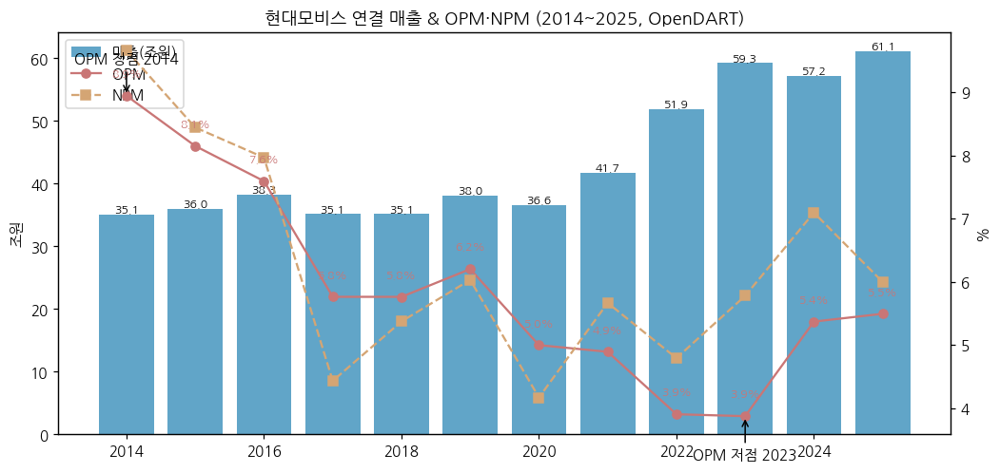

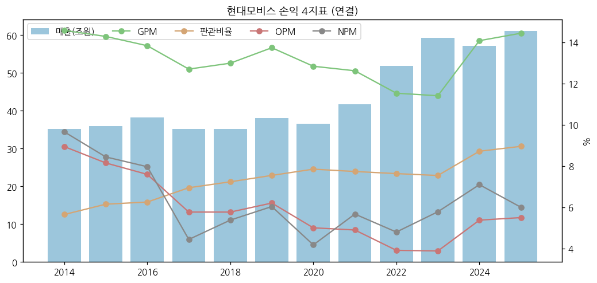

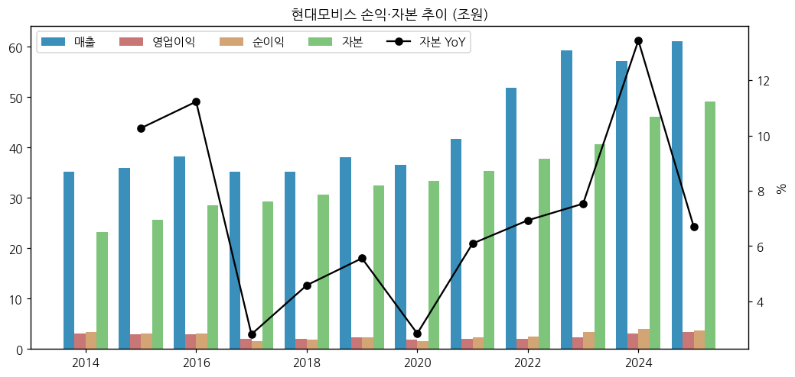

(3) 주가 역사

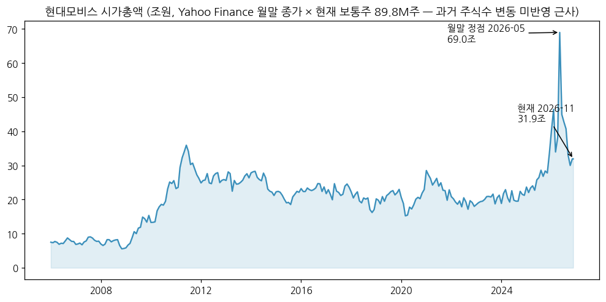

→ (Yahoo Finance v8 월간 OHLC. 시가총액 = 월말 종가 × 현재 보통주 약 89.8M주 — 과거 주식수 변동 미반영 근사)

**시장 데이터 (2026-11-13 확인)**

| 항목 | 값 | 출처 |
|---|---|---|
| 종가 | 355,500원 | Yahoo Finance meta, 2026-11-13 |
| 시가총액 | 약 31.9조원 (355,500원 × 약 89.8M주) | 계산 |
| 52주 최고 / 최저 | 822,000원 / 288,000원 | Yahoo Finance meta |
| 사상 최고가 (ATH) | **822,000원 (2026년 6월 장중)** — 월말 종가 정점 768,000원(2026.05말, 시총 약 69조) | Yahoo 월간 |
| ATH 대비 | **-56.8%** | 계산 |

**주가 변천사 요약**:
- 2009~2011: 모듈화·중국 성장 → 2011 첫 정점(월말 시총 약 35조 근사)
- 2012~2024: 20만원대 장기 박스 — 저마진 전동화 매출 확대, 지배구조 개편 기대·무산(2018)
- 2025.12~2026.01: 로봇 부품(액추에이터) 내러티브 — 한경 "로봇 사업으로 구조적 성장"(2025-12-15)
- 2026.05~06: 그룹 로봇 3만대 생산·액추에이터 35만개 계획 → **ATH 822,000원(2026-06 장중)**
- 2026.07~11: 로봇 기대 되돌림 + 증권사 목표가 하향(현대차증권 69만→52만, KB 90만→80만, 2026-10) → 2026-11-13 355,500원

(4) 주요 연혁

| 시기 | 내용 |
|---|---|
| 1977.07 | 현대정공 설립 |
| 2000 | 현대모비스로 사명 변경, A/S 부품 사업 이관 |
| 2015 | 한전부지 컨소시엄 참여 |
| 2018.03 | 지배구조 개편(모비스 분할·글로비스 합병) 발표 → 2018.05 철회 |
| 2021.01 | 현대오트론 반도체 사업 영업양수(1,300억) |
| 2021.03 | 정관에 "로봇, 로봇 부품 제조 및 판매업" 추가 |
| 2021.06 | Boston Dynamics 지분 투자(2.2억달러) → 2022.08 HMG Global 20% 출자로 전환 |
| 2024.11 | 첫 CEO Investor Day |
| 2025 | 로봇 부품사업 전담 조직 신설, CEO Investor Day "반도체·로보틱스 사업 본격 진출" |
| 2026.01 | OPmobility와 램프 사업 매각 MOU |
| 2026.09 | R&D Tech Day — 액추에이터 2종 공개, "히어로 제품" 10종 선정 |
| 2026.11 | 아틀라스용 액추에이터 시제품 생산 개시(의왕) |

---

## ③ 비즈니스 모델

(1) 실적 추이 통합 표 (사업부별 연간, DART 영업부문 주석)

| 연도 | 모듈·부품 외부매출 | A/S 외부매출 | 모듈·부품 OP | A/S OP | 연결조정 | 연결 OP | 모듈 OPM | A/S OPM | A/S 매출 비중 |
|---|---|---|---|---|---|---|---|---|---|
| 2015 | 297,155 | 63,042 | 15,882 | 14,167 | -703 | 29,346 | 5.3% | 22.5% | 17.5% |
| 2016 | 315,748 | 66,869 | 13,663 | 16,084 | -699 | 29,047 | 4.3% | 24.1% | 17.5% |
| 2017 | 282,609 | 68,837 | 2,376 | 17,524 | 350 | 20,249 | 0.8% | 25.5% | 19.6% |
| 2018 | 281,911 | 69,581 | 2,573 | 17,418 | 258 | 20,250 | 0.9% | 25.0% | 19.8% |
| 2019 | 304,826 | 75,661 | 4,007 | 20,082 | -497 | 23,593 | 1.3% | 26.5% | 19.9% |
| 2020 | 295,864 | 70,401 | 2,090 | 15,647 | 565 | 18,303 | 0.7% | 22.2% | 19.2% |
| 2021 | 332,654 | 84,368 | 780 | 19,681 | -59 | 20,401 | 0.2% | 23.3% | 20.2% |
| 2022 | 416,965 | 102,098 | 281 | 21,653 | -1,669 | 20,265 | 0.1% | 21.2% | 19.7% |
| 2023 | 483,715 | 108,829 | -1,555 | 24,564 | -56 | 22,953 | -0.3% | 22.6% | 18.4% |
| 2024 | 451,519 | 120,851 | -602 | 33,901 | -2,564 | 30,735 | -0.1% | 28.1% | 21.1% |
| 2025 | 478,001 | 133,180 | 760 | 35,035 | -2,221 | 33,575 | 0.2% | 26.3% | 21.8% |

→ 단위 억원. 출처: DART 사업보고서 연결 주석 "보고부문별 재무정보"(외부고객 매출, 부문 OP는 연결조정 전). OPM은 부문 OP ÷ 외부매출(부문간 매출 제외라 근사)
→ ⚠️ **회사 IR 부문 OP와 기준 다름** — IR FY25: 모듈·핵심부품 757억, A/S 3조 2,818억(합 3조 3,575억 = 연결). IR은 공통비·연결조정을 부문에 배분. 분기 리뷰는 IR 기준 사용
→ 2014 부문 데이터 미추출 (2015 사업보고서 전기 비교 파싱 실패)

(1-1) 사업부별 분기 시계열 (1Q24~3Q26, 11분기)

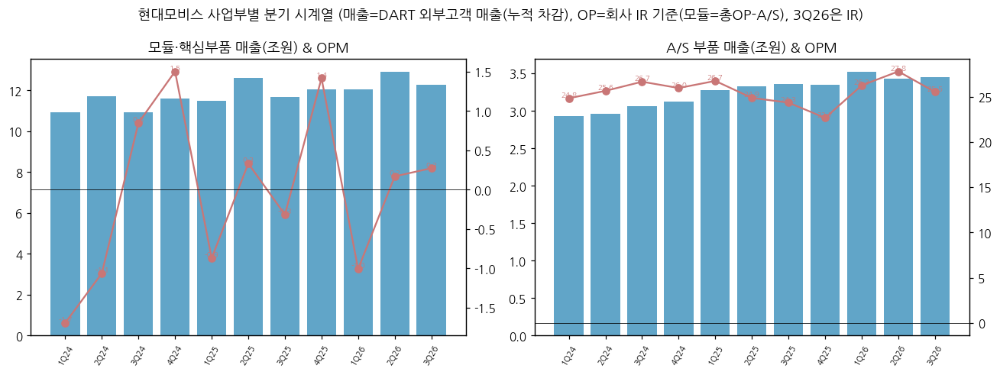

| 분기 | 연결 매출 | 모듈·핵심부품 매출 | A/S 매출 | 연결 OP | 모듈·핵심부품 OP | A/S OP | OPM | 모듈 OPM | A/S OPM |
|---|---|---|---|---|---|---|---|---|---|
| 1Q24 | 138,692 | 109,374 | 29,318 | 5,427 | -1,852 | 7,279 | 3.9% | -1.7% | 24.8% |
| 2Q24 | 146,553 | 116,909 | 29,644 | 6,361 | -1,241 | 7,602 | 4.3% | -1.1% | 25.6% |
| 3Q24 | 140,018 | 109,407 | 30,606 | 9,086 | 928 | 8,158 | 6.5% | 0.8% | 26.7% |
| 4Q24 | 147,107 | 115,823 | 31,284 | 9,861 | 1,740 | 8,121 | 6.7% | 1.5% | 26.0% |
| 1Q25 | 147,520 | 114,743 | 32,778 | 7,767 | -999 | 8,766 | 5.3% | -0.9% | 26.7% |
| 2Q25 | 159,362 | 126,067 | 33,295 | 8,700 | 420 | 8,280 | 5.5% | 0.3% | 24.9% |
| 3Q25 | 150,319 | 116,747 | 33,572 | 7,803 | -370 | 8,173 | 5.2% | -0.3% | 24.3% |
| 4Q25 | 153,979 | 120,444 | 33,536 | 9,305 | 1,706 | 7,599 | 6.0% | 1.4% | 22.7% |
| 1Q26 | 155,605 | 120,415 | 35,190 | 8,026 | -1,213 | 9,239 | 5.2% | -1.0% | 26.3% |
| 2Q26 | 163,247 | 128,942 | 34,304 | 9,752 | 218 | 9,534 | 6.0% | 0.2% | 27.8% |
| **3Q26 (IR)** | **157,233** | **122,739** | **34,494** | **9,141** | **335** | **8,807** | **5.8%** | **0.3%** | **25.5%** |

→ 매출 = DART 분기·반기·사업보고서 "외부고객 매출" 누적 차감(4Q = 연간 − 3Q 누적), 3Q26 = 회사 IR. 회사 IR 텍스트 값과 1억 단위까지 일치 확인(4Q25 모듈 120,444·A/S 33,536, 1Q26 120,415·35,190, 2Q26 128,942·34,304)
→ OP = 회사 IR 기준. 모듈·핵심부품 OP는 IR 하이라이트 문구(3Q23 146억, 1Q24 -1,852억, 2Q24 -1,241억, 3Q24 928억, 4Q24 1,740억, 1Q25 -999억, 2Q25 420억, 3Q25 -370억, 4Q25 1,706억, 2Q26 218억, 3Q26 335억), A/S OP = 연결 OP − 모듈 OP. 1Q26 A/S 9,239억은 IR 명시값
→ ⚠️ 표준(15년 60+분기) 대비 11분기 — 2016~2023 분기 부문 OP(IR 기준)는 IR PDF 표가 이미지라 미추출 (v1.1 보강 후보)

(1-2) 전사 12분기 시계열 (rolling)

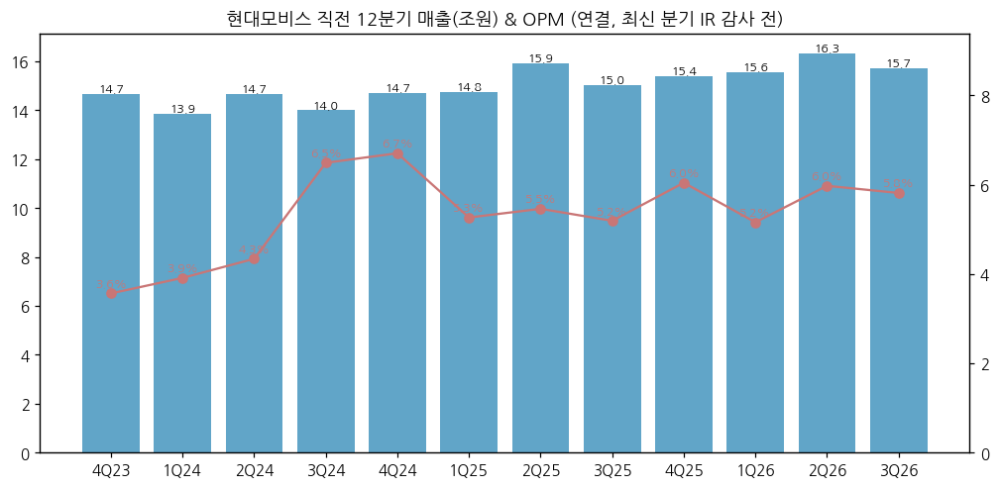

| 분기 | 매출 (억) | OP (억) | OPM | 매출 YoY | OP YoY | NI 연결 (억) |
|---|---|---|---|---|---|---|
| 4Q23 | 146,722 | 5,232 | 3.6% | -2.1% | -20.8% | 6,514 |
| 1Q24 | 138,692 | 5,427 | 3.9% | -5.4% | +29.8% | 8,624 |
| 2Q24 | 146,553 | 6,361 | 4.3% | -6.6% | -4.2% | 9,977 |
| 3Q24 | 140,018 | 9,086 | 6.5% | -1.6% | +31.6% | 9,212 |
| 4Q24 | 147,107 | 9,861 | 6.7% | +0.3% | +88.5% | 12,789 |
| 1Q25 | 147,520 | 7,767 | 5.3% | +6.4% | +43.1% | 10,317 |
| 2Q25 | 159,362 | 8,700 | 5.5% | +8.7% | +36.8% | 9,344 |
| 3Q25 | 150,319 | 7,803 | 5.2% | +7.4% | -14.1% | 9,305 |
| 4Q25 | 153,979 | 9,305 | 6.0% | +4.7% | -5.6% | 7,681 |
| 1Q26 | 155,605 | 8,026 | 5.2% | +5.5% | +3.3% | 8,831 |
| 2Q26 | 163,247 | 9,752 | 6.0% | +2.4% | +12.1% | 10,602 |
| **3Q26 (IR)** | **157,233** | **9,141** | **5.8%** | **+4.6%** | **+17.2%** | **5,984** |

**3Q26 핵심 박스**
→ 매출 15.72조(+4.6%): 모듈·핵심부품 12.27조(+5.1%, 고객사 완성차 생산 -2.3%에도 전동화·전장 확대, BEV 생산 +12.8%), A/S 3.45조(+2.7%) (회사 3Q26 IR p.3·5)
→ 영업이익 9,141억(+17.2%): 모듈·핵심부품 335억 흑자(2개 분기 연속, 인도 화재·메모리 반도체 비용 부담에도), A/S 8,807억(+7.8%, 판가 인상·관세 25→15%·USD +2.8%) (회사 IR)
→ 순이익 5,984억(-35.7%) — 지분법이익 3,324억 → 2,007억(-39.6%), 기타/금융손익 +1,482억 → -1,948억(원화 강세 외환손익) (회사 IR p.6, SBS Biz)
→ 발표 전 컨센서스 9,447억(현대차증권 2026-10-13 인용, 토요경제) 대비 약 -3%

(2) 사업부별 개요 (FY25)

| 사업부 | FY25 매출 | 비중 | FY25 OP (IR) | OPM | 주요 제품 |
|---|---|---|---|---|---|
| 모듈·핵심부품 | 47.8조 | 78% | 757억 | 0.2% | 샤시·칵핏·FEM 모듈, 전동화(PE·BSA), 전장(IVI·HUD·ADAS·사운드), 제동·조향·에어백, 램프 |
| A/S 부품 | 13.3조 | 22% | 3조 2,818억 | 24.6% | 보수용 순정부품 글로벌 공급 |
| (신규) 로봇 부품 | 0 | — | — | — | 액추에이터(아틀라스, 2028 공급 목표), 핸드그리퍼, 퍼셉션모듈 |

(3) 사업부별 디테일

**① 모듈·핵심부품**
→ 전동화: HMGMA·유럽 EV 물량 연동. 3Q26 유럽 모듈/부품 매출 +36.0% (IR p.7)
→ 전장: 북미 Major OE HUD(멕시코 생산), 중국 Major OE 사운드시스템, 인도 IVI 디스플레이 수주 (IR p.10)
→ 수주 부진: 고객사 BEV→HEV·ICE 전략 변경, 신기술 적용 축소 → 핵심부품 Non-captive 3Q 누계 11.5억달러(목표 89.7억달러의 13%). 대신 **북미 Major OE 샤시모듈(약 7년, 미국 생산)** 수주로 모듈 포함 연간 140억달러(계획 118억달러 초과) 전망 (IR p.12)

**② A/S 부품**
→ 판가 인상·환율·관세 완화가 3대 레버. 2Q26 일회성 관세 환급으로 A/S OP 9,534억(+15.1%) 정점

**③ 로봇 부품 (신규)**
→ 액추에이터 2종 공개(2026.09), 시제품 생산(2026.11, 의왕연구소), 2028 공급 시점에 맞춰 성능·신뢰성 검증 (SBS Biz 2026-10-30)
→ 그룹 계획: 2028 미국 액추에이터 제조시설 연 35만 개+ (헤럴드경제 2026-05-18 — 생산 주체는 기사에 미명시)
→ 로보틱스 핵심부품 조직 신설, 관련 인력 약 2배 확대 (SBS Biz 2026-10-30)

(4) 주요 경쟁사
→ 모듈·부품: Bosch, ZF, Continental, Magna, Denso, Aptiv / 국내 HL만도(제동·조향)
→ 로봇 액추에이터: Harmonic Drive·Nabtesco(감속기), Schaeffler, 중국 Sanhua·Tuopu(Tesla Optimus 공급망), 국내는 자동차 부품사들의 진입 시도 단계 (본 버전 미검증)

(5) 주요 매출처
→ 현대차·기아 및 계열 해외 법인이 대부분. Non-captive: 북미·유럽·중국·인도 Major OE (고객명 비공개)

(6) 생산 CAPA + 임직원
→ 생산거점 30·물류 41·연구소 8 (2025말). 연구개발 인력 7,948명(국내 6,158·해외 1,790, 3Q26) (회사 IR p.9)

---

## ④ 재무 구조 (12년 시계열)

(1) 손익·현금흐름 요약 (억원, OpenDART CFS)

| 연도 | 매출총이익 | GPM | 판관비 | 판관비율 | 영업CF | 투자CF | 재무CF | 유형취득 | 무형취득 | CapEx 계 | FCF | 배당지급 | 자사주취득 | 현금 | 유동비율 |
|---|---|---|---|---|---|---|---|---|---|---|---|---|---|---|---|
| 2014 | 51,232 | 14.6% | 19,820 | 5.6% | 8,466 | -1,866 | -2,223 | 10,695 | 412 | 11,108 | -2,642 | — | 41 | 29,114 | 219.9% |
| 2015 | 51,478 | 14.3% | 22,133 | 6.1% | 43,519 | -49,486 | 1,698 | 40,798 | 556 | 41,354 | 2,164 | — | 2,347 | 24,979 | 192.1% |
| 2016 | 52,957 | 13.8% | 23,910 | 6.2% | 20,178 | -21,245 | -3,363 | 12,961 | 325 | 13,286 | 6,892 | — | — | 20,493 | 206.8% |
| 2017 | 44,652 | 12.7% | 24,403 | 6.9% | 19,487 | -10,655 | -3,955 | 6,769 | 472 | 7,240 | 12,247 | 3,325 | — | 24,079 | 230.8% |
| 2018 | 45,670 | 13.0% | 25,420 | 7.2% | 16,101 | -9,440 | -7,206 | 5,314 | 289 | 5,603 | 10,498 | 3,325 | — | 23,351 | 239.3% |
| 2019 | 52,292 | 13.7% | 28,699 | 7.5% | 26,441 | -7,202 | -9,720 | 7,894 | 383 | 8,278 | 18,163 | 4,750 | 3,225 | 33,420 | 239.9% |
| 2020 | 47,042 | 12.8% | 28,739 | 7.8% | 24,767 | -12,568 | -2,319 | 10,959 | 231 | 11,190 | 13,577 | 2,821 | 2,349 | 42,024 | 227.2% |
| 2021 | 52,645 | 12.6% | 32,244 | 7.7% | 26,088 | -19,534 | -9,624 | 9,218 | 325 | 9,544 | 16,545 | 4,636 | 4,286 | 41,560 | 233.7% |
| 2022 | 59,872 | 11.5% | 39,606 | 7.6% | 21,541 | -16,040 | -6,385 | 11,344 | 864 | 12,208 | 9,333 | 3,681 | 2,442 | 40,882 | 223.6% |
| 2023 | 67,622 | 11.4% | 44,669 | 7.5% | 53,426 | -25,414 | -18,894 | 18,019 | 1,113 | 19,132 | 34,294 | 3,672 | 3,030 | 50,794 | 212.1% |
| 2024 | 80,626 | 14.1% | 49,892 | 8.7% | 42,527 | -45,891 | -2,550 | 22,041 | 1,610 | 23,651 | 18,876 | 4,062 | 1,630 | 47,885 | 223.0% |
| 2025 | 88,299 | 14.4% | 54,725 | 9.0% | 44,725 | -32,337 | -12,047 | 13,478 | 1,679 | 15,157 | 29,569 | 5,834 | 4,145 | 49,224 | 232.6% |

→ "—" = OpenDART 계정 미추출(결측). 2015 유형취득 4.1조는 한전부지 매입 분담 포함
→ 회사 IR CAPEX(생산/R&D, R&D 시설 포함): 2022 1조 476억 → 2023 1조 8,815억 → 2024 2조 1,600억 → 2025 1조 4,794억 → 2026E 2조 2,084억 (3Q 누계 9,877억, 44.7%) — 현금흐름표 유형취득과 기준 상이


(2) 재무상태표

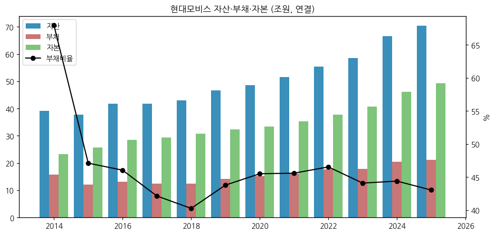

→ 2025말 자산 70.4조 / 부채 21.2조 / 자본 49.2조 / 현금 4.9조. 부채비율 43% — 무차입에 가까운 순현금 구조

(3) 현금흐름

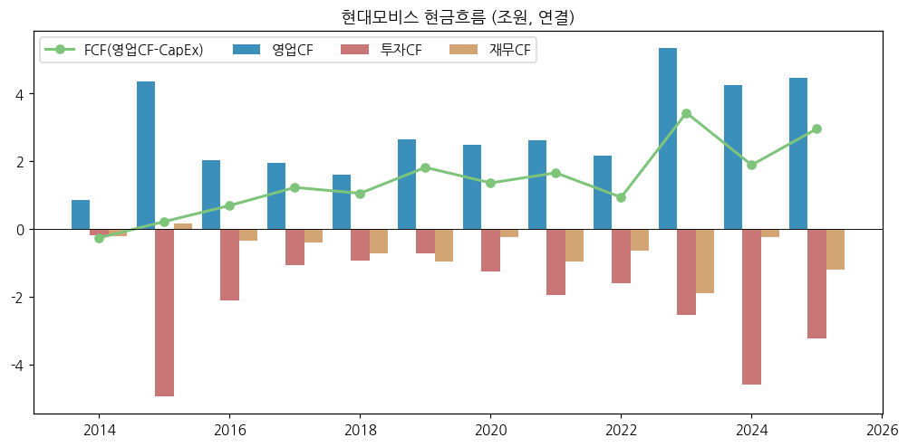

(4) CapEx

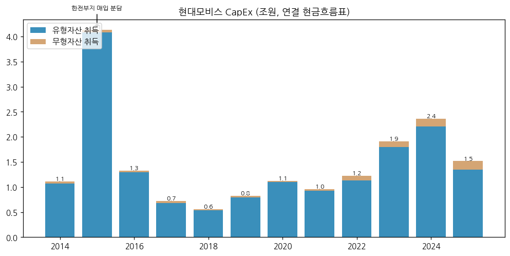

(5) 부채구조
→ OpenDART 기준 사채·장기차입 계정 미미(2023 이후 단기차입 계정 미표시). 이자보상 여력 충분

(6) 배당·자사주

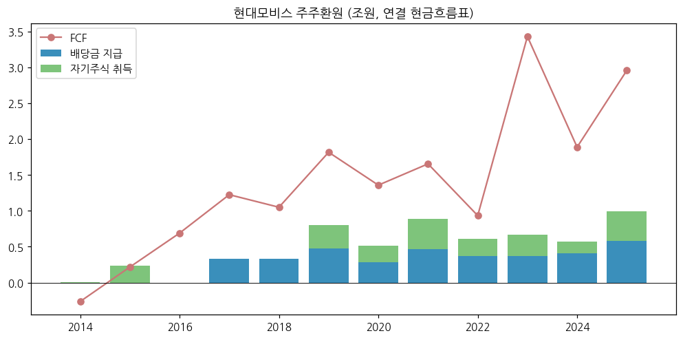

→ DPS 2023 4,500원 → 2024 6,000원 → 2025 6,500원 (DART). 자사주: 2025 4,145억 매입·소각 + 기보유 70만주 소각(2,072억), 2026 5,000억 매입(5~7월, 91만주) → 2026.08 소각 (회사 2Q26 IR)

(7) 재무비율

| 연도 | ROE(지배, 기말) | 부채비율 | 유동비율 | OPM | NPM |
|---|---|---|---|---|---|
| 2021 | 6.7% | 45.6% | 233.7% | 4.9% | 5.7% |
| 2022 | 6.6% | 46.5% | 223.6% | 3.9% | 4.8% |
| 2023 | 8.4% | 44.1% | 212.1% | 3.9% | 5.8% |
| 2024 | 8.8% | 44.4% | 223.0% | 5.4% | 7.1% |
| 2025 | 7.4% | 43.1% | 232.6% | 5.5% | 6.0% |

---

## ⑤ 지배 구조

(1) 그룹·계열 관계
→ 현대차그룹 순환출자의 정점: 기아 → **현대모비스** → 현대차(22.36%) → 기아. 정의선 회장 직접 지분 0.33%
→ HMG Global LLC 20% 출자 → Boston Dynamics 간접 보유. 2024~2026 BD 추가 출자: 2024.05 4,300만달러, 2025.08 1.06억달러(2025 6,400만·2026 4,200만달러 분납), 2026.08 4,100만달러 (회사 3Q26 IR p.13)

(2) 주주 구분 (2025말, DART 2025 사업보고서)

| 주주 | 주식수 | 지분율 |
|---|---|---|
| 기아 (최대주주) | 16,427,074 | 18.10% |
| 정몽구 | 6,778,966 | 7.47% |
| 현대제철 | 5,504,846 | 6.07% |
| 현대글로비스 | 656,293 | 0.72% |
| 정의선 | 303,759 | 0.33% |
| 특수관계인 합계 | 29,671,938 | 32.70% |

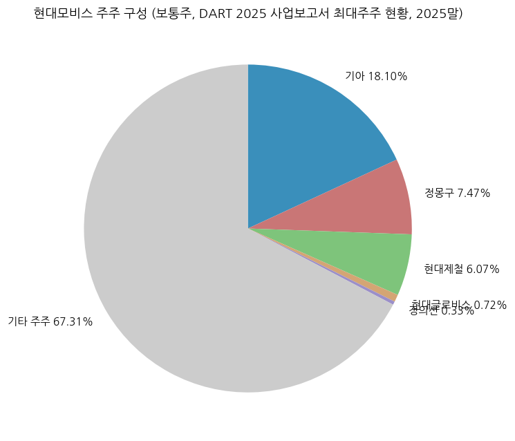

(3) 임원·이사회
→ 대표이사 정의선 회장(그룹 회장 겸직), 이규석 사장(총괄). 주요 BU: 전동화/모듈BU(김선섭 부사장), 전장BU(정수경 부사장), 서비스부품BU(손찬모 부사장), 램프BU(박정훈 전무), 반도체사업담당(박철홍 전무) — DART 2025 사업보고서
→ 로보틱스: 2025 로봇 부품사업 전담 조직 신설 → 로보틱스사업추진실 산하 로보틱스개발팀 (DART 2025 사업보고서 II-6)

---

## ⑥ 기타 팩트

(1) R&D 인프라

| 연도 | 2022 | 2023 | 2024 | 2025 | 2026E |
|---|---|---|---|---|---|
| R&D 투자 (억) | 13,709 | 15,925 | 17,486 | 18,765 | 21,631 |
| 부품제조/전동화 매출 대비 | 10.1% | 9.5% | 10.1% | 9.6% | 9.3%(3Q 누계) |

→ 출처: 회사 3Q26 IR p.9 (2026E 연결자회사 제외, 3Q 누계 1조 4,538억). "연간 R&D 투자 첫 2조원 돌파" 전망 (회사 컨콜, SBS Biz)

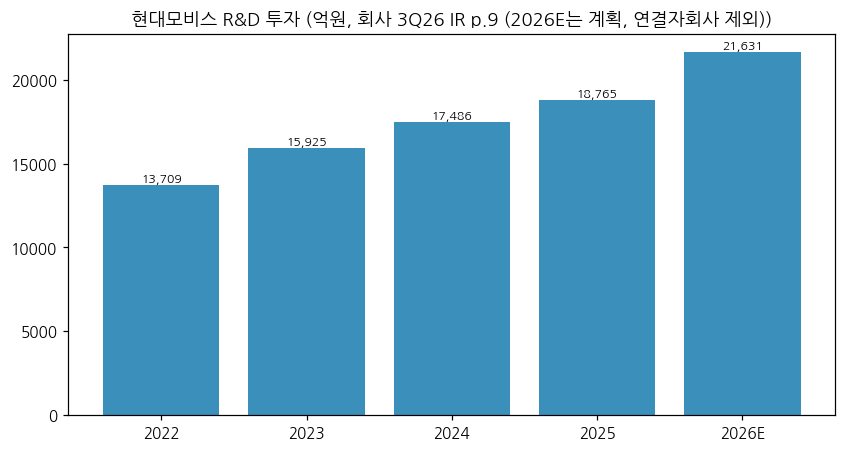

(2) 진행 중 corporate action (회사 3Q26 IR p.13 외)

| 시기 | 내용 |
|---|---|
| 2020.03 | Motional 지분투자 4억달러 |
| 2021.01 | 현대오트론 반도체 영업양수 1,300억 |
| 2021.04 | Supernal(AAM) 투자 개시 |
| 2021.06 | Boston Dynamics 지분투자 2.2억달러 |
| 2022.10 | AI 연구소(미국) 8,500만달러 — 로보틱스 경쟁력 |
| 2023.06 | 미국 배터리셀 JV(SK온·LGES) 6,100억 |
| 2024.05 | Motional 1.85억달러, BD 4,300만달러 추가 |
| 2025.08 | BD 1.06억달러 추가 |
| 2026.01~ | 램프 사업 물적분할·OPmobility 매각 (2027 하반기 종결 목표) |
| 2026.06 | 에이치엠지퓨처콤플렉스 1조 988억 (5년 분납) |
| 2026.08 | BD 4,100만달러 추가 |

(3) R&D 마일스톤
→ 2025 차량용 반도체 ASIL-D 프로세스 인증, PE시스템 독자개발 / 2026.09 Tech Day 60여 종 성과, 히어로 제품 10종 / 2026.11 로봇 액추에이터 시제품 생산

(4) 주요 리스크
→ 캡티브 물량(현대·기아 생산) 의존, 관세(A/S 수출), 원화 강세(외환손익·지분법), Non-captive 수주 부진, 로봇 양산 일정 지연, 램프 매각 종결 리스크

(5) ESG / (6) 인증
→ 본 버전 미수집 (v1.1)

---

## Version Log

| 버전 | 일자 | 내용 |
|---|---|---|
| v1.0 | 2026-11-14 | 첫 작성 (로봇 섹터 편입). OpenDART CFS 43건 + DART 원문 43건(연간 부문 11년 파싱) + IR PDF 20건 + Yahoo 월간. 표준 12종 차트 |

**자료 source audit (v1.0)**

| 자료 | 상태 | 비고 |
|---|---|---|
| OpenDART 재무제표 JSON | ✅ | CFS 43건 |
| DART 원문 영업부문 | ✅ | 2015~2025 연간, 1Q24~2Q26 분기 |
| 회사 IR PDF | △ | 2023.3Q~2026.3Q, 부문 분기표는 이미지 → 하이라이트 문구로 OP 복원 |
| 주가 | ✅ | Yahoo v8 |
| 국민연금·외국인 지분 / ESG | ❌ | 미수집 |

**잔여 보완 후보 (v1.1)**
→ 분기 부문 시계열 2016~2023 확장, 지역별 매출(미주·유럽·중국·기타), 핵심부품 제품별 매출, Non-captive 수주 연도별 표, 2014 부문
