> 종목: 현대오토에버 (307950.KS / 현대오토에버 주식회사 / Hyundai AutoEver Corp.)
> 섹터: 로봇 — 서브섹터 산업·물류 자동화 (워치리스트 모빌리티·에너지전환 대분류)
> 작성 시각: 2026-11-14 KST (v1.0, 신규 작성)
> 적용 구조: v4.8 (6개 섹션 + 12종 표준 차트, chart2는 SI·ITO·차량SW 3사업부 누적 1장)
> 데이터: 연결 연간 10년(2016~2025; 2016~2018은 합병 전 단독 사업보고서 요약) + 분기 31개(1Q19~3Q26, 2019.03 상장 이후 전 분기) 사업부별 매출·전사 손익 + Yahoo Finance 307950.KS 주간 시계열(2019.03~2026.11)
> 출처: OpenDART 연결재무제표 JSON 31건(2018 FY~2026 2Q, corp_code 00362441) / DART 정기보고서 공시원문 15건(2022 사업보고서~2026 반기보고서, 최신 2026.06 반기 rcept 20260814003571, 2025 사업보고서 20260318001324) / OpenDART 기업개황·최대주주·임원·직원·배당(2025 사업보고서) / 회사 IR 실적발표 PDF 45건(irgo 경유, 2019.2Q~2026.3Q; 최신 2026-10-30 「2026년 3분기 경영실적」) / 교보증권 2Q26 Review(2026-07-30)·대신증권 Results Comment(2026-07-31) / 시장데이터 Yahoo Finance(2026-11-13 종가)

# 현대오토에버 기업 개요 (v1.0 — 로봇·산업자동화, 지속성장 + 피지컬AI 옵션)
> **Fact verify cutoff**: 2026-11-14 (주가·시가총액·52주 고저는 Yahoo Finance v8 주간 시계열 2026-11-13 종가, 3Q26 실적은 2026-10-30 회사 IR 감사 전 수치, 주주는 2025 사업보고서)

---

## ① 기업 분류

(1) Primary / Secondary 분류

**Primary 분류: 지속성장 (그룹 캡티브 IT서비스, 10년 OPM range 1.4%pt)**

→ 매출 2016 1조 3,360억 → 2025 4조 2,521억 (9년 CAGR **+13.7%**), 10년 동안 역성장 연도는 2018(-3.3%)·2020(-0.6%) 2회뿐

→ OPM 2016~2025 **4.6~6.0%** 박스권 — 이익률이 아니라 매출 규모가 이익을 키우는 구조. 현대차그룹이 IT 투자를 늘리면 그만큼 매출이 늘고, 단가 협상으로 마진이 6% 안팎에 고정된다

→ 매출의 **96.2%가 현대차그룹 계열사**(2025 계열사 매출 4조 918억 / 4조 2,521억, DART 2025 사업보고서 II-4 주요 매출처)

**Secondary 노트: 꿈 — 그룹 피지컬AI(로봇 관제·스마트팩토리·AI 데이터센터)의 SW 실행 법인**

→ 2026년 주가는 실적이 아니라 이 옵션으로 움직였다: 2026-03 30만 원대 → 2026-05 말 주간 종가 93.1만 원(장중 106.6만 원, Yahoo 52주 고가) → 2026-11-13 28.55만 원 (고점 대비 -69%)

→ 로봇 관련 매출은 **분리 공시하지 않는다**. 스마트팩토리 구축은 SI, 공장 시스템 운영은 ITO 안에 섞여 있다. 셀사이드는 로보틱스 가치를 별도로 넣고 있다(교보 2026-07-30: 신사업 현재가치 5.29조 중 로보틱스 4.23조 = "BD/로보틱스 사업 내 SI 사업 영위 가정")

**Entity 구조 (2026.06 반기 기준)**

→ **(1) Enterprise IT = SI + ITO** — 3Q26 누계 매출 2조 8,010억 (82%) — 그룹 ERP·클라우드·데이터센터·공장 시스템 구축(SI)과 운영(ITO)

→ **(2) 차량SW** — 3Q26 누계 6,102억 (18%) — 차량 SW 플랫폼 mobilgene(AUTOSAR), 내비게이션 SW, 정밀지도, 제어기 BSW

→ **(3) 해외법인** — 미주·유럽·인도·중국 등. 3Q26 YTD 현지통화 매출 증가율 미주 +18.7%, 유럽 +14.9%, 인도 +28.0%, 중국 +13.8% (회사 3Q26 IR p.5)

**부문 명칭 매핑 (시계열 연결 시 필수)**

| 기간 | 사업부 | 비고 |
|---|---|---|
| 1Q19~1Q21 | SI · ITO | 합병 전 현대오토에버 단독 |
| 2Q21~ | SI · ITO · **차량SW** | 2021.04.01 현대엠엔소프트(내비) + 현대오트론 SW부문 흡수합병 → 차량SW 신설 |
| 2025~ IR | Enterprise IT(SI+ITO) · 차량SW | 매출은 3분류 유지, 매출총이익은 2분류로만 공개 |

→ **사업부 영업이익은 공시하지 않는다**. IR이 사업부별 매출총이익(GPM)까지만 공개 → 본 리포트 사업부 이익은 GPM 기준

(2) Summary Box (10년 연결 2016~2025)

| 지표 | 10년 평균 | 정점 | 저점 | 2025년 |
|---|---|---|---|---|
| 매출 (억원) | 23,224 | **42,521 (2025)** | 13,360 (2016) | **42,521** |
| 영업이익 (억원) | 1,290 | **2,553 (2025)** | 702 (2018) | **2,553** |
| 순이익 (억원) | 983 | **1,868 (2025)** | 552 (2017·2018) | **1,868** |
| OPM (%) | **5.4%** | 6.0% (2016·2024·2025) | 4.6% (2021) | **6.0%** |

```
[현대오토에버 10년 연결 손익 (억원)]
연도   매출      OP     OPM    NI
2016  13,360    804   6.0%    647   ← 합병 전 단독 (SI·ITO)
2017  14,734    729   4.9%    552
2018  14,249    702   4.9%    552
2019  15,718    802   5.1%    569   ← 2019.03.28 코스피 상장 (공모가 44,000원)
2020  15,626    868   5.6%    608   ← 코로나 — 유일한 역성장(-0.6%)
2021  20,704    961   4.6%    714   ← 2021.04 3사 합병 → 차량SW 편입, 매출 +32%
2022  27,545  1,424   5.2%  1,162   ← 차량SW +73%, 그룹 차세대 ERP 착수
2023  30,650  1,814   5.9%  1,403
2024  37,136  2,244   6.0%  1,752   ← SI +27% (차세대 ERP·HMGMA 공장 시스템)
2025  42,521  2,553   6.0%  1,868   ← 매출 4조 돌파, 차량SW +2.9%로 정체
(2026 1~3Q: 매출 34,111억 +16.4%, OP 1,806억 +1.0% — 외형 성장, 이익 정체)

OPM range: 4.6% ~ 6.0% = 1.4%pt → 사이클 cutoff(±10%pt) 대비 매우 작음 → 지속성장
```

**📊 성장 통계**

| 지표 | 값 |
|---|---|
| 매출 CAGR (9년, 2016→2025) | **+13.7%** |
| 매출 CAGR (6년, 2019→2025, 상장 후) | **+18.0%** |
| 영업이익 CAGR (6년, 2019→2025) | **+21.3%** |
| OPM 평균 (2016~2025) | **5.4%** |
| OPM range | **1.4%pt** |
| 분기 계절성 | 1Q 저점(OPM 2~4%) → 4Q 고점(연간 매출의 30%) — 그룹 IT 예산 집행·단가 소급 타이밍 |

**국내 IT서비스 3사 비교 (FY25, 회사 공시 기준)**

→ **현대오토에버** — 매출 4조 2,521억 / OP 2,553억 / **OPM 6.0%** — 그룹 매출 비중 96%

→ **삼성SDS·LG CNS** — 2026E PER 14배·12배 vs 현대오토에버 47배 (알파증류소 2026-04-15, 당시 주가 40.1만 원 기준) — 동종업 대비 3배 이상 프리미엄은 로봇·피지컬AI 옵션 몫 `[판단]`

(3) 정량적 분류 근거

→ **매출 그룹 의존 96.2%** (2025) — 수요가 그룹 IT·공장 투자 사이클에 묶여 있다. 외부 경기보다 현대차그룹 CapEx·IT 예산이 1차 변수

→ **원가 구조 = 외주비 77% + 상품 23%** (2025 매입액 2조 4,932억 중 외주용역비 1조 9,194억, DART 2025 사업보고서 II-3) — 인력·외주 기반 노동집약 사업이라 마진 상단이 제한

→ **2026 YTD 이익 정체**: 1~3Q 매출 +16.4%인데 영업이익 +1.0% — 차량SW GPM이 2024 17.3% → 2026 1~3Q 8.8%로 반 토막

(4) 산업 분류

→ **한국표준산업분류** — 582 소프트웨어 개발 및 공급업 (DART 기업개황 induty_code 582)

→ **KRX 업종** — 유가증권시장 IT서비스

→ **워치리스트 섹터** — **로봇 / 산업·물류 자동화** (두산로보틱스·Symbotic·Teradyne과 같은 서브섹터)

→ 실질 분류: 매출 기준 그룹 캡티브 IT서비스(82%) + 차량 SW(18%). 로봇은 아직 매출 단위로 잡히지 않는 옵션

(5) 분류 결정 논리

(1) **가장 큰 사업부 기준** — Enterprise IT 82% → IT서비스 수요(그룹 디지털 전환) 따라 꾸준히 성장, 사이클 진폭 작음 → 지속성장

(2) **이익 sub-rule** — 사업부 영업이익 미공시. GPM은 Enterprise IT 10~11%, 차량SW 8~19%로 차량SW 변동이 크지만 매출 비중 18%라 전사 OPM 진폭은 1.4%pt에 그침

(3) **Secondary 꿈 노트 근거** — 2026 주가 고점 PER은 실적 대비 100배를 넘었다(대신 2026-07-31: 2026F PER 128.9배 표기). 주가가 실적이 아닌 그룹 로봇·AI 투자 뉴스(보스턴다이나믹스 아틀라스, 새만금 AI 데이터센터)에 반응 → 밸류에이션에 꿈 프리미엄 존재

(6) 적정 밸류에이션 방법

→ **1차 — PER (12MF EPS)**: 이익 변동성 작은 지속성장 → PER이 기본. 2026-11-13 종가 285,500원 기준 **trailing PER 약 42.8배**(4Q25~3Q26 순이익 합 1,875억 × 지배 비율 97.7% ÷ 27,423,982주 ≈ EPS 6,680원, `[추정]`). 3사 합병 이후 평균 12MF P/E는 약 30배(iM증권 2024-10-31)

→ **2차 — SOTP (기존 사업 PER + 신사업 가치)**: 셀사이드 표준. 교보(2026-07-30) = 기존사업 8.73조(2027E 지배순익 2,580억 × 33.8배) + GPU/데이터센터 1.06조 + 로보틱스 4.23조 → 목표가 54만 원. 대신(2026-07-31) = 2028E EPS 13,553원 × 42.8배 → 58만 원

→ **DCF 미사용 근거** — 그룹 투자 일정(로봇 양산·데이터센터)에 따라 신사업 매출 시점이 크게 바뀜

→ 현재 시가총액 **7.83조 원**(285,500원 × 27,423,982주, 2026-11-13). PBR 약 4.0배(3Q26말 자본 1조 9,367억, 회사 IR)

(7) 분기 재평가 트리거 (**분류 변경 조건**)

→ ① **로봇·스마트팩토리 매출을 별도 공시 + 연 1,000억 이상** → Secondary 꿈 → Primary 고성장 후보로 격상 검토 (그룹 휴머노이드 양산 SI 실현)

→ ② **OPM 7% 이상 4분기 연속** → 단가·믹스 구조 개선 확인, 지속성장 상단 재평가

→ ③ **그룹 IT 예산 축소로 매출 YoY 한 자릿수 2분기 연속** → 지속성장 둔화, 꿈 프리미엄 제거 국면

---

## ② 회사 개요

(1) 기본 사항

| 항목 | 내용 |
|---|---|
| 회사명 (한글) | 현대오토에버 주식회사 |
| 회사명 (영문) | Hyundai AutoEver Corp. |
| 종목코드 | 307950 (KRX 유가증권시장, 2019.03.28 상장) |
| 설립 | 2000.04.10 |
| 본사 | 서울특별시 강남구 테헤란로 510 (루첸타워) |
| 홈페이지 | www.hyundai-autoever.com |
| 대표이사 | **류석문** 전무 (1972.01생, 광주과학기술원 메카트로닉스 석사, 쏘카 CTO·라이엇게임즈코리아 개발이사 → 현대오토에버 SW플랫폼사업부장 → 2025년 말 대표이사, 개발자 출신) |
| 발행주식수 | 27,423,982주 (보통주, 자기주식 866주) |
| 최대주주 | **현대자동차 31.59%** + 특수관계인 합 **75.29%** (현대모비스 20.13%, 기아 16.24%, 정의선 7.33%) |
| 기타 5% 이상 | 국민연금공단 8.22% (교보증권 2026-07-30 Company Data 인용) |
| 임직원 | 5,753명 (2025말: IT 3,912 / 차량SW 1,568 / 경영지원 273, DART 2025 사업보고서) |
| 시가총액 | **7.83조 원** (2026-11-13, 285,500원) |

→ 사업 한 줄 정의: **현대차그룹의 IT 시스템을 만들고(SI) 돌리고(ITO), 차에 들어가는 SW를 공급(차량SW)하는 그룹 IT 법인**. 그룹 로봇·스마트팩토리의 관제·통합 SW 역할로 확장 중

(2) 10년 손익·자본 추이

| 연도 | 매출 | 영업이익 | OPM | 순이익 | 자본총계 | 자본 YoY |
|---|---|---|---|---|---|---|
| 2019 | 15,718 | 802 | 5.1% | 569 | 5,150 | — |
| 2020 | 15,626 | 868 | 5.6% | 608 | 5,624 | +9.2% |
| 2021 | 20,704 | 961 | 4.6% | 714 | 13,758 | **+144.6%** |
| 2022 | 27,545 | 1,424 | 5.2% | 1,162 | 14,904 | +8.3% |
| 2023 | 30,650 | 1,814 | 5.9% | 1,403 | 15,923 | +6.8% |
| 2024 | 37,136 | 2,244 | 6.0% | 1,752 | 17,305 | +8.7% |
| 2025 | 42,521 | 2,553 | 6.0% | 1,868 | 18,747 | +8.3% |

→ (단위: 억원. 출처: OpenDART 연결. 2021 자본 급증은 3사 합병 신주 발행 — 자본잉여금 7,731억)

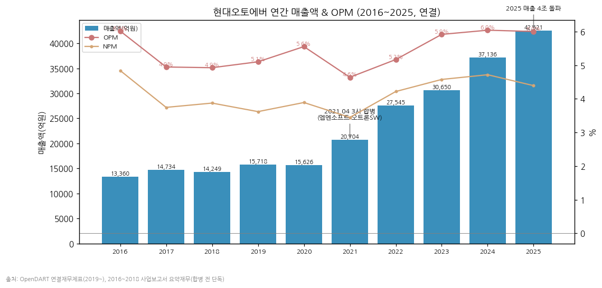

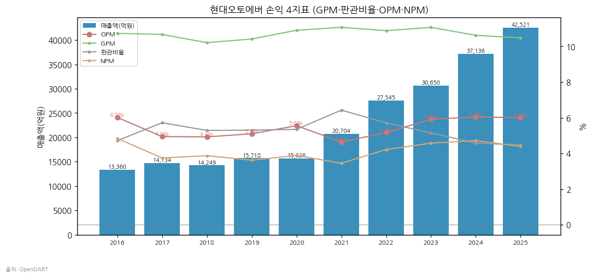

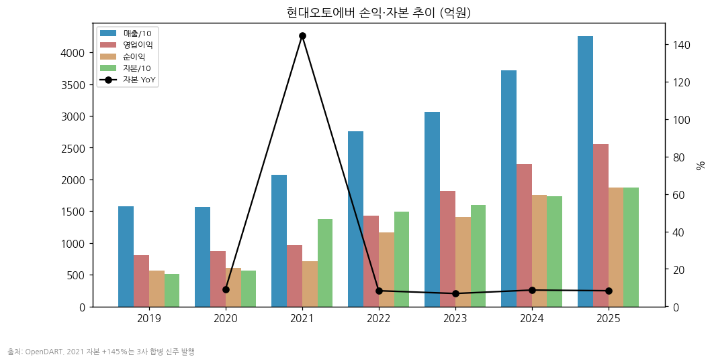

(3) 주가 역사

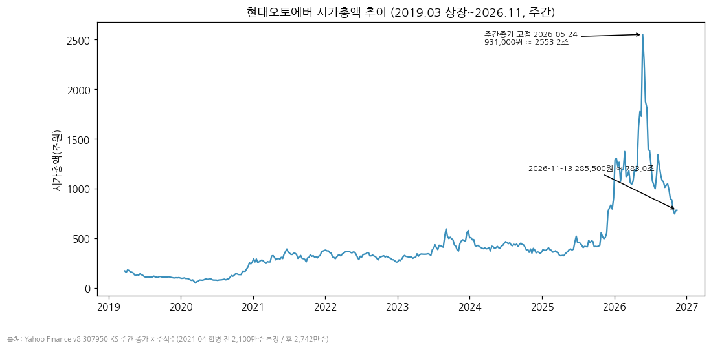

→ 2019.03 상장(공모가 44,000원) → 2019말 48,500원 → 2020말 123,500원 (그룹 SW 통합 기대, 시총 약 2.6조)

→ 2021~2024: 9.5~18.5만 원 박스권. 합병 후 차량SW 고성장(2022 +73%)에도 OPM 5~6%에 갇혀 PER 20~40배 사이 등락

→ 2025말 331,500원 (+151% YoY) — 그룹 SDV·로보틱스 역할 부각

→ **2026 피지컬AI 랠리**: 2026-04-01 시가 38.1만 원 → 5월 보스턴다이나믹스 아틀라스 공개·그룹 피지컬AI 전략 → 2026-05-13 장중 72.3만 원(mediawatch 2026-05) → **2026년 5월 말 주간 종가 93.1만 원(시총 약 25.5조), 장중 고가 106.6만 원**(Yahoo Finance 52주 고가, 2026-11-13 meta) — 상장 이후 ATH

→ 하락: 6~7월 AI 밸류체인·그룹사 주가 조정 + 2Q 차량SW 부진 → 2026-07-29 33.8만 원(교보) → 10/30 3Q 실적 발표일 -13.1%(알파증류소) → **2026-11-13 285,500원 (시총 7.83조, ATH 대비 -69%)**. 52주 저가 180,700원(Yahoo meta)

(4) 주요 연혁

| 일자 | 내용 |
|---|---|
| 2000.04 | 현대오토에버 설립 (현대차그룹 IT 서비스 법인) |
| 2012.01 | 파주 데이터센터 준공 (연면적 10,035㎡) |
| 2019.03.28 | 코스피 상장 |
| 2021.04.01 | 현대엠엔소프트·현대오트론(SW부문) 흡수합병 → 차량SW 부문 신설, 매출 2조 시대 |
| 2023 하반기 | 차량 SW 플랫폼 mobilgene Classic 2.0 개발 완료 |
| 2024.12 | 현대차 차세대 ERP 본사·미주 롤인 계약 1,167억 (DART 단일판매공급계약) |
| 2025 | 매출 4조 2,521억 돌파 / 류석문 대표 선임(개발자 출신) |
| 2026.05 | 주가 ATH (주간 종가 93.1만 원) |
| 2026.10.22 | 현대차·기아 모바일 로봇 '모베드' 기반 AI 순찰·관제 솔루션 공개 — "로봇 SI 기업으로 기획·구축·통합관제·유지보수 일괄" (아시아경제 2026-10-22) |
| 2026.10.30 | 새만금 AI 데이터센터 GPU 서비스 합작법인 'HMG AI 팩토리'(가칭)에 1,146억 출자, 지분 26% 결정 (연합뉴스 2026-10-30) |

---

## ③ 비즈니스 모델

(1) 실적 추이 통합 표 (5년, 억원)

| 구분 | 2021 | 2022 | 2023 | 2024 | 2025 | 비중(2025) |
|---|---|---|---|---|---|---|
| **매출 합계** | 20,704 | 27,545 | 30,650 | 37,136 | 42,521 | 100% |
| SI | 7,450 | 9,604 | 10,098 | 12,789 | 16,572 | 39.0% |
| ITO | 10,362 | 12,941 | 14,157 | 16,304 | 17,672 | 41.6% |
| 차량SW | 2,893 (2Q~4Q) | 5,001 | 6,395 | 8,044 | 8,277 | 19.5% |
| 매출총이익 | 2,292 | 2,998 | 3,392 | 3,945 | 4,455 | GPM 10.5% |
| 영업이익 | 961 | 1,424 | 1,814 | 2,244 | 2,553 | OPM 6.0% |
| **YoY** | | | | | | |
| SI | — | +28.9% | +5.1% | +26.6% | **+29.6%** | |
| ITO | — | +24.9% | +9.4% | +15.2% | +8.4% | |
| 차량SW | — | +72.9% | +27.9% | +25.8% | **+2.9%** | |

→ (출처: 회사 IR 분기별 손익계산서 합산, 2021 차량SW는 합병일 이후 3개 분기)
→ 사업부 GPM (2025): SI 10.9%, ITO 9.0%, 차량SW 12.7%(2024 17.3%에서 -4.6%p — 미국 관세로 저가 차종 내비 탑재율 하락, 딜사이트 2026-04-06 / 유진증권 인용)
→ 지역: 해외법인 매출 비중 미공시. 3Q26 YTD 현지통화 성장률 미주 +18.7%·유럽 +14.9%·인도 +28.0%·중국 +13.8% (회사 3Q26 IR p.5)

(2) 사업부별 분기 시계열 (1Q19~3Q26, 31분기)

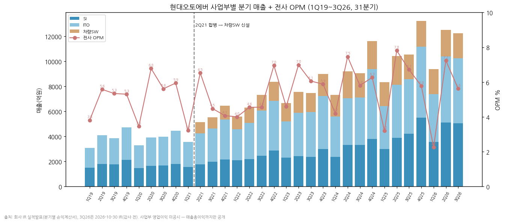

| 분기 | 1Q24 | 2Q24 | 3Q24 | 4Q24 | 1Q25 | 2Q25 | 3Q25 | 4Q25 | 1Q26 | 2Q26 | **3Q26** |
|---|---|---|---|---|---|---|---|---|---|---|---|
| 매출 | 7,313 | 9,181 | 9,046 | 11,596 | 8,330 | 10,421 | 10,543 | 13,227 | 9,357 | 12,507 | **12,247** |
| SI | 2,365 | 3,308 | 3,314 | 3,801 | 2,996 | 3,878 | 4,210 | 5,487 | 3,568 | 5,106 | **5,049** |
| ITO | 3,225 | 3,726 | 3,778 | 5,574 | 3,412 | 4,239 | 4,349 | 5,672 | 3,810 | 5,278 | **5,199** |
| 차량SW | 1,723 | 2,147 | 1,954 | 2,220 | 1,922 | 2,303 | 1,983 | 2,068 | 1,979 | 2,123 | **1,999** |
| 매출총이익 | 682 | 1,075 | 964 | 1,224 | 699 | 1,227 | 1,161 | 1,368 | 732 | 1,371 | **1,208** |
| 영업이익 | 307 | 685 | 525 | 727 | 267 | 814 | 708 | 765 | 212 | 905 | **689** |
| OPM | 4.2% | 7.5% | 5.8% | 6.3% | 3.2% | 7.8% | 6.7% | 5.8% | 2.3% | 7.2% | **5.6%** |

→ (단위: 억원. 출처: 회사 IR. 1Q19~4Q23은 chart2 데이터 — 1Q19~1Q21 SI·ITO 2사업부, 2Q21부터 차량SW 추가)
→ 3Q26 사업부 GPM: Enterprise IT 10.1%(3Q25 11.1%), 차량SW 8.5%(3Q25 10.6%) — 회사 3Q26 IR p.4

**📦 3Q26 핵심 박스**
→ 매출 1조 2,247억 (+16.2% YoY, -2.1% QoQ), 영업이익 689억 (-2.6% YoY), OPM 5.6% — 영업이익 컨센 759~765억 하회(연합인포맥스 5개사 759억 / FnGuide 765억)
→ Enterprise IT 1조 248억 (+19.7%) 성장 지속 / 차량SW 1,999억 (+0.8%) 정체
→ ITO 계약 협상 지연으로 약 200억 매출 4Q 이연(흥국 2026-11-03, NH 2026-11-02 인용) → 단가 인상 4~5% + 소급분 4Q 반영 예상
→ 3Q26말 현금 8,513억, 차입금 0, 부채비율 94.9%

(3) 최근 12분기 매출 & OPM

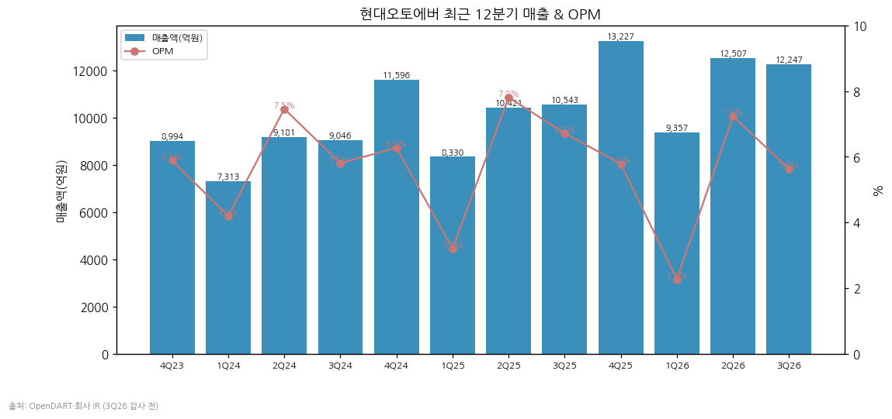

(4) 사업부별 개요 (매출 비중 순)

→ **ITO (41.6%)** — 그룹 계열사 IT 시스템 운영·유지보수. 장기계약이 대부분이나 서비스 범위·단가는 매년 재협상(DART II-4). 이 연례 단가 협상 타이밍이 분기 실적 변동의 1차 원인 (2024.3Q·2026.3Q 모두 협상 지연으로 이연)

→ **SI (39.0%)** — 그룹 차세대 ERP(5~6년 장기, iM 2024-10), 클라우드 전환, 데이터센터, 공장(HMGMA 등) 시스템 구축. 2024~2025 +27~30% 성장 견인. 국내 본사 ERP 롤아웃은 2026년 내 완료 예상, 해외법인 수요가 다음 축(교보 2026-07-30)

→ **차량SW (19.5%)** — mobilgene(AUTOSAR 표준 플랫폼, 현대·기아·제네시스 전 차종 적용), 현대차 ADAS 표준SW 플랫폼(2021 하반기~), 내비게이션 SW(2013 순정 첫 탑재, OEM·PIO 공급), 정밀지도. 2025년부터 정체 — 관세로 저가 차종 내비 탑재율 하락 + 현대·기아 차량에서 네이버·카카오 내비 앱 사용 허용(한국경제 2026-11-01, 알파증류소 인용)

(5) 로봇·스마트팩토리 관련 역할 (서브섹터 관점)

→ **스마트팩토리**: 생산 공정 디지털화·데이터 관리 플랫폼 제공으로 그룹 제조 경쟁력을 SW 측면에서 지원 (mediawatch 2026-05). 매출은 SI(구축)·ITO(운영)에 포함, 분리 미공시

→ **로봇 관제**: 공장 휴머노이드 연동 SW·운영 솔루션 등 관제 시스템 담당으로 알려짐(mediawatch 2026-05). 2026-10 모베드 기반 순찰·관제 솔루션으로 "로봇 SI" 사업 첫 공개

→ **AI 인프라**: 그룹 새만금 AI 데이터센터(엔비디아 블랙웰 GPU 5만 장 기반 AI Factory, 알파증류소 2026-04-15) — HMG AI 팩토리 SPC 1,146억 출자(지분 26%). 현대차·기아 GPU 서버 통합 구매 공급 계약(구매대행) 공시 2026-07-28(대신 2026-07-31 인용)

→ 셀사이드 정량화: NH투자증권은 아틀라스 초기 3만 대 양산 시 시스템 구축 매출을 6.6조 원으로 추정(알파증류소 2026-04-15 인용). 보스턴다이나믹스 아틀라스 공장 투입은 2028년 이후 2.5만 대 이상(同) `[전망]`

(6) 주요 경쟁사

| 사업부 | 국내 | 글로벌 |
|---|---|---|
| SI·ITO | 삼성SDS, LG CNS, SK C&C, 포스코DX | Accenture, IBM, NTT Data |
| 차량SW | LG전자 VS, (그룹 외) 네이버·카카오 내비 | Vector, Elektrobit, Bosch ETAS, TomTom, HERE |
| 로봇 SI·관제 | 두산로보틱스(솔루션), 포스코DX | Symbotic, Siemens, Rockwell |

(7) 주요 매출처

→ 현대자동차(주)를 포함한 계열회사 매출 2025 **4조 918억(96.2%)**, 2024 3조 4,248억(92.2%) (DART 2025 사업보고서)
→ 진행 중 주요 계약: AWS PPA 빌링 서비스 1,193억(Motional, 2024~2026), 차세대 ERP 본사·미주 롤인 1,167억(현대자동차, 2024.12~)
→ 주요 매입처: 메가존클라우드, HERE, Sonatus, AWS코리아, SAP코리아 (상품 매입 5,738억)

(8) 생산 CAPA·인력

→ 데이터센터: 파주(2012 준공, 수전 14,000kVA)·광주 운영, 현대차 의왕센터와 상호 백업(DR) 체계
→ 임직원 5,753명(2025말), 1인 평균 급여 IT 남 1.05억 / 차량SW 남 1.00억
→ 유형자산 기계장치 2025말 2,040억(+1,149억 증가, 데이터센터·GPU 장비 추정 `[추정]`)

---

## ④ 재무 구조 (7년 시계열, 2019~2025)

(1) 손익계산서 (억원)

| 연도 | 매출 | 매출총이익 | GPM | 판관비 | 영업이익 | OPM | 순이익 | NPM |
|---|---|---|---|---|---|---|---|---|
| 2016 | 13,360 | 1,434 | 10.7% | 630 | 804 | 6.0% | 647 | 4.8% |
| 2017 | 14,734 | 1,572 | 10.7% | 843 | 729 | 4.9% | 552 | 3.7% |
| 2018 | 14,249 | 1,455 | 10.2% | 754 | 702 | 4.9% | 552 | 3.9% |
| 2019 | 15,718 | 1,637 | 10.4% | 834 | 802 | 5.1% | 569 | 3.6% |
| 2020 | 15,626 | 1,704 | 10.9% | 836 | 868 | 5.6% | 608 | 3.9% |
| 2021 | 20,704 | 2,292 | 11.1% | 1,331 | 961 | 4.6% | 714 | 3.4% |
| 2022 | 27,545 | 2,998 | 10.9% | 1,574 | 1,424 | 5.2% | 1,162 | 4.2% |
| 2023 | 30,650 | 3,392 | 11.1% | 1,578 | 1,814 | 5.9% | 1,403 | 4.6% |
| 2024 | 37,136 | 3,945 | 10.6% | 1,701 | 2,244 | 6.0% | 1,752 | 4.7% |
| 2025 | 42,521 | 4,455 | 10.5% | 1,902 | 2,553 | 6.0% | 1,868 | 4.4% |

→ GPM 10~11%가 10년간 고정 — 외주·인건비 원가에 단가를 얹는 구조

(2) 재무상태표 (억원)

| 연도 | 자산 | 부채 | 자본 | 부채비율 | 현금 | 단기금융상품 | 유동비율 |
|---|---|---|---|---|---|---|---|
| 2019 | 10,267 | 5,117 | 5,150 | 99% | 659 | 2,088 | 185% |
| 2020 | 10,770 | 5,146 | 5,624 | 92% | 951 | 2,045 | 191% |
| 2021 | 23,461 | 9,703 | 13,758 | 71% | 1,403 | 5,751 | 204% |
| 2022 | 26,194 | 11,291 | 14,904 | 76% | 5,595 | 1,900 | 192% |
| 2023 | 28,431 | 12,507 | 15,923 | 79% | 4,826 | 2,997 | 199% |
| 2024 | 33,495 | 16,190 | 17,305 | 94% | 3,825 | 4,100 | 178% |
| 2025 | 36,052 | 17,305 | 18,747 | 92% | 3,011 | 5,036 | 174% |

→ 3Q26말: 자산 3조 7,738억 / 부채 1조 8,372억 / 자본 1조 9,367억 / 현금 8,513억 / 차입금 0 (회사 IR p.6, 회사채 500억 2025.04 전액 상환)

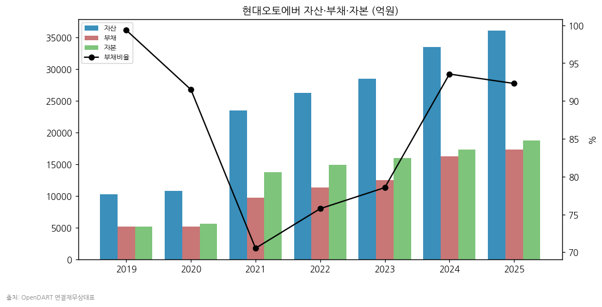

(3) 현금흐름 (억원)

| 연도 | 영업CF | 투자CF | 재무CF | CapEx(유·무형) | FCF |
|---|---|---|---|---|---|
| 2019 | 802 | -2,282 | -272 | 227 | 575 |
| 2020 | 1,156 | -313 | -503 | 267 | 889 |
| 2021 | 2,199 | -1,229 | -558 | 680 | 1,519 |
| 2022 | 2,013 | 2,815 | -630 | 944 | 1,069 |
| 2023 | 2,089 | -1,804 | -1,096 | 626 | 1,463 |
| 2024 | 2,560 | -2,749 | -903 | 1,429 | 1,131 |
| 2025 | 4,236 | -3,394 | -1,672 | 2,371 | 1,865 |

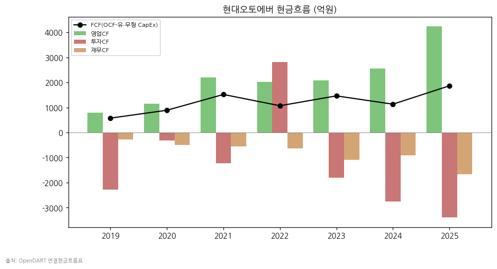

(4) CapEx

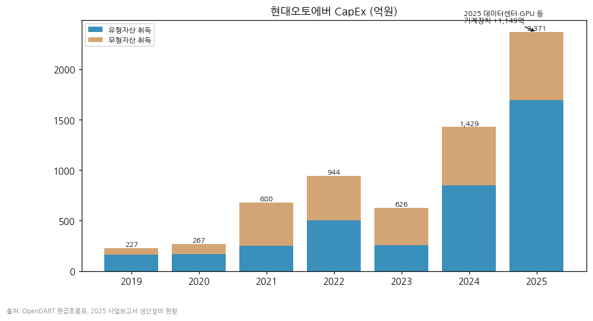

→ 2025 유형 1,695억(기계장치 +1,149억) + 무형 676억 = 2,371억, 매출 대비 5.6% — 2023(2.0%) 대비 급증. AI 데이터센터·GPU 인프라 투자 국면 진입 `[판단]`

(5) 부채 구조

→ 차입금 0 (2025.04 회사채 500억 상환). 부채는 매입채무·초과청구공사·리스부채(2025말 1,990억) 등 영업부채 중심

(6) 배당·자사주

| 연도 | DPS(원) | 배당총액(억원) | 연결 배당성향 |
|---|---|---|---|
| 2023 | 1,430 | 392 | 28.5% |
| 2024 | 1,780 | 488 | 28.6% |
| 2025 | 1,900 | 521 | 28.6% |

→ 자사주 매입 없음(보유 866주, 기타취득). 배당성향 28%대 유지 정책

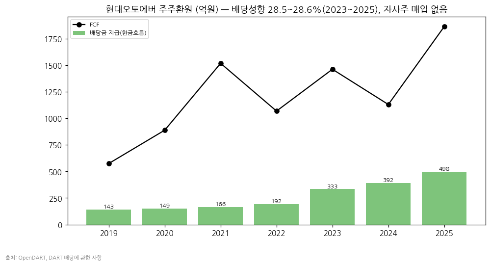

(7) 재무비율 (2025)

→ ROE 약 10.3%(대신 2026-07-31 표기) / ROA 약 5.4% / 부채비율 92.3% / 유동비율 174% / 이자보상배율: 금융비용 119억(대부분 리스이자) 대비 영업이익 21배

---

## ⑤ 지배 구조

(1) 그룹 관계

→ 현대자동차그룹 계열 (공시대상기업집단). 현대차(31.59%)·현대모비스(20.13%)·기아(16.24%) 3사가 67.96% 보유 + 정의선 회장 7.33% → 특수관계인 합 75.29% (DART 2025 사업보고서)
→ 정의선 회장 개인 지분 보유 계열사 중 하나 — 그룹 지배구조 개편 논의 때마다 거론되는 종목 `[판단]`

(2) 주주 구분

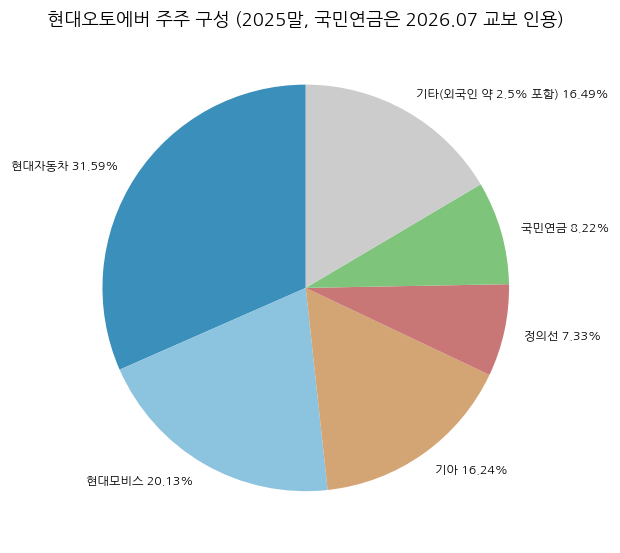

→ 유통주식 약 16% 수준(최대주주 75.29% + 국민연금 8.22% 제외) → 수급이 얇아 테마 장세에서 변동성 확대 (2026 고점 대비 -69%)
→ 외국인 지분율 약 2.5% (교보·대신 2026-07)

(3) 임원·이사회 (2025 사업보고서 기준)

| 성명 | 직위 | 주요 경력 |
|---|---|---|
| 류석문 | 대표이사 전무 | 쏘카 CTO, 라이엇게임즈코리아 개발이사, 현대오토에버 SW플랫폼사업부장 |
| 박상수 | 사내이사 상무 | 기획재경사업부장, AT커니 DT Partner |
| 김희철 | 선임사외이사 | 김앤장 고문, 서울지방국세청장 |
| 이선욱 | 사외이사 | 김앤장 변호사, 춘천지검 차장검사 |
| 장영재 | 사외이사 | KAIST 산업및시스템공학과 교수(디지털 제조혁신), 다임리서치 CEO |
| 설금희 | 사외이사 | 켐젠 대표, LG CNS 상무 |

→ 김윤구 전 대표(사장)는 2025.12.31 임기 만료

---

## ⑥ 기타 팩트

(1) R&D

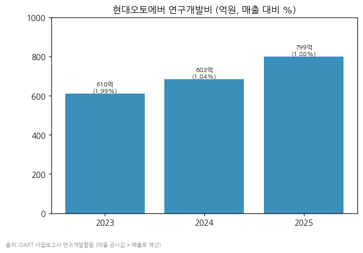

→ 연구개발비/매출 2023 1.99% · 2024 1.84% · 2025 1.88% (DART 2025 사업보고서) — IT서비스 특성상 낮은 수준. 금액은 비율 × 매출 역산 약 610억 → 683억 → 799억 `[추정]`
→ 핵심 기술 자산: mobilgene Classic/Adaptive(AUTOSAR), 현대차 ADAS 표준SW 플랫폼, 엔진·변속기·전동화 제어기 BSW

(2) Corporate action

| 시점 | 내용 |
|---|---|
| 2021.04 | 현대엠엔소프트·현대오트론 SW부문 흡수합병 (3사 합병) |
| 2024.12 | 현대차 차세대 ERP 본사·미주 롤인 1,167억 수주 |
| 2025.04 | 회사채 500억 전액 상환 → 무차입 |
| 2026.07.28 | 현대차·기아 GPU 서버 통합 구매·공급 계약(구매대행) 공시 |
| 2026.10.30 | HMG AI 팩토리(가칭) 1,146억 출자 결정, 지분 26% |

(3) R&D·사업 마일스톤

→ 2013 순정 내비게이션 첫 탑재 / 2016 mobilgene Classic 양산 적용 / 2021 하반기 ADAS 표준SW 플랫폼 적용 / 2023 하반기 mobilgene Classic 2.0 / mobilgene Adaptive 양산(자율주행·커넥티비티 제어기) / 2026.10 로봇 순찰·관제 솔루션 공개

(4) 주요 리스크

→ **그룹 의존 96%**: 그룹 IT 예산·단가 협상이 곧 실적. 협상 지연 시 분기 이익 변동(2024.3Q·2026.3Q)
→ **차량SW 정체**: 미국 관세에 따른 저가 차종 내비 탑재율 하락, 외부 내비 앱 허용 → 2025 +2.9%, 2026 1~3Q -1.7%
→ **밸류에이션 변동성**: 꿈 프리미엄 — 2026 고점 대비 -69%. 그룹 로봇 양산 일정 지연 시 추가 조정 가능
→ **인건비**: 원가의 77%가 외주용역비. 임금 인상 폭이 단가 인상 폭을 넘으면 마진 훼손

(5) ESG·인증

→ ESG 등급·인증 상세는 본 버전 미수집 (v1.1 보완 후보)

---

## Version Log

| 버전 | 일자 | 내역 |
|---|---|---|
| v1.0 | 2026-11-14 | 신규 작성. OpenDART 재무 JSON 31건 + 공시원문 15건 + IR PDF 45건 + 교보·대신 2Q26 리포트 + Yahoo 주간 시계열. 차트 12종 생성 |

**잔여 보완 후보 (v1.1)**
→ 12년 연간 표준 대비 부족(10년, 2016~2018은 손익만) — 2019 증권신고서로 2014~2015 보강
→ 지배주주 분기 순이익 정확치(트레일링 EPS), 국민연금 지분 DART 5% 공시로 재확인
→ ESG 등급·인증, 해외법인별 매출 금액(IR p.5 표 판독)
→ 3Q26 분기보고서(2026-11-14 공시 예정) 확정치로 3Q26 교체
