# 현대위아 — 기업 개요 (v1.1)

> 마지막 update: 2026-11-28 (v1.1 — 2026-11-27 임시주총 영업양도 가결 반영) / v1.0 2026-11-25 (3Q26 분기보고서 2026-11-13 제출분 + 3Q26 실적 IR 2026-11-02 반영)
> 입력 source: OpenDART fnlttSinglAcntAll (연결, 2015 FY\~3Q26, 44개 JSON + 2014 비교컬럼) + DART 정기공시 원문 XML 44건 (사업보고서 2015\~2025, 분기·반기 1Q16\~3Q26) + OpenDART 주요정보 (최대주주·임원·직원·배당·자기주식·주식총수, 2016·2019·2022·2025) + 현대위아 IR 실적발표 PDF 36건 (2018.1Q\~2026.3Q, irgo) + Yahoo Finance (011210.KS 월간 2011-02\~2026-11, 일간 2024-11\~2026-11-25) + 보도 (아시아경제 2026-01-08, MTN 2026-10-19, 스마트투데이 2026-08-13)
> 갱신 주기: 매분기 (실적 리뷰 모드 호출 시)
> 워치리스트: 자동차 섹터 / 서브섹터: **부품** (2026-11-23 추가 섹터, 4Q26부터 리뷰) — 피어: [[현대모비스_기업개요]], [[현대차_기업개요]] (완성차)
> **Fact verify cutoff**: 2026-11-25 (주가·시가총액·52주 고저 = Yahoo Finance 2026-11-25 종가 49,300원. 3Q26 = DART 분기보고서 확정치. 외국인 지분율은 미확보)

---

## 1. 기업 분류

- **Primary 분류: 사이클** (Cyclical — 현대차·기아 물량 사이클 + 구조조정 사이클, 저마진 OEM 부품)
- **Secondary 노트: 꿈(열관리 TMS·로보틱스) 일부 섞임** — 2026-01\~03 주가 2배 랠리는 실적이 아니라 CES 2026 열관리 신제품·그룹 로봇 테마로 움직임. 현재 신사업 매출 비중 \~5% (2026E 4,000억대)

### ① 정량 근거

**📊 Summary Box (12년, 2014\~2025 연결):**

| 지표 | 값 |
|------|-----|
| 매출 CAGR (2014→2025, 11년) | **+1.0%** (7.60조 → 8.48조) ※ 2025는 공작기계 제외 계속영업. 동일 기준(공작 포함) 2014→2023 +1.4% |
| OPM 평균 | **2.6%** (2017·2018 제외 시 3.1%) |
| OPM 정점 평균 | **4.8%** (2014 6.9% · 2023/2024 2.7%) |
| OPM 저점 평균 | **0.6%** (2018 0.1% · 2020 1.1%) |
| 사이클 주기 | 약 9년 (peak-to-peak 2014→2023) — 대사이클 1회 + 2019·2021 소사이클 |
| 사이클 회수 (12년) | 정점 2회 / 저점 2회 |

```
[전사 OPM 시계열 (12년, 연결, DART)]
2014  6.9%  ███████  ← 정점: 엔진(국내·중국)·공작기계 동반 호황, 현대위스코·메티아 합병(11월)
2015  6.4%  ██████   ← 멕시코·중국 엔진 증설 CapEx 정점 (6,442억)
2016  3.5%  ███      ← 중국 판매 급감 시작, 기계 부진
2017  0.2%  ▏        ← 통상임금 소송 충당금(4Q17 OP -716억), 사드 여파 중국 엔진 가동률 하락
2018  0.1%  ▏        ← 저점: 기계사업 OP -1,150억 (범용기 감가판매·재고/채권 충당금)
2019  1.4%  █        ← 기계 합리화, 차량부품 회복
2020  1.1%  █        ← 코로나 (2Q20 OP -386억) / 통상임금 충당금 환입
2021  1.4%  █        ← 반도체 부족 + 기계 적자(-450억)
2022  2.6%  ███      ← 회복: 모듈·멕시코 물량, 기계 적자 축소
2023  2.7%  ███      ← 회복 정점 (원공시 공작 포함 기준)
2024  2.7%  ███      ← 계속영업 기준 (공작기계 중단영업 재작성)
2025  2.4%  ██       ← 통상임금·미국 관세·열관리 양산 초기비용
```

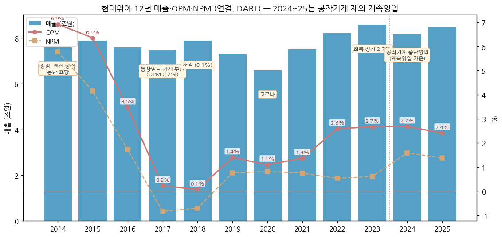

**최근 분기 델타 (계속영업, 회사 IR / DART 3Q26 분기보고서):**

| 분기 | 매출 (억원) | 매출 YoY | 영업이익 (억원) | OP YoY | OPM |
|---|---|---|---|---|---|
| 1Q26 | 21,793 | +5.7% | 516 | +6.2% | 2.4% |
| 2Q26 | 23,537 | +8.0% | 504 | -10.6% | 2.1% |
| **3Q26** | **24,590** | **+14.3%** | **547** | **+5.5%** | **2.2%** |

→ 매출 YoY는 3개 분기 연속 가속 (5.7% → 8.0% → 14.3%), 영업이익은 정체 (OPM 2.1\~2.4% 박스). "외형 가속·마진 정체" 국면

### ② 산업 분류

- DART 업종코드: 303 (자동차 신품 부품 제조업) — 기업개황 company.json
- 워치리스트: 대분류 모빌리티 → 섹터 **자동차** / 서브섹터 **부품** (현대모비스·HL만도·한온시스템과 같은 칸)
- 사업 구성 (2025 계속영업 매출 8.48조): 차량부품(모빌리티) **92.3%** — 엔진·모듈·등속조인트·4WD(구동)·열관리 / 기타 **7.7%** — 특수(방산)·로보틱스(舊 모빌리티솔루션)
- 구조 변화: 공작기계 2025-07-14 매각 완료(중단영업) → 특수(방산) 2027-03-31 현대로템 양도 예정 → **2027년부터 사실상 순수 자동차 부품 + 열관리·로봇 신사업 회사**

### ③ 분류 결정 논리

(1) **가장 매출 큰 사업부 기준 적용 시**: 차량부품 92%, 매출처는 현대차·기아 중심 (2025 상위 4개 고객 합계 약 7.5조, 매출의 88% — 주석 '주요 고객 공시' 고객1 4.04조). 완성차 물량·믹스·환율이 이익 driver → **사이클**

(2) **영업이익 비중 우선 sub-rule**: 2025 영업이익 2,044억 중 차량부품 1,577억(77%), 기타(방산 중심) 467억(23%). 9M26은 차량부품 1,058억(68%) vs 기타 509억(32%) — 매출 7%짜리 방산이 이익의 1/3. 방산 이관 후에는 이익이 다시 차량부품 100%에 수렴 → 사이클 분류 강화

(3) **Boundary case**: 열관리(TMS)·로보틱스는 "꿈" 성격 (2035 목표 4조, 매출 27%). 현재 신사업 매출 \~4,000억대(2026E, 약 4\~5%)로 분류 영향 없음. 단, 열관리 매출 YoY +160%(3Q26)처럼 고성장 구간이라 주가는 Secondary(꿈) 요인에 민감 — 2026-01-08 CES 발표 당일 장중 +23%

(4) **피어 대비**: [[현대모비스_기업개요]]는 A/S 부품 고마진 캐시카우로 Primary **지속성장**(12년 OPM 평균 5.6%, range 5.0pp). 현대위아는 A/S 사업이 없고 OEM 납품만 있어 OPM 평균 2.6%·range 6.8pp — 같은 그룹 부품사지만 이익 질이 다름. [[현대차_기업개요]](완성차, Primary 사이클)의 물량 사이클을 레버리지 없이 얇은 마진으로 받는 구조

### ④ 적정 밸류에이션 방법

- **PBR (사이클 기준) 우선** — 순이익률 0.5\~1.6%로 PER이 노이즈(일회성 외환손익·손상·중단영업)에 크게 흔들림. 지배주주 자본 3.62조(3Q26) 대비 시가총액 1.34조 = **PBR 0.37배**
- PBR 밴드 (월말 종가 × 27,195,083주 ÷ 연말 자본): 2014 정점 **약 2.1배** / 2020-03 저점 **약 0.23배** / 2026-02 꿈 랠리 고점 **약 0.76배** / 현재 0.37배
- **PER 보조** — TTM 연결 순이익(4Q25\~3Q26) 848억 기준 약 16배. 3Q26 외환손실 -612억(루블·원화 강세) 같은 영업외 변동이 커 PER은 정규화 이익(영업이익 × (1-세율))로 보는 것이 맞음
- **SOTP 보조 (구조 변화 반영)**: 방산 양도대금 3,584억 + 공작기계 매각 3,400억(2025 수령) → 시가총액 대비 약 52%가 최근 2년 매각 현금. 신사업(TMS·로봇)은 옵션 가치로 별도 평가
- 피어 차별화: 현대모비스 = PER(A/S 안정 이익) + PBR, 현대위아 = PBR 단독 + 신사업 옵션. 이유 — 이익의 지속성이 아니라 자본·현금 대비 할인이 주가 하단을 결정

### ⑤ 분기 재평가 트리거 (분류 변경 조건)

- 열관리+로보틱스 매출 비중이 **10%** 이상 (분기 2,500억+) 도달 → Secondary(꿈) → **고성장 Secondary 격상** 검토
- 차량부품 OPM이 **2개 분기 연속 3.5%** 이상 → 저마진 사이클 → 구조적 마진 개선(믹스 전환) 재분류 후보
- 현대차·기아 외 고객(GM·포드·글로벌 OE) 매출 비중이 공시상 **20%** 이상 → 캡티브 사이클 → 독립 부품사 분류 검토
- 2027-03 방산 이관 미종결(주식매수청구 1,400억 초과로 이사회 철회·인허가 지연) 시 — 임시주총은 2026-11-27 가결 → 기타 부문 방산 이익(분기 100\~200억) 유지 전제 Secondary 노트 재작성

---

## 2. 회사 개요

### ① 기본 사항

| 항목 | 내용 |
|---|---|
| 회사명 | 현대위아 주식회사 (HYUNDAI WIA CORPORATION) |
| 종목코드 | 011210 (KOSPI) · DART corp_code 00106623 |
| 설립 / 상장 | 1976-03-29 (기아기공) / 2011-02 유가증권시장 상장 |
| 본사 | 경상남도 창원시 성산구 정동로 153 |
| 대표이사 | 권오성 (2025-08-08 임시주총·이사회 선임, 前 현대차 연구개발지원사업부장) |
| 최대주주 | 현대자동차 25.35% (특수관계인 합산 40.74%, 2025-12-31) |
| 발행주식 | 보통주 27,195,083주 (자기주식 597,338주, 2025-12-31) |
| 시가총액 | **약 1.34조원** (2026-11-25 종가 49,300원) |
| 52주 고/저 | 112,600원 (장중, 2026-03-03) / 46,600원 (Yahoo Finance meta) |
| 사상 최고가 | 장중 234,000원 (2014-08), 월말 종가 최고 223,000원 (2014-08, 시총 약 6.06조) |
| 임직원 | 2,843명 (본사, 2025-12-31 — 모빌리티 1,419 / 기타 1,424) |
| 사업 한 줄 정의 | 현대차·기아向 엔진·모듈·등속·4WD·열관리 부품사. 방산·공작기계를 떼어내고 열관리(TMS)·로보틱스로 포트폴리오 전환 중 |
| 생산 거점 | 7개국 13개 (국내 창원·평택·서산·울산·안산·광주 / 중국 산동·강소, 멕시코, 인도, 러시아, 슬로바키아, 미국), 의왕 연구소 |

### ② 최근 12년 손익·자본 추이 (조원, 연결, DART)

| 연도 | 매출 | 영업이익 | OPM | 순이익 | NPM | 자본총계 | 자본 YoY | 비고 |
|---|---|---|---|---|---|---|---|---|
| 2014 | 7.60 | 0.526 | 6.9% | 0.439 | 5.8% | 2.85 | | ← 정점 |
| 2015 | 7.88 | 0.501 | 6.4% | 0.327 | 4.1% | 3.16 | +11.0% | |
| 2016 | 7.59 | 0.263 | 3.5% | 0.131 | 1.7% | 3.26 | +3.0% | ← 하강 |
| 2017 | 7.49 | 0.017 | 0.2% | -0.063 | -0.8% | 3.14 | -3.6% | ← 통상임금 |
| 2018 | 7.88 | 0.005 | 0.1% | -0.056 | -0.7% | 3.04 | -3.3% | ← 저점 |
| 2019 | 7.31 | 0.102 | 1.4% | 0.055 | 0.8% | 3.09 | +1.8% | |
| 2020 | 6.59 | 0.072 | 1.1% | 0.054 | 0.8% | 3.53 | +14.0% | ← 코로나, 산동법인 연결 |
| 2021 | 7.53 | 0.103 | 1.4% | 0.056 | 0.7% | 3.70 | +4.8% | |
| 2022 | 8.21 | 0.212 | 2.6% | 0.043 | 0.5% | 3.73 | +1.0% | ← 러시아 손상 -1,144억 |
| 2023 | 8.59 | 0.229 | 2.7% | 0.053 | 0.6% | 3.77 | +0.9% | ← 회복 정점 |
| 2024 | 8.18 | 0.219 | 2.7% | 0.129 | 1.6% | 4.03 | +6.9% | ← 계속영업 (공작 제외) |
| 2025 | 8.48 | 0.204 | 2.4% | 0.117 | 1.4% | 4.07 | +1.0% | ← 공작기계 매각 완료 |

※ 2014\~2023 = 원공시(공작기계 포함), 2024\~2025 = 공작기계 중단영업 재작성 기준 (2024 사업보고서부터). 2023 계속영업 재작성치 = 매출 8.17조 / 영업이익 0.233조. 순이익은 중단영업 포함

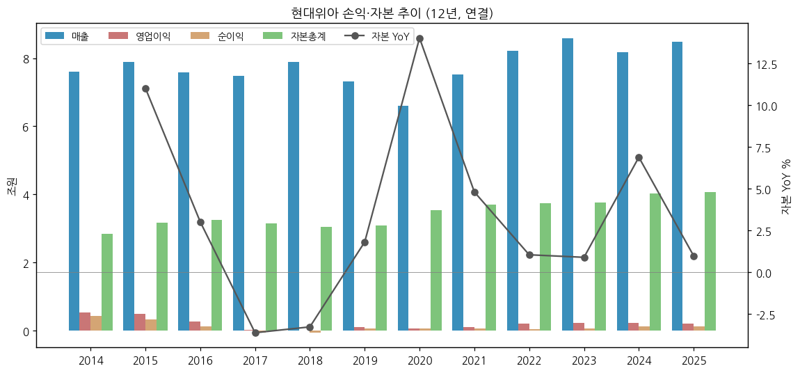

### ③ 회사 주가 역사 ★ narrative 영역

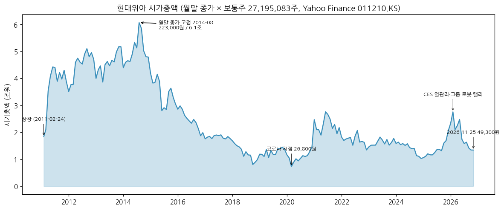

→ **2011-02 상장 → 2014-08 ATH (월말 223,000원, 시총 약 6.06조)** [Yahoo Finance 011210.KS 월간]
→ 상장 3년 만에 3배: 현대차그룹 엔진 내재화(산동·국내 엔진공장) + 공작기계 호황 + 그룹 부품사 프리미엄. 2014 OPM 6.9%·ROE 15.4%로 이익도 정점

→ **2014-08 → 2020-03 저점 (월말 26,800원, 시총 약 0.73조, 고점 대비 -88%)**
→ 중간 milestone:
   - 2016\~2017: 사드 여파 중국 판매 급감 → 산동 엔진 가동률 하락, 4Q17 통상임금 충당금으로 영업적자
   - 2018: 기계사업 OP -1,150억 (범용기 감가판매·충당금), 연결 OCF -1,133억
   - 2020-03: 코로나 저점 — PBR 약 0.23배

→ **2020\~2025: 0.8\~1.6조 박스권** (월말 30,000\~60,000원대). OPM 1\~3%대 회복했지만 저마진 고착 → 할인 지속
   - 2024-12: 37,800원 (공작기계 매각 결정 전후)
   - 2025-10\~12: 58,600원 → 75,700원 (공작기계 매각 완료·배당성향 상향·열관리 기대)

→ **2026-01\~03: "꿈" 랠리 — 장중 112,600원 (2026-03-03, 시총 약 3.06조, 52주 고점)**
   - 2026-01-08: CES 2026에서 통합열관리모듈·냉각모듈·슬림 HVAC 공개 → 장중 95,400원, 하루 +13% (아시아경제 2026-01-08)
   - 현대차그룹 AI·로봇 랠리 동조 (그룹 로봇 테마)

→ **2026-06\~11: 반락 — 2026-11-25 종가 49,300원 (시총 약 1.34조, 고점 대비 -56%)**
   - 2Q26 영업이익 -10.6% YoY (미국 관세·원가·선행투자), 2026-10-19 방산(특수사업) 현대로템 양도 결정 — 고마진 사업 이탈 우려 vs 3,584억 현금화

### ④ 회사의 주요 연혁

| 시점 | 내용 |
|---|---|
| 1976-03 | 기아기공 설립 (공작기계 1977, 자동차 변속기 1979 생산 개시) |
| 1994 | 항공기 랜딩기어 국산화 개발 (방산·항공 사업 기반) |
| 1996-03 | 기아중공업으로 상호변경 |
| 2000-01 | 위아로 상호변경 (현대차그룹 편입) |
| 2004-06 | 자동차 모듈사업 개시 |
| 2005-10 | 자동차 엔진사업 개시 |
| 2009-08 | 현대위아로 상호변경, 위아마그나파워트레인 설립(2009-03) |
| 2011-02 | 유가증권시장 상장 |
| 2014-11 | 현대위스코·현대메티아 흡수합병 (단조·주물 소재사업 편입) |
| 2016 | 멕시코 엔진·등속 양산, 서산 카파엔진 양산, 등속조인트 누적 1억개 |
| 2020 하반기 | 산동 엔진법인 연결 편입 |
| 2023-12 | 현대위아터보 흡수합병 |
| 2025-03 | 공작기계사업 매각 계약 (에이치엠티테크·에이치엠티솔루션 컨소시엄, 3,400억) |
| 2025-07 | 공작기계 매각 종결 (2025-07-14), PV5 전기차 공조시스템 양산 개시 |
| 2025-08 | 권오성 대표이사 선임, 선임사외이사 제도 도입 |
| 2026-01 | CES 2026 열관리 3종 공개 |
| 2026-10 | 특수(방산)사업 현대로템 영업양도 결정 (3,584억, 이사회 2026-10-19) |
| 2026-11-27 | 임시주주총회 영업양도 특별결의 **가결** (의결권 행사 주식 기준 찬성 85.2%) → 주식매수청구 11-27\~12-16 → 2027-03-31 거래 종결 예정 |

---

## 3. 비즈니스 모델

### ① 실적 추이 (연결 → 사업부 → 품목 3단계 위계)

**(1) 연간 통합 표 — 사업부 (억원, 회사 IR / DART 사업보고서)**

| 구분 | 2021 | 2022 | 2023 | 2024 | 2025 | 9M26 |
|---|---|---|---|---|---|---|
| **전사 매출** | 75,277 | 82,076 | 81,656 † | 81,809 | 84,816 | 69,920 |
| ├ 차량부품 (모빌리티) | 67,755 | 74,532 | 77,480 | 75,967 | 78,323 | 64,622 |
| │ ├ 모듈 | 18,530 | 22,601 | — | — | — | — |
| │ └ 부품 (엔진·등속·구동·소재 등) | 49,225 | 51,931 | — | — | — | — |
| ├ 기계 (공작기계/RnA) ‡ | 5,573 | 5,685 | (중단) | (중단) | (중단) | — |
| └ 기타 (특수·로보틱스) | 1,948 (특수) | 1,859 (특수) | 4,176 | 5,843 | 6,493 | 5,299 |
| **전사 영업이익** | 1,027 | 2,121 | 2,328 † | 2,188 | 2,044 | 1,567 |
| ├ 차량부품 | 1,477 | 2,129 | 2,211 | 1,932 | 1,577 | 1,058 |
| │ OPM | 2.2% | 2.9% | 2.9% | 2.5% | 2.0% | 1.6% |
| └ 기계 → 기타 | -450 (기계) | -8 (기계) | 117 | 256 | 467 | 509 |
| 　 OPM | -6.0% | -0.1% | 2.8% | 4.4% | 7.2% | 9.6% |

† 2023은 계속영업 재작성치 (원공시 85,903 / 2,292). ‡ 2021\~2022 기계 = 공작기계/RnA + 특수 합산 7,521·7,544, 위 표는 품목 분리
※ 2023\~ 기타 = 특수 + 로보틱스(舊 모빌리티솔루션, 2022까지 RnA로 기계부문에 포함) → 2022 이전과 단순 비교 불가 (양식 변경)

**(2) 품목 연간 (구 양식, 억원, 회사 IR 연간실적)**

| 품목 | 2019 | 2020 | 2021 | 2022 |
|---|---|---|---|---|
| 모듈 | 18,420 | 17,280 | 18,530 | 22,601 |
| 부품 | 46,130 | 41,900 | 49,225 | 51,931 |
| 공작기계 (/RnA) | 6,900 | 4,670 | 5,573 | 5,685 |
| 군수·특수 | 1,700 | 2,080 | 1,948 | 1,859 |

※ 2023 이후 회사 IR은 품목별 금액을 공시하지 않고 증감률만 제시 (예: 3Q26 모듈 +18%, 열관리 +160%, 특수 +11%, 로보틱스 -7%)

**(3) 지역별 매출 (2024, 백만원, 2025 사업보고서 주석 '지역별 정보' 전기 컬럼)**

| 지역 | 매출 | 비중 | 영업이익 |
|---|---|---|---|
| 한국 | 6,498,639 | 79.4% | 95,085 |
| 북미 (멕시코·미국) | 901,383 | 11.0% | 83,094 |
| 중국 | 578,506 | 7.1% | 31,116 |
| 인도 | 150,277 | 1.8% | 12,018 |
| 유럽 (러시아·슬로바키아) | 52,081 | 0.6% | -2,503 |
| **합계** | **8,180,886** | 100% | **218,810** |

※ 2025 당기 지역별 수치는 v1.1에서 보강 (원문 파싱 미완)

**(4) 사업부별 분기 시계열 (회사 IR)**

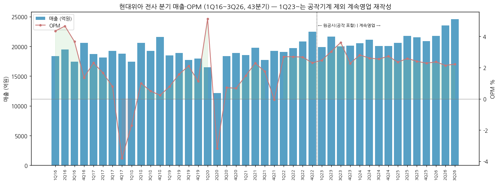

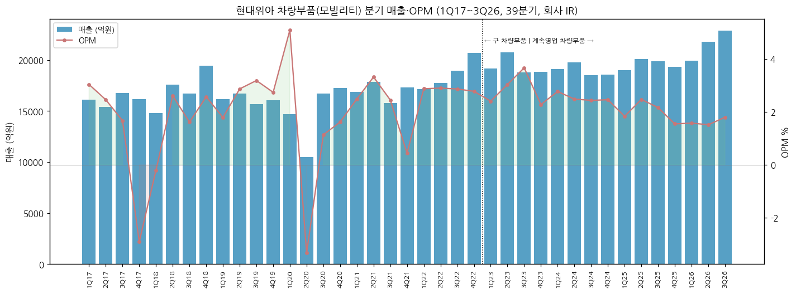

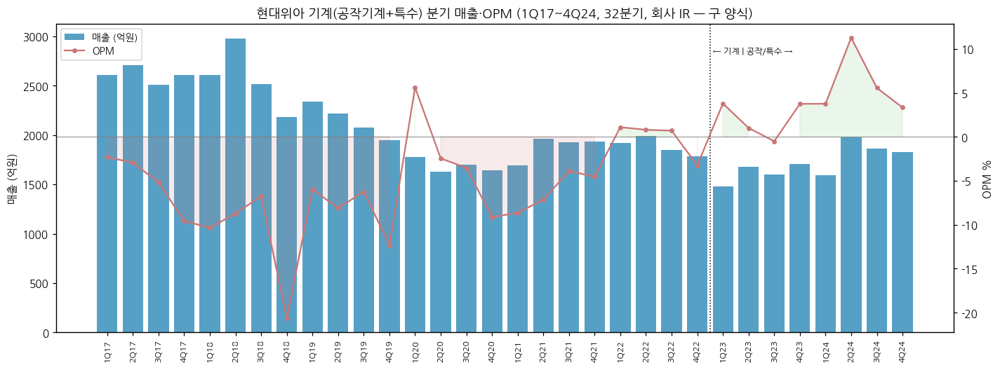

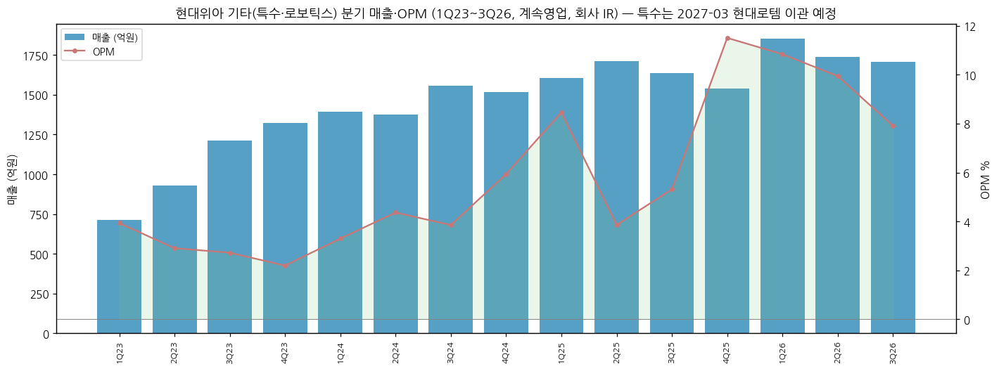

**전사 분기 매출 / 영업이익 (억원, OpenDART — 2016\~2022 원공시, 공작기계 포함)**

| 연도 | 1Q 매출 | 2Q 매출 | 3Q 매출 | 4Q 매출 | 1Q OP | 2Q OP | 3Q OP | 4Q OP |
|---|---|---|---|---|---|---|---|---|
| 2016 | 18,387 | 19,487 | 17,439 | 20,581 | 800 | 908 | 640 | 280 |
| 2017 | 18,718 | 18,133 | 19,251 | 18,772 | 431 | 301 | 151 | **-716** |
| 2018 | 17,409 | 20,573 | 19,221 | 21,602 | -298 | 204 | 96 | 49 |
| 2019 | 18,494 | 18,920 | 17,749 | 17,983 | 146 | 299 | 373 | 202 |
| 2020 | 16,478 | 12,137 | 18,394 | 18,914 | 845 | **-386** | 132 | 128 |
| 2021 | 18,548 | 19,801 | 17,701 | 19,228 | 274 | 452 | 312 | -11 |
| 2022 | 19,068 | 19,718 | 20,803 | 22,487 | 515 | 531 | 557 | 518 |

**전사 분기 (억원, 계속영업 재작성 — 회사 IR 별첨, 3Q26은 DART 분기보고서와 일치)**

| 연도 | 1Q 매출 | 2Q 매출 | 3Q 매출 | 4Q 매출 | 1Q OP | 2Q OP | 3Q OP | 4Q OP |
|---|---|---|---|---|---|---|---|---|
| 2023 | 19,875 | 21,651 | 19,979 | 20,151 | 490 | 657 | 722 | 459 |
| 2024 | 20,519 | 21,149 | 20,078 | 20,064 | 577 | 552 | 512 | 547 |
| 2025 | 20,618 | 21,786 | 21,519 | 20,893 | 485 | 563 | 518 | 477 |
| 2026 | 21,793 | 23,537 | 24,590 | | 516 | 504 | 547 | |

⚠ OpenDART 분기 요약의 4Q24(매출 17,050)·4Q25 YoY(+22.5%)는 1\~3Q24 원공시(공작 포함)와 FY24 재작성치를 섞은 역산이라 왜곡 → 위 IR 재작성치 사용

**차량부품 / 기계 분기 (억원, 회사 IR — 2017\~2020 십억원 표기를 억원 환산)**

| 분기 | 차량 매출 | 차량 OP | 차량 OPM | 기계 매출 | 기계 OP | 기계 OPM |
|---|---|---|---|---|---|---|
| 2017 (1\~4Q) | 16,110 · 15,420 · 16,740 · 16,160 | 490 · 380 · 280 · -470 | 3.0 · 2.5 · 1.7 · -2.9% | 2,610 · 2,710 · 2,510 · 2,610 | -60 · -80 · -130 · -250 | -2.2 · -3.0 · -5.1 · -9.5% |
| 2018 | 14,800 · 17,590 · 16,700 · 19,420 | -30 · 460 · 270 · 500 | -0.2 · 2.6 · 1.6 · 2.6% | 2,610 · 2,980 · 2,520 · 2,180 | -270 · -260 · -170 · -450 | -10.1 · -8.7 · -6.8 · -20.7% |
| 2019 | 16,160 · 16,700 · 15,670 · 16,030 | 290 · 480 · 500 · 440 | 1.8 · 2.9 · 3.2 · 2.7% | 2,340 · 2,220 · 2,080 · 1,950 | -140 · -180 · -130 · -240 | -5.9 · -8.0 · -6.2 · -12.2% |
| 2020 | 14,700 · 10,500 · 16,690 · 17,280 | 750 · -350 · 190 · 280 | 5.1 · -3.3 · 1.1 · 1.6% | 1,780 · 1,630 · 1,700 · 1,640 | 100 · -40 · -60 · -150 | 5.5 · -2.3 · -3.2 · -9.1% |
| 2021 | 16,857 · 17,835 · 15,773 · 17,294 | 420 · 593 · 387 · 77 | 2.5 · 3.3 · 2.5 · 0.4% | 1,691 · 1,966 · 1,928 · 1,934 | -146 · -141 · -75 · -88 | -8.6 · -7.2 · -3.9 · -4.5% |
| 2022 | 17,151 · 17,729 · 18,952 · 20,699 | 494 · 515 · 544 · 576 | 2.9 · 2.9 · 2.9 · 2.8% | 1,917 · 1,989 · 1,851 · 1,788 | 21 · 16 · 13 · -58 | 1.1 · 0.8 · 0.7 · -3.2% |
| 2023 (공작/특수) | — | — | — | 1,477 · 1,682 · 1,603 · 1,707 | 56 · 17 · -8 · 64 | 3.8 · 1.0 · -0.5 · 3.7% |
| 2024 (공작/특수) | — | — | — | 1,595 · 1,979 · 1,867 · 1,828 | 60 · 223 · 104 · 61 | 3.8 · 11.3 · 5.6 · 3.3% |

**계속영업 사업부 분기 (억원, 회사 IR 2026-02-02·2026-11-02 별첨)**

| 분기 | 차량부품 매출 | OP | OPM | 기타 매출 | OP | OPM |
|---|---|---|---|---|---|---|
| 1Q23 | 19,163 | 462 | 2.4% | 712 | 28 | 3.9% |
| 2Q23 | 20,722 | 630 | 3.0% | 929 | 27 | 2.9% |
| 3Q23 | 18,766 | 689 | 3.7% | 1,213 | 33 | 2.7% |
| 4Q23 | 18,829 | 430 | 2.3% | 1,322 | 29 | 2.2% |
| 1Q24 | 19,125 | 531 | 2.8% | 1,394 | 46 | 3.3% |
| 2Q24 | 19,774 | 492 | 2.5% | 1,375 | 60 | 4.4% |
| 3Q24 | 18,521 | 452 | 2.4% | 1,557 | 60 | 3.9% |
| 4Q24 | 18,547 | 457 | 2.5% | 1,517 | 90 | 5.9% |
| 1Q25 | 19,011 | 349 | 1.8% | 1,607 | 136 | 8.5% |
| 2Q25 | 20,074 | 497 | 2.5% | 1,711 | 66 | 3.9% |
| 3Q25 | 19,882 | 431 | 2.2% | 1,637 | 87 | 5.3% |
| 4Q25 | 19,356 | 300 | 1.5% | 1,538 | 177 | 11.5% |
| 1Q26 | 19,939 | 315 | 1.6% | 1,854 | 201 | 10.8% |
| 2Q26 | 21,799 | 331 | 1.5% | 1,739 | 173 | 9.9% |
| **3Q26** | **22,884** | **412** | **1.8%** | **1,706** | **135** | **7.9%** |

**📌 3Q26 핵심 박스 (2026-11-02 IR, DART 분기보고서 2026-11-13)**

| 항목 | 3Q26 | YoY | QoQ | 코멘트 |
|---|---|---|---|---|
| 매출 | 24,590억 | +14.3% | +4.5% | 모듈(+18%, 플랫폼 모듈 거래방식 변경), 열관리(+160%), 멕시코·국내 HEV 엔진 증가 / 러시아 엔진·구동·등속 감소 |
| 영업이익 | 547억 | +5.5% | +8.5% | 물량 증가 vs 믹스 악화(러시아 엔진·구동·등속 감소), 재료비·물류비 증가 |
| 차량부품 OPM | 1.8% | -0.4%p | +0.3%p | 매출 +15.1%에도 이익 -4.4% — 모듈 비중 상승(저마진)이 핵심 |
| 기타 OP | 135억 | +55.2% | -22.0% | 특수 매출 +11%, 로보틱스 -7% |
| 세전이익 | -67억 | 적전 | 적전 | 외환손실 -612억 (원화 강세 외화매출채권 평가손, 루블 약세 외화차입금 평가손) |
| 차입금 | 11,713억 | | | 본사 4,794억 / 해외 6,919억 |

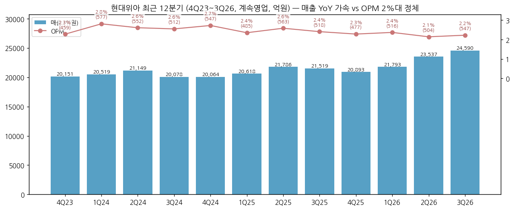

### ② 사업부별 개요 (매출 비중 큰 순서, 2025)

| 사업부 | 2025 매출 | 비중 | 2025 OP | 주요 제품 | 주요 고객 |
|---|---|---|---|---|---|
| 차량부품 (모빌리티) | 7.83조 | 92.3% | 1,577억 (2.0%) | 엔진(국내·멕시코·중국 산동·러시아), 모듈(샤시·플랫폼), 등속조인트(CVJ), 4WD 구동부품(PTU·ATC·e-LSD), 열관리(냉각수 허브모듈·공조 HVAC) | 현대차·기아 (+ GM·포드 등 글로벌 OE) |
| 기타 — 특수(방산) | 약 4,000억 † | \~5% | 기타 합산 467억 (7.2%) | 대구경 화포(K9 자주포 포신·포탑 계열), 함포, 견인포, 항공기 착륙장치, RCWS | 방위사업청·체계업체 |
| 기타 — 로보틱스 (舊 모빌리티솔루션) | 2,000억대 † | \~3% | | 자동차 생산설비(FA), 물류로봇·관제, 협동·주차로봇, 전동화 설비(헤어핀 스테이터) | 현대차그룹 계열 |

† 회사가 기타 부문 내 특수/로보틱스를 분리 공시하지 않음. 특수 2026 매출 목표 약 4,000억(MTN 2026-10-19)으로 역산한 근사치

### ③ 사업부별 디테일

**(1) 엔진 — 최대 품목, 해외 가동률이 이익을 좌우**
→ 현대차·기아 엔진 일부를 국내(평택·서산)·중국 산동·멕시코·러시아에서 위탁 생산 (카파·감마·누우 계열)
→ 3Q26: 멕시코 신규 감마2 엔진(미주 HEV 수요) 증가, 러시아 감소 — 러시아법인은 매출 감소 + 루블 외환손실 이중 부담
→ 전동화 리스크: 내연기관 엔진은 장기 축소 품목. 회사도 '유지사업'으로 분류 (2026-11 IR 사업 포트폴리오)

**(2) 모듈 — 외형 기여, 마진 희석**
→ 샤시·플랫폼 모듈 (현대모비스와 그룹 내 분담). 3Q26 +18% — 플랫폼 모듈 거래방식 변경(매출 인식 범위 확대)
→ 모듈은 조립·통과 매출 비중이 커 OPM이 낮음 → 2026 매출 가속에도 차량부품 OPM 1.5\~1.8%로 하락한 원인

**(3) 등속조인트·4WD(구동) — 독자 경쟁력, '확대사업'**
→ 등속조인트 누적 1억개 (2016), 인도 CVJ 공장 증설 → **2027 인도 푸네 등속공장 신설**, 슬로바키아 거점, 해외 신규 고객 확대 목표
→ 3Q26은 구동·등속 감소가 믹스 악화 요인

**(4) 열관리(TMS) — 핵심 성장사업**
→ 냉각수 허브 모듈(EV), 전기차 공조시스템 자체 개발 → 2025-07 기아 PV5 탑재 양산 / 2027 내연기관·HEV 공조 양산 계획
→ 3Q26 열관리 매출 +160% YoY. 슬로바키아 냉각수 모듈 양산, 인도 공조 생산 준비. 대응 능력 연 30만대 → 2028 100만대 (스마트투데이 2026-08-13)
→ 목표: 2032 글로벌 열관리 전문사, TMS 2026→2035 CAGR 40.4% (2026-11 IR). 차량 외 열관리(ESS·데이터센터)로 범위 확대 검토

**(5) 로보틱스 — 성장 초기**
→ 모바일로봇 통합관제(2021 개발, 그룹 공장 적용), 주차로봇 실증(현대차·현대건설 컨소시엄, 시흥), AX 팩토리 자동화
→ 3Q26 로보틱스 매출 -7% YoY. 2026→2035 CAGR 19.8% 목표 (2026-11 IR)

**(6) 특수(방산) — 2027-03 현대로템 이관 예정**
→ 국내 유일 대구경 화포 전문 (사업보고서). 2024\~2025 K-방산 수출로 기타 부문 OPM 4%→7\~11% 상승
→ 매각 논리 (2026-11 IR): 체계사 중심 구조라 부품사 성장 한계, 노후 공장 개선·신사업에 대규모 투자 필요 → 영업가치 4,800억(EV/EBITDA 9.5배, 국내 방산 부품사 8곳 평균 8.6배) − 이전 제외 부동산 1,170억 − 순자산 조정 46억 = **양도대금 3,584억**
→ 이전 제외 부동산(창원 토지·건물)은 현대로템에 임대 후 신사업 부지로 활용 예정

### ④ 주요 경쟁사 (사업부별)

| 사업부 | 국내 | 글로벌 |
|---|---|---|
| 엔진 (위탁생산) | 현대차 자체 파워트레인 공장 (내재화 대체 관계) | — (캡티브 구조) |
| 모듈 | 현대모비스 | Magna, Forvia |
| 등속조인트·4WD 구동 | 현대트랜시스(구동), 이래AMS | GKN Driveline(Dowlais), NTN, American Axle, BorgWarner, Magna |
| 열관리 (TMS·공조) | 한온시스템, 두원공조 | Denso, Valeo, Mahle, Sanhua(밸브·부품) |
| 로보틱스·FA | 현대무벡스, 두산로보틱스, 레인보우로보틱스 | ABB, Fanuc, KUKA |
| 특수 (이관 예정) | 한화에어로스페이스(K9 체계), 현대로템(인수자) | Rheinmetall, BAE |

### ⑤ 주요 매출처

- 공시 한계: 사업보고서 주석은 고객명을 '고객1\~4'로 익명 표기. 부문정보상 모빌리티 주요 고객 = **현대자동차㈜·기아㈜**
- 2025 모빌리티 상위 4개 고객 매출 (백만원): 고객1 **4,044,682** / 고객2 1,207,185 / 고객3 1,152,052 / 고객4 1,056,285 → 합계 7.46조, 전사 매출의 **88%**
- 2024 (전기): 고객1 3,898,864 / 고객2 1,382,054 / 고객3 1,128,223 / 고객4 887,526
- 추정 순서 (DART 미확인 추정): 고객1 = 현대차(국내·해외 법인 합산 가능성), 고객2\~4 = 기아 및 해외 생산법인(HMMA·KaMS 등). 글로벌 OE(GM·포드)는 사업보고서에 언급되나 금액 비공개
- 판매 조건: 차량부품 월 마감 후 90일 이내 외담대 / 특수 연부액 계약 / 로보틱스 프로젝트별

### ⑥ 생산 CAPA + 임직원

| 항목 | 2023 | 2024 | 2025 |
|---|---|---|---|
| 생산능력 — 차량부품 (백만원, 본사) | 8,257,448 | 8,907,914 | 9,643,661 |
| 생산능력 — 기타 (창원) | 562,445 | 658,643 | 643,364 |
| 모빌리티솔루션·특수 신규 수주 (억원) | 9,002 | 6,365 | 7,152 |
| 수주잔고 (진행매출 사업, 2025말) | | | 1조 4,290억 |

| 임직원 (본사, 명) | 2016 | 2019 | 2022 | 2025 |
|---|---|---|---|---|
| 합계 | 3,443 | 3,074 | 2,917 | 2,843 |
| 구성 | 차량 991 / 기계 391 / 연구 563 / 기타 1,498 | 차량 1,077 / 기계 858 / 연구 502 / 기타 637 | 차량 1,041 / 기계 441 / 연구 525 / 기타 910 | 모빌리티 1,419 / 기타 1,424 |
| 남성 1인 평균 급여 (차량·모빌리티) | 0.80억 | 0.78억 | 1.02억 | 1.32억 |

---

## 4. 재무 구조

※ 단위: 억원, 연결, OpenDART fnlttSinglAcntAll (2014 = 2015 사업보고서 비교컬럼). 2014\~2023 원공시(공작기계 포함), 2024\~2025 계속영업

### ① 손익계산서 (12년)

| 연도 | 매출 | 매출원가 | 매출총이익 | GPM | 판관비 | CIR | 영업이익 | OPM | 세전이익 | 순이익 | 지배순이익 | NPM |
|---|---|---|---|---|---|---|---|---|---|---|---|---|
| 2014 | 75,956 | 67,651 | 8,306 | 10.9% | 3,049 | 4.0% | 5,256 | 6.9% | 5,858 | 4,392 | 4,344 | 5.8% |
| 2015 | 78,842 | 70,431 | 8,411 | 10.7% | 3,402 | 4.3% | 5,009 | 6.4% | 4,433 | 3,269 | 3,269 | 4.1% |
| 2016 | 75,894 | 70,127 | 5,767 | 7.6% | 3,140 | 4.1% | 2,627 | 3.5% | 2,328 | 1,307 | 1,307 | 1.7% |
| 2017 | 74,874 | 71,933 | 2,940 | 3.9% | 2,773 | 3.7% | 167 | 0.2% | -971 | -630 | -630 | -0.8% |
| 2018 | 78,805 | 75,784 | 3,021 | 3.8% | 2,970 | 3.8% | 50 | 0.1% | -706 | -556 | -556 | -0.7% |
| 2019 | 73,146 | 69,179 | 3,967 | 5.4% | 2,948 | 4.0% | 1,019 | 1.4% | 495 | 552 | 552 | 0.8% |
| 2020 | 65,922 | 62,413 | 3,509 | 5.3% | 2,790 | 4.2% | 720 | 1.1% | 845 | 537 | 610 | 0.8% |
| 2021 | 75,277 | 70,307 | 4,970 | 6.6% | 3,943 | 5.2% | 1,027 | 1.4% | 1,007 | 561 | 623 | 0.7% |
| 2022 | 82,076 | 76,206 | 5,870 | 7.2% | 3,749 | 4.6% | 2,121 | 2.6% | 861 | 435 | 654 | 0.5% |
| 2023 | 85,903 | 80,061 | 5,843 | 6.8% | 3,550 | 4.1% | 2,292 | 2.7% | 1,067 | 525 | 915 | 0.6% |
| 2024 | 81,809 | 76,435 | 5,374 | 6.6% | 3,186 | 3.9% | 2,188 | 2.7% | 1,775 | 1,295 | 1,204 | 1.6% |
| 2025 | 84,816 | 79,430 | 5,385 | 6.3% | 3,341 | 3.9% | 2,044 | 2.4% | 1,813 | 1,169 | 990 | 1.4% |

→ GPM 10.9%(2014) → 3.8%(2018) → 6\~7%대 박스. 판관비율 4% 안팎 고정이라 **GPM 1%p = OPM 1%p** 구조
→ 세전 → 순이익 괴리: 2022 러시아 유형자산 손상(-1,144억)·외환손실, 2025 중단영업손실(-436억, 공작기계 매각 관련)
→ 2024 중단영업이익 +230억, 2025 중단영업손실 -436억

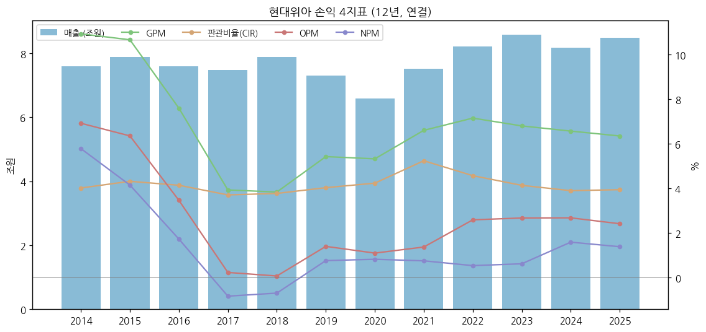

### ② 재무상태표 (12년)

| 연도 | 자산총계 | 부채총계 | 자본총계 | 현금성자산 | 매출채권 | 재고자산 | 유형자산 | 총차입금 | 부채비율 | 유동비율 |
|---|---|---|---|---|---|---|---|---|---|---|
| 2014 | 59,373 | 30,884 | 28,489 | 4,835 | 13,259 | 6,733 | 19,282 | 12,261 | 108% | 189% |
| 2015 | 66,831 | 35,199 | 31,632 | 5,845 | 12,752 | 7,799 | 23,228 | 15,766 | 111% | 197% |
| 2016 | 70,221 | 37,635 | 32,586 | 7,993 | 11,887 | 7,716 | 25,483 | 19,616 | 115% | 220% |
| 2017 | 71,937 | 40,536 | 31,401 | 9,313 | 11,726 | 8,909 | 26,003 | 22,528 | 129% | 223% |
| 2018 | 71,074 | 40,705 | 30,369 | 3,358 | 16,700 | 8,031 | 25,695 | 22,795 | 134% | 209% |
| 2019 | 67,743 | 36,825 | 30,918 | 3,826 | 14,011 | 6,652 | 25,610 | 21,523 | 119% | 192% |
| 2020 | 77,199 | 41,940 | 35,259 | 5,549 | 14,643 | 7,610 | 31,587 | 27,747 | 119% | 201% |
| 2021 | 77,495 | 40,542 | 36,953 | 4,351 | 14,910 | 8,150 | 31,026 | 25,360 | 110% | 195% |
| 2022 | 75,465 | 38,128 | 37,337 | 6,744 | 16,464 | 8,102 | 27,994 | 22,174 | 102% | 177% |
| 2023 | 68,259 | 30,592 | 37,668 | 4,718 | 15,124 | 7,945 | 26,421 | 14,575 | 81% | 188% |
| 2024 | 70,760 | 30,497 | 40,263 | 7,584 | 14,300 | 6,805 | 26,427 | 12,405 | 76% | 165% |
| 2025 | 70,251 | 29,597 | 40,654 | 11,165 | 13,438 | 5,899 | 25,376 | 12,091 | 73% | 189% |
| 3Q26 | 72,207 | 31,428 | 40,779 | 8,068 | 14,247 | 7,253 | — | 11,559 | 77% | — |

※ 총차입금 = 단기차입금 + 유동성장기부채 + 사채 + 장기차입금 (리스부채 제외). 회사 IR 기준 차입금(2025말 12,292억)과 소폭 차이
※ 2020 자산 급증 = 산동 엔진법인 연결 편입. 2023 부채 감소 = 차입금 상환(재무CF -8,191억)

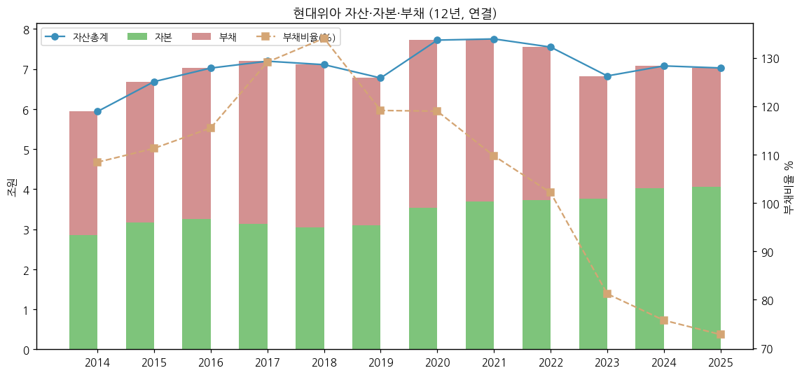

### ③ 현금흐름표 (12년)

| 연도 | 영업CF | 투자CF | 재무CF | 유형 CapEx | 무형 CapEx | FCF (OCF−CapEx) |
|---|---|---|---|---|---|---|
| 2014 | 4,486 | -5,178 | 1,914 | 2,908 | 696 | 881 |
| 2015 | 6,265 | -8,750 | 3,453 | 5,760 | 682 | -178 |
| 2016 | 3,546 | -4,700 | 3,314 | 4,383 | 481 | -1,317 |
| 2017 | 727 | -2,344 | 3,112 | 3,081 | 420 | -2,774 |
| 2018 | -1,133 | -4,639 | -209 | 1,740 | 369 | -3,243 |
| 2019 | 4,442 | -2,488 | -1,521 | 1,784 | 375 | 2,283 |
| 2020 | 1,891 | -3,247 | 3,329 | 2,516 | 271 | -896 |
| 2021 | 2,903 | -2,003 | -2,418 | 1,516 | 252 | 1,135 |
| 2022 | 4,240 | 1,847 | -3,619 | 1,132 | 172 | 2,937 |
| 2023 | 4,681 | 1,527 | -8,191 | 1,319 | 211 | 3,151 |
| 2024 | 5,920 | -304 | -2,501 | 2,410 | 365 | 3,144 |
| 2025 | 4,041 | -4 | -1,227 | 2,118 | 416 | 1,507 |
| 9M26 | 2,898 | -5,335 | -485 | 유무형 3,162 | | -264 |

→ 2015\~2018 4년 누적 FCF -7,512억 (엔진 증설 + 이익 붕괴) → 차입 확대 / 2019\~2025 누적 FCF +13,261억 → 차입금 2.8조(2020) → 1.2조(2025)
→ 2025 투자CF ≈ 0: 매각예정자산 처분 +3,376억(공작기계)이 CapEx를 상쇄

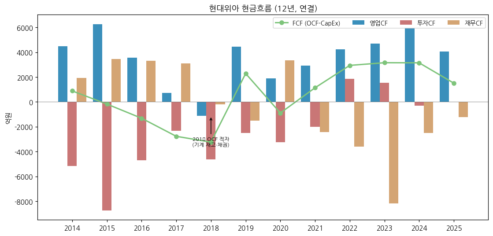

### ④ CapEx 추이 (12년)

| 연도 | 유형 | 무형 | 총 CapEx | CapEx/매출 | 감가상각비(유무형, IR) | 비고 |
|---|---|---|---|---|---|---|
| 2014 | 2,908 | 696 | 3,605 | 4.7% | | |
| 2015 | 5,760 | 682 | 6,442 | 8.2% | | ← 정점: 산동 엔진4공장·멕시코 |
| 2016 | 4,383 | 481 | 4,864 | 6.4% | | 멕시코 엔진·등속 양산 |
| 2017 | 3,081 | 420 | 3,501 | 4.7% | | |
| 2018 | 1,740 | 369 | 2,109 | 2.7% | | ← 투자 축소 |
| 2019 | 1,784 | 375 | 2,159 | 3.0% | | |
| 2020 | 2,516 | 271 | 2,787 | 4.2% | | |
| 2021 | 1,516 | 252 | 1,768 | 2.3% | | |
| 2022 | 1,132 | 172 | 1,303 | 1.6% | | ← 저점 |
| 2023 | 1,319 | 211 | 1,530 | 1.8% | | |
| 2024 | 2,410 | 365 | 2,776 | 3.4% | 2,617 | 열관리·슬로바키아 |
| 2025 | 2,118 | 416 | 2,534 | 3.0% | 2,678 | |
| 9M26 | | | 3,162 | 4.5% | 2,065 | 인도·슬로박·열관리 증설 |

→ 회사 계획: 2026\~2028 전략적 투자 확대 후 안정화. 3개년 평균 투자비 '23\~'25 3,144억 → '26\~'28 5,663억 (2025 4Q IR). 2035년까지 누적 R&D 약 1.8조·글로벌 거점 약 1조·신사업 약 0.9조 (2026-11 IR)

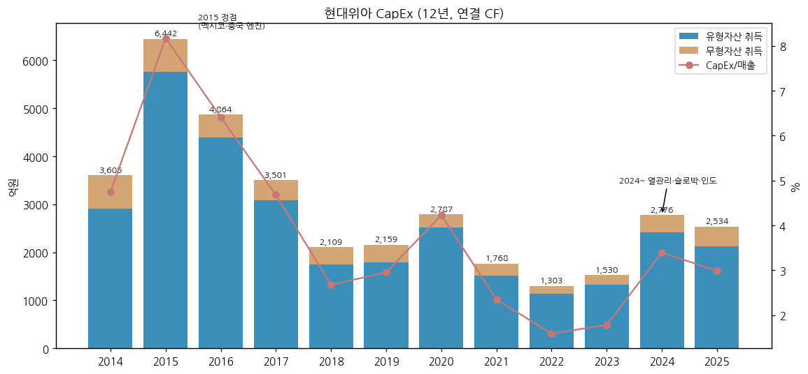

### ⑤ 부채구조 + 채무증권 (12년)

| 연도 | 단기차입금 | 유동성장기부채 | 사채 | 장기차입금 | 총차입금 | 순차입금 (현금성자산 차감) | 이자보상배율 (OP/이자지급) |
|---|---|---|---|---|---|---|---|
| 2014 | 162 | 1,675 | 6,877 | 3,546 | 12,261 | 7,426 | 17.3x |
| 2015 | 0 | 1,543 | 9,570 | 4,652 | 15,766 | 9,920 | 13.6x |
| 2016 | 0 | 1,549 | 9,573 | 8,493 | 19,616 | 11,623 | 5.9x |
| 2017 | 149 | 1,828 | 11,969 | 8,582 | 22,528 | 13,215 | 0.3x |
| 2018 | 520 | 3,048 | 11,474 | 7,752 | 22,795 | 19,437 | 0.1x |
| 2019 | 1,280 | 4,949 | 9,079 | 6,216 | 21,523 | 17,697 | 1.5x |
| 2020 | 970 | 6,490 | 10,474 | 9,813 | 27,747 | 22,198 | 1.2x |
| 2021 | 260 | 7,862 | 7,481 | 9,757 | 25,360 | 21,010 | 1.8x |
| 2022 | 384 | 9,532 | 2,992 | 9,267 | 22,174 | 15,430 | 3.3x |
| 2023 | 504 | 4,723 | 998 | 8,350 | 14,575 | 9,856 | 3.4x |
| 2024 | 1,530 | 6,144 | 499 | 4,231 | 12,405 | 4,821 | 3.9x |
| 2025 | 712 | 4,083 | 3,490 | 3,806 | 12,091 | 927 | 4.3x |

→ 단기금융상품 포함 현금 (IR 기준): 2024말 11,117억 → 2025말 16,890억 → 3Q26 15,787억 → **2025말 실질 순현금 약 4,600억**
→ 2025 사채 3,487억 신규 발행 (CF), 3Q26 회사채 만기 상환. 차입금 지역 구성 3Q26: 본사 4,794억 / 해외 6,919억 (러시아 외화차입금이 루블 환산손익 원천)

### ⑥ 배당·자사주 추이 (12년)

| 연도 | DPS (원, 결산) | 배당 지급 (CF, 억원) | 자사주 취득 (CF) | FCF | 연결 배당성향 |
|---|---|---|---|---|---|
| 2014 | 800 | 129 | 0 | 881 | 4.9% |
| 2015 | 1,100 | 212 | 0 | -178 | 8.9% |
| 2016 | 1,100 | 292 | 25 | -1,317 | 22.4% |
| 2017 | 600 | 292 | 0 | -2,774 | — (적자) |
| 2018 | 600 | 159 | 0 | -3,243 | — (적자) |
| 2019 | 700 | 159 | 0 | 2,283 | 33.7% |
| 2020 | 700 | 186 | 0 | -896 | 30.5% |
| 2021 | 700 | 186 | 0 | 1,135 | 29.8% |
| 2022 | 700 | 186 | 0 | 2,937 | 28.4% |
| 2023 | 850 | 187 | 0 | 3,151 | 24.8% |
| 2024 | 1,100 | 226 | 0 | 3,144 | 24.3% |
| 2025 | **1,200** | 293 | 81 | 1,507 | **32.2%** |

→ 배당 지급(CF)은 전년 결산 배당이 다음 해 지급. 2025 결산 배당총액 319억 (3Q26 IR 자본변동 -319억)
→ 배당정책 (2025 4Q IR): 배당성향 20\~30% → **25\~35%로 상향** (2026 사업연도\~), 자기주식 매입·소각은 '추진 검토'
→ 2025 자기주식: 기초 549,320주 + 취득 187,046주 − 처분 139,028주 = 기말 597,338주 (2.20%). 현금배당수익률 2025 1.4% (사업보고서) / 현재가 기준 2.4%

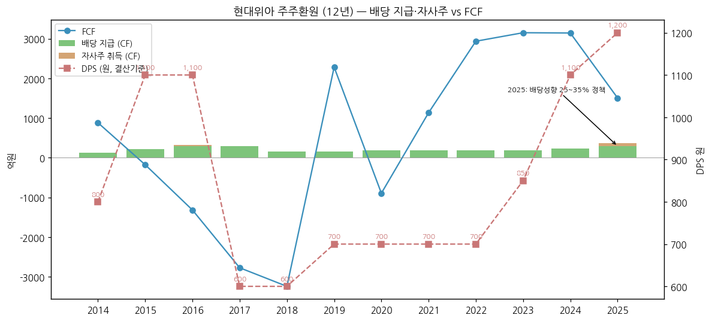

### ⑦ 재무 비율 (12년)

| 연도 | ROE (평균자본) | ROA | 부채비율 | 유동비율 | 이자보상배율 | 재고일수 | 매출채권일수 |
|---|---|---|---|---|---|---|---|
| 2014 | 15.4% | 7.4% | 108% | 189% | 17.3x | 32일 | 64일 |
| 2015 | 10.9% | 5.2% | 111% | 197% | 13.6x | 36일 | 59일 |
| 2016 | 4.1% | 1.9% | 115% | 220% | 5.9x | 37일 | 57일 |
| 2017 | -2.0% | -0.9% | 129% | 223% | 0.3x | 43일 | 57일 |
| 2018 | -1.8% | -0.8% | 134% | 209% | 0.1x | 37일 | 77일 |
| 2019 | 1.8% | 0.8% | 119% | 192% | 1.5x | 33일 | 70일 |
| 2020 | 1.6% | 0.7% | 119% | 201% | 1.2x | 42일 | 81일 |
| 2021 | 1.6% | 0.7% | 110% | 195% | 1.8x | 40일 | 72일 |
| 2022 | 1.2% | 0.6% | 102% | 177% | 3.3x | 36일 | 73일 |
| 2023 | 1.4% | 0.7% | 81% | 188% | 3.4x | 34일 | 64일 |
| 2024 | 3.3% | 1.9% | 76% | 165% | 3.9x | 30일 | 64일 |
| 2025 | 2.9% | 1.7% | 73% | 189% | 4.3x | 25일 | 58일 |

※ 2014 ROE는 기말자본 기준. 이자보상배율 = 영업이익 ÷ CF 이자의 지급
→ ROE 2\~3%는 자본비용 대비 크게 미달 → PBR 0.3\~0.5배 할인의 근거. 재고·채권 회전은 2018 이후 꾸준히 개선 (공작기계 이탈 효과 포함)

---

## 5. 지배 구조

### ① 그룹·계열 관계

- 현대자동차그룹 계열 (기업집단 현대자동차). 최대주주 현대자동차(25.35%), 2대 기아(13.44%), 정의선 회장 1.95%
- 주요 종속회사: 강소현대위아, 산동현대위아기차발동기(엔진), Hyundai-Wia India, Hyundai Wia Mexico, Hyundai Wia Rus, Hyundai-Wia Alabama, Wia Slovakia, 테크젠, 모비언트 / 관계·공동기업: 위아마그나파워트레인 등
- 그룹 내 역할: 현대모비스(모듈·전장·A/S)와 모듈 분담, 현대트랜시스(변속기·시트)와 구동 분담. 방산은 그룹 방산 계열사 현대로템으로 통합 (2027-03 예정)

### ② 주주 구분 (2025-12-31, 사업보고서)

| 주주 | 주식수 | 지분율 | 구분 |
|---|---|---|---|
| 현대자동차 | 6,893,596 | 25.35% | 최대주주 |
| 기아 | 3,654,004 | 13.44% | 계열회사 |
| 정의선 | 531,095 | 1.95% | 계열회사 임원 |
| 권오성 (대표이사) | 1,000 | 0.00% | 등기임원 |
| **특수관계인 합계** | **11,079,695** | **40.74%** | |
| 국민연금공단 | 2,546,628 | 9.36% | 5% 이상 주주 |
| 자기주식 | 597,338 | 2.20% | |
| 기타 (외국인·기관·개인) | — | 약 47.7% | 외국인 지분율 미확보 (v1.1 보강) |

→ 최대주주 지분 25.35% / 특수관계인 40.74%는 2016 이후 10년간 불변 (2016·2019·2022·2025 OpenDART 대조)

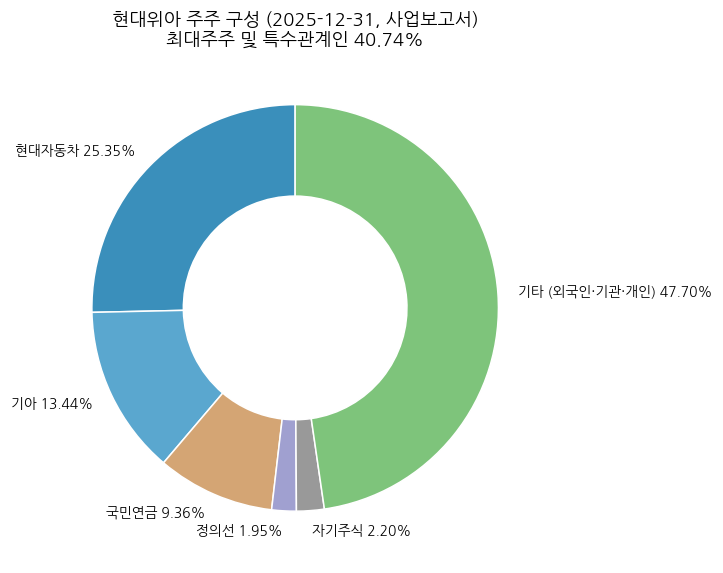

### ③ 임원·이사회 (2025 사업보고서)

| 성명 | 직위 | 구분 | 담당·주요 경력 |
|---|---|---|---|
| 권오성 (1970) | 부사장 | 사내이사·대표이사 | 前 현대차 연구개발지원사업부장·MLV시험센터장, 서울대 |
| 황윤목 (1971) | 전무 | 사내이사 | 품질사업부장, 前 현대위아 모빌리티사업본부장·전략추진실장 |
| 권오현 (1970) | 상무 | 사내이사 | 재경본부장, 前 현대로템 경영관리실장 (2025-07 대표이사 직무 후 사내이사) |
| 이동열 (1966) | 사외이사 | 선임사외이사 | 법무법인 로백스 대표변호사, 前 서울서부지검 검사장 |
| 최우석 (1970) | 사외이사 | 감사위원 | 고려대 경영대 교수 |
| 김찬우 (1976) | 사외이사 | 감사위원 | 고려대 인공지능학과 교수, 前 삼성전자 글로벌AI센터 부사장 |
| 이규진 (1977) | 사외이사 | 감사위원 | 명지대 기계공학과 교수 |

- 대표이사 변천: 김경배 → 정재욱(2021-03 선임, 2025-06-30 사임) → 권오현(직무, 2025-07-01) → **권오성(2025-08-08)**
- 이사회 7인 중 사외이사 4인, 2025-08 선임사외이사 제도 도입. 사외이사 중 AI·기계공학 교수 2인 — 로보틱스·열관리 전환과 정합

---

## 6. 기타 팩트

### ① R&D 인프라

| 연도 | 연구개발비 (억원) | R&D/매출 |
|---|---|---|
| 2014 | 710 | 0.93% |
| 2015 | 673 | 0.85% |
| 2016 | 685 | 0.90% |
| 2017 | 661 | 0.88% |
| 2018 | 695 | 0.88% |
| 2019 | 591 | 0.81% |
| 2020 | 561 | 0.85% |
| 2021 | 542 | 0.72% |
| 2022 | 625 | 0.76% |
| 2023 | 672 | 0.82% (계속영업 매출 기준) |
| 2024 | 869 | 1.06% |
| 2025 | **936** | **1.10%** |

※ DART 사업보고서 '연구개발비용', 연결, 설비투자 제외. 각 연도는 최신 보고서 재기재치 우선
→ 연구소: 의왕 (연구부문 인원 2016 563명 → 2022 525명). 2024부터 R&D 비용 +29%·+8% — 열관리·로보틱스 선행 개발 반영

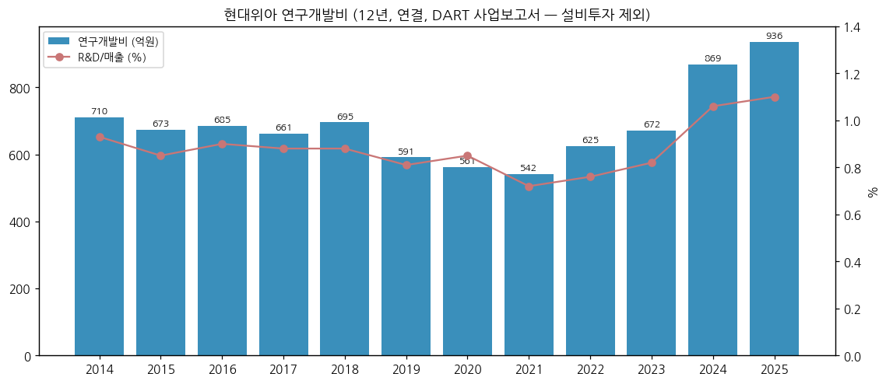

### ② 진행 중 corporate action — 10년치 주요 이벤트

| 시점 | 이벤트 | 영향 |
|---|---|---|
| 2016 | 멕시코 엔진·등속·소재 공장 양산 | 북미 거점 (2024 북미 매출 9,014억) |
| 2017-4Q | 통상임금 소송 충당금 반영 | 4Q17 OP -716억 |
| 2018 | 기계사업 합리화 (산업기계 등) | 2018 기계 OP -1,150억 |
| 2020 하반기 | 산동 엔진법인 연결 편입 | 자산 +9,456억 |
| 2022 | 러시아 유형자산 손상 | 세전 -1,144억 (4Q22 순손실 -1,588억) |
| 2023-12 | 현대위아터보 흡수합병 | 터보차저 내재화 |
| 2024 | 중국 사업 합리화 (산동 자산 처분손실 -84억, 4Q23) | 중국 법인 효율화 |
| 2025-03\~07 | **공작기계사업 물적분할(위아공작기계) → HMT 컨소시엄 매각 3,400억** | 중단영업, 현금 +3,376억 |
| 2025 | 강소 주물공장 매각 | 3Q25 매각이익 (3Q26 역기저) |
| 2026-10-19 | **특수사업 현대로템 포괄적 영업양도 계약 3,584억** | 2026-11-27 임시주총 **가결**(찬성 85.2%) → 주식매수청구 11-27\~12-16 (매수가 51,811원, 청구액 1,400억 초과 시 이사회 철회 가능) → 2027-03-31 종결 |

### ③ 기술·신사업 마일스톤 — 10년치

| 시점 | 마일스톤 |
|---|---|
| 2016 | 등속조인트 누적 1억개, 서산 카파 엔진 양산 |
| 2021 하반기 | 모바일 로봇 통합관제 시스템 개발 (그룹 공장 적용) |
| 2023\~ | 전기차 구동모터 헤어핀 스테이터·감속기 PE시스템 생산설비 사업화 |
| 2025 | 경량화 105mm 자주포 신속연구개발 완료, 기동형 RCWS 개발 (특수 — 이관 대상) |
| 2025-07 | 전기차 공조시스템(HVAC) 자체 개발 → 기아 PV5 양산 탑재 |
| 2025 | 슬로바키아 냉각수 모듈 양산 |
| 2026-01 | CES 2026: 통합열관리모듈·냉각모듈·슬림 HVAC 공개, '데카 밸브' 열관리 모듈 |
| 2026 | 주차로봇 실증 (현대차·현대건설 컨소시엄, 시흥 힐스테이트 더웨이브시티) |
| 2027 (계획) | 내연기관·HEV 공조시스템 양산, 인도 푸네 등속공장 신설 |
| 2028 (계획) | 열관리 대응 능력 연 100만대 |
| 2035 (목표) | 전사 매출 14.8조 (2026→2035 CAGR 5.9%), TMS·로보틱스 4.0조 (27%) |

### ④ 주요 리스크

- **고객 집중**: 상위 4개 고객(현대차·기아 계열 추정) 매출 88% — 그룹 생산계획·단가 협상이 이익 결정
- **저마진 + 믹스**: 모듈 비중 확대 시 OPM 희석 (3Q26 차량부품 OPM 1.8%), 엔진 위탁생산은 전동화로 장기 축소
- **미국 관세**: 2Q26 영업이익 감소 요인으로 미국 자동차 부품 관세 지목 (스마트투데이 2026-08-13). 멕시코 엔진 → 미국 공장 공급 구조 노출
- **러시아**: 2022 유형자산 손상 -1,144억, 외화차입금 루블 환산손익 (3Q26 러시아 외환손실 -253억). 러시아 엔진 가동률 하락
- **외환손익 변동성**: 3Q26 외환손실 -612억으로 세전 적자전환 — 영업이익 대비 영업외 변동 폭이 큼
- **통상임금**: 2017 충당금, 2025 4Q 통상임금 영향 재발 (2025 4Q IR)
- **방산 이관 공백**: 2025 기타 부문 이익 467억(전사 23%) 중 방산 비중 큼 → 2027 이후 신사업이 이를 대체하기 전 이익 공백. 임시주총은 2026-11-27 가결(찬성 85.2%) — 남은 변수는 주식매수청구 규모(12-16 마감, 1,400억 초과 시 철회 가능)와 관계기관 인허가
- **선행투자 부담**: 2026\~2028 CapEx 5,663억/년 계획 → FCF 축소 (9M26 FCF ≈ -264억)

### ⑤ ESG 등급

- 2045 탄소중립·RE100(글로벌 공장 재생에너지 100%) 목표 수립 (2025 사업보고서)
- 이사회: 사외이사 과반, 감사위원회·투명경영위원회·보수위원회 운영, 선임사외이사 제도(2025-08)
- 외부 ESG 등급 (KCGS·MSCI 등): **미확인 — v1.1에서 web verify 후 기재**

### ⑥ 인증·라이선스

- ISO 14001·QS 9000 (2001), ISO 27001 (2008) — 회사 연혁 (2016 사업보고서)
- 방산: 국내 유일 대구경 화포 전문업체 (사업보고서 기재) — 방산 지정·인허가는 영업양도 시 현대로템으로 이전 (계약 확약사항)

---

## Version Log

**v1.1 (2026-11-28) — 2026-11-27 임시주총 결과 반영**
- 특수사업부 현대로템 영업양도 안건 특별결의 가결 (의결권 행사 주식 기준 찬성 85.2%, 현대위아 2026-11-27 공시) [Source: 매일일보·비건뉴스 2026-11-27\~28]
- 잔여 변수 갱신: 주식매수청구 11-27\~12-16 (매수가 51,811원), 청구액 1,400억 초과 시 이사회 철회 가능 / 거래 종결 2027-03-31 예정
- 수정 위치: 1번 재평가 트리거, 2번 연혁, 6번 corporate action·리스크, 잔여 보완 후보

**v1.0 (2026-11-25) — 신규 작성 (자동차 섹터 부품, 병렬 작업 4종 중 1)**
- ① OpenDART 연결 재무 JSON 44건 (2015 FY\~3Q26) + 2014 비교컬럼 → 12년 손익·재무상태·현금흐름·CapEx·배당 전부 DART 원값. 2014\~2017 계정ID `ifrs_` 구표준 → 매핑 처리
- ② DART 정기공시 원문 XML 44건 — 2015\~2021 사업보고서는 EUC-KR 인코딩(헤더는 utf-8 표기)이라 cp949 재디코딩 후 파싱: R&D 12년, DPS 12년, 연혁, 제품·CAPA·수주·주요 고객·지역 정보
- ③ 회사 IR PDF 36건 (irgo, 2018.1Q\~2026.3Q; 8건 다운로드 실패 — 2017 연간·2021 2Q/3Q 등) — 사업부 분기 시계열 3개 양식 매핑: 〔차량부품/기계〕 1Q17\~4Q22 → 〔모빌리티/공작·특수〕 1Q22\~4Q24 → 〔계속영업 차량부품/기타(특수·로보틱스)〕 1Q23\~3Q26
- ④ 차트 15종: chart1·1b·2(×4: 전사·차량부품·기계특수·기타)·4·5·6·7·8·9·10·11·12
- ⑤ 데이터 주의: OpenDART 분기 요약의 4Q24는 원공시 1\~3Q(공작 포함)와 재작성 FY24 혼합 역산 → IR 재작성치로 대체

**잔여 보완 후보 (v1.1):**
- 2016 이전 사업부 분기 (2016 IR 미확보) — 60+분기 표준 대비 사업부 시계열 39분기
- 2023\~ 품목별(엔진·모듈·등속·구동·열관리) 금액 — IR 비공개, 증권사 리포트 첨부 시 보강
- 2025 지역별 매출 (당기 컬럼), 외국인 지분율, 외부 ESG 등급
- 임직원 12년 연속 시계열 (현재 4개 연도)
- 4Q26 실적 발표 + 주식매수청구 최종 규모(2026-12-16 마감) 반영
