> 종목: 현대차 (005380.KS / 현대자동차 주식회사 / HYUNDAI MOTOR CO)
> 섹터: 로봇 — 서브섹터 **휴머노이드 완성체** (워치리스트 대분류: 모빌리티·에너지전환)
> 작성 시각: 2026-11-14 KST (v1.0)
> 적용 구조: v4.8 (6개 섹션 + 12종 표준 차트)
> 데이터: 12년 연결 연간(2014~2025, OpenDART 전체 재무제표 CFS — 2014는 2015 사업보고서 비교표시) + 43분기 연결 분기(1Q16~2Q26 OpenDART, 3Q26 회사 IR) + 사업부(차량·금융·기타) 19분기(1Q22~3Q26, 회사 IR) + Yahoo Finance 005380.KS 월간 시계열(2000.02~2026.11)
> 출처: **DART 정기보고서 공시원문 44건** (corp_code 00164742) — 최신 2026.03 1분기보고서(2026-05-15), 2025 사업보고서(rcept 20260318001394) / OpenDART 연결재무 JSON 43건 / **회사 IR 실적발표 PDF 20건(2022.3Q~2026.3Q; 2026.1Q·2Q 자료는 irgo 미게시)** — 최신 2026-10-29 「2026년 3분기 경영실적 발표」 / 시장데이터: Yahoo Finance(2026-11-13 종가) / 보도: SBS Biz·딜사이트·파이낸셜뉴스(2026-10-29), 아시아경제(2026-11-02), 이투데이(2026-09-12), 헤럴드경제(2026-05-18)

# 현대차 기업 개요 (v1.0 — 로봇 · 휴머노이드 완성체, 완성차 사이클 + 로보틱스 옵션)
> **Fact verify cutoff**: 2026-11-14 (주가·시가총액·52주 고저·ATH는 2026-11-13 Yahoo Finance meta·월간 OHLC, 3Q26 실적은 2026-10-29 회사 IR — 감사 전)

---

## ① 기업 분류

(1) Primary / Secondary 분류

**Primary 분류: 사이클 (완성차 수요·환율·관세 사이클, 12년 OPM range 7.0pp — cutoff ±10pp 미달의 "완만한 사이클")**

→ 12년 OPM: 2014 8.5% → 2020 **2.3% 저점**(코로나·품질비용) → 2023 **9.3% 정점**(SUV·제네시스 믹스 + 원/달러 1,300원대) → 2025 6.2% → 2026 1~3Q 5.7%(대미 관세 25%→15%)
→ 매출은 12년 중 감소가 1회(2020)뿐인 우상향 — 이익률만 사이클을 탄다. 이익 변동의 3대 축은 **환율·믹스·인센티브**(회사 IR 영업이익 증감 분해 항목 그대로)

**Secondary 노트: 꿈 (로보틱스·자율주행 옵션 — 보스턴다이내믹스·Motional은 지분법, 연결 매출 0)**

→ 보스턴다이내믹스(BD)는 현대차가 49.50% 보유한 **HMG Global LLC(지분법 관계기업)** 산하 — 연결 매출·영업이익에 로봇 매출은 없고 손실만 지분법으로 반영 (DART 2025 사업보고서 연결 주석, HMG Global 장부가 2조 9,247억)
→ 2025 사업보고서 CEO 메시지: "아틀라스를 실제 생산 현장에 투입하기 위한 준비를 진행중이며, **2028년까지 연간 3만 대 규모의 로봇 생산 체계**를 구축" (DART 2025 사업보고서)
→ 시장은 2026년 상반기에 이 옵션을 크게 반영 → 주가 2026-06 장중 **783,000원 ATH** 후 2026-11-13 269,500원(-65.6%)

**Entity 구조 (DART 영업부문, 3개 보고부문)**

→ **(1) 차량부문** — 2025 매출 145.6조(78%) — 현대·제네시스 완성차, HMA(미국)·HME(유럽)·HMMA(앨라배마)·HMGMA(조지아)·HMI(인도, 2024.10 상장) 등
→ **(2) 금융부문** — 30.2조(16%) — 현대캐피탈·현대카드·HCA(Hyundai Capital America)
→ **(3) 기타부문** — 10.4조(6%) — **현대로템**(33.77%) 등 철도·방산
→ 부문 비중: DART 2026.1Q 분기보고서 II 서술 "2025년 기준 차량 약 78%, 금융 약 16%, 기타 약 6%"

(2) Summary Box (12년 연결 시계열 2014~2025 + 사이클 통계)

| 지표 | 12년 평균 (2014~2025) | 정점 | 저점 | 2025년 |
|---|---|---|---|---|
| 매출 (연결, 억원) | 1,231,733 | **1,862,545 (2025)** | 892,563 (2014) | **1,862,545** |
| OP (연결, 억원) | 76,214 | **151,269 (2023)** | 23,947 (2020) | **114,679** |
| NI 연결 (억원) | 67,247 | **132,299 (2024)** | 16,450 (2018) | **103,648** |
| OPM (연결, %) | 5.8% | **9.3% (2023)** | 2.3% (2020) | **6.2%** |

```
[현대차 12년 연결 손익 시계열 (억원)]
연도   매출         OP       OPM    NI(연결)
2014   892,563    75,500   8.5%    76,495   ← 한전부지 10.55조 컨소시엄 낙찰(2014.09)
2015   919,587    63,579   6.9%    65,092   ← 제네시스 브랜드 독립(2015.11)
2016   936,490    51,935   5.5%    57,197
2017   963,761    45,747   4.7%    45,464   ← 중국 사드 보복·미국 재고 부담
2018   968,126    24,222   2.5%    16,450   ← 3Q18 OP 2,889억(OPM 1.2%), 엔진 리콜 충당금
2019 1,057,464    36,055   3.4%    31,856   ← 3Q19 엔진 품질비용
2020 1,039,976    23,947   2.3%    19,246   ← 12년 저점 (코로나, 3Q20 품질비용으로 분기 적자)
2021 1,176,106    66,789   5.7%    56,931   ← 반도체 공급난 속 가격 인상
2022 1,425,275    98,198   6.9%    79,836   ← 원/달러 1,300원대 + 판가
2023 1,626,636   151,269   9.3%   122,723   ← 12년 정점 (OP 15.1조)
2024 1,752,312   142,396   8.1%   132,299   ← 인센티브 증가, 4Q24 OPM 6.1%
2025 1,862,545   114,679   6.2%   103,648   ← 대미 관세 25%(2025.04~), 4Q25 OPM 3.6%
(2026 1~3Q: 매출 140.27조 -0.9% YoY, OP 8.04조 -9.4% — 3Q26 단독 OP +5.5%로 반전, 회사 IR·OpenDART)

OPM range: 2.3% ~ 9.3% = 7.0%pt (cutoff ±10%pt 미달)
사이클 회수: 저점 1회(2020), 정점 2회(2014·2023) → 12년 약 1 사이클
```

**📊 사이클 통계 (12년 연결)**

| 지표 | 값 |
|---|---|
| 매출 CAGR (11년, 2014→2025) | **+6.9%** |
| 매출 CAGR (3년, 2022→2025) | **+9.3%** |
| OPM 평균 (2014~2025) | **5.8%** |
| OPM 정점 평균 (2014·2023) | **8.9%** |
| OPM 저점 (2020) | **2.3%** |
| OPM range | **7.0%pt** |
| 사이클 주기 | 정점→저점 6년 (2014→2020), 저점→정점 3년 (2020→2023) |
| 사이클 cutoff (±10%pt) | **미충족** → 완만한 사이클 (매출 우상향 + 이익률 등락) |

(3) 정량적 분류 근거

→ **차량부문 이익 비중** — 2023~2025 연결 OP의 74~85%가 차량(연결조정 포함 산식: 총 OP − 금융 − 기타, 회사 IR). 금융은 연 1.4~2.2조로 안정적, 기타(현대로템)는 2025년부터 의미 있는 기여(분기 0.1~0.3조)
→ **미국 의존** — 3Q26 미국 소매 27.0만 대, M/S 6.6%(6개 분기 연속 6%대), 미국 HEV 비중 26.8% 분기 최대 (회사 3Q26 IR p.6). 관세 25% → 15% 인하가 2026 3Q 이익 반등의 핵심 변수
→ **로봇 매출 분리 공시 없음** — 로봇 관련 손익은 지분법(HMG Global 49.5%)으로만 반영. BD 단독 실적은 2025 매출 1,501억, 순손실 5,284억 (이투데이 2026-09-12, BD 감사보고서 인용 보도)
→ **금융부문 자산 효과** — 2025말 연결 BS 금융업채권 134.4조(유동 55.8조·비유동 78.5조) + 운용리스자산 53.9조. 이 자산 증가로 연결 영업CF가 2023~2025 3년 연속 마이너스 — 차량부문 현금창출력과 구분해서 봐야 함

(4) 산업 분류

→ **한국표준산업분류** — 30121 승용차 및 기타 여객용 자동차 제조업 (OpenDART 기업개황 induty_code 30121)
→ **워치리스트 섹터** — 로봇 / 서브섹터 **휴머노이드 완성체**
→ 실질 분류: 매출·이익 기준 **완성차 + 캡티브 금융**, 주가 프리미엄 기준 **로보틱스·자율주행 옵션**

(5) 분류 결정 논리

(1) **가장 큰 사업부 기준** — 차량 78%(매출)·약 75~85%(이익) → 완성차 사이클이 Primary driver
(2) **cutoff 미달 처리** — OPM range 7.0pp로 ±10pp 미달이지만, 이익 YoY 진폭은 크다(2018 -47%, 2021 +179%, 2025 -19%). 매출 변동성이 낮고 이익률만 움직이는 구조라 "완만한 사이클"로 Primary 사이클 유지
(3) **로봇은 Secondary(꿈)** — 연결 실적 기여 0, 2028 양산 목표. 2026년 주가 급등락(+164% → -66%)은 실적이 아니라 옵션 가치 재평가 → 리포트는 숫자(완성차)와 옵션(로봇)을 분리해 본다

(6) 적정 밸류에이션 방법

→ **1차 — P/E (12MF) + 주주환원 수익률**: 완성차 본업. 2026-11-13 종가 269,500원 × 보통주 204,757,766주(2025말 발행) = **보통주 시총 약 55.2조원**. 직전 4개 분기(4Q25~3Q26) 연결 순이익 합 8.59조 기준 **trailing PER 약 6.4배**(보통주 시총만 사용, 우선주·비지배 미조정 — `추정`)
→ **2차 — P/B 밴드**: 3Q26말 연결 자본 128.8조(회사 IR p.18), 2025말 지배자본 115.4조 → **PBR 약 0.48배**(보통주 시총 기준, `추정`)
→ **3차 — SOTP(로봇 옵션)**: BD는 HMG Global 49.5% × BD 지분으로 간접 보유. 2021 인수 당시 BD 가치 11억달러(80% 취득), 현재 가치는 공시 없음. 증권사 SOTP에 BD 가치를 넣느냐가 2026년 목표가 편차(46만~65만원)의 주 원인 (아시아경제 2026-11-02)
→ **DCF 미사용 근거**: 금융부문 자산 증감이 연결 FCF를 지배(2023~2025 FCF -11~-17조)해 연결 FCF 기반 DCF가 의미 없음

(7) 분기 재평가 트리거 (**분류 변경 조건**)

→ ① **BD/아틀라스 매출이 연결로 들어오는 구조 변경**(HMG Global 지배력 취득 또는 BD 직접 연결) + 로봇 매출 연 1조원 이상 → Secondary 꿈 → **고성장 sub-segment 분리**
→ ② **관세 15% 체제에서 OPM 8%+ 2분기 연속 회복** → 2023형 정점 재진입
→ ③ **OPM 4% 하회 2분기 연속**(4Q25 3.6% 수준) → 사이클 저점 국면 판단

---

## ② 회사 개요

(1) 기본 사항

| 항목 | 내용 |
|---|---|
| 회사명 (한글) | 현대자동차 주식회사 |
| 회사명 (영문) | HYUNDAI MOTOR CO |
| 종목코드 | 005380 (보통주), 005385·005387·005389 (우선주) |
| 설립 | 1967.12.29 |
| 본사 | 서울특별시 서초구 헌릉로 12 |
| 대표이사 | 정의선 회장·호세 무뇨스 사장·최영일 (각자 대표, OpenDART 기업개황 2026-11 조회) |
| 발행주식수 | 보통주 204,757,766주 / 우선주 60,632,342주 (2025말, 자기주식 보통주 1,648,558주) |
| 최대주주 | **현대모비스 22.36%** (45,782,023주) + 특수관계인 합 30.67% (DART 2025 사업보고서) |
| 임직원 | 72,598명 (2025말, 차량부문 별도 — 남 66,681·여 5,917) |
| 2025 배당 | 보통주 DPS 10,000원 (2024 12,000원), 연결 배당성향 27.7% |
| 업종코드 | 30121 |

(2) 12년 손익·자본 추이 (연결, OpenDART 재무제표 — 각 연도 사업보고서 최초 공시값)

| 연도 | 매출 (억) | OP (억) | OPM | NI 연결 (억) | NI 지배 (억) | 자본총계 (억) | 자산총계 (억) | 부채비율 | ROE(지배, 기말) |
|---|---|---|---|---|---|---|---|---|---|
| 2014 | 892,563 | 75,500 | 8.5% | 76,495 | 73,468 | 626,206 | 1,472,251 | 135.1% | 12.7% |
| 2015 | 919,587 | 63,579 | 6.9% | 65,092 | 64,173 | 668,814 | 1,653,679 | 147.3% | 10.3% |
| 2016 | 936,490 | 51,935 | 5.5% | 57,197 | 54,064 | 723,446 | 1,788,359 | 147.2% | 8.0% |
| 2017 | 963,761 | 45,747 | 4.7% | 45,464 | 40,328 | 747,574 | 1,781,995 | 138.4% | 5.8% |
| 2018 | 968,126 | 24,222 | 2.5% | 16,450 | 15,081 | 738,960 | 1,806,558 | 144.5% | 2.2% |
| 2019 | 1,057,464 | 36,055 | 3.4% | 31,856 | 29,800 | 763,658 | 1,945,122 | 154.7% | 4.3% |
| 2020 | 1,039,976 | 23,947 | 2.3% | 19,246 | 14,244 | 763,410 | 2,093,442 | 174.2% | 2.1% |
| 2021 | 1,176,106 | 66,789 | 5.7% | 56,931 | 49,424 | 826,158 | 2,339,464 | 183.2% | 6.6% |
| 2022 | 1,425,275 | 98,198 | 6.9% | 79,836 | 73,644 | 908,965 | 2,557,425 | 181.4% | 8.9% |
| 2023 | 1,626,636 | 151,269 | 9.3% | 122,723 | 119,617 | 1,018,094 | 2,824,634 | 177.4% | 12.9% |
| 2024 | 1,752,312 | 142,396 | 8.1% | 132,299 | 125,267 | 1,202,759 | 3,397,984 | 182.5% | 11.5% |
| **2025** | **1,862,545** | **114,679** | **6.2%** | **103,648** | **94,460** | **1,276,482** | **3,688,448** | **189.0%** | **8.2%** |

→ 출처: OpenDART fnlttSinglAcntAll CFS. 2018·2019 연간 OP는 분기 합산(사업보고서 JSON에 영업이익 계정 누락 → OpenDART 분기 3개월 값 합), 2018~2022 NI 연결은 계정명 기준 보강
→ 부채비율이 180%대인 것은 **금융부문(현대캐피탈 등) 차입 연결 효과** — 3Q26말 차입금 172.6조 중 대부분이 금융부문 (회사 IR p.18)

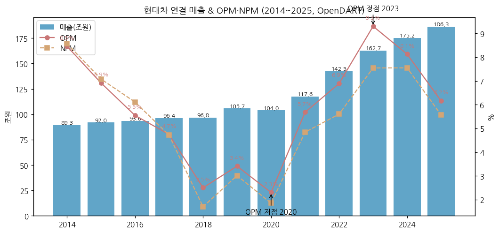

→ **사이클 위치**: 2014 정점 → 2018~2020 품질비용·코로나 저점 → 2021~2023 반도체난 속 가격·믹스·환율 3박자 정점 → 2024~2025 인센티브·관세로 하강 → 3Q26 관세 인하 효과로 분기 반등

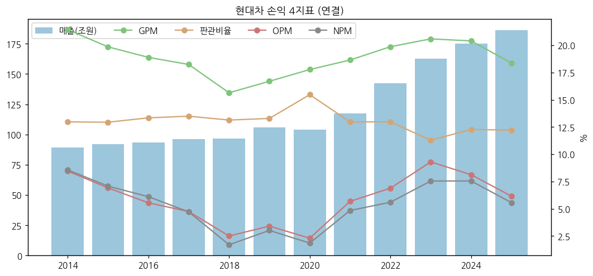

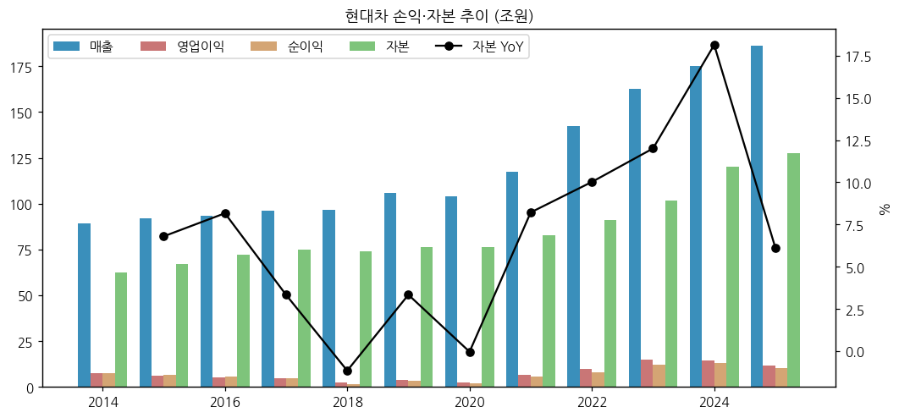

(3) 주가 역사

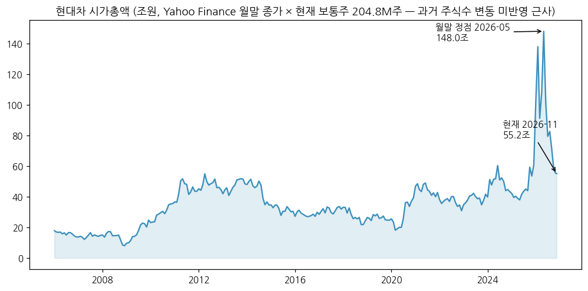

→ (출처: Yahoo Finance v8 월간 OHLC. 시가총액 = 월말 종가 × **현재 보통주 204.76M주** — 과거 주식수 변동(자사주 소각 등) 미반영 근사, 우선주 제외)

**시장 데이터 (2026-11-13 확인)**

| 항목 | 값 | 출처 |
|---|---|---|
| 종가 | 269,500원 | Yahoo Finance meta, 2026-11-13 |
| 보통주 시가총액 | 약 55.2조원 (269,500원 × 204.76M주) | 계산 |
| 52주 최고 / 최저 | 783,000원 / 253,500원 | Yahoo Finance meta |
| 사상 최고가 (ATH) | **783,000원 (2026년 6월 장중)** — 월말 종가 정점 723,000원(2026.05말, 보통주 시총 약 148조) | Yahoo 월간 고가·종가 |
| ATH 대비 | **-65.6%** | 계산 |

**주가 변천사 요약**:
- 2014.09: 한전부지 10.55조 낙찰 → 지배구조·자본배분 우려로 장기 디레이팅
- 2015~2020: 중국 부진·품질비용으로 10만원대 박스, 2020.03 코로나 저점
- 2021.01: 애플카 협력 기대로 단기 급등
- 2023~2025: 이익 정점·주주환원(밸류업) — 20만원대
- 2025.10~2026.01: 관세 합의(대미 25%→15%) + AI·로봇 모빌리티 재평가. 2026-01 장중 41만원 첫 돌파(헤럴드경제 2026-01-12) → 2026-01 월중 고가 590,000원
- 2026.02~06: CES 2026 아틀라스 공개·2028 로봇 3만대 생산체계·BD IPO 기대 → **2026-06 장중 ATH 783,000원**
- 2026.06~11: 2Q·3Q 판매 부진, 연간 가이던스 하향, "해외 자회사 IPO 계획 없음" 발언으로 BD IPO 기대 소멸 → 10월 한 달 약 -20%, 18개 증권사 중 11곳 목표가 하향 (아시아경제 2026-11-02) → 2026-11-13 269,500원

(4) 주요 연혁

| 시기 | 내용 |
|---|---|
| 1967.12 | 현대자동차 설립 |
| 1976 | 첫 고유모델 포니 생산 |
| 1998 | 기아자동차 인수 |
| 2014.09 | 한전 삼성동 부지 그룹 컨소시엄 10조 5,500억원 낙찰 (DART 사업보고서) |
| 2015.11 | 제네시스 브랜드 출범 |
| 2020.03 | Motional(자율주행 JV) 설립 투자 |
| 2021.06 | **Boston Dynamics 지분 80% 취득 완료** (현대차·현대모비스·현대글로비스·정의선 회장, 기업가치 11억달러) |
| 2022.08 | HMG Global LLC 출범 — BD 지분 현물출자 (현대차 49.5%·현대모비스 20% 등) |
| 2024.10 | 현대차 인도법인(HMI) 인도 증시 상장 |
| 2025.03 | 미국 조지아 HMGMA 준공 |
| 2025.04 | 미국 자동차 관세 25% 부과 → 2025.11 한국산 15%로 인하 (회사·모비스 IR "관세율 25% → 15%") |
| 2026.01 | CES 2026에서 AI 로보틱스 전략·아틀라스 공개 |
| 2026.05 | 2028년 미국 로봇 생산시설(연 3만대) + 액추에이터 시설(연 35만개) 구축 계획 보도 (헤럴드경제 2026-05-18) |
| 2026.08 | HMG Global 통해 BD 추가 출자 (현대모비스 몫 4,100만달러, 모비스 3Q26 IR p.13) |
| 2026.10 | 2026 가이던스 하향: 도매 415.8만→400만대, OPM 6.3~7.3% → 5.5~6.5% (딜사이트 2026-10-29) |

---

## ③ 비즈니스 모델

(1) 실적 추이 통합 표 (사업부별, 회사 IR — 십억원을 억원 환산)

| 구분 (억원) | 2022 | 2023 | 2024 | 2025 |
|---|---|---|---|---|
| **연결 매출** | 1,425,275 | 1,626,636 | 1,752,312 | 1,862,545 |
| 차량 매출 | 1,133,420 | 1,301,500 | 1,367,250 | 1,456,320 |
| 금융 매출 | 200,380 | 224,010 | 284,470 | 302,330 |
| 기타 매출 | 87,720 | 101,130 | 100,610 | 103,890 |
| **연결 OP** | 98,198 | 151,269 | 142,396 | 114,679 |
| 차량 OP (연결조정 포함) | 74,350 | 126,770 | 114,120 | 84,710 |
| 금융 OP | 18,440 | 13,850 | 17,950 | 21,640 |
| 기타 OP | 5,820 | 10,640 | 10,320 | 8,330 |
| 차량 OPM | 6.6% | 9.7% | 8.3% | 5.8% |

→ 출처: 매출 = 회사 4Q23·4Q24·4Q25 IR 연간 표(차량·금융), 기타 = 연결 − 차량 − 금융. OP = 회사 IR 분기 부문 OP 합산, 차량 OP = 연결 OP − 금융 − 기타(연결조정 포함). 3Q26 IR부터 회사가 "자동차 부문 = 연결조정 합산"으로 표기를 바꿈 → 본 리포트는 전 기간 같은 산식으로 통일
→ 2022~2024 연간 매출은 IR 원표기(2022 142.15조·2023 162.66조)와 DART 최초공시(142.53조·162.66조) 사이 소폭 재작성 차이 존재

(1-1) 사업부별 분기 시계열 (1Q22~3Q26, 19분기)

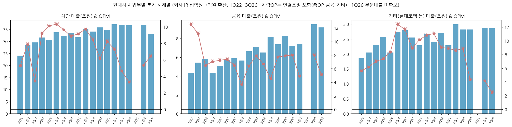

→ ⚠️ 표준(15년 60+분기) 대비 **19분기만 확보** — 2022.3Q 이전 IR PDF 미다운로드, DART 영업부문 주석은 부문간 제거 전 값이라 IR 기준과 직접 연결 불가 (v1.1 보강 후보)

| 분기 | 연결 매출 | 차량 매출 | 금융 매출 | 기타 매출 | 연결 OP | 차량 OP | 금융 OP | 기타 OP | OPM | 차량 OPM |
|---|---|---|---|---|---|---|---|---|---|---|
| 1Q24 | 406,590 | 317,180 | 66,560 | 22,850 | 35,570 | 29,000 | 4,250 | 2,320 | 8.7% | 9.1% |
| 2Q24 | 450,210 | 352,380 | 71,050 | 26,780 | 42,790 | 34,280 | 5,610 | 2,900 | 9.5% | 9.7% |
| 3Q24 | 429,280 | 340,190 | 64,970 | 24,120 | 35,810 | 28,790 | 4,350 | 2,670 | 8.3% | 8.5% |
| 4Q24 | 466,240 | 357,500 | 81,880 | 26,860 | 28,220 | 22,050 | 3,740 | 2,430 | 6.1% | 6.2% |
| 1Q25 | 444,080 | 347,180 | 73,980 | 22,920 | 36,340 | 28,590 | 5,710 | 2,040 | 8.2% | 8.2% |
| 2Q25 | 482,870 | 370,300 | 82,690 | 29,880 | 36,020 | 26,920 | 6,530 | 2,570 | 7.5% | 7.3% |
| 3Q25 | 467,210 | 367,150 | 71,890 | 28,170 | 25,370 | 17,110 | 5,760 | 2,500 | 5.4% | 4.7% |
| 4Q25 | 468,390 | 365,900 | 74,320 | 28,170 | 16,950 | 12,090 | 3,640 | 1,220 | 3.6% | 3.3% |
| 1Q26 | 459,389 | 약 35조 | — | — | 25,147 | 17,880 | 5,792 | 1,483 | 5.5% | — |
| 2Q26 | 492,150 | 368,320 | 95,040 | 28,790 | 28,510 | 19,710 | 7,590 | 1,210 | 5.8% | 5.4% |
| **3Q26 (IR)** | **451,102** | **330,580** | **91,900** | **28,620** | **26,772** | **21,350** | **4,710** | **710** | **5.9%** | **6.5%** |

→ 1Q26: 회사 IR 미확보 → OpenDART 분기 재무 + DART 1분기보고서 영업부문 주석(금융 5,792억·기타 1,483억, 부문간 조정 전) 사용. 차량 매출은 사업의 내용 서술 "약 35조원"
→ 3Q26 YoY: 차량 매출 -10.0%·OP +24.8%, 금융 매출 +27.8%·OP -18.2%, 기타 매출 +1.6%·OP -71.6% (회사 3Q26 IR p.11)

(1-2) 전사 12분기 시계열 (rolling)

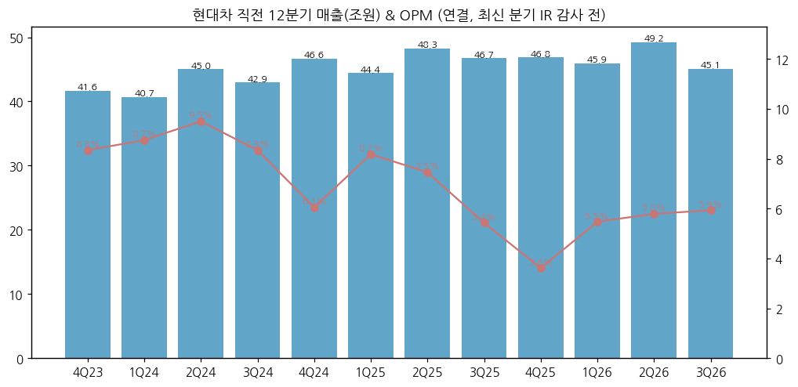

| 분기 | 매출 (억) | OP (억) | OPM | 매출 YoY | OP YoY | NI 연결 (억) |
|---|---|---|---|---|---|---|
| 4Q23 | 416,325 | 34,745 | 8.3% | +8.1% | +3.4% | — |
| 1Q24 | 406,585 | 35,574 | 8.7% | +7.6% | -1.0% | 33,760 |
| 2Q24 | 450,206 | 42,791 | 9.5% | +6.6% | +1.0% | 41,739 |
| 3Q24 | 429,283 | 35,809 | 8.3% | +4.7% | -6.3% | 32,058 |
| 4Q24 | 466,237 | 28,222 | 6.1% | +12.0% | -18.8% | 24,742 |
| 1Q25 | 444,078 | 36,336 | 8.2% | +9.2% | +2.1% | 33,822 |
| 2Q25 | 482,867 | 36,016 | 7.5% | +7.3% | -15.8% | 32,504 |
| 3Q25 | 467,214 | 25,373 | 5.4% | +8.8% | -29.1% | 25,482 |
| 4Q25 | 468,386 | 16,954 | 3.6% | +0.5% | -39.9% | 11,840 |
| 1Q26 | 459,389 | 25,147 | 5.5% | +3.4% | -30.8% | 25,849 |
| 2Q26 | 492,153 | 28,509 | 5.8% | +1.9% | -20.8% | 28,880 |
| **3Q26 (IR)** | **451,102** | **26,772** | **5.9%** | **-3.4%** | **+5.5%** | **19,317** |

→ 1Q16~2Q26 = OpenDART 분기 3개월 값(4Q = 연간 − 3Q 누적). 3Q26 = 회사 IR 2026-10-29(감사 전), DART 3분기보고서로 확정 필요

**3Q26 핵심 박스**
→ 매출 45.11조(-3.4%) — 도매 92.1만 대(-11.3%): 국내 파업 생산 차질(국내 도매 -27.2%)·추석 영업일수·중동 수요 감소·2Q 부품사 화재 (파이낸셜뉴스 2026-10-29)
→ 영업이익 2.68조(+5.5%), OPM 5.9% — 컨센서스 2.38조(연합인포맥스) 대비 **+12.4%** (SBS Biz 2026-10-29). 증감 분해: 환율 +1.28조, 물량 -1.11조, 믹스 -0.57조, 금융 -0.11조, 기타 +0.64조 (회사 IR p.12)
→ 순이익 1.93조(-24.2%) — 영업외 손익 7,890억 → 2,290억(지분법 -5,640억 포함, 회사 IR p.13)
→ 2026 가이던스 하향: 도매 400만 대, 연결 OPM 5.5~6.5%(종전 6.3~7.3%), 매출 성장 1~2% 유지, 자동차 투자 17.8조 → 16조 (딜사이트 2026-10-29)

(2) 사업부별 개요 (FY25)

| 사업부 | FY25 매출 | 비중 | FY25 OP | OPM | 주요 내용 |
|---|---|---|---|---|---|
| 차량 | 145.6조 | 78% | 8.5조(연결조정 포함) | 5.8% | 현대·제네시스 완성차, 글로벌 도매 약 410만 대 |
| 금융 | 30.2조 | 16% | 2.2조 | 7.2% | 현대캐피탈(미국 HCA 포함)·현대카드 |
| 기타 | 10.4조 | 6% | 0.8조 | 8.0% | 현대로템(방산·철도) 등 |

(3) 사업부별 디테일

**① 차량**
→ 판매(도매, 회사 3Q26 IR p.9): 3Q26 92.1만 대 = SUV 57.1만(62%)·PV 30.6만·CV 4.4만. xEV 24.6만(26.7%) = HEV 16.7만(18.2%)·EV 6.9만·PHEV 0.7만·FCEV 0.2만
→ 지역: 미국 소매 27.0만(+3.5%, M/S 6.6%), 유럽 소매 12.2만(-18.3%), 국내 13.1만(-27.2%), 인도 14.9만(+9.5%), 중국 1.5만
→ **이익 outlier**: 2Q23 차량 OPM 10.3%(정점), 4Q25 3.3%(관세 25% 전액 반영 분기)

**② 금융**
→ 3Q26 매출 9.19조(+27.8%)지만 OP 4,710억(-18.2%) — 대손·조달비용 부담 (회사 IR)

**③ 기타 (현대로템)**
→ 현대로템 3Q26 OP 2,471억(-11%) 등 반영 → 기타 OP 710억(-71.6%). 연결조정 영향 큼

**④ 로보틱스 (연결 외 — 지분법)**
→ 구조: 현대차 49.50% → HMG Global LLC → Boston Dynamics (현대모비스 20% 별도 출자, 정의선 회장 개인 지분 20% 이상 — 이투데이 2026-09-12)
→ BD 실적(보도): 매출 2021 668억 → 2025 1,501억, 순손실 2021 1,970억 → 2025 5,284억, 5년 누적 순손실 1조 7,558억 (이투데이 2026-09-12)
→ 양산 계획: 2028 미국 로봇 생산시설 연 3만 대·액추에이터 연 35만 개, 현대차·기아 공장 로봇 2만 5천 대 이상 투입, HMGMA 내 RMAC 2026 여름 개소 (헤럴드경제 2026-05-18). 아틀라스 2028년 HMGMA 투입(부품 서열 작업) → 2030 조립 작업 확대 (SBS Biz 2026-10-30, 모비스 실적 기사)
→ 증권사 추정 예시: IBK투자증권 — 2028 아틀라스 ASP 13.4만달러 × 1만 1,290대 = 매출 2조 1,940억, 2030 3만 대 4조 7,210억 (이투데이 2026-09-12 인용) `[추정]`

(4) 주요 경쟁사

→ 완성차: Toyota(HEV), GM·Ford(미국), VW·Stellantis(유럽), BYD 등 중국 EV.
→ 휴머노이드: Tesla Optimus, Figure AI, Agility Robotics, Unitree·UBTech(중국), 1X 등

(5) 주요 매출처
→ B2C 완성차 — 특정 고객 의존 없음. 매출처 집중은 지역(미국) 의존으로 대체

(6) 생산 CAPA + 임직원
→ 국내 울산·아산·전주 + 해외 미국(HMMA·HMGMA)·체코·튀르키예·인도·브라질·인니·싱가포르(HMGICS) 등 (DART 사업보고서 II). 임직원 72,598명(2025말 별도)

---

## ④ 재무 구조 (12년 시계열)

(1) 손익계산서·현금흐름 요약

| 연도 | 매출총이익 | GPM | 판관비 | 판관비율 | 영업CF | 투자CF | 재무CF | 유형취득 | 무형취득 | CapEx 계 | FCF | 배당지급 | 자사주취득 | 현금 | 유동비율 |
|---|---|---|---|---|---|---|---|---|---|---|---|---|---|---|---|
| 2014 | 191,300 | 21.4% | 115,801 | 13.0% | 21,208 | -61,950 | 47,070 | 33,538 | 13,721 | 47,259 | -26,050 | 5,869 | 1,450 | 70,965 | 184.8% |
| 2015 | 182,574 | 19.9% | 118,995 | 12.9% | 12,484 | -80,603 | 72,137 | 81,417 | 12,181 | 93,599 | -81,114 | 13,525 | 3,149 | 73,315 | 163.9% |
| 2016 | 176,893 | 18.9% | 124,958 | 13.3% | 9,970 | -63,118 | 56,914 | 29,712 | 14,064 | 43,775 | -33,805 | 10,845 | 2,616 | 78,901 | 166.1% |
| 2017 | 175,779 | 18.2% | 130,032 | 13.5% | 39,224 | -47,444 | 21,812 | 30,550 | 14,631 | 45,181 | -5,957 | 11,387 | — | 88,215 | 171.4% |
| 2018 | 151,421 | 15.6% | 127,200 | 13.1% | 37,643 | -24,151 | -8,808 | 32,265 | 16,327 | 48,592 | -10,949 | 11,275 | 4,547 | 91,136 | 147.7% |
| 2019 | 176,550 | 16.7% | 140,495 | 13.3% | 4,198 | -59,292 | 48,749 | 35,867 | 17,167 | 53,034 | -48,836 | 11,218 | 4,580 | 86,820 | 142.7% |
| 2020 | 184,817 | 17.8% | 160,870 | 15.5% | -4,098 | -93,376 | 113,525 | 46,878 | 17,016 | 63,894 | -67,993 | 8,938 | 3,031 | 98,621 | 140.7% |
| 2021 | 219,305 | 18.6% | 152,515 | 13.0% | -11,764 | -51,826 | 87,923 | 43,043 | 15,570 | 58,613 | -70,377 | 11,868 | 3,053 | 127,956 | 137.9% |
| 2022 | 283,181 | 19.9% | 184,983 | 13.0% | 106,273 | -12,035 | -13,245 | 40,150 | 17,187 | 57,337 | 48,936 | 13,550 | 1,935 | 208,649 | 129.8% |
| 2023 | 334,844 | 20.6% | 183,575 | 11.3% | -25,188 | -86,494 | 93,934 | 70,708 | 17,804 | 88,512 | -113,699 | 24,990 | — | 191,666 | 138.7% |
| 2024 | 357,492 | 20.4% | 215,096 | 12.3% | -56,616 | -146,235 | 194,933 | 80,613 | 23,061 | 103,675 | -160,291 | 39,133 | 2,322 | 190,149 | 145.6% |
| 2025 | 342,168 | 18.4% | 227,490 | 12.2% | -59,913 | -103,471 | 154,248 | 83,668 | 27,031 | 110,699 | -170,611 | 36,889 | 7,051 | 183,606 | 136.3% |

→ 단위 억원, OpenDART CFS. FCF = 영업CF − (유형+무형 취득). **연결 영업CF는 금융부문 채권 증가가 포함돼 차량부문 현금창출력과 다르다** — 2023~2025 연속 마이너스는 할부·리스 자산 확대 때문 (2025 영업활동 자산·부채 변동 -34.3조)
→ 2017·2023 자사주 취득 "—"는 OpenDART 계정 미추출(결측, 실제 0 아님 가능)


(2) 재무상태표

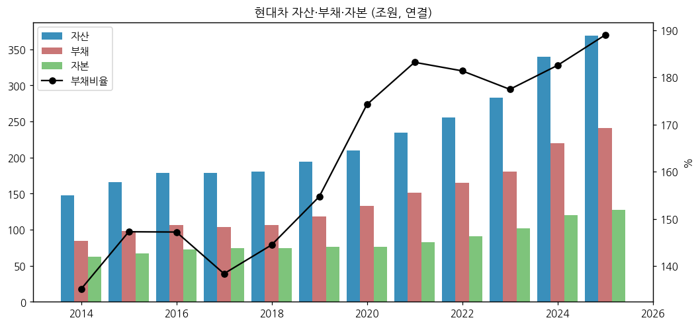

→ 2025말: 자산 368.8조 / 부채 241.2조 / 자본 127.6조(지배 115.4조) / 현금 18.4조 / 금융업채권 134.4조(유동 55.8 + 비유동 78.5) / 운용리스자산 53.9조 / 관계기업투자 37.9조
→ 3Q26말(IR p.18): 자산 365.4조 / 부채 236.6조 / 자본 128.8조 / 차입금 172.6조 / 부채비율 183.7%

(3) 현금흐름

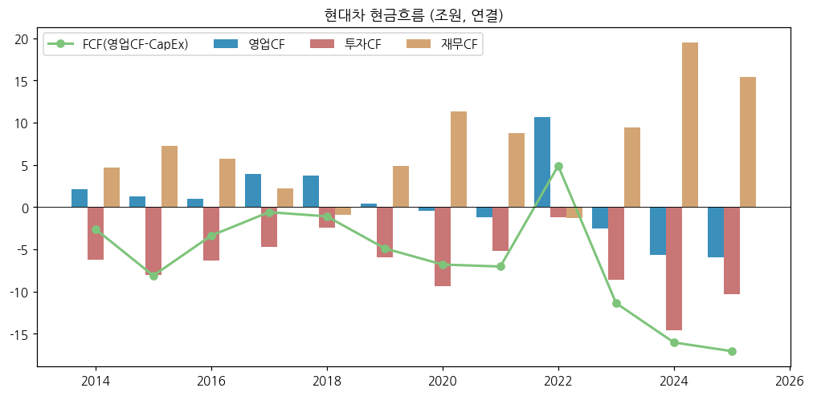

(4) CapEx

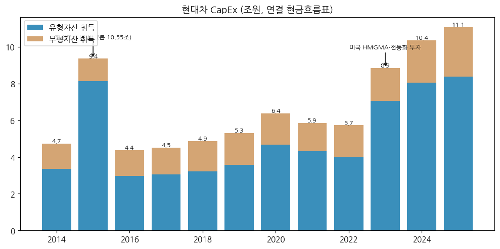

→ 2015 유형취득 8.1조 = 한전부지 매입 분(그룹 10.55조 중 현대차 몫) 포함. 2023~2025 연 8.9~11.1조 — HMGMA·전동화·인도 푸네 공장
→ 2026 자동차 투자 계획 17.8조 → 16조 하향 (회사 3Q26 컨콜, 딜사이트)

(5) 부채구조
→ 2025말 사채 106.9조, 장기차입금 24.3조, 단기차입금 10.4조, 유동성장기부채 33.8조 — 대부분 금융부문 조달

(6) 배당·자사주

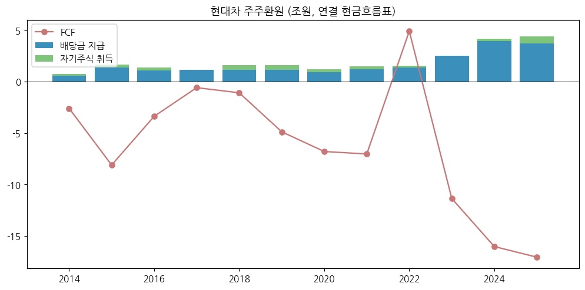

→ DPS: 2023 11,400원 → 2024 12,000원 → 2025 10,000원 (보통주, DART). 밸류업: 연 최소 DPS 10,000원 유지, 분기 배당 2,500원 (3Q26 컨콜) — 자사주 매입은 축소 가능성 언급 (아시아경제 2026-11-02)

(7) 재무비율 (연결)

| 연도 | ROE(지배, 기말) | 부채비율 | 유동비율 | OPM | NPM |
|---|---|---|---|---|---|
| 2021 | 6.6% | 183.2% | 137.9% | 5.7% | 4.8% |
| 2022 | 8.9% | 181.4% | 129.8% | 6.9% | 5.6% |
| 2023 | 12.9% | 177.4% | 138.7% | 9.3% | 7.5% |
| 2024 | 11.5% | 182.5% | 145.6% | 8.1% | 7.6% |
| 2025 | 8.2% | 189.0% | 136.3% | 6.2% | 5.6% |

---

## ⑤ 지배 구조

(1) 그룹·계열 관계

→ **현대자동차그룹** 순환출자 구조: 기아 → 현대모비스(18.10%) → 현대차(22.36%) → 기아(약 34%) (DART 2025 사업보고서 각 사)
→ 로봇 지배구조: 현대차 49.50%·현대모비스 20%·기아 → HMG Global LLC → Boston Dynamics. 정의선 회장 BD 개인 지분 20% 이상 (이투데이 2026-09-12)

(2) 주주 구분 (2025말, DART 2025 사업보고서 최대주주 현황)

| 주주 | 주식수 (보통주) | 지분율 |
|---|---|---|
| 현대모비스 (최대주주) | 45,782,023 | 22.36% |
| 정몽구 | 11,395,859 | 5.57% |
| 정의선 | 5,598,478 | 2.73% |
| 특수관계인 합계 | 62,796,038 | 30.67% |

→ 국민연금·외국인 지분율은 본 버전 미수집 (v1.1 보강 후보)

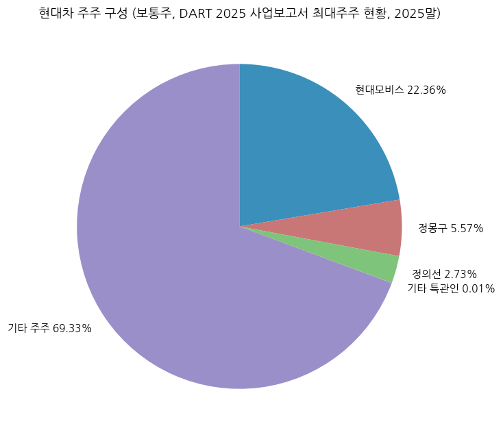

(3) 임원·이사회
→ 대표이사: **정의선** 회장(1970.10, 美 샌프란시스코대 MBA, 기아 사장·현대차 부회장 거쳐 그룹 회장), **호세 무뇨스** 사장(1965.06, 닛산 북미 출신, CEO), 최영일(OpenDART 기업개황 2026 기준 각자대표 — 상세 약력은 2026 반기보고서 확인 필요)
→ CFO 이승조 부사장(1969.11). 사외이사 7명(심달훈 선임사외이사·감사위원장, 도진명·김수이·벤자민 탄·이지윤·장승화·최윤희) — DART 2025 사업보고서 임원 현황

---

## ⑥ 기타 팩트

(1) R&D 인프라

| 연도 | 2023 | 2024 | 2025 |
|---|---|---|---|
| 연구개발비용 계 (억) | 39,736 | 45,894 | 55,354 |
| R&D/매출 | 2.4% | 2.6% | 3.0% |

→ 출처: DART 2025 사업보고서 II-6 (연결 기준, 정부보조금 차감 전). 2022 이전은 본 버전 미추출
→ 로보틱스 조직: 로보틱스랩, 로보틱스사업실, 로보틱스지능개발실, 로보틱스부품구매실 (DART 2026.1Q 미등기임원 담당 업무)

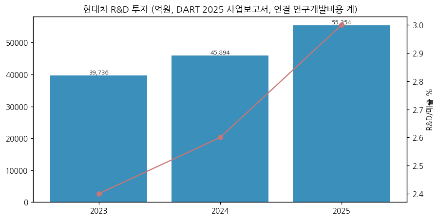

(2) 진행 중 corporate action (10년)

| 시기 | 내용 |
|---|---|
| 2021.06 | Boston Dynamics 인수(그룹 80%) |
| 2022.08 | HMG Global LLC 설립·BD 지분 현물출자 |
| 2023~2025 | Motional 추가 증자, 42dot 인수·RCPS 보통주 전환(2023.12) |
| 2024.10 | 인도법인 IPO |
| 2025.05 | Boston Dynamics AI Institute → Robotics and AI Institute 사명 변경 |
| 2026 | BD 추가 출자(HMG Global 경유), BD IPO는 "결정된 바 없음"(이투데이) → 3Q26 컨콜 "해외 자회사 IPO 계획 없음"(아시아경제) |

(3) R&D·로봇 마일스톤
→ 2021: BD 인수, Spot 상용 판매 지속 / 2024.04: 전기 구동 신형 아틀라스 공개 / 2026.01: CES 2026 AI 로보틱스 전략·아틀라스 공개 / 2026 여름: HMGMA RMAC 개소 계획 / 2028: HMGMA 아틀라스 투입·로봇 3만대 생산체계 목표

(4) 주요 리스크
→ 대미 관세(15%) 및 정책 변동, 환율(원화 강세 시 이익 감소 — 3Q26 환율 효과 +1.28조), 노사(2026 파업), EV 수요 둔화, 금융부문 대손, BD 손실 확대(지분법) 및 IPO 불확실성

(5) ESG 등급 / (6) 인증
→ 본 버전 미수집 (v1.1 보강 후보)

---

## Version Log

| 버전 | 일자 | 내용 |
|---|---|---|
| v1.0 | 2026-11-14 | 첫 작성 (로봇 섹터 편입). OpenDART CFS 43건(2015~2Q26) + DART 공시원문 44건 + IR PDF 20건 + Yahoo 월간. 표준 12종 차트 |

**자료 source audit (v1.0)**

| 자료 | 상태 | 비고 |
|---|---|---|
| OpenDART 재무제표 JSON | ✅ | CFS 43건, 2014은 비교표시 |
| DART 정기보고서 원문 | ✅ | 44건 다운로드, 본 버전은 2025 사업보고서·2026.1Q만 파싱 |
| 회사 IR PDF | △ | 2022.3Q~2026.3Q 20건, 2026.1Q·2Q 미게시 |
| 주가 | ✅ | Yahoo v8 월간 |
| 국민연금·외국인 지분 | ❌ | 미수집 |

**잔여 보완 후보 (v1.1)**
→ 사업부 분기 시계열 2016~2021 확장(DART 영업부문 주석 → IR 기준 연결조정 매핑), 연간 판매대수 12년, R&D 2014~2022, 지역별 매출, ESG
