> 종목: 휴젤 (145020.KQ / 휴젤(주) / Hugel, Inc.)
> 섹터: 소비재 대분류 > 섹터 **뷰티** > 서브섹터 **미용의료** (핵심 종목 — 파마리서치·클래시스·엘앤씨바이오와 동일 서브섹터)
> 작성 시각: 2026-11-15 KST (v1.0 — 최초 작성)
> 적용 구조: v4.8 (6개 섹션 + 12종 표준 차트 + chart2 보조 4종). 연간은 OpenDART 제공 범위(2015~2025, 11년) + 3Q26 누적, 분기는 1Q16~3Q26(43분기), 제품별 분기는 1Q20~3Q26(27분기)
> 데이터: 연결 연간 11년(2015~2025 OpenDART CFS) + 연결 분기 43개(1Q16~3Q26, 4Q = 연간 − 3Q 누적) + 제품별 매출(DART 정기보고서 누적치 차분) + 지역별 톡신·필러 매출(회사 IR 4Q24~3Q26) + 국내/수출(DART 매출실적 2014~3Q26) + Yahoo Finance 145020.KQ 월간 시계열(2015.12~2026.11)
> 출처: DART 정기보고서 44건 (corp_code 00888347) — 최신 정성자료 **2026.09 분기보고서(rcept_no 20261113000357, 2026-11-13 공시)** / OpenDART 연결재무 JSON 44건(2015 FY~2026 3Q) / OpenDART 기업개황·주주·임원·직원·배당·자기주식(2018·2020·2022·2024·2025 사업보고서) / 회사 IR: irgo 실적발표 PDF 20건(2Q22~3Q26, 최신 2026-11-04 3Q26 Earnings Release) / 언론: 데일리메디·SBS Biz·CEO스코어데일리(2026-09~11, 美 CSO 전환) / 시장데이터: Yahoo Finance(2026-11-13 종가)

# 휴젤 기업 개요 (v1.0 — 보툴리눔 톡신 글로벌 확장, 지속성장 + 美 직판 전환기)
> **Fact verify cutoff**: 2026-11-15 (재무는 2026.09 분기보고서까지 확정치. 주가·시가총액·52주 고저는 2026-11-13 Yahoo Finance 단일 소스. 美 CSO 계약 조건·2026 가이던스는 언론 보도 기준 — 회사 공시 원문 미확인)

---

## ① 기업 분류

(1) Primary / Secondary 분류

**Primary 분류: 지속성장 (글로벌 톡신 수출 확장형)**

→ 2015~2025 매출 CAGR **+20.6%** (651억 → 4,251억), 2017~2025 8년 CAGR +11.2%. 11년 동안 매출 역성장 연도 없음 (2018년 +0.2%가 최저)
→ 11년 평균 OPM **40.2%**, 최저 연도도 27.3%(2015) — 적자 연도 없음. GPM 70~78% 밴드 유지 (자체 균주·자체 원료 생산, 원재료 비중 미미)
→ 성장 엔진이 "국내 1위 톡신 → 중국(2020)·유럽(2022)·미국(2024) 허가 → 수출 비중 63%(2025)"로 단계적으로 바뀌어 왔다

**Secondary 노트: 사이클 성격 일부 (규제·유통 이벤트형 단절)**

→ 이익 변동은 경기보다 **규제·유통 구조 이벤트**가 만든다: ① 2018 중국 따이공(보따리상) 단속 → OPM 56% → 33%, ② 2021.11 식약처 품목허가 취소 처분(국가출하승인 관련, 소송으로 집행정지), ③ **2026 美 유통 구조 CSO 전환 → 3Q26 OPM 18.6%** (전년 44.8%)
→ 3Q26은 미국 기존 유통사 재고 재매입으로 북남미 톡신·필러 매출이 **-0.1십억원**(음수) — 일회성 성격이나 2027 직판 완성까지 판관비 부담 지속 `[판단]`

**Entity 구조 (2026.09)**

→ **(1) 휴젤(주)** — 강원 춘천 거두단지 본사·공장. 보툴리눔 톡신 '보툴렉스'(수출명 Letybo/레티보) 연구개발·생산, 국내 영업·마케팅, 화장품(웰라쥬)
→ **(2) ㈜아크로스 (91.12%)** — HA 필러 '더채움'(수출명 Persnica 등)·스킨부스터 '바이리즌' 제조. 3Q26 누적 매출 744억, 순이익 459억 — 고수익 자회사
→ **(3) Hugel America (100%)** — 美 레티보 판매 법인 (자회사 Hugel Canada·Hugel Australia·Hugel New Zealand). 3Q26 누적 매출 257억, **순손실 -250억**
→ **(4) ㈜제이월드 (100%)** — 리프팅 실 '블루로즈' 제조 / 대만·중국·홍콩·태국·싱가포르 판매 법인
→ 영업부문은 단일 — 사업부별 영업이익 미공개. 제품별(톡신·필러&스킨부스터·화장품·실·기타) + 지역별(톡신+필러 합산: 국내·APAC·북남미·유럽) 매출만 공시

(2) Summary Box (연결 11년 2015~2025 + 3Q26 누적)

| 지표 | 11년 평균 (2015~2025) | 정점 | 저점 | 2025년 | 3Q26 누적 |
|---|---|---|---|---|---|
| 매출 (억원) | 2,358 | **4,251 (2025)** | 651 (2015) | **4,251 (+14.0%)** | 3,521 (+15.1% YoY) |
| 영업이익 (억원) | 975 | **2,009 (2025)** | 178 (2015) | 2,009 | 1,217 (-14.9% YoY) |
| OPM | 40.2% | **56.0% (2017)** | 27.3% (2015) / 33.0% (2018) | 47.2% | 34.6% (3Q26 단독 18.6%) |
| GPM | 73.6% | 78.4% (2025) | 59.2% (2015) | 78.4% | 76.4% |
| 순이익(지배, 억원) | 720 | 1,409 (2025) | 339 (2015) | 1,409 | 860 (-15.9%) |

→ 매출 CAGR(2015→2025) **+20.6%**, (2017→2025) +11.2% — 2017 중국 수출 급증 이후 2018~2020 정체(3년 CAGR +5%), 2021~2025 재가속(CAGR +15%)
→ OPM 사이클: 56%(2017 정점) → 33%(2018~2019 저점, 2년) → 47%(2025) — **정점→저점→회복 1회, 약 8년 주기**. 2026 美 직판 전환이 2번째 저점 형성 중 `[판단]`
→ 2015 NPM 52%는 ㈜아크로스 지분 추가 취득(관계기업 → 종속 편입)에 따른 관계기업투자처분이익 506억(일회성, 기타비용 318억과 일부 상쇄) 포함 (DART 2015 사업보고서 주석 28)

(3) 정량 근거 — 연간 매출·OPM

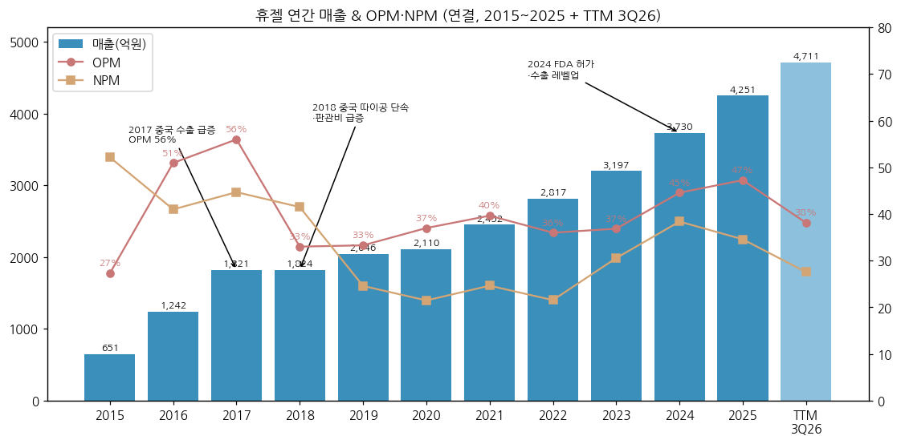

| 연도 | 매출 (억) | YoY | OP (억) | OPM | 사이클 annotation |
|---|---|---|---|---|---|
| 2015 | 651 | +61% | 178 | 27.3% | ← 2015.12 코스닥 상장 (공모가 15만원) |
| 2016 | 1,242 | +91% | 633 | 50.9% | ← 수출 528억 (전년 2.7배), 거두 제2공장 |
| 2017 | 1,821 | +47% | 1,019 | **56.0%** | ← **1차 정점**: 수출 비중 64% (중국 비공식 유통 포함), 베인캐피탈(Leguh) 유증 |
| 2018 | 1,824 | +0% | 602 | 33.0% | ← **급락**: 중국 따이공 단속 → 수출 -34%, 판관비 1.8배 (휴젤파마 합병) |
| 2019 | 2,046 | +12% | 681 | 33.3% | ← 저점 유지, R&D 313억 (FDA·NMPA 허가 비용) |
| 2020 | 2,110 | +3% | 781 | 37.0% | ← 코로나, 2020.10 중국 NMPA 허가 (레티보) |
| 2021 | 2,452 | +16% | 972 | 39.6% | ← 중국 정식 수출 개시, 11월 식약처 처분 |
| 2022 | 2,817 | +15% | 1,014 | 36.0% | ← GS 컨소 인수(4월), 유럽 허가·출시 |
| 2023 | 3,197 | +14% | 1,178 | 36.8% | ← 필러 +25%, 수출 비중 55% |
| 2024 | 3,730 | +17% | 1,662 | 44.6% | ← 2024.02 **美 FDA 허가**, ITC 승소(10월) |
| 2025 | 4,251 | +14% | 2,009 | **47.2%** | ← 북남미 +105%, 화장품 +53%, 수출 비중 65% |
| 3Q26 누적 | 3,521 | +15% | 1,217 | 34.6% | ← **美 CSO 전환** — 3Q26 단독 OPM 18.6% |

(4) 산업 분류

| 구분 | 분류 |
|---|---|
| DART 업종 | 211 — 기초 의약물질 및 생물학적 제제 제조업 |
| KRX | 코스닥 (2015.12.24 상장, 공모가 150,000원) |
| 워치리스트 | 소비재 대분류 > **뷰티** 섹터 > **미용의료** 서브섹터 **핵심 종목** (동 서브섹터: 파마리서치·클래시스·엘앤씨바이오) |
| 최대주주 | Aphrodite Acquisition Holdings LLC 44.48% (GS·IMM 'Dione' + CBC Group 공동 최대출자) |
| 글로벌 피어 | AbbVie(Allergan Aesthetics, Botox) / Galderma(Dysport·Restylane) / Merz(Xeomin) / Evolus(Jeuveau = 대웅 나보타) / 메디톡스 / 대웅제약 |

(5) 분류 결정 논리 (4단계)

→ **(1) 매출 큰 사업부 기준**: 톡신 매출 비중 54~55%(2025~3Q26), 필러&스킨부스터 27~31%. 두 제품 모두 반복 시술(톡신 3~6개월, 필러 약 12개월) 소모품 — 경기보다 미용 시술 인구·침투율에 연동 → 지속성장 성격
→ **(2) Secular 변수 sub-rule**: 글로벌 톡신 시장 2023년 51억 달러, 연 8%+ 성장(DART 인용). 휴젤의 성장은 시장 성장 + **허가국가 확대(해외 27개국)** 의 합. 미국(세계 최대 미용 톡신 시장) 진입이 다음 5년 성장의 핵심 변수
→ **(3) Boundary case 처리**: 2018·2026처럼 유통·규제 이벤트로 이익이 꺾이는 구간이 반복 → Primary 지속성장 + Secondary "이벤트형 사이클"로 처리. 반도체식 수급 사이클과는 다르다
→ **(4) 글로벌 피어 cross-reference**: Evolus(나보타 美 판매)는 매출 고성장·적자, AbbVie Aesthetics는 저성장·고마진. 휴젤은 OPM 40%대 + 매출 두 자릿수 성장으로 둘 사이 — **미국 직판 성공 시 Evolus형 고성장 구간 진입, 실패 시 국내·APAC 중심 저성장 고마진** `[판단]`

(6) 적정 밸류에이션 방법 (밸류에이션 다이얼)

| 우선순위 | 방법 | 현재 값 (2026-11-13) | 비고 |
|---|---|---|---|
| 1 | PER (TTM 지배순이익) | 시총 2.35조 / 1,246억 = **약 18.9배** | TTM = 4Q25 386 + 1Q26 393 + 2Q26 433 + 3Q26 34 (억원, 지배) — 3Q26 일회성으로 TTM 왜곡 |
| 2 | EV/EBIT (TTM) | (2.35조 − 순현금 약 5,900억) / 1,795억 = **약 9.8배** | 순현금 = 현금 2,349 + 단기금융상품 3,520 + 기타금융자산 (차입금 0, CB 2026.07 전환 완료) |
| 3 | PBR | 2.35조 / 지배자본 10,727억 = **약 2.2배** | 자본 대비 현금 비중이 높아 PBR 하방 지지 |

→ 사업 mix(톡신 고마진 + 반복 매출)상 **PER 1순위**. 美 직판 전환기에는 판관비 선반영으로 PER이 왜곡되므로 2027E 이익 기준 PER 또는 EV/EBIT 병행 `[판단]`
→ 삼성전자 비교: 삼성전자(사이클)는 PBR 1순위, 휴젤(지속성장·순현금)은 PER 1순위 — 분류 차이가 방법 차이를 만든다

(7) 분기 재평가 트리거 (분류 변경 조건)

→ (1) **美 매출 비중 20% 이상 + 북남미 지역 OPM 흑자화** (Hugel America 분기 흑자) → Secondary 이벤트형 사이클 해소, "글로벌 고성장"으로 격상 검토
→ (2) 반대로 **2027년까지 북남미 매출이 2025년(679억) 수준 회복 실패** → 미국 옵션가치 제거, "국내·APAC 지속성장(저성장 고마진)"으로 하향
→ (3) 중국 톡신 수출(APAC 내) 2분기 연속 역성장 → 지속성장 근거 약화
→ (4) 최대주주(Aphrodite) 지분 매각·상장폐지/재상장(홍콩 등) 결정 — 지배구조 이벤트가 밸류 방법 자체를 바꿀 수 있음

---

## ② 회사 개요

(1) 기본 사항

| 항목 | 내용 |
|---|---|
| 회사명 (한글) | 휴젤(주) |
| 회사명 (영문) | Hugel, Inc. |
| 종목코드 | 145020 (코스닥, 2015.12.24 상장, 공모가 150,000원) |
| 설립 | 2001.11.22 |
| 본사·공장 | 강원특별자치도 춘천시 동내면 거두단지1길 23 (서울 사무소 별도) |
| 홈페이지 | www.hugel.co.kr / IR 문의 ir@hugel.co.kr |
| 사업 한 줄 정의 | A형 보툴리눔 톡신(보툴렉스/레티보)과 HA 필러·스킨부스터를 자체 생산해 국내 1위·해외 27개국에 판매하는 메디컬 에스테틱 기업 |
| 대표집행임원 | **장두현** (1976.07생, 2025.09~, CJ그룹 경영전략실 → 보령 대표이사(2019~2025)) — 집행임원제, 이사회 의장과 분리 |
| 글로벌 CEO | **캐리 스트롬(Julia Carroll Strom)** — 기타비상무이사(2026.03 선임), 前 Allergan Aesthetics (보톡스 마케팅·Plastic Surgery VP 등) |
| 이사회 의장 | 조기철·경한수 공동의장 (CBC Group, 2026.04~) |
| 발행주식수 | 보통주 **12,215,173주** (2026.11.11 자사주 30만주 소각 등기 후) / 자기주식 1,185,098주(9.7%) |
| 최대주주 | **Aphrodite Acquisition Holdings LLC 44.48%** (5,566,791주, 2026.09 — 2026.07 CB 전환 211,140주 반영) |
| 임직원 | 667명 (2026.09, 남 344·여 323, 평균근속 4.1년) |
| 시가총액 | **약 2.35조원** (192,300원 × 12.22M주, 2026-11-13 Yahoo Finance) |
| 52주 고가 / 저가 | 308,500원 (2025.12) / 163,700원 (2026.09) — Yahoo Finance 월간 고저. 상장 후 최고 392,000원(2025.07) |
| 배당 | **상장 이후 현금배당 없음** — 자사주 매입·소각으로 환원 |

(2) 연간 손익·자본 추이 (연결)

| 연도 | 매출 (억) | OP (억) | OPM | NI (억) | 자본총계 (억) | 자산총계 (억) |
|---|---|---|---|---|---|---|
| 2015 | 651 | 178 | 27.3% | 339(지배) | 2,152 | 2,336 |
| 2016 | 1,242 | 633 | 50.9% | 509 | 2,739 | 2,943 |
| 2017 | 1,821 | 1,019 | 56.0% | 814 | 7,179 | 8,209 |
| 2018 | 1,824 | 602 | 33.0% | 757 | 7,848 | 9,183 |
| 2019 | 2,046 | 681 | 33.3% | 503 | 7,443 | 8,947 |
| 2020 | 2,110 | 781 | 37.0% | 453 | 7,941 | 9,563 |
| 2021 | 2,452 | 972 | 39.6% | 604 | 8,292 | 10,097 |
| 2022 | 2,817 | 1,014 | 36.0% | 607 | 8,495 | 10,498 |
| 2023 | 3,197 | 1,178 | 36.8% | 977 | 7,797 | 9,293 |
| 2024 | 3,730 | 1,662 | 44.6% | 1,431 | 8,408 | 9,394 |
| **2025** | **4,251** | **2,009** | **47.2%** | **1,470** | **9,802** | **10,768** |
| 3Q26 누적 | 3,521 | 1,217 | 34.6% | 901 | 11,066 | 12,120 |

→ 출처: OpenDART CFS 각 연도 사업보고서 / 2026.09 분기보고서. 2015는 순이익(지배) 기준
→ **시계열 단절**: ① 2017.07 Leguh Issuer(베인캐피탈 SPC) 제3자배정 유증 985,217주 × 36만원 = 약 3,547억 + CB → 자본 2,739억 → 7,179억, ② 2018.01 휴젤파마 흡수합병, ③ 2019.07 최대주주 ㈜동양에이치씨 역합병(자기주식 80만주 소각), ④ 2020.07 무상증자 1:2, ⑤ 2021 매출에는 Microvention 뇌질환 의료기기 유통 포함 — 2022.09 계약 종료로 중단영업 재분류(2021 재작성 매출 2,319억), ⑥ 2023~2025 자사주 대량 매입(1,224억·1,725억)·소각으로 자본 감소

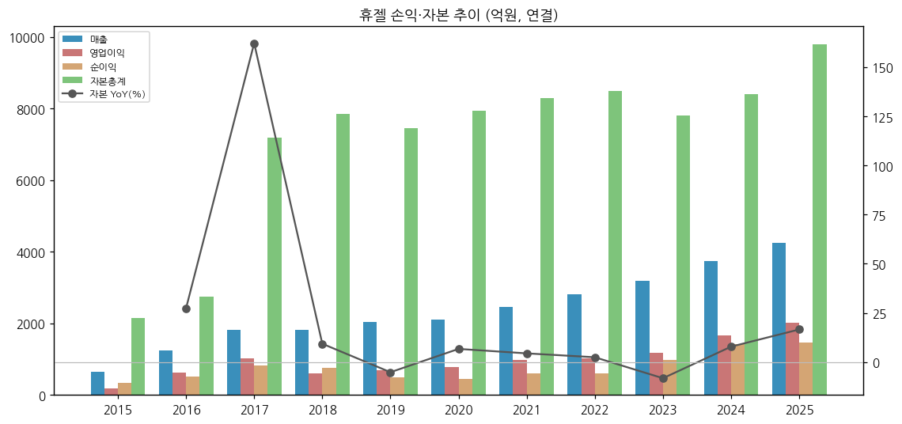

(3) 주가·시가총액 역사

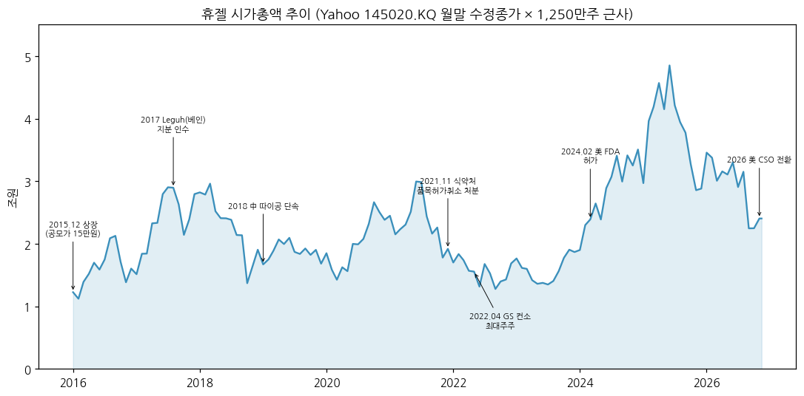

→ (출처: Yahoo Finance 145020.KQ 월말 수정종가 × 1,250만주 — 2020.07 무상증자 이전 구간은 수정주가 기준이라 실제 시총과 근사, 자사주 소각·CB 전환에 따른 주식수 변동은 미반영한 근사치)

| 구간 | 시총(근사) | Narrative |
|---|---|---|
| 2015.12~2017.08 | 1.2조 → 2.9조 | 상장 직후 수출 급증(중국), 2017.07 베인캐피탈 지분 인수 |
| 2018 | 2.9조 → 1.4조 | 중국 따이공 단속 → 2018 OPM 33%로 급락, 미국 진출 지연 |
| 2019~2021.06 | 1.4조 → 3.0조 | 중국 NMPA 허가(2020.10), 무상증자, GS 컨소 인수 기대 |
| 2021.06~2023.10 | 3.0조 → 1.3조 | 식약처 품목허가 취소 처분(2021.11), 메디톡스 ITC 소송(2022.03 제소), 美 FDA 허가 지연 |
| 2023.11~2025.07 | 1.3조 → 4.9조 | **2024.02 FDA 허가 + ITC 승소(2024.10) + 이익 레벨업(OPM 45~47%)** — 상장 후 최고가 39.2만원 |
| 2025.08~2026.11 | 4.9조 → 2.35조 | 美 판매 부진 우려 → 2026 CSO 전환 발표·3Q26 이익 급감 |

(4) 주요 연혁

| 일자 | 내용 |
|---|---|
| 2001.11 | 설립 (바이오벤처) |
| 2010.03 | '보툴렉스' 국내 품목허가 (눈꺼풀경련) — 국산 2번째 톡신 |
| 2014 | 중국 파트너(사환제약 계열로 알려짐 — DART는 "중국 심뇌혈관 의약품 1위 제약회사") 톡신·필러 독점공급계약 |
| 2015.12 | 코스닥 상장 |
| 2016 | 거두 제2공장 준공 (cGMP·EU GMP 기준) |
| 2017.07 | Leguh Issuer(베인캐피탈) 제3자배정 유증 → 최대주주 |
| 2018.01 | 판매법인 휴젤파마 흡수합병 / 2018.08 Hugel America 설립 |
| 2019.07 | ㈜동양에이치씨(최대주주) 역합병 |
| 2020.10 | **중국 NMPA 레티보 100U 허가** (2021.02 50U 추가) |
| 2021.11~12 | 식약처 보툴렉스 회수·폐기 및 품목허가 취소 처분 → 행정소송·집행정지로 판매 지속 |
| 2022.01 | **유럽 HMA 50U 허가** 권고 → 2022 하반기 유럽 출시 / 바이리즌 스킨부스터 출시 |
| 2022.04~05 | **Aphrodite Acquisition Holdings(GS·IMM·CBC·Mubadala 컨소) 최대주주 변경** (약 1.72조 거래) |
| 2022.06·11 | 캐나다·호주 허가 |
| 2022.07 | 거두 B공장(톡신 CAPA 확장) 준공 |
| 2024.02 | **美 FDA 레티보 50U·100U 허가** (미간주름) |
| 2024.10 | 메디톡스 ITC 영업비밀 소송 Final Determination — 휴젤 승소 (메디톡스 CAFC 항소 진행 중) |
| 2025.01 | UAE 허가 |
| 2025.09 | 장두현 대표집행임원 취임 |
| 2026.03 | 캐리 스트롬 기타비상무이사 선임 (글로벌 CEO) |
| 2026.04 | 한스바이오메드 '셀르디엠'(hADM 스킨부스터) 국내 판권 |
| 2026.07 | '더채움 시그니처' 출시 / 최대주주 CB 211,140주 전환 |
| 2026.09 | 이사회에 Hugel America CSO 계약 체결 보고 — 美 유통 구조 CSO 체제 전환 |
| 2026.11 | 자기주식 30만주 소각 (11.11 등기) |

---

## ③ 비즈니스 모델

(1) 실적 추이 통합 표 (연결, 억원 — 제품별 / 지역별 / 국내·수출 3단계)

**[1단계] 제품별 매출 (DART 주요 제품 매출 현황)**

| 제품 | 2021 | 2022 | 2023 | 2024 | 2025 | 3Q26 누적 | 3Q26 YoY(누적) | 비중(3Q26) |
|---|---|---|---|---|---|---|---|---|
| 톡신 (보툴렉스/레티보) | 1,246 | 1,608 | 1,685 | 2,016 | **2,305** | 1,932 | +18.7% | 54.9% |
| 필러&스킨부스터 (더채움·바이리즌) | 878 | 942 | 1,184 | 1,278 | 1,302 | 967 | +0.6% | 27.5% |
| 화장품 (웰라쥬) | 145 | 209 | 268 | 369 | **563** | 548 | +34.0% | 15.6% |
| 의료기기·실 (블루로즈 등) | 169 | 36 | 43 | 52 | 54 | 38 | — | 1.1% |
| 기타 (용역 등) | 14 | 23 | 17 | 16 | 27 | 35 | — | 1.0% |
| **합계** | **2,452** | **2,817** (+중단 103) | **3,197** | **3,730** | **4,251** | **3,521** | +15.1% | 100% |

→ 2021 의료기기 169억은 Microvention 유통 포함(2022.09 종료 → 중단영업). 2026부터 필러에 스킨부스터 포함 명칭 'Filler & Skinbooster', 의료기기는 'Thread'로 변경
→ 회사 IR 기준 2025: 톡신 2,338억(+15.0%) / 필러&스킨부스터 1,297억(+1.7%) / 화장품&기타 616억(+45.9%) — IR은 실·기타를 화장품에 합산

**[2단계] 지역별 톡신+필러 매출 (회사 IR, 십억원)**

| 지역 | 2024 | 2025 | YoY | 3Q25 누적 | 3Q26 누적 | YoY | 3Q26 단독 | 3Q26 YoY |
|---|---|---|---|---|---|---|---|---|
| 국내 | 111.0 | 94.9 | -14.5% | 70.0 | **80.9** | +15.6% | 27.4 | **+54%** |
| 아시아태평양 (중국·태국·호주 등) | 128.6 | 141.1 | +9.7% | 108.1 | **123.0** | +13.8% | 33.1 | -8% |
| 북남미 (미국·브라질·캐나다 등) | 33.1 | 67.9 | **+105%** | 38.7 | 34.8 | -10.1% | **-0.1** | N/M |
| 유럽 및 기타 | 58.0 | 59.5 | +2.6% | 44.2 | **55.1** | +24.7% | 17.8 | +18% |
| **합계** | **330.8** | **363.5** | +9.9% | **260.9** | **293.7** | +12.6% | **78.1** | -14% |

→ 2024 지역값은 2025 IR의 YoY로 역산 (국내 94.9/0.855 등) — 회사 원표 아님
→ 3Q26 북남미 -0.1십억원: **美 기존 유통사(Benev) 재고 재매입으로 매출 차감** (회사 IR 주석 "US operational shift")

**[3단계] 국내/수출 (DART 매출실적, 제품+상품, 억원)**

| 연도 | 2014 | 2016 | 2017 | 2018 | 2019 | 2020 | 2021* | 2022 | 2023 | 2024 | 2025 | 3Q26 누적 |
|---|---|---|---|---|---|---|---|---|---|---|---|---|
| 국내 | 281 | 566 | 656 | 1,042 | 1,230 | 1,215 | 1,135 | 1,313 | 1,427 | 1,476 | 1,489 | 1,322 |
| 수출 | 122 | 676 | 1,165 | 782 | 816 | 895 | 1,184 | 1,504 | 1,770 | 2,254 | **2,762** | 2,198 |
| 수출 비중 | 30% | 54% | **64%** | 43% | 40% | 42% | 51% | 53% | 55% | 60% | **65%** | 62% |

→ *2021은 중단영업(Microvention) 제외 재작성치. 2017 수출 급증 → 2018 급감이 중국 비공식 유통 단속의 흔적

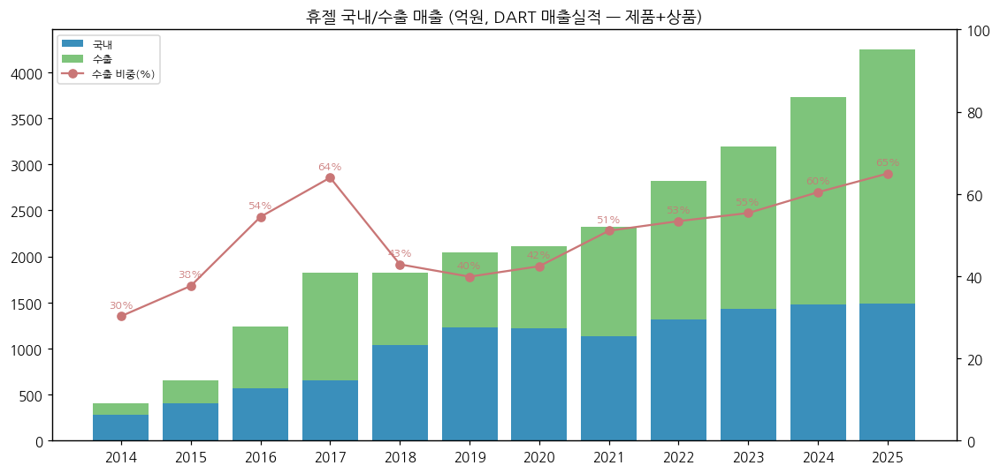

(1-b) 제품별 분기 시계열 (1Q20~3Q26, 27분기)

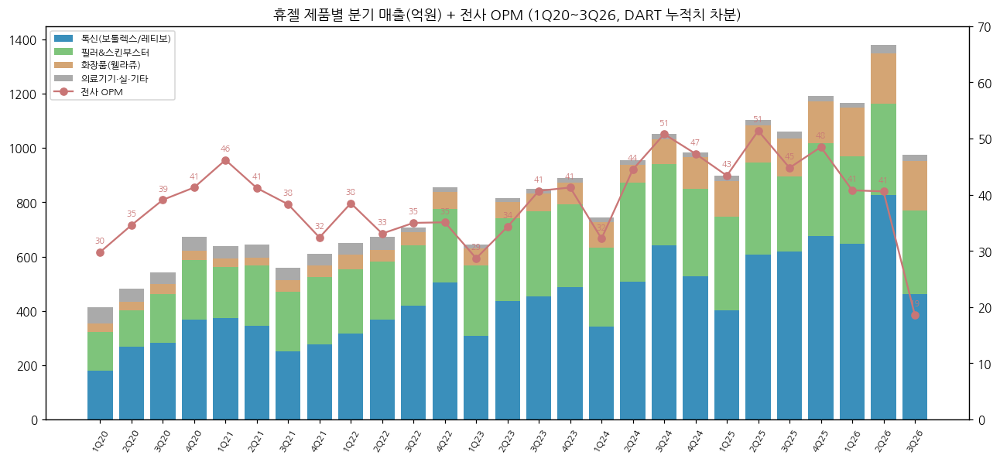

→ DART 정기보고서 '주요 제품 등의 매출 현황'(누적) 차분으로 분기 산출. 기타 = 연결 매출 − 톡신 − 필러 − 화장품 (의료기기·실·용역)
→ 사업부별 영업이익은 미공시 → OPM은 전사 기준

| 분기 | 톡신 | 필러&SB | 화장품 | 기타 | 합계 | OPM |
|---|---|---|---|---|---|---|
| 1Q24 | 341 | 293 | 95 | 15 | 743 | 32.2% |
| 2Q24 | 506 | 365 | 66 | 16 | 954 | 44.5% |
| 3Q24 | 641 | 299 | 90 | 21 | 1,051 | 50.8% |
| 4Q24 | 528 | 321 | 117 | 15 | 982 | 47.3% |
| 1Q25 | 403 | 344 | 132 | 19 | 898 | 43.4% |
| 2Q25 | 607 | 341 | 136 | 20 | 1,103 | 51.4% |
| 3Q25 | 618 | 276 | 141 | 23 | 1,059 | 44.8% |
| 4Q25 | 677 | 341 | 154 | 19 | 1,191 | 48.5% |
| 1Q26 | 646 | 322 | 179 | 19 | 1,166 | 40.8% |
| 2Q26 | **825** | 337 | 186 | 30 | **1,379** | 40.6% |
| 3Q26 | 461 | 308 | 183 | 23 | 975 | **18.6%** |

→ 회사 IR 분기값과 소폭 차이(예: 3Q25 필러 IR 302억 vs DART 차분 276억) — IR 사후 재분류 추정, 본 표는 DART 기준

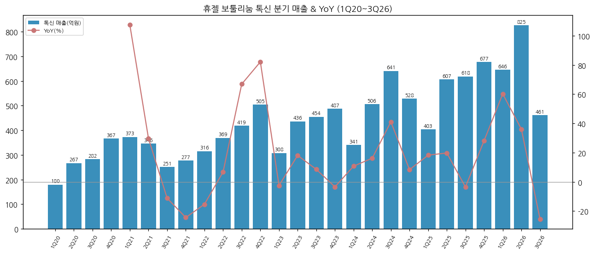

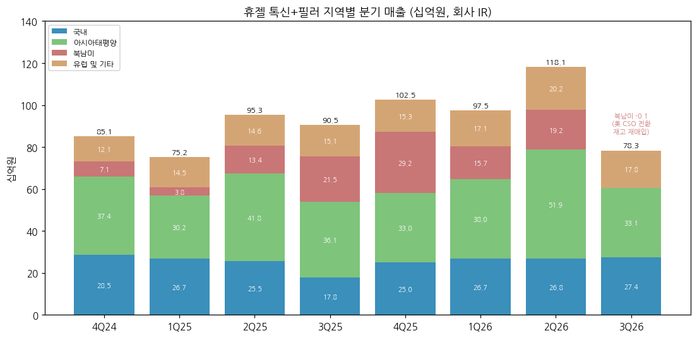

(1-c) 전사 분기 시계열 — 최근 12분기 및 전체 43분기

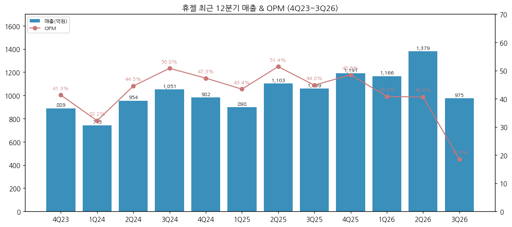

| 분기 | 매출 | OP | OPM | 매출 YoY | OP YoY | 순이익 |
|---|---|---|---|---|---|---|
| 1Q16 | 227 | 88 | 38.8% | | | 68 |
| 2Q16 | 309 | 164 | 52.9% | | | 140 |
| 3Q16 | 328 | 179 | 54.7% | | | 143 |
| 4Q16 | 378 | 202 | 53.4% | | | 158 |
| 1Q17 | 443 | 258 | 58.4% | +95.3% | +194.0% | 209 |
| 2Q17 | 462 | 273 | 59.2% | +49.2% | +67.0% | 205 |
| 3Q17 | 416 | 237 | 57.1% | +26.7% | +32.3% | 193 |
| 4Q17 | 501 | 251 | 50.0% | +32.6% | +24.1% | 207 |
| 1Q18 | 458 | 223 | 48.7% | +3.5% | -13.7% | 213 |
| 2Q18 | 429 | 167 | 39.0% | -7.1% | -38.8% | 160 |
| 3Q18 | 349 | 51 | 14.7% | -16.0% | -78.4% | 239 |
| 4Q18 | 588 | 160 | 27.3% | +17.4% | -36.0% | 145 |
| 1Q19 | 491 | 164 | 33.4% | +7.3% | -26.3% | 141 |
| 2Q19 | 503 | 160 | 31.8% | +17.3% | -4.5% | 128 |
| 3Q19 | 511 | 182 | 35.6% | +46.4% | +254.9% | 121 |
| 4Q19 | 540 | 175 | 32.3% | -8.1% | +8.9% | 113 |
| 1Q20 | 413 | 123 | 29.8% | -16.0% | -25.1% | 67 |
| 2Q20 | 483 | 167 | 34.6% | -4.0% | +4.6% | 151 |
| 3Q20 | 541 | 212 | 39.1% | +5.7% | +16.2% | 107 |
| 4Q20 | 674 | 279 | 41.3% | +24.8% | +59.6% | 128 |
| 1Q21 | 638 | 295 | 46.2% | +54.7% | +139.3% | 194 |
| 2Q21 | 645 | 266 | 41.2% | +33.7% | +59.1% | 154 |
| 3Q21 | 558 | 214 | 38.3% | +3.2% | +0.9% | 211 |
| 4Q21 | 610 | 198 | 32.4% | -9.5% | -29.1% | 44 |
| 1Q22 | 649 | 250 | 38.5% | +1.7% | -15.2% | 159 |
| 2Q22 | 674 | 223 | 33.1% | +4.5% | -16.1% | 154 |
| 3Q22 | 707 | 248 | 35.0% | +26.7% | +16.0% | 263 |
| 4Q22 | 855 | 300 | 35.1% | +40.1% | +52.1% | 31 |
| 1Q23 | 644 | 185 | 28.7% | -0.8% | -26.0% | 170 |
| 2Q23 | 816 | 280 | 34.3% | +21.0% | +25.4% | 214 |
| 3Q23 | 848 | 346 | 40.7% | +20.0% | +39.5% | 416 |
| 4Q23 | 889 | 367 | 41.3% | +4.0% | +22.3% | 177 |
| 1Q24 | 743 | 240 | 32.2% | +15.4% | +29.5% | 227 |
| 2Q24 | 954 | 424 | 44.5% | +17.0% | +51.6% | 370 |
| 3Q24 | 1,051 | 534 | 50.8% | +23.9% | +54.5% | 420 |
| 4Q24 | 982 | 465 | 47.3% | +10.4% | +26.4% | 414 |
| 1Q25 | 898 | 390 | 43.4% | +20.9% | +62.6% | 309 |
| 2Q25 | 1,103 | 567 | 51.4% | +15.5% | +33.6% | 382 |
| 3Q25 | 1,059 | 474 | 44.8% | +0.8% | -11.2% | 380 |
| 4Q25 | 1,191 | 578 | 48.5% | +21.3% | +24.5% | 398 |
| 1Q26 | 1,166 | 476 | 40.8% | +29.9% | +22.3% | 406 |
| 2Q26 | 1,379 | 560 | 40.6% | +25.1% | -1.1% | 447 |
| **3Q26** | **975** | **181** | **18.6%** | **-7.9%** | **-61.8%** | **47** |

→ 출처: dart_quarterly_summary (OpenDART CFS, 4Q = 연간 − 3Q 누적). 2021~2022 분기는 원공시 기준(중단영업 재분류 전후 혼재) — 2021·2022 일부 분기 합계와 재작성 연간치가 다를 수 있음
→ 계절성: 1Q 비수기(국내 시술 성수기 = 방학·연말), 2Q·4Q 성수기. 해외 파트너 선적 타이밍에 따라 분기 톡신 변동 큼

(2) 사업부별 개요 (매출 비중 큰 순서, 3Q26 누적)

| 부문 | 주요 브랜드 | 비중 | 제조 | 판매 |
|---|---|---|---|---|
| 톡신 | 보툴렉스(국내) / Letybo(해외) — 50·100·150·200·300U | 54.9% | 휴젤 거두 1·2·B공장 (자체 균주·원액) | 국내 직판(병의원), 해외 국가별 파트너·현지법인, 美 Hugel America(CSO) |
| 필러&스킨부스터 | 더채움(프리미엄·시그니처) / 바이리즌 / 셀르디엠(도입) / 수출명 Persnica·Revolax 등 | 27.5% | ㈜아크로스 (거두 필러 신공장, 2026.3Q 증축 착공) | 국내 직판 + 수출 |
| 화장품 | 웰라쥬(WELLAGE — 히알루론산 앰플 등) | 15.6% | 외부 위탁 추정 `[미확인]` | 화장품사업부: 온라인·오프라인·홈쇼핑, 중국·홍콩·태국 법인 |
| 실(Thread) | 블루로즈 포르테·클레어 | 1.1% | ㈜제이월드 | 국내 직판 |

(3) 사업부별 디테일

**톡신 (Top-seller)**
→ 적응증(국내): 눈꺼풀경련·미간주름·뇌졸중 후 상지근육경직·소아뇌성마비 첨족기형·눈가주름·사각턱(2023) 허가. 추가 임상: 과민성방광(1상)·경부근긴장이상(1상)·양성교근비대증(2상) — DART 2026.09
→ 해외 27개국 허가. 3대 선진 시장 모두 진입: **중국(2020.10)·유럽(2022.01)·미국(2024.02)**
→ 국내: 국내 톡신 시장 약 2,400억+(2024, DART) — 보툴렉스가 국내 1위 지배력(회사 추정). 3Q26 국내 톡신+필러 +54%
→ 2026 Growth: 1H26 톡신 +47%(IR 149.4십억 vs 101.9) → 3Q26 -21% (美 재고 재매입 영향)

**필러&스킨부스터**
→ 2023 +25% 고성장 후 2024 +8% → 2025 +2% → 3Q26 누적 +1%로 정체. 국내 스킨부스터 시장 약 4,500억(DART) 진입 위해 바이리즌·셀르디엠(2026.04) 확장, 더채움 시그니처(2026.07) 출시
→ 아크로스 3Q26 누적 순이익률 62%(459억/744억) — 필러는 톡신과 동급 고마진

**화장품 (Growth outlier)**
→ 2023 268억 → 2025 563억(+53%) → 3Q26 누적 548억(+34%). 해외(중국·동남아) 채널 확대가 견인 — 전사 대비 마진은 낮을 것으로 추정 `[판단: 부문 이익 미공시]`

**美 사업 — CSO 체제 전환 (2026 핵심 이벤트)**
→ 2024.02 FDA 허가 후 유통 파트너 **Benev**에 제품 공급(sell-in 매출 인식) 방식으로 출시 → 2025 북남미 679억(+105%)
→ 2026: Benev와 계약을 **CSO(영업대행) 계약**으로 변경 — Hugel America가 판매 주체로서 최종 고객 판매분(sell-out)을 직접 매출 인식, Benev에는 판매수수료 지급. 가격·마케팅·고객데이터는 휴젤이 관리. **2027년 내 완전 직판** 목표 (데일리메디 2026-09, SBS Biz 2026-11)
→ 3Q26 영향: ① 기존 유통 재고 재매입 → 북남미 매출 -0.1십억, ② 판관비 549억(+60% YoY — 판매수수료·CSO 종료 시점까지 고객데이터 무형자산 상각 등), ③ 세전이익 76억(-85%)
→ 언론 인용 가이던스: 2026 매출 10%대 후반 성장·OPM 30%대 중반(하향), 2028 매출 9,000억·미국 비중 30%+ 유지 — **단일 출처, 회사 공시 미확인**
→ 초기 지표: 직판 전환 11주 만에 전략 고객 75곳 중 30%+ 활성화 (회사 발표, 언론)

(4) 주요 경쟁사

| 부문 | 글로벌 | 국내 |
|---|---|---|
| 톡신 | AbbVie/Allergan **Botox**(미용 톡신 50%+ 점유 추정, DART), Galderma Dysport, Merz Xeomin, Evolus Jeuveau(=대웅 나보타), Revance Daxxify, 중국 란저우 BTXA | 메디톡스(메디톡신·코어톡스), 대웅제약(나보타), 휴온스바이오파마(리즈톡스) 등 |
| HA 필러 | Galderma Restylane, Allergan Juvederm | 메디톡스 뉴라미스, LG화학 이브아르(DART 원문은 "VIG파트너스社 이브아르"로 표기), 다수 국내사 |
| 스킨부스터 | — | 파마리서치 리쥬란, 엘앤씨바이오 리투오 등 (동 서브섹터 종목) |
| 화장품 | — | 더마 코스메틱 다수 |

→ 진입장벽: 보툴리눔 균주·독소는 생물무기금지협약 대상(제조·보유·수출입 신고), BL3 시설, 바이오의약품 수준 임상 — 장기 과점 구조 (DART)

(5) 주요 매출처

→ DART: 매출 10% 이상 단일 외부고객 **"B사" 1곳** — 3Q26 544억(전년동기 452억). 실명 미공시. 해외 대형 유통 파트너로 추정 `[미확인 — 중국 파트너 또는 지역 파트너 가능성]`
→ 국가별 파트너(공시·보도 기준): 중국 — 현지 판매 파트너(2014 독점공급계약, 중국 법인이 관리) / 유럽 — Croma-Pharma(오스트리아, ITC 소송 공동피고로 확인) / 미국 — Benev(→ CSO) / 캐나다·호주·뉴질랜드·대만·태국 — 자회사 직접
→ 국내: 전국 병의원 직판 + 종합병원·도매

(6) 생산 CAPA + 임직원 추이

→ 생산능력·실적·가동률: **바이오 전략물자로 기재 생략** (DART)
→ 설비: 톡신 거두 1공장·제2공장(2016, cGMP/EU GMP)·**거두 B공장(2022.07, CAPA 확장)** / 필러 아크로스 신공장(2021 하반기 가동) → **2026 3Q 필러공장 증축 착공**
→ 유형자산: 1,468억(2025말) → 1,986억(2026.09) — 3Q26 누적 취득 629억(건물 138억, 건설중 172억, 사용권자산 267억 = 서울 사무소 이전 추정)

| 연도 | 2018 | 2020 | 2022 | 2024 | 2025 | 2026.09 |
|---|---|---|---|---|---|---|
| 임직원 (명) | 355 | 438 | 512 | 609 | 629 | 667 |

---

## ④ 재무 구조 (연간 2015~2025 + 3Q26)

(1) 손익계산서

| 연도 | 매출 | 매출원가 | GP | GPM | 판관비 | OP | OPM | NI | NI(지배) | NPM |
|---|---|---|---|---|---|---|---|---|---|---|
| 2015 | 651 | 266 | 385 | 59.2% | 207 | 178 | 27.3% | — | 339 | 52.1% |
| 2016 | 1,242 | 298 | 944 | 76.0% | 311 | 633 | 50.9% | 509 | 433 | 41.0% |
| 2017 | 1,821 | 400 | 1,421 | 78.0% | 402 | 1,019 | 56.0% | 814 | 728 | 44.7% |
| 2018 | 1,824 | 510 | 1,314 | 72.0% | 712 | 602 | 33.0% | 757 | 697 | 41.5% |
| 2019 | 2,046 | 606 | 1,439 | 70.4% | 759 | 681 | 33.3% | 503 | 446 | 24.6% |
| 2020 | 2,110 | 623 | 1,488 | 70.5% | 707 | 781 | 37.0% | 453 | 420 | 21.5% |
| 2021 | 2,452 | 644 | 1,808 | 73.7% | 836 | 972 | 39.6% | 604 | 577 | 24.6% |
| 2022 | 2,817 | 628 | 2,189 | 77.7% | 1,175 | 1,014 | 36.0% | 607 | 573 | 21.5% |
| 2023 | 3,197 | 735 | 2,462 | 77.0% | 1,284 | 1,178 | 36.8% | 977 | 931 | 30.5% |
| 2024 | 3,730 | 859 | 2,872 | 77.0% | 1,209 | 1,662 | 44.6% | 1,431 | 1,358 | 38.4% |
| 2025 | 4,251 | 916 | 3,335 | 78.4% | 1,326 | 2,009 | 47.2% | 1,470 | 1,409 | 34.6% |
| 3Q25 누적 | 3,060 | 687 | 2,373 | 77.6% | 943 | 1,430 | 46.7% | 1,071 | 1,023 | 35.0% |
| 3Q26 누적 | 3,521 | 832 | 2,688 | 76.4% | **1,471** | 1,217 | 34.6% | 901 | 860 | 25.6% |

→ 2019~2022 NPM이 OPM 대비 크게 낮은 이유: 최대주주 CB(Leguh 보유) 파생상품 평가손실·금융비용(2022 금융비용 445억), 2021~2022 중단영업 손실 등. 2023~2025 CB 소멸·이자수익 증가로 NPM 회복
→ 판관비 레벨: 2018(휴젤파마 합병) 1.8배, 2022(유럽·해외 법인) +41%, **3Q26 누적 +56%(美 CSO)**

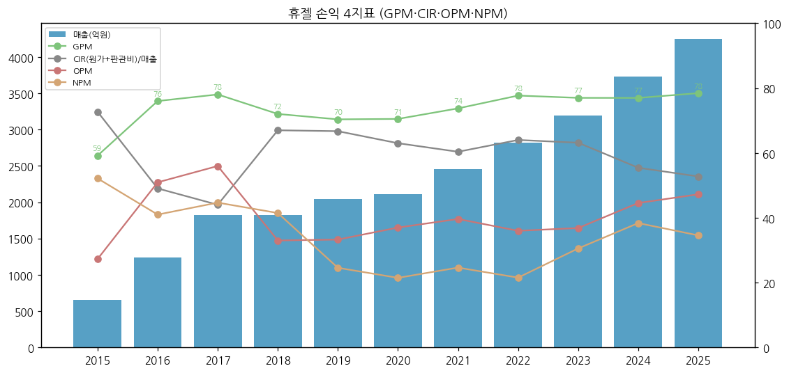

(2) 재무상태표

| 연도 | 자산 | 부채 | 자본 | 지배자본 | 현금 | 단기금융상품 | 유형 | 무형 | 재고 | 부채비율 | 유동비율 |
|---|---|---|---|---|---|---|---|---|---|---|---|
| 2015 | 2,336 | 184 | 2,152 | 2,078 | 705 | 72 | 489 | — | 80 | 8.5% | 601% |
| 2016 | 2,943 | 204 | 2,739 | 2,528 | 649 | 393 | 588 | — | 135 | 7.4% | 760% |
| 2017 | 8,209 | 1,030 | 7,179 | 6,957 | 313 | 5,644 | 590 | 637 | 155 | 14.3% | 2,995% |
| 2018 | 9,183 | 1,335 | 7,848 | 7,277 | 290 | 5,725 | 606 | 1,125 | 219 | 17.0% | 2,972% |
| 2019 | 8,947 | 1,504 | 7,443 | 6,995 | 153 | 5,536 | 698 | 1,336 | 289 | 20.2% | 1,706% |
| 2020 | 9,563 | 1,623 | 7,941 | 7,467 | 624 | 5,368 | 769 | 1,698 | 232 | 20.4% | 1,527% |
| 2021 | 10,097 | 1,806 | 8,292 | 7,771 | 2,941 | 2,425 | 957 | 1,974 | 274 | 21.8% | 1,140% |
| 2022 | 10,498 | 2,003 | 8,495 | 7,921 | 1,318 | 3,921 | 1,205 | 2,001 | 269 | 23.6% | 348% |
| 2023 | 9,293 | 1,496 | 7,797 | 7,473 | 1,060 | 3,709 | 1,347 | 1,823 | 343 | 19.2% | 989% |
| 2024 | 9,394 | 986 | 8,408 | 8,038 | 1,301 | 2,852 | 1,510 | 1,959 | 426 | 11.7% | 856% |
| 2025 | 10,768 | 967 | 9,802 | 9,503 | 2,097 | 3,190 | 1,468 | 1,913 | 558 | 9.9% | 730% |
| 3Q26 | 12,120 | 1,054 | 11,066 | 10,727 | 2,349 | 3,520 | 1,986 | 2,124 | 605 | 9.5% | 902% |

→ 순현금 구조: 현금+단기금융상품 **약 5,870억**(2026.09) = 자산의 48%. 차입금 없음
→ 무형자산 약 2,000억 = 아크로스 인수 영업권·FDA 등 개발비 자산화·(2026) 美 고객데이터 무형자산

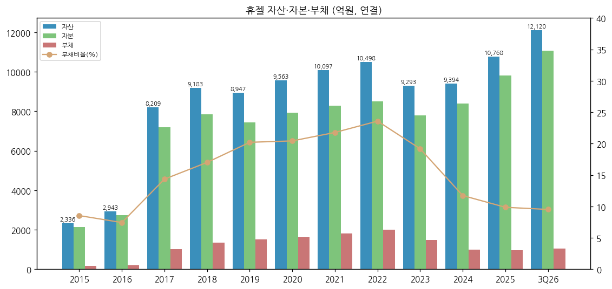

(3) 현금흐름표

| 연도 | 영업CF | 투자CF | 재무CF | CapEx | FCF | 자사주 취득 |
|---|---|---|---|---|---|---|
| 2015 | 198 | -171 | 504 | 131 | 67 | 0 |
| 2016 | 451 | -539 | 31 | 161 | 290 | 60 |
| 2017 | 642 | -5,553 | 4,576 | 72 | 570 | 0 |
| 2018 | 658 | -322 | -356 | 167 | 491 | 413 |
| 2019 | 770 | -10 | -903 | 284 | 486 | 462 |
| 2020 | 743 | -253 | -18 | 452 | 291 | 0 |
| 2021 | 859 | 1,801 | -360 | 484 | 375 | 360 |
| 2022 | 806 | -1,918 | -514 | 450 | 356 | 445 |
| 2023 | 1,177 | 432 | -1,871 | 406 | 772 | 1,224 |
| 2024 | 1,491 | 424 | -1,721 | 333 | 1,157 | 1,725 |
| 2025 | 1,501 | -487 | -217 | 295 | 1,205 | 13 |
| 3Q26 누적 | 1,205 | -943 | -2 | 625 | 580 | 0 |

→ 투자CF 변동은 대부분 단기금융상품 운용(예금 만기 이동) — 실물 투자는 CapEx 열 참조
→ 2017 재무CF 4,576억 = 베인캐피탈 유증 + CB 발행

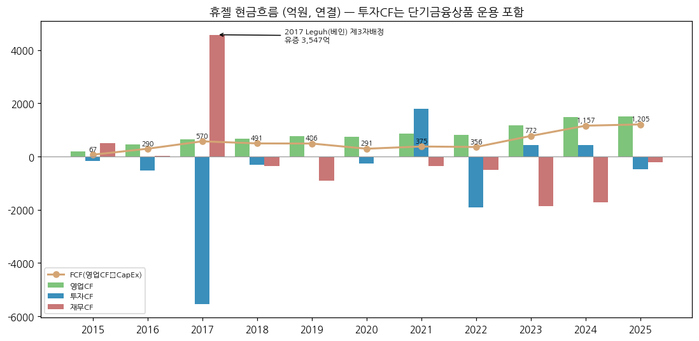

(4) CapEx

| 연도 | 2015 | 2016 | 2017 | 2018 | 2019 | 2020 | 2021 | 2022 | 2023 | 2024 | 2025 | 3Q26 누적 |
|---|---|---|---|---|---|---|---|---|---|---|---|---|
| 유형 | 124 | 156 | 63 | 91 | 123 | 170 | 239 | 328 | 237 | 124 | 134 | 312 |
| 무형 | 7 | 5 | 9 | 76 | 161 | 282 | 245 | 122 | 168 | 210 | 161 | 312 |
| 합계 | 131 | 161 | 72 | 167 | 284 | 452 | 484 | 450 | 406 | 333 | 295 | **625** |

→ 사이클: 2016 톡신 제2공장 → 2019~2021 해외 허가용 개발비 자산화(무형) → 2021~2022 필러 신공장·거두 B공장 → **2026 필러 증축 + 美 고객데이터 무형자산 취득(추정)**

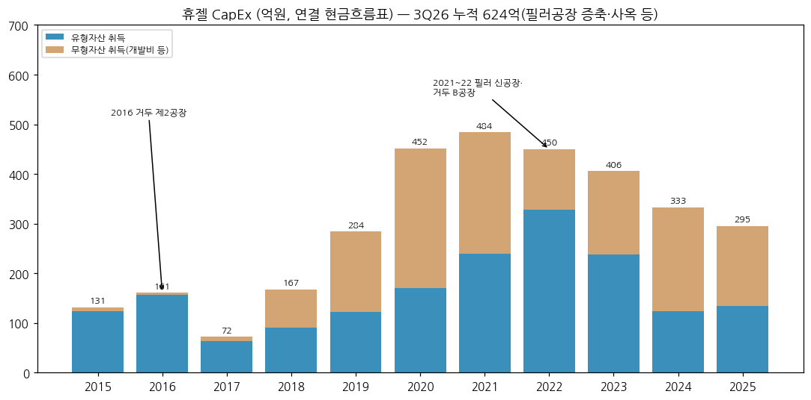

(5) 부채구조 + 채무증권 발행 history

→ 차입금 사실상 0 (2015 14억, 2019 단기차입 2억이 전부)
→ 유일한 채무증권: **제2회차 CB** (2017 Leguh Issuer 대상, 전환가 124,800원) — 2024.05~06 542,043주+48,098주 전환, 잔여분(최대주주 Aphrodite 보유) **2026.07.13 211,140주 전환 → CB 말소**
→ 회사채·CP·신종자본증권 발행 없음 (DART 2026.09)
→ 최대주주 Aphrodite는 휴젤 주식 5,566,791주 전량을 **삼성증권 주선 대주단에 담보 제공** (리파이낸싱 2026.06.17, 담보설정금액 7,650억, 2029.06.17까지) — 회사 부채는 아니나 지배구조 리스크 요인

(6) 배당·자사주

→ **현금배당: 상장 이후 0원** (2023~2025 결산배당 X, DART). 정관상 분기배당 근거 조항은 존재
→ 자사주 매입: 2016 60억 → 2018 413억 → 2019 462억 → 2021 360억 → 2022 445억 → **2023 1,224억 → 2024 1,725억** → 2025 13억 → 3Q26 0
→ 소각: 2019.09 10만주(+2019.12 합병 취득 80만주) / 2021.12 10만주 / 2023.12 371,563주 / 2025.05 30만주 / **2026.11 30만주** — 누적 이익소각 1,171,563주
→ 2016~2025 누적 자사주 매입 약 4,700억 vs 누적 FCF 약 5,900억 → FCF의 약 80%를 자사주로 환원 `[판단: 단순 합산]`

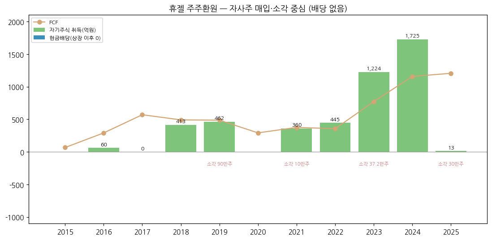

(7) 재무비율

| 연도 | ROE(지배) | ROA | 부채비율 | 유동비율 | OP/금융비용 |
|---|---|---|---|---|---|
| 2015 | 16.3% | 14.5% | 8.5% | 601% | 67x |
| 2016 | 18.8% | 19.3% | 7.4% | 760% | 122x |
| 2017 | 15.4% | 14.6% | 14.3% | 2,995% | 46x |
| 2018 | 9.8% | 8.7% | 17.0% | 2,972% | 16x |
| 2019 | 6.3% | 5.5% | 20.2% | 1,706% | 6x |
| 2020 | 5.8% | 4.9% | 20.4% | 1,527% | 3x |
| 2021 | 7.6% | 6.1% | 21.8% | 1,140% | 5x |
| 2022 | 7.3% | 5.9% | 23.6% | 348% | 2x |
| 2023 | 12.1% | 9.9% | 19.2% | 989% | 8x |
| 2024 | 17.5% | 15.3% | 11.7% | 856% | 35x |
| 2025 | 16.1% | 14.6% | 9.9% | 730% | 21x |

→ ROE(지배) = 지배순이익 / 평균 지배자본 (2015는 기말). 2017 유증으로 자본이 2.6배 커지며 ROE가 5~8%로 희석 → 이익 성장 + 자사주 소각으로 2024~2025 16~18% 회복
→ "이자보상배율" 대신 OP/금융비용 — 차입이 없어 금융비용은 대부분 CB 평가손실·외환손실. 실질 이자보상 이슈 없음

---

## ⑤ 지배 구조

(1) 그룹·계열 관계

→ 공정거래법상 휴젤은 **GS그룹 기업집단 소속**으로 분류 — 특수관계자 주석에 ㈜지에스·㈜지에스리테일·GS Global Japan 등 "지에스그룹 기업집단 소속 계열회사" 기재 (DART 2026.09). GS리테일과 화장품 매입·판매 거래 존재(3Q26 매입 28억)
→ 지배 체인: **휴젤 ← Aphrodite Acquisition Holdings LLC(케이만, 44.48%) ← ① Dione Limited 42.11% (㈜GS 62.50% + IMM인베스트먼트 측) / ② C-Bridge V Investment Six Pte.(CBC Group, 싱가포르) 42.11% / ③ 기타 출자자 2곳(약 15.8% — 언론상 Mubadala 투자회사 10.53% 등)**
→ Aphrodite는 휴젤 주식만 보유하는 SPC (2025말 자산 23.65억 달러, 부채 4.46억 달러)
→ 2022 인수 거래: Leguh Issuer(베인캐피탈)로부터 주식 5,355,651주 + CB 일부, 약 1.72조원 (언론). 2022.04.29 최대주주 변경

(2) 주주 구분

| 주주 | 주식수 | 지분율 | 비고 |
|---|---|---|---|
| Aphrodite Acquisition Holdings LLC | 5,566,791 | **44.48%** | 최대주주. 전량 대주단 담보 |
| 자기주식 | 1,485,098 | 11.87% | 2026.11.11 30만주 소각 후 1,185,098주(9.7%) |
| 기타 (소액·기관·외국인) | 5,463,284 | 43.65% | 소액주주 21,199명, 39.56%(의결권 주식 기준) |
| 합계 | 12,515,173 | 100% | 2026.09.30 기준 |

→ 5% 이상 주주: Aphrodite 1곳만 공시. 우리사주조합 해당 없음
→ 외국인 지분율(KRX 기준) **미확보** — DART에 없음. Aphrodite가 외국법인이므로 외국인 지분율에 44.48%가 포함될 가능성 `[미확인]`

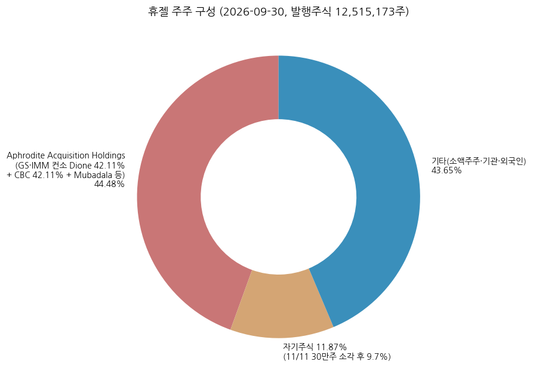

(3) 임원·이사회 (2026.09, 등기임원 8인 — 집행임원제)

| 성명 | 직위 | 구분 | 주요 경력 |
|---|---|---|---|
| **장두현** | 대표집행임원 | 상근 | CJ그룹 경영전략실(2000~2013), 보령홀딩스 전략기획실장, **보령 대표이사(2019~2025)**, 2025.09~ 휴젤 |
| 조기철 | 이사회 공동의장 | 기타비상무 | Citigroup Asia Healthcare IB MD, Zai Lab CFO, **CBC Group SMD** |
| 경한수 | 이사회 공동의장 | 기타비상무 | 의학박사, 제넥신 대표(2015~2017), **CBC Group SMD** |
| 줄리아 캐롤 스트롬 (Carrie Strom) | 이사 (글로벌 CEO) | 기타비상무 | Pfizer, **Allergan 보톡스 마케팅·Plastic Surgery VP** 등 (2026.03 선임) |
| 허준녕 | 이사 | 기타비상무 | UBS IB ED, GS벤처스 대표, **㈜GS 미래사업팀장 부사장** |
| 이태형 | 이사·감사위원 | 기타비상무 | GS에너지 경영기획부문장, **㈜GS CFO 부사장** |
| 패트릭 홀트 | 이사·감사위원 | 독립이사 | Allergan VP, Cordis President, Amarin CEO |
| 나정인 | 이사·감사위원 | 독립이사 | 삼일회계법인, 한미회계법인 품질관리실장 (2026.03 선임) |

→ 이사회 구성: CBC 측 2 + GS 측 2 + 글로벌 CEO 1 + 독립이사 2 + 대표집행임원 1 — **CBC·GS 공동지배** 구조가 이사회에 그대로 반영
→ 前 이사회 의장 차석용(前 LG생활건강 부회장) 2026.03 임기만료 퇴임
→ 미등기 주요 임원: 박철민(운영총괄 부사장), 황정욱(재경본부 부사장), 전효진(전략사업부 전무), 유승한(국내사업부 상무) 등

---

## ⑥ 기타 팩트

① R&D 인프라

| 연도 | 2015 | 2016 | 2017 | 2018 | 2019 | 2020 | 2021 | 2022 | 2023 | 2024 | 2025 | 3Q26 누적 |
|---|---|---|---|---|---|---|---|---|---|---|---|---|
| 연구개발비 (억, 정부보조금 차감) | 34 | 42 | 73 | 148 | 313 | 338 | 290 | 266 | 219 | 148 | 152 | 111 |
| R&D/매출 | 5.2% | 3.4% | 4.0% | 8.1% | 15.3% | 16.0% | 11.9% | 9.5% | 6.9% | 4.0% | 3.6% | 3.2% |

→ 2019~2022 피크는 FDA·NMPA·EU 허가 및 해외 임상 — 개발비 자산화 비중 높음(2019 211억, 2020 180억). 허가 완료 후 R&D 강도 4% 미만으로 하향
→ 기업부설연구소(2022 상반기 과기정통부 우수 기업연구소 선정)

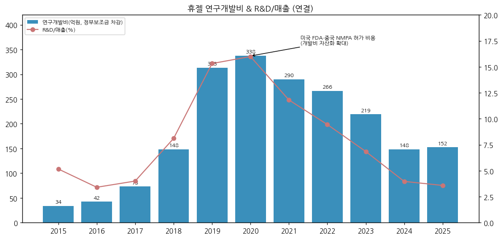

② 진행 중 corporate action (10년)

| 시기 | 내용 |
|---|---|
| 2015 | ㈜아크로스(필러) 지분 추가 취득 → 종속회사 편입 (당시 58.57%, 현재 91.12%) / ㈜휴템 인수 |
| 2017.07 | 베인캐피탈(Leguh) 제3자배정 유증·CB |
| 2018.01 | 휴젤파마 흡수합병 |
| 2019.07 | 최대주주 동양에이치씨 역합병 |
| 2020.07 | 무상증자 1:2 |
| 2020.09 / 2022.05 | 제이월드(리프팅 실) 80% → 100% 인수 |
| 2022.04~05 | 최대주주 GS·CBC 컨소(Aphrodite)로 변경 |
| 2022.09 | Microvention 의료기기 국내 유통 종료(중단영업) |
| 2022~2024 | Croma Aesthetics Canada 등 인수 → Hugel Canada / 호주 법인 |
| 2023~2026 | 자사주 3,000억+ 매입, 4회 소각 |
| 2026.04 | 한스바이오메드 셀르디엠 국내 판권 |
| **2026.09~** | **Hugel America — Benev CSO 계약, 2027 美 완전 직판 전환** |
| 2026.11 | 자사주 30만주 소각 |
| 상시 | 최대주주 지분 처리(홍콩 재상장·매각 검토 보도 2022~2023, 미결정) `[언론]` |

③ R&D 마일스톤

| 시기 | 마일스톤 |
|---|---|
| 2010~2019 | 보툴렉스 국내 적응증 5개 (눈꺼풀경련·미간·뇌졸중 상지경직·소아 첨족·눈가) |
| 2017 말 | 美·유럽 임상 3상 종료 |
| 2020.10 | 중국 NMPA 허가 (100U), 2021.02 50U |
| 2021.01 | 보툴렉스 300U 국내 허가 |
| 2022.01~07 | 유럽(HMA) 50U, 영·독·佛·伊·西 등 개별국 허가 / 캐나다 50·100U |
| 2022.04 | 더채움(Persnica) 중국 허가 |
| 2022.11 | 호주 허가 |
| 2023 | 사각턱(양성교근비대증 관련) 국내 허가, 레볼렉스 태국 허가 |
| **2024.02** | **美 FDA 레티보 50·100U 허가** (2018 Hugel America 설립 후 BLA 진행, 허가까지 약 6년) |
| 2025.01 | UAE 허가 |
| 진행 | 과민성방광(1상)·경부근긴장이상(1상)·양성교근비대증(2상), 더채움 안면중앙부 볼륨(3상)·중국 추가 허가 |
| 중단 | HG102(액상 톡신) 3상 조기 종료, HG301(턱밑지방) 임상 종료 |

④ 주요 리스크

→ (1) **美 직판 전환 실행 리스크**: 2026~2027 판관비·무형자산 상각 선반영, Hugel America 3Q26 누적 순손실 -250억. AbbVie·Evolus·Revance와 가격 경쟁 `[판단]`
→ (2) **메디톡스 소송**: ITC 337 조사(2022.03 제소) — 2024.10 Final Determination 휴젤 승소, 메디톡스 CAFC 항소 진행 중(2025.06 Opening Brief). 국내 민사·형사 관련 이슈도 병존
→ (3) **식약처 행정처분**: 2021.11~12 보툴렉스 품목허가 취소·회수폐기·판매정지 처분 → 1심 일부 승소(2024.02), 양측 항소로 2심 진행, 집행정지(2024.03) 상태로 판매 지속
→ (4) **중국 의존**: APAC(중국 포함) 매출이 톡신+필러의 42%(3Q26). 중국 규제·파트너 재고 정책 변화 시 2018형 급락 재현 가능
→ (5) **최대주주 지분 담보·Exit**: Aphrodite 보유 전량 담보(7,650억). PE·재무적투자자 공동지배 → 향후 지분 매각(오버행)·지배구조 변경 가능성
→ (6) **환율**: 매출 62~65% 수출(달러·유로 등) — 원화 강세 시 마진 하락
→ (7) 기타: 상표권 분쟁(중국 Shenzhen 법원, CNY 5만), 약사법 위반 혐의 사건(서울서부지검, 당사·임직원 2명) — 회사는 재무 영향 중요하지 않다고 기재

⑤ ESG

→ ESG 등급(KCGS 등) **미확보**. 인증: ISO 14001·ISO 45001(2024.03), ISO 27001(2025.03), ISO/IEC 27001·27701(2026.04)
→ 2025 코스닥 공시우수법인(2026.03)

⑥ 인증·라이선스

→ 톡신 생산시설: 美 cGMP·EU GMP 기준 제2공장, 식약처 GMP / 품목허가: 국내 보툴렉스 50·100·150·200·300U, 해외 27개국(美 FDA·中 NMPA·EU HMA·캐나다·호주·UAE 등)
→ 보툴리눔 균주·독소: 생물무기금지협약 대상 — 산업통상자원부 제조·보유·수출입 허가 보유
→ 수출의 탑: 7천만불(2023), **1억불(2025)**

---

## Version Log

| 버전 | 일자 | 내역 |
|---|---|---|
| v1.0 | 2026-11-15 | 최초 작성. OpenDART 연결 재무(2015 FY~2026 3Q, 44건) + DART 정기보고서 44건(2016~2026.09, 2016~2021 구형 XML은 CP949 재디코딩) + irgo 실적 IR 20건(2Q22~3Q26) + Yahoo 월간 주가. 차트 15종(표준 12종 + chart2 보조 4종: 제품별분기·톡신·지역별·내수수출). 3Q26 분기보고서(2026-11-13) 반영 |

**잔여 보완 후보**
→ 4Q26 실적(2027.02 예상) 후 연간 2026 확정 + 美 CSO 전환 첫 온기 분기 지역별 매출 반영
→ 2014 이전 손익(사업보고서 요약재무) 보강 — 현재 연간은 2015~2025 11년
→ 지역별 톡신+필러 분기 시계열을 2Q22 이전 IR PDF(이미지형, 텍스트 추출 불가)로 확장 — OCR 필요
→ 외국인 지분율(KRX), ESG 등급, "B사"(10% 고객) 실체, 美 CSO 계약 조건(수수료율·기간) 확인
→ 2026 가이던스·2028 목표(9,000억, 美 30%)를 회사 IR 원문으로 교차 확인
→ 사업부(제품)별 이익 — 아크로스(필러) 별도 실적으로 필러 마진 분리 시계열 구축
