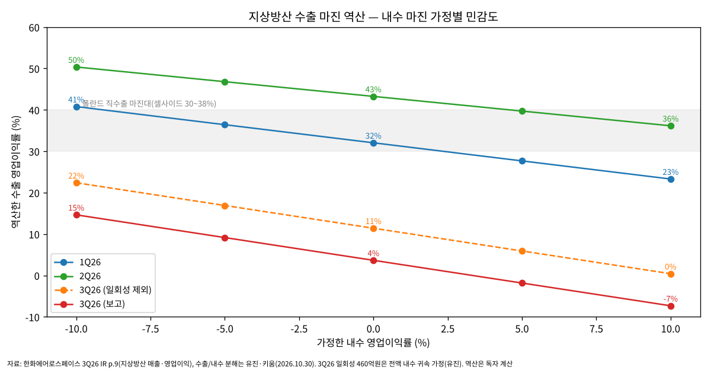
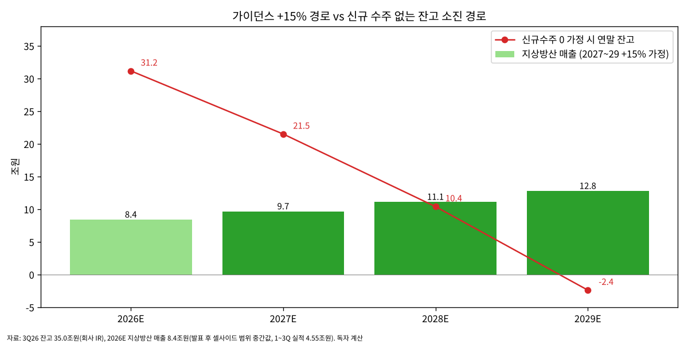
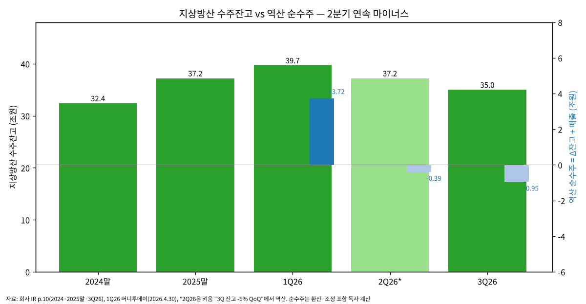

# 한화에어로스페이스 3Q26 실적 인뎁스 분석

> 모드: 실적 인뎁스 분석
> 종목: 한화에어로스페이스 (012450)
> 섹터: 방산
> 분기: 2026-Q3
> 발표일: 2026-10-29
> 작성 시각: 2026-10-30 21:50 KST
> 입력: `2026-Q3_한화에어로스페이스_리뷰.md` + 국내외 13개사 리포트(10/29~30) + 웹 리서치(주가·수주 파이프라인·경쟁 입찰 결과)
> 논점: ① 비폴란드 수출 마진의 구조적 레벨 ② 15% 가이던스의 보수성 vs 실행 지연 ③ 수주 공백과 잔고 감소의 의미 ④ 4Q26·2027 분기별 잠재 신규수주 점검 (BT 지정 4개, 모두 중립형으로 처리)

---

## Executive Summary

→ **논점 ① 비폴란드 수출 마진 — "구조적 10%대"는 과잉 해석, 그러나 "폴란드 30%대 복귀"도 아니다**: 같은 비폴란드 중심 분기였던 1Q26을 역산하면 수출 OPM 23~32%(내수 0~10% 가정). 3Q26의 10%대는 원가 선반영(타이밍) + 호주 R&D 매출(저마진 층)이 겹친 바닥. 정상 레벨은 **블렌디드 22~28%** [전망] — 셀사이드 2027 가정(JPM 35%, DB 38%)보다 5~10%p 낮음

→ **논점 ② 15% 가이던스 — 2027은 보수적, 2028~29는 아니다**: 가이던스 문구가 1Q 콜 "2030년까지 연 15~20%" → 3Q 콜 "27~29년 연 15%"로 상단이 빠짐. 2026년 지상방산 성장이 약 +3%에 그치면서 연초 경로 대비 약 1년치(0.9조원) 매출이 밀림. 2027년 +15%(9.7조원)는 잔고 35조원의 28%로 **수주 없이도 달성 가능**, 2028~29년은 신규 수주가 없으면 2029년 중 잔고 소진

→ **논점 ③ 수주 공백 — 양보다 질이 문제**: 잔고는 1Q26 39.7조원(최고) → 3Q26 35.0조원(-12%). 역산 순수주는 2Q·3Q 연속 마이너스(환산 효과 추정 포함). 더 중요한 신호는 **유럽 블록화 2연패**(루마니아 IFV 5.8조원 → 라인메탈, 프랑스 다연장 → 자국 썬다트). 남은 대형 건(폴란드 EC3·사우디 MNG·UAE)은 모두 현지화·JV 조건 → 수주가 와도 논점 ①의 저마진 층에 속함

→ **논점 ④ 잠재 수주 — 2027년 잔고 커버리지 유지에 17조원 필요**: 2028년 매출의 3.5년치 잔고를 유지하려면 2027년 수주가 약 17조원 필요 [독자 계산]. 독자 Base(폴란드 EC3 + UAE 1차 + 소형 건 ≈ 12조원)로는 부족, 사우디 MNG까지 들어오는 Bull에서만 충족. 4Q26 확률이 가장 높은 이벤트는 스페인 K9 잔고 반영과 UAE 정상 방한 계기의 기본계약

→ **시장 반응**: 10/29 종가 760,000원(-3.4%), 10/30 종가 **696,000원(-8.4%)**, 장중 662,000원. 9월 말 1,007,000원 대비 -31%. 거래량은 평소의 약 2.3배. 15개 증권사 중 11곳이 TP 하향(전원 매수) — **셀사이드는 "시차", 바이사이드는 "추가 리셋"**으로 갈림

→ **종합 시각 (작업 가설)**: 주가 하방은 4Q26 실적(지상방산 3.6조원 이상 인식)이 받치고, 상방은 대형 수주 1건이 연다. 다만 수출 마진의 2층 구조가 확인된 이상, 2024~25년식 고멀티플 회복은 어렵다 → **"실적 회복 확인 → 수주 확인 → 마진 재평가"의 3단 순서**로 접근

→ **Bull/Bear 분기 변수**: ① 4Q26 지상방산 매출 3.58조원 이상(= 회사가 말한 "2026년 성장 지속"의 산술 하한) ② 폴란드 K9 EC3의 현지화 비율·금융 조건 ③ 1Q27 비폴란드 분기의 수출 OPM이 20%를 넘는지

→ **review → in-depth 핵심 발견**: 리뷰에서 "회사 하한 4Q 지상방산 2.08조원"으로 해석했던 부분을 정정 — 회사 IR p.9의 "2026년 성장 지속" 전망을 산술하면 4Q 하한은 **3.58조원**으로, 셀사이드 평균(3.94조원)과 크게 다르지 않음. 회사 가이던스와 셀사이드 기대의 갭은 리뷰에서 본 것보다 작다

---

## 시장 반응 정리

### ① 주가·거래량

| 일자 | 종가 (원) | 등락 | 비고 |
|---|---|---|---|
| 2026-04-07 | 1,537,000 | - | 52주(사상) 최고 종가 |
| 2026-09-30 | 1,007,000 | - | 9월 말 |
| 2026-10-28 | 787,000 | - | 발표 전일 (10/29 등락에서 역산) |
| **2026-10-29** | **760,000** | **-3.43%** | 3Q26 발표·컨콜일 |
| **2026-10-30** | **696,000** | **-8.42%** | 시가 717,000·고가 729,000·저가 662,000, 거래량 약 35.5만주(평균 15.3만주) |

→ (출처: 서울경제 2026-10-30(10/29 종가), 이투데이 2026-10-30(10/30 종가·9월 말 종가), Google Finance 10/30 15:05(시가·저가·거래량), 키움(52주 최고))
→ 9월 말 대비 -30.9%, 사상 최고가 대비 -54.7%. 10/30 장중 방산주 동반 약세: LIG D&A -2.8%, 현대로템 -2.9%, 한화시스템 -5.1% (아주경제, 10:30 기준)
→ 미래에셋 정세훈 연구원: 신규 수주 공백·실적 리스크에 개별 기업 이슈까지 겹쳐 방산업 전반의 투자심리가 위축 (아주경제 인용)

### ② 외국인·기관 매매 동향
→ 발표 전후 5거래일 투자자별 순매수 데이터는 공개 자료로 확인 불가 (다음 업데이트 시 KRX 투자자별 매매동향으로 보완 필요)
→ 간접 지표: JPM Sales 기준 공매도 추정치 -10% WoW / +25.6% MoM, 대차 상환일수(DTC) 2.4일 (10/29). 외국인 지분율 45.1% (국내 리포트 공통)
→ 해석 보류 — 외국인·기관 방향이 확인되지 않아 "컨센 형성 vs 의견 갈림" 판정은 불가

### ③ 셀사이드 즉각 반응
→ 10/29~30 보고서 15개사 중 11곳 TP 하향, 15개사 전원 매수 유지. 평균 TP는 10/30 종가 대비 +86.8% (이투데이)
→ BT 첨부 13개사 기준: 평균 TP 1,305,385원, 하향 8건·유지 4건·확인 불가 1건 (리뷰 ⑥ 참조). 첨부 외 한국투자증권 165만원 → 154만원
→ 영향력 큰 증권사: 삼성 136만 → 100만원(-26.5%), 신한 138만 → 101만원(-26.8%), 미래에셋 → 115만원(-26%) — 대형사의 하향 폭이 가장 큼

### ④ 시장 통념의 형성
→ **셀사이드 통념 — "시차 문제"**: 폴란드 인도가 4Q로 몰렸을 뿐, 잔고 35조원과 15% 가이던스는 유효
→ **바이사이드 통념 — "추가 리셋 + 수주 확인 전 매수 유보"**: JPM Sales는 컨콜 후 매수 의욕이 낮다고 전함. MS는 실적 바닥 가능성은 인정하되 청산 이벤트(clearing event)는 아니라고 판단
→ 시장이 가장 크게 반응한 시그널: 영업이익 미스 자체보다 **"폴란드가 빠지면 수출 마진이 10%대"라는 사실의 노출**과 **사우디 관련 코멘트 부재**

---

## 논점 1: 비폴란드 수출 마진의 구조적 레벨

### ① 논점 정의 & 시장 통념

(1) 논점 한 줄
→ 3Q26 수출 매출 5,936억원 중 폴란드는 소량, 이집트·호주가 중심이었다. 이 분기의 수출 OPM(증권사 추정 10%대)이 "비폴란드 사업의 진짜 실력"인지, 일시적 바닥인지

(2) 시장의 지배적 해석
→ 셀사이드 다수: 일시적. 유진은 4Q부터 수출 OPM 30% 내외 회복, DB는 4Q 수출 OPM 38%, JPM은 수출 마진 가정을 35%로 소폭 하향
→ 반대 시각: 키움(이집트·호주 K9 수익성이 상대적으로 낮음), 유안타(해외 OPM 11% 추정), 다올(5월부터 "폴란드 외 이집트·호주 수익성에 의문")

(3) 핵심 질문
→ 2027E 컨센 지상방산 OPM 25~28%는 "폴란드급 마진이 수출 전반에 유지된다"는 가정 위에 있음. 이 가정이 5%p 틀리면 2027E 연결 영업이익 약 3,500억원(컨센 5.26조원의 약 7%)이 사라짐 [독자 계산: 2027E 수출 매출 약 7조원 × 5%p]

### ② 메인 논거 — 무게: "구조적 10%대는 과잉 해석, 정상 블렌디드 22~28%"

(1) **1Q26이라는 대조군 — 비폴란드 비중이 높았던 분기의 마진은 20%대 이상**
→ 1Q26 지상방산: 수출 6,514억원·내수 5,697억원·영업이익 2,087억원(OPM 17.1%). 폴란드 K9 EC2 인도는 2026년 2월 기준 누적 6문에 불과했음 (회사 4Q25 컨콜, 뉴스1 2026-02-09)
→ 내수 OPM을 0~10%로 가정해 역산하면 1Q26 수출 OPM은 **23~32%**. 같은 방식으로 3Q26(일회성 460억원 제외)은 **0~11%**
→ 수출 매출 규모는 1Q 6,514억원 vs 3Q 5,936억원으로 9% 차이인데, 역산 수출 OPM은 15~20%p 차이 → 매출 구성만으로는 설명이 안 되고 **원가 인식 타이밍**이 주원인이라는 증거

→ (출처: 회사 3Q26 IR p.9, 수출/내수 분해 유진·키움 2026-10-30, 역산은 독자 계산. 3Q26 일회성은 전액 내수 귀속 가정(유진))

(2) **원가 선반영 메커니즘은 다음 분기에 되돌려진다**
→ GS: 4Q·내년 초(루마니아 K9) 인도분의 생산원가가 3Q에 먼저 인식됐고, 직전 분기 생산분이 매출로 잡히며 완충하는 효과도 2Q에 이미 소진됨
→ 비유하면, 식당이 연말 단체 예약을 위해 9월에 식재료를 미리 사들였는데 손님은 12월에 오는 구조 — 9월 장부만 보면 적자지만 12월에 몰아서 회수
→ 정량: 3Q26 지상방산의 매출 대비 원가 부담이 2Q26 수준으로 돌아오면 OPM은 일회성 제외 기준 6% → 15~20%로 복귀 [전망]

(3) **최근 계약일수록 단가가 높다 — 신규 계약 마진은 오히려 개선**

| 계약 | 규모 | 수량 | 문당 단가 (억원) | 성격 |
|---|---|---|---|---|
| 폴란드 K9 EC1 (2022) | 3.20조원 | 212문 | 151 | 직수출 |
| 폴란드 K9 EC2 (2023) | 3.45조원 | 152문 | 227 | 직수출 + 일부 현지 |
| 루마니아 K9 (2024) | 1.38조원 | 54문 | 256 | 현지 공장 착공 |
| 호주 K9 AS9 (2021) | 0.79조원 | 30문 | 265 | 현지 생산 |
| 이집트 K9 (2022) | 2.00조원 | 200문 | 100 | 현지 생산·기술이전 |

→ (출처: 유안타 지상방산 파이프라인 표 2026-10-30, 회사 IR p.10. 패키지에 K10·탄약·기술이전 포함 여부가 달라 단순 비교에 한계)
→ 루마니아·호주는 현지 생산형인데도 문당 단가가 폴란드 EC1보다 70%가량 높음. 다올(5월)도 위상 격상 후 신규·재구매 건에 적정 가격이 반영됐다고 평가
→ **이집트만 문당 100억원으로 이질적** — 이집트 비중이 큰 분기에 수출 마진이 낮게 나오는 것은 구조적이지만, 이집트는 계약액 기준으로도 수출 잔고 약 25.9조원의 8% 수준(잔여분은 이보다 작음)

(4) **2027년 믹스는 폴란드 쪽으로 다시 기운다**
→ 회사: 2027년 폴란드 K9·천무 인도 모두 증가, 루마니아 K9 납품 시작 (신한 컨콜 Q&A)
→ 대신: 2027년 수출 비중 58% → 77.2%, 지상방산 OPM 19.8% → 28.0% 가정 — 가장 낙관적 추정이 믹스 복귀를 근거로 함

### ③ 반론

(1) **현지화는 트렌드다 — 미래의 수출은 폴란드 EC1이 아니라 이집트·호주를 닮아간다**
→ 근거: 루마니아(K9·K10 현지 공장 착공), 폴란드 K9 EC3(현지화 전제 협상, 회사 2Q·3Q 콜), 사우디 MNG(비전2030 국방 지출 현지화 50% 목표, 현재 24.89%), UAE(EDGE와 JV·단계적 현지 생산) — 잔여 대형 파이프라인 전부가 현지화형
→ 성립 조건: 2027년 이후 신규 수주의 70% 이상이 현지화형이고, 현지 생산분의 마진이 15% 이하라면 2029년경 블렌디드 수출 OPM은 15~20%로 수렴
→ 반례: 현대로템 K2 2차는 현지 파트너의 생산 준비가 늦어져 직수출 물량이 더 많을 것으로 전망되며 높은 수익성 유지가 예상됐음 (증권가 전망, 한국경제 2025-06-11 인용) — 현지화 조건이 곧바로 마진 희석으로 이어지지는 않을 수 있음

(2) **호주 레드백(3.17조원, 129대)이 2026~28년 양산 램프업 — 저마진 층이 커진다**
→ JPM: 3Q 수출 마진 미스의 핵심은 마진 희석적인 호주 R&D 매출 비중 확대. 레드백은 초기 양산 단계라 학습곡선 비용이 큼
→ 성립 조건: 레드백 매출이 2027년 연 1조원 이상으로 커지고, 초기 OPM이 한 자릿수에 머물 경우 → 수출 OPM 약 2~3%p 하락 요인 [독자 계산]

(3) **1Q26은 "깨끗한" 비폴란드 표본이 아닐 수 있다**
→ JPM Sales: 연초 이후 폴란드향 천무 누적 출하는 수출 데이터상 55대 — 1Q26 매출에 폴란드 천무 일부가 섞였다면 메인 논거 (1)의 대조군 역산은 과대평가
→ 성립 조건: 1Q26 매출에 폴란드 천무가 20대 이상 반영됐다면 1Q26 비폴란드 마진도 10%대일 가능성
→ 반박: 회사는 3Q 수출이 호주·이집트 위주였다고 명시했지만 1Q에 대해서는 같은 언급이 없음 → **이 반론은 현재 반증 불가** — 4Q 컨콜에서 국가별 매출 질의 필요

### ④ KEY INSIGHT

> **수출 마진은 3층 구조다: ① 폴란드 직수출 30%대 ② 현지 생산형(루마니아·호주 K9·향후 EC3) 20%대 전후 ③ 초기 양산·R&D·저단가(이집트·레드백 초기) 10% 안팎. 3Q26은 ③층에 원가 선반영이 겹친 바닥이지 새로운 정상 레벨이 아니다.** 다만 셀사이드 2027 가정(수출 OPM 35~38%)은 ①층 비중을 과대평가하고 있어 블렌디드 22~28%가 현실적이다 [전망]. 무게는 "일시적" 쪽에 두되, 정상 레벨은 하향 조정한다.
>
> 결론을 바꿀 변수: **1Q27(폴란드 인도가 적은 계절적 비수기) 수출 OPM이 20%를 넘는지**, 4Q26 컨콜의 국가별 매출 구성 공개 여부

---

## 논점 2: 15% 가이던스의 보수성 vs 실행 지연

### ① 논점 정의 & 시장 통념

(1) 논점 한 줄
→ 회사는 "27~29년 지상방산 매출 연 +15%"를 유지했다. 이것이 낮게 잡은 보수적 숫자인지, 아니면 실행 지연을 포장한 하향인지

(2) 시장의 지배적 해석
→ 보수적: JPM(3Q로 기저가 낮아진 만큼 15%는 보수적), GS(2027년 +30%, 2026~30 CAGR 15% 이상)
→ 지연 인정: GS(연초 15~20% CAGR 대비 약 6개월 지연), JPM Sales(Bloomberg 컨센의 2027 방산 성장 기대 +22% 대비 가이던스가 낮음)

(3) 핵심 질문
→ 2027년 컨센 지상방산 매출(5개사 평균 약 11.2조원, +30% 내외)이 회사 가이던스(+15% ≈ 9.7조원)보다 15% 이상 높음 → 어느 쪽이 맞느냐에 따라 2027E 영업이익이 3,000~4,000억원 갈림 [독자 계산: 매출 갭 1.5조원 × 지상방산 OPM 22~25%]

### ② 메인 논거 — 무게: "2027년은 보수적(잔고 확보), 2028~29년은 수주 의존 — 가이던스는 범위 하단으로의 조정"

(1) **가이던스 문구의 변화 — 상단이 사라졌다**
→ 1Q26 컨콜(4/30): "지상방산은 2030년까지 연평균 15~20% 성장, 3.5~4년치 잔고 유지가 목표" (머니투데이·연합인포맥스)
→ 3Q26 컨콜(10/29): "지상방산 매출 연평균 +15% (27~29년) 유지" (신한)
→ "유지"라고 표현했지만 실제로는 ① 범위 상단 20%가 빠졌고 ② 기간이 2030 → 2029로 짧아졌으며 ③ 기산점이 2025 → 2026으로 이동 — 2026년 저성장을 기저에서 지워버린 효과

(2) **2026년에 약 1년치 성장이 밀렸다**
→ 2025년 지상방산 매출 8.13조원 → 연 15% 경로라면 2026년 9.35조원이어야 함
→ 실제 2026년은 회사 IR의 "2026년 성장 지속" 기준 최소 8.13조원 이상, 셀사이드 범위 8.2~9.5조원(중간값 약 8.4조원) → **연초 경로 대비 약 0.9조원(약 10%) 미달** — GS가 말한 "6개월 지연"과 정합

(3) **2027년 +15%는 잔고만으로 달성 가능**
→ 2027년 +15% = 약 9.66조원 (2026E 8.4조원 기준) = 3Q26 잔고 35.0조원의 28%
→ 이미 잔고에 있는 사업: 폴란드 K9 EC2(3.45조원)·천무 EC3(5.6조원), 루마니아 K9(1.38조원, 2027 납품 개시), 호주 레드백(3.17조원), 이집트 K9(2.0조원), 노르웨이 천무(1.3조원), 핀란드 K9(0.9조원)
→ **2027년 15%의 리스크는 수주가 아니라 인도 타이밍(실행)** — 대전 사업장 정상화(2027H1), 천무 미사일 생산 병목(유안타), 고객사 인수 일정이 변수

(4) **2028~29년은 신규 수주 없이는 불가능**
→ 신규 수주가 0이라면 잔고는 2026년 말 31.2조원 → 2027년 말 21.5조원 → 2028년 말 10.4조원 → **2029년 중 소진** [독자 계산]

→ (출처: 3Q26 잔고 회사 IR p.10, 2026E 지상방산 매출은 셀사이드 범위 중간값. 독자 계산)
→ 회사가 목표로 하는 "3.5~4년치 잔고"를 2028년 매출(11.1조원) 기준으로 유지하려면 2027년 말 잔고 약 39조원 필요 → 논점 ④로 연결

### ③ 반론

(1) **Bull 반론 — 15%는 명백한 저평가, 2027년은 +30%도 가능**
→ GS: 폴란드·루마니아 K9 순증 약 120문만으로 2.4조원 매출 추가, 에스토니아·노르웨이·호주·국내 장약(MCS) 증설까지 더하면 2027년 +30%
→ 유진: 2027E 지상방산 13.2조원(+56%)
→ 성립 조건: 4Q26 폴란드 인도(K9 30문+, 천무 60대+)가 계획대로 끝나 생산 라인에 이월 물량이 쌓이지 않을 것, 루마니아 공장 램프업 정상화 → **4Q26 지상방산 매출 4조원 이상이면 이 반론에 무게**

(2) **Bear 반론 — 2027년도 미달할 수 있다**
→ 최근 4개 분기 중 3개 Miss(리뷰 ②(5)), 매번 "인도 타이밍"이 원인 → 회사의 분기 인도 계획 신뢰도 자체가 낮아진 상태
→ 대전 사업장 정상화는 2027H1 목표, 그 사이 보은·여수가 국내 물량을 대신 생산 → 수출 라인의 여력이 국내 캐치업에 잠식될 가능성
→ 성립 조건: 대전 정상화가 2027H2로 밀리거나, 폴란드 2027년 국방예산·한국 금융 지원 한도 확정이 지연(뉴스프리존)되어 인수가 늦어질 경우

### ④ KEY INSIGHT

> **15% 가이던스는 "보수성"과 "후퇴"가 동시에 들어있는 숫자다.** 2027년 한 해만 보면 잔고로 확보된 보수적 숫자(셀사이드 +30%의 절반)이지만, 연초의 "2030년까지 15~20%"에서 상단과 기간을 잘라낸 것은 실행 지연에 대한 사실상의 인정이다. 무게는 **"2027년 +15~20% 달성 가능(보수적), 2028~29년은 수주 확인 전까지 할인"**에 둔다.
>
> 결론을 바꿀 변수: **4Q26 지상방산 매출이 3.58조원(2026년 YoY 성장의 산술 하한)을 넘는지**, 2027년 2월 연간 실적 발표 때 2027년 단년도 가이던스 제시 여부

---

## 논점 3: 수주 공백과 잔고 감소의 의미

### ① 논점 정의 & 시장 통념

(1) 논점 한 줄
→ 지상방산 잔고는 1Q26 39.7조원(사상 최대)을 찍고 3Q26 35.0조원으로 2분기 만에 -4.7조원. 일시적 공백인지, 구조적 수주 둔화의 시작인지

(2) 시장의 지배적 해석
→ 셀사이드: 일시적. SK(4월)는 스페인 K9·사우디 MNG·루마니아 레드백·폴란드 EC3 등이 예상돼 잔고 감소 우려는 불필요하다고 봤음. 키움은 중동 방공 문의 증가로 성장 흐름 유지 판단
→ 바이사이드: MS — 한국 방산 4사 중 2026년에 의미 있는 수주를 확보한 곳은 한화가 유일하지만, 추가 수주가 투자자 신뢰 회복의 열쇠

(3) 핵심 질문
→ 잔고의 "양"은 아직 4년치(35조원/2026E 8.4조원)로 충분. 문제는 **다음 대형 수주가 언제·어떤 조건으로 오느냐** — 이것이 2028년 이후 성장률과 마진(논점 ①)을 동시에 결정

### ② 메인 논거 — 무게: "양은 괜찮고 질이 나빠졌다 — EU 블록화와 현지화 조건이 새 정상"

(1) **잔고 피크아웃과 2분기 연속 마이너스 순수주**

| 시점 | 지상방산 잔고 | 분기 매출 | 역산 순수주 (Δ잔고 + 매출) |
|---|---|---|---|
| 2025년 말 | 37.2조원 | - | - |
| 1Q26 | 39.7조원 | 1.22조원 | **+3.72조원** |
| 2Q26* | 약 37.2조원 | 2.11조원 | **약 -0.39조원** |
| 3Q26 | 35.0조원 | 1.25조원 | **약 -0.95조원** |

→ (출처: 회사 IR p.10, 1Q26 잔고 머니투데이 2026-04-30, *2Q26은 키움 "3Q 잔고 -6% QoQ"에서 역산. 독자 계산)
→ 역산 순수주는 환산·계약 변경 등 조정 항목을 포함한 값이라 개별 공시 수주와 1:1로 대응하지 않음
→ 2Q·3Q는 공시된 수주(4월 핀란드 K9 0.9조원, 9월 크로아티아 천무 0.6조원)가 있었는데도 역산 순수주가 마이너스 → 조정 항목이 2Q 약 -1.3조원, 3Q 약 -1.5조원으로 추정 [추정, 회사 미공시]. 유력한 후보는 **원화 강세에 따른 외화 잔고의 원화 환산 감소** — 수출 비중 74%인 잔고에 원화 강세가 직접 반영되는 구조
→ 회사 공시 기준 2026년 신규 수주(노르웨이 천무 1.3조원 + 핀란드 K9 0.9조원 + 크로아티아 천무 0.6조원 ≈ 2.8조원, 금액 미공개 미국·스페인 제외) vs 1~3Q 지상방산 매출 4.57조원 → **Book-to-bill 약 0.6**

→ (출처: 위 표와 동일)

(2) **유럽 블록화 — 2026년 2연패**
→ 루마니아 차세대 보병전투차량(5/31): 사업 규모 약 5.8조원. 한화는 레드백 298대를 28억 유로(대당 약 950만 유로)와 현지화 80%로 제안했으나, 대당 1,100만 유로·현지화 40%를 제시한 라인메탈 링스가 선정 (뉴스1·KPI뉴스). EU의 저금리 재무장 대출 SAFE를 통한 계약
→ 프랑스 다연장로켓(6/15): 2월까지 천무가 유력 후보(IFRI 보고서)로 거론됐으나, 최종적으로 자국 MBDA·사프란의 썬다트 선정 (서울신문)
→ **함의: 가격·현지화·성능에서 앞서도 EU 역내 조달 자금(SAFE)이 붙은 사업에서는 진다.** 유럽 신규 시장은 크로아티아(0.6조원)·스페인(인드라 파트너형)처럼 소형이거나 현지 업체의 하청 구조로 제한

(3) **남은 대형 건은 전부 현지화·JV 조건**
→ 폴란드 K9 EC3: 잔여 308문, 1차 단가 기준 4.6조원·2차 단가 기준 약 7조원 (블로터). 현지 생산·정비·부품 생태계와 금융 조건에서 양측 간극 (블로터·뉴스프리존)
→ 사우디 MNG: 현지 생산·MRO 포함 시 10조원대 (연합인포맥스, 1Q 콜). 사우디 국방 현지화율 24.89% → 2030년 50% 목표 (인사이트)
→ UAE: EDGE와 현지 JV 설립·단계적 현지 생산 (파이낸셜뉴스·마켓잉크)
→ 수주가 와도 논점 ①의 2층(현지화형)에 해당 → **잔고는 회복돼도 마진 레벨은 2024~25년보다 낮게 형성**

(4) **수주 타이밍의 외생 변수가 늘었다**
→ 사우디: 이란 전쟁으로 의사결정이 상반기 → 하반기로 지연(SK 4월 전망) → 3Q 콜에서도 지연 지속(JPM). 미·이란 종전 MOU 이후 협의 재개 여부는 미공개 (인사이트)
→ 폴란드: EC3 발효에 폴란드 2027년 국방예산 편성 + 한국 금융기관 지원 한도 확정이 선행돼야 해 일정이 촉박 (뉴스프리존)

### ③ 반론

(1) **"잔고 착시" — 계약됐지만 아직 안 잡힌 물량이 있다**
→ 스페인 K9(8월 계약, 수주잔고 미반영, 128문 — 인드라 컨소시엄 궤도형 자주포 프로그램 총액 45.5억 유로), 미국 K9MH(옵션 포함 최대 2.63억 달러, 확정 9문) (회사 IR·연합인포맥스·이투데이)
→ 성립 조건: 스페인 계약의 한화 몫이 1조원 이상으로 4Q26 잔고에 반영되면 3Q 감소분의 절반을 즉시 상쇄

(2) **방산 수주는 원래 덩어리(lumpy)다**
→ 2025년 12월 폴란드 천무 EC3 5.6조원 한 건이 연간 수주의 큰 몫을 차지. EC3 K9 한 건(4.6~7조원)만으로 잔고는 40조원대로 복귀
→ 4Q는 각국 예산 확정 시즌으로 방산 수주 성수기 (DB, 한화투자)
→ 성립 조건: EC3가 2027H1 이내 체결

(3) **잔고 감소의 일부는 환율 — 사업을 잃은 게 아니다**
→ 원화 강세는 외화 잔고의 원화 환산액을 줄이지만, 원화가 다시 약세로 돌아서면 잔고와 매출이 함께 늘어남 → 펀더멘털 훼손으로 보기 어려움
→ 한계: 회사가 환산 효과를 별도 공시하지 않아 크기를 확정할 수 없음

### ④ KEY INSIGHT

> **잔고의 "양"은 위기가 아니지만(4년치), "질"이 바뀌었다.** EU는 SAFE 자금으로 역내 조달을 강화하며 한화에 2연패를 안겼고, 남은 대형 건(폴란드 EC3·사우디 MNG·UAE)은 모두 현지화·JV형이다. 시장이 원하는 청산 이벤트는 대형 1건이면 충분하지만, 그 1건이 저마진 층에 속한다는 점이 다음 리레이팅의 상한을 정한다. 무게는 **"양적 공백은 일시적, 질적 변화는 구조적"**에 둔다.
>
> 결론을 바꿀 변수: **폴란드 K9 EC3의 현지 생산 비율과 금융 조건**, 분기 역산 순수주의 플러스 전환

---

## 논점 4: 4Q26·2027 분기별 잠재 신규수주 점검

### ① 논점 정의 & 시장 통념

(1) 논점 한 줄
→ 주가 반등의 1순위 트리거는 대형 수주다. 4Q26부터 2027년 말까지 어떤 건이 언제, 어느 정도 확률로 잔고에 들어올 수 있는지 분기 단위로 점검

(2) 시장의 지배적 해석
→ 셀사이드: "4Q는 방산 성수기 + UAE 방한 + 사우디 MNG·폴란드 3차 협상 지속"(DB), "중동 방공 계약 논의는 매우 가시적, MNG는 시점의 문제"(SK), "2027년부터 중동이 수주 중심"(유진)
→ 바이사이드: 사우디 관련 명확한 코멘트가 없어 실망(JPM Sales)

### ② 파이프라인 전수 점검

| 사업 | 규모 | 한화에어로 몫 | 현재 단계 | 가장 빠른 시점 | 독자 확률 [전망] | 마진 층 |
|---|---|---|---|---|---|---|
| 폴란드 K9 EC3 | 4.6~7조원 (308문) | 대부분 | 현지화·금융 조건 협상, 회사 "빠르면 연내" | 4Q26 | 4Q26 25% / 2027H1 누적 65% | ②층 (현지화) |
| UAE 통합방공망 (EDGE) | 한국 전체 프레임워크 350억 달러(49조원) | 천무 + 발사대류 (몫 미공개) | 9/15 주요조건합의서(한화시스템), JV 검토. UAE 대통령 방한은 10월 추진 보도 → JPM은 11월 가능성 언급 | 4Q26 (정상 방한 계기 기본계약) | 4Q26 기본계약 35% / 실행계약 2027 | ②층 (JV) |
| 사우디 MNG | 10조원대 (현지 생산·MRO 포함) | K9·장갑차·유도무기 | 이란 전쟁 후 협의 재개 여부 미공개 | 2027H1 | 4Q26 5% / 2027 누적 45% | ②층 (현지화율 50% 목표) |
| 스페인 K9 잔고 반영 | 비공개 (인드라 프로그램 총 45.5억 유로) | 128문 관련분 | 8월 계약 체결, 잔고 미반영 | 4Q26 | 4Q26~1Q27 80% | ②층 (파트너형) |
| 사우디·이라크 천궁-II 발사대 추가 / L-SAM 수출 | 발사대 각 0.4~0.6조원 (유안타 파이프라인) | 발사대 | 중동 방공 문의 증가 | 2027 | 2027 누적 40% | ①~②층 |
| 에스토니아·핀란드 K9 추가 | 소형 (0.5조원 미만) | 전량 | 예산 산정 진행 (SK 4월) | 4Q26 | 2027 누적 50% | ①층 (재구매) |
| 유럽 천무 추가 (국가 미공개) | 미상 | 전량 | 회사 "유럽 천무 잠재력 큼, 연말 결과 기대" (1Q 콜) | 4Q26 | 30% | ①~②층 |
| 미 육군 MTC-W 양산 | 약 500문·10조원 | 전량 (미국 현지) | 시제 9문 계약, 약 4년 시험 | 2030 이후 | 2027 수주 기여 없음 | ②층 |
| 미 육군 궤도형 자주포 | 미상 | K9 기반 참여 | 시장조사(RFI) 단계 | 2028 이후 | 2027 수주 기여 없음 | ②층 |

→ (출처: 블로터·뉴스프리존(EC3), 이투데이·파이낸셜뉴스(UAE), 연합인포맥스·인사이트(MNG), 회사 IR·연합인포맥스(스페인), 유안타 파이프라인 표, SK증권(4월), 연합뉴스·서울신문·이투데이(미국). 확률은 독자 판단)
→ **2026년 놓친 건**: 루마니아 IFV(5.8조원, 5/31 라인메탈), 프랑스 다연장로켓(6/15 썬다트)

### ③ 분기별 시나리오와 잔고 커버리지

(1) 분기별 이벤트 캘린더 (독자 Base)

| 분기 | 가능 이벤트 | Base 수주 반영 | 비고 |
|---|---|---|---|
| 4Q26 | 스페인 K9 잔고 반영, UAE 정상 방한 계기 기본계약, 소형 재구매(에스토니아 등) | 1~2조원 | EC3는 폴란드 예산·금융 확정 일정상 연내 체결 확률 낮음 |
| 1Q27 | 폴란드 K9 EC3 (Base 시점), UAE 1차 실행계약 | 5~7조원 | 회사 "연내 기대"가 1~2분기 밀리는 패턴 반복 |
| 2Q27 | 중동 방공 발사대, 유럽 천무 추가 | 1~2조원 | |
| 3Q27 | 사우디 MNG (Bull 시점) | 0~10조원 | 이벤트 리스크 최대 |
| 4Q27 | 각국 2028 예산 시즌, UAE 2차 | 1~3조원 | |

(2) 2027년 말 잔고 시나리오 [독자 계산]

| 시나리오 | 2027년 수주 | 2027년 말 잔고 | 2028년 매출(11.1조원) 대비 커버리지 | 판정 |
|---|---|---|---|---|
| Bear | 약 7조원 (EC3 2027H2 + 소형) | 약 28.5조원 | 2.6년 | 목표(3.5~4년) 미달 → 2028년 성장 둔화 |
| **Base** | **약 12조원** (EC3 + UAE 1차 + 소형) | **약 33.5조원** | **3.0년** | 목표 하단 미달 |
| Bull | 약 22조원 (Base + 사우디 MNG) | 약 43.5조원 | 3.9년 | 목표 충족 → 2028~29년 15% 신뢰 회복 |

→ 계산: 2026년 말 잔고 31.2조원(3Q26 35.0조원 − 4Q26E 매출 3.85조원, 4Q 수주 미포함) + 2027년 수주 − 2027년 매출 9.66조원
→ **3.5년치 잔고 유지에 필요한 2027년 수주 = 약 17.3조원** (= 11.1조원 × 3.5 − 31.2조원 + 9.66조원)
→ Base 시나리오로는 부족 — **사우디 MNG급 대형 건이 하나 더 필요**

### ④ 반론

(1) **Bull 반론 — 중동은 "시점의 문제", 오히려 경쟁이 줄었다**
→ SK: 이란 전쟁으로 경쟁국인 중국의 가능성이 축소되며 한화의 MNG 수주 가능성이 높아짐. 중동 실전 교전에서 천궁-II의 운용 신뢰성이 입증되며 사우디·이라크의 추가 도입·상위 방공망 확장 가능성 (DB)
→ UAE 프레임워크 49조원 중 한화 계열 몫이 크면(L-SAM·천궁-II 레이다 = 한화시스템, 천무·발사대 = 한화에어로) 4Q26~1Q27에만 5조원 이상 가능
→ 성립 조건: UAE 정상 방한이 연내 성사되고 기본계약에 금액이 명시될 것

(2) **Bear 반론 — "연내 기대"는 이미 여러 번 밀렸다**
→ 폴란드 EC3는 2026년 2월 콜에서 "연내 체결 가능성"을 처음 언급(뉴스1) → 7월 "빠르면 연내"(ZDNet) → 9월 현지 보도는 일정이 촉박하다고 전망. 사우디 MNG는 상반기 → 하반기 → 미정
→ 성립 조건: 2027H1까지 EC3·MNG 모두 미체결 시 Bear 시나리오(커버리지 2.6년) 현실화

### ⑤ KEY INSIGHT

> **4Q26에 가장 확실한 것은 "작은 것들"(스페인 잔고 반영, 재구매)이고, 큰 것(EC3·MNG)은 2027년의 일이다.** 2027년 수주가 독자 Base(12조원)에 그치면 잔고 커버리지는 3년으로 떨어져 2028년 이후 15% 가이던스가 흔들린다. 3.5년 커버리지를 지키려면 약 17조원 — 사실상 **EC3 + UAE + MNG 중 2건 이상**이 필요하다. 무게는 "4Q26 이벤트는 심리 개선용, 2027H1 EC3가 진짜 분기점"에 둔다.
>
> 결론을 바꿀 변수: **UAE 정상 방한 시 기본계약 금액 명시 여부(4Q26)**, **폴란드 2027년 국방예산·한국 수출금융 한도 확정(연말)**

---

## 논점 간 교차 분석

### ① 상호 강화
→ 논점 ③(현지화형 수주) → 논점 ①(마진 2층 고착): 남은 대형 건이 모두 현지화형이라는 사실이 "정상 수출 마진 22~28%" 판단을 강화
→ 논점 ③·④(수주) → 논점 ②(2028~29 성장): 2028년 이후 15%는 2027년 수주 17조원 여부에 직결

### ② 상충
→ **성장 vs 마진의 트레이드오프**: 논점 ④의 Bull(EC3 + UAE + MNG 대량 수주)은 잔고·성장을 회복시키지만, 모두 현지화형이라 논점 ①의 블렌디드 마진을 낮춤 → "수주 랠리 = 마진 상승"이라는 2023~24년식 공식은 더 이상 성립하지 않음
→ 해소 조건: 현대로템 K2 2차 사례처럼 현지 파트너 준비가 늦어 초기 물량이 직수출로 나가면 마진 희석은 2~3년 지연

### ③ 독립
→ 논점 ②의 2027년 +15%(잔고 소진형)는 논점 ④의 4Q26 수주 뉴스와 무관하게 작동 — 2027년 실적은 이미 잔고에 들어있는 사업의 실행 문제

### ④ 조건부 연결
→ 4Q26 지상방산 OPM이 20% 미만이면 → 논점 ①의 "일시적" 판단이 약화되고 → 논점 ②의 2027E 컨센 하향 압력이 동시에 커짐 (두 논점이 함께 Bear로 전환되는 단일 트리거)
→ EC3가 높은 현지화 비율(예: 50% 이상)로 체결되면 → 잔고(논점 ③)는 회복되지만 논점 ① 마진 하향이 확정

### ⑤ 종합 시사점
→ 시간 축으로 분리하면: **단기(4Q26) = 실적 회복 확인 국면** (논점 ② Bull 검증), **중기(2027H1) = 수주 확인 국면** (논점 ③·④), **밸류에이션 = 마진 층 재평가** (논점 ①)
→ 밸류 위치: 10/30 종가 696,000원은 유진 2027E EPS(47,524원) 기준 P/E 약 14.6배, 신한(37,782원) 기준 약 18.4배. 독자 마진 판단(2027E 영업이익 컨센 대비 약 -7%)을 반영해도 P/E 15~16배 수준으로 Rheinmetall 2027E 22.5배(한화투자) 대비 낮음
→ 결론: 주가는 상당한 리셋을 반영했다. 다만 다음 리레이팅은 ① 4Q 실적 → ② 대형 수주 순서로 단계적이며, 수출 마진 2층 구조 때문에 2024~25년 고점 멀티플 회복은 어렵다

---

## 종합 모니터링 체크리스트

| 변수 | 우선순위 | 확인 시점 | Bull 시그널 | Bear 시그널 |
|---|---|---|---|---|
| 관세청 폴란드향 자주포·로켓 수출액 (11~12월) | High | 월간 (익월 중순) | K9 30문·천무 20대 이상 출하 확인 | 11월까지 출하 미미 |
| UAE 정상 방한·EDGE 기본계약 | High | 실시간 (11~12월) | 금액·물량 명시된 기본계약 | 방한 연기 또는 MOU 수준 |
| 4Q26 지상방산 매출·OPM | High | 2027년 2월 실적 | 매출 ≥ 3.6조원, OPM ≥ 22% | 매출 < 3.58조원 또는 OPM < 20% |
| 폴란드 K9 EC3 조건 | High | 실시간 (연말~2027H1) | 연내 체결, 직수출 비중 높음 | 2027H2 이후로 지연, 현지화 50% 이상 |
| 스페인 K9 잔고 반영액 | Med | 4Q26 실적 | 1조원 이상 반영 | 소규모·미반영 지속 |
| 사우디 MNG 협의 재개 | Med | 실시간 | 사업자 선정 일정 공개 | 2027년에도 무소식 |
| 1Q27 수출 OPM (비수기 마진 테스트) | Med | 2027년 4~5월 | 20% 이상 | 15% 미만 → 논점 ① 결론 전환 |
| 분기 역산 순수주 | Med | 분기 | 플러스 전환 | 3분기 연속 마이너스 |
| 원/달러 환율 | Med | 실시간 | 원화 약세 (잔고·마진 동반 개선) | 원화 추가 강세 |
| 대전 사업장 재가동 | Low | 2027H1 | 일정 내 정상화 | 지연·추가 충당금 |
| EU SAFE 사업 입찰 결과 | Low | 수시 | 한국산 선정 사례 | 추가 패배 |
| 외국인·기관 순매수 | Low | 일간 | 외국인 순매수 전환 | 매도 지속 |

---

## 작업 가설 정리 (Stage 2 핸드오프)

### ① 작업 가설

(1) **K-방산 수출 마진은 "직수출 / 현지화형"의 2층 구조로 분화했고, 블렌디드 수출 OPM은 2024~25년 피크(30%+)를 재현하기 어렵다**
→ 근거: 한화 3Q26 비폴란드 수출 10%대, 잔여 대형 파이프라인 전부 현지화·JV 조건
→ 섹터 교차 검증 대상: 현대로템(K2 2차 현지화), LIG D&A(중동 천궁-II 현지화)

(2) **EU의 SAFE 기반 역내 조달 강화로 유럽 신규 대형 수주는 "기존 고객 후속분"으로 제한되고, 성장축은 중동·미국으로 이동한다 — 그만큼 수주 타이밍의 외생 변수(전쟁·정상외교)가 커진다**
→ 근거: 루마니아 IFV·프랑스 다연장 패배(2026), 사우디 MNG 전쟁 지연, UAE 정상 방한 의존

(3) **한화에어로 지상방산의 2027년 +15%는 잔고로 확보, 2028년 이후 성장은 2027년 수주 약 17조원 달성 여부에 달려 있다**

### ② 다음 분기 핵심 변수
→ 4Q26 지상방산 매출 3.6조원·OPM 22%
→ 폴란드 K9 EC3 체결 시점·현지화 조건
→ UAE 기본계약 금액
→ 1Q27 수출 OPM 20%
→ 분기 역산 순수주 플러스 전환

### ③ 미해결 논점 (→ `sectors/방산/unresolved_in_depth_points.md` 후보)
→ 원화 강세가 외화 잔고에 미친 환산 효과의 크기 (회사 미공시)
→ 1Q26 매출의 국가별 구성 — 비폴란드 마진의 깨끗한 표본 확보 여부
→ UAE 프레임워크 49조원 중 한화에어로 몫

---

> 본 리포트의 [전망]·확률·시나리오는 애널리스트 독자 판단이며 투자 권유가 아님. 셀사이드 수치는 2026-10-29~30 리포트, 주가는 2026-10-30 종가 기준.
