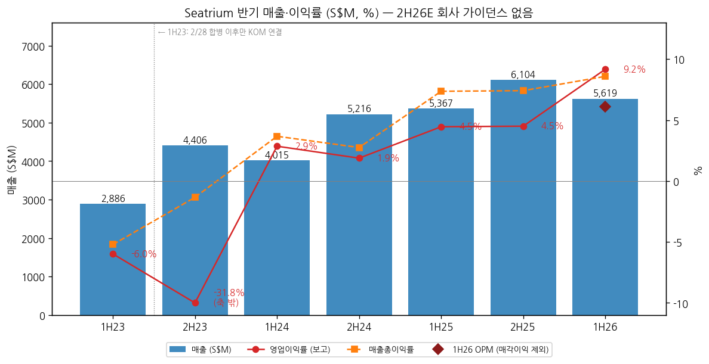
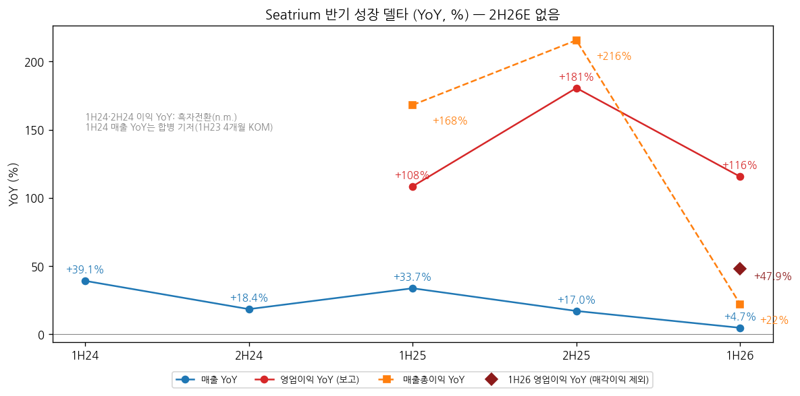
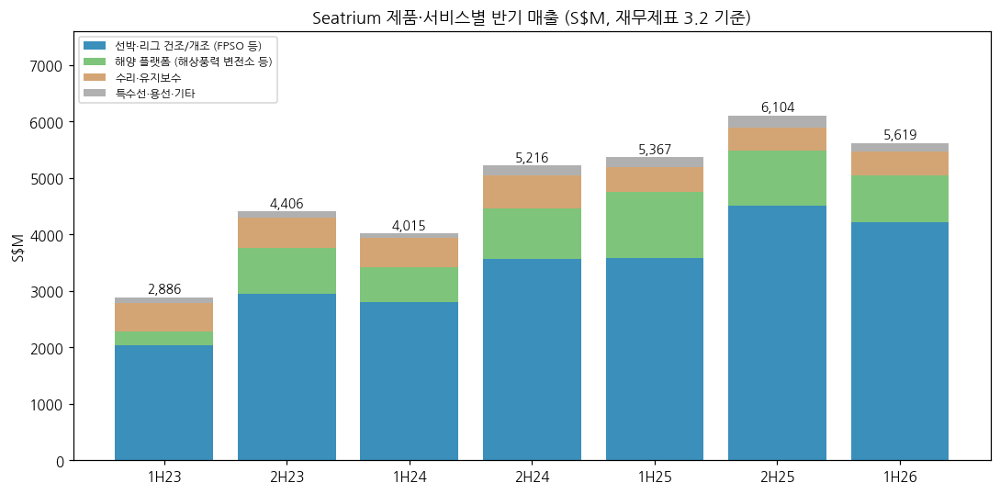
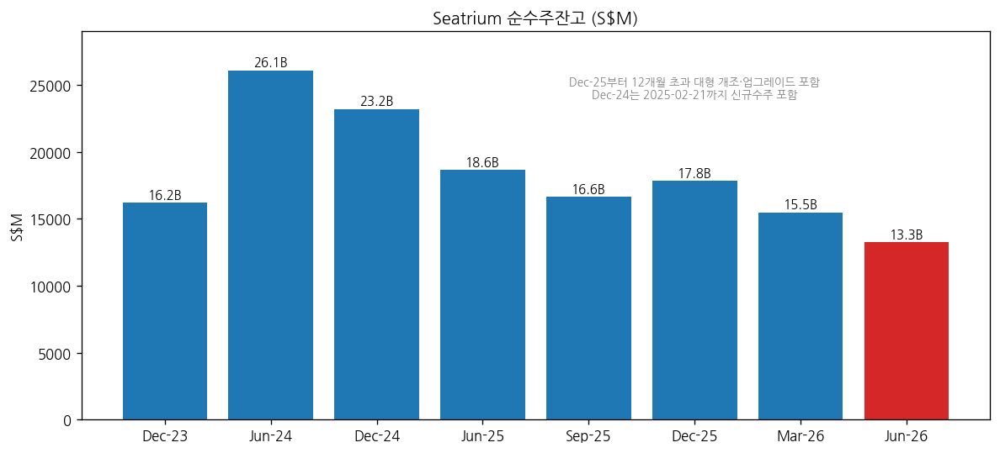

> 모드: 실적 리뷰 (v11)
> 종목: 시트리움 / Seatrium Limited (5E2.SI)
> 섹터: 조선
> 서브섹터: 조선 글로벌
> 분기: 2026-Q2 (1H26 반기 실적, 1~6월. 반기 공시 종목이라 분기 영업이익 미공시. 3Q26 Business Update는 2026-11-19 장 전 발표 예정 — 10/29 회사 공시)
> 발표일: 2026-07-31 (1H26 반기 재무제표·보도자료·IR 자료·애널리스트 브리핑 동시. 7/24 이익 증가 예고 공시 선행)
> 작성 시각: 2026-11-14 19:10 KST
> 분석 소스: [1차 · 회사 원문] SGX/investors.seatrium.com — 1H26 Condensed Interim FS·Press Release·Results Presentation·Briefing Transcript(7/31), 1Q26 Business Update(5/29), FY25 FS·Presentation(2/26), 3Q25 Business Update(2025-11-13), 1H25·FY24·1H24 Presentation, FY24 FS(2H23·FY23 비교 열), 2H26 수주 공시 5건(10/5~10/30), 3Q26 발표일 공지(10/29). [보도 인용] Sembcorp Marine FY21·FY22 실적(회사 보도자료 인용 기사), 시가총액·애널리스트 평균 TP(stockanalysis.com, 2026-09-22 기준), JPM First Take 헤드라인(reportify, 7/31), UOB Kay Hian 헤드라인(sginvestors, 8/3). 셀사이드 원문 없음
> 리뷰 깊이: 숫자 중심 | 리서치 첨부 0건

# Seatrium 1H26 실적 리뷰 — 마진은 올라왔는데, 잔고가 1년치까지 줄었다

> 성장 델타: 판정 보류 (분기 영업이익 미공시) / 반기 기준 둔화 | 내러티브: 약화 → 델타 둔화 + 내러티브 약화 → 경계 구간 (마진 개선은 숫자로 확인됐지만 수주 공백이 2027년 매출을 깎는 구간. 대형 FPSO·HVDC 수주가 확인되기 전까지 관망)

→ **숫자**: 1H26 매출 S$5,619M(+4.7% YoY), 영업이익 S$515M(+115.6%, OPM 9.2%), 지배 순이익 S$373M(+158%). 다만 영업이익에 매각이익 S$172M(세전)이 들어 있다. 이를 빼면 영업이익 S$343M(+47.9%, OPM 6.1%), 순이익 S$212M(+54%)다. 매출총이익률은 7.4% → 8.6%로 올랐다 (회사 FS·IR)
→ **델타**: 매출 YoY가 +33.7%(1H25) → +17.0%(2H25) → +4.7%(1H26)로 3개 반기 중 2개 반기 연속 감속했다. 매각이익을 뺀 영업이익 YoY(+47.9%)도 1H25 +108.5%, 2H25 +180.6%보다 낮다. 이익은 아직 플러스 성장이라 반기 판정은 "둔화"다 [판단]
→ **쟁점 ①**: 순수주잔고가 S$17.8B(2025년 말) → S$15.5B(3월 말) → S$13.3B(6월 말)로 6개월 새 -26% 줄었다. 1H26 신규 수주는 "S$1억 남짓"이다(CEO). 잔고는 FY25 매출의 1.16배 수준이다 [계산]
→ **쟁점 ②**: 회사는 "수요가 아니라 FID 타이밍 문제"라며 2년 파이프라인 S$32B와 FSRU 입찰 6~9건을 제시했다. 페트로브라스는 EPC 직발주에서 BOT(운영사 주도)로 옮겨가고 있다. 7월 말 이후 RigCo 리그 4기(>S$5억)·SBM FPSO 통합(>S$2억)·FSRU·파워십 개조 계약이 공시됐지만, 금액이 공개된 것만 합하면 S$7억+로 대형 FPSO(건당 S$40~50억) 한 척에 못 미친다
→ **다음 반기 관건**: 11/19 3Q26 업데이트에서 9월 말 잔고가 S$12B 아래로 내려가는지, 그리고 연내 Albacora 등 대형 FPSO·TenneT HVDC 추가분 수주 여부가 잔고 감소를 멈출지가 판정을 바꾼다. 회사는 FY26 순이익이 FY25(S$324M)보다 "의미 있게 높을 것"이라는 정성 가이던스만 냈다

---

## 1. 숫자

① 연결 기준 반기 표 (단위: S$M, %, SFRS(I) — 영업이익 = 손익계산서 Operating profit)

| 항목 | 1H23 | 2H23 | 1H24 | 2H24 | 1H25 | 2H25 | **1H26** | 2H26E |
|---|---|---|---|---|---|---|---|---|
| 매출액 | 2,886 | 4,406 | 4,015 | 5,216 | 5,367 | 6,104 | **5,619** | 가이던스 없음 |
| 영업이익 (보고) | -173 | -1,400 | 115 | 98 | 239 | 275 | **515** | — |
| OPM (보고) | -6.0 | -31.8 | 2.9 | 1.9 | 4.5 | 4.5 | **9.2** | — |
| 매출 YoY | — | — | +39.1 | +18.4 | +33.7 | +17.0 | **+4.7** | — |
| 영업이익 YoY | — | — | 흑전 | 흑전 | +108.5 | +180.6 | **+115.6** | — |
| **매출 YoY 델타 (%p)** | — | — | — | -20.7 | +15.3 | -16.7 | **-12.3** | — |
| **영업이익 YoY 델타 (%p)** | — | — | — | n.m. | n.m. | +72.1 | **-65.0** | — |
| 영업이익 (매각이익 제외) | — | — | — | — | 232 | 미산출 | **343** | — |
| OPM (매각이익 제외) | — | — | — | — | 4.3 | — | **6.1** | — |
| 영업이익 YoY (매각이익 제외) | — | — | — | — | — | — | **+47.9** | — |
| 매출총이익 | -150 | -59 | 147 | 143 | 395 | 452 | **482** | — |
| 매출총이익률 | -5.2 | -1.3 | 3.7 | 2.7 | 7.4 | 7.4 | **8.6** | — |
| 지배 순이익 | -264 | -1,752 | 36 | 121 | 144 | 179 | **373** | — |
| 순이익 (매각이익 제외, 회사) | — | — | — | — | 138 | — | **212** | — |
| EBITDA (회사) | 36 | 201 | 311 | 316 | 407 | 430 | **651 (매각 제외 479)** | — |

→ (출처: 1H26·1H25는 1H26 Condensed Interim FS 손익계산서, 2H25·2H24·FY25·FY24는 FY25 FS, 2H23·FY23은 FY24 FS 비교 열. 1H23·1H24는 연간 − 하반기 [계산]. 매각이익(세전)은 1H26 S$172M, 1H25 S$7M — 1H26 IR 15쪽. 매각이익 제외 순이익은 회사 수치(세후 매각이익 1H26 S$161M, 1H25 S$6M). EBITDA는 각 반기 IR, 2H25 = FY25 837 − 1H25 407 [계산]. 2H25는 자회사·관계사 매각이익 S$63M과 Admiralty 야드 원상복구 충당금 −S$49M, 외화선도 평가손 −S$74M이 섞여 있어 매각이익 제외 영업이익을 산출하지 않았다)
→ **이번 반기 서프라이즈**: 공개 컨센서스 원문을 확보하지 못했다. 보도 헤드라인 기준으로 JPM은 "1H26 core EPS 미스(마진은 개선, 잔고 소진 지속)", UOB Kay Hian은 "마진 덕에 core 이익 비트, 다만 잔고 낮음"으로 엇갈렸다 (reportify 7/31, sginvestors 8/3 — 보도 인용, 원문 미확인)
→ **기준 단절**: 2023-02-28 Keppel Offshore & Marine 합병 완료(Sembcorp Marine → Seatrium). 1H23은 KOM이 4개월만 연결돼 1H24 매출 YoY(+39%)는 부풀어 있다. 2023년 하반기 영업손실(-S$1,400M)은 합병 후 자산 감액·손실충당금·합병 비용이 반영된 숫자다 (FY24 IR: 2023 underlying 순손실 -S$28M). 따라서 의미 있는 YoY 비교는 1H25부터다
→ **매출 YoY는 이미 꺾이는 중이다**. 2H24·2H25 반기 매출은 마일스톤이 몰리는 하반기라 상반기보다 크다. 같은 반기끼리 보면 상반기 YoY는 +33.7% → +4.7%, 하반기 YoY는 +18.4% → +17.0%다. 회사 FY2028 목표(연 S$10~12B)는 사실상 "현 수준 유지"이고, 1H26 연환산 S$11.2B가 이미 그 범위 안이다 [계산]
→ **이익은 마진이 끌고 있다**. 매출 +S$252M에 매출총이익 +S$87M(증분 마진 34.7%, [계산]). 회사는 고마진 프로젝트 믹스, 간접비 감소(매각으로 연 S$50M 절감, 1H26에 약 S$10M만 반영), 원가 통제를 꼽았다. Maersk WTIV 정산 충당금이 일부 상쇄했다 (CFO Stephen Lu, 브리핑)
→ **[판단] 반기 델타 = 둔화**: 판정 기준인 영업이익 YoY를 매각이익 조정 기준으로 보면 +47.9%로, 직전 반기들(+108.5%, +180.6%)보다 작지만 플러스다. 매출 YoY는 2개 반기 연속 하락이다. 2H26에 남은 S$40M 절감 효과와 매각이익 잔여분(Aquarius Brasil, >S$80M 매각)이 더해지면 FY26 순이익은 "materially higher"가 되겠지만, 이는 비경상 요인 비중이 크다. 2H26 매출 YoY가 마이너스로 돌아서면 "꺾임"으로 바꾼다

→ (출처: Seatrium 반기·연간 재무제표, 1H26 IR. 2H26E는 회사 수치 가이던스와 공개 컨센 원문이 없어 공란)

→ (출처: 동일. 1H24·2H24 영업이익 YoY는 흑자전환으로 n.m., 1H26 마름모는 매각이익 S$172M 제외 기준 [계산])

② 사업부별 매출 (단위: S$M, %)

(1) 회사 관리 사업부 (IR 기준, 사업부 이익 미공개)

| 사업부 | 1H24 | 1H25 | **1H26** | 1H26 YoY | FY24 | FY25 | FY25 비중 |
|---|---|---|---|---|---|---|---|
| Oil & Gas (FPSO·FPU·FLNG) | 2,871 | 3,631 | **약 4,200** | **+15** | 약 6,600 | 약 8,100 | 71% |
| Offshore Wind (HVDC·HVAC 변전소, 설치선) | 545 | 1,120 | **약 900** | **-21** | 약 1,300 | 약 2,100 | 18% |
| Repairs & Upgrades (수리·개조·FSRU) | 517 | 418 | **약 400** | **보합** | 약 1,100 | 약 800 | 7% |
| Others (특수선·용선·MRO) | 82 | 198 | **약 200** | **-17** | 약 300 | 약 400 | 3% |
| 합계 | 4,015 | 5,367 | **5,619** | **+4.7** | 9,231 | 11,472 | 100% |

→ (출처: 1H24·1H25 정확치는 1H25 IR 15쪽. 1H26·FY24·FY25는 IR 막대그래프 S$B 소수 1자리 표기라 "약"으로 표기하고 YoY는 회사 기재치. 사업부별 영업이익은 회사가 공시하지 않는다 — 재무제표 보고 부문은 "야드(리그·부유체·수리·플랫폼·특수선)", "용선", "기타" 3개뿐이다)

(2) 재무제표 제품·서비스별 매출 (FS 주석 3.2, 정확치)

| 제품·서비스 | 1H24 | 2H24 | 1H25 | 2H25 | **1H26** | 1H26 YoY | 비고 |
|---|---|---|---|---|---|---|---|
| 선박·리그 건조/개조 | 2,800 | 3,568 | 3,583 | 4,504 | **4,211** | **+17.5** | P-84·P-85 FPSO, Kaskida·Tiber FPU |
| 해양 플랫폼 | 616 | 892 | 1,168 | 976 | **830** | **-28.9** | TenneT 2GW HVDC 4기, 미국 HVAC 잔여 |
| 수리·유지보수 | 517 | 587 | 433 | 408 | **428** | **-1.1** | 1H26 91척(1H25 101척) |
| 특수선 | 19 | 57 | 47 | 67 | **22** | **-52.8** | |
| 용선·기타 | 62 | 112 | 137 | 150 | **129** | **-6.0** | 용선은 Aquarius Brasil 매각 후 소멸 |

→ (출처: 1H26·FY25·FY24 Condensed Interim FS 주석 3.2, 1H24 = FY24 − 2H24 [계산]. 용선·기타 = 용선 + 상품매출 + 기타)
→ (출처 보조: 보고 부문 이익 — 야드 부문 1H26 S$458M(1H25 S$210M), 용선 부문 S$57M(1H25 S$8M). 1H26 용선 부문 이익은 예인선 17척 매각이익이 포함된 것으로 보인다 [추정]. Macquarie 질문 "용선 영업이익 약 S$57M, 그룹의 10%" — 브리핑)
→ **델타를 끄는 것은 FPSO다**. 선박·리그 건조/개조가 +17.5%로 유일하게 성장했다. 페트로브라스 P-84·P-85가 공정 피크 구간에 들어왔다 (CFO)
→ **꺾이는 것은 해상풍력이다**. 해양 플랫폼 매출은 1H25 S$1,168M이 정점이었고 2H25 -16%, 1H26 -29%로 2개 반기 연속 감소다. 회사 설명은 "레거시 프로젝트 기여 감소"다. 신규 HVDC는 2025년 12월 BalWin5 이후 없다
→ **수리·개조는 바닥 다지기**다. 처리 척수는 줄었지만(101 → 91척) 단가가 높은 크루즈·해군·LNG선·FSRU 위주로 바꾸고 있다. 회사는 2H26 물량 증가를 예고했다

→ (출처: Seatrium 재무제표 주석 3.2)

③ 수주·잔고 — 선행지표 (단위: S$M)

| 항목 | Dec-23 | Jun-24 | Dec-24 | Jun-25 | Sep-25 | Dec-25 | Mar-26 | **Jun-26** |
|---|---|---|---|---|---|---|---|---|
| 순수주잔고 | 16,190 | 26,083 | 23,217 | 18,637 | 16,638 | 17,841 | 15,488 | **13,262** |
| 잔고 프로젝트 수 | — | 32 | 27 | 25 | 24 | 24 | 24 | **24** |
| 잔고 내 O&G 비중 | — | 65%* | 75% | 74% | — | 66% | — | **62%** |
| 잔고 / 직전 연간 매출 (배) | 2.22 | — | 2.52 | — | — | 1.56 | — | **1.16** |

→ (출처: 각 반기 IR·분기 Business Update 부록 표. *Jun-24는 "Oil & Gas and others" 기준. Dec-24는 2025-02-21까지 신규 수주 포함. Dec-25부터 12개월 이상 걸리는 대형 개조·업그레이드 계약 포함(정의 변경). 잔고/매출 [계산])
→ **신규 수주**: 2024년 + 2025년 2월까지 S$15.2B → 2025년 S$4B+ → 1H26 "S$1억 남짓"(LNGT Karadeniz FSRU, FPSO 수명연장)이다. 1H26 book-to-bill은 약 0.02다 [계산: 0.1 / 5.6]
→ **2H26 공시 수주 (7/31 이후)**: Karpowership 9번째 FSRU 개조(10/5, 금액 비공개), Excelerate FSRU EPCIC + 옵션 1척(10/8, 비공개, 2028 인도), Karpowership Whale급 파워십 5척 개조·통합(10/23, 비공개, 첫 척 2027년 12월 입고), RigCo(Keppel 자회사) 리그 4기 완공 >S$500M(10/26, 드릴십 2027·잭업 2028), SBM Offshore FPSO 통합 >S$200M(10/30, 2029 완공). 금액 공개분 합계 >S$700M이다
→ **잔고 소진 속도**: 순잔고 인도연도별 분포는 2026년 S$122M, 2027년 S$1,806M, 2028년 S$1,992M, 2029년 S$2,438M, 2030년 이후 S$6,904M이다. 2H26에 수리·개조(잔고 밖)를 뺀 약 S$5.2~5.6B가 잔고에서 매출로 빠지면 연말 잔고는 신규 수주 전 S$7.7~8.1B, 공시 수주를 더해도 S$8.4~8.8B 수준이다 [추정]. 연 매출의 0.8배 안팎으로, Seatrium 출범 후 최저다

→ (출처: Seatrium IR·Business Update)

④ 가이던스 (이전 → 이번)

| 항목 | FY25 실적 발표 (2026-02-26) | 1Q26 업데이트 (2026-05-29) | **1H26 실적 (2026-07-31)** |
|---|---|---|---|
| 이익 가이던스 | 수치 없음, 마진 개선 지속 | "margin improvements on track" | **FY26 순이익이 FY25(S$324M)보다 "materially higher" (매각이익 포함)** |
| 마진 | 매출총이익률 7.4%, "mid-teens 프로젝트 마진 허들" | 개선 지속 | **1H 마진 동인 하반기 지속, 점진적 개선** |
| 2년 파이프라인 | >S$32B (O&G 23·OW 7·개조 2) | >S$28B (페트로브라스 SEAP 제외) | **>S$32B (O&G 21·OW 9·개조 2)** |
| 원가 절감 | 매각으로 연 >S$50M, FY28까지 누적 >S$100M | 매각 완료, >S$330M 현금화 | **5월부터 연 S$50M 런레이트, 1H 반영 약 S$10M** |
| 추가 매각 | >S$200M 장부가 자산 매각 예정 | — | **Aquarius Brasil >S$80M 매각 (2H26 종결)** |
| 주주환원 | DPS 3.0센트(FY24 1.5) | — | **S$100M 자사주 중 S$90M 집행 → 9/22 S$200M 신규 프로그램** |
| FY2028 목표 | 매출 S$10~12B, EBITDA ≥S$1.0B, ROE ≥8% | 유지 | **유지 ("on track")** |

→ (출처: 각 일자 보도자료·IR·브리핑. 신규 자사주 프로그램은 2026-09-22 공시)
→ 정리: 숫자 가이던스는 없고 방향만 있다. 이번 반기에 바뀐 것은 ① FY26 순이익 "materially higher" 문구 추가 ② 파이프라인 S$28B → S$32B 복귀(FLNG·FSRU 중심) 두 가지다. 1H26 EBITDA(매각 제외) S$479M을 연환산하면 S$958M으로 FY2028 목표(≥S$1.0B)에 이미 근접했다 [계산]

⑤ 연간 (단위: S$M, %)

| 항목 | FY21 (SCM) | FY22 (SCM) | FY23 | FY24 | FY25 | 1H26 |
|---|---|---|---|---|---|---|
| 매출액 | 1,862 | 1,947 | 7,291 | 9,231 | 11,472 | 5,619 |
| 영업이익 | 미확보 | 미확보 | -1,573 | 212 | 514 | 515 |
| OPM | — | — | -21.6 | 2.3 | 4.5 | 9.2 (매각 제외 6.1) |
| 매출 YoY | — | +4.6 | 기준 단절 | +26.6 | +24.3 | +4.7 |
| 영업이익 YoY | — | — | — | 흑전 | +141.7 | +115.6 |
| 지배 순이익 | -1,171 | -261 | -2,017 | 157 | 324 | 373 |
| 매출총이익률 | — | — | -2.9 | 3.1 | 7.4 | 8.6 |

→ (출처: FY23~FY25 회사 FS. FY21·FY22는 합병 전 Sembcorp Marine 단독 — 회사 FY22 보도자료를 인용한 기사 기준(보도 인용). 2026E·2027E 공개 컨센서스 원문은 확보하지 못했다. 참고로 stockanalysis 집계(S&P Global, 9/22)는 애널리스트 10명 평균 TP S$2.51, 3년 매출 성장률 전망 -7.4%(연평균)를 보여준다 — 보도 인용)
→ 발표 전 → 후 연간 컨센 변화: 미확보

---

## 2. 시장 쟁점

① 지난 분기 체크
→ 첫 리뷰 — 직전 체크 없음

② 이번 반기 쟁점 4개 (1H26 브리핑 질문 + 보도에서 반복된 것)

| # | 쟁점 | 반복 출처 |
|---|---|---|
| (1) | 잔고 S$13.3B, 수주 S$1억 — 언제 채워지나 | DBS·Citi 질문, JPM·UOB 헤드라인, Seatrade "net orderbook declines" |
| (2) | 페트로브라스 EPC → BOT 전환 — 수주율 90% 시대는 끝났나 | JPM·DBS 질문 (2명, 3문항) |
| (3) | 마진 8.6%는 지속 가능한가 — 매각이익·절감·수리 믹스 분해 | Citi·Macquarie 질문, 회사 "54%에 앵커하라" |
| (4) | 가스(FLNG·FSRU) 파이프라인은 해상풍력 공백을 메울 수 있나 | Citi·Business Times·Upstream 질문 |

③ 쟁점별 분해

(1) 잔고 S$13.3B — 언제 채워지나

(1-1) 회사 설명
→ "FID 타이밍은 통제할 수 없다. 2023년, 2024년에도 같은 질문을 받았다. 입찰팀은 거의 피크다" (CEO Chris Ong, DBS Ho Pei Hwa 질문 답변)
→ 하반기 후보로 Albacora(결과 2H26), 다수의 FLNG·FSRU 개조, HVDC·HVAC, 가이아나(Exxon)를 직접 거명했다
→ "수요가 아니라 타이밍 문제(timing, not demand)" — 해상풍력 리스 발주는 2026년 둔화, 2027년 회복 (IR 10쪽)
→ 잔고 질은 개선: Series Build 95% 이상, 합병 전 비(非)FPSO 레거시 잔고는 S$140M 미만(약 1%)

(1-2) 반복된 질문
→ Citi(Luis Hilado): 2028년 이후 인도분까지 공정이 많이 진척됐는데, 조기 완공·조기 수금이 가능한가 → "고객은 가속을 좋아하지만 작업 전선(work front)이 준비돼야 한다. 마일스톤 지급이라 마일스톤을 달성하면 받는다"
→ DBS: 하반기에 FID가 기대되는 대형 프로젝트는 무엇인가 → 위 (1-1)

(1-3) **[판단]**
→ 숫자로 보면 잔고는 6개월에 S$4.6B 줄었고, 같은 기간 매출은 S$5.6B였다. 즉 신규 수주가 거의 0이었다. 7월 이후 공시분(>S$0.7B)을 더해도 2H26 매출 소진(약 S$5.5B)을 메우지 못한다 [계산]
→ 이번 리뷰의 핵심 리스크다. 회사의 FY2028 매출 목표(S$10~12B)를 지키려면 2027년 중 FPSO 2척급(건당 S$4~5B, 회사 IR 8쪽) 수주가 필요하다 [추정]. 잔고 정의가 Dec-25부터 대형 개조를 포함하도록 넓어진 점도 감안해야 한다 — 같은 정의라면 감소 폭은 더 크다
→ 결론이 바뀌는 조건: 연내 Albacora 또는 가이아나 FPSO 1척(S$4B급) 수주가 확인되면 잔고는 S$12B 이상으로 회복하고 "타이밍 문제"라는 회사 설명이 숫자로 확인된다

(2) 페트로브라스 EPC → BOT 전환

(2-1) 회사 설명
→ "BOT도 EPC 후 O&M을 붙인 구조다. 전면에 서는 운영사 파트너가 있고, 우리는 EPC 부분을 맡는다. 규격·지급 조건·리스크 프로필은 EPC와 대체로 같다" (CEO)
→ "BOT도 마진과 마일스톤 지급 등 상업 조건은 기존 프로젝트와 비슷하다. 최종 노출은 같다" (CFO, DBS 질문 보충)
→ 페트로브라스 SEAP(SBM 수주)는 1Q26에 파이프라인에서 뺐다(남미 S$12B → S$8B). SBM과는 로컬 콘텐츠 하도급을 협의 중이다 (CEO 연설). 실제로 10/30 SBM에서 남미행 FPSO 통합 >S$2억을 받았다

(2-2) 반복된 질문
→ JPM(Terence Khi): 2021~2024년 페트로브라스 EPC 계약의 90%를 땄는데, BOT로 바뀌면 경쟁 구도는 어떻게 바뀌나 / 직접 입찰과 SBM 하도급이 겹치지 않나
→ DBS: 운영사가 약 10곳 사전적격인데, BOT 모드에서 운영사와의 관계는 어떻게 바뀌나

(2-3) **[판단]**
→ BOT에서 Seatrium은 원청이 아니라 운영사(SBM·MODEC 등)의 EPC 파트너다. 같은 운영사들은 중국·한국 야드도 쓸 수 있으므로, 브라질 로컬 콘텐츠 3개 야드가 유일한 차별점이 된다. "가격을 이기려고 들어간다(pricing to win)"는 CEO 발언은 마진 압박 가능성을 시사한다 [판단]
→ SBM 통합 계약(>S$2억)은 풀스코프 EPC(S$4~5B)의 약 5% 규모다. BOT 시대의 기본 수주 단위가 "통합·모듈"로 작아질 수 있다는 첫 신호다 [판단]

(3) 마진 8.6%는 지속 가능한가

(3-1) 회사 설명
→ "54%(매각이익 제외 순이익 증가율)가 앵커할 숫자다. 영업 성과의 진짜 개선을 보여준다" (CEO)
→ 마진 동인: 고마진 Series Build 비중 확대, 영업 레버리지, 원가 규율. Maersk WTIV 정산 충당금이 일부 상쇄 (CFO)
→ 매각 런레이트 절감 연 S$50M 중 1H26에는 약 S$10M만 반영, 2H26에 전액 반영 (CFO, Citi 질문 답변)
→ 수리·개조(R&U) 마진은 EPC의 "mid-teens"보다 높다. 크루즈 업그레이드는 건당 S$50~100M (CFO, Macquarie Zhiwei Foo 질문 답변)

(3-2) 반복된 질문
→ Macquarie: 용선 영업이익 S$57M(그룹의 약 10%)이 Aquarius Brasil 매각 후 어떻게 되나 → "종결 후 용선 부문은 0이 된다. 대금은 18~24개월 분할 + 마지막에 총액의 약 45% 일시 지급. 다른 계정에 잡힌다" (CFO)
→ Macquarie: 크루즈 업그레이드 사이클이 마진을 얼마나 올리나 → 수치 답변 없음 ("blended")

(3-3) **[판단]**
→ 매출총이익률 8.6%는 매각이익과 무관한 숫자라 "진짜 개선"이 맞다. 다만 "mid-teens 프로젝트 마진"과의 차이(약 6%p)는 미배분 간접비·레거시 손실이다. 2H26에 절감 S$40M이 더 들어오면 매출총이익률 기준 약 +0.7%p 효과다 [계산: 40 / 5,600]
→ 반대로 용선 부문(1H26 S$57M)은 사라지고, 수주 공백으로 2027년 야드 가동률이 떨어지면 고정비 부담이 다시 커진다. 마진 개선이 "매출 감소 구간"에서 유지되는지가 2027년의 시험대다 [판단]

(4) 가스(FLNG·FSRU)가 해상풍력 공백을 메울 수 있나

(4-1) 회사 설명
→ "FSRU 입찰만 6~9건을 보고 있다. 통합부터 풀 EPC까지, FLNG 개조도 있다" (CEO, Citi·Business Times 질문 답변). 파이프라인 증가분(S$28B → S$32B)은 주로 LNG 관련이다
→ 세계 유일의 LNG선 → FLNG 개조 2기(Hilli·Gimi) 실적, FSRU/FSU 개조 세계 90% 이상. FLNG 계약은 통상 S$10억, FSRU 개조는 S$3,000만~1억 (IR 9쪽)
→ 신조 FLNG 설계 FLNG-X는 AiP를 받았고 "지금도 입찰 가능하다" (CEO, Upstream 질문 답변). 아프리카 FLNG 기회 약 S$7B
→ 해상풍력: 파이프라인 S$9B(HVDC·HVAC), TenneT 2GW 할당 사전적격 3곳 중 하나

(4-2) **[판단]**
→ FSRU·파워십은 건당 규모가 작아(S$0.3~1억) 잔고를 채우기엔 부족하다. 10월에 연달아 나온 Excelerate·Karpowership 계약이 금액 비공개인 것도 같은 이유로 보인다 [추정]. 잔고를 움직이려면 FLNG(S$10억급) 또는 FPSO(S$40~50억)가 필요하다
→ 한국 피어 연결: 신조 FLNG는 삼성중공업(점유율 64%, 2026-Q3 조선 섹터 리뷰)의 영역이다. Seatrium이 FLNG-X로 신조 시장에 들어오면 삼성중공업과 직접 경쟁하게 되고, 개조형 FLNG는 삼성중공업 신조 대비 공기·가격 대안이 된다 [판단]

---

## 3. 내러티브 점검

① 성장 스토리 정의
→ 합병(2023) 후 레거시 손실 정리 → Series Build(페트로브라스 P-시리즈 6척, TenneT 2GW HVDC 4기) 잔고 위에서 마진을 정상화(매출총이익률 -2.9% → 8.6%)하고, FY2028 EBITDA S$1B·ROE 8%로 가는 "턴어라운드 + 자기자본이익률 회복" 스토리. 시장은 마진 개선 속도와 잔고 재충전을 함께 산다

② 이번 반기 평가
→ **강화된 부분**: 마진. 매출총이익률 8.6%, 매각 제외 순이익 +54%, FCF S$237M(일회성 제외) 흑자 전환, 순레버리지 0.5배. 턴어라운드의 "이익" 축은 거의 완성 단계다
→ **약해진 부분**: 잔고. 반년 수주 S$1억, 잔고 S$13.3B(매출의 1.16배), 해상풍력 매출 2개 반기 연속 감소, 페트로브라스 BOT 전환으로 대형 EPC 직수주 경로 불확실
→ **[판단] 내러티브 = 약화**: 스토리의 다음 단계(성장 재개)를 받칠 잔고가 줄고 있다. 회사가 "타이밍 문제"라고 하지만 1H26 시점에 확인된 것은 없다. 1번 델타 "둔화"와 합치면 **경계 구간**이다

③ 스토리를 다시 강하게 만들 트리거
→ 대형 FPSO 1척 이상(Albacora·가이아나·페트로브라스 BOT EPC) 수주 — 잔고를 S$4~5B 한 번에 회복
→ TenneT 2GW HVDC 추가 할당 또는 FLNG 신조/개조(S$10억급) 수주
→ 2H26 매출총이익률 9% 이상 + FY26 순이익 S$600M대(매각 포함) — "materially higher"의 크기 확인 [추정 기준]

④ 스토리를 깨뜨릴 리스크
→ 3Q26 업데이트에서도 대형 수주가 없고 잔고가 S$12B 아래로 감소 — 2027년 매출 역성장 가시화
→ BOT 구조에서 하도급 위주 수주가 고착되며 계약 단가·마진 하락
→ 해상풍력 FID 지연 장기화(유럽 HVDC 일정 순연), Middle East 긴장에 따른 MRO 둔화 지속

⑤ 한국 조선 3사 대비 시사점
→ 마진·잔고 모두 한국 3사보다 한 단계 아래다. Seatrium FY25 OPM 4.5%(1H26 매각 제외 6.1%), 잔고 약 1.2년치 vs 한국 3사 3Q26 OPM 10.7~15.6%, 잔고 3년치 이상(2026-Q3 조선 섹터 리뷰). 해양(FPSO·FLNG)에서 Seatrium이 수주를 못 채우는 것은 같은 해양 발주 공백(한화오션 Venus FPSO 대기, 삼성중공업 해양 수주 목표의 54%)이 업종 전반 현상이라는 방증이다 [판단]
→ 반대로 Seatrium의 BOT 하도급 전환·FSRU 소형화는 한국 3사가 해양 수주 단가를 지키기 어렵다는 경고이기도 하다. 해상풍력 변전소(HVDC/HVAC)에서는 Seatrium이 TenneT 사전적격 3곳 중 하나로, HD현대중공업의 OSS 진입에 가장 직접적인 경쟁자다 [판단]

---

## 4. 향후 봐야 할 것 (우선순위 순)

(1) **3Q26 업데이트(11/19)의 9월 말 순잔고 — S$12B 사수 여부**
→ 무엇을: 9월 말 순잔고(6월 말 S$13.3B에서 3Q 매출 약 S$2.8B 소진 시 신규 수주 없으면 약 S$10.5~10.7B [추정]), 3Q 신규 수주 금액, 2027년 인도분 비중. S$12B 아래면 2027년 매출 역성장 경로가 확정되고 반기 델타 "꺾임" 쪽으로 기운다
→ 어떤 데이터로: 3Q26 Business Update(잔고 표·프로젝트 목록·POC), 컨퍼런스콜 트랜스크립트
→ 언제: 2026-11-19 장 전

(2) **대형 FPSO 수주 — Albacora·가이아나·페트로브라스 BOT**
→ 무엇을: 풀스코프 EPC(S$4~5B) 1척 이상, 또는 BOT 컨소시엄의 EPC 파트너 지위 확정. 하도급(통합·모듈) 위주면 건당 S$2~5억에 그친다
→ 어떤 데이터로: SGX 수주 공시, 뉴스 키워드 "Seatrium Albacora", "Petrobras FPSO BOT award", "Exxon Guyana FPSO integration Seatrium", 경쟁 야드(한화오션 Venus, 중국 야드) 수주
→ 언제: 2H26 결과(CEO) ~ 2027년 상반기

(3) **2H26 마진과 FY26 순이익 크기 — "materially higher"**
→ 무엇을: 2H26 매출총이익률 9% 이상(1H26 8.6%), 절감 S$40M 추가 반영, Aquarius Brasil 매각이익, FY26 순이익(FY25 S$324M 대비). 매출이 YoY 마이너스로 돌아서도 마진이 오르는지
→ 어떤 데이터로: FY26 실적(2027년 2월 말 예상, 전년 2/26), 이익 예고 공시(전년 사례 7/24)
→ 언제: 2027년 2월 말

(4) **해상풍력 재개 — TenneT 2GW 추가 할당, 아시아 HVAC**
→ 무엇을: TenneT 2GW 할당 결과(사전적격 3곳 중 하나), 대만·한국·일본 HVAC OSS 입찰. 해양 플랫폼 매출의 3개 반기 연속 감소 여부
→ 어떤 데이터로: TenneT 발주 공시, 뉴스 키워드 "TenneT 2GW platform award", "Seatrium HVAC offshore substation", HD현대중공업 OSS 수주
→ 언제: 2027년 (회사는 "2027년 모멘텀 회복")

(5) **가스 개조 수주의 규모 — FLNG 1건이 나오나**
→ 무엇을: FSRU 입찰 6~9건 중 수주 건수, FLNG 개조/신조(S$10억급) 1건 여부, Karpowership LOI 잔여 FSRU 1건
→ 어떤 데이터로: SGX 공시, 뉴스 키워드 "Seatrium FLNG conversion", "FLNG-X", 삼성중공업 FLNG 수주(경쟁 구도)
→ 언제: 4Q26~2027
