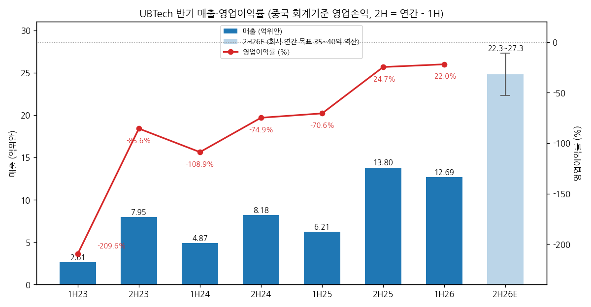
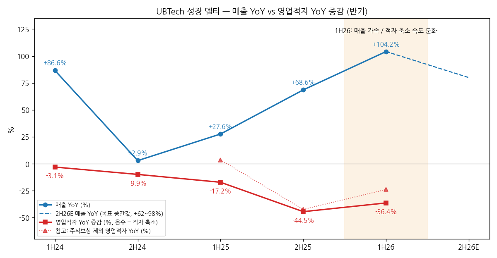
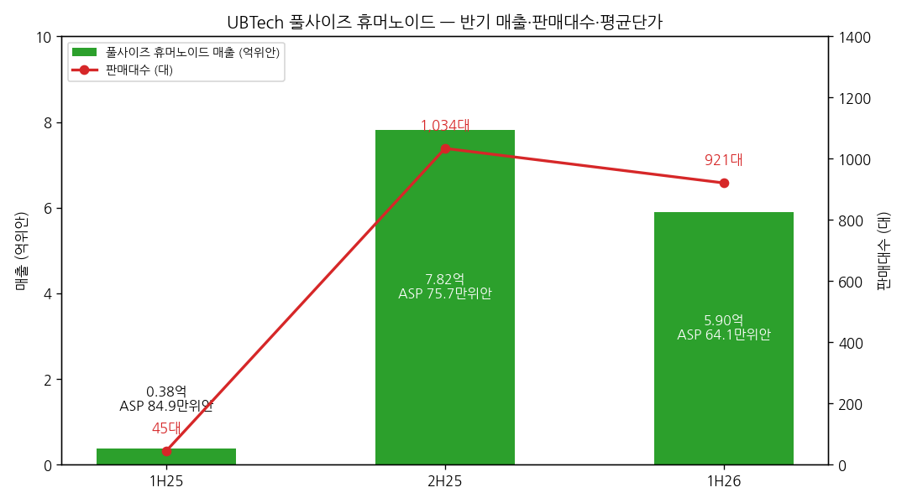

> 모드: 실적 리뷰 (v11)
> 종목: UBTech / 优必选 (9880.HK)
> 섹터: 로봇
> 서브섹터: 휴머노이드 완성체
> 분기: 2026-Q2 (1H26 반기 실적 — 홍콩 상장사라 손익은 반기·연간만 공시, 손익이 나온 분기로 리뷰를 둔다)
> 발표일: 2026-08-28 (HKEX 中期業績公告, 장 마감 후 18:45) / 실적설명회 2026-08-30 / 中期報告 2026-09-24
> 작성 시각: 2026-11-23 11:50 KST
> 분석 소스: [1차·회사 원문] HKEX 공시 원문 — Interim Results Announcement 1H26(8/28), Interim Report 2026(9/24), Annual Results Announcement FY2025(2026-03-31)·FY2024(2025-03-30)·FY2023(2024-03-28), Interim Results Announcement 1H25(2025-08-29)·1H24(2024-08-28), 2026 H주 인센티브 부여 공시(9/14). 2H = 연간 − 1H [계산]. [보도 인용] 실적설명회(8/30) 경영진 발언·사업부 이익률 — 澎湃新闻(9/1), 东方财富(8/31), 中国经营报(新浪 전재, 9/13), 市值风云(同花顺 전재, 10/27); 1H26 수주 10억위안 이상 — 财通证券 집계(澎湃新闻 인용); 11월 채널 계약 — 21世纪经济报道(证券之星 전재, 11/12). 셀사이드 리포트 미확보, 실적설명회 Q&A 원문 미확보
> 리뷰 깊이: 숫자 중심 | 리서치 첨부 0건
> 비영업 요인: 주식보상비 소멸(1H25 0.72억 → 1H26 0) · 인수(锋龙股份 43.01%, 2026-04 연결 — 매출 1.39억) · 신용손상 추정 방식 변경(0.01억 → 0.91억)

# UBTech 1H26 실적 리뷰 (2026-Q2) — 매출 +104%로 가속했지만, 영업적자 축소 속도는 2H25보다 느려졌다. 휴머노이드는 반기 기준 직전 반기보다 덜 팔렸다

> 성장 델타: 둔화 | 내러티브: 약화 → 매출 가속 + 적자 축소 속도 둔화 + 인도 지연 → 경계 구간 (2H26 매출 22\~27억위안 달성 확인 전까지)

> ⚠ 비영업 요인 플래그: 영업적자 개선 1.60억위안 중 0.72억(45%)은 주식보상비 소멸(1H25 0.72억 → 1H26 0) — 제외하면 적자 축소율 −23.9%(2H25 −42.4%). 매출 증가 6.48억위안 중 1.39억은 锋龙 인수 편입(오가닉 매출 +81.8%). 반대로 신용손상 0.91억위안(추정 방식 변경)이 적자를 키웠다. 판정은 보고 영업손익 그대로

→ **판정 방식**: 적자 기업이라 영업이익 YoY 대신 **영업적자 YoY 증감률(적자 축소율)과 축소 금액의 변화**로 판정했다. 영업손익은 회사 공시 중국 회계기준 "Operating loss"(营业利润 — 금융비용·투자손익·신용손상 포함). 반기 단위로 1H26 vs 1H25를 보고, 직전 반기 2H25 vs 2H24와 비교했다
→ **숫자**: 1H26 매출 12.69억위안(+104.2%), 영업손익 −2.79억위안(1H25 −4.39억, 적자 −36.4%), 영업이익률 −22.0%(+48.6%p YoY), 매출총이익률 44.7%(+9.7%p). 직전 반기 2H25는 적자 −44.5%(−6.13억 → −3.40억, 축소 2.73억)였는데 1H26 축소 폭은 1.60억이다. 매출 YoY는 +68.6% → +104.2%(+35.6%p)로 가속했다 — 이익 우선 원칙(Unitree 3Q26 선례)으로 **둔화**
→ **쟁점**: (1) 2H26 매출 22\~27억위안(1H의 1.8\~2.2배)이 필요한데 광시 공장이 2\~3개월 늦었다 (2) 풀사이즈 휴머노이드 매출총이익률 66.8%는 평균단가 하락(84.9 → 64.1만위안) 속에서 나왔다 — 회사 장기 목표는 50% 이상 (3) 손익분기는 "2027년 4분기 분기 흑자" 그대로, 4Q26 조정 EBITDA 흑자 "가능" (4) 매출채권 22.25억(1년 초과 7.67억)·재고 9.85억·현금 23.3억위안
→ **다음 반기 관건**: 2H26 영업적자가 1.89억위안 이하(2H25 −3.40억 대비 −44.5% 이상 축소)면 델타 가속으로 돌아선다. 1H26(−2.79억)보다 적자가 커지면 꺾임이다. 다음 손익 공시는 2026 연간 실적(2027-03 말 예상)

---

## 1. 숫자

① 연결 기준 반기 표 (단위: 억위안, %, 중국 회계기준 — 분기 실적 미공시)

| 항목 | 1H23 | 2H23 | 1H24 | 2H24 | 1H25 | 2H25 | **1H26** | 2H26E |
|---|---|---|---|---|---|---|---|---|
| 매출 | 2.61 | 7.95 | 4.87 | 8.18 | 6.21 | 13.80 | **12.69** | 22.3\~27.3 (회사 목표 역산) |
| 영업손익 (Operating loss) | −5.47 | −6.80 | −5.30 | −6.13 | −4.39 | −3.40 | **−2.79** | 가이던스 없음 |
| 영업이익률 | −209.6 | −85.6 | −108.9 | −74.9 | −70.6 | −24.7 | **−22.0** | — |
| 매출 YoY | — | — | +86.6 | +2.9 | +27.6 | +68.6 | **+104.2** | +62\~+98 |
| 영업적자 YoY 증감 (음수 = 축소) | — | — | −3.1 | −9.9 | −17.2 | −44.5 | **−36.4** | — |
| 영업적자 축소 금액 (억위안) | — | — | +0.17 | +0.68 | +0.91 | +2.73 | **+1.60** | — |
| **매출 YoY 델타 (%p)** | — | — | — | — | +24.7 | +41.0 | **+35.6** | — |
| **영업적자 증감 델타 (%p)** | — | — | — | — | −7.3 | −27.3 | **+8.1** (축소 속도 둔화) | — |
| 매출총이익률 | 22.6 | 34.5 | 38.0 | 23.1 | 35.0 | 38.9 | **44.7** | 2026 목표 40\~43 [보도] |
| 참고: 주식보상비 | 1.79 | 2.04 | 1.76 | 0.69 | 0.72 | 0.27 | **0** | 9월 신규 부여 |
| 참고: 주식보상 제외 영업손익 | −3.68 | −4.76 | −3.54 | −5.44 | −3.67 | −3.13 | **−2.79** | — |
| 참고: 주식보상 제외 영업적자 YoY | — | — | −3.7 | +14.2 (확대) | +3.6 (확대) | −42.4 | **−23.9** | — |
| 참고: 신용손상 | 0.09 | 1.36 | 0.74 | 0.82 | 0.01 | 1.50 | **0.91** | — |
| 순손익 | −5.48 | −7.17 | −5.40 | −6.20 | −4.40 | −3.50 | **−3.39** | — |
| 지배주주 순손익 | −5.33 | −7.01 | −5.16 | −6.07 | −4.14 | −2.90 | **−3.11** | — |
| 조정 EBITDA (회사 non-GAAP) | — | — | — | — | −3.22 | −1.16 | **−1.74** | 4Q26 흑자 "가능" [보도] |

→ (출처: HKEX 원문 — 1H26·1H25·1H24 Interim Results Announcement, FY2025·FY2024·FY2023 Annual Results Announcement 손익계산서·non-GAAP 조정표. 1H23은 1H24 공시의 비교치. 2H = 연간 − 1H [계산]. 2H26E 매출 = 회사 2026 매출 목표 35\~40억위안(실적설명회, 周剑 회장 "仍然充满信心" — 澎湃新闻·东方财富 보도) − 1H26 [계산])
→ 서프라이즈: 회사 가이던스(반기)·공개 컨센서스가 없어 판단 불가. 회사가 2026 연간 목표(매출 35\~40억)를 유지했다는 것이 유일한 기준점이다
→ **YoY 위치**: 매출 YoY는 2H24 +2.9%에서 3개 반기 연속 가속(+27.6 → +68.6 → +104.2%). 영업적자 축소율은 2H25 −44.5%가 지금까지 최대였고 1H26 −36.4%로 처음 줄었다. 영업이익률 개선 폭(YoY)도 2H25 +50.2%p → 1H26 +48.6%p로 비슷하다
→ **기준 단절**: 1H26부터 锋龙股份(43.01%, 원예기계·자동차·유압 부품)이 4월분부터 연결됐다(매출 1.39억위안, 3개월치). 2H26에는 6개월치가 들어온다. 锋龙 제외 매출은 약 11.30억위안(+81.8%) [보도 인용 澎湃新闻·市值风云, 계산 일치]
→ **[판단] 델타 = 둔화**: 판정 지표(영업적자 축소율)가 −44.5% → −36.4%로 8.1%p 약해졌고, 축소 금액도 2.73억 → 1.60억위안으로 줄었다. 주식보상비 소멸분을 빼면 −42.4% → −23.9%로 둔화가 더 크다. 매출은 가속이라 기준표상 "방향 엇갈림(유지)"에도 걸리지만, 이익 우선 원칙에 따라 둔화로 판정했다

→ (출처: HKEX 반기·연간 실적 공시 원문, 2H = 연간 − 1H [계산]. 2H26E는 회사 연간 매출 목표 35\~40억위안 역산)

→ (출처: 동일. 영업적자 YoY 증감은 음수일수록 적자 축소. 주식보상 제외치는 회사 non-GAAP 조정표의 주식보상비를 영업손익에 더한 값 [계산])

② 사업부별 매출 (단위: 억위안, % — 회사는 "단일 영업 부문"이라 사업부 영업이익 미공시)

| 사업부 | 1H25 | 2H25 | **1H26** | 1H26 YoY | 1H26 비중 | 2025 연간 |
|---|---|---|---|---|---|---|
| 풀사이즈 구현형 휴머노이드 | 0.38 | 7.82 | **5.90** | +1,445.0 | 46.5 | 8.21 |
| 비(非)구현형 휴머노이드 (소형) | 0.27 | 0.21 | **0.33** | +21.9 | 2.6 | 0.48 |
| 기타 지능형 로봇 (교육·물류·업종 맞춤) | 3.03 | 3.26 | **2.46** | −18.8 | 19.4 | 6.29 |
| └ 교육 로봇 (구 분류) | 2.40 | — | **1.22** | −49.1 | 9.6 | — |
| └ 물류 로봇 (구 분류) | 0.56 | — | **1.37** | +144.0 | 10.8 | — |
| 기타 스마트 하드웨어 (반려·청소·정원 기기) | 2.52 | 2.47 | **2.59** | +2.9 | 20.4 | 4.99 |
| 원예기계·자동차·유압 부품 (锋龙) | — | — | **1.39** | 신규 | 11.0 | — |
| 기타 (원자재·부품) | 0.02 | 0.03 | **0.02** | +10.6 | 0.1 | 0.05 |
| **합계** | **6.21** | **13.80** | **12.69** | **+104.2** | 100 | **20.01** |

→ (출처: 1H26 Interim Results Announcement "Revenue by Type of Products and Services"(1H25는 새 분류로 재작성된 회사 비교치), FY2025 Annual Results Announcement. 2H25 = FY2025 − 1H25 [계산]. 교육·물류는 1H26 공시의 구 분류 병기표 — 풀사이즈 휴머노이드 일부 포함)

| 풀사이즈 휴머노이드 | 2024 | 1H25 | 2H25 | **1H26** |
|---|---|---|---|---|
| 판매대수 (대) | 3 [계산] | 45 [계산] | 1,034 [계산] | **921** |
| 매출 (억위안) | 0.36 | 0.38 | 7.82 | **5.90** |
| 평균단가 (만위안/대) | — | 84.9 | 75.7 | **64.1** [계산] |
| 매출총이익률 | — | 47.3 [계산] | — | **66.8** [보도 인용] |
| 판매대수 HoH (직전 반기 대비) | — | — | — | **−10.9%** |
| 매출 HoH | — | — | — | **−24.6%** |

→ (출처: 판매대수 — 1H26 921대(+1,946.7%)·2025 1,079대(+35,866.7%)는 HKEX 실적 공시 원문, 1H25·2024·2H25는 증가율 역산 [계산]. 매출총이익률 66.8%(+19.5%p)·Walker S2 70% 이상은 실적설명회 발언 [보도 인용 澎湃新闻·东方财富])

→ (출처: HKEX 실적 공시 원문, 2H25·평균단가 [계산])

→ **델타를 끈 것은 풀사이즈 휴머노이드다**. YoY 매출 증가 6.48억위안 중 5.52억(85%)이 휴머노이드다. 휴머노이드 매출총이익 약 3.9억위안은 전사 매출총이익(5.67억)의 약 70%다 [보도 인용 澎湃新闻]
→ **그러나 직전 반기(2H25)보다는 줄었다**. 판매 1,034 → 921대(−10.9%), 매출 7.82 → 5.90억위안(−24.6%). 2H25에 대형 데이터 수집 센터 수주(광시 팡청강 2.64억 등 — 2025-11 회사 공시)가 몰렸고, 1H26 매출은 기존 제품 Walker S2 중심이다 (中国经营报). 계절성(하반기 매출 63\~75%)을 감안해도 반기 순서상 감소다 [판단]
→ **고객 집중**: 1H26 단일 고객 매출 3.09억위안(전사 24%) — 1H25·2025 연간에는 10% 이상 고객이 없었다 (1H26 공시 원문). 휴머노이드 매출의 절반 이상이 한 고객일 가능성이 있다 [추정]
→ **꺾이는 사업부**: 교육 로봇 −49.1%(2.40 → 1.22억). 레거시 하드웨어는 +2.9%로 정체

(1) 비용 구조 (매출 대비 %)

| 항목 | 1H25 | **1H26** | 증감 |
|---|---|---|---|
| 판매비 | 36.0 (2.24억) | **18.8 (2.38억)** | +6.5% |
| 관리비 | 29.8 (1.85억) | **11.8 (1.49억)** | −19.3% (주식보상 −0.52억) |
| 연구개발비 | 35.1 (2.18억) | **23.9 (3.03억)** | +38.9% |
| 신용손상 | 0.2 (0.01억) | **7.2 (0.91억)** | 외부 등급법 → 이동률법 변경 |
| 투자손실 (지분법) | 6.3 (0.39억) | **2.6 (0.33억)** | — |

→ (출처: 1H26 Interim Results Announcement MD&A·손익계산서 원문)
→ 1H26 영업적자 개선 1.60억위안 분해 [계산]: 매출총이익 +3.50억 vs 연구개발비 −0.85억, 신용손상 −0.90억, 판매비 −0.15억, 관리비 +0.36억(주식보상 소멸 포함), 기타 −0.36억(금융비용 환손실 등)

(2) 회사 목표·가이던스 — 이전 → 이번

| 항목 | 이전 | 이번 (1H26 발표 후) | 출처 등급 |
|---|---|---|---|
| 2026 매출 | 35\~40억위안 (2026-03 연간 실적 후 보도) | 유지 — "충분한 자신감" (8/30 설명회) | 보도 인용 |
| 2026 Walker S 인도 | 2,000\~3,000대 | **5,000대로 상향** | 보도 인용 (市值风云) — 9/14 인센티브 공시는 "2026년 특정 판매 목표"만 명시 |
| 생산 캐파 목표 | 연 1만대 | 유지 (1H26 공시 "annual production target of 10,000 units") | 회사 원문 |
| 손익분기 | 2027년 4분기 분기 흑자 | 유지, 앞당기기 노력. 4Q26 조정 EBITDA 흑자 "가능" | 보도 인용 (张钜 CFO) |
| U1 (가정용) 2026 인도 | 사전 예약 1.3만대 이상 | 1,500\~2,000대 | 보도 인용 (周剑 회장) |
| 휴머노이드 매출총이익률 | — | 장기 50% 이상 유지 | 보도 인용 |

(3) 수주

→ 1H26 신규 수주 10억위안 이상, 1억위안 이상 대형 계약 3건(항공 제조·자동차·스마트 제조) [보도 인용 — 财通证券 집계, 澎湃新闻]. 회사는 반기 수주잔고를 공시하지 않는다
→ 2025년 Walker 시리즈 연간 수주 약 14억위안 [보도 인용 21世纪经济报道]

③ 연간 (단위: 억위안, %)

| 항목 | 2022 | 2023 | 2024 | 2025 | 2026 목표 |
|---|---|---|---|---|---|
| 매출 | 10.08 | 10.56 | 13.05 | 20.01 | 35\~40 |
| 영업손익 | −9.68 | −12.28 | −11.43 | −7.79 | — |
| 영업이익률 | −96.0 | −116.3 | −87.6 | −38.9 | — |
| 매출 YoY | — | +4.7 | +23.7 | +53.3 | +75\~+100 |
| 영업적자 YoY 증감 | — | +26.8 (확대) | −6.9 | −31.8 | — |
| 매출총이익률 | 39.4 | 31.5 | 28.7 | 37.7 | 40\~43 [보도] |

→ (출처: FY2023·FY2024·FY2025 Annual Results Announcement 원문. 기업 개요 v1.0의 东方财富 F10 영업이익(2025 −7.75억, 1H26 −2.57억)은 집계 기준이 달라 회사 원문(−7.79억, −2.79억)과 소폭 차이 — 이 리뷰는 회사 원문 기준)
→ 공개 컨센서스는 집계 출처·증권사 수를 확인하지 못해 쓰지 않았다

---

## 2. 시장 쟁점 (회사 설명 + 설명회 반복 질문)

① 지난 분기 체크
→ 첫 리뷰 — 직전 체크 없음

② 이번 반기 쟁점 4개

| # | 쟁점 | 근거 |
|---|---|---|
| (1) | 2H26 매출 22\~27억위안을 만들 수 있나 — 광시 공장 지연, 휴머노이드 판매 HoH 감소 | 설명회(8/30) 질문, 澎湃新闻·东方财富·市值风云 |
| (2) | 휴머노이드 매출총이익률 66.8%는 지속 가능한가 — 단가 하락 속 이익률 상승 | 설명회 질문, 澎湃新闻 |
| (3) | 손익분기는 언제 — 적자 축소가 주식보상·믹스 덕인가 | 설명회 질문, 东方财富 |
| (4) | 운전자본·현금·M&A — 매출채권, 재고, 锋龙 영업권 | 중기 보고서, 澎湃新闻·市值风云 |

③ 쟁점별 분해

(1) **2H26 매출 목표와 생산 지연**
→ 회사 설명: 周剑 회장은 2026 매출 목표 35\~40억위안에 "여전히 충분한 자신감"을 보였다. 광시 공장은 "자연적 요인"으로 가동이 2\~3개월 늦어 9월 중하순부터 일괄 인도하며, "사전에 크게 예상하지 못했다"고 했다. 선전에 긴급 예비 캐파를 짓고 있다 [보도 인용 澎湃新闻 9/1]. 류저우 "슈퍼 스마트 공장"은 2026-09 가동, 연 1만대 이상 계획 [보도 인용 市值风云]
→ 숫자: 2H26 필요 매출 22.3\~27.3억위안 = 1H26의 1.8\~2.2배 [계산]. 2024·2025년 상·하반기 매출 비율이 약 3:7이라 패턴상 불가능한 수치는 아니다 (2025: 6.21 vs 13.80) [보도 인용 东方财富]. 다만 Walker S 5,000대 목표면 2H26에 약 4,080대(1H26 921대의 4.4배)를 인도해야 한다 [계산]
→ 锋龙 6개월치(1H 3개월 1.39억 기준 약 2.8억 [추정])가 2H26 매출을 받친다 — 목표 달성 여부를 볼 때 이 몫은 빼고 봐야 한다 [판단]
→ **[판단]** 매출 목표는 锋龙 연결과 하반기 계절성으로 하단(35억)은 가능 범위다. 관건은 휴머노이드 대수 — 1H26이 2H25보다 적게 팔렸고 신제품(Walker S3·C1·U1·Cruzr Y1)이 아직 양산 전이라, 2H26 휴머노이드 인도가 2,000대를 넘지 못하면 "5,000대" 내러티브는 무너진다

(2) **휴머노이드 매출총이익률 66.8%**
→ 회사 설명: 张钜 CFO — 전사 이익률 상승은 주로 고마진 풀사이즈 휴머노이드 비중 확대(매출의 절반 가까이) 덕분이고 원가 절감은 부차적. Walker S2 매출총이익률 70% 이상, 휴머노이드 전체는 장기 50% 이상 유지가 목표 [보도 인용 澎湃新闻·东方财富]
→ 숫자: 평균단가 84.9(1H25) → 75.7(2H25) → 64.1만위안(1H26) [계산]. 단가가 25% 내리는 동안 이익률은 47.3% → 66.8%로 올랐다 — 데이터 수집 센터·솔루션형 계약 믹스 영향일 가능성 [판단]. Unitree 휴머노이드 평균단가 16.6만위안(2025)의 약 4배
→ **[판단]** 회사 스스로 장기 목표를 50%로 제시해 66.8%가 정점일 가능성을 열어 뒀다. 2H26에 锋龙(저마진, 1H26 이익률 10년 최저 [보도 인용])이 6개월 들어오면 전사 매출총이익률은 2026 목표 40\~43%로 내려올 공산이 크다 [전망]

(3) **손익분기 경로**
→ 회사 설명: 단일 분기 손익분기 목표 2027년 4분기는 바뀌지 않았고 앞당기려 노력 중. 4Q26 조정 EBITDA는 "흑자 전환 기회가 있다" [보도 인용 张钜 CFO, 东方财富]. 조정 EBITDA는 주식보상·신용손상·자산손상을 제외한 지표라 순이익 흑자와 다르다 [보도 인용 东方财富]
→ 숫자: 1H26 조정 EBITDA −1.74억위안(−45.9% YoY). 영업적자 개선 1.60억 중 주식보상 소멸 0.72억 [계산]. 2026-09 H주 인센티브 362만주 부여(부여일 종가 78.9홍콩달러 ≈ 2.9억홍콩달러 규모 [계산]) — 2H26부터 주식보상비가 다시 잡힌다 (HKEX 9/14 공시)
→ **[판단]** 1H26 적자 축소의 절반 가까이가 회계성 비용 소멸이라, 영업 레버리지만으로 본 개선 속도는 2H25보다 확실히 느리다. 2H26에는 주식보상 재개 + 锋龙 저마진 + 신용손상이 겹쳐 보고 영업적자 축소율이 1H26보다 더 커지기 어렵다 [전망]

(4) **운전자본·현금·M&A**
→ 회사 설명: 신용손상 0.91억위안은 2025년 말부터 예상신용손실률 산정을 외부 등급법에서 이동률법으로 바꾼 결과. 현금 감소는 锋龙 인수 대금 16.65억위안 지급 때문이며 "유동성은 충분" (1H26 공시 원문)
→ 숫자: 현금 23.26억위안(2025 말 48.88억), 반기 영업CF −7.49억(1H25 −3.71억). 매출채권 순액 16.80억(2025 말 13.02억, +29.0%), 총액 22.25억 중 1년 초과 7.67억(34.5%), 3년 초과 2.47억. 재고 9.85억(+70.9%, 반기 매출원가 7.02억의 1.4배). 锋龙 영업권 11.24억위안(인수가의 67.5%) (중기 보고서 원문, 매출채권 연령은 澎湃新闻 보도와 일치)
→ **[판단]** 반기 영업CF 적자 7.5억이면 현금 23억은 약 1.5년치다. 추가 유상 배정(상장 후 6회) 가능성이 주가 상단을 누르는 요인이다 [판단]

→ 셀사이드 리포트와 실적설명회 Q&A 원문은 확보하지 못했다. 위 쟁점은 회사 공시 설명과 설명회 발언을 다룬 보도 4건(澎湃新闻·东方财富·中国经营报·市值风云)에서 공통으로 나온 주제다. 질문자 소속은 보도에 나오지 않는다

④ 주가 반응
→ 8/31 종가 84.8홍콩달러(+1.56%, 시총 427억홍콩달러) [보도 인용 澎湃新闻] → 9월 말 63.45홍콩달러 → 11/12 74.5홍콩달러 [보도 인용 21世纪经济报道]. 11/9 차이나텔레콤 계약 후 3거래일 +18.8% [보도 인용]. 2025년 말(139.9홍콩달러) 대비 약 −47% [계산] — 시장은 숫자보다 인도 지연과 현금 소진에 반응했다 [판단]

---

## 3. 내러티브 점검

→ **성장 스토리**: 중국 자동차·3C 공장에 들어가는 풀사이즈 산업용 휴머노이드(Walker S2) 대량 인도 1위 업체가, 2026년 수천 대 규모 양산으로 적자를 줄이고 2027년 흑자로 간다. 시장은 "산업용 휴머노이드 대량 인도"를 산다
→ **이번 반기**: 매출 +104%, 휴머노이드 +1,445%, 이익률 66.8%는 스토리의 숫자 확인이다. 반면 ① 휴머노이드 판매가 직전 반기보다 줄었고 ② 광시 공장 2\~3개월 지연 ③ U1 인도가 예약의 11\~15% ④ 锋龙(비핵심 M&A)과 단일 고객 24% 집중이 겹쳤다. 회사 목표는 유지·상향했지만 타이밍이 밀리고 주가 멀티플이 내려갔다 → **내러티브 약화**
→ **판정**: 델타 둔화 + 내러티브 약화 → 경계 구간. 매출 가속은 진짜지만, BT의 이익 델타 기준으로는 2H25가 개선 속도 정점이었다 [판단]
→ **스토리 강화 트리거**: ① 2026 연간 풀사이즈 휴머노이드 인도 3,000대 이상(2H26 2,000대 이상) 공시 ② 2H26 영업적자 1.89억위안 이하(축소율 −44.5% 이상) ③ 대형 수주(1억위안 이상) 연속 공시·신규 고객 확대로 단일 고객 비중 하락
→ **훼손 리스크**: ① 2026 매출 35억위안 미달 ② 휴머노이드 매출총이익률 50% 미만 ③ 추가 유상 배정·锋龙 영업권 손상
→ **한국 로봇 기업 대비 시사점**: UBTech 풀사이즈 평균단가 64만위안(약 1.3억원 [계산, 1위안 ≈ 200원 가정])은 산업용 휴머노이드 가격 기준선이다. 현대차그룹(보스턴다이내믹스 Atlas)·레인보우로보틱스의 공장 투입 단가 비교 기준으로 쓸 수 있다 [판단]

---

## 4. 향후 봐야 할 것

(1) **2H26 영업적자 축소율 — 델타 판정 1순위**
→ 무엇을: 2H26 영업손익 −1.89억위안 이하면 축소율 −44.5% 이상 → 가속. −2.79억위안(1H26)보다 크면 꺾임. 주식보상 재개·锋龙 6개월·신용손상 반영 후 숫자
→ 어떤 데이터로: 2026 Annual Results Announcement (HKEX, 2H = 연간 − 1H)
→ 언제: 2027-03 말 예상 (2025 실적 3/31, 2024 실적 3/30 공시)

(2) **풀사이즈 휴머노이드 연간 인도 대수 — 5,000대 목표 vs 실제**
→ 무엇을: 2026 연간 인도(1H 921대) — 3,000대 이상이면 2H26 2,000대 이상, 5,000대면 2H 약 4,080대. 광시·류저우 공장 가동률, Walker S3·Cruzr Y1 양산 시점
→ 어떤 데이터로: 연간 실적 공시 판매대수, 회사 공식 채널 인도 발표, HKEX 자발적 공고(대형 수주)
→ 언제: 수시, 2027-03 말

(3) **휴머노이드 매출총이익률·평균단가**
→ 무엇을: 66.8% 유지 vs 50%대 하락, 평균단가 64만위안 하락폭. 전사 매출총이익률 2026 목표 40\~43%
→ 어떤 데이터로: 연간 실적 공시 MD&A·연간 보고서, 실적설명회 발언
→ 언제: 2027-03 말\~04

(4) **운전자본·현금·조정 EBITDA**
→ 무엇을: 4Q26 조정 EBITDA 흑자 여부(회사 "가능"), 매출채권 1년 초과 7.67억위안 증감, 현금 23억위안 유지 여부, 추가 유상 배정
→ 어떤 데이터로: 연간 실적 공시 재무상태표·현금흐름표, HKEX 배정(placing) 공고, 월간 증권 변동 보고(Monthly Return)
→ 언제: 2027-03 말, 배정 공고는 수시

(5) **U1 가정용·채널 계약의 매출화**
→ 무엇을: U1 2026 인도 1,500\~2,000대(예약 1.3만대 이상), 11/9 차이나텔레콤 산하 天翼电信终端 3년 10만대 목표 협약, 11/11 永达汽车 U1 Pro 400대(2026년 내 인도) — 소비자용 첫 대량 주문
→ 어떤 데이터로: 회사 발표, 연간 실적 공시 사업부 매출, 뉴스 키워드 "优必选 U1 交付"
→ 언제: 2026-12\~2027-03
