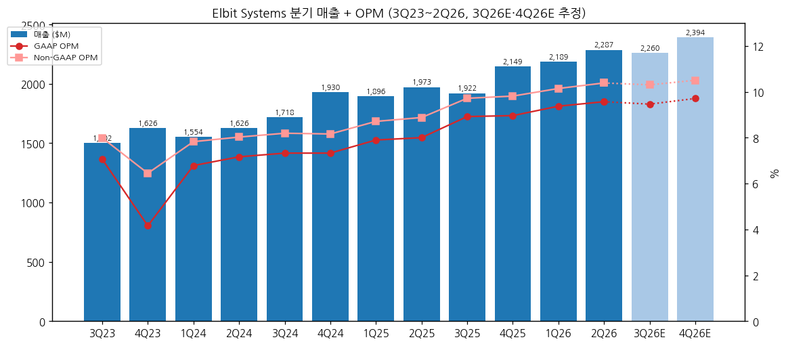
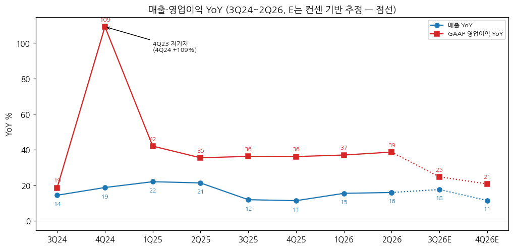
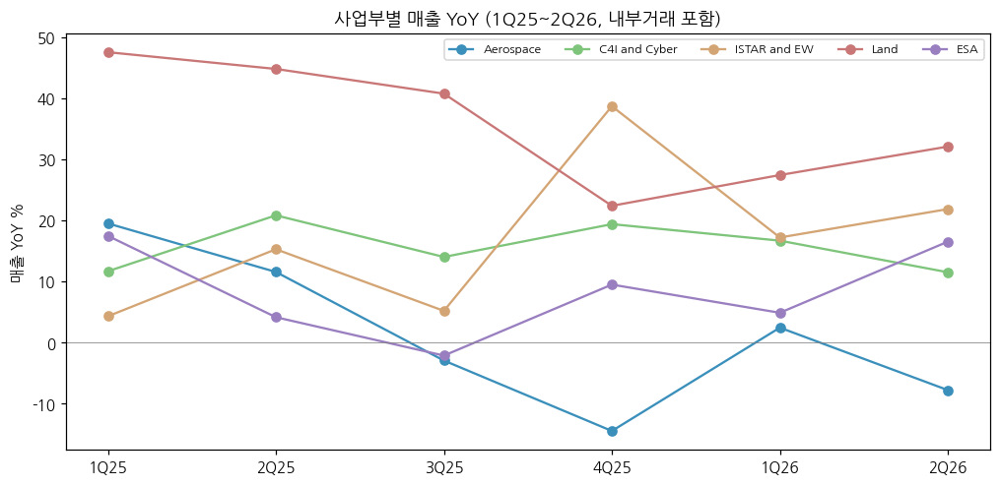

> 모드: 실적 리뷰 (v11)
> 종목: Elbit Systems (ESLT)
> 섹터: 방산
> 서브섹터: 방산 글로벌
> 분기: 2026-Q2
> 발표일: 2026-08-11 (다음 발표: **3Q26 — 2026-11-17 (화) 09:00 ET**, 회사 공지 2026-10-28. 작성 시점 미발표라 최근 발표 분기 2Q26 기준으로 작성)
> 작성 시각: 2026-11-14 18:30 KST
> 분석 소스: 회사 2Q26 보도자료(2026-08-11, PRNewswire) + 2Q26 컨퍼런스콜 트랜스크립트(회사 공개 PDF — Q&A: Jefferies·Oppenheimer·Morgan Stanley) + 과거 분기 보도자료 12건·20-F(ESLT 기업개요 v1.0) + 웹 보완: 주가 반응(Globes·ynet·Finviz/Investing, 8/11), 등급·TP(MarketBeat — JPMorgan 8/19), 컨센(stockanalysis·tradestie·Finviz/Earnings Whispers, 2026-11). 셀사이드 리포트 첨부 없음

# Elbit Systems 2Q26 실적 리뷰

## 0. 한 줄 판정

> 성장 델타: 유지 | 내러티브: 유지 → 관찰 구간 (영업이익 YoY 35~39% 고원 6개 분기째 — 11/17 3Q26에서 컨센이 그리는 20%대 둔화가 실제로 나오는지 확인)

→ 숫자: 매출 $2,287M(+15.9%), GAAP 영업이익 $218.8M(+38.7%), Non-GAAP 영업이익 $237.5M(+35.6%, OPM 10.4%). 영업이익 YoY가 1Q25 이후 35~39%에서 6개 분기 연속 횡보 — 델타 변화폭 +1.6%p로 "유지"
→ 서프라이즈: 매출 컨센($2.22B) 대비 +3%, Non-GAAP EPS $4.14로 컨센($3.24~3.70, 집계처별 차이) 대비 +12~28%. 회사는 영업이익률이 "내부 목표를 넘어섰다"고 설명
→ 수주잔고 $32.0B (+34% YoY, 신기록) — 매출 증가율(16%)의 2배. 유럽($1.4B 현대화·그리스 PULS 약 $750M)이 분기 증가를 끌었다
→ 그런데 주가는 실적일 Nasdaq -8.3%, TASE -9.4%. 섹터 차익실현·멀티플 부담(2026E P/E 40배대)이 겹쳤고, JPMorgan은 TP $950 → $885(Neutral)로 내렸다. 숫자는 강화, 가격은 약화 — 내러티브는 "유지"로 판단
→ 다음 분기 관건: 3Q26 컨센 EPS $3.94(2Q 실적 $4.14보다 낮음)는 영업이익 YoY 약 25%로의 둔화를 내포 `[추정]`. 2Q의 일회성(ESA 유리한 믹스·이스라엘 재고 보충)이 빠진 뒤 OPM 10%와 YoY 30%대가 유지되는지가 델타 판정을 가른다

## 1. 숫자

① 연결 분기 표 ($M, US GAAP / Non-GAAP 병기)

| 항목 | 3Q23 | 4Q23 | 1Q24 | 2Q24 | 3Q24 | 4Q24 | 1Q25 | 2Q25 | 3Q25 | 4Q25 | 1Q26 | **2Q26** | 3Q26E | 4Q26E |
|---|---|---|---|---|---|---|---|---|---|---|---|---|---|---|
| 매출 | 1,501.6 | 1,625.8 | 1,554.0 | 1,626.2 | 1,717.5 | 1,930.2 | 1,895.8 | 1,972.7 | 1,921.6 | 2,148.6 | 2,188.8 | **2,287.1** | 2,260 | 2,394 |
| 영업이익 (GAAP) | 106.1 | 67.6 | 105.4 | 116.5 | 125.8 | 141.4 | 149.7 | 157.8 | 171.4 | 192.5 | 205.1 | **218.8** | 214 | 232 |
| OPM (GAAP) | 7.1% | 4.2% | 6.8% | 7.2% | 7.3% | 7.3% | 7.9% | 8.0% | 8.9% | 9.0% | 9.4% | **9.6%** | 9.5% | 9.7% |
| 영업이익 (Non-GAAP) | 120.0 | 104.8 | 121.6 | 130.5 | 140.7 | 157.5 | 165.1 | 175.1 | 186.7 | 210.8 | 222.0 | **237.5** | 233 | 251 |
| OPM (Non-GAAP) | 8.0% | 6.4% | 7.8% | 8.0% | 8.2% | 8.2% | 8.7% | 8.9% | 9.7% | 9.8% | 10.1% | **10.4%** | 10.3% | 10.5% |
| 매출 YoY | 11.3% | 7.9% | 11.5% | 11.9% | 14.4% | 18.7% | 22.0% | 21.3% | 11.9% | 11.3% | 15.5% | **15.9%** | 17.6% | 11.4% |
| 영업이익 YoY (GAAP) | 44.6% | -43.9% | 12.2% | 14.7% | 18.6% | 109.2% | 42.0% | 35.5% | 36.2% | 36.1% | 37.0% | **38.7%** | 24.7% | 20.7% |
| 영업이익 YoY (Non-GAAP) | — | — | 12.1% | 13.0% | 17.2% | 50.3% | 35.8% | 34.2% | 32.7% | 33.8% | 34.5% | **35.6%** | 24.7% | 19.3% |
| **매출 YoY 델타 (%p)** | -0.2 | -3.4 | +3.6 | +0.3 | +2.5 | +4.3 | +3.3 | -0.7 | -9.4 | -0.6 | +4.1 | **+0.5** | +1.7 | -6.2 |
| **영업이익 YoY 델타 (%p)** | +56.3 | -88.4 | +56.1 | +2.4 | +3.9 | +90.6 | -67.1 | -6.6 | +0.8 | -0.1 | +0.9 | **+1.6** | -13.9 | -4.0 |

→ (출처: 회사 분기 보도자료 — 3Q23·1Q24~2Q26, 4Q23은 4Q24 보도자료 전년 열. 3Q22·2Q23 YoY 기준치는 3Q23·2Q24 보도자료. Non-GAAP은 회사 재작성값. **3Q26E 매출 $2,260M = 컨센(tradestie 집계, 2026-11), 4Q26E 매출 = 2026E 컨센 $9,130M − 1H26 − 3Q26E [계산]. E 구간 영업이익은 컨센 미공개라 Non-GAAP OPM 10.3%/10.5% 가정, GAAP = Non-GAAP − 분기 조정항목 약 $19M으로 역산 `[추정]`**)
→ 컨센 대비: 매출 +3.0% (컨센 $2.22B, Finviz/Investing 인용). Non-GAAP EPS $4.14 vs 컨센 $3.24(Investing) / $3.70(Globes 계열 보도) → +12~28%. Non-GAAP OPM 10.4% vs 예상 10.1%(ynet 인용)
→ 4Q23(전쟁 초기 비용, OPM 4.2%)의 낮은 기저로 4Q24 +109%가 튄 것을 빼면, 영업이익 YoY는 1Q24 12% → 3Q24 19% → 1Q25 이후 35~39%로 올라선 뒤 **6개 분기째 고원**이다. 2Q26 38.7%가 이 구간의 최고치 `[판단]`
→ 컨센 경로: 3Q26E 매출 +17.6%로 오히려 빨라지지만 영업이익 YoY는 25% 안팎, 4Q26E 21%로 둔화 `[추정]`. 2027E Non-GAAP EPS $17.81은 2026E($16.31~16.38) 대비 +9%에 그친다(stockanalysis) — **컨센이 그리는 영업이익 YoY 정점은 2Q26** `[전망]`

→ (출처: 회사 분기 보도자료. 3Q26E·4Q26E는 컨센 매출 + OPM 가정 [추정], 점선)

→ (출처: 회사 분기 보도자료. E 구간 점선 [추정])

② 사업부별 매출 ($M, 내부거래 포함) — 사업부 영업이익은 분기 미공시

| 사업부 | 항목 | 2Q25 | 3Q25 | 4Q25 | 1Q26 | **2Q26** | QoQ | YoY |
|---|---|---|---|---|---|---|---|---|
| Land | 매출 | 583.1 | 593.7 | 581.1 | 714.6 | **770.2** | +7.8% | **+32.1%** |
| | YoY 추이 | +44.8% | +40.8% | +22.4% | +27.4% | **+32.1%** | | |
| | 매출 비중 | 27.5% | 28.8% | 25.3% | 30.6% | **31.5%** | | |
| Aerospace | 매출 | 536.8 | 477.7 | 548.2 | 516.6 | **495.0** | -4.2% | **-7.8%** |
| | YoY 추이 | +11.6% | -2.9% | -14.5% | +2.4% | **-7.8%** | | |
| ESA | 매출 | 409.2 | 407.7 | 473.1 | 423.9 | **476.8** | +12.5% | **+16.5%** |
| | YoY 추이 | +4.1% | -2.1% | +9.5% | +4.9% | **+16.5%** | | |
| ISTAR and EW | 매출 | 367.5 | 340.7 | 456.6 | 423.1 | **447.8** | +5.8% | **+21.9%** |
| | YoY 추이 | +15.3% | +5.2% | +38.7% | +17.2% | **+21.9%** | | |
| C4I and Cyber | 매출 | 226.8 | 243.3 | 240.8 | 256.7 | **252.9** | -1.5% | **+11.5%** |
| | YoY 추이 | +20.8% | +14.0% | +19.4% | +16.7% | **+11.5%** | | |
| 내부거래 제거 | | -150.7 | -141.5 | -151.2 | -146.1 | -155.6 | | |
| **전사 (= 방산 합계)** | 매출 | 1,972.7 | 1,921.6 | 2,148.6 | 2,188.8 | **2,287.1** | +4.5% | +15.9% |
| | GAAP 영업이익 | 157.8 | 171.4 | 192.5 | 205.1 | **218.8** | +6.7% | +38.7% |

→ (출처: 회사 분기 보도자료 사업부 표. 매출 비중은 사업부 합계(내부거래 포함) 대비 [계산]. 3Q25·4Q25 내부거래는 사업부 합 − 전사 [계산])
→ **섹터 합산에 쓸 방산 기준: 전사 = 방산.** 민수(상업 항공전자·기체구조물, ESA 의료기기)는 별도 공시가 없고 소규모라 분리하지 않는다. 기준값 2Q26 매출 $2,287.1M / GAAP 영업이익 $218.8M (전년 $1,972.7M / $157.8M), Non-GAAP $237.5M (전년 $175.1M)
→ 델타를 끄는 건 **Land(+32%)와 ISTAR and EW(+22%)**. Land는 이스라엘 탄약, ISTAR는 아태 고출력 레이저·전자전·해양. ESA +16.5%는 회사가 "일회성 유리한 믹스"라고 밝힌 부분이 섞였다
→ 꺾이는 곳은 **Aerospace** — 4개 분기 중 3개 분기 마이너스(유럽 훈련·시뮬레이션 감소, 일회성 불리한 믹스). 2025 연간 Aerospace OPM 7.3%로 Land(11.4%)보다 낮아, 믹스상으로는 Land 비중 확대가 마진에 플러스 `[판단]`

→ (출처: 회사 분기 보도자료)

(2-1) 지역별 매출 — 이스라엘 비중 급등 ($M)

| 지역 | 2Q25 | 2Q26 | YoY | 2Q26 비중 | 2025 연간 비중 |
|---|---|---|---|---|---|
| 이스라엘 | 670.5 | 855.0 | +27.5% | **37.4%** | 32.2% |
| 유럽 | 563.8 | 563.3 | -0.1% | 24.6% | 27.0% |
| 북미 | 404.6 | 464.7 | +14.9% | 20.3% | 20.9% |
| 아시아태평양 | 261.9 | 319.9 | +22.1% | 14.0% | 15.7% |
| 중남미·기타 | 71.9 | 84.2 | +17.1% | 3.7% | 4.2% |

→ (출처: 2Q26 보도자료 지역 표, YoY [계산])
→ 2Q26 증분 매출 $314M 중 이스라엘이 $185M(59%). CFO는 "4월 초 끝난 이란 분쟁 이후 재고 보충"을 이유로 들었다. **유럽 매출은 정체(-0.1%)인데 유럽 수주는 잔고 증가의 주역** — 수주가 매출로 넘어오는 시차 구간 `[판단]`

(2-2) 수주잔고 ($B)

| | 2Q25 | 3Q25 | 4Q25 | 1Q26 | **2Q26** |
|---|---|---|---|---|---|
| 수주잔고 | 23.8 | 25.2 | 28.1 | 30.2 | **32.0** |
| YoY | +13% | +14% | +24% | +31% | **+34%** |
| 이스라엘 외 비중 | 68% | 69% | 72% | 71% | **73%** |
| 향후 약 1.5년 내 수행 비중 | 46% | 38% | 54%(2년) | 49% | **42%** |
| 잔고 / TTM 매출 (배) | 3.2 | 3.3 | 3.5 | 3.7 | **3.7** |

→ (출처: 각 분기 보도자료·20-F. 수행 비중은 "잔여 당해 + 다음 해" 기준이라 분기마다 기간이 다름. 잔고/매출 [계산])
→ 분기 잔고 증가 +$1.8B ≈ 수주 약 $4.1B [계산: 잔고 증가 + 분기 매출, 환율·취소 무시 `[추정]`] → 분기 Book-to-bill 약 1.8배

③ 연간 ($M)

| 항목 | 2022 | 2023 | 2024 | 2025 | 2026E | 2027E |
|---|---|---|---|---|---|---|
| 매출 | 5,511.5 | 5,974.7 | 6,827.9 | 7,938.6 | 9,130 | 10,250 |
| 영업이익 (GAAP) | 367.5 | 369.1 | 489.1 | 671.4 | 약 870 `[추정]` | — |
| OPM (GAAP) | 6.7% | 6.2% | 7.2% | 8.5% | 약 9.5% | — |
| Non-GAAP 영업이익 | — | 448.7 | 550.4 | 737.8 | 약 944 `[추정]` | — |
| 매출 YoY | 4.4% | 8.4% | 14.3% | 16.3% | 15.0% | 12.3% |
| 영업이익 YoY (GAAP) | -12.2% | 0.4% | 32.5% | 37.3% | 약 30% `[추정]` | — |
| Non-GAAP EPS ($) | — | 6.70 | 8.76 | 12.75 | 16.31~16.38 | 17.81 |

→ (출처: 2022~2025 20-F·4Q 보도자료. 2026E·2027E 매출·EPS = 컨센(stockanalysis, 2026-11 — 집계 4~6곳, **소수 의견 좌우 가능**). 2026E 영업이익 = 1H26 실적 + 3Q·4Q E 합 [추정])
→ 발표 전 대비 연간 컨센 변화: 집계처 수정 이력 미확보. 최근 30일 EPS 상향 1건·하향 0건(tradestie) — 실적 추정은 내려가지 않았다

## 2. 시장 쟁점

① 2-0 지난 분기 체크

→ 첫 리뷰 — 직전 체크 없음

② 이번 분기 쟁점 5개 (소스: 컨콜 Q&A 3개 기관 + 실적 후 기사)

| # | 쟁점 | 언급 |
|---|---|---|
| (1) | 수주잔고 $32B → 매출 전환 속도 (CapEx $300M, 고객 투자 분담) | 컨콜 Jefferies·Morgan Stanley(2회), 기사 다수 |
| (2) | 마진 확장의 지속성 — 일회성 믹스·R&D법 효과·세율 | 컨콜 회사 설명, Jefferies(ESA 믹스), Finviz 기사 |
| (3) | 이스라엘 재고 보충 수요의 지속성 vs 수출 전환 | 컨콜 Jefferies(이란 휴전), 회사 지역 설명 |
| (4) | 실적 서프라이즈에도 -8~9% — 멀티플과 섹터 차익실현 | Globes·ynet·Finviz, JPMorgan TP 하향 |
| (5) | 신성장 축 — 고출력 레이저·해양·자율·미국(ESA) | 컨콜 Oppenheimer·Jefferies·Morgan Stanley |

③ 쟁점별 분해

(1) **수주잔고 $32B → 매출 전환 속도**

(1-1) 회사 설명
→ CFO: 잔고는 전년 대비 34% 늘었는데 매출은 16%. 2022년 이후 잔고 증가가 매출 증가를 계속 앞섰고, 매출 성장률은 2024 약 14% → 2025 15% → 2026 "mid-teen"
→ CEO: 전환을 위해 연간 CapEx를 약 $220M → **$300M**으로 올렸다(1H26 이미 $150M 초과). 남부 이스라엘 신규 공장 가동, 해외 시설 확장, 로보틱스·AI로 생산성 개선
→ CFO (Morgan Stanley 질문): 고객이 생산능력 투자를 매칭하거나, 기술 이전을 원하는 국가는 현지 시설 비용을 전액 부담하는 모델이 최근 2~3년 새 생겼다

(1-2) 해석 편차

| 관점 | 핵심 가정·숫자 | 논리 |
|---|---|---|
| 회사 | 2026 매출 "mid-teen" 성장 | 잔고 가시성 + CapEx로 전환 가속 |
| 컨센 | 2026E +15.0%, 2027E +12.3% (stockanalysis) | 잔고 +34%에도 매출 성장은 오히려 낮아짐 — 전환 병목 가정 |
| 기사 (Finviz, 11월) | 잔고 $25.2B → $32B(4개 분기) | "전환 시험대" — 병목이 성장을 제한할 수 있음 |

(1-3) 공통 vs 갈림
→ 공통: 수요(잔고)는 의문이 없다. 질문은 전부 "얼마나 빨리 매출이 되나"
→ 갈림: 회사는 CapEx·고객 투자로 전환이 빨라진다고 보고, 컨센은 2027 매출 +12%로 감속을 넣었다

(1-4) [판단]
→ 잔고/TTM 매출이 3.2배 → 3.7배로 늘었다는 건 전환이 수주를 못 따라간다는 뜻이다. 2Q26 잔고 중 "향후 약 1.5년 내 수행" 비중도 46%(2Q25) → 42%로 낮아졌다 — 새 수주가 장기 물량 위주다. 3Q26 매출이 컨센($2.26B, +17.6%)을 넘으면 전환 가속 쪽, 못 미치면 병목 쪽으로 기운다

(2) **마진 확장의 지속성**

(2-1) 회사 설명
→ CFO: 매출총이익률·영업이익률·순이익률 모두 확대, 영업이익률은 "내부 목표를 넘어섰다". GAAP GPM 25.3%(+1.3%p), Non-GAAP OPM 10.4%(+1.5%p)
→ 비용 항목: R&D(순) $159.1M(매출 7.0%, +0.4%p) — 1H26 R&D 약 $70M 증액 중 절반을 3월 제정된 R&D 장려법 인센티브가 충당, 누적 효과 약 $40M 인식. G&A 비율 4.8% → 4.3%
→ 일회성: ESA +17%에 "일회성 유리한 믹스", Aerospace -8%에 "일회성 불리한 믹스" (서로 일부 상쇄)
→ 세율: Pillar II 최저한세로 실효세율 5.6% → 16.4% — 영업이익 +39%가 GAAP 순이익 +38%, Non-GAAP EPS +28%로 줄어든 이유

(2-2) 해석 편차

| 관점 | 핵심 가정·숫자 | 논리 |
|---|---|---|
| 회사 | 마진 확장 지속 | 영업레버리지 + R&D 장려법 |
| 컨센 (역산) | 3Q26E EPS $3.94 < 2Q 실적 $4.14 | 3Q 매출 컨센은 2Q와 비슷한데 EPS가 낮다 — 2Q 마진에 일회성이 섞였다고 보는 것 `[추정]` |
| Finviz 기사 | 이스라엘 재고 보충·유리한 믹스가 빠지면 마진 약화 가능 | 일회성 의존 우려 |

(2-3) 공통 vs 갈림
→ 공통: GPM이 24.0% → 25.3%로 올라온 건 구조적(믹스 + 규모). 세율 상승은 영구 요인
→ 갈림: R&D 장려법 효과와 ESA 일회성 믹스를 빼면 OPM 개선 폭이 얼마나 남는지

(2-4) [판단]
→ R&D 장려법은 비용(R&D)을 늘리면서 그 절반을 보전하는 구조라 영업이익 증가 기여는 제한적이다. 마진 개선의 본체는 GPM +1.3%p(Land 탄약 비중 확대)로 본다. 3Q26 GAAP OPM 9.5% 이상이면 구조적 개선이 확인된다 `[판단]`

(3) **이스라엘 재고 보충 수요의 지속성**

(3-1) 회사 설명
→ CFO: 2Q26 이스라엘 매출 비중 37% — 4월 초 끝난 이란 분쟁 이후 재고 보충. 유럽·아시아는 계속 의미 있는 성장 엔진
→ CEO (Jefferies의 이란 휴전 관련 질문): 유럽·미국 수요가 커지고 있고 잔고 증가는 주로 이스라엘 외(유럽). 파이프라인이 매우 크다
→ 보도자료: 2026-07 초 미-이란 양해각서가 깨지고 교전 재개 — 상황 불확실

(3-2) 해석 편차

| 관점 | 핵심 가정 | 논리 |
|---|---|---|
| 회사 | 이스라엘 외 잔고 73% | 이스라엘 비중은 일시적으로 높고, 잔고는 수출 중심 |
| Jefferies (질문) | 휴전 논의가 성장 프로파일에 미치는 영향 | 전쟁 수요 피크아웃 우려를 대변 |

(3-3) 공통 vs 갈림
→ 공통: 2Q 매출 증분의 59%가 이스라엘 [계산]. 단기 성장은 이스라엘이 끌었다
→ 갈림: 이스라엘 수요가 꺼질 때 유럽 잔고가 제때 매출로 넘어오는지 (유럽 매출 2Q26 YoY -0.1%)

(3-4) [판단]
→ 2Q 유럽 매출 정체는 리스크 신호다. 다만 7월 이후 미-이란 교전 재개로 이스라엘 수요의 단기 소멸 가능성은 낮아졌다. 3Q26 이스라엘 비중이 33% 이하로 내려가면서도 매출 +15%를 지키는지가 체크포인트 `[판단]`

(4) **서프라이즈에도 -8~9% — 멀티플과 섹터 차익실현**

(4-1) 사실
→ 주가: Nasdaq 8/10 $846.04 → 8/11 $776.08 (-8.3%), TASE -9.4% (시총 약 NIS 100억 증발, ynet). 이후 11/13 $706.62 — 실적 전일 대비 -16.5%, 3/17 고점($1,016) 대비 -30% [Yahoo Finance, 계산]
→ 원인 보도: 실적 약세가 아니라 3년 +206% 상승 뒤 차익실현(ynet), 텔아비브 방산지수 -4.0%·NextVision 동반 급락 등 섹터 매도(Globes)

(4-2) 셀사이드 변화

| 기관 | 시점 | 의견·TP | 비고 |
|---|---|---|---|
| JPMorgan (Seth Seifman) | 2026-08-19 | Neutral, $950 → **$885** | 실적 후 하향 |
| Morgan Stanley | 2026-07-15 | $845 제시 | 실적 전 |
| 미상 (MarketBeat) | 2026-06-24 | Strong Buy → Hold, $950 → $880 | 실적 전 |
| 컨센 (stockanalysis) | 2026-11 | Hold (6곳 중 Strong Buy 1·Hold 5), 평균 TP $802 (범위 $518~960) | 현재가 대비 +13.5% |

→ (출처: MarketBeat ESLT forecast, stockanalysis ESLT forecast — 2026-11-14 조회)

(4-3) [판단]
→ EPS 추정은 오르는데(30일 상향 1건, 하향 0건) TP는 내려갔다 → **TP 하향은 실적이 아니라 멀티플 하향** `[판단]`. 2026E P/E 43배는 한국 방산 5사(현대로템 리뷰 기준 2026E P/E 11배 안팎) 대비 큰 프리미엄 — 한국 5사 리뷰에서 보인 "방산 멀티플 디레이팅"이 글로벌 피어에도 나타난 사례

(5) **신성장 축 — 레이저·해양·자율·미국**

(5-1) 회사 설명 (Q&A)
→ 고출력 레이저: Iron Beam 일정대로 인도 중, 이스라엘 추가 주문 기대. 헬기·전투기 탑재형 레이저 개발 주계약자 — 헬기형은 "비교적 짧은 기간 내" 실전 배치 예상. 해외 관심이 "엄청나다"
→ 해양: 영국 해군 차기 함정 전자전, 소노부이(Sparton, 미 해군 2개 공급사 중 하나), 무인수상정, 예인 소나(GeoSpectrum)
→ 미국(ESA): ENVG-B $212M 단독 공급 선정, CBP $370M, THOR 무인기 미 육군 선정. 다만 CEO는 "이번 분기 속도가 그대로 이어지진 않을 수 있다"고 언급
→ 자율: Bluewhite Robotics 인수 등 볼트온 3건, 기술 이전·현지 생산 의지가 차별점

(5-2) [판단]
→ 레이저는 아직 매출 기여가 작고(ISTAR 내 일부), 2026~2027 숫자를 바꿀 변수는 아니다. 미국 ESA는 회사 스스로 2Q 속도를 낮춰 잡았다 — 3Q ESA 성장률은 한 자릿수로 돌아갈 가능성 `[전망]`

④ 낙관 vs 보수

→ 낙관(회사·잔고 논리): 잔고 +34%, CapEx 증액·고객 투자 분담으로 전환 가속, 매출 mid-teen 성장과 마진 확장 지속
→ 보수(JPMorgan·컨센 경로): 2027E EPS +9%로 성장 둔화, 이스라엘 재고 보충과 일회성 믹스 소멸, Pillar II 세율, 이미 높은 멀티플
→ 차이의 본질: **잔고가 매출로 넘어오는 속도**와 **이스라엘 수요 정상화 후 성장률**. 셀사이드는 숫자를 올리면서도 의견은 Hold — 바이사이드(주가)는 "좋은 숫자에도 판다" 쪽 `[판단]`

⑤ 추정치·TP 변화 (압축)

| 기관 | 직전 TP | 현재 TP | 3Q26 E | 2026E / 2027E | 핵심 변화 |
|---|---|---|---|---|---|
| JPMorgan (8/19) | $950 | $885 | — | — | Neutral 유지, TP -6.8% |
| 컨센 (11월) | — | 평균 $802 | EPS $3.94, 매출 $2.26B | EPS $16.31~16.38 / $17.81, 매출 $9.13B / $10.25B | EPS 상향 1·하향 0 (30일) |

→ TP 하향 원인: 멀티플 하향. 2026E EPS는 유지·상향인데 TP 하향 `[판단]`. 개별 증권사 추정치 상세는 미확보(리포트 첨부 없음)

## 3. 내러티브 점검

① 성장 스토리 정의
→ "이스라엘 전쟁 수요와 유럽 재무장을 동시에 받는 방산 통합업체. 잔고가 매출의 3배 이상 쌓여 매출 10%대 중반 성장과 마진 레벨업(OPM 7% → 10%)이 몇 년간 이어진다"

② 이번 분기가 스토리에 준 영향
→ 강화: Non-GAAP OPM 10.4%로 10% 돌파, 잔고 신기록 $32B(+34%), 그리스 PULS 약 $750M·유럽 $1.4B로 유럽 축 확인
→ 약화: 성장의 59%가 이스라엘 재고 보충, 유럽 매출 정체, 세율 상승으로 EPS 성장이 영업이익보다 느림, 주가·TP 하락(멀티플)
→ 훼손 아님: 수요·점유율·마진 구조 전제는 그대로

③ 국면 판단
→ 델타 유지(영업이익 YoY 38.7%, 6개 분기 35~39% 고원) + 내러티브 유지(숫자 강화 vs 멀티플 약화 상쇄) → **관찰 구간**
→ 다만 컨센은 3Q26부터 YoY 20%대로 둔화를 넣었다. 실제로 그렇게 나오면 다음 리뷰 판정은 "둔화"가 되고, 2Q26이 이번 사이클의 델타 정점이 된다 `[전망]`

④ 트리거와 리스크
→ 트리거: ① 3Q26 영업이익 YoY 30%대 유지(컨센 상회) ② PULS 유럽 추가 수주(EuroPULS 독일 본계약, NATO 국가) ③ 레이저 해외 첫 수출
→ 리스크: ① 이스라엘 비중 정상화 + 유럽 전환 지연 → 매출 한 자릿수 성장 ② 유럽 다연장 입찰에서 천무·HIMARS에 연패(노르웨이 2026-01 사례) ③ 일부 국가의 이스라엘산 무기 거래 제한 확대

## 4. 향후 봐야 할 것

① **3Q26 영업이익 YoY — 고원 유지 vs 20%대 둔화** (델타 판정을 바꿀 1순위)
→ 무엇을: GAAP 영업이익 $214M 이상(YoY +25% `[추정]`)인지, 30%대(약 $223M+) 유지인지. Non-GAAP OPM 10% 유지, 매출 컨센 $2.26B(+17.6%)
→ 어떤 데이터로: 3Q26 보도자료·컨콜, 컨센 EPS $3.94(tradestie)·$3.97(Earnings Whispers)
→ 언제: **2026-11-17 (화)**

② **수주잔고 $33B+와 전환율 (잔고/매출 3.7배)**
→ 무엇을: 잔고 순증 지속 여부, "향후 1.5년 내 수행" 비중 42%의 변화, CapEx $300M 집행
→ 어떤 데이터로: 분기 보도자료 잔고 문단, 컨콜 CapEx 코멘트
→ 언제: 2026-11-17 / 2027-03 (4Q·연간)

③ **이스라엘 매출 비중 37%의 정상화 속도와 유럽 매출 반등**
→ 무엇을: 이스라엘 비중 33% 이하 + 유럽 매출 YoY 플러스 전환. 미-이란 교전·휴전 흐름
→ 어떤 데이터로: 보도자료 지역 표, 이스라엘 국방예산, 중동 정세 뉴스
→ 언제: 3Q26·4Q26 실적

④ **PULS vs 천무 — 유럽 다연장 입찰**
→ 무엇을: 2026 PULS 유럽 수주(그리스 약 $750M, 9월 약 $235M, 11월 약 $260M NATO 국가) 이후 독일 EuroPULS 본계약, 크로아티아 등 천무 경합국 결과
→ 어떤 데이터로: 회사 6-K 수주 공시, Breaking Defense·Defense News 입찰 보도, 한화에어로스페이스 천무 수주 공시
→ 언제: 상시 (4Q26~1H27)

⑤ **세율·R&D 장려법이 만드는 EPS 전환율**
→ 무엇을: 실효세율 16%대 유지 여부, R&D 장려법 효과(1H 누적 약 $40M)의 연간 규모, 2027E EPS +9% 컨센의 상향 여부
→ 어떤 데이터로: 보도자료 세금 문단, 4Q 컨콜, 컨센 집계
→ 언제: 2026-11-17 / 2027-03
