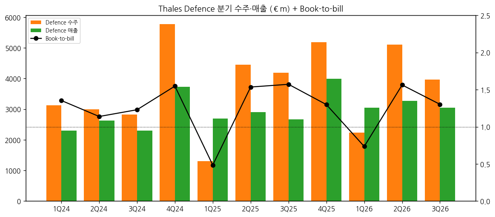
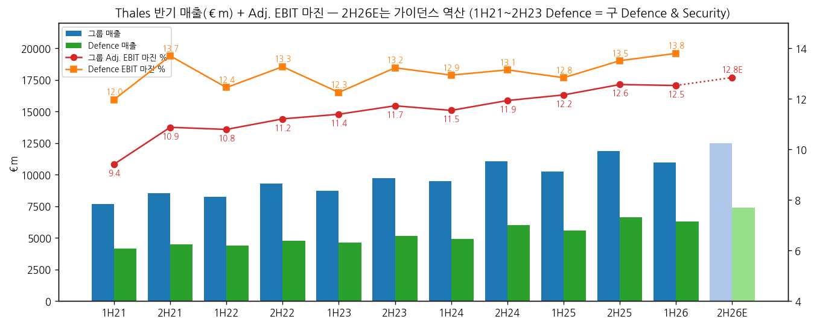
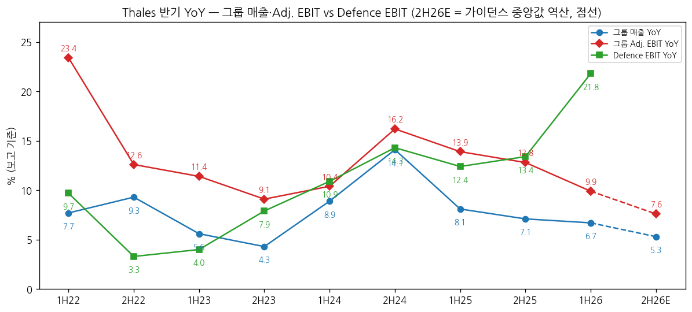
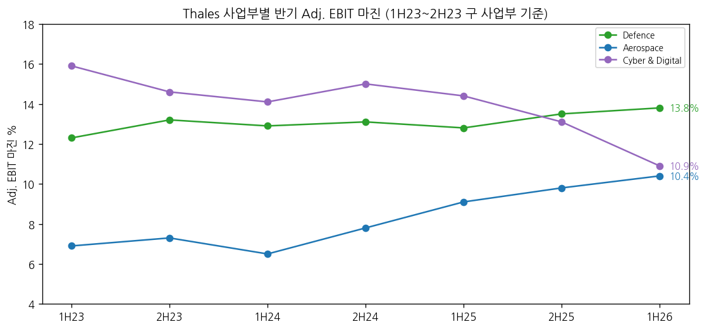

> 모드: 실적 리뷰 (v11)
> 종목: Thales (HO)
> 섹터: 방산
> 서브섹터: 방산 글로벌
> 분기: 2026-Q2 (H1 2026 반기 손익 — 반기 공시 종목이라 손익이 나온 분기로 리뷰를 둔다. 10/22 9M 수주·매출을 추가 반영)
> 발표일: 2026-07-23 (H1 2026 반기 실적) / 추가 반영: 2026-10-22 (9M 2026 수주·매출, 07:00 CET — 손익 없음)
> 작성 시각: 2026-11-14 18:30 KST / 2026-11-14 반기 기준으로 본문 재작성 (BT 지시: 반기 공시 종목은 손익이 나온 분기에 리뷰를 둔다)
> 분석 소스: [1차·회사 원문] H1 2026 보도자료·2026 반기보고서(7/23), F126 종료 공시(7/3), FY2025·FY2024·FY2023·FY2022·FY2021 연간 보도자료, H1 2022~2025 반기 보도자료(Euronext 공시 첨부·AMF 사본), 9M 2026 보도자료(10/22) / [기사] Reuters(Euronext 게재 7/23·10/22 — CEO·CFO 발언, Citi·Jefferies·Berenberg 인용), Baird Maritime(7/23), TradingSat(9/15 애널리스트 미팅·DB 상향), MarketScreener(4/21), Goldesel(10/23 Oddo·DZ TP), ABC Bourse(10/22), Quartr 3Q 요약(AI 요약) / [주가] Yahoo HO.PA 일간 / 셀사이드 리포트 첨부 0건, 반기 컨콜 트랜스크립트 원문 미확보 → 쟁점은 회사 자료 + 기사 인용 발언으로 구성 / 다음 발표: FY2026 실적 2027-03 초 (전년 3/3, 확정일 미확인)
> 리뷰 깊이: 숫자 중심 | 리서치 첨부 0건
> 분기 업데이트: 3Q26 (2026-10-22 — 9M 수주·매출)

# Thales 1H26 실적 리뷰 (2026-Q2, 3Q 9M 수주·매출 반영) — 그룹 이익은 "유지", 방산 이익은 "가속"

## 0. 한 줄 판정

> 성장 델타: 유지 (반기 기준 — 그룹 Adj. EBIT YoY 2H25 +12.8% → 1H26 +9.9%, -2.9%p) / 방산(Defence) 가속 (Defence EBIT YoY +13.4% → +21.8%, +8.4%p) | 내러티브: 강화 → 방산 기준 적극 구간 후보 (그룹은 Cyber & Digital 이익 -27%가 희석, 2H26 확인은 2027-03 FY26 발표)

→ **숫자 (반기)**: 1H26 매출 €10,949m (+6.7%, 유기적 +7.8%), Adj. EBIT €1,372m (+9.9%, 유기적 +11.4%), 마진 12.5% (+0.4%p). 그룹 EBIT YoY는 2H25 +12.8% → 1H26 +9.9%로 -2.9%p — 기준표상 "유지"(±5%p). 유기적으로는 1H25 +12.7% → 1H26 +11.4%로 거의 같다
→ **방산 기준**: Defence 매출 €6,316m (+12.9%, 유기적 +13.1%), EBIT €875m (+21.8%, 유기적 +22.0%), 마진 **13.8%** (+1.0%p, 반기 사상 최고). Defence EBIT YoY는 +13.4%(2H25) → +21.8%로 "가속". 그룹 델타를 끌어내린 건 Cyber & Digital EBIT -26.9%(마진 14.4% → 10.9%)
→ **쟁점**: ① Defence 마진이 처음으로 13%를 "의미 있게" 넘었다(Jefferies) — 생산 증설 레버리지 ② 수주 +21%(컨센 +1%)·FCF €1.87bn(컨센 €0.47bn) 서프라이즈의 질 ③ F126 종료(특별손실 ~€450m)·위성 2기 취소 — Adj. EBIT 영향 없음 ④ Cyber & Digital 마진 급락
→ **다음 반기 관건**: 연간 가이던스(매출 €23.3~23.6bn·마진 12.6~12.8%) 역산 2H26 Adj. EBIT €1.56~1.65bn(YoY +5~11%, 중앙 +7.6%) → 컨센 경로상 그룹 EBIT YoY는 1H26 +9.9% → 2H26 약 +8%로 "유지". Defence 2H 마진 13.5%+ 유지가 방산 "가속" 지속의 조건 [계산]

### 추가: 3Q26 업데이트 (2026-10-22 — 9M 수주·매출)

→ 손익 공시 없음 — Thales는 1Q·3Q에 수주·매출만 발표한다. 0번 판정(반기 기준)은 그대로 둔다
→ **3Q26 매출** €5,473m: 보고 +9.7%, 유기적 +8.7% (2Q 6.0%에서 +2.7%p 재가속). 컨센 €5.38bn 대비 +1.7% (ABC Bourse, 회사 집계 컨센). 9M 유기적 +8.1% vs 컨센 7.4% (Reuters)
→ **방산 기준(Defence)**: 3Q 매출 €3,043m (3Q25 €2,666m, +14.1%, 유기적 +12.8%) / 3Q Defence 수주 €3,964m (-5%, 유기적 -6% — 3Q25 +51% 고기저) / 9M Defence 매출 €9,358m (+13.0% 유기적), 수주 €11,315m (+14%), book-to-bill 1.21 [계산]
→ **수주**: 3Q 그룹 수주 €6,651m (+4%, 컨센 €5.7bn 대비 +17%). 서프라이즈는 우주(Aerospace 수주 +38%, IRIS² 약 €500m)가 견인 — Berenberg(Reuters 인용). CFO: IRIS² 추가 약 €2bn을 향후 수 분기에 기대
→ **지역**: 9M 중동 수주 €1,909m (+210% 유기적)·매출 €1,288m (+48.9%) — 방공·우주 대형 수주. 프랑스 수주 +47% (SNLE 3G 핵잠, Rafale F5). 루마니아 GM200 MM/A 레이더 12기(EU SAFE)
→ **사업부 3Q 매출**: Aerospace €1,458m (+8.1%, 위성 취소 영향 소멸), Cyber & Digital €945m (-0.3% 유기적 — Cyber +4.3%, Digital -3.0%)
→ **가이던스 (10/22)**: 매출 성장 "6~7% 상단, 상회 가능"(€23.3~23.6bn)으로 문구 상향, 마진 12.6~12.8%·book-to-bill >1.1·현금전환율 100~110% 유지. 3Q 컨콜 요약(Quartr AI): Defence 연간 low double-digit 성장·마진 13%+, Cyber & Digital 저 한 자릿수(H2 > H1)
→ **SAMP/T NG**: CFO는 Patriot 대안으로 여러 고객과 수출 논의 중이라고 했다(Reuters). 프랑스 4기 추가 주문
→ **주가·TP**: 발표일 €230.0 → €226.7 (-1.4%). Oddo TP €288 → €287(Outperform), DZ €298 → €286(Buy) — 둘 다 소폭 하향, 등급 유지 (Goldesel 10/23)
→ **4Q26E (가이던스 역산)**: 그룹 매출 약 €7.03bn (4Q25 €6,881m, 보고 +2%·유기적 약 +5~6%), Defence 약 €4.2~4.5bn (4Q25 €3,991m) [추정]

| 3Q26 분기 (€m) | 3Q25 | 1Q26 | 2Q26 | **3Q26** | YoY 보고 | YoY 유기적 |
|---|---|---|---|---|---|---|
| 그룹 매출 | 4,991 | 5,316 | 5,633 | **5,473** | +9.7% | +8.7% |
| 그룹 수주 | 6,409 | 4,652 | 7,819 | **6,651** | +4% | +3% |
| Defence 매출 | 2,666 | 3,047 | 3,269 | **3,043** | +14.1% | +12.8% |
| Defence 수주 | 4,192 | 2,240 | 5,111 | **3,964** | -5% | -6% |
| Aerospace 매출 | 1,348 | 1,384 | 1,395 | **1,458** | +8.1% | +7.8% |
| Cyber & Digital 매출 | 938 | 859 | 938 | **945** | +0.7% | -0.3% |

→ (출처: Q1·H1·9M 2026 보도자료. 2Q26 = H1 − 1Q [계산], 3Q25는 2026 보도자료 재작성 비교값)

→ (출처: 회사 보도자료, 2Q·4Q는 반기·연간 − 분기 역산)

---

## 1. 숫자

① 반기 5지표 (€m, %, Adjusted EBIT = 회사 주 이익 지표)

| 항목 | 1H21 | 2H21 | 1H22 | 2H22 | 1H23 | 2H23 | 1H24 | 2H24 | 1H25 | 2H25 | **1H26** | 2H26E (가이던스 역산) |
|---|---|---|---|---|---|---|---|---|---|---|---|---|
| 매출 | 7,669 | 8,523 | 8,256 | 9,313 | 8,716 | 9,712 | 9,493 | 11,084 | 10,265 | 11,871 | **10,949** | 12,350~12,650 |
| Adj. EBIT | 722 | 927 | 891 | 1,044 | 993 | 1,139 | 1,096 | 1,323 | 1,248 | 1,492 | **1,372** | 1,560~1,650 |
| Adj. EBIT 마진 | 9.4 | 10.9 | 10.8 | 11.2 | 11.4 | 11.7 | 11.5 | 11.9 | 12.2 | 12.6 | **12.5** | 12.7~13.0 |
| 매출 YoY (보고) | — | — | +7.7 | +9.3 | +5.6 | +4.3 | +8.9 | +14.1 | +8.1 | +7.1 | **+6.7** | +4~7 |
| 매출 YoY (유기적) | — | — | +5.4 | — | +7.7 | — | +6.0 | — | +8.1 | — | **+7.8** | — |
| Adj. EBIT YoY (보고) | — | — | +23.4 | +12.6 | +11.4 | +9.1 | +10.4 | +16.2 | +13.9 | +12.8 | **+9.9** | +5~11 |
| Adj. EBIT YoY (유기적) | — | — | +21.1 | — | +13.1 | — | +4.7 | — | +12.7 | — | **+11.4** | — |
| **매출 YoY 델타 (%p, 보고)** | — | — | — | +1.6 | -3.7 | -1.3 | +4.6 | +5.2 | -6.0 | -1.0 | **-0.4** | 약 -1 |
| **Adj. EBIT YoY 델타 (%p, 보고)** | — | — | — | -10.8 | -1.2 | -2.3 | +1.3 | +5.8 | -2.3 | -1.1 | **-2.9** | 약 -2 |
| 조정 순이익 (지배) | — | — | 726 | 830 | 819 | 949 | 866 | 1,034 | 877 | 1,128 | **990** | — |

→ (출처: 반기·연간 보도자료. 2H = 연간 − 1H [계산]. 2021~2025는 Transport 제외 재작성 기준(1H21은 1H22 보도자료 비교값). 유기적 성장률은 회사가 1H에만 반기 단위로 공시. 2H26E = 연간 가이던스(매출 €23.3~23.6bn × 마진 12.6~12.8%) − 1H26 [계산]. 조정 순이익 2H = 연간 − 1H [계산])
→ **이 분기(3Q26)의 손익**: 회사는 반기·연간에만 EBIT을 공시한다. 3Q26 영업이익은 존재하지 않으며 손익 판정은 직전 반기(1H26)로 한다. 다음 손익 공시는 FY2026(2H26 포함) — 2027-03 초
→ **기준 단절**: ① 2021년부터 Transport(2024-05 Hitachi Rail 매각) 제외 재작성 ② 2023년 사업부 재편(Defence & Security → Defence, DIS → Cyber & Digital, 2024 공시부터) ③ 2024 Imperva·Cobham AeroComms 인수 — 2024 보고 매출 YoY에 인수 효과(약 +3.6%p, 유기적 8.3% vs 보고 11.7%) 포함
→ **[판단] 반기 델타 = 그룹 "유지", 방산 "가속"**: 그룹 Adj. EBIT YoY가 4개 반기 연속 +10~16% 범위에서 움직였고, 1H26의 -2.9%p는 ±5%p 안이다. 유기적 기준(+12.7% → +11.4%)으로도 같은 결론. 반면 Defence EBIT YoY는 +12.4%(1H25) → +13.4%(2H25) → +21.8%(1H26)로 2개 반기 연속 확대 — 섹터 합산에 쓰는 방산 기준으로는 "가속"이다. 그룹과 방산의 판정이 갈린 원인은 Cyber & Digital(EBIT -€72m YoY)
→ **컨센 경로 (2H26E)**: 가이던스 중앙값이면 그룹 EBIT YoY +7.6%로 1H26(+9.9%)보다 조금 낮다 — "유지" 범위. 회사 가이던스는 매출만 상단으로 올리고 마진은 유지해 보수적이다(1H 마진 12.5%에 2H 계절성 +0.4~0.5%p를 더하면 연간 12.7% 안팎) [판단]

→ (출처: 반기·연간 보도자료, 2H26E는 가이던스 역산(연한 막대·점선). 1H21~2H23 Defence는 구 Defence & Security 기준)

→ (출처: 동일, 보고 기준 YoY. Defence 2H26E는 마진 가이던스가 "13%+"뿐이라 표시하지 않음)

② 사업부별 반기 매출·Adj. EBIT (€m, %)

| 사업부 | 항목 | 1H23 | 2H23 | 1H24 | 2H24 | 1H25 | 2H25 | **1H26** |
|---|---|---|---|---|---|---|---|---|
| **Defence** | 매출 | 4,626 | 5,170 | 4,938 | 6,031 | 5,593 | 6,653 | **6,316** |
| | Adj. EBIT | 567 | 684 | 639 | 793 | 718 | 899 | **875** |
| | 마진 | 12.3 | 13.2 | 12.9 | 13.1 | 12.8 | 13.5 | **13.8** |
| | 매출 YoY | +5.6 | +8.2 | +8.7 | +18.6 | +13.3 | +10.3 | **+12.9** |
| | EBIT YoY | +4.0 | +7.9 | +10.9 | +14.3 | +12.4 | +13.4 | **+21.8** |
| | 수주 | 4,603 | — | 6,120 | 8,603 | 5,762 | 9,377 | **7,351** |
| Aerospace | 매출 | 2,465 | 2,746 | 2,582 | 2,889 | 2,759 | 3,151 | **2,779** |
| | Adj. EBIT | 171 | 200 | 167 | 224 | 252 | 308 | **289** |
| | 마진 | 6.9 | 7.3 | 6.5 | 7.8 | 9.1 | 9.8 | **10.4** |
| Cyber & Digital | 매출 | 1,595 | 1,752 | 1,934 | 2,090 | 1,849 | 1,990 | **1,797** |
| | Adj. EBIT | 253 | 255 | 272 | 313 | 267 | 261 | **195** |
| | 마진 | 15.9 | 14.6 | 14.1 | 15.0 | 14.4 | 13.1 | **10.9** |
| Naval Group 지분법(35%) | EBIT | 44 | 47 | 44 | 49 | 35 | 59 | **39** |
| **Defence 매출 비중** | % | 53 | 53 | 52 | 54 | 54 | 56 | **58** |
| **Defence 이익 비중** (부문 합계 대비) | % | 57 | 60 | 59 | 60 | 58 | 61 | **64** |

→ (출처: 반기·연간 보도자료. 2H = 연간 − 1H [계산]. 1H23·2H23은 구 사업부(Defence & Security·DIS) 기준이고 1H24부터 Defence·Cyber & Digital 재편 기준 — 1H24·2H24 YoY는 회사 재작성 2023(Defence 9,628/1,270, 1H23 4,544/576) 대비 [계산]. 1H25는 2026 보도자료 재작성 비교값, 2H25는 2025 연간 보도자료 기준으로 역산(기준 혼재 소폭). Defence 수주 2H = 연간 − 1H [계산], 2H23은 기준 차이로 생략. 이익 비중 = Defence ÷ 3개 부문 합계 [계산])
→ **섹터 합산에 쓸 방산 기준 = Defence 부문** (레이더·방공·전자전·함정 전투체계·통신·옵트로닉스·이펙터). Aerospace(민항 항전·우주)와 Cyber & Digital은 제외. 1H26 Defence 매출 €6,316m(1H25 €5,593m), Adj. EBIT €875m(1H25 €718m)

→ (출처: 반기·연간 보도자료, 1H23~2H23은 구 사업부 기준)

→ **델타를 끄는 것은 Defence다.** 매출 +12.9%에 EBIT +21.8% — 매출 1%당 이익 1.7% 증가의 레버리지. 2Q 단독으로도 Defence 매출 유기적 +11.9%(1Q 14.3%)로 두 자릿수가 이어졌다. 회사 설명은 "센서·이펙터 생산 증설의 수확", 특히 중동 고객의 단·중기 소요 대응 (1H26 보도자료)
→ **Aerospace는 숨은 개선**: 매출 +2.1%(유기적)로 낮지만 이는 5월 정지궤도 위성 2기 주문 취소(약 €-150m) 탓이고, 빼면 +8.8%(2Q +11.0%). EBIT은 +17.2%(유기적), 마진 10.4%로 6개 반기 연속 상승 — 우주 2년 구조조정 효과 (회사)
→ **Cyber & Digital이 그룹 델타를 깎았다**: EBIT €267m → €195m (-26.9%). Cyber 마진은 14.0%로 거의 유지, 하락은 Digital(결제카드·생체인식 마진 악화 + 1H25 1회성 이익 기저) (회사). C&D만 빼면 부문 EBIT YoY는 +20.0%다 [계산: (289+875)/(252+718)−1]

③ 수주·잔고·현금 (€m)

| 항목 | 1H24 | 2H24 | 1H25 | 2H25 | **1H26** | 9M26 (3Q 업데이트) |
|---|---|---|---|---|---|---|
| 그룹 수주 | 10,767 | 14,522 | 10,352 | 14,912 | **12,471** | 19,122 |
| 그룹 수주 YoY | +26% | -0% | -4% | +3% | **+21%** | +14% |
| Book-to-bill | 1.13 | 1.31 | 1.01 | 1.26 | **1.14** | 1.16 |
| €100m+ 대형 수주 | — | — | — | — | **18건 €4,850m** | 29건 €7,570m |
| 수주잔고 (기말) | 46,958 | 50,602 | 50,038 | 53,323 | **52,434** | — |
| Defence 잔고 | — | — | 38,971 | 41,617 | **41,100** | — |
| Free operating CF | (85) | 2,112 | 499 | 2,078 | **1,865** | — |
| 순현금(순차입) 기말 | (4,594) | (3,044) | (3,427) | (1,618) | **(519)** | — |

→ (출처: 반기·연간·9M 보도자료, 반기보고서 부문 잔고. 2H = 연간 − 1H [계산]. 1H26 잔고는 F126 프로그램과 일부 우주 주문을 잔고에서 제거한 뒤 값 (회사))
→ 잔고 €52.4bn은 1H25 대비 +5%로, F126 제거에도 늘었다. Defence 잔고 €41.1bn ≈ Defence 매출 3.2년치 (회사)
→ FCF €1.87bn은 1H25(€0.50bn)의 3.7배 — 회사는 "수주 모멘텀에 따른 운전자본 개선 + 유리한 고객 대금 수령 시점"을 이유로 들었다. 즉 일부는 선수금 시점 효과다 [판단]

④ 가이던스 변화 (€m)

| 항목 | 2026-03-03 (최초) | 2026-07-03 (F126 공시) | 2026-07-23 (1H) | 2026-10-22 (9M) |
|---|---|---|---|---|
| 유기적 매출 성장 | +6~7% | 유지 | 유지 (€23.3~23.6bn) | **"상단, 상회 가능"** |
| Adj. EBIT 마진 | 12.6~12.8% | 유지 | 유지 | 유지 |
| Book-to-bill | > 1.0 | **> 1.1** | > 1.1 | > 1.1 |
| 현금전환율 (FCF/조정 순이익) | 95~100% | **100~110%** | 100~110% | 100~110% |
| 중기 (2028, CMD 2024) | 유기적 CAGR 5~7% 상단, 마진 13~14% | — | — | FY26 발표 때 재검토 예고 (Quartr 요약) |

→ (출처: FY2025·F126·1H26·9M 보도자료)
→ F126 종료: 특별손실 약 €450m(대부분 비현금, 지출 비용 + 보수적 보상 추정), 순이익(지배) -€331m. Adj. EBIT·조정 순이익에서 제외되고, 프로그램 마진이 그룹 평균보다 훨씬 낮아 마진엔 "약간 플러스". 매출 영향 2026년 약 0.5%, 이후 연 1% 미만 (7/3 공시)

⑤ 연간 (€m, %)

| 항목 | 2021 | 2022 | 2023 | 2024 | 2025 | 2026E (가이던스) |
|---|---|---|---|---|---|---|
| 매출 | 16,192 | 17,569 | 18,428 | 20,577 | 22,136 | 23,300~23,600 |
| Adj. EBIT | 1,649 | 1,935 | 2,132 | 2,419 | 2,740 | 2,940~3,020 [계산] |
| 마진 | 10.2 | 11.0 | 11.6 | 11.8 | 12.4 | 12.6~12.8 |
| 매출 YoY (유기적) | +5.3 | +5.5 | +7.9 | +8.3 | +8.8 | +6~7% 상단 이상 |
| Adj. EBIT YoY | +32.1 | +17.3 | +10.2 | +13.4 | +13.3 | +7~10 [계산] |
| Defence 매출 | 8,633 | 9,154 | 9,628 | 10,969 | 12,234 | low double-digit 성장 |
| Defence EBIT (마진) | 1,111 (12.9) | 1,179 (12.9) | 1,270 (13.2) | 1,432 (13.1) | 1,619 (13.2) | 13%+ |
| 조정 EPS (€) | 6.39 | 7.35 | 8.48 | 9.24 | 9.76 | — |

→ (출처: 연간 보도자료. 2021~2022 Defence는 구 Defence & Security 기준. 2026E 컨센 수치는 무료 범위에서 미확보)
→ 연간 Adj. EBIT YoY는 2024~2025 +13%대 → 2026E +7~10%로 내려오는 경로다. 회사 가이던스가 보수적이라는 점(1H 마진 이미 12.5%)을 감안해도 그룹 기준 "가속"은 가이던스 경로에 없다 — 방산 부문만 가속 [판단]

---

## 2. 시장 쟁점 — 회사 설명 + 반복된 질문

① 지난 분기 체크
→ 첫 리뷰 — 직전 체크 없음 (FY2025 리뷰 미작성)

② 이번 분기(1H26) 쟁점 4개

| # | 쟁점 | 반복해서 나온 곳 |
|---|---|---|
| (1) | Defence 마진 13%+ 돌파 — 생산 증설 레버리지는 지속되나 | 회사(7/23), Jefferies·Citi(Reuters·Baird 7/23), Deutsche Bank(7월말 상향) |
| (2) | 수주 +21%·FCF €1.87bn 서프라이즈의 질 — 중동 방공과 선수금 시점 | 회사(7/23), Reuters(컨센 비교), Citi |
| (3) | F126 종료·위성 취소 — 잔고·이익에 남는 흔적 | 회사(7/3·7/23), Reuters |
| (4) | Cyber & Digital 마진 급락 — 그룹 멀티플의 발목 | 회사(7/23), Citi·Kepler(9/15 애널리스트 미팅), AlphaValue·Berenberg(4월) |

③ 쟁점별 분해

(1) **Defence 마진 13%+ 돌파**

(1-1) 회사 설명
→ Defence EBIT €875m (+22.0% 유기적), 마진 13.8% (1H25 12.8%). "센서·이펙터 생산 증설로 늘어난 수요에 대응한 결과" — 특히 중동에서 고객의 단·중기 소요 지원 (1H26 보도자료)
→ CEO: SAMP/T NG(MBDA와 공동 개발)가 Patriot보다 성능이 낫고 납기도 2028년 vs 2032년으로 빠르다. 다만 미국의 정치적 영향력이 판도를 바꿀 수 있다 (Reuters 7/23)

(1-2) 반복된 질문·해석

| 출처 | 핵심 내용 | 논리 |
|---|---|---|
| Jefferies (Reuters·Baird 7/23) | "처음으로 Defence 마진이 의미 있게 13% 위" (Jefferies는 13.9%로 인용, 회사 13.8%) | 마진 레벨 변화 확인 |
| Citi (Reuters 7/23) | "유럽 재무장은 실재하고 다가오고 있다" | 수주가 현금으로 이어짐 |
| Deutsche Bank (TradingSat 9/15 인용, 7월말 Buy 상향) | 드론 대체 우려가 있는 지상장비 피어(Rheinmetall·Renk·CSG)와 달리 센서·전자전 포트폴리오가 유리 | 포트폴리오 적합성 |

(1-3) **[판단]**
→ Defence 마진은 12.3%(1H23) → 13.2 → 12.9 → 13.1 → 12.8 → 13.5 → **13.8%**로, 계절성(2H > 1H)을 감안하면 1H 기준 12.3 → 12.9 → 12.8 → 13.8%로 1H26에 한 단계 올랐다. 1H에 13.8%면 2H 계절성상 14%대도 가능하다
→ 다만 회사의 연간 Defence 가이던스는 "13%+"뿐이다(3Q 컨콜 요약). 결론이 바뀌는 조건: FY26에서 2H26 Defence 마진이 13.5% 미만이면 1H26은 믹스 효과(고마진 레이더·이펙터)였던 것으로, 14% 이상이면 구조적 레벨 상승으로 본다

(2) **수주·FCF 서프라이즈의 질**

(2-1) 회사 설명
→ 1H 수주 €12,471m (+22% 유기적), book-to-bill 1.14. Defence 수주 €7,351m (+28%) — 대형 13건, 2Q에만 11건(Rafale F5 SPECTRA·차세대 연결성 DGA 2건, 호주 Bushmaster 268대, 중동 공중감시 시스템, SAMP/T NG 2계층 개발(OCCAR), 독일군 옵트로닉스 수천 대, 그리스 Hydra급 현대화). 지역별로 중동 +202%, 기타 유럽 +46%, 프랑스 +34% (1H26 보도자료)
→ FCF €1,865m: "수주 모멘텀에 따른 운전자본의 큰 개선과 유리한 고객 대금 수령 시점" (회사)

(2-2) 반복된 질문·해석

| 출처 | 핵심 내용 |
|---|---|
| Reuters 7/23 (컨센 비교) | 수주 +21% vs 애널리스트 예상 +1%, FCF €1.87bn vs 컨센 €0.47bn, 매출은 회사 집계 컨센 부합, Adj. EBIT은 예상 상회 (수치 미제시) |
| Citi | 강한 수주가 FCF 서프라이즈를 만들었다 |

(2-3) **[판단]**
→ 수주 서프라이즈는 실체가 있다 — 대형 수주 18건 €4.85bn 중 Defence 13건이고, 1억 유로 미만 소형 수주도 +2%로 바닥이 받쳤다
→ FCF는 선수금 시점이 섞여 있다. 2H25 FCF €2.08bn처럼 통상 2H에 몰리는 현금이 1H로 당겨졌을 수 있어, 연간 현금전환율 가이던스(100~110%)를 올린 폭(+5~10%p)이 실질 개선분으로 보는 게 맞다 [판단]
→ 한국 5사 교차: 중동 수주 +202%(1H)·+210%(9M)는 LIG D&A·한화시스템이 기대하는 중동 천궁-II 수요와 같은 흐름이다. SAMP/T NG 수출이 붙으면 중동·유럽 장거리 방공 시장에서 천궁-II의 경쟁 상대가 하나 늘어난다

(3) **F126 종료·위성 취소의 흔적**

(3-1) 회사 설명
→ 독일 국방부의 F126 호위함 프로그램 종료: 1H26 특별손실(대부분 비현금) → 순이익(지배) €485m (-27%), F126 영향 -€331m. Adj. EBIT·조정 순이익엔 영향 없음. 잔고에서 F126 주문 제거 (7/3·7/23)
→ 정지궤도 통신위성 2기 주문 취소(5월): 1H Aerospace 매출 약 -€150m, 잔고에서 제거. 이를 빼면 그룹 유기적 매출 +9.6% (회사)

(3-2) 반복된 질문
→ 대형 프로그램 취소가 잔고의 신뢰도를 떨어뜨리는가 — 회사는 잔고가 제거 후에도 +5% 늘었다고 강조
→ F126 보상 협상 결과(보수적 보상 추정 포함) — 추가 손실·환입 여부

(3-3) **[판단]**
→ 조정 지표 기준으로는 두 건 모두 일회성이다. F126은 저마진 프로그램이라 오히려 Defence 마진에 약간 플러스다. 섹터 차원에서는 "대형 프로그램 취소 → 잔고 제거" 리스크를 Low 시그널로 둔다

(4) **Cyber & Digital 마진 급락**

(4-1) 회사 설명
→ C&D 매출 €1,797m (+0.4% 유기적), EBIT €195m (-26.9%), 마진 10.9% (-3.6%p). Cyber 마진 14.0%로 거의 유지, Digital 마진은 1H25 1회성 이익 기저 + 결제(Payment Services)·생체인식(Identity & Biometrics) 시장 부진으로 하락. Cyber 매출은 2Q +4.5%로 반등 (1H26 보도자료)

(4-2) 반복된 질문·해석

| 출처 | 핵심 내용 |
|---|---|
| Citi (TradingSat 9/15) | Cyber 수익성은 목표 수준, 성장("rule of 30": ~10% 성장 + 20% 마진)은 아직 증명 필요 |
| Kepler Cheuvreux (TradingSat 9/15) | Cyber 두 자릿수 유기적 성장 목표 유지 — 투자자 우려의 핵심 |
| AlphaValue·Berenberg (MarketScreener 4/21) | 1Q Cyber 약세가 주가 부담, Cyber 회복은 점진적 (Berenberg Hold €265) |

(4-3) **[판단]**
→ C&D는 1H26 그룹 부문 EBIT의 14%다. 이 부문이 -27%를 내면서 부문 EBIT YoY를 약 10%p 깎았다 [계산: 부문 합계 YoY +9.9% vs C&D 제외 +20.0%]. 섹터 합산은 Defence만 쓰므로 섹터 판단엔 영향이 작지만, **Thales 주가의 멀티플은 C&D 회복에 묶여 있다**

④ 낙관 vs 보수
→ 낙관: Jefferies Buy €310·Oddo Outperform(4월 €305) — Defence 마진 레버리지, 수주 모멘텀, 밸류에이션
→ 보수: Berenberg Hold €265 — Cyber 회복 점진적
→ 차이의 본질: Defence 숫자에는 이견이 없다. 갈리는 건 **Cyber & Digital 회복 속도와 방산 멀티플**이다
→ 주가: 발표일 7/22 €226.8 → 7/23 €238.3 (+5.1%) → 8/4 €262.4 (+15.7%) 고점 후 되돌림, 11/13 €227.1로 발표 전 수준 (Yahoo 일간 종가 [계산]). 반기 EBIT이 나올 때만 주가가 크게 움직였고(3/3 FY25 -2.5%, 10/22 9M -1.4%), 1H 랠리는 4개월 만에 전부 반납됐다

⑤ 추정치·TP 변화 (기사 확인분)

| 증권사 | 직전 TP | 현재 TP | 등급 | 시점 | 핵심 |
|---|---|---|---|---|---|
| Deutsche Bank | — | — | Buy (상향) | 2026-07말 | 센서·전자전 포트폴리오 |
| Jefferies | — | €310 | Buy | 2026-04 기준 | Defence 마진 13% 돌파 강조 (7/23) |
| Oddo BHF | €305 (4월) | €288 → €287 (10/23) | Outperform | — | 4월 이후 하향 |
| DZ Bank | €298 | €286 | Buy | 2026-10-22 | — |
| Berenberg | — | €265 | Hold | 2026-04 | Cyber 점진 회복 |

→ (출처: MarketScreener 4/21, TradingSat 9/15, Goldesel 10/23. 컨센 TP 평균 €290.5·18명 (MarketScreener, 4월 시점))
→ 1H 이후 확인된 변경은 DB 상향 1건, 10월 소폭 하향 2건. 연간 EBIT 컨센 변화 수치는 미확보 — 실적 하향이 아니라 밸류에이션 조정으로 보인다 `[추정]`

---

## 3. 내러티브 점검

① 성장 스토리 정의
→ "유럽 재무장과 중동 방공 수요로 레이더·방공·전자전(Defence)이 두 자릿수 성장하고, 생산 증설의 레버리지로 Defence 마진이 13%대 중반 이상으로 오르는 유럽 방산전자 대장주. 항전·우주 회복은 보탬, Cyber & Digital은 걸림돌"

② 이번 반기 평가
→ **강화**: Defence 마진 13.8%(반기 최고)·EBIT +22%, 수주 +21%(컨센 +1%)·Defence 수주 +28%, FCF 서프라이즈, 수주·현금 가이던스 상향(7/3), 9M에서 매출 가이던스 상단 이상으로 재확인
→ **약한 고리**: 그룹 마진 가이던스 12.6~12.8%는 그대로, Cyber & Digital 이익 -27%, 1H 랠리(+16%)를 4개월 만에 반납한 주가
→ **[판단] 내러티브 = 강화**. 0번 국면은 "방산 기준 적극 구간 후보" — 방산 델타 가속 + 내러티브 강화지만, 그룹 델타는 유지이고 다음 손익 확인이 2027-03이라 "후보"로 둔다

③ 한국 방산 5사 대비 시사점
→ Thales Defence 1H26 EBIT YoY +21.8%·마진 13.8% vs 한국 5사 3Q26: 현대로템 영업이익 YoY -11.0%(방산 OPM 28.1%), LIG D&A·한화시스템 수출 마진 하락 — 각사 리뷰 참조. **이익 델타는 Thales 방산이 앞서고, 마진 레벨은 한국 K2 수출(현대로템)이 높다** [판단]
→ 맞붙는 지점: 중동·동유럽 방공(SAMP/T NG·Ground Master vs 천궁-II·한화시스템 MFR), 함정 전투체계·전자전(한화시스템·LIG D&A), 호주 장갑차·탄약(한화에어로스페이스)

④ 스토리를 다시 강하게 만들 트리거
→ FY2026에서 2H26 Defence 마진 14%+ 및 2028 마진 목표(13~14%) 상향
→ SAMP/T NG 수출 계약(중동·유럽), IRIS² 추가 약 €2bn 수주
→ Cyber 두 자릿수 성장 복귀

⑤ 스토리를 깨뜨릴 리스크
→ 2H26 Defence 마진 13.5% 미만 → 1H26은 믹스 효과였다는 해석
→ F126형 대형 프로그램 취소 추가, 프랑스 재정 압박(2026 추가 법인세 €90~100m)
→ 중동 수주의 일회성(지정학 긴급 소요) 확인 → 2027 수주 역기저

---

## 4. 향후 봐야 할 것 (우선순위 순)

① **2H26 이익 델타 — 그룹 Adj. EBIT €1.56~1.65bn, Defence 마진 13.5%+** (반기 델타 판정 1순위)
→ 무엇을: 2H26 그룹 Adj. EBIT YoY +10% 이상(€1.64bn+)이면 "유지~가속", +5% 미만(€1.57bn 미만)이면 "둔화". Defence 2H 마진 14%+면 방산 가속 지속, 13.5% 미만이면 방산 델타 꺾임 후보
→ 어떤 데이터로: FY2026 보도자료·컨콜 (2H = 연간 − 1H 역산)
→ 언제: 2027-03 초

② **2027 가이던스·2028 목표 재검토**
→ 무엇을: 2027 유기적 성장(6%+ 유지)·마진 가이던스, 2028 마진 목표 13~14% 상향 여부
→ 어떤 데이터로: FY2026 발표 (회사가 중기 목표 재검토 예고)
→ 언제: 2027-03 초

③ **Defence 수주·SAMP/T NG 수출 — 연간 Book-to-bill >1.1**
→ 무엇을: 4Q Defence 수주 €5bn+ (4Q25 €5.19bn), 연간 Book-to-bill >1.1, SAMP/T NG 수출 계약, IRIS² 추가 수주
→ 어떤 데이터로: FY2026 수주표, Eurosam·각국 국방부 발표, 뉴스 키워드 "SAMP/T NG export"
→ 언제: 2027-03 / 수시

④ **중동 방공 수요 지속성 (한국 5사 교차)**
→ 무엇을: 중동 수주·매출 증가율(1H 수주 +202%, 9M 매출 +49%) 유지 — LIG D&A·한화시스템 중동 천궁 수주와 교차 확인
→ 어떤 데이터로: FY2026 지역별 수주·매출표, 중동 방공 계약 뉴스
→ 언제: 2027-03

⑤ **Cyber & Digital 회복과 corporate action**
→ 무엇을: C&D 2H 마진 반등(1H 10.9%), Cyber 성장률, Exail 인수 승인(2027 3Q 지분 인수 목표), 우주 통합(Bromo) EU 승인, F126 보상 협상
→ 어떤 데이터로: FY2026 보도자료, EU 경쟁당국 발표
→ 언제: 2027-03 / 2027 중

→ 다음 공시 일정: 9M 2026 수주·매출은 10/22에 이미 나왔다(위 3Q 업데이트 블록). 다음은 FY2026 실적(2027-03 초, 2H26 손익 포함), Q1 2027 수주·매출(2027-04 하순 예상)
