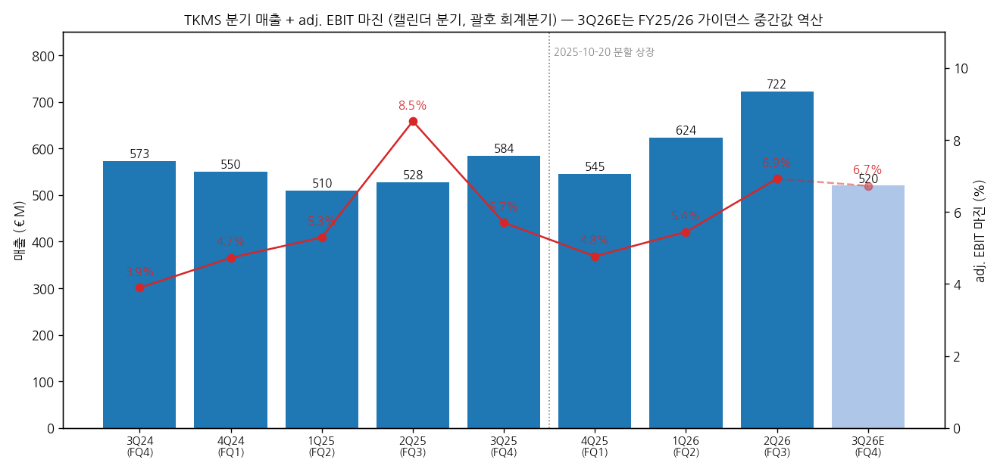
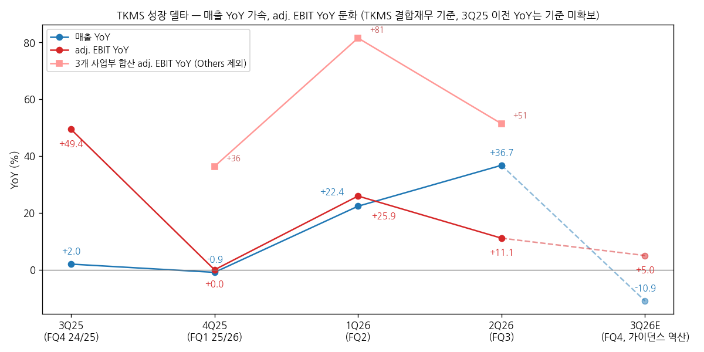
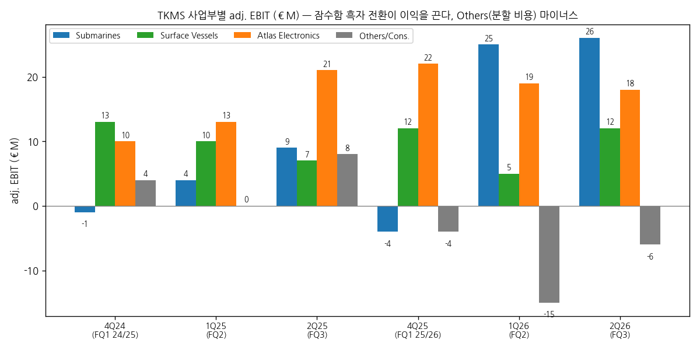

> 모드: 실적 리뷰 (v11)
> 종목: TKMS (TKMS.DE)
> 섹터: 조선
> 서브섹터: 조선 글로벌
> 분기: 2026-Q2 (캘린더 2Q26 = 회계 Q3 FY25/26, 2026-04-01 ~ 06-30, 9월 결산) — FY25/26 연간(캘린더 3Q26 포함)은 **2026-12-07 Annual Financial Report 발표 예정** (11/14 기준 미발표, Quiet Period 11/23~12/6)
> 발표일: 2026-08-12 (07:00 CET Quarterly Statement 9M + 보도자료 + 컨퍼런스콜 웹캐스트)
> 작성 시각: 2026-11-14 19:13 KST
> 분석 소스: **셀사이드 리포트 미확보 — 회사 자료 + 웹서치.** 회사 자료(1차) — Quarterly Statement 9M 2025/26 (8/12), 9M Earnings Presentation (8/12), 보도자료 (8/12), Half-year Financial Report H1 25/26 (5/11), Quarterly Statement Q1 25/26 (2/11), Investor Presentation (2026-11, 분기 사업부 표·FY24/25 재무제표 포함), IR 홈페이지 컨센서스(회사 집계 중간값)·주주구조·재무일정 (11/14 조회). 분할 전 기준은 thyssenkrupp Annual Report 2021/22·2023/24·2024/25 Marine Systems 세그먼트. 웹 — 캐나다 총리실 CPSP 발표(7/6), 주가 Yahoo Finance(TKMS.DE), 보도(dpa·Börse Express·The Week 등, "보도 인용" 표시). 컨콜 트랜스크립트 미확보 (웹캐스트 영상만 공개). 직전 분기 리뷰 없음 (첫 리뷰)
> 리뷰 깊이: 숫자 중심 | 리서치 첨부 0건

# TKMS 2Q26 (FQ3 25/26) 실적 리뷰 — 매출 +37%로 가속, adj. EBIT은 +11%로 둔화. 잠수함 흑자 전환이 이익을 끌고 분할 비용이 깎았다

> 성장 델타: 둔화 | 내러티브: 강화 → 이익 델타 둔화 + 내러티브 강화 → 대기 구간 (12/7 FY25/26 실적·FY26/27 가이던스와 캐나다 CPSP 본계약 확인 전까지)

→ **숫자**: 매출 €722M(+36.7% YoY, 분기 최대), adj. EBIT €50M(+11.1% YoY), 마진 6.9%(-1.6%p YoY). 매출 YoY는 1Q26 +22.4% → +36.7%로 14%p 가속했지만 adj. EBIT YoY는 +25.9% → +11.1%로 15%p 둔화했다. Others(본사·연결조정)를 뺀 3개 사업부 합산 adj. EBIT은 €37M → €56M(+51%)로 여전히 강하다. 둔화의 원인은 전년 결합재무 최초 작성 시 일회성 이익(Others +€8M)과 올해 분할 관련 G&A(Others -€6M)다
→ **쟁점 ①**: 잠수함 adj. EBIT이 9M €11M → €46M(4배)로 뛰었다. 회사 설명은 "2021년 7월 이전 저마진 레거시 수주 소진 + 신규 수주(마진 높음) 램프업"이다. 9M에 레거시 잠수함 3척을 인도했다
→ **쟁점 ②**: 가이던스를 두 번째로 올렸다(매출 +2~5% → +10~12%, 마진 >6% → 최대 6.5%, adj. EBIT €100~150M → €130~160M). 그런데 가이던스대로면 4Q(FQ4) 매출은 약 €520M(-11% YoY)이다. 회사 집계 컨센(FY26E 매출 €2,521M·adj. EBIT €163M)은 가이던스 상단 위에 있다
→ **쟁점 ③**: 분기 수주는 €208M(Book-to-bill 0.29)로 비었지만, 분기 뒤 A-200 DEU 호위함 4척(약 €5B, FQ4 반영)과 캐나다 CPSP 우선협상(최대 12척, €15B+, 잔고 +50% 이상)이 나왔다. 캐나다는 한화오션을 예비 공급자로 지정했다
→ **다음 분기 관건**: 12/7 FY25/26 실적에서 FQ4 adj. EBIT이 가이던스 역산(€35M)인지 컨센 역산(€53M)인지, FY26/27 가이던스가 컨센(매출 €2,840M·마진 7.1%)을 맞추는지. 캐나다 본계약 시점(회사 "CY26 말" vs 캐나다 정부 "늦어도 2027년 말")

---

## 1. 숫자

① 연결 기준 분기 표 (단위: €M, %, 캘린더 분기 — 괄호는 회계분기, 9월 결산)

| 항목 | 3Q24 (FQ4 23/24) | 4Q24 (FQ1 24/25) | 1Q25 (FQ2) | 2Q25 (FQ3) | 3Q25 (FQ4) | 4Q25 (FQ1 25/26) | 1Q26 (FQ2) | **2Q26 (FQ3)** | 3Q26E (FQ4) [가이던스 역산] |
|---|---|---|---|---|---|---|---|---|---|
| 매출 | 573 | 550 | 510 | 528 | 584 | 545 | 624 | **722** | 약 520 |
| adj. EBIT | 22 | 26 | 27 | 45 | 33 | 26 | 34 | **50** | 약 35 |
| adj. EBIT 마진 | 3.9 | 4.7 | 5.3 | 8.5 | 5.7 | 4.8 | 5.4 | **6.9** | 약 6.7 |
| 매출 YoY | — | — | — | — | +2.0 | -0.9 | +22.4 | **+36.7** | 약 -10.9 |
| adj. EBIT YoY | — | — | — | — | +49.4 | 0.0 | +25.9 | **+11.1** | 약 +5.0 |
| **매출 YoY 델타 (%p)** | — | — | — | — | — | -2.9 | +23.3 | **+14.3** | 약 -47.6 |
| **adj. EBIT YoY 델타 (%p)** | — | — | — | — | — | -49.4 | +25.9 | **-14.8** | 약 -6.1 |
| 3개 사업부 합산 adj. EBIT (Others 제외) | — | 22 | 27 | 37 | 미공개 | 30 | 49 | **56** | — |
| 3개 사업부 합산 YoY | — | — | — | — | — | +36.4 | +81.5 | **+51.4** | — |
| 수주 | 미확보 | 5,440 | 157 | 3,001 | 약 447 [계산] | 904 | 2,505 | **208** | A-200 DEU 약 5,000 반영 예정 |
| 수주잔고 (기말, €B) | 11.8 | 미확보 | 미확보 | 18.6 | 18.2 | 18.7 | 20.6 | **20.1** | — |

→ (출처: TKMS Quarterly Statement Q1·9M 25/26, Half-year Report H1 25/26, Investor Presentation 2026-11 "Quarterly details" 표. 3Q24·3Q25는 연간 − 9M 역산 [계산]: FY23/24 €1,986.6M − 9M €1,413.8M, adj. EBIT €85.6M − €63.3M / FY24/25 €2,171.4M − €1,587.2M, €130.8M − €97.5M. 3Q25 수주는 사업부 합(잠수함 -75 + 수상함 66 + Atlas 457, 연결조정 전) [계산]. 3개 사업부 합산 adj. EBIT은 회사 분기표 기준이며 사업부 반올림으로 ±€1M 차이가 난다)
→ **adj. EBIT 정의(회사 기준)**: IFRS 영업이익(Income from operations) + thyssenkrupp 브랜드 라이선스 수수료 + 기타 금융수익(지분법 포함) + 특수항목(분할 거래비용·부동산 취득세 등)을 더한 값. 2Q26: 영업이익 €47M + 기타 금융수익 €2M + 특수항목 €1M = €50M. 9M 특수항목 €9M 중 €8M이 분할 재편 부동산 취득세다
→ **기준 단절**: 2025-10-20 분할 상장. 위 표는 모두 TKMS 결합재무(Combined FS, carve-out) → 연결재무 기준이다. 분할 전 thyssenkrupp "Marine Systems" 세그먼트 숫자(예: FY23/24 매출 €2,118M·adj. EBIT €125M)는 회계정책·carve-out 조정으로 TKMS 기준(€1,987M·€86M)과 다르다. 그래서 4Q24~2Q25(FQ1~FQ3 24/25)의 YoY는 같은 기준의 전년 분기가 없어 비워 뒀다
→ **3Q26E**: 회사 가이던스(매출 +10~12% = €2,388~2,432M, adj. EBIT €130~160M) 중간값 − 9M 실적 [계산]. 같은 방식으로 **회사 IR 집계 컨센(FY26E 매출 €2,521M, adj. EBIT €163M, 마진 6.5%)을 역산하면 3Q26E 매출 €631M(+8.0%), adj. EBIT €53M(+59%, 마진 8.4%)**이다. 컨센은 가이던스 상단(€160M)보다 높다 (IR 홈페이지 컨센서스, 11/14 조회, 증권사 10곳 커버리지의 중간값)
→ 이번 분기 컨센 대비 서프라이즈는 분기 컨센 미확보로 계산하지 못했다. 발표일 주가는 +8.5%(€86.8 → €94.2), 다음 날 +10.2%(€103.8)로 반응이 강했다 (Yahoo Finance 종가)

→ **판정 근거 — 둔화**: adj. EBIT YoY가 +25.9% → +11.1%로 축소됐지만 플러스 성장이다(스킬 기준 "둔화"). 매출은 가속이라 방향이 엇갈리지만 YoY 변화폭이 ±5%p를 넘어 "유지"가 아니다. Others를 뺀 사업부 합산도 +81.5% → +51.4%로 둔화 방향이 같다
→ **마진이 떨어진 이유 3가지** (회사 설명): ① 전년 2Q25(8.5%)에 결합재무 최초 작성 관련 일회성 회계 이익이 있었다(Others +€8M) ② 분할에 따른 G&A 증가(분기 G&A €35M → €48M, +38%) ③ Atlas 마진 11.9% → 7.4%(전년 서비스 이례 호조 + 램프업 투자). 잠수함 마진은 3.8% → 6.4%로 올랐다
→ **YoY 경로 [판단]**: 가이던스 역산 기준이면 다음 분기 매출 YoY가 마이너스(-11%)로 꺾인다. 회사가 "수상함 3Q 매출은 회계 타이밍 영향, 4Q에 따라잡는다"고 말한 점, 컨센 역산(+8%)을 보면 가이던스는 보수적일 가능성이 높다. 그래도 분기 매출 €722M은 가이던스 경로를 넘는 고점이라 매출 YoY 정점은 2Q26일 가능성이 크다

→ (출처: TKMS Quarterly Statement·Half-year Report·Investor Presentation 2026-11. 3Q26E는 FY25/26 가이던스 중간값 역산 [계산])

→ (출처: 같은 자료 [계산]. 점선은 가이던스 역산 E. 분홍선은 Others 제외 3개 사업부 합산)

② 사업부별 매출·adj. EBIT (단위: €M, %)

| 사업부 | 항목 | 2Q25 (FQ3 24/25) | 1Q26 (FQ2 25/26) | **2Q26 (FQ3 25/26)** | 9M 24/25 | 9M 25/26 | 매출 비중 2Q26 |
|---|---|---|---|---|---|---|---|
| 잠수함 (Submarines) | 매출 | 231 | 370 | **400** | 854 | 1,001 | 52% |
| 잠수함 | adj. EBIT | 9 | 25 | **26** | 11 | 46 | |
| 잠수함 | 마진 | 3.8 | 6.7 | **6.4** | 1.3 | 4.6 | |
| 잠수함 | 매출 YoY | — | +20.1 | **+73.2** | — | +17.2 | |
| 잠수함 | adj. EBIT YoY | — | +525 | **+189** | — | +318 | |
| 수상함 (Surface Vessels) | 매출 | 158 | 103 | **131** | 368 | 408 | 17% |
| 수상함 | adj. EBIT | 7 | 5 | **12** | 30 | 30 | |
| 수상함 | 마진 | 4.2 | 5.1 | **9.5** | 8.1 | 7.4 | |
| 수상함 | 매출 YoY | — | +22.6 | **-17.1** | — | +10.9 | |
| 수상함 | adj. EBIT YoY | — | -50.0 | **+71.4** | — | 0.0 | |
| Atlas Electronics | 매출 | 180 | 191 | **236** | 480 | 612 | 31% |
| Atlas | adj. EBIT | 21 | 19 | **17** | 45 | 59 | |
| Atlas | 마진 | 11.9 | 10.0 | **7.4** | 9.4 | 9.6 | |
| Atlas | 매출 YoY | — | +20.1 | **+31.1** | — | +27.5 | |
| Atlas | adj. EBIT YoY | — | +46.2 | **-19.0** | — | +31.1 | |
| Others/연결조정 | 매출 | -42 | -40 | **-44** | -115 | -130 | |
| Others/연결조정 | adj. EBIT | 8 | -15 | **-6** | 11 | -25 | |

→ (출처: Quarterly Statement 9M 25/26 사업부 표(2Q26·9M), Investor Presentation 2026-11 분기표(1Q26, 2Q25 Others). 매출 비중은 사업부 합계 €767M(연결조정 전) 기준 [계산]. 회사 분기표는 2Q26 Atlas adj. EBIT을 €18M으로 적었다 — 반올림 차, 본문은 Quarterly Statement €17M 사용. FQ1 25/26 사업부 매출은 Q1 Statement 이후 사업부 관리체계 변경으로 H1에서 일부 재분류됐다)

→ (출처: Investor Presentation 2026-11 "Quarterly details year-to-date")

→ **델타를 끄는 것은 잠수함이다.** 9M 그룹 adj. EBIT 증가 +€12M을 쪼개면 잠수함 +€35M, Atlas +€14M, 수상함 0, Others -€37M이다 (회사 9M 브리지). 잠수함 매출 +73%(2Q)는 신규 건조(노르웨이·독일 212CD, 싱가포르 218SG 등) 램프업과 서비스 매출이고, 마진 6.4%는 레거시 비중 축소 덕이다
→ **Atlas는 매출 +31%인데 이익 -19%다.** 회사는 "전년 이례적 서비스 호조 기저 + 일시적 램프업 투자"라고 했다. 9M 마진(9.6%)은 전년(9.4%)보다 높아 구조적 훼손은 아니다 [판단]. Atlas 매출의 일부는 그룹 내부(212CD용 어뢰·소나) 매출이다
→ **수상함은 매출 -17%지만 마진 9.5%**로 개선됐다. 브라질 Tamandaré·New Polarstern 집행 중이며, 3Q 매출은 회계 타이밍으로 4Q에 따라잡는다고 했다. 3Q 판매비 절감도 기여했다
→ **Others -€6M (전년 +€8M)**: 분할 G&A(9M +€21M)와 일회성 연금 출연이 반영됐다. 9M Others는 -€25M으로 그룹 이익을 1.3%p 깎는다 [계산]. 분할 비용 중 컨설팅 등은 일회성이지만 상장사 거버넌스 비용은 남는다

(1) 수주·잔고 — 선행지표 (단위: €M, €B)

| 항목 | 2Q25 (FQ3 24/25) | 1Q26 (FQ2 25/26) | **2Q26 (FQ3 25/26)** | 9M 24/25 | 9M 25/26 |
|---|---|---|---|---|---|
| 그룹 수주 | 3,001 | 2,505 | **208** | 8,598 | 3,617 |
| Book-to-bill | 5.7 | 4.0 | **0.29** | 5.4 | 1.9 |
| 잠수함 수주 | 2,914 | 2,045 | **67** | 7,202 | 2,186 |
| 수상함 수주 | 9 | 32 | **3** | 1,183 | 36 |
| Atlas 수주 | 86 | 537 | **154** | 235 | 1,950 |
| 수주잔고 (€B, 기말) | 18.6 | 20.6 | **20.1** | — | — |
| Sales coverage (잔고/매출, 배) | 8.6 | 8.8 | **8.0** | — | — |

→ (출처: Quarterly Statement 9M·H1, Investor Presentation 2026-11. Book-to-bill [계산])
→ 2Q26 수주 공백은 예정된 것이다. 9M 수주의 핵심은 1Q26 노르웨이 212CD 옵션 2척(약 €2B)과 독일 BAAINBw 중어뢰 DM2A5 프레임 계약(Atlas, 4Q25)이었다
→ **분기 뒤 수주(FQ4 반영)**: ① A-200 DEU 호위함 4척 + 옵션 4척, 약 €5B(7/14 서명, 회사 사상 최대 수상함 계약, 첫 인도 2029) — F126 프로그램 취소 대체 ② 캐나다 CPSP 우선협상자(7/6, 최대 12척 212CD, 회사 추정 €15B+, 잔고 +50% 이상) — **아직 수주 아님**
→ 잔고 €20.1B는 FY24/25 매출의 9.3배다 [계산]. A-200 DEU만 더해도 FQ4 말 잔고는 약 €24~25B가 된다 [추정: 20.1 + 5 − FQ4 매출 약 0.5~0.6]

(2) 가이던스 — 이전 → 이번 (FY25/26, 10월~9월)

| 항목 | 최초 (2025-12) | 1차 상향 (2026-02, FQ1) | **2차 상향 (2026-08, FQ3)** | 9M 실적 | FQ4 역산 |
|---|---|---|---|---|---|
| 매출 성장 | -1% ~ +2% | +2% ~ +5% | **+10% ~ +12%** (€2,388~2,432M) | €1,890M (+19.1%) | €498~542M |
| adj. EBIT | — | €100~150M | **€130~160M** | €110M (+12.8%) | €20~50M |
| adj. EBIT 마진 | — | >6.0% | **최대 6.5%** | 5.8% | — |
| 투자(CAPEX) | — | 약 €200M | 약 €200M (Wismar 확장) | €83M | — |
| 중기 목표 | 매출 CAGR 약 10%, 마진 >7%, 3년 누적 FCF >€400M | 확인 | **확인** | — | — |
| 배당 | 순이익의 30~50% (FY25/26부터, 2027년 첫 지급) | | | | |

→ (출처: Quarterly Statement Q1 25/26 Forecast report(최초 -1~+2% 언급), 9M 25/26 Forecast report, 9M Earnings Presentation p.18. FQ4 역산 [계산])
→ 사업부 가이던스: "Atlas·수상함 매출 급증(sharp increase), 잠수함 완만한 증가(moderate)" (9M Forecast report)
→ 회사 집계 컨센(IR 홈페이지, 11/14): FY26E 매출 €2,521M / adj. EBIT €163M / 6.5%, FY27E €2,840M / €201M / 7.1%, FY28E €3,402M / €261M / 7.7%. **시장은 FY27에 이미 중기 목표(>7%)를 넣고 있다**

③ 연간 (단위: €M, %)

| 항목 | FY21/22 | FY22/23 | FY23/24 | FY24/25 | FY25/26 가이던스 | FY25/26E 컨센 | FY26/27E 컨센 | FY27/28E 컨센 |
|---|---|---|---|---|---|---|---|---|
| 매출 | 1,696 | 1,949 | 1,987 | 2,171 | 2,388~2,432 | 2,521 | 2,840 | 3,402 |
| adj. EBIT | 34 | 88 | 86 | 131 | 130~160 | 163 | 201 | 261 |
| 마진 | 2.0 | 4.5 | 4.3 | 6.0 | 최대 6.5 | 6.5 | 7.1 | 7.7 |
| 매출 YoY | — | +14.9 | +1.9 | +9.3 | +10~12 | +16.1 | +12.7 | +19.8 |
| adj. EBIT YoY | — | +159 | -2.3 | +52.9 | -1~+22 | +24.6 | +23.3 | +29.9 |
| 수주 | 4,326 | 986 | 1,355 | 약 9,027 [계산] | — | — | — | — |
| 수주잔고 (€B) | 13.8 | 12.7 | 11.8 | 18.2 | — | — | — | — |
| 순이익 | 13 | 63 | 88 | 108 | — | — | — | — |

→ (출처: CMD 2025 Presentation p.131(FY21/22~FY23/24, Combined FS 기준), Investor Presentation 2026-11(FY24/25 연결 손익), IR 컨센서스 페이지. FY24/25 수주는 사업부 합(연결조정 전) [계산]. 분할 전 thyssenkrupp Marine Systems 세그먼트 기준 시계열은 `TKMS.DE_기업개요.md` 참조)
→ 발표 전 → 후 컨센 변화: 증권사별 추정 변경 이력 미확보. 보도 인용으로 Deutsche Bank TP €115로 상향, Bernstein €115로 하향, Stifel €105 신규(Börse Express·trading-treff 보도, 원문 미확인). IR 페이지 기준 애널리스트 의견 Buy 70%·Hold 30%, TP 중간값 €102.5(11/2)

---

## 2. 시장 쟁점

> 셀사이드 리포트·컨콜 트랜스크립트 미확보 — 쟁점은 회사 Quarterly Statement·발표자료의 설명, 회사 보도자료, 웹 보도(dpa·Börse Express 등)로 구성했다. 질문자 소속은 확인하지 못했다.

① 지난 분기 체크 (2-0)

첫 리뷰 — 직전 체크 없음.

② 이번 분기 쟁점

| # | 쟁점 | 근거 |
|---|---|---|
| (1) | 잠수함 마진 4배 — 레거시 소진이 끝나면 마진은 어디까지 가나 | 회사 9M 자료 핵심 메시지, Q1 때 Bernstein이 잠수함 마진을 "우려"로 지목 (보도 인용) |
| (2) | 가이던스 2차 상향인데 FQ4 역산은 매출 -11% — 보수적인가, 4Q 공백인가 | 가이던스 vs 컨센 괴리 |
| (3) | 캐나다 CPSP·A-200 DEU·인도 P-75I — 잔고 €20B → €40B 시나리오와 실행 능력 | 회사 발표 p.6·8, 보도 다수 |
| (4) | 분할 비용과 현금흐름 — G&A +33%, 9M FCF -€204M | 9M 자료, 보도 |

③ 쟁점별 분해

(1) 잠수함 마진 4배 — 레거시 소진이 끝나면 마진은 어디까지 가나

(1-1) 회사 설명
→ "9M 잠수함 adj. EBIT은 €11M → €46M으로 4배가 됐다. 신규 건조 프로젝트 램프업이 커지고 저마진 레거시 프로젝트 부담이 줄어든 결과다" (9M Quarterly Statement)
→ 레거시 = 2021년 7월 이전 수주분. 9M에 레거시 잠수함 3척 인도(214급 2025-11, 동남아 기밀 고객 2026-01, 지중해 기밀 고객 2026-06). "2028년경 레거시 생산 종료가 가시적" (9M 발표 p.9 차트)
→ 신규 수주의 수주 시점 총이익률은 레거시 대비 +7%p 높다 (Investor Presentation p.49). FY24/25 사업부 총이익률: 잠수함 12.2%(FY23/24 7.4%), 수상함 16.7%, Atlas 22.6%
→ CEO: "잠수함 부문 adj. EBIT 300% 증가는 수주잔고 대부분을 차지하는 사업에서 나온 것"

(1-2) [판단]
→ 잠수함 마진은 2Q25 3.8% → 1Q26 6.7% → 2Q26 6.4%로 6%대에 올라섰다. 레거시 인도가 2028년까지 이어지므로 마진 개선은 계단식으로 더 진행될 여지가 있다. 컨센 FY27 그룹 마진 7.1%는 잠수함 7%대 진입을 전제로 보인다
→ 확인할 숫자는 **FQ4 잠수함 마진 6% 이상 유지**다. 레거시 인도 분기(일회성 마진 인식)가 지나간 뒤에도 6%대면 구조적 개선이 맞다

(2) 가이던스 2차 상향인데 FQ4 역산은 매출 -11% — 보수적인가, 4Q 공백인가

(2-1) 회사 설명
→ "프로젝트 진척이 좋고 운영 성과가 개선돼 연간 가이던스를 조정한다" (CFO Paul Glaser, 보도자료)
→ "수상함 3Q 매출은 회계 타이밍 영향 — 4Q에 따라잡는다(catch-up in Q4)" (9M 발표 p.13)
→ FQ1 때 "보수적 계획 접근(conservative planning approach)"을 명시했고, 매출 성장은 중기적으로 "back-loaded"라고 했다 (Q1 Statement)

(2-2) 출처별 해석 편차

| 출처 | 핵심 가정·추정 | 논리 |
|---|---|---|
| 회사 가이던스 | FY 매출 €2,388~2,432M, adj. EBIT €130~160M → FQ4 매출 약 €520M, adj. EBIT 약 €35M | 상단을 열어둔 보수적 범위 |
| IR 집계 컨센 (중간값) | FY 매출 €2,521M, adj. EBIT €163M → FQ4 €631M, €53M (마진 8.4%) | 가이던스 상단 초과 — 2Q26 매출 €722M 추세 유지 |
| 전년 패턴 | FQ4 24/25 매출 €584M, adj. EBIT €33M (마진 5.7%) | FQ4가 계절적 고점은 아니다 |

(2-3) [판단]
→ 2Q26 매출 €722M을 그대로 FQ4에 놓으면 FY 매출은 €2,612M(+20%)다 [계산]. 가이던스 +10~12%는 FQ4 매출이 €200M 줄어든다는 뜻이라 보수적이라고 본다. 다만 회사가 두 번 올리면서도 상단을 컨센 아래에 둔 것은 FQ4에 레거시 인도·마일스톤 타이밍 리스크가 있다는 신호로도 읽힌다
→ 12/7 실적이 컨센 €163M 근처면 "델타 재가속", 가이던스 중간(€145M) 근처면 FQ4 YoY +5%로 "둔화 지속"이다

(3) 캐나다 CPSP·A-200 DEU·인도 P-75I — 잔고 €20B → €40B 시나리오

(3-1) 회사 설명
→ CPSP: 최대 12척 212CD, 잠재 수주가치 €15B 이상, 잔고 +50% 이상. 독일·노르웨이·캐나다 212CD 공동 함대 최대 24척 → 규모의 효율. "최종 계약 서명은 CY26 말 예상" (9M 발표 p.6)
→ 캐나다 정부: "늦어도 2027년 말까지 계약 완료, 첫 4척 2034년 인도. 협상이 실패하면 한화오션을 우선협상자로 지정할 수 있다" (캐나다 총리실 7/6). CEO는 "6개월 안에 빠를 수도"라고 했다 (보도 인용)
→ A-200 DEU: 4척 약 €5B, 옵션 4척. 첫 인도 2029년 — "A-200 타입은 36개월 안에 건조" (9M 발표 p.19). 10/8 독일 예산위원회가 옵션 4척 승인 (보도 인용, 단일 출처·원문 미확인)
→ 인도 P-75I: MDL과 6척(+옵션 3척) AIP 잠수함 최종 협상, 설계 착수(Early Work Agreement) 수주. 9월 말 기준 미서명 (The Week 9/23 보도 인용)
→ 그 외 파이프라인: F127 방공 호위함(5+1+2척, TKMS 과반 JV 단독 입찰), 브라질 Tamandaré 추가 4척 MoU(4월), 그리스 신형 잠수함·214급 성능개량

(3-2) [판단]
→ CPSP + A-200 DEU + P-75I가 모두 들어오면 잔고는 €40B대로 2배가 된다. 매출 €2.5B 회사에 잔고 16배는 실행(조선소 능력)이 병목이다. 회사가 Navantia(스페인)·Fincantieri(이탈리아)와 잠수함 협력 프레임을 연말까지 만들겠다고 한 것, German Naval Yards Kiel 인수 입찰을 철회한 것은 "능력 확장을 자본 대신 파트너십으로" 하겠다는 선택이다
→ 캐나다 계약 시점이 쟁점이다. 회사 가이던스는 CY26 말, 캐나다 정부의 공식 데드라인은 2027년 말이다. 12월에 서명 신호가 없으면 시장 기대(연내)가 밀린다

(4) 분할 비용과 현금흐름

(4-1) 회사 설명
→ 9M G&A €129M(+33%) 중 €21M이 분할 관련(거버넌스·보고·컴플라이언스 + 일회성 컨설팅). 9M FCF -€204M은 "마일스톤 결제 타이밍과 신규 프로젝트 램프업, 전년 212CD 선수금 기저". 연간 FCF는 플러스 예상 (9M 발표 p.17)
→ 순금융자산 €834M(Jun-26), 무차입. 1Q에 tk에 약 €285M 지급(분할 재편)

(4-2) [판단]
→ 선수금 구조의 조선·방산 특성상 FCF는 수주 타이밍을 따른다. FQ4 A-200 DEU 계약 선수금이 들어오면 연간 플러스 전환은 무리가 없어 보인다. 배당(순이익 30~50%, 2027년 첫 지급)의 커버 조건이 FCF라 FY25/26 FCF 부호가 첫 배당 규모를 정한다

---

## 3. 내러티브 점검

① 성장 스토리 정의
→ **"유럽 재무장 + 비핵 잠수함 독점적 지위(회사 주장 "NATO 잠수함 함대의 70%를 TKMS가 공급")로 잔고가 2배로 늘고, 저마진 레거시가 빠지면서 마진이 2%(FY21/22) → 6% → 7%+로 계단식으로 오른다"**

② 이번 분기 평가 — **강화**
→ 숫자: 잠수함 adj. EBIT 4배, 매출 +37%로 "레거시 소진 → 마진 상승" 전제가 확인됐다. 가이던스 2차 상향, 중기 목표 재확인
→ 수주: 분기 뒤 A-200 DEU(약 €5B)와 캐나다 CPSP 우선협상(€15B+)이 나왔다. 둘 다 회사 역사상 최대 규모다
→ 약화 요인: 그룹 adj. EBIT YoY 둔화(+11%), Others 분할 비용, Atlas 이익 감소, 9M FCF 마이너스. 주가는 8/14 고점 €104.0에서 11/13 €75.0으로 -28%. 10/20 thyssenkrupp(51%)의 12개월 락업이 끝났다 — 물량 부담 요인 [판단]

③ 국면 설명 (0번 판정 근거)
→ 이익 델타 둔화 + 내러티브 강화 → **대기 구간**. 수주는 역대급인데 분기 이익 YoY는 분할 비용·기저 때문에 둔화했고, 가이던스대로면 FQ4도 +5%로 낮다. 매출 가속이 이익으로 넘어오는 것은 FY26/27(컨센 +23%)부터다
→ 12/7 FY 실적이 컨센(€163M)에 맞고 FY26/27 가이던스가 마진 7% 근처로 나오면 "가속 + 강화"로 올린다 [판단]

④ 한국 조선 3사 대비 시사점
→ **잠수함 수출 경쟁에서 TKMS가 연속으로 이겼다.** 캐나다 CPSP는 TKMS 우선협상·한화오션 예비, 폴란드 Orka는 Saab A26(6/29 서명)으로 TKMS·한화오션 모두 탈락했다. 남은 큰 판은 그리스(신형 4척, 한화오션은 ONEX와 팀 구성), 사우디, 인도 P-75I(TKMS 단독)이다. 한화오션 특수선 할증이 빠진 이유(`2026-Q3_한화오션_리뷰.md` 쟁점 ②) 중 하나가 TKMS의 캐나다 수주다
→ 마진 구조 비교: TKMS 그룹 마진 6.9%·잠수함 6.4%는 한국 상선(한화오션 상선 17%대)보다 낮지만, 잔고/매출 8배로 가시성은 훨씬 길다. 한국 3사의 함정 수출 스토리는 "가격·납기", TKMS는 "NATO 상호운용성·기존 고객 기반"으로 싸우는 구도다 [판단]

⑤ 스토리를 강하게 만들 트리거
→ (1) 캐나다 CPSP 본계약 서명 (€15B+, 잔고 +50%)
→ (2) 인도 P-75I 계약 (6+3척)
→ (3) FY26/27 가이던스 마진 7% 근처 + FQ4 잠수함 마진 6%대 유지

⑥ 스토리를 깨뜨릴 리스크
→ (1) 캐나다 협상 장기화·조건 악화 (2027년 말 데드라인, 한화오션 예비 공급자)
→ (2) Wismar 램프업·공급망 지연으로 신규 프로젝트 원가 초과 (회사가 소프트웨어 라이선스 비용 상승을 새 리스크로 추가)
→ (3) thyssenkrupp 지분 매각(락업 해제) 물량, 유럽 방산주 섹터 디레이팅

---

## 4. 향후 봐야 할 것 (우선순위 순)

(1) **12/7 FY25/26 실적 — FQ4(3Q26) adj. EBIT €35M(가이던스 역산) vs €53M(컨센 역산)** — 델타 판정을 바꾸는 1순위 변수
→ 무엇을: FQ4 adj. EBIT €45M 이상(YoY +35% 이상)이면 "재가속", €35M 안팎이면 "둔화 유지", €33M 미만이면 YoY 마이너스로 "꺾임". FQ4 매출이 €584M(전년)을 넘는지, 잠수함 마진 6%대 유지, Others 적자 폭
→ 어떤 데이터로: Annual Financial Report FY25/26, 실적 발표·컨콜, 사업부 표
→ 언제: 2026-12-07 (Quiet Period 11/23~12/6)

(2) **FY26/27 가이던스 — 컨센 매출 €2,840M(+13%)·adj. EBIT €201M·마진 7.1%와의 괴리**
→ 무엇을: 마진 가이던스가 7%를 포함하는지(중기 목표 조기 달성), 매출 성장 +10% 이상인지. 첫 배당 규모(순이익 30~50%)
→ 어떤 데이터로: 12/7 Outlook, 회사 컨센 페이지 갱신
→ 언제: 2026-12-07

(3) **캐나다 CPSP 본계약 — 회사 "CY26 말" vs 캐나다 "늦어도 2027년 말"**
→ 무엇을: 연내 서명 여부, 계약 금액(€15B+)과 수주 인식 시점, 캐나다 현지 산업 참여(ITB) 조건. 지연 시 예비 공급자 한화오션 거론 여부
→ 어떤 데이터로: 회사 ad-hoc 공시, 캐나다 국방조달청(DIA) 발표, 뉴스 키워드 "CPSP contract TKMS", "Canadian Patrol Submarine signed"
→ 언제: 2026-12 ~ 2027-1Q (2/10 FQ1 26/27 실적 전후)

(4) **FQ4 수주 인식 — A-200 DEU 약 €5B + 옵션 4척, 연말 잔고 €24B 이상**
→ 무엇을: FQ4 수주가 €5B를 넘는지, 옵션 4척(10/8 예산위 승인 보도)의 FQ1 26/27 인식 여부, F127 계약 진척
→ 어떤 데이터로: 12/7 수주·잔고 공시, 독일 하원 예산위원회 25-Mio-Vorlagen
→ 언제: 2026-12-07, F127은 2027년

(5) **인도 P-75I 서명·그리스 신형 잠수함 — 한국 3사와의 다음 수출 경쟁**
→ 무엇을: P-75I(6+3척, TKMS-MDL) 인도 내각안보위(CCS) 승인·서명, 그리스 4척 사업자 선정(TKMS vs 한화오션-ONEX vs Naval Group), 사우디 잠수함 사업 진척
→ 어떤 데이터로: 인도 국방부·MDL 거래소 공시, 그리스 국방부 발표, 뉴스 키워드 "P-75I signed", "Hellenic Navy submarine selection", "Saudi submarine Hanwha"
→ 언제: 수시 (P-75I는 2026년 말 ~ 2027년 상반기 거론)
