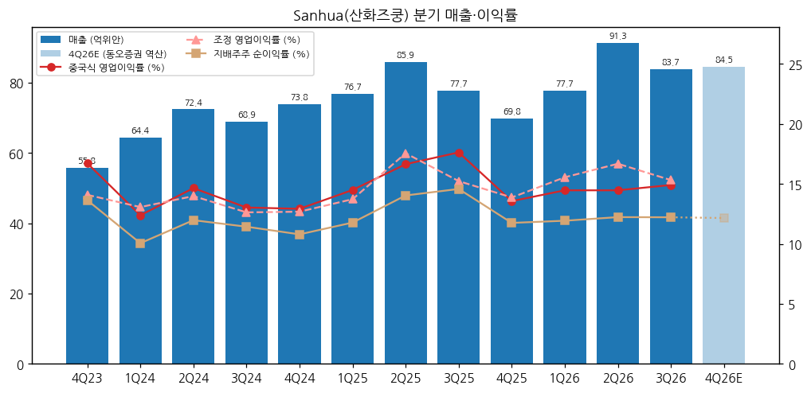
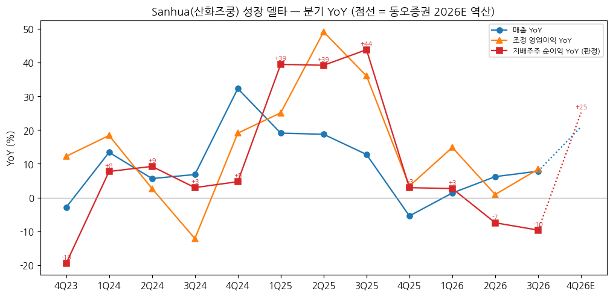
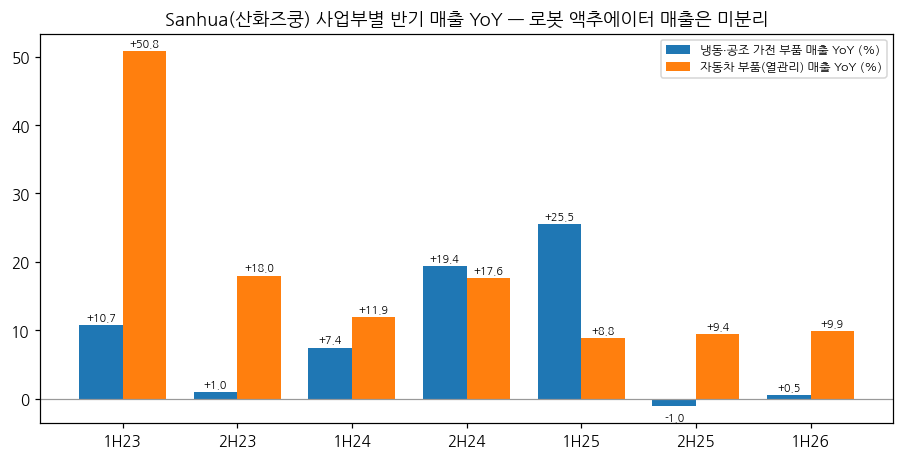

> 모드: 실적 리뷰 (v11)
> 종목: Sanhua Intelligent Controls / 산화즈쿵 (三花智控, 002050.SZ / H주 2050.HK)
> 섹터: 로봇
> 서브섹터: 로봇 부품
> 분기: 2026-Q3 (캘린더 = 회계 분기, 9/30 종료)
> 발표일: 2026-10-28 (장 마감 후 3분기 보고서 공시, 보고서 표기일 10/29)
> 작성 시각: 2026-11-14 19:42 KST
> 분석 소스: [1차 — 회사 원문] 심천거래소 공고 PDF(东方财富 공고 미러 경유 원문) — 2026년 3분기 보고서(10/28), 2026년 반기 보고서(8/26), 2025년 연간 보고서(3/23). 분기 단독 손익 세부(원가·판관비·营业利润)는 东方财富 F10 재무 API(회사 공시 수치 집계)로 받고 원문과 대조(3Q26 매출 83.74·순이익 10.23·扣非 10.18억위안 일치). 반기 사업부 매출·GPM은 东方财富 主营构成(반기·연간 보고서 원문 표와 대조). [보도 인용] 동오증권 3Q26 리뷰(10/29, 2026~2028E·3Q 부문별 추정), 국원증권 3Q26 리뷰(11/2, 2026~2028E), TrendForce(9/21, 21세기경제보도 인용 — Tesla 공급사 실사). 주가 Yahoo Finance v8. 컨퍼런스콜·업적설명회 Q&A 원문은 미확보
> 리뷰 깊이: 숫자 중심 | 리서치 첨부 0건 (웹 공개 증권사 리뷰 2건 보완)
> 다중 부문 처리: 로봇(액추에이터) 매출 **미분리 공시** → 회사 전체 숫자로 리뷰 (feedback_multisegment_global_peer 규칙). 로봇 매출은 사업부 표(냉동·공조 가전 부품 / 자동차 부품)에 섞여 있고 금액 미공개

# Sanhua 3Q26 실적 리뷰 — 매출 +7.8%, 순이익 -9.6%로 2개 분기 연속 역성장. 환차손이 이익을 깎았고, 로봇 액추에이터는 "배치 납품·라인 램프업" 문구뿐 숫자가 없다

> 성장 델타: 꺾임 | 내러티브: 약화 → 델타 꺾임 + 내러티브 약화 → 매매 제외 구간 (로봇 매출 미분리 → 섹터 합산 시 트래킹 처리 권고)

→ **판정 지표**: 지배주주 순이익(归母净利润)으로 판정했다. 중국 회계의 营业利润(이하 "중국식 영업이익")은 환차손익(재무비용)·공정가치 평가손익·투자수익을 포함해 K-IFRS 영업이익과 다르다. 그래서 순이익을 주 지표로 쓰고, 중국식 영업이익·비경상 제외 순이익(扣非)·조정 영업이익(매출 − 원가 − 세금 − 판관비 − 연구개발비 [계산])을 함께 적었다
→ **3Q 단독 산출 방식**: 중국 A주 3분기 보고서는 누적(1~9월) 손익표만 싣는다. 3Q 단독 = 9M 누적 − 1H 누적으로 계산했다 [계산]. 매출 252.74 − 169.00 = 83.74억위안, 순이익 30.67 − 20.44 = 10.23억위안. 회사가 보고서 첫 표에 함께 적은 "본 보고기간(3개월)" 숫자와 같다
→ **숫자**: 3Q26 매출 83.74억위안(+7.8% YoY), 지배주주 순이익 10.23억위안(-9.6%), 중국식 영업이익 12.49억위안(-8.8%), 매출총이익률 28.9%(+0.9%p). 순이익 YoY가 +2.7%(1Q26) → -7.5%(2Q26) → -9.6%(3Q26)로 2개 분기 연속 마이너스다
→ **환차손 조정**: 9M26 환차손 3.83억위안(전년 0.69억), 투자 평가손 2.15억위안 (3분기 보고서). 조정 영업이익(환차손·평가손 제외)은 3Q26 12.83억위안 YoY +8.4%로 플러스지만 2Q25~3Q25의 +36~49%에서 한 자릿수로 내려왔다. 회사는 환차손을 "경상 손익"으로 분류한다 — 판정은 보고 기준으로 하고 조정치는 참고로 둔다
→ **쟁점**: (1) 이익 역성장은 환율(위안화 강세)이 만든 것인가 (2) 냉동·공조 부품 둔화(9M +2%)와 자동차 부품 유지(+10%) (3) 로봇 액추에이터는 어디까지 왔나 — 매출 미분리, 회사 문구 "핵심 제품 배치 납품·라인 램프업"
→ **다음 분기 관건**: 4Q25 기저(순이익 8.21억위안, YoY +2.9%)가 낮아 4Q26은 YoY 반등 구조다. 동오증권 2026E(순이익 40.94억위안)가 요구하는 4Q26 순이익은 10.27억위안(+25.2%) [보도 인용·계산]. 반등해도 "기저효과"인지 "로봇·액랭 신규 매출"인지 구분이 필요하다

---

## 1. 숫자

① 연결 기준 분기 표 (단위: 억위안, %, 중국 기업회계준칙. 분기 단독 = 누적 차감)

| 항목 | 4Q23 | 1Q24 | 2Q24 | 3Q24 | 4Q24 | 1Q25 | 2Q25 | 3Q25 | 4Q25 | 1Q26 | 2Q26 | **3Q26** | 4Q26E (동오) | 4Q26E (국원) |
|---|---|---|---|---|---|---|---|---|---|---|---|---|---|---|
| 매출 | 55.8 | 64.4 | 72.4 | 68.9 | 73.8 | 76.7 | 85.9 | 77.7 | 69.8 | 77.7 | 91.3 | **83.7** | 84.5 | 91.5 |
| 조정 영업이익 [계산] | 7.9 | 8.4 | 10.1 | 8.7 | 9.4 | 10.5 | 15.1 | 11.8 | 9.7 | 12.1 | 15.2 | **12.8** | — | — |
| 조정 OPM | 14.1 | 13.1 | 14.0 | 12.6 | 12.7 | 13.7 | 17.6 | 15.2 | 13.9 | 15.6 | 16.7 | **15.3** | — | — |
| 중국식 영업이익 (营业利润) | 9.3 | 8.0 | 10.6 | 9.0 | 9.5 | 11.1 | 14.3 | 13.7 | 9.5 | 11.2 | 13.2 | **12.5** | — | — |
| 중국식 영업이익률 | 16.7 | 12.4 | 14.7 | 13.0 | 12.9 | 14.5 | 16.6 | 17.6 | 13.6 | 14.5 | 14.5 | **14.9** | — | — |
| 지배주주 순이익 (판정 지표) | 7.61 | 6.48 | 8.67 | 7.87 | 7.97 | 9.03 | 12.07 | 11.32 | 8.21 | 9.28 | 11.16 | **10.23** | 10.27 | 16.22 |
| 지배주주 순이익률 | 13.6 | 10.1 | 12.0 | 11.4 | 10.8 | 11.8 | 14.0 | 14.6 | 11.8 | 11.9 | 12.2 | **12.2** | 12.2 | — |
| 扣非 순이익 | 6.94 | 6.71 | 8.56 | 7.21 | 8.70 | 8.53 | 11.57 | 10.73 | 8.75 | 9.86 | 11.62 | **10.18** | — | — |
| 매출총이익률 | 28.4 | 27.1 | 27.8 | 28.2 | 26.8 | 26.8 | 29.3 | 28.0 | 31.2 | 27.8 | 28.3 | **28.9** | — | — |
| 매출 YoY | -2.9 | +13.4 | +5.6 | +6.8 | +32.3 | +19.1 | +18.7 | +12.8 | -5.4 | +1.4 | +6.2 | **+7.8** | +21.0 | +31.0 |
| 조정 영업이익 YoY | +12.2 | +18.4 | +2.7 | -12.2 | +19.1 | +25.1 | +49.1 | +36.1 | +3.4 | +14.9 | +0.9 | **+8.4** | — | — |
| 중국식 영업이익 YoY | -14.9 | +13.7 | +8.5 | -4.6 | +2.2 | +39.4 | +34.9 | +52.5 | -0.7 | +1.2 | -7.7 | **-8.8** | — | — |
| 순이익 YoY | -19.5 | +7.7 | +9.2 | +3.0 | +4.7 | +39.5 | +39.2 | +43.8 | +2.9 | +2.7 | -7.5 | **-9.6** | +25.2 | +97.7 |
| 扣非 순이익 YoY | +28.7 | +20.5 | -6.0 | -4.5 | +25.3 | +27.2 | +35.2 | +48.8 | +0.6 | +15.5 | +0.4 | **-5.1** | — | — |
| **매출 YoY 델타 (%p)** | -21.4 | +16.3 | -7.8 | +1.2 | +25.5 | -13.2 | -0.3 | -6.0 | -18.2 | +6.8 | +4.8 | **+1.6** | +13.2 | — |
| **순이익 YoY 델타 (%p)** | -42.0 | +27.2 | +1.5 | -6.3 | +1.8 | +34.8 | -0.3 | +4.6 | -40.9 | -0.2 | -10.1 | **-2.2** | +34.8 | — |
| **조정 영업이익 YoY 델타 (%p)** | -21.6 | +6.2 | -15.7 | -14.8 | +31.2 | +6.0 | +24.0 | -13.0 | -32.6 | +11.4 | -13.9 | **+7.5** | — | — |

→ (출처: 4Q23~3Q26 분기 단독 = 东方财富 F10 분기 손익(회사 1Q·반기·3Q·연간 보고서 누적치 차감 집계). 3Q25·3Q26은 9M − 1H 누적 차감으로 직접 재계산해 일치 확인 [계산]. 3Q26 회사 원문: 매출 8,373,537,505.49위안(+7.82%), 순이익 1,023,229,695.08위안(-9.64%), 扣非 1,018,469,669.43위안(-5.09%). 조정 영업이익 = 매출 − 매출원가 − 세금·부가 − 판매비 − 관리비 − 연구개발비 [계산])
→ (4Q26E: 동오증권 2026E 매출 337.21·순이익 40.94억위안(10/29) − 9M26 누적 [계산·보도 인용]. 국원증권 2026E 매출 344.23·순이익 46.89억위안(11/2) − 9M26 [계산·보도 인용] — 국원 추정은 3Q 실적 이전 가정이 유지된 것으로 보여(4Q 순이익 YoY +98% 필요) 참고만. 중국 쪽 컨센서스 집계 출처·증권사 수는 확인하지 못해 쓰지 않았다)
→ **서프라이즈**: 동오증권은 "실적 예상 부합"으로 평가했다 [보도 인용]. 회사는 분기 가이던스를 내지 않는다
→ **YoY 정점**: 순이익·조정 영업이익·扣非 모두 2Q25~3Q25(+39~49%)가 정점이었다. 그 뒤 4Q25(+2.9%)에 급감했고 2026년은 1Q +2.7% → 2Q -7.5% → 3Q -9.6%. 4Q26은 낮은 기저(4Q25 순이익률 11.8%)라 동오 경로상 +25%로 반등한다
→ **이익률은 무너지지 않았다**: 매출총이익률 28.9%는 12분기 중 두 번째로 높다. 이익을 깎은 것은 재무비용(3Q26 0.60억위안, 전년 -0.17억 — 환차손)과 공정가치 평가손(3Q26 -0.28억위안), 그리고 관리비·연구개발비 증가(3Q 기간비용률 13.8%, +1.8%p, 동오증권)다
→ **[판단] 델타 = 꺾임**: 판정 지표(순이익) YoY가 2Q26에 마이너스로 돌아섰고 3Q26에도 -9.6%로 마이너스가 이어졌다. 조정 영업이익 기준으로는 +0.9% → +8.4%로 소폭 올랐지만, 회사가 환차손을 경상 손익으로 분류하고 있고 위안화 강세가 이어지는 한 반복되는 비용이다. 조정 기준도 2025년 고점(+36~49%)에서 한 자릿수로 내려와 "가속"으로 보지 않는다

→ (출처: 회사 분기·반기·연간 보고서, 东方财富 F10 분기 단독 손익. 4Q26E 연한 막대·점선은 동오증권 2026E 역산 [계산·보도 인용])

→ (출처: 동일. 4Q26E 점선은 동오증권 2026E에서 역산 [계산])

② 사업부별 매출·이익 (단위: 억위안, % — 회사는 반기에만 사업부 매출·GPM 공시, 사업부 영업이익 미공시)

| 사업부 | 항목 | 1H24 | 2H24 | 1H25 | 2H25 | **1H26** | 9M26 (동오) | 3Q26 (동오) |
|---|---|---|---|---|---|---|---|---|
| 냉동·공조 가전 부품 (制冷空调电器零部件) | 매출 | 82.8 | 82.8 | 103.9 | 82.0 | **104.4** | 153.3 | 48.8 |
| | 매출 YoY | +7.4 | +19.4 | +25.5 | -1.0 | **+0.5** | +2 | +7 |
| | 매출총이익률 | 27.6 | 27.1 | 28.2 | 29.5 | **28.4** | 28.6 | — |
| | 순이익 [추정] | — | — | — | — | — | 16.9 (-11%) | 5.5 (-10%) |
| 자동차 부품 (汽车零部件, 열관리) | 매출 | 54.0 | 59.9 | 58.7 | 65.5 | **64.6** | 99.5 | 34.9 |
| | 매출 YoY | +11.9 | +17.6 | +8.8 | +9.4 | **+9.9** | +10 | +10 |
| | 매출총이익률 | 27.3 | 27.9 | 28.0 | 29.5 | **27.6** | 28.6 | — |
| | 순이익 [추정] | — | — | — | — | — | 13.8 (+2%) | 4.8 (-10%) |
| 로봇 액추에이터 | 매출 | 미분리 | 미분리 | 미분리 | 미분리 | **미분리** | "소규모" | — |

→ (출처: 반기 = 2025 연간·2026 반기 보고서 "营业收入构成"(东方财富 主营构成 집계). 2H = 연간 − 1H [계산]. 9M26·3Q26 부문 숫자는 동오증권 3Q26 리뷰(10/29) [보도 인용·증권사 추정] — 회사 원문에는 분기 부문 숫자가 없다. 사업부 YoY는 [계산])

→ (출처: 동일, 반기 공시 기준)
→ **델타를 끄는 쪽은 자동차 부품이다**. 반기 매출 YoY가 +8.8%(1H25) → +9.9%(1H26)로 유지되고 3Q26도 +10%(동오) 수준. 회사 설명은 "신에너지차 열관리 우위 유지, 상용차·ESS·무인주행 등 신규 분야 확대, 해외 생산 기지 운영 개선" (2026 반기 보고서)
→ **꺾인 쪽은 냉동·공조 가전 부품이다**. 1H25 +25.5%(가전 보조금·수출 선행 수요) → 2H25 -1.0% → 1H26 +0.5%. 동오는 9M26 순이익 -11%로 추정했다. 국내 가전 수요 약세를 해외와 데이터센터 액랭(동오: 2026년 액랭 매출 +50~100% 추정)이 일부 메우는 구도다 [보도 인용]
→ 지역별(1H26): 국내 98.5억위안(+8.8%), 해외 70.5억위안(-2.2%) — 해외 매출 감소에는 위안화 강세 환산 효과도 섞여 있다 (2026 반기 보고서, [판단])

(1) 로봇 액추에이터 — 분리 공시 여부 점검

| 공시 | 로봇 관련 기재 | 숫자 |
|---|---|---|
| 2025 연간 보고서 (3/23) | "전략 신흥 사업(바이오닉 로봇 기전 액추에이터 포함)" — 고객과 핵심 제품 연구개발·시제작·반복 개선·샘플 출하, 해외 생산 확대 | 없음 |
| 2026 반기 보고서 (8/26) | "핵심 제품 배치 납품과 생산라인 램프업을 안정적으로 추진, 신제품 개발·시장 확대 병행" | 없음 |
| 2026 3분기 보고서 (10/28) | 로봇 사업 언급 없음 (주주 명단에만 로봇 ETF — 상위 10대 주주에 华夏 중증로봇 ETF 0.95%·天弘 중증로봇 ETF 0.33%) | 없음 |
| 증권사 (동오 10/29) | "북미 대형 고객과 엔지니어링 램프업, 2026년 소규모 매출, 2027년 핵심 고객·신제품 양산으로 확대" | 없음 [보도 인용] |
| 보도 (TrendForce 9/21) | 회사: 최신 실사는 모르나 "주요 고객과 로봇 관절 액추에이터를 개발 중"임을 확인 | — [보도 인용] |

→ **결론**: 로봇 매출은 금액·비중 모두 미공시. 사업부 표는 2개(냉동·공조 / 자동차)뿐이라 추출할 부문이 없다. 섹터 합산(로봇 부품)에 회사 전체 숫자를 넣으면 가전·자동차 열관리 사이클을 로봇 델타로 착각하게 된다 → **섹터 합산 시 트래킹 처리 권고**

③ 연간 (단위: 억위안, %)

| 항목 | 2021 | 2022 | 2023 | 2024 | 2025 | 2026E (동오) | 2027E (동오) | 2026E (국원) | 2027E (국원) |
|---|---|---|---|---|---|---|---|---|---|
| 매출 | 160.2 | 213.5 | 245.6 | 279.5 | 310.1 | 337.2 | 394.8 | 344.2 | 401.7 |
| 조정 영업이익 [계산] | 19.5 | 26.9 | 34.7 | 36.6 | 47.1 | — | — | — | — |
| 중국식 영업이익 | 19.9 | 30.7 | 35.5 | 37.1 | 48.6 | 48.7 | 60.8 | 56.6 | 63.7 |
| 지배주주 순이익 | 16.8 | 25.7 | 29.2 | 31.0 | 40.6 | 40.9 | 51.1 | 46.9 | 53.0 |
| 순이익률 | 10.5 | 12.1 | 11.9 | 11.1 | 13.1 | 12.1 | 13.0 | 13.6 | 13.2 |
| 매출 YoY | +32.3 | +33.2 | +15.0 | +13.8 | +11.0 | +8.7 | +17.1 | +11.0 | +16.7 |
| 순이익 YoY | +15.2 | +52.8 | +13.5 | +6.1 | +31.1 | +0.8 | +24.9 | +15.4 | +13.0 |

→ (출처: 2021~2025 东方财富 F10 연간 손익(회사 연간 보고서 집계), 2025는 연간 보고서 원문(매출 310.12·순이익 40.63억위안) 대조. 2026E·2027E 동오증권(10/29)·국원증권(11/2) [보도 인용])
→ **추정치 변화**: 동오증권은 3Q 발표 후 2026~2028E 순이익을 45.1/57.7/73.0 → 40.9/51.1/65.9억위안으로 9~11% 내렸다 (사유: 가전 수요 약세, 환차손, 투자 평가손) [보도 인용]. 2026E 순이익 YoY +0.8% — 2026년은 사실상 "이익 정체의 해"로 굳어졌다
→ 2027E 반등(+25%)은 로봇·액랭 신규 매출 + 환율 기저를 전제로 한다. 회사 원문에는 이 전제를 뒷받침하는 숫자가 아직 없다 [판단]

---

## 2. 시장 쟁점 (회사 설명 + 반복 질문)

① 지난 분기 체크
→ 첫 리뷰 — 직전 체크 없음. 이번 분기부터 로봇 부품 글로벌 피어로 편입

② 이번 분기 쟁점 3개

| # | 쟁점 | 근거 |
|---|---|---|
| (1) | 순이익 역성장은 환율 때문인가, 본업 둔화인가 | 3분기 보고서 비경상 손익 설명, 동오·국원 리뷰 |
| (2) | 냉동·공조 부품 정체를 자동차 부품·액랭이 메울 수 있나 | 반기 보고서, 동오 부문 추정 |
| (3) | 로봇 액추에이터 — Tesla Optimus 양산 일정과 매출 인식 시점 | 반기 보고서, 동오, TrendForce(9/21) |

③ 쟁점별 분해

(1) **이익 역성장 = 환차손 + 평가손 + 비용 증가**
→ 회사 설명: 9M26 재무비용 전년 대비 +2.67억위안 "주로 환차손 영향", 공정가치 변동손익 -3.24억위안 "투자 평가손과 환율 파생상품 평가 영향". 9M26 환차손 3.83억위안(전년 0.69억), 선물·외환선도 이익 0.66억, 투자 평가손 2.15억위안. 회사는 공시 규정에 따라 환차손은 경상 손익, 선물·선도 손익은 비경상 손익으로 분류한다고 명시했다 (3분기 보고서)
→ 숫자: 동오는 "환차손·평가손 두 항목 합계 전년 대비 +5.3억위안, 이를 더하면 9M 순이익 +8%"로 계산했다 [보도 인용]. 3Q26 조정 영업이익 +8.4%, 扣非 -5.1% [계산·회사]
→ **[판단]** 환율을 빼면 본업은 한 자릿수 성장(+8%)이다. 2025년 고성장(+31%)의 핵심이던 마진 개선(조정 OPM 2Q25 17.6%)이 2026년에는 15~17%에서 멈췄다. 즉 "역성장"은 환율 탓이지만 "고성장 → 저성장" 전환은 본업 자체의 변화다

(2) **냉동·공조 정체, 자동차 부품 유지**
→ 회사 설명: 국내 가전 수요 압박 속에서 고객 집중·제품 구조 최적화, 데이터센터 액랭은 1차측·CDU·서버 랙까지 제품 범위 확장 (2026 반기 보고서). 9/29~30 싱가포르 Data Center World Asia에서 2MW급 CDU용 판형 열교환기 등 전시 (국원 11/2 [보도 인용])
→ 숫자: 냉동·공조 1H26 +0.5%, 9M26 +2%(동오), 3Q26 +7%(동오). 자동차 1H26 +9.9%, 3Q26 +10%(동오). 3Q26 냉동·공조 매출 QoQ -16%는 성수기(2Q) 이후 계절성 [보도 인용]
→ **[판단]** 매출 비중 61.8%(1H26)인 냉동·공조가 0~7% 성장에 머무는 한 전사 매출은 한 자릿수를 벗어나기 어렵다. 액랭이 2026년 +50~100%(동오)라도 기준 금액이 공개되지 않아 전사 기여를 측정할 수 없다

(3) **로봇 액추에이터 — 숫자 없는 내러티브**
→ 회사 설명: 2026 반기 보고서 "바이오닉 로봇 기전 액추에이터 핵심 제품 배치 납품과 라인 램프업을 안정적으로 추진". 3분기 보고서는 언급 없음
→ 보도: Tesla 팀이 9/16 닝보에 도착해 Optimus 3세대 공급사 실사를 시작했고(Tuopu·Joyson 등 포함), Sanhua는 "최신 실사는 알지 못하나 주요 고객과 로봇 관절 액추에이터를 개발 중"이라고 답했다. Tesla의 2026년 목표 약 5만 대, 대당 목표가 2만 달러 수준이 보도됐다 (TrendForce 9/21, 21세기경제보도 인용) [보도 인용]
→ 동오: "2026년 소규모 매출, 2027년 핵심 고객·신제품 양산으로 확대" [보도 인용]
→ **[판단]** 시장은 Sanhua를 "Optimus 관절 액추에이터 1차 공급사"로 가격에 넣어 왔지만(상위 10대 주주에 로봇 ETF 2개 — 华夏 0.95%·天弘 0.33%, 2026-09 말), 회사는 매출을 공개하지 않는다. 주가는 2026-01-19 장중 고점 60.77위안 → 11/13 34.87위안(-42.6%)으로 기대를 상당 부분 되돌렸다. 로봇 내러티브의 재점화 조건은 회사가 로봇 매출을 별도로 공개하거나 Tesla 양산 물량이 확인되는 것이다

→ 컨퍼런스콜·업적설명회 Q&A 원문은 확보하지 못했다. 위 쟁점은 증권사 리뷰 2건(동오·국원)과 보도에서 공통으로 다룬 주제다
→ 시장 반응: 발표 다음 거래일 10/29 A주 34.50위안(-3.2%), 10/30 33.24위안(-3.7%), 11/13 34.87위안 (Yahoo Finance)

---

## 3. 내러티브 점검

→ **성장 스토리**: 냉동·공조 밸브·펌프와 신에너지차 열관리 부품의 글로벌 상위권 회사("다수 제품이 세계 시장 상위", 2025 연간 보고서)가, 정밀 기전 제조 역량을 Tesla Optimus 관절 액추에이터로 옮겨 "로봇 부품 3번째 성장축"을 만든다. 시장은 2025년 하반기 이 기대로 멀티플을 올렸다(2025-12~2026-01 고점)
→ **이번 분기**: 본업은 저성장(조정 영업이익 +8%)에 환차손이 겹쳐 이익 역성장. 로봇은 숫자 공개가 없고, 증권사는 2026~2028E 이익을 9~11% 내렸다 → **내러티브 약화** (스토리 자체는 유지되나 타이밍이 2027년 이후로 밀리고 추정치가 하향)
→ **판정**: 델타 꺾임 + 내러티브 약화 → 매매 제외 구간. 4Q26 YoY 반등은 4Q25 저기저 효과라 "가속" 신호로 읽지 않는다 [판단]
→ **스토리 강화 트리거**: ① 회사가 로봇 액추에이터 매출을 별도 공시(2026 연간 보고서 사업부 표) ② Tesla Optimus 3세대 양산·공급사 확정 보도 ③ 위안화 강세 진정으로 환차손 소멸 + 조정 영업이익 +15% 이상 복귀
→ **훼손 리스크**: ① Optimus 액추에이터 공급 물량이 경쟁사(Tuopu 등)로 쏠림 ② 냉동·공조 매출 역성장 전환 ③ 미국 관세·보조금 변화로 자동차 열관리 해외 매출 둔화

---

## 4. 향후 봐야 할 것

(1) **4Q26 순이익 YoY 반등의 질** (1순위 — 델타 판정 변수)
→ 무엇을: 4Q26 순이익 10.3억위안(+25%, 동오 역산) 이상 여부. 반등분 중 환차손 축소·기저효과와 본업(조정 영업이익 YoY) 기여 구분. 조정 영업이익 YoY +15% 이상이면 "유지"로 재검토
→ 어떤 데이터로: 2026 연간 실적 예고(전년 12/22 공시), 2026 연간 보고서 손익·재무비용 주석
→ 언제: 2026-12 말~2027-01(실적 예고), 2027-03 하순(연간 보고서 — 전년 3/23)

(2) **로봇 액추에이터 매출 분리 공시 여부**
→ 무엇을: 2026 연간 보고서 사업부 표에 로봇(전략 신흥 사업) 행이 생기는지, 금액·GPM. 생기면 섹터 합산 "핵심 유지"로 전환 검토
→ 어떤 데이터로: 2026 연간 보고서 "营业收入构成", H주 연간 보고서 부문 정보
→ 언제: 2027-03 하순

(3) **Tesla Optimus 3세대 양산·공급사 확정**
→ 무엇을: Optimus 2026년 생산 목표(약 5만 대 보도) 진척, 관절 액추에이터 공급사 명단·물량 배분 (Sanhua vs Tuopu)
→ 어떤 데이터로: Tesla 4Q26 실적 발표·주주서한, TrendForce·21세기경제보도 등 공급망 보도
→ 언제: 2027-01 하순(Tesla 4Q26 실적)

(4) **환율과 냉동·공조 부품 회복**
→ 무엇을: 위안화 대비 달러·유로 흐름(환차손 규모), 냉동·공조 부품 매출 YoY 플러스 유지, 액랭 매출 금액 공개 여부
→ 어떤 데이터로: 2026 연간 보고서, 중국 가전 수출 통계(해관총서), 위안화 환율
→ 언제: 월간(환율·수출), 2027-03 하순(연간 보고서)
