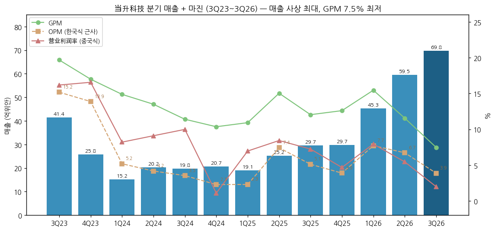
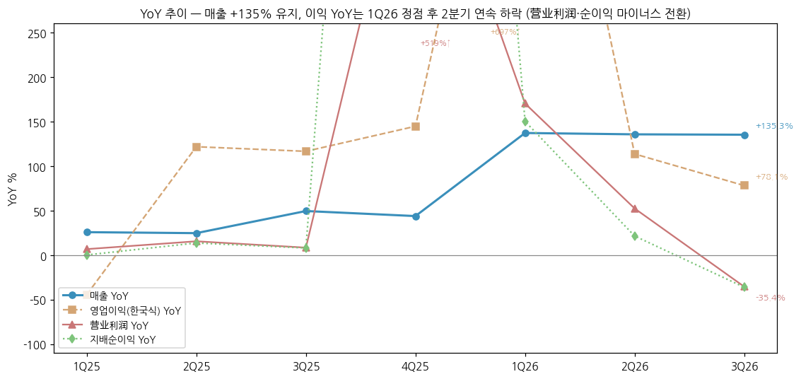
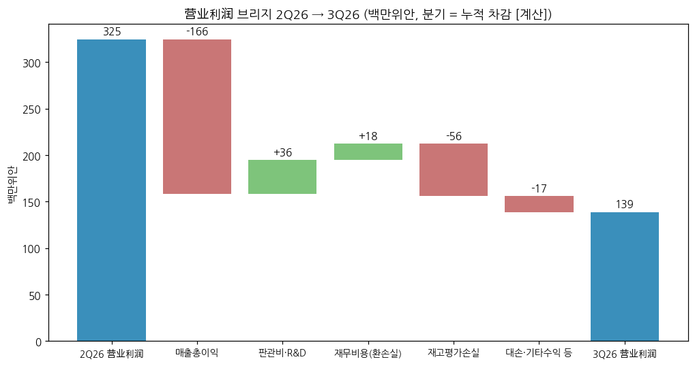
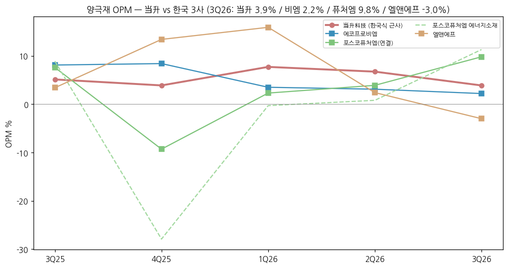

> 모드: 실적 리뷰 (v11)
> 종목: 当升科技 / Beijing Easpring Material Technology (300073.SZ, 심천 ChiNext)
> 섹터: 배터리
> 서브섹터: 양극재 글로벌
> 분기: 2026-Q3 (캘린더 = 회계 분기, 9/30 종료)
> 발표일: 2026-10-26 (장 마감 후 3분기 보고서 공시, cninfo 게재 10/27)
> 작성 시각: 2026-11-14 KST
> 분석 소스: [1차 — 회사 원문, cninfo] 2026년 3분기 보고서(10/26)·반기보고서(8/25)·1분기 보고서(4/24)·2025 연보(3/30)·2025 3분기·반기·1분기 보고서 + 2023~2024 분기 보고서(분기 단독 = 누적 차감 [계산]) / 3Q26 자산손상 계상 공고(10/26), 1H26 업적예고(7/18), 윈난 LFP 일체화 공고(4/16) [2차 — 웹] 동오증권 3Q26 점평(2026-10-27, 출하량·톤당 이익 추정)·1H26 점평(2026-08-26), 同花顺 기관 컨센 집계(2026-10-29, 10개사·최근 6개월), Mysteel flash(2026-10-27), 同花顺 3Q 보도(2026-10-30), 新华财经 탄산리튬(2026-09-30), 界面新闻 수출환급 공고(2026-01), Yahoo Finance 주가·환율. 셀사이드 리포트 첨부 없음 — 쟁점은 회사 공시 설명 + 증권사 점평 요지로 구성
> 리뷰 깊이: 숫자 중심 | 리서치 첨부 0건 (웹 점평 2건 인용, 출처 등급 "보도 인용")
> 다음 발표: 2026 연간 — 업적예고 2027-01 하순 / 연보 2027-03 하순 예상 (전년 2026-01-29·2026-03-30 선례) [추정]

# 当升科技 3Q26 실적 리뷰 — 매출 +135%는 메탈가·물량, 이익 −36%는 GPM 7.5%(사상 최저)·환손실·재고평가손실

## 0. 한 줄 판정

> 성장 델타: 꺾임 | 내러티브: 약화 → 델타 꺾임 + 내러티브 약화 → 매매 제외 구간 (GPM 두 자릿수 회복 확인 전까지)

→ **판정 지표**: 섹터 합산과 비교하기 위해 **영업이익(한국식 근사) = 매출 − 매출원가 − 税金及附加 − 판매·관리·R&D** [계산]를 주 지표로 쓰고, 중국식 营业利润과 지배순이익을 병기했다. 营业利润은 정부보조금·투자손익·자산손상·재무비용(환손실)이 섞여 K-IFRS 영업이익과 다르다
→ **숫자**: 3Q26 매출 69.8억위안(+135.3% YoY, +17.3% QoQ, 사상 최대 분기), 한국식 OP 2.71억(+78.1% YoY, **−32.4% QoQ**), 营业利润 1.39억(**−35.4% YoY**), 지배순이익 1.23억(**−36.0% YoY, −49.7% QoQ**). 한국식 OP YoY가 1Q26 +697% → 2Q26 +114% → 3Q26 +78%로 **2개 분기 연속 둔화**, 营业利润·순이익 YoY는 **마이너스 전환** → "꺾임". GPM 7.5%는 분기 시계열 최저 (2Q26 11.6%, 3Q25 12.0%)
→ **쟁점 ①**: 매출 +135% vs 이익 −36% — 매출은 판매량(다원계 2.2만t 보합 + LFP 4.5~4.8만t +40% QoQ ⚠️동오 추정)과 메탈 연동 판가로 늘었지만, 9월 탄산리튬 급락(고점 대비 −28%)으로 **판가 하락이 원가(고가 재고)보다 먼저 와서** GPM이 4.1%p 빠졌다
→ **쟁점 ②**: 해외 마진 — 1H26 해외 GPM 9.6%(−9.4%p YoY)로 내수(15.2%)보다 낮아졌다. 한국 셀 장기계약 물량, 수출환급 축소(9%→6%, 2027 취소), 위안 강세 환손실(9M 재무비용 1.94억)이 같은 방향으로 작용
→ **다음 분기 관건**: 4Q26 GPM이 10% 이상으로 돌아오는지(메탈가 안정 시 래깅 해소)와 핀란드 1기 가동 비용. 동오증권 2026E 순이익 7.9억(종전 11.3억, −30%) → 역산 4Q26E 1.47억(+13.5% YoY) — 컨센은 아직 하향 중

## 1. 숫자

① 연결 기준 분기 표 (단위: 억위안, %, 중국 기업회계준칙 CAS)

| 항목 | 3Q23 | 4Q23 | 1Q24 | 2Q24 | 3Q24 | 4Q24 | 1Q25 | 2Q25 | 3Q25 | 4Q25 | 1Q26 | 2Q26 | **3Q26** | 4Q26E |
|---|---|---|---|---|---|---|---|---|---|---|---|---|---|---|
| 매출 | 41.4 | 25.8 | 15.2 | 20.2 | 19.8 | 20.7 | 19.1 | 25.2 | 29.7 | 29.7 | 45.3 | 59.5 | **69.8** | [미확보] |
| 매출총이익률 (GPM) | 19.7% | 17.0% | 14.9% | 13.5% | 11.4% | 10.4% | 10.9% | 15.0% | 12.0% | 12.6% | 15.5% | 11.6% | **7.5%** | — |
| 영업이익 (한국식 근사) | 6.29 | 3.59 | 0.79 | 0.85 | 0.70 | 0.47 | 0.44 | 1.87 | 1.52 | 1.16 | 3.49 | 4.00 | **2.71** | — |
| OPM (한국식 근사) | 15.2% | 13.9% | 5.2% | 4.2% | 3.5% | 2.3% | 2.3% | 7.4% | 5.1% | 3.9% | 7.7% | 6.7% | **3.9%** | — |
| 营业利润 (중국식) | 6.70 | 4.28 | 1.25 | 1.84 | 1.98 | 0.22 | 1.33 | 2.13 | 2.15 | 1.39 | 3.59 | 3.25 | **1.39** | — |
| 营业利润率 | 16.2% | 16.6% | 8.2% | 9.1% | 10.0% | 1.1% | 7.0% | 8.4% | 7.2% | 4.7% | 7.9% | 5.5% | **2.0%** | — |
| 지배순이익 | 5.66 | 4.33 | 1.10 | 1.76 | 1.77 | 0.08 | 1.11 | 2.01 | 1.92 | 1.30 | 2.77 | 2.44 | **1.23** | 1.47 (동오) / 4.06 (컨센 평균) [계산] |
| 매출 YoY | -16.7% | -64.0% | -67.7% | -45.4% | -52.1% | -20.0% | +25.8% | +24.7% | +49.5% | +43.9% | +137.2% | +135.7% | **+135.3%** | — |
| 영업이익(한국식) YoY | +8.8% | -62.5% | -85.8% | -83.8% | -88.9% | -86.8% | -44.4% | +121.8% | +116.6% | +144.7% | +697.1% | +113.6% | **+78.1%** | — |
| 营业利润 YoY | +0.7% | -46.2% | -75.8% | -69.7% | -70.4% | -94.8% | +6.8% | +15.6% | +8.4% | +519.0% | +170.3% | +52.4% | **-35.4%** | — |
| 지배순이익 YoY | +0.0% | -44.6% | -74.4% | -64.3% | -68.7% | -98.3% | +0.2% | +13.6% | +8.0% | +1616.1% | +150.3% | +21.5% | **-36.0%** | +13.5% (동오) / +213% (컨센) |
| **매출 YoY 델타 (%p)** | +12.9 | -47.3 | -3.7 | +22.2 | -6.7 | +32.1 | +45.8 | -1.1 | +24.8 | -5.7 | +93.3 | -1.5 | **-0.4** | — |
| **영업이익(한국식) YoY 델타 (%p)** | +11.8 | -71.2 | -23.3 | +2.0 | -5.1 | +2.0 | +42.5 | +166.1 | -5.2 | +28.1 | +552.3 | -583.5 | **-35.5** | — |
| **营业利润 YoY 델타 (%p)** | +2.8 | -46.9 | -29.7 | +6.1 | -0.8 | -24.3 | +101.5 | +8.8 | -7.1 | +510.5 | -348.7 | -117.9 | **-87.8** | — |

→ (출처: 각 분기 보고서 합병이윤표. 1Q = 1분기 보고, 2Q = 반기 − 1Q, 3Q = 9M − 반기, 4Q = 연보 − 9M [계산]. 4Q26E = 동오증권 2026E 순이익 7.9억(2026-10-27) 및 同花顺 10개사 평균 10.49억(2026-10-29, 최근 6개월 — 3Q 발표 전 추정 다수 포함) − 9M 실적 6.43억 [계산]. 매출·영업이익 4Q26E 컨센 [미확보])
→ **컨센 대비**: 분기 컨센 [미확보]. 1H26 업적예고(7/18) 순이익 4.8~5.3억 → 실제 5.20억 (상단 부근). 3Q 후 동오증권이 2026E 순이익을 11.3억 → 7.9억으로 30% 하향 → 3Q가 기대를 크게 밑돌았음을 시사 `[판단]`
→ 원화 환산 참고: 3Q26 매출 ≈ 1조 4,668억원, 한국식 OP ≈ 569억원, 营业利润 ≈ 292억원 (3Q26 평균 210.16원/위안, Yahoo KRW=X÷CNY=X 일평균 [계산])
→ **YoY 위치**: 매출 YoY는 1Q26 +137% → 3Q26 +135%로 고원 유지 (델타 −0.4%p). 이익 YoY는 1Q26이 정점 — 한국식 OP +697%(저베이스) → +114% → +78%, 营业利润 +170% → +52% → −35%. 4Q25가 저베이스(营业利润률 4.7%)라 4Q26 YoY는 숫자상 플러스로 돌아올 수 있지만, 동오 추정 경로(+13.5%)로는 **YoY 정점은 1Q26에 이미 지났다** `[전망]`
→ **한국식 OP가 营业利润보다 덜 나빠 보이는 이유**: 3Q26 R&D 1.15억(2Q 1.82억, 1Q 2.58억)으로 분기 R&D가 줄어 판관비가 0.36억 감소했고, 환손실(0.62억)·재고평가손실(0.56억)은 한국식 OP 밖에 있다. 한국 3사 기준(K-IFRS)이면 재고평가손실은 매출원가에 들어가 OP를 깎는다 → **K-IFRS 유사 OP ≈ 2.15억 (OPM 3.1%)** [계산: 2.71 − 0.56] `[판단]`

→ (출처: 회사 분기·반기·연간 보고서, 분기 단독 = 누적 차감 [계산])

→ (출처: 회사 보고서 [계산]. 1Q26 한국식 OP YoY +697%, 4Q25 营业利润 YoY +519%는 저베이스로 축 밖)

② 제품·지역별 (분기 미공시 — 반기·연간 공시 + 증권사 출하 추정)

(2-1) 1H26 제품·지역 (백만위안, 반기보고)

| 구분 | 1H26 매출 | YoY | 비중 | GPM | GPM YoY |
|---|---|---|---|---|---|
| 다원계 (NCM/NCA) | 6,605 | +145.0% | 63.1% | 12.7% | −5.8%p |
| LFP·LMFP·나트륨 | 2,819 | +116.6% | 26.9% | 12.1% | +9.1%p |
| LCO | 664 | +101.2% | 6.3% | 24.2% | +16.0%p |
| 스마트장비 | 74 | +7.7% | 0.7% | 29.2% | +0.9%p |
| 기타 | 314 | +764.2% | 3.0% | 9.0% | −6.4%p |
| **중국 내수** | 6,820 | +122.0% | 65.1% | 15.2% | +4.5%p |
| **해외** | **3,655** | **+168.8%** | **34.9%** | **9.6%** | **−9.4%p** |

→ (출처: 2026 반기보고 「占比10%以上的产品」「分地区」)
→ 다원계 매출 +145%인데 GPM −5.8%p, 해외 매출 +169%인데 GPM −9.4%p — **물량·판가로 커진 매출이 마진을 동반하지 못한 부분이 해외 다원계**에 집중 `[판단]`

(2-2) 3Q26 제품별 출하·톤당 이익 (⚠️ 동오증권 추정, 2026-10-27 — 회사 미공시)

| 제품 | 2Q26 출하 | **3Q26 출하** | 3Q26 톤당 순이익 | 2Q26 톤당 순이익 | 2026E 출하 |
|---|---|---|---|---|---|
| 다원계 | 2.0~2.2만t | **~2.2만t** (해외 ~1.3만t, 60%) | **~0.3만위안** (환손실·핀란드 손실 가산 ~0.7만) | 0.7~0.8만위안 | ~8.5만t (+70%) |
| LFP | 3.3만t | **4.5~4.8만t** (+40% QoQ) | **~0.05만위안** (재고평가손실) | 0.2만위안 | ~16.5만t |
| LCO | (1H 0.2만t) | ~0.1만t | ~2만위안 | ~0.5만위안 (1H) | ~0.4만t |

→ (출처: 동오증권 3Q26 점평 2026-10-27·1H26 점평 2026-08-26, 보도 인용)
→ **델타를 끄는 건 LFP 물량**, **꺾인 건 다원계 톤당 이익** — 다원계 출하는 보합인데 톤당 이익이 0.75만 → 0.3만위안으로 60% 줄었다. 동오는 다원계 손익 악화분 중 약 0.8억위안을 환손실·핀란드 손실로 봤다

③ 이익 브리지 (백만위안, [계산])

| 항목 | 3Q25 | 2Q26 | **3Q26** | QoQ | YoY |
|---|---|---|---|---|---|
| 매출총이익 | 357 | 688 | **522** | −166 | +164 |
| 판관비·R&D·세금 | −206 | −288 | **−251** | +36 | −46 |
| = 한국식 OP | 152 | 400 | **271** | −130 | +119 |
| 재무비용 (환손실 중심) | +10 | −80 | **−62** | +18 | −72 |
| 자산손상 (재고평가) | 0 | 0 | **−56** | −56 | −56 |
| 신용손상 (대손) | +6 | −16 | **−14** | +2 | −20 |
| 기타수익·투자·공정가치 등 | +47 | +20 | **0** | −20 | −46 |
| = 营业利润 | 215 | 325 | **139** | −186 | −76 |

→ (출처: 분기 보고서 누적 차감 [계산]. 재고평가손실 9M 5,621.95만위안은 반기 0 → 전액 3Q 계상 — 3Q26 자산손상 공고)
→ YoY로 보면 매출총이익은 +1.64억 늘었는데 **재무비용(−0.72억)·재고평가(−0.56억)·기타수익 감소(−0.46억)·대손(−0.20억)이 +1.94억을 빼앗아** 营业利润이 −0.76억 줄었다
→ QoQ로 보면 핵심은 매출총이익 −1.66억 — 매출이 10.3억 늘었는데 매출총이익은 줄었다. GPM 11.6% → 7.5%

→ (출처: 회사 분기 보고서 [계산])

④ 연간 (백만위안)

| 항목 | 2022 | 2023 | 2024 | 2025 | 2026E | 2027E |
|---|---|---|---|---|---|---|
| 매출 | 21,264 | 15,127 | 7,593 | 10,374 | [미확보] | [미확보] |
| 한국식 OP | 2,469 | 2,064 | 281 | 499 | — | — |
| OPM (한국식) | 11.6% | 13.6% | 3.7% | 4.8% | — | — |
| 营业利润 | 2,539 | 2,221 | 530 | 700 | — | — |
| 지배순이익 | 2,259 | 1,924 | 472 | 632 | 790 (동오) / 1,049 (평균) | 1,280 (동오) |
| 매출 YoY | +157.5% | −28.9% | −49.8% | +36.6% | — | — |
| 순이익 YoY | +107.0% | −14.8% | −75.5% | +34.0% | +25% (동오) / +66% (평균) | +63% (동오) |

→ (출처: 2022~2025 연보, 2026E·2027E 동오증권 2026-10-27 / 同花顺 집계 10개사 평균 2026-10-29)
→ **발표 전후 추정 변화**: 동오증권 2026E 11.3 → 7.9억 (−30%), 2027E 14.5 → 12.8억 (−12%), 2028E 17.5 → 15.4억 (−12%). 화태증권(10/29)은 2026E 9.20억·TP ¥38.87 (증지) — 3Q 후 나온 추정 2건 모두 6개월 평균(10.49억)보다 낮다

## 2. 시장 쟁점

① 2-0 지난 분기 체크

→ 첫 리뷰 — 직전 체크 없음

② 이번 분기 쟁점 4개

| # | 쟁점 | 근거 |
|---|---|---|
| (1) | 매출 +135%인데 이익 −36% — 판가 전가인가, 마진 압박인가 | 3Q 보고서 변동 사유, Mysteel·同花顺 보도 "원가가 수익보다 빨리 올랐다", 동오 점평 GPM −4.1%p QoQ |
| (2) | 해외(한국 셀) 고객 마진 — 장기계약 물량 확대의 대가 | 1H26 해외 GPM 9.6%(−9.4%p), 3Q 해외 출하 60%(동오), 수출환급 취소 |
| (3) | 운전자본·현금흐름 — 매출채권 +121%, 재고 +62%, 영업CF 마이너스 | 3Q 보고서, 同花顺 11/5 보도("이익은 나는데 현금은 나간다") |
| (4) | 핀란드·LFP 증설 — CapEx +162%의 회수 시점 | 3Q 보고서 건설중자산 +151%, 동오 "핀란드 손실" |

③ 쟁점별 분해

(1) **매출 +135% vs 이익 −36% — 판가 전가인가, 마진 압박인가**

(1-1) 회사 설명
→ 매출: "锂电正极材料销量增长，叠加产品售价随着原材料市场行情上涨" — 판매량 증가 + 원재료 시세 연동 판가 상승 (3Q26 보고서)
→ 원가: "营业成本随收入增长而增加" (9M 원가 +140.9% vs 매출 +135.9%), 자산손상 "存货跌价准备增加" (재고평가충당금 5,622만위안), 재무비용 "汇兑损失增加"
→ 1H26 업적예고: 다원계 해외 "稳定放量", LFP "盈利水平持续向好" — 3Q 악화에 대한 별도 코멘트는 없음

(1-2) 시장 해석

| 출처 | 핵심 가정·추정 | 논리 |
|---|---|---|
| 동오증권 (10/27, 매수 유지) | 3Q GPM 7.5% (−4.1%p QoQ), 다원계 톤당 0.3만·LFP 0.05만위안 | 이익 감소 원인 = 환손실 + 핀란드 손실 + **탄산리튬 하락에 따른 재고평가손실**. 2026E −30% 하향 |
| 同花顺 (10/30 보도) | 원가 증가율이 매출보다 4.98%p 높음 | "成本涨得比收入快" — 판가 전가 불완전 |
| Mysteel (10/27) | 순이익 −49% QoQ | 성장 동력은 판매량 + 원재료 연동 판가 |

(1-3) 공통 vs 갈림
→ 공통: 매출 증가는 **판매량(특히 LFP) + 메탈 연동 판가**이고, 이익 감소는 **메탈가 급락에 따른 래깅(고가 재고 → 낮은 판가)**과 영업외 비용(환손실·재고평가)이다
→ 갈림: GPM 7.5%가 일시적 래깅인지(메탈 안정 시 10%대 복귀), 구조적인지(해외 계약 가격·LFP 믹스)

(1-4) [판단]
→ 메탈가 래깅의 크기 가늠: 탄산리튬 8월 고점 ¥16.29만/t → 9월 ¥11.70만 (−28%, 新华财经). 재고 47.1억위안(3Q 매출의 약 2개월분)이 고점 부근 원가로 쌓여 있었고, 판가는 월평균 시세로 따라 내려가 3Q GPM을 깎았다. 그러나 **GPM 하락은 3Q만의 일이 아니다** — 1Q26 15.5% → 2Q 11.6% → 3Q 7.5%로 2개 분기 연속 4%p씩 빠졌고, 2Q는 리튬이 오르던 시기였다 → 래깅만으로 설명되지 않는 부분(해외 다원계 마진·LFP 믹스)이 절반 이상 `[판단]`
→ 비교: 한국 양극재 3사도 3Q26에 같이 빠졌다 (에코프로비엠 OPM 2.2%, 엘앤에프 −3.0% — 재고평가손실 426억원). 当升의 재고평가손실(0.56억위안 ≈ 118억원, 매출의 0.8%)은 엘앤에프(매출의 4.9%)보다 훨씬 작다 → **当升의 문제는 재고 손실보다 판가-원가 스프레드 자체** `[판단]`

→ (출처: 当升 = 회사 보고서 [계산, 한국식 근사] / 한국 3사 = 같은 폴더 기업개요 (DART·회사 IR, 에코프로비엠·엘앤에프 3Q26 [잠정]))

→ 결론이 바뀌는 조건: 4Q26 GPM이 11% 이상(1H26 평균 13%에 근접)으로 회복하면 래깅 일시성 확인. 10% 미만이 이어지면 구조적 마진 하락

(2) **해외(한국 셀) 고객 마진 — 장기계약 물량의 대가**

(2-1) 회사 설명
→ "国际客户销量同比大幅提升，公司深度绑定LGES、SK on、三星SDI、Murata、欧美及印度等国际战略大客户，与LGES、SK on两大锂电巨头签订的长期供货协议快速放量" (1H26 반기보고)
→ 1H26 해외 매출 36.55억위안 (34.9%), "海外客户销售情况较为稳定 … 境外客户回款正常" — 마진 하락 원인 설명 없음
→ 3Q26 보고서: "因出口退税政策取消，公司应交增值税增加" — 수출환급 취소를 회사가 직접 언급

(2-2) 시장 해석

| 출처 | 핵심 가정·추정 | 논리 |
|---|---|---|
| 동오증권 (10/27) | 3Q 다원계 해외 출하 ~1.3만t (60%) | 해외 비중 확대 자체는 긍정, 다만 환손실·핀란드 손실이 다원계 톤당 이익을 0.4만위안 깎음 |
| 동오증권 (8/26, 1H 점평) | 다원계 톤당 0.8~1만위안 유지 전망 | 국제 고객 비중 상승 → 수익성 유지 가능 (3Q에 전망 미달) |
| 재정부·세무총국 공고 (2026-01-09) | 배터리 제품 수출환급 9% → 6% (4/1) → 취소 (2027-01-01) | 수출품 원가 상승 (회사는 양극재 적용 범위를 명시하지 않았지만 3Q 보고서에서 환급 취소 언급) |

(2-3) 공통 vs 갈림
→ 공통: LGES(2025~2027 약 11만t)·SK on 계약으로 해외 물량은 늘고 있고, 2026말 핀란드 가동으로 유럽 현지 공급까지 이어진다
→ 갈림: 해외 GPM 9.6%가 ① 환율·환급 같은 외생 변수인지 ② 장기계약 가격 공식(가공비 고정 + 메탈 pass-through)이 공격적이었던 것인지 — 회사 설명이 없다

(2-4) [판단]
→ 2024년 해외 GPM 21.0% vs 내수 10.0% [역산] → 1H26 해외 9.6% vs 내수 15.2%로 **2년 만에 완전히 뒤집혔다**. 환급 축소(4월~, 최대 3%p)와 위안 강세만으로는 11%p 하락을 다 설명하기 어렵다 → LGES 중니켈 고전압 대량 계약의 가격이 낮다는 가설이 유력 `[판단]`
→ **한국 양극재 3사 함의**: LGES·SK on이 중국 当升의 중니켈 고전압·고니켈 물량을 늘리는 것은 포스코퓨처엠(LGES)·에코프로비엠(SK on)의 점유율 경쟁 요인. 다만 当升이 그 물량을 GPM 10% 아래로 가져가고 있다면 한국 업체와의 가격 경쟁은 "출혈형"에 가깝다 `[판단]`
→ 확인 변수: 2026 연보의 해외 GPM(연간), 2027 수출환급 완전 취소 후 계약 가격 재협상 여부

(3) **운전자본·현금흐름 — 이익은 나는데 현금은 나간다**

(3-1) 회사 설명
→ 매출채권 59.8억 (연초 27.1억, +121%): "销量增长，叠加产品售价大幅增长，处于信用期内应收账款增加"
→ 재고 47.1억 (+62%): "客户订单需求增加，原材料、产成品等备货量相应增加，叠加采购价格上涨"
→ 9M 영업CF −1.50억 (전년 +7.30억): "应收账款、存货占用资金增加"

(3-2) 시장 해석

| 출처 | 핵심 가정·추정 | 논리 |
|---|---|---|
| 동오증권 (10/27) | 3Q 단독 영업CF 약 −2.4억, 재고 QoQ −4% | 3Q에 재고는 줄기 시작 |
| 同花顺 (11/5) | 매출채권 +32.7억, 재고 +18.1억 (연초 대비) | 소재 업체 자금이 원재료 비축·외상에 묶인 대표 사례 |

(3-3) 공통 vs 갈림
→ 공통: 매출 2배 성장 국면의 정상적 운전자본 증가. 지급어음(65.6억, +98%)으로 상당 부분을 공급사에 넘기고 있다
→ 갈림: 메탈가 하락이 이어지면 재고·매출채권 가치가 같이 떨어지는 이중 부담

(3-4) [판단]
→ 순현금은 2025말 약 80.3억 [계산: 현금 65.0 + 구조화예금 15.4 − 차입 0] → 3Q26말 약 45.2억 [계산]으로 9개월 만에 35억 줄었다 (CapEx 28.9억 + 운전자본). 재무 위기는 아니지만, 2027 핀란드·윈난 CapEx를 감안하면 **"순현금 프리미엄"이 줄어드는 구간** `[판단]`

(4) **핀란드·LFP 증설 — CapEx +162%의 회수 시점**

(4-1) 회사 설명
→ 핀란드 1기 6만t 고니켈 — "预计2026年底部分产线建成投产" (1H26), Business Finland 보조금 최대 €1.15억 (1차 €2,781만 수령), 그린 파이낸싱 €5.144억
→ 윈난 LFP 15만t + 인산철 20만t (云天化 합작, 2026-04 공고), 판즈화 2기 8만t 시운전
→ 9M CapEx 28.9억 (+162%), 건설중자산 30.8억 (+151%)

(4-2) 시장 해석

| 출처 | 핵심 가정·추정 | 논리 |
|---|---|---|
| 동오증권 (10/27) | 3Q 환손실+핀란드 손실 약 0.8억위안 [보도 인용] / LFP CAPA 2026말 15만t, 2027 출하 ~35만t | 2027년 LFP 물량 2배 → 2027E 순이익 +63% |
| 3Q 보고서 | 소수주주(핀란드) 순손익 −650만위안 (9M 4,967만 − 반기 5,618만 [계산]) | 핀란드 법인 손실 일부가 소수주주 몫 |

(4-3) 공통 vs 갈림
→ 공통: 2027년 성장의 근거는 LFP 물량(2배)과 핀란드 가동
→ 갈림: LFP 톤당 이익(3Q 0.05만위안)이 2Q 수준(0.2만)으로 돌아와야 물량 2배가 이익 2배가 된다

(4-4) [판단]
→ LFP 35만t × 톤당 0.2만위안 = 7억, 다원계 10만t × 0.8만 = 8억 → 2027E 15억 수준이 동오 12.8억보다 높은 상단 시나리오. 반대로 3Q 톤당 이익(LFP 0.05·다원 0.3만)이 고착되면 2027 순이익은 5억 내외 [계산] — **톤당 이익이 2027 이익의 2~3배 차이를 만든다** `[전망]`

④ 낙관 vs 보수

→ 낙관 (CICC 8/30 TP ¥61.00·2026E 11.40억, 중국은하 8/26 2026E 12.69억): 해외 장기계약 + LFP 2nd curve + 고체전지 소재 선점 — 모두 3Q 발표 전 추정
→ 보수 (동오 10/27 2026E 7.90억, 화태 10/29 TP ¥38.87·2026E 9.20억): 3Q 마진 하락을 반영해 하향
→ 셀사이드 vs 주가: 10/27 발표 다음날 −7.3% (¥36.48 → ¥33.83), 11/13 ¥32.39 — 52주 고점(2025-11-13 ¥69.96) 대비 −54%. 주가는 TP 평균(¥49.94)보다 하단 TP(¥38.87)에도 못 미쳐, **시장은 보수 시나리오보다 더 보수적** `[판단]`

⑤ 추정치·TP 변화 (압축)

| 출처 | 직전 TP | 현재 TP | 4Q26 순이익 E | 2026E / 2027E 순이익 | 핵심 변화 |
|---|---|---|---|---|---|
| 동오증권 (10/27, 매수) | — | 미제시 | 1.47 [계산] | 7.9 / 12.8 (종전 11.3 / 14.5) | 3Q 반영 −30% |
| 화태증권 (10/29, 증지) | — | ¥38.87 | 2.77 [계산] | 9.20 / — | — |
| 同花顺 10개사 평균 (최근 6개월) | — | ¥49.94 (38.87~61.00) | 4.06 [계산] | 10.49 / — | 3Q 전 추정 다수 |

→ (단위: 억위안. 출처: 동오증권 점평 2026-10-27, 同花顺 2026-10-29 집계 — 보도 인용)
→ 3Q 후 하향 2건, 상향 0건. **하향 원인은 실적(마진) 하향** — 멀티플이 아니라 톤당 이익 가정을 낮췄다

## 3. 내러티브 점검

① 성장 스토리 정의
→ "중국 양극재 중 해외(한국 셀 3사·유럽) 비중이 가장 높은 국유 업체 — 해외 장기계약 다원계로 안정 이익을 내고, LFP·고체전지 소재로 물량을 키운다"

② 이번 분기가 스토리에 준 영향
→ 강화: 매출 사상 최대(69.8억), LFP 출하 +40% QoQ, 해외 다원계 물량 60% 유지, 핀란드 일정 유지
→ 약화: **"해외 = 고마진"이라는 전제가 숫자로 깨지고 있다** (해외 GPM 9.6% < 내수 15.2%), 전사 GPM 7.5% 사상 최저, 영업CF 마이너스, 2026E 순이익 −30% 하향
→ 시장 반응: 매출 성장에 프리미엄을 주지 않고, 이익 하향에만 반응 (발표일 −7.3%, 52주 고점 대비 −54%)

③ 국면 판단
→ 델타 꺾임 (营业利润·순이익 YoY 마이너스 전환, 한국식 OP YoY 2개 분기 연속 둔화) + 내러티브 약화 (추정치 하향, 해외 마진 의문) → **매매 제외 구간**
→ BT 프레임상 주의: 4Q25 저베이스 때문에 4Q26 YoY는 플러스로 보일 수 있다 (동오 +13.5%). YoY 숫자보다 **GPM 방향**으로 판단하는 것이 맞다 `[판단]`

④ 트리거와 리스크
→ 트리거: ① 4Q26 GPM 11%+ 회복 (래깅 해소) ② 핀란드 1기 가동 + 유럽 OEM 신규 장기계약 ③ 탄산리튬 반등 (래깅 이익 재발생 — 한국 업체처럼 재고평가 환입)
→ 리스크: ① 2027 수출환급 완전 취소로 해외 GPM 추가 하락 ② 리튬 하락 지속 시 재고평가 반복 ③ CapEx·운전자본으로 순현금 소진

## 4. 향후 봐야 할 것

① **4Q26 GPM 10% 회복 여부** (델타 판정 1순위)
→ 무엇을: 분기 GPM 7.5% → 10~11%, 营业利润률 4% 이상, 재고평가손실 추가 여부
→ 어떤 데이터로: 2026 연간 업적예고(순이익 범위 — 7.9억 이상이면 4Q 1.5억+), 연보 분기 주요재무지표 표, 탄산리튬 선물(广期所) 가격
→ 언제: 2027-01 하순 (업적예고) / 2027-03 하순 (연보)

② **해외 GPM과 수출환급 취소 영향**
→ 무엇을: 2026 연간 해외 GPM (1H 9.6%) — 내수 대비 격차 축소 여부, 2027-01 환급 0% 전환 후 계약가 재협상
→ 어떤 데이터로: 2026 연보 「分地区」, LGES·SK on 실적 컨콜의 양극재 원가 코멘트
→ 언제: 2027-03

③ **LFP 톤당 이익과 2027 물량**
→ 무엇을: LFP 톤당 순이익 0.05 → 0.2만위안 회복, 2026 LFP 출하 16.5만t 달성, 윈난 15만t 착공 진척
→ 어떤 데이터로: 증권사 4Q 점평, 연보 산销량표, 인산철·탄산리튬 가격
→ 언제: 2027-01 ~ 2027-03

④ **핀란드 1기 가동**
→ 무엇을: 2026말 일부 라인 가동 공시, 초기 손실 규모(소수주주 손익), 유럽 고객(VW·BMW·벤츠) 인증
→ 어떤 데이터로: 회사 공고, 연보 子公司 손익, Business Finland 2차 보조금 수령 공고
→ 언제: 2026-12 ~ 2027-03

⑤ **운전자본·현금흐름**
→ 무엇을: 4Q 영업CF 플러스 전환, 매출채권 60억·재고 47억의 증감, 단기차입 12.8억 추가 여부
→ 어떤 데이터로: 2026 연보 현금흐름표
→ 언제: 2027-03
