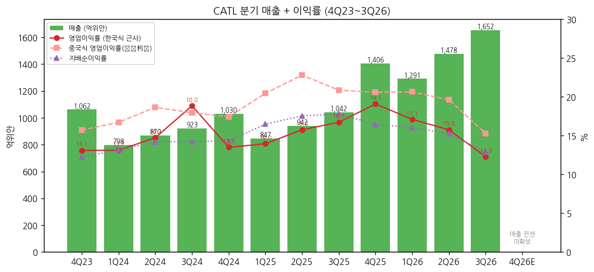
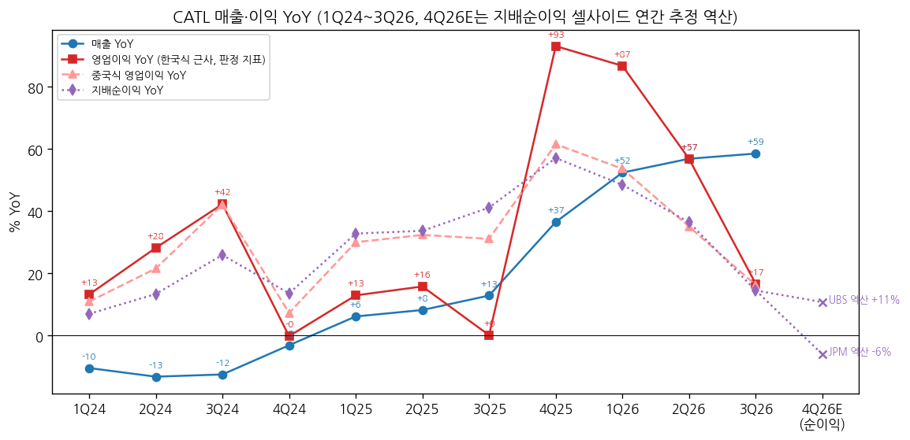
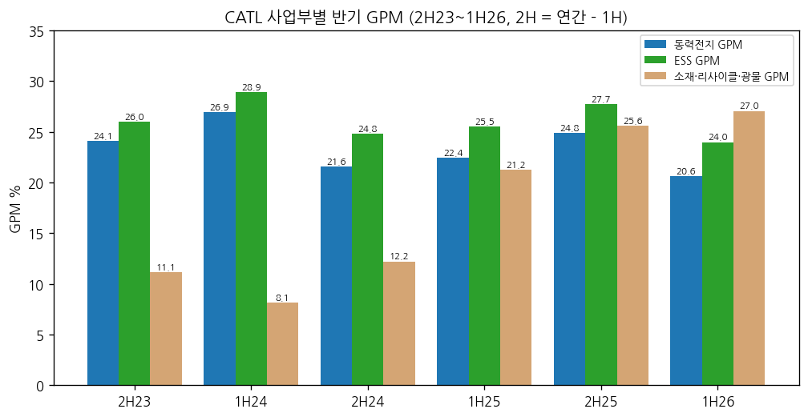
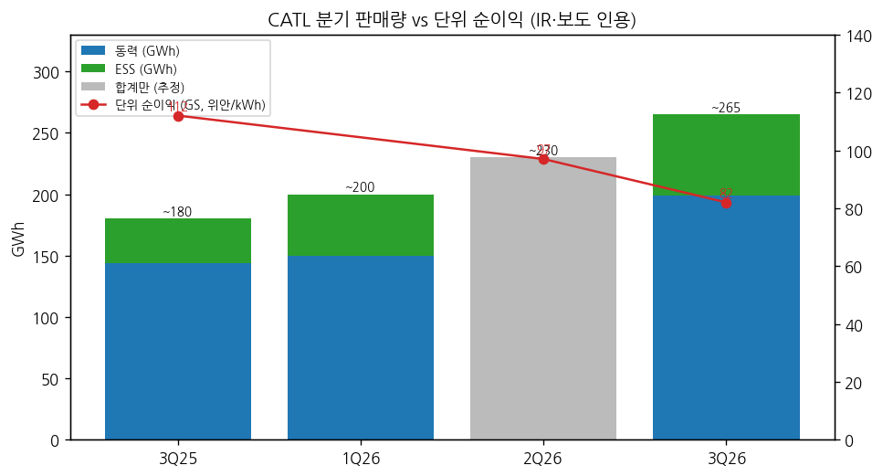

> 모드: 실적 리뷰 (v11)
> 종목: CATL / 宁德时代 (300750.SZ A주 · 3750.HK H주)
> 섹터: 배터리
> 서브섹터: 배터리 셀 글로벌
> 분기: 2026-Q3 (캘린더 = 회계 분기, 9/30 종료)
> 발표일: 2026-10-20 (장 마감 후 3분기 보고서 공시, 거래소 게재일 10/21) — 주가 반응일 10/21
> 작성 시각: 2026-11-14 20:30 KST
> 분석 소스: [1차 — 회사 원문] 심천거래소 공고 PDF(东方财富 공고 미러 경유) — 2026년 3분기 보고서(10/21)·반기보고서(7/25)·1분기 보고서(4/16), 2025년 3분기 보고서, 2025 연차보고서. 분기 단독 손익 세부(원가·판관비·R&D·营业利润)는 东方财富 F10 재무 API(회사 공시 집계 — 3Q26·9M26 원문과 일치 확인). [보도 인용] 3Q26 IR 설명·출하량·셀사이드 반응: 东方财富(10/21), CnEVPost(10/20·10/21), Tiger Brokers 종합(GS·JPM·UBS·Jefferies 요약), Gasgoo(10/22 회사 IR 기록), SNE Research 점유율(CnEVPost 8/4·8/7·11/2·11/5), 10jqka(9/22 셀 판가), Korea Herald(9/15 미국 EO 14420). 주가 Yahoo Finance. 실적설명회 Q&A 원문은 미확보
> 리뷰 깊이: 숫자 중심 | 리서치 첨부 0건 (셀사이드 TP·추정치는 보도 인용)
> 다음 발표: 2026 연차보고서·4Q26 — 2027-03 중순 예상 (전년 3/10 공시, 회사 확정 공지 전)

# CATL 3Q26 실적 리뷰 — 매출 +59%인데 이익 +15~17%. 이익 YoY가 4Q25 정점 이후 3개 분기 연속 내려왔고 4Q26은 마이너스 가능성

> 성장 델타: 꺾임 | 내러티브: 약화 → 델타 꺾임 + 내러티브 약화 → 매매 제외 구간 (단위이익 바닥 확인 전까지)

→ **판정 지표**: 한국식 근사 영업이익(= 매출 − 매출원가 − 세금과공과 − 판매비 − 관리비 − R&D, [계산])으로 판정했다. 중국 회계의 营业利润(이하 "중국식 영업이익")은 지분법·정부보조금·공정가치·손상을 포함해 K-IFRS 영업이익과 다르므로 병기만 한다. **세 지표(한국식 영업이익·중국식 영업이익·지배순이익) 모두 같은 방향(3개 분기 연속 YoY 하락)**
→ **숫자**: 3Q26 매출 1,652.2억위안(+58.6% YoY), 영업이익(한국식) 203.2억(+16.7%), OPM 12.3%(-4.4%p), 중국식 영업이익 252.7억(+16.3%), 지배순이익 212.5억(+14.5%, QoQ -5.8%), GPM 20.7%(-5.1%p YoY, -2.5%p QoQ). 영업이익(한국식) YoY가 +93.2%(4Q25) → +86.8%(1Q26) → +56.8%(2Q26) → **+16.7%(3Q26)**, 델타 **-40.2%p**
→ **컨센 대비**: 지배순이익 212.5억은 사전 기대 GS 240억(-11%)·CLSA 250~260억(-15~18%)에 미달, 매출·출하량은 부합~소폭 상회 (东方财富·Tiger 종합, 보도 인용). 발표일 10/21 A주 -12.0%, H주 -11.4% (Yahoo)
→ **쟁점**: (1) 판매량은 ~265GWh(+44~60%)로 사상 최대인데 단위 순이익이 82위안/kWh로 전년 112에서 -27% (GS) — 리튬 재상승·저가 ESS 구계약·수출환급 축소 (2) 9/1 배터리 소비세 2%, 2027-01 수출환급 폐지 — 4Q가 첫 완전 반영 분기이고 고객 분담 협상은 진행 중 (3) 3Q 영업현금흐름 약 14억(2Q 265억) — 운전자본·CapEx 동시 확대 (4) 그래도 점유율은 오른다(글로벌 EV 39.1%, 비중국 33.7%, 북미 ESS 38.8%)
→ **다음 분기 관건**: 4Q26 지배순이익이 4Q25(231.7억) 대비 플러스인지. 셀사이드 연간 추정 역산으로 JPM 약 218억(-6%) ~ UBS 약 257억(+11%) [계산] — 마이너스면 "꺾임" 확정, GPM 21% 이상 방어 + 소비세 분담 합의면 둔화로 완화

---

## 1. 숫자

① 연결 기준 분기 표 (단위: 억위안, %, 중국 기업회계준칙)

| 항목 | 4Q23 | 1Q24 | 2Q24 | 3Q24 | 4Q24 | 1Q25 | 2Q25 | 3Q25 | 4Q25 | 1Q26 | 2Q26 | **3Q26** | 4Q26E (JPM 역산) | 4Q26E (UBS 역산) |
|---|---|---|---|---|---|---|---|---|---|---|---|---|---|---|
| 매출 | 1,062.4 | 797.7 | 870.0 | 922.8 | 1,029.7 | 847.0 | 941.8 | 1,041.9 | 1,406.3 | 1,291.3 | 1,477.9 | **1,652.2** | [미확보] | [미확보] |
| 영업이익 (한국식 근사, 판정 지표) | 139.2 | 104.7 | 128.2 | 173.9 | 139.0 | 118.3 | 148.5 | 174.2 | 268.4 | 220.9 | 232.9 | **203.2** | — | — |
| OPM (한국식) | 13.1 | 13.1 | 14.7 | 18.8 | 13.5 | 14.0 | 15.8 | 16.7 | 19.1 | 17.1 | 15.8 | **12.3** | — | — |
| 중국식 영업이익 (营业利润) | 167.0 | 133.3 | 162.2 | 165.7 | 179.3 | 173.4 | 214.8 | 217.3 | 289.7 | 266.5 | 290.1 | **252.7** | — | — |
| 지배순이익 | 129.8 | 105.1 | 123.6 | 131.4 | 147.4 | 139.6 | 165.2 | 185.5 | 231.7 | 207.4 | 225.5 | **212.5** | 217.7 | 256.7 |
| GPM | n/m* | 23.3 | 23.6 | 27.7 | 23.1 | 24.4 | 25.6 | 25.8 | 28.2 | 24.8 | 23.2 | **20.7** | — | — |
| 매출 YoY | -10.2 | -10.4 | -13.2 | -12.5 | -3.1 | +6.2 | +8.3 | +12.9 | +36.6 | +52.4 | +56.9 | **+58.6** | — | — |
| 영업이익 YoY (한국식) | -6.1 | +13.2 | +28.2 | +42.3 | -0.1 | +13.0 | +15.8 | +0.2 | +93.2 | +86.8 | +56.8 | **+16.7** | — | — |
| 중국식 영업이익 YoY | +16.3 | +11.0 | +21.6 | +42.1 | +7.3 | +30.1 | +32.4 | +31.1 | +61.6 | +53.7 | +35.1 | **+16.3** | — | — |
| 지배순이익 YoY | -1.2 | +7.0 | +13.4 | +26.0 | +13.6 | +32.9 | +33.7 | +41.2 | +57.1 | +48.5 | +36.5 | **+14.5** | -6.0 | +10.8 |
| **매출 YoY 델타 (%p)** | -18.4 | -0.2 | -2.8 | +0.7 | +9.4 | +9.3 | +2.1 | +4.6 | +23.7 | +15.9 | +4.5 | **+1.7** | — | — |
| **영업이익 YoY 델타 (%p, 한국식)** | -52.8 | +19.4 | +15.0 | +14.1 | -42.5 | +13.1 | +2.9 | -15.7 | +93.0 | -6.4 | -30.0 | **-40.2** | — | — |
| **지배순이익 YoY 델타 (%p)** | -11.9 | +8.2 | +6.4 | +12.6 | -12.3 | +19.2 | +0.9 | +7.5 | +15.9 | -8.6 | -12.1 | **-21.9** | -20.5 | -3.7 |

→ (출처: 각 분기 보고서. 분기 단독 세부는 东方财富 F10(4Q = 연간 − 9M [계산]). 2024 분기는 2025 분기보고서의 재작성 비교치(보증비용을 판매비 → 매출원가로 이동, 해석 18호) 기준. \*4Q23 GPM은 재작성 연간 − 구기준 9M이라 해석 불가(11.6%로 계산됨). 한국식 영업이익은 원가·판매비를 모두 빼므로 재분류 영향 없음. YoY·델타 [계산])
→ (4Q26E: JPM 2026E 지배순이익 863억(10/21 하향 후) − 9M26 645.3억 = 217.7억 / UBS 2026E 902억(하향 후, 2026~28 902~1,315억) − 9M26 = 256.7억 [계산] [보도 인용 — Tiger 종합]. 매출·영업이익 분기 컨센은 미확보)
→ 원화 참고값: 3Q26 매출 **34.7조원**, 영업이익(한국식) **4.27조원**, 중국식 영업이익 5.31조원, 지배순이익 4.47조원 [3Q26 평균 CNY/KRW 210.2 = USD/KRW 1,417.0 ÷ USD/CNY 6.741, Yahoo 일간 7/1~9/30 평균, 계산]
→ **컨센 대비**: 지배순이익 GS 사전 기대 240억 대비 -11.5%, 중신리옹(CLSA) 250~260억 대비 -15~18% [계산]. 매출·출하량은 "부합 또는 소폭 상회", GPM은 GS 기대 대비 -3.8%p (Tiger 종합, 보도 인용)
→ **YoY 정점은 4Q25(영업이익 +93%)였다.** 이후 1Q26 +87% → 2Q26 +57% → 3Q26 +17%로 3개 분기 연속 하락, 셀사이드 연간 추정이 그리는 4Q26 순이익 YoY는 -6% ~ +11%. 매출 YoY는 +59%로 아직 오르고 있어 **"매출 가속 + 이익 감속"의 가위 모양** — 늘어난 매출만큼 이익이 따라오지 않는 구간 `[판단]`
→ 9M26: 매출 4,421억(+56.2%), 영업이익(한국식) 657억(+49.0%), 지배순이익 645억(+31.6%), 영업현금흐름 616억(-23.6%)

→ (출처: 회사 분기 보고서·东方财富 F10 분기 단독, 한국식 근사 OPM [계산])

→ (출처: 회사 분기 보고서 [계산], 4Q26E는 JPM·UBS 2026E 지배순이익 − 9M26 역산 [보도 인용])

② 이익 감소 분해 — 3Q26 vs 2Q26 (억위안, 분기 단독)

| 항목 | 3Q25 | 2Q26 | **3Q26** | QoQ 증감 | 비고 |
|---|---|---|---|---|---|
| 매출 | 1,041.9 | 1,477.9 | **1,652.2** | +174.3 | 판매량 ~230 → ~265GWh |
| 매출총이익 | 268.8 | 342.2 | **341.8** | **-0.4** | 매출 +12%인데 GP 정체 → GPM -2.5%p |
| 세금과공과 | 6.0 | 6.9 | **22.1** | **+15.2** | 9/1 배터리 소비세 2% (9월 1개월분) |
| R&D | 49.7 | 60.6 | **71.4** | +10.8 | YoY +43.6% |
| 판매비+관리비 | 38.9 | 41.8 | **45.1** | +3.3 | |
| **영업이익 (한국식)** | 174.2 | 232.9 | **203.2** | **-29.7** | |
| 자산손상(재고 등) | -15.8 | -5.2 | **-17.1** | -11.9 | 리튬 가격 연동 재고 충당 (东方财富) |
| 투자수익(지분법 등) | 23.6 | 34.6 | **29.1** | -5.5 | |
| 기타수익(보조금) | 16.3 | 13.1 | **18.0** | +4.9 | |
| 공정가치 변동 | 7.0 | 9.8 | **12.5** | +2.7 | |
| **중국식 영업이익** | 217.3 | 290.1 | **252.7** | **-37.4** | |
| 지배순이익 | 185.5 | 225.5 | **212.5** | -13.0 | 법인세 감소(-20억 QoQ)가 일부 상쇄 |

→ (출처: 东方财富 F10 분기 단독, 3Q26 보고서 원문 대조. 증감 [계산])
→ 3Q26 영업이익(한국식) QoQ -29.7억의 구성: **매출총이익 정체(매출 증가분 174억이 이익으로 안 옴) + 소비세 +15억 + R&D +11억** [계산]. 영업외에서는 재고 손상 -12억이 더해졌다
→ 소비세 9월 1개월분이 세금과공과 +15억 — 4Q는 3개월 전부 적용 (CnEVPost 10/21). 고객 분담 합의 전까지 4Q 세금과공과가 3Q보다 커지는 방향 [전망]

③ 사업부별 (반기만 공시 — 분기 사업부 매출·이익 미공시)

| 사업부 (억위안) | 1H25 매출 | 2H25 매출 | **1H26 매출** | 1H26 YoY | 1H25 GPM | 2H25 GPM | **1H26 GPM** | GPM YoY |
|---|---|---|---|---|---|---|---|---|
| 동력전지 시스템 | 1,315.7 | 1,849.3 | **1,921.2** | +46.0% | 22.4% | 24.8% | **20.6%** | -1.8%p |
| ESS 전지 시스템 | 284.0 | 340.4 | **532.6** | +87.5% | 25.5% | 27.7% | **24.0%** | -1.6%p |
| 소재·리사이클·광물 | 112.5 | 165.9 | **188.1** | +67.2% | 21.2% | 25.6% | **27.0%** | +5.8%p |
| 기타 | 76.7 | 92.5 | **127.2** | +65.8% | 73.6% | 74.9% | **69.0%** | — |
| 합계 | 1,789 | 2,448 | **2,769** | +54.8% | 25.0% | 27.2% | **23.9%** | -1.1%p |
| 중국 내 / 해외 매출 | 1,177 / 612 | 1,764 / 684 | **1,898 / 871** | +61% / +42% | 22.9% / 29.0% | 24.7% / 33.6% | **21.2% / 30.0%** | -1.8 / +1.0%p |

→ (출처: 2026 반기보고서 "占比10%以上的产品" 표(원문), 2025 반기·연차보고서. 2H25 = 연간 − 1H25 [계산]. 2025 소재 = 电池材料及回收 + 电池矿产资源 합산)
→ **델타를 끄는 것**: ESS 매출 +87.5%, 매출 증가분(980억) 중 25%가 ESS [계산] — 3Q26 ESS 판매 ~66GWh로 YoY 약 2배, 전체의 약 1/4 (东方财富, 보도 인용)
→ **꺾이는 것**: 동력·ESS 모두 GPM이 2H25 정점(24.8%·27.7%)에서 1H26 20.6%·24.0%로 하락, 3Q26 전사 GPM 20.7%는 1H26 평균(23.9%)보다 더 낮다 → 2H26 사업부 GPM은 1H26보다 더 내려갈 가능성 [전망]
→ **상쇄 요인**: 소재·광물 GPM 27.0%(+5.8%p) — 리튬 상승이 셀 마진을 깎는 동안 광물·리사이클 마진은 오른다. 다만 매출 비중 7%라 상쇄 폭은 작다 `[판단]`
→ 해외 GPM 30.0% vs 중국 21.2% — 해외 동력전지 GPM이 국내보다 높다 (회사 IR, 东方财富)

→ (출처: 회사 반기·연차보고서 [계산])

④ 판매량·단위이익 (회사 정기보고서 미공시 — IR 설명·보도 인용)

| 분기 | 판매량 합계 (GWh) | 동력 | ESS | 단위 순이익 (GS, 위안/kWh) | 출처 |
|---|---|---|---|---|---|
| 3Q25 | 약 180 | 약 144 [계산] | 약 36 | 112 | Energy-Storage.news (2025-10) |
| 1Q26 | 200+ (+67%) | 약 150 | 약 50 | 약 100 (0.1위안/Wh) | huxiu (2026-04-16) |
| 2Q26 | 약 230 ⚠️추정 | [미확보] | [미확보] | 97 | 3Q QoQ +13% 역산 |
| **3Q26** | **260+ (+44~60%)** | **약 199 (+50%)** | **약 66 (약 2배)** | **82** | 东方财富·Tiger (2026-10-21) |

→ JPM도 단위이익 약 0.10 → 0.08위안/Wh로 하향, 2027E 0.075위안/Wh (Tiger 종합, 보도 인용)
→ **물량은 사상 최대, 단위이익은 1년 새 -27%** — 이익 = 물량 × 단위이익에서 물량이 +47%(180 → 265) 늘었는데 단위이익이 -27% 줄어 순이익은 +15% [계산]
→ 1H26 가동률 94.86%, 건설 중 CAPA 764GWh (반기보고서) — 회사는 "물량 자신감 > 단위이익 자신감" (UBS 코멘트, 보도 인용)

→ (출처: 회사 IR 설명·보도 인용, GS 단위이익 추정, 2Q26 합계는 ⚠️추정)

⑤ 연간 (억위안)

| 항목 | 2022 | 2023 | 2024 | 2025 | 2026E | 2027E |
|---|---|---|---|---|---|---|
| 매출 | 3,286 | 4,009 | 3,620 | 4,237 | [미확보] | [미확보] |
| 영업이익 (한국식) | 320 | 454 | 546 | 709 | — | — |
| OPM (한국식) | 9.8% | 11.3% | 15.1% | 16.7% | — | — |
| 지배순이익 | 307 | 441 | 507 | 722 | 863 (JPM) ~ 902 (UBS) | 939 (JPM) |
| 매출 YoY | +152.1% | +22.0% | -9.7% | +17.0% | — | — |
| 지배순이익 YoY | +92.9% | +43.6% | +15.0% | +42.3% | +20 ~ +25% [계산] | +9% (JPM) [계산] |

→ (출처: 2022~2025 연차보고서 / 2026E·2027E = JPM(10/21 각 -4%·-6% 하향 후), UBS(2026~28 -11~14% 하향 후) — Tiger 종합 [보도 인용])
→ 발표 후 추정치는 **모두 하향**: JPM 2026E -4%·2027E -6%, UBS 2026~28 -11~14%, GS 2026~28 EPS -4~7% (보도 인용). 집계 컨센(Wind·Bloomberg)은 미확보
→ 2027E 순이익 YoY +9%(JPM) — **이익 성장률은 2025(+42%) → 2026E(+20%대) → 2027E(+10% 안팎)로 내려가는 경로** `[전망]`

## 2. 시장 쟁점

① 2-0 지난 분기 체크

→ 첫 리뷰 — 직전 체크 없음 (BT 1Q26 LGES·SDI 리뷰에서 "CATL 1Q26 OPM 약 17%" 피어 기준으로만 인용)

② 이번 분기 쟁점 5개

| # | 쟁점 | 근거 |
|---|---|---|
| (1) | 물량 +47%인데 단위이익 -27% — 마진 하락은 일시적(믹스)인가, 구조적(가격·원가)인가 | GS·JPM·UBS 공통, 주가 -12%의 1차 원인 |
| (2) | 소비세·수출환급 폐지 비용을 누가 떠안나 | CFO 발언, JPM 하향 논리, 4Q 첫 완전 반영 |
| (3) | 영업현금흐름 급감과 CapEx 재가속 — 운전자본은 언제 풀리나 | GS·JPM, 3Q 영업CF 14억 |
| (4) | 2027 수요 +20~30%와 ESS 4Q 감소 — 물량 성장은 유지되나 | 회사 IR, JPM 20~25%, 중국 ESS 우려 |
| (5) | 해외(유럽 현지화·미국 규제) — 점유율 확대가 이어지나 | SNE 점유율, 헝가리 시험생산, 미국 EO 14420 |

③ 쟁점별 분해

(1) **물량 +47%인데 단위이익 -27% — 일시적인가, 구조적인가**

(1-1) 회사 설명
→ 3Q 단위이익 하락 원인: 제품 믹스 불리, 9월 소비세 2%, 수출 증치세 환급 축소의 3Q 완전 반영 (CnEVPost 10/21, Tiger 종합)
→ 3Q가 **저가 ESS 구계약 인도의 정점** — 4Q ESS 인도량은 눈에 띄게 줄고, 신규 계약은 시스템 패키지로 마진이 더 높아 점진 개선. 다만 **GPM 회복은 점진적이고 상반기 수준으로 빨리 돌아가기 어렵다** (东方财富 10/21 IR 정리)
→ 대부분 주문에 탄산리튬 등 메탈가 연동 조항 (1Q26 IR, huxiu 4/16)

(1-2) 시장 해석

| 출처 | 핵심 가정·추정 | 논리 |
|---|---|---|
| GS (Buy, A TP 559→507) | 3Q 단위이익 82위안/kWh (기대 93), 2026~28 EPS -4~7% | 2026은 소비세 전액 부담, 2027부터 고객 분담 가정 |
| JPM (A 비중확대 유지, H 중립 하향) | 단위이익 0.10 → 0.08위안/Wh, 2027E 0.075 | 완성차 수익성 압박 속 비용 전가가 생각보다 어렵다 |
| UBS (Buy, H TP 820→730) | 2026~28 순이익 -11~14% | 회사는 물량엔 자신, 단위이익엔 덜 자신 |
| Jefferies (Buy, A TP 535) | 2027 단위이익·이익 -10% 시 P/E 12x(A)·16x(H) | 하향을 감안해도 밸류는 낮다 |

→ (출처: Tiger Brokers 종합, 东方财富 10/21 — 보도 인용)

(1-3) 공통 vs 갈림
→ 공통: 단위이익은 이미 꺾였고 2027 단위이익 추정도 내려갔다. 물량(점유율)은 문제 없다
→ 갈림: 하락이 "믹스·정책 일회성"(회사·GS: 2027 분담으로 회복)인지, "판가 협상력 약화"(JPM: 완성차 압박·내재화)인지

(1-4) [판단]
→ 숫자는 JPM 쪽에 가깝다. 매출총이익이 QoQ로 정체(342.2 → 341.8억)한 것은 소비세(세금과공과 계정, GP 아래)와 무관한 **원가·판가 문제**다. 리튬 상승(2025 중반 6만 → 2026-06 21만 위안/톤 돌파)에 연동 조항이 있어도 시차 때문에 GP가 먼저 눌리는 구조로 본다. 4Q26 GPM이 21% 이상으로 반등하면 "믹스" 설명이 맞고, 20% 아래면 구조적 하락이 확인된다 `[판단]`

(2) **소비세·수출환급 폐지 비용을 누가 떠안나**

(2-1) 회사 설명
→ 리튬전지 소비세: 2026-09-01 2% (과도 세율) → 2027-09 4%. 수출 증치세 환급: 2026-04-01 9% → 6%, **2027-01-01 폐지** (CnEVPost 10/21, Gasgoo 10/22)
→ CFO 정수: 소비세는 가격에 내재(가내세)라 하류 전가는 고객과 재협상이 필요, "비용 분담 협상은 진행 중". 아직 재무제표에 결과 미반영 (CnEVPost 10/21)

(2-2) 시장 해석

| 출처 | 핵심 가정 | 논리 |
|---|---|---|
| GS | 2026 CATL 전액 부담, 2027 고객 분담 | 업계 1위 협상력 |
| JPM | 새 세금이 CATL 손익에 머문다 — 협상 타결 전까지 | 완성차 이익 압박으로 전가 어려움 |
| 회사 | 일부 압박은 일시적 | 신제품·신기술·분담 협상 |

(2-3) 공통 vs 갈림
→ 공통: 4Q26이 소비세 첫 완전 반영 분기(3개월), 2027-01부터 수출환급 0% — **2027 상반기까지 정책 비용이 계단식으로 커진다**
→ 갈림: 전가 비율과 시점

(2-4) [판단]
→ 3Q 세금과공과 +15억(9월 1개월)을 단순 3배하면 4Q 약 45억으로 3Q 영업이익의 약 22% 규모 ⚠️추정 (9월에 일회성 계상 여부 미확인). 2027-09 세율 4%로 오르기 전 분담 합의가 나오는지가 2027 이익 추정의 1번 변수 `[판단]`

(3) **영업현금흐름 급감과 CapEx 재가속**

(3-1) 회사 설명
→ 3Q 영업CF 약 14억 (2Q 265억) [계산: 9M 616 − 1H 602]: 선급금 확대, 상류 결제기간 단축, 공급사 증설 지원 — 지원은 2~3개 분기 더 이어진다 (Tiger 종합, longportapp). 현금+거래성금융자산 4,300억+
→ 일부 해외 AC측(시스템) 프로젝트는 출하에서 매출 인식까지 6개월~1년 이상 (같은 출처)

(3-2) 숫자
→ 3Q26말 재고 1,448억 (연초 +53%), 매출채권 1,129억 (+48%), 선급금 265억 (+85%), 단기차입 399억 (연초 129억), 사채 527억 (연초 34억) (3Q26 보고서 원문·东方财富)
→ CapEx 3Q 171억 (+73% YoY), 9M 422억 — 2025 연간(423억)과 같은 수준을 9개월에 [계산]. 3Q FCF 약 -157억 (GS 집계 -156.9억) → 순현금 2,728억(2025말) → 2,427억 [계산]

(3-3) 공통 vs 갈림
→ 공통: 순현금이 커서 재무 위험은 아니다. 다만 "현금 창출 기계"라는 2023~2025 내러티브(FCF 592 → 658 → 909억)는 2026에 쉬어 간다
→ 갈림: 재고 증가가 물량 대비(수요 대응)인지, 리튬 고점 재고(손상 리스크)인지

(3-4) [판단]
→ 3Q 자산손상 17.1억(리튬가 연동 재고 충당)이 이미 나왔다. 리튬이 꺾이면 재고 손상이 커지고, 계속 오르면 셀 마진이 눌린다 — **어느 쪽이든 2H26 이익엔 부담**인 비대칭 구간 `[판단]`

(4) **2027 수요 +20~30%와 ESS 4Q 감소**

(4-1) 회사 설명
→ 2027 글로벌 동력+ESS 배터리 수요 +20~30%는 "달성 가능하고 높지 않다". 중국 승용 판매는 2026 소폭 감소했지만 전동화율·대당 탑재량(9M 69.5kWh, +32%) 상승, 유럽 전동화 지속, 미국은 성장 제한 (Gasgoo 10/22, Tiger 종합)
→ ESS: 해외 수요는 자신, 중국 국내는 불확실 — 설치·인수 갭과 채널 재고 우려로 국내 ESS 성장이 기대보다 낮을 수 있음 (longportapp 정리)

(4-2) 시장 해석
→ JPM 2027 수요 +20~25% (회사보다 보수), UBS "20~30% 달성 가능" (Tiger 종합)

(4-3) [판단]
→ 물량 쟁점은 이번 분기 약세의 원인이 아니다. 1H26 가동률 94.9%, 건설 중 CAPA 764GWh는 물량 성장 의지를 보여 준다. 다만 **신규 CAPA의 2027~28 수주 커버율을 회사가 밝히지 않았다**(longportapp) — 물량 성장 + 단위이익 하락이 겹치면 "증설해서 마진을 내주는" 2022년 패턴과 닮는다 `[판단]`

(5) **해외 — 유럽 현지화와 미국 규제**

(5-1) 숫자·회사 설명
→ 점유율 (SNE Research): 글로벌 EV 1~9월 39.1% (389.2GWh, +24.9%) / 비중국 EV 33.7% (전년 28.6%, +46.7%) — 같은 기간 한국 3사 합산 38.2% → 26.5% / 유럽 CATL 96.8GWh (+35.4%) / ESS 1H26 글로벌 27.1%, **북미 38.8%** (CnEVPost 8/4·11/2·11/5)
→ 해외 공장: 독일 14GWh·헝가리 1기 생산 개시(시험생산 9/22, 최종 100GWh), 스페인 50GWh JV 순조 (Tiger 종합, PR Newswire 9/22). 현지 생산이 무역 장벽 일부 회피 (东方财富 10/21)
→ VW T6 LFP 수주 진행 (东方财富 10/21)

(5-2) 미국 리스크
→ 2026-08-26 행정명령 14420 — 대규모 ESS·인버터 등 전력망 장비의 우려국 관련 품목을 금지·조건부 허가 가능, 시행규칙 120일 내 (Korea Herald 9/15). 9/8 교통부 장관이 Ford에 CATL 관계 단절 서한. Ford 미시간 라이선스 공장은 6월 양산 개시, ESS용 연 20GWh+ 계획 (CarScoops 7/1)

(5-3) [판단]
→ **BT 배터리 섹터 가설 1("미국 ESS는 사실상 한국 셀 독점 구간")과 충돌하는 숫자**: 1H26 북미 ESS 출하 점유율 CATL 38.8% vs LGES 13.6%·SDI 6.1%. 다만 SNE 출하 기준은 2025 이전 계약분 인도가 섞여 있고, EO 14420 시행규칙(2026-12 말 전후)이 신규 설치를 막으면 2027부터 숫자가 바뀐다 — 가설 1의 검증 지표를 "북미 ESS 출하 점유율"로 바꿔 추적할 필요 `[판단]`

④ 낙관 vs 보수

→ 낙관 (GS Buy A TP 507·H TP 777, Jefferies Buy A TP 535): 정책 비용은 2027부터 고객과 분담, 점유율·물량 우위 불변, 하향 후에도 2027 P/E 10~12x(A)로 싸다
→ 보수 (JPM H 중립·TP 725 → 500, Citi A TP 500 → 479): 완성차 이익 압박 속 소비세·환급 폐지·무역장벽이 업계 수익성을 예상보다 빨리 떨어뜨린다
→ 셀사이드 vs 주가: 등급은 대부분 매수 유지인데 A주는 10/20 259.08 → 10/22 220.41 (-14.9%, 2거래일) → 11/13 237.70, ATH(468.75) 대비 -49% [Yahoo] — **시장은 셀사이드보다 단위이익 하락을 더 길게 본다** [판단]

⑤ 추정치·TP 변화 (압축)

| 출처 | 직전 TP | 현재 TP | 4Q26 순이익 E | 2026E / 2027E 순이익 | 핵심 변화 |
|---|---|---|---|---|---|
| GS (Buy) | A 559 / H 859 | A 507 / H 777 | — | EPS -4~7% (2026~28) | 소비세 2026 전액 부담 가정 |
| JPM (A 비중확대 / H 중립↓) | H 725 | H 500 | 217.7 [계산] | 863 / 939 (-4% / -6%) | H주 등급 하향, 단위이익 하향 |
| UBS (Buy, H) | 820 | 730 | 256.7 [계산] | 902 (-11~14%, 2026~28) | 단위이익 자신감 약화 |
| Citi | A 500 / H 765 | A 479 / H 732 | — | — | |
| Jefferies (Buy, A) | — | 535 | — | 하향 민감도 -10% 제시 | 밸류 근거 매수 유지 |

→ (출처: Tiger Brokers 종합, 东方财富 10/21 — 보도 인용. TP 단위: A주 위안, H주 HK$)
→ TP 하향 6건(A 2·H 4), 상향 0건. 평균 하향률 A주 -6.8%, H주 -14.0% [계산: GS·Citi A / GS·JPM·UBS·Citi H 단순 평균]
→ **A주 TP 하향은 실적 하향(EPS -4~14%)과 거의 같은 폭, H주 TP 하향은 실적보다 크다(JPM -31%)** — H주는 A주 대비 프리미엄(+32%, 11/13 [계산]) 축소, 즉 **멀티플 하향이 겹쳤다** `[판단]`

## 3. 내러티브 점검

① 성장 스토리 정의
→ "세계 EV 배터리 40%를 쥔 원가 1위 셀 메이커 — LFP·소재 수직계열화로 사이클 저점에서도 두 자릿수 마진을 내고, ESS·유럽 현지화로 물량을 계속 키우며, 배당성향 50%로 현금을 돌려준다"

② 이번 분기가 스토리에 준 영향
→ 유지: 점유율 상승(글로벌 39.1%, 비중국 33.7%, 북미 ESS 38.8%), 판매량 사상 최대, 유럽 공장 가동, 2027 수요 +20~30% 발언
→ 약화: **"저점에서도 두 자릿수 마진"의 마진 쪽** — 한국식 OPM 12.3%로 2023년(11.3%) 수준까지 내려왔고, 리튬 상승·정책 비용·완성차 단가 압박이 동시에 작용. 현금흐름 내러티브도 2026에 쉬어 간다
→ 추정치·TP 전면 하향 + H주 디레이팅 → **내러티브 약화** (훼손은 아님 — 물량·점유율 전제는 그대로)

③ 국면 판단
→ 델타 꺾임(영업이익 YoY +87 → +57 → +17%, 3개 분기 연속 하락 + 4Q26 순이익 YoY -6~+11% 경로로 정점 통과) + 내러티브 약화 → **매매 제외 구간**
→ 한국 셀과 비교: LGES·SDI는 3Q26 ESS로 이익 **개선** 국면, CATL은 이익 **감속** 국면 — 같은 서브섹터 안에서 델타 방향이 반대다. 마진 격차(보조금 제외 OPM)는 CATL 12.3% vs LGES 3.5%·SDI 6.1%로 아직 6~9%p `[판단]`

④ 트리거와 리스크
→ 트리거: ① 소비세·환급 비용 고객 분담 합의 공시 ② 4Q26 GPM 21% 이상 반등(ESS 시스템 신계약 믹스) ③ 나트륨이온 4Q26 양산·钠电 ESS 출하로 리튬 의존 축소
→ 리스크: ① 4Q26 순이익 YoY 마이너스(JPM 경로) ② 리튬 추가 상승 or 급락 시 재고 손상 ③ 미국 EO 14420 시행규칙이 CATL 셀 ESS·라이선스 공장까지 포함

## 4. 향후 봐야 할 것

① **4Q26 이익 YoY 부호와 GPM** (델타 판정 1순위)
→ 무엇을: 4Q26 지배순이익이 4Q25 231.7억 대비 플러스인지 (JPM 역산 217.7 vs UBS 256.7), 한국식 OPM 12% 유지, GPM 21% 이상
→ 어떤 데이터로: 2026 연차보고서(4Q = 연간 − 9M), 1월 업적 예고(业绩预告) 공시 여부
→ 언제: 2027-01 (예고 시) ~ 2027-03 중순

② **소비세·수출환급 비용 분담 합의**
→ 무엇을: 고객 분담 비율·판가 인상 공지, 4Q 세금과공과 규모(3Q 22.1억), 2027-01 수출환급 폐지 후 해외 GPM 30% 유지 여부
→ 어떤 데이터로: 회사 IR 기록(投资者关系活动记录表), CATL 온라인몰 셀 판가, 보도
→ 언제: 2026-12 ~ 2027-1H

③ **단위이익·리튬 가격**
→ 무엇을: 분기 단위 순이익 82위안/kWh(3Q26) 바닥 여부, 탄산리튬 21만 위안/톤 전후 방향, 재고 손상
→ 어떤 데이터로: SMM·上海钢联 탄산리튬 가격, 셀사이드 4Q 리뷰의 단위이익
→ 언제: 매주 / 2027-03

④ **영업현금흐름·CapEx**
→ 무엇을: 분기 영업CF 200억대 회복(3Q 14억), CapEx 분기 170억 지속 여부, 순현금 2,400억 유지
→ 어떤 데이터로: 2026 연차보고서 현금흐름표
→ 언제: 2027-03

⑤ **해외 점유율과 미국 규제**
→ 무엇을: SNE 비중국 EV 점유율 33.7% 유지·북미 ESS 38.8% 추이, 헝가리 양산 램프업, 미국 EO 14420 시행규칙(배터리 ESS 포함 여부)
→ 어떤 데이터로: SNE Research 월간 발표, 미 에너지부 규칙, Ford 미시간 공장 뉴스
→ 언제: 2026-12 말 (EO 120일) ~ 2027-1Q
