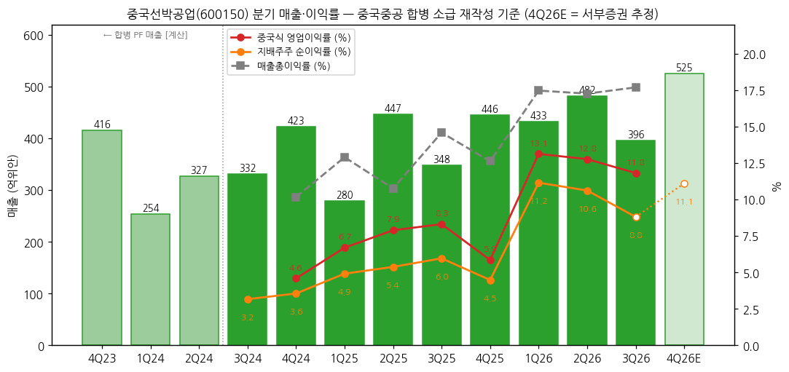
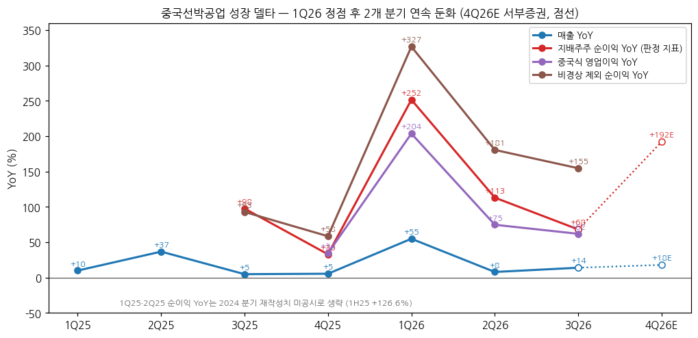
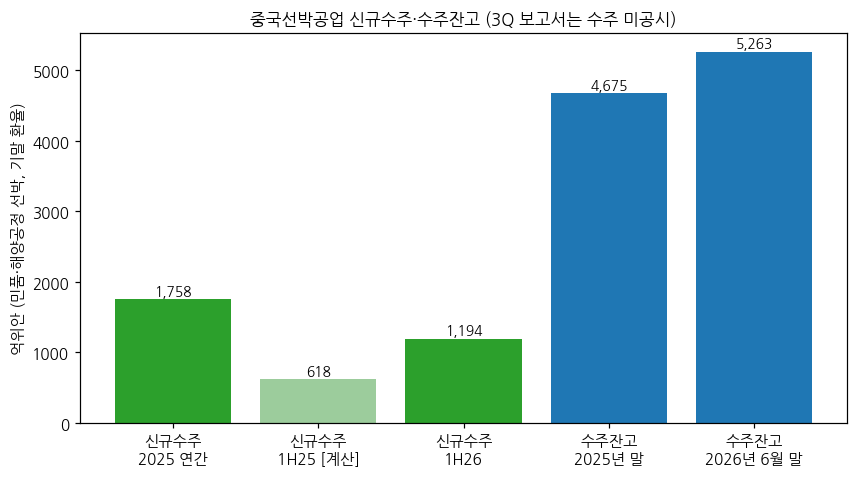

> 모드: 실적 리뷰 (v11)
> 종목: 중국선박공업 / China CSSC Holdings (中国船舶, 600150.SS)
> 섹터: 조선
> 서브섹터: 조선 글로벌
> 분기: 2026-Q3 (캘린더 = 회계 분기, 9/30 종료)
> 발표일: 2026-10-30 (장 마감 후 3분기 보고서 공시, 거래소 게재일 10/31)
> 작성 시각: 2026-11-14 19:13 KST
> 분석 소스: [1차 — 회사 원문] 상해거래소 공고 PDF(东方财富 공고 미러 경유 원문) — 2026년 3분기 보고서(10/30), 2026년 반기 보고서(8/30), 2026년 1분기 보고서(4/29), 2025년 연간 보고서(4/29, 2023~2024 재작성치·2025 분기·2026 경영목표 포함), 2025년 3분기 보고서(재작성 3Q24·9M24), 2025년 반기 보고서. 분기 단독 손익 세부(원가·판관비·营业利润)는 东方财富 F10 재무 API(회사 공시 수치 집계)로 받고 원문과 대조. 합병 전 2023~2024 분기 PF는 중국선박·중국중공(601989) 원보고 합산 [계산]. [보도 인용] 중금공사 3Q26 리뷰(11/4, 格隆汇 전재), 서부증권 3Q26 리뷰(11/3, 格隆汇 전재 — 2026~2028E), 每日经济新闻(7/13, 회사 증권부 통화), USTR 입항료 유예 연장(Holland & Knight 11/9). 컨퍼런스콜·업적설명회 Q&A 원문은 미확보
> 리뷰 깊이: 숫자 중심 | 리서치 첨부 0건

# 중국선박공업 3Q26 실적 리뷰 — 순이익 +68%, 1Q26 정점 이후 2개 분기 연속 둔화. 마진(GPM 17.7%)은 지키고 인도 척수가 분기를 흔든다

> 성장 델타: 둔화 | 내러티브: 유지 → 델타 둔화 + 내러티브 유지 → 경계 구간 (4Q26 인도 23척+와 순이익 YoY 재가속 확인 전까지)

→ **판정 지표**: 지배주주 순이익(归母净利润)으로 판정했다. 중국 회계의 营业利润(이하 "중국식 영업이익")은 투자수익·기타수익·자산손상·이자수익(재무비용 음수)을 포함해 K-IFRS 영업이익과 다르다. 그래서 순이익을 주 지표로 쓰고, 중국식 영업이익과 비경상 제외 순이익(扣非)을 방향 확인용으로 병기했다. 네 지표 모두 같은 방향(둔화)이다
→ **숫자**: 3Q26 매출 395.9억위안(+13.9% YoY), 지배주주 순이익 34.9억위안(+68.1%), 중국식 영업이익 46.8억위안(+61.9%), 매출총이익률 17.7%(+3.1%p). 순이익 YoY가 +251.6%(1Q26) → +113.1%(2Q26) → +68.1%(3Q26)로 2개 분기 연속 내려왔다(델타 -45.0%p). 매출 YoY는 +7.9% → +13.9%로 올랐다
→ **일회성**: 3Q26에 중국중공 흡수합병 관련 세무 처리로 법인세 6.92억위안이 손익에 잡혔다(회사, 비경상 손익). 이를 더한 조정 순이익은 41.8억위안(+101.5%) [계산]이지만 2Q26(+113.1%)보다 여전히 낮아 판정은 같다
→ **쟁점**: (1) 3Q 매출 QoQ -17.9%는 인도 척수(1H 102척 → 3Q 43척 [계산])의 문제다. 회사는 인도 시점 일괄 인식(完工交船法)이라 "분기보다 연간으로 보라"고 한다 (2) 마진은 GPM 17.3% → 17.7%로 유지돼 수익성 훼손 신호는 없다 (3) 수주는 1H26 1,193.9억위안(+93.1%), 잔고 5,262.7억위안(연초 대비 +12.6%)으로 선행지표는 강하다
→ **다음 분기 관건**: 연간 인도 계획 168척 중 9월 말까지 145척(86.3%) [계산] → 4Q26 23척 이상 인도. 회사 연매출 목표(1,650억위안 이상)가 요구하는 4Q26 매출은 338.8억위안 이상(YoY -24.0%)으로 낮다. 서부증권 추정(매출 525.5억위안, 순이익 58.4억위안, YoY +192%) [보도 인용]대로 나오면 순이익 YoY가 재가속한다. 이 둘 사이 간극이 크다

---

## 1. 숫자

① 연결 기준 분기 표 (단위: 억위안, %, 중국 기업회계준칙)

| 항목 | 4Q23 | 1Q24 | 2Q24 | 3Q24 | 4Q24 | 1Q25 | 2Q25 | 3Q25 | 4Q25 | 1Q26 | 2Q26 | **3Q26** | 4Q26E (가이던스 하한) | 4Q26E (서부증권) |
|---|---|---|---|---|---|---|---|---|---|---|---|---|---|---|
| 매출 | 415.7 PF | 254.4 PF | 326.8 PF | 331.9 | 423.0 | 279.6 | 446.8 | 347.6 | 445.8 | 433.1 | 482.2 | **395.9** | 338.8 이상 | 525.5 |
| 중국식 영업이익 (营业利润) | — | — | — | — | 19.4 | 18.7 | 35.3 | 28.9 | 26.1 | 56.9 | 61.6 | **46.8** | 미제시 | — |
| 중국식 영업이익률 | — | — | — | — | 4.6 | 6.7 | 7.9 | 8.3 | 5.9 | 13.1 | 12.8 | **11.8** | — | — |
| 지배주주 순이익 (판정 지표) | — | — | — | 10.5 | 15.0 | 13.7 | 24.0 | 20.7 | 20.0 | 48.3 | 51.2 | **34.9** | 미제시 | 58.4 |
| 지배주주 순이익률 | — | — | — | 3.2 | 3.6 | 4.9 | 5.4 | 6.0 | 4.5 | 11.2 | 10.6 | **8.8** | — | 11.1 |
| 비경상 제외 순이익 (扣非) | — | — | — | 7.7 | 11.0 | 11.2 | 17.7 | 14.9 | 17.4 | 47.7 | 49.8 | **38.0** | — | — |
| 매출총이익률 | — | — | — | — | 10.2 | 12.9 | 10.8 | 14.6 | 12.6 | 17.5 | 17.3 | **17.7** | — | — |
| 매출 YoY | — | +60.3 | +3.7 | +1.9 | +1.8 | +9.9 | +36.7 | +4.8 | +5.4 | +54.9 | +7.9 | **+13.9** | -24.0 이상 | +17.9 |
| 순이익 YoY | — | — | — | — | — | — | — | +97.6 | +32.9 | +251.6 | +113.1 | **+68.1** | — | +192.3 |
| 중국식 영업이익 YoY | — | — | — | — | — | — | — | — | +34.4 | +203.7 | +74.7 | **+61.9** | — | — |
| 扣非 순이익 YoY | — | — | — | — | — | — | — | +92.9 | +58.5 | +326.8 | +180.6 | **+154.7** | — | — |
| **매출 YoY 델타 (%p)** | — | — | -56.6 | -1.8 | -0.1 | +8.2 | +26.8 | -31.9 | +0.6 | +49.5 | -47.0 | **+6.0** | — | +4.0 |
| **순이익 YoY 델타 (%p)** | — | — | — | — | — | — | — | — | -64.7 | +218.8 | -138.5 | **-45.0** | — | +124.2 |
| **중국식 영업이익 YoY 델타 (%p)** | — | — | — | — | — | — | — | — | — | +169.3 | -129.0 | **-12.8** | — | — |

→ (출처: 3Q24~3Q26 = 회사 원문. 2025년 4개 분기는 2025년 연간 보고서 "2025년 분기별 주요 재무 데이터"(재작성 기준), 2026년은 각 분기·반기 보고서, 3Q24 매출·순이익은 2025년 3분기 보고서의 "上年同期 调整后", 4Q24는 2024 연간 재작성치(2025 연간 보고서) − 9M24 재작성치(2025 3분기 보고서) [계산]. 분기 원가·营业利润 세부는 东方财富 F10 분기 단독 손익(합계가 연간 원문과 일치함을 확인 — 2025 营业利润 4개 분기 합 108.98 = 연간 108.98). 4Q23~2Q24 매출 PF = 중국선박 원보고 + 중국중공 원보고 단순 합산 [계산]. PF와 재작성치의 차이는 1H24 581.2 vs 578.6(-0.4%), 9M24 914.4 vs 910.5(-0.4%), 2023 연간 1,215.4 vs 1,213.9(-0.1%)로 작다. 순이익은 PF와 재작성치 차이가 커서(2024 연간 PF 49.3 vs 재작성 42.2) 쓰지 않았다)
→ (4Q26E: 가이던스 하한 = 회사 2026년 매출 목표 "1,650억위안 이상"(2025 연간 보고서) − 9M26 1,311.2 [계산]. 서부증권 = 2026E 매출 1,836.6·순이익 192.8억위안(11/3 리뷰, 格隆汇 전재) − 9M26 누적 [계산] [보도 인용]. 중국 쪽 컨센서스는 집계 출처·증권사 수를 확인하지 못해 쓰지 않았다)
→ **기준 단절**: 2025-09-11 중국중공(中国重工) 흡수합병(신주 30.5억주, 총주식 44.7억 → 75.3억주) 완료. 동일지배 합병이라 2023~2025년 비교 수치를 소급 재작성했다. 재작성 전 1Q25 매출은 158.6억위안, 재작성 후 279.6억위안이다(2026 1분기 보고서). 2024 분기 재작성치는 3Q24만 공시돼 1Q24·2Q24는 PF로 채웠고, 2024 분기 순이익·营业利润 YoY는 계산하지 않았다. 1H25 순이익 YoY는 +126.6%(1H24 재작성 16.7억위안 = 9M24 27.2 − 3Q24 10.5 [계산])
→ **이익 지표 차이**: 중국식 영업이익(营业利润)에는 투자수익(3Q26 7.9억위안, 중선디젤 등 관계사), 정부보조금 성격 기타수익, 이자수익(재무비용 -1.7억위안)이 들어 있다. K-IFRS에 가깝게 매출 − 원가 − 세금 − 판관비 − 연구개발비로 다시 계산하면 3Q26 34.8억위안(이익률 8.8%), YoY +94.0%로 2Q26(+172.7%), 1Q26(+335.3%)에 이어 역시 둔화다 [계산]
→ **YoY 정점**: 순이익·중국식 영업이익·扣非 모두 1Q26이 정점이다. 1Q25가 재작성 기준으로도 낮은 기저(순이익률 4.9%)였기 때문이다. 4Q25 기저(순이익 20.0억위안, 이익률 4.5%)가 다시 낮아 4Q26은 인도량만 맞으면 YoY가 반등하는 구조다. 회사 연간 목표 하한만 맞추면 매출 YoY는 -24%가 된다
→ **[판단] 델타 = 둔화**: 판정 지표(순이익) YoY가 +113.1% → +68.1%로 축소됐지만 플러스다. 2개 분기 연속 둔화지만 서부증권 경로(4Q26E +192%)상 YoY 정점이 이미 지났다고 볼 근거가 없어 "꺾임" 조건(정점 통과)은 충족하지 않는다. 매출 YoY는 +6.0%p 올라 방향이 엇갈린다

→ (출처: 회사 분기·반기·연간 보고서, 东方财富 F10 분기 단독 손익. 4Q23~2Q24 연한 막대는 PF 매출 [계산], 4Q26E는 서부증권 추정 [보도 인용])

→ (출처: 동일. 4Q26E 점선은 서부증권 2026E에서 역산 [계산])

② 사업부별 주영업수입·매출총이익률 (단위: 억위안, %, 반기 공시 — 분기 사업부 미공시)

| 사업부 | 항목 | 2024 (재작성) | 1H25 | 2H25 | 2025 | **1H26** |
|---|---|---|---|---|---|---|
| 선박 건조·수리·해양공정 | 매출 | 1,144.4 | 625.2 | 687.6 | 1,312.8 | **815.3** |
| | 매출 YoY | — | — | — | +14.7 | **+30.4** |
| | 매출총이익률 | 8.8 | 10.1 | 13.2 | 11.7 | **17.2** |
| 선박 기자재·기전설비·기타 | 매출 | 170.7 | 92.2 | 94.0 | 186.2 | **90.5** |
| | 매출 YoY | — | — | — | +9.1 | **-1.8** |
| | 매출총이익률 | 18.6 | 19.1 | 13.2 | 16.2 | **16.8** |
| 합계 (주영업수입) | 매출 | 1,315.1 | 717.4 | 781.5 | 1,499.0 | **905.8** |
| | 매출총이익률 | 10.1 | 11.3 | 13.2 | 12.3 | **17.2** |

→ (출처: 2025 연간 보고서·2026 반기 보고서 "主营业务分产品情况". 2024·1H25·2H25는 회사가 공시한 YoY·이익률 변화폭에서 역산 [계산]. 2H25 기자재 이익률 13.2%는 연간 원가 − 1H25 역산 원가로 계산 [계산]. 3Q26 분기 사업부는 미공시)
→ **델타를 끄는 것은 선박 건조다**. 매출 비중 90%(1H26)이고 이익률이 10.1%(1H25) → 13.2%(2H25) → 17.2%(1H26)로 반기마다 3~4%p씩 올랐다. 회사 설명은 "인도한 중고급 선형 비중과 척당 평균 가격이 올랐고 건조 기간이 줄었다"이다 (2026 반기 보고서)
→ 기자재·기전설비는 매출 정체(-1.8%), 이익률 하락(-2.3%p)으로 기여가 없다
→ 2025년 지역별로 보면 해외 매출 688.9억위안의 이익률이 19.2%, 국내 810.0억위안은 6.4%였다 (2025 연간 보고서). 해외 상선 인도 비중이 마진을 결정한다 [판단]

(1) 수주·잔고 — 선행지표 (단위: 억위안, 척, 만DWT — 민품·해양공정 선박, 기말 환율 환산)

| 항목 | 2025 연간 | 1H25 | **1H26** | 2025년 말 | **2026년 6월 말** | 3Q26 |
|---|---|---|---|---|---|---|
| 신규수주 금액 | 1,758.4 | 618.4 [계산] | **1,193.9 (+93.1%)** | — | — | 미공시 |
| 신규수주 척수 / DWT | 237척 / 3,050.7 | — / 981.1 [계산] | **177척 / 2,245 (+128.8%)** | — | — | 미공시 |
| 수주잔고 금액 | — | — | — | 4,674.5 | **5,262.7 (+12.6%)** | 미공시 |
| 수주잔고 척수 / DWT | — | — | — | 652척 / 7,997.3 | **729척 / 9,389** | 미공시 |
| 인도 (민품) | 161척 / 1,367.8 | — | **102척 / 956** | — | — | 43척 [계산] (9M 145척) |

→ (출처: 2025 연간 보고서, 2026 반기 보고서, 2026 3분기 보고서(9M 145척). 1H25는 회사가 밝힌 증가율에서 역산 [계산]. 금액은 각 기말 환율 기준이라 환율 변동이 섞여 있다. 달러 기준 잔고는 미공시)

→ (출처: 동일. 1H25 연한 막대는 역산 [계산])
→ 1H26 수주/선박 매출 비율(Book-to-bill)은 1.46배, 잔고는 2025년 선박 매출의 4.0배다 [계산]. 잔고 구성(척수 기준)은 유조선 약 30%, 컨테이너선 약 20%, 벌크선 약 15%, 가스선(LNG·LPG·에탄 등) 약 10%, 특수선 등 약 25%다
→ 수리 수주 1H26 367척·26.0억위안, 기자재·기전 수주 119.9억위안. 3분기 보고서는 수주를 공시하지 않는다 — 다음 수주 숫자는 2026 연간 보고서(2027년 3~4월)다

(2) 회사 가이던스 — 이전 → 이번

| 항목 | 이전 | 이번 | 진척 (9M26) |
|---|---|---|---|
| 연매출 목표 | 2025년 약 1,405억위안 [계산] (실적 1,519.8 = 목표 +8.17%) | **2026년 1,650억위안 이상 (+8.6% 이상)** | 1,311.2억위안 = 79.5% |
| 민품 인도 계획 | 2025년 미확보 (실적 161척) | **2026년 168척 / 1,650만DWT** | 145척 = 86.3% [계산] |
| 기자재·기전 산출 | 2025년 실적 150.7억위안 | **2026년 170억위안 이상** | 1H26 89.3억위안 |
| 배당 | 2025년 결산 주당 0.365위안 (27.5억, 배당성향 35%) | **2026년 중간배당 주당 0.465위안 (35.0억 [계산])** | 10/17 실시 공고 |

→ (출처: 2025 연간 보고서 "经营计划", 2026 반기 보고서, 2026 반기 권익분배 실시 공고(10/17). 2025 목표는 "목표 대비 8.17% 초과"에서 역산 [계산]. 회사는 분기 가이던스를 내지 않고 7월에 반기 실적 예고(순이익 92~110억위안, 실적 99.5)를 냈다)
→ 매출 목표는 9월 말 79.5%를 채워 보수적이다. 인도 계획은 4Q에 23척이 남아 3Q(43척)보다 적다. 목표가 남긴 숫자만 보면 4Q26은 약한 분기처럼 보이지만, 회사는 2025년에도 목표를 8.17% 초과했다. 목표는 하한으로 읽는 게 맞다 [판단]

③ 연간 (단위: 억위안, %)

| 항목 | 2022 (합병 전) | 2023 (재작성) | 2024 (재작성) | 2025 | 2026E (회사 목표) | 2026E (서부증권) | 2027E (서부증권) |
|---|---|---|---|---|---|---|---|
| 매출 | 594.9 | 1,213.9 | 1,333.5 | 1,519.8 | 1,650 이상 | 1,836.6 | 2,158.6 |
| 중국식 영업이익 | 4.1 | 미확보 | 53.3 | 109.0 | — | — | — |
| 지배주주 순이익 | 1.7 | 25.8 | 42.2 | 78.5 | — | 192.8 | 246.9 |
| 순이익률 | 0.3 | 2.1 | 3.2 | 5.2 | — | 10.5 | 11.4 |
| 매출 YoY | — | n.m. | +9.9 | +14.0 | +8.6 이상 | +20.8 | +17.5 |
| 순이익 YoY | — | n.m. | +63.7 | +86.0 | — | +145.6 | +28.1 |

→ (출처: 2022는 합병 전 원보고(东方财富 F10), 2023~2025는 2025 연간 보고서 재작성치. 2023 재작성 营业利润은 공시 표에 없어 미확보. 2026E·2027E 서부증권(11/3) [보도 인용]. 중금공사는 2026/2027년 이익 추정을 유지했다고만 밝혔고 PER 12.8배/9.4배, 목표주가 50위안을 제시했다 [보도 인용])
→ 9M26 순이익 134.4억위안은 이미 2025 연간(78.5)의 1.7배다. 서부증권 2026E 192.8억위안은 4Q26 58.4억위안을 요구한다 — 1Q·2Q 수준(48~51억위안)을 넘는 숫자다

---

## 2. 시장 쟁점 (회사 설명 + 반복 질문)

① 지난 분기 체크
→ 첫 리뷰 — 직전 체크 없음. 섹터 리뷰 `(서브) 중국 조선 2사 트래킹`(2026-11-14)이 3Q26 숫자를 보도 인용으로 먼저 적었고, 이번에 회사 원문으로 매출·순이익(3Q26 395.89·34.87, 1Q26 433.12·48.32, 1H26 915.30·99.54, 2025 1,519.78·78.48, 9M25 1,074.03·58.52)을 모두 재확인했다. 차이 없음

② 이번 분기 쟁점 4개

| # | 쟁점 | 근거 |
|---|---|---|
| (1) | 3Q 매출이 왜 QoQ -18%인가 — 수요인가, 인도 타이밍인가 | 중금(11/4), 每日经济新闻(7/13) 회사 통화 |
| (2) | 순이익 둔화는 마진 문제인가, 일회성인가 | 3분기 보고서 세무 처리 6.92억위안, 중금·서부 |
| (3) | 수주 호조는 이어지나 — 중국 점유율과 신조선가 | 반기 보고서, 중금(클락슨 1~10월) |
| (4) | 미국 USTR 입항료(301조)와 한국과의 경쟁 구도 | USTR 유예 연장(11/9) |

③ 쟁점별 분해

(1) **3Q 매출 감소 = 인도 척수**
→ 회사 설명: "재무 결산은 주로 완공 인도 시점에 수익을 인식한다(完工交船法). 분기 인도 척수가 분기 이익을 직접 좌우하므로 한 분기보다 연간으로 봐야 한다" (회사 증권부, 每日经济新闻 7/13 통화) [보도 인용]. 3분기 보고서는 "9M 민품 145척 인도, 인도 척수와 매출총이익 모두 증가"라고만 적었다
→ 숫자: 1H26 102척 → 3Q26 43척 [계산]. 중금은 3Q 매출 감소를 "고온 날씨와 조선소 전 계통 점검·정비" 영향으로 판단했다 [보도 인용, 회사 확인 없음]
→ **[판단]** 한국 3사(진행률 기준 인식)와 달리 분기 매출이 인도 일정에 따라 계단식으로 움직인다. 따라서 분기 YoY 델타의 신뢰도가 낮고, 반기·연간 YoY와 매출총이익률을 함께 봐야 한다. 9M 기준으로는 매출 +22.1%, 순이익 +129.7%로 견조하다

(2) **순이익 둔화 = 마진 아닌 볼륨 + 세금**
→ 회사 설명: 합병에 따른 지분 교환 관련 법인세 중 "중국중공 자회사 지분 보유 기간 이익 관련분"을 당기 손익으로 처리, 영향 6.92억위안, 비경상 손익 처리 (3분기 보고서). 1H26에도 "일부 자회사가 이월결손금을 소진하고 정상 납세 주기에 들어갔다"며 법인세가 +342.6% 늘었다 (반기 보고서)
→ 숫자: 매출총이익률 17.5%(1Q) → 17.3%(2Q) → 17.7%(3Q)로 유지, 9M 17.5%(전년 12.6%) [계산]. 扣非 순이익(37.98억위안, +154.7%)이 보고 순이익보다 높다. 실효세율 상승은 2027년에도 이어질 구조적 요인이다 [판단]
→ **[판단]** 이익률 레벨은 훼손되지 않았다. 둔화의 원인은 ① 1Q25 저기저 소진 ② 3Q 인도 감소 ③ 세금(일회성 6.92억 + 정상 납세 전환)이다

(3) **수주·선가 — 선행지표는 강하다**
→ 회사 설명: 1H26 수주 금액 +93.1%, DWT +128.8%. 중고급 선형 80% 이상(2025년). 반기 보고서는 업계 데이터로 1H26 중국 신규수주 점유율 82.3%, 수주잔고 71.2%를 인용했다 (중국선박공업협회·클락슨)
→ 중금(11/4): 클락슨 기준 1~10월 글로벌 신규수주 7,969만CGT(+61.0%), 중국 6,103만CGT(+94.7%, 점유율 76.6%), 10월 신조선가지수 187.2(+1.3% YoY) [보도 인용]
→ **[판단]** 잔고 5,263억위안(6월 말)은 2025 선박 매출의 4년치다. 2026년 수주 선가가 2027~2028년 인도 마진을 정한다. 유조선 비중(약 30%)이 높아 VLCC·MR 발주 사이클에 민감하다

(4) **USTR 입항료와 한국 경쟁 구도**
→ 사실: 미국 USTR의 중국 건조·운항 선박 입항료(301조)는 2025-11 1년 유예 후, 2026-11-09부터 2027-01-09까지 2개월 추가 유예됐다. 중국도 미국 관련 선박 보복 입항료를 2027-01-10까지 유예했다 (Holland & Knight 11/9, Seatrade) [보도 인용]
→ **[판단]** 유예가 끝나 입항료가 부과되면 미국 기항 선사(컨테이너·자동차운반선)의 중국 발주가 한국으로 일부 이동할 수 있다. 유예 연장이 이어지면 중국의 가격 경쟁력이 그대로 유지된다. 회사는 보고서에서 이 이슈를 언급하지 않았다

→ 컨퍼런스콜·업적설명회 Q&A 원문은 확보하지 못했다. 위 반복 질문은 증권사 리뷰 2건(중금·서부)과 언론의 회사 통화에서 공통으로 나온 주제다

---

## 3. 내러티브 점검

→ **성장 스토리**: 중국 최대 상선 조선사가 합병(7개 핵심 조선소)으로 규모를 키우고, 2023~2024년 고선가 수주분이 2025~2027년 인도되며 이익률이 오르는 구조. 시장은 "글로벌 수주잔고 1위 + 이익률 재평가"를 산다
→ **이번 분기**: 이익률(GPM 17.7%)과 잔고(+12.6%)는 스토리를 확인했다. 순이익 증가율 둔화는 인도 타이밍·세금 요인이 커서 스토리 훼손이 아니다 → **내러티브 유지**
→ **판정**: 델타 둔화 + 내러티브 유지 → 경계 구간. 인도 기준 인식 때문에 분기 델타가 들쭉날쭉하다. 4Q26에 순이익 YoY가 재가속(+100% 이상)하면 "유지"로 되돌릴 수 있다 [판단]
→ **스토리 강화 트리거**: ① 4Q26 순이익 50억위안 이상(4Q25 20.0의 2.5배) ② 2026 연간 수주 2,000억위안 이상 ③ USTR 입항료 영구 철회
→ **훼손 리스크**: ① GPM 15% 아래로 하락(원가·인건비) ② 유조선 발주 둔화로 수주 반감 ③ 301조 입항료 부과 재개
→ **한국 조선 3사 대비 시사점**: 한국 3사 합산 영업이익 YoY도 3Q26 +34.0%로 둔화(-50.7%p)해, 중국 대형사와 한국이 같은 시점에 증가율 정점을 지나고 있다 [판단]. 다만 중국선박공업의 이익률(순이익률 8.8%, GPM 17.7%)은 한국 3사 OPM(14.0%)보다 낮은 대신 개선 폭(GPM +5%p YoY)이 크다. "중국이 한국 마진을 따라잡는 속도"가 한국 프리미엄의 축소 요인이다

---

## 4. 향후 봐야 할 것

(1) **4Q26 인도 척수와 순이익 YoY 재가속** (1순위 — 델타 판정 변수)
→ 무엇을: 연간 168척 계획 대비 4Q 잔여 23척 이상 인도, 2026 연간 매출 1,650억위안 이상(4Q 338.8억 이상), 4Q26 순이익 50억위안 이상이면 YoY +150% 이상 재가속 / 30억위안 미만이면 YoY +50% 미만으로 "꺾임" 검토
→ 어떤 데이터로: 2026 연간 실적 예고(2027년 1월 말, 2025년엔 1/30 공시), 회사·조선소 인도 보도, 중국 공업정보화부 조선 완공량 통계
→ 언제: 2027-01 말(실적 예고), 2027-04 말(연간 보고서)

(2) **매출총이익률 17%대 유지와 실효세율**
→ 무엇을: 분기 GPM 17% 이상 유지, 4Q 합병 관련 세무 처리 추가 여부, 정상 납세 전환에 따른 순이익률 희석
→ 어떤 데이터로: 2026 연간 보고서 손익계산서, 비경상 손익 표
→ 언제: 2027-04 말

(3) **2026 연간 수주·잔고**
→ 무엇을: 2026 연간 신규수주 2,000억위안 이상(1H 1,193.9), 연말 잔고 5,500억위안 이상, 유조선·LNG선 비중 변화
→ 어떤 데이터로: 2026 연간 보고서, 클락슨 월간 수주(중국 점유율 76.6% 유지 여부), 회사 대형 계약 공시
→ 언제: 월간(클락슨), 2027-04 말(연간 보고서)

(4) **USTR 301조 입항료 유예 만료 (2027-01-09)**
→ 무엇을: 추가 연장·영구 철회·부과 재개 중 어느 쪽인지, 중국의 대응(보복 입항료 2027-01-10 만료)
→ 어떤 데이터로: USTR Federal Register 공고, 미중 무역협상 보도
→ 언제: 2026-12 ~ 2027-01 초

(5) **2027년 경영목표**
→ 무엇을: 2027년 매출 목표(2026E 서부 1,836.6 → 2027E 2,158.6 대비), 인도 계획 척수, 배당성향 35% 유지 여부
→ 어떤 데이터로: 2026 연간 보고서 "经营计划"
→ 언제: 2027-04 말
