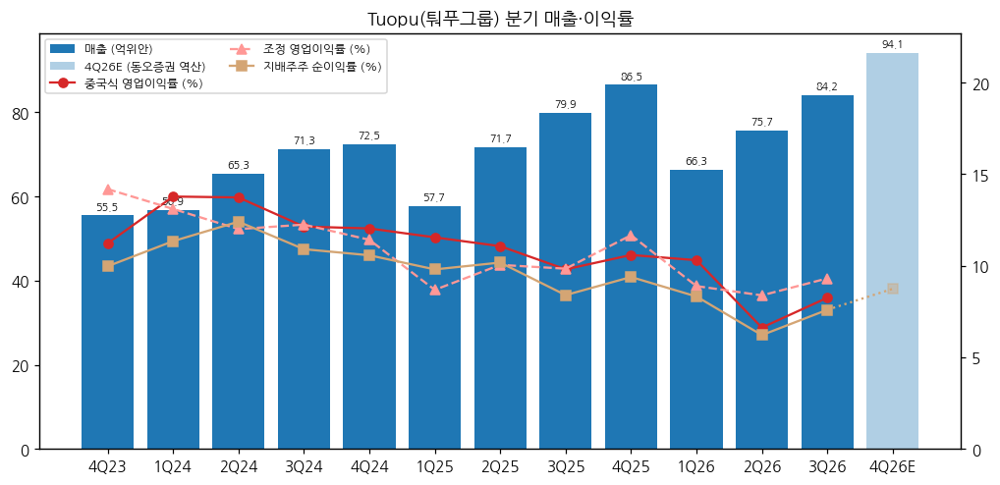
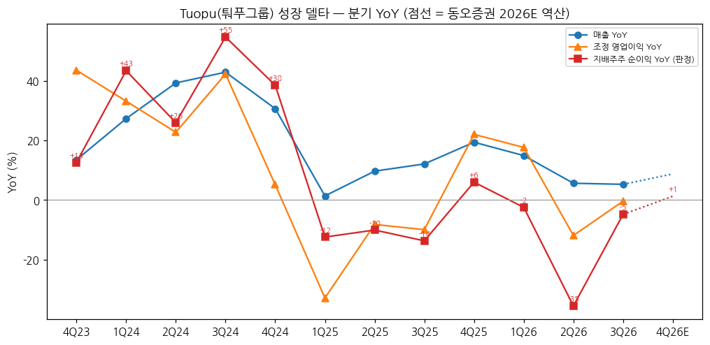
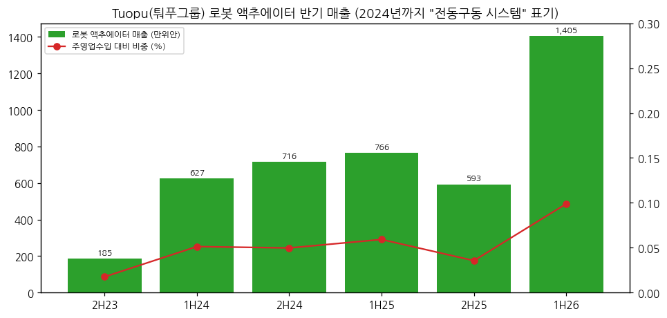

> 모드: 실적 리뷰 (v11)
> 종목: Tuopu Group / 퉈푸그룹 (拓普集团, 601689.SS — 상해거래소 601689.SH)
> 섹터: 로봇
> 서브섹터: 로봇 부품
> 분기: 2026-Q3 (캘린더 = 회계 분기, 9/30 종료)
> 발표일: 2026-10-29 (장 마감 후 3분기 보고서 공시)
> 작성 시각: 2026-11-14 19:42 KST
> 분석 소스: [1차 — 회사 원문] 상해거래소 공고 PDF(东方财富 공고 미러 경유 원문) — 2026년 3분기 보고서(10/29), 2026년 반기 보고서(8/27, 로봇 액추에이터 매출 포함 제품별 표), 2025년 연간 보고서(3/23), 2025년 경영실적 예고(2/11). 분기 단독 손익 세부는 东方财富 F10 재무 API(회사 공시 수치 집계)로 받고 원문과 대조(3Q26 매출 84.16·순이익 6.40·扣非 6.03억위안 일치). 반기 제품별 매출·GPM은 东方财富 主营构成(반기·연간 보고서 원문 표와 대조). [보도 인용] 동오증권 3Q26 리뷰(10/31, 2026~2028E), 화안증권 3Q26 리뷰(10/30, 2026~2028E), TrendForce(9/21, 21세기경제보도 인용 — Tesla 공급사 실사). 주가 Yahoo Finance v8. 컨퍼런스콜·업적설명회 Q&A 원문은 미확보
> 리뷰 깊이: 숫자 중심 | 리서치 첨부 0건 (웹 공개 증권사 리뷰 2건 보완)
> 다중 부문 처리: 로봇 액추에이터(机器人执行器) 매출은 **반기·연간 보고서에서만 분리 공시**(1H26 1,404.8만위안, 주영업수입의 0.1%), 부문 영업이익·분기 숫자는 미공시 → 회사 전체 숫자로 리뷰하고 로봇 부문은 별도 행으로 추출 (feedback_multisegment_global_peer 규칙)

# Tuopu 3Q26 실적 리뷰 — 순이익 -4.8%로 3개 분기 연속 역성장, 낙폭은 2Q(-35.5%)보다 크게 줄었다. 로봇 액추에이터 매출은 반기 1,405만위안(+83%)으로 아직 전사의 0.1%

> 성장 델타: 꺾임 | 내러티브: 약화 → 델타 꺾임(마이너스 폭 축소) + 내러티브 약화 → 매매 제외 구간 (로봇 매출 0.1%·영업이익 미공시 → 섹터 합산 시 트래킹 처리 권고)

→ **판정 지표**: 지배주주 순이익(归母净利润)으로 판정했다. 중국식 영업이익(营业利润)은 정부보조금(其他收益)·환차손익·자산손상을 포함해 K-IFRS 영업이익과 다르다. 조정 영업이익(매출 − 원가 − 세금 − 판관비 − 연구개발비 [계산])과 扣非 순이익을 방향 확인용으로 병기했다
→ **3Q 단독 산출 방식**: 3분기 보고서의 9M 누적 − 반기 보고서 1H 누적 [계산]. 매출 226.15 − 141.99 = 84.16억위안, 순이익 16.62 − 10.23 = 6.40억위안. 회사가 보고서 첫 표에 함께 적은 "본 보고기간(3개월)" 숫자와 같다
→ **숫자**: 3Q26 매출 84.16억위안(+5.3% YoY, +11.2% QoQ), 지배주주 순이익 6.40억위안(-4.8%), 중국식 영업이익 6.95억위안(-11.4%), 매출총이익률 18.1%(-0.5%p). 순이익 YoY -2.4%(1Q26) → -35.5%(2Q26) → -4.8%(3Q26). 델타는 +30.7%p지만 여전히 마이너스다
→ **쟁점**: (1) 마진 하락의 원인 — 신규 공장 램프업 감가상각·인건비, 원재료, 환차손(회사 설명) (2) 고객 집중도(상위 5개사 65.8%)와 국내 승용차 수요 둔화 (3) 로봇 액추에이터 — "소량 납품" 단계, 1H26 매출 1,404.8만위안
→ **다음 분기 관건**: 동오증권 2026E(순이익 24.85억위안) 역산 4Q26 순이익 8.23억위안(+1.3%), 화안증권(24억위안) 역산 7.38억위안(-9.2%) [보도 인용·계산]. 4Q26에 YoY 플러스 전환이 나와야 "꺾임"에서 벗어난다

---

## 1. 숫자

① 연결 기준 분기 표 (단위: 억위안, %, 중국 기업회계준칙. 분기 단독 = 누적 차감)

| 항목 | 4Q23 | 1Q24 | 2Q24 | 3Q24 | 4Q24 | 1Q25 | 2Q25 | 3Q25 | 4Q25 | 1Q26 | 2Q26 | **3Q26** | 4Q26E (동오) | 4Q26E (화안) |
|---|---|---|---|---|---|---|---|---|---|---|---|---|---|---|
| 매출 | 55.5 | 56.9 | 65.3 | 71.3 | 72.5 | 57.7 | 71.7 | 79.9 | 86.5 | 66.3 | 75.7 | **84.2** | 94.1 | — |
| 조정 영업이익 [계산] | 7.9 | 7.5 | 7.8 | 8.7 | 8.3 | 5.0 | 7.2 | 7.9 | 10.1 | 5.9 | 6.3 | **7.8** | — | — |
| 조정 OPM | 14.2 | 13.1 | 12.0 | 12.2 | 11.4 | 8.7 | 10.1 | 9.8 | 11.7 | 8.9 | 8.4 | **9.3** | — | — |
| 중국식 영업이익 (营业利润) | 6.2 | 7.8 | 9.0 | 8.7 | 8.7 | 6.7 | 7.9 | 7.8 | 9.2 | 6.8 | 5.0 | **6.9** | — | — |
| 중국식 영업이익률 | 11.2 | 13.8 | 13.7 | 12.1 | 12.0 | 11.6 | 11.1 | 9.8 | 10.6 | 10.3 | 6.6 | **8.3** | — | — |
| 지배주주 순이익 (판정 지표) | 5.54 | 6.45 | 8.11 | 7.78 | 7.67 | 5.65 | 7.29 | 6.72 | 8.13 | 5.52 | 4.71 | **6.40** | 8.23 | 7.38 |
| 지배주주 순이익률 | 10.0 | 11.3 | 12.4 | 10.9 | 10.6 | 9.8 | 10.2 | 8.4 | 9.4 | 8.3 | 6.2 | **7.6** | 8.7 | — |
| 扣非 순이익 | 5.20 | 5.96 | 7.00 | 7.27 | 7.05 | 4.87 | 6.75 | 6.55 | 7.95 | 4.73 | 4.34 | **6.03** | — | — |
| 매출총이익률 | 23.6 | 22.4 | 20.4 | 20.9 | 19.8 | 19.9 | 19.3 | 18.6 | 20.0 | 19.3 | 18.4 | **18.1** | — | — |
| 매출 YoY | +13.5 | +27.3 | +39.3 | +42.9 | +30.6 | +1.4 | +9.7 | +12.1 | +19.4 | +14.9 | +5.6 | **+5.3** | +8.8 | — |
| 조정 영업이익 YoY | +43.5 | +33.2 | +22.7 | +42.2 | +5.1 | -32.8 | -8.2 | -9.9 | +22.0 | +17.7 | -11.9 | **-0.4** | — | — |
| 중국식 영업이익 YoY | +22.5 | +41.9 | +22.5 | +52.4 | +40.1 | -15.0 | -11.6 | -9.5 | +5.0 | +2.5 | -36.8 | **-11.4** | — | — |
| 순이익 YoY | +12.6 | +43.4 | +25.9 | +54.6 | +38.5 | -12.4 | -10.0 | -13.7 | +6.0 | -2.4 | -35.5 | **-4.8** | +1.3 | -9.2 |
| 扣非 순이익 YoY | +8.0 | +41.8 | +15.3 | +53.7 | +35.5 | -18.4 | -3.5 | -10.0 | +12.7 | -2.8 | -35.6 | **-7.9** | — | — |
| **매출 YoY 델타 (%p)** | -2.3 | +13.8 | +12.0 | +3.6 | -12.2 | -29.2 | +8.3 | +2.4 | +7.3 | -4.5 | -9.3 | **-0.4** | +3.5 | — |
| **순이익 YoY 델타 (%p)** | +12.2 | +30.7 | -17.4 | +28.7 | -16.2 | -50.9 | +2.3 | -3.6 | +19.7 | -8.4 | -33.0 | **+30.7** | +6.1 | — |
| **조정 영업이익 YoY 델타 (%p)** | +43.1 | -10.4 | -10.4 | +19.5 | -37.1 | -37.9 | +24.6 | -1.7 | +31.9 | -4.4 | -29.5 | **+11.5** | — | — |

→ (출처: 4Q23~3Q26 분기 단독 = 东方财富 F10 분기 손익(회사 1Q·반기·3Q·연간 보고서 누적치 차감 집계). 3Q25·3Q26은 9M − 1H 누적 차감으로 직접 재계산해 일치 확인 [계산]. 3Q26 회사 원문: 매출 8,415,979,948.62위안(+5.28%), 순이익 639,508,737.20위안(-4.78%), 扣非 603,055,697.08위안(-7.91%). 조정 영업이익 [계산])
→ (4Q26E: 동오증권 2026E 매출 320.26·순이익 24.85억위안(10/31) − 9M26 누적 [계산·보도 인용]. 화안증권 2026E 순이익 24억위안(10/30, 반올림 표기) − 9M26 [계산·보도 인용]. 중국 쪽 컨센서스 집계 출처·증권사 수는 확인하지 못해 쓰지 않았다)
→ **서프라이즈**: 화안증권은 "관리비·연구개발비 통제로 실적이 예상을 소폭 상회"로 평가했다 [보도 인용]. 회사는 분기 가이던스를 내지 않고, 연간은 2월에 경영실적 예고(2025년: 순이익 26.0~29.0억위안, 실적 27.79억위안)를 낸다
→ **YoY 정점**: 순이익 YoY 정점은 3Q24(+54.6%). 1Q25부터 마이너스로 돌았고 4Q25(+6.0%) 한 번 플러스를 낸 뒤 2026년 3개 분기 연속 마이너스다. 매출은 +5~15%로 계속 늘었지만 이익이 따라오지 못하는 "매출 성장·이익 정체" 구간이 2025년부터 7개 분기째다
→ **마진**: 매출총이익률 23.6%(4Q23) → 18.1%(3Q26)로 2년간 5.5%p 하락. 회사 설명은 "제품군 확대·신규 공장 램프업에 따른 인건비·감가상각 증가, 원재료 가격 상승, 환율" (2026 반기 보고서). 3Q26 재무비용 0.95억위안(+133%, 환차손) [동오 보도 인용·회사]
→ **[판단] 델타 = 꺾임**: 판정 지표(순이익) YoY가 마이너스(-4.8%)다. 2Q26 대비 낙폭이 30.7%p 줄었지만 2Q26의 -35.5%는 저점 기저(2Q25)가 아닌 비용 급증(중국식 영업이익률 6.6%) 때문이었고, 3Q26 개선은 QoQ 매출 +11%에 따른 회복이다. 4Q26 동오 경로(+1.3%)로도 "가속"이 아니라 "0% 근처 정체"다

→ (출처: 회사 분기·반기·연간 보고서, 东方财富 F10 분기 단독 손익. 4Q26E 연한 막대·점선은 동오증권 2026E 역산 [계산·보도 인용])

→ (출처: 동일. 4Q26E 점선은 동오증권 2026E에서 역산 [계산])

② 사업부(제품)별 매출·매출총이익률 (단위: 억위안, % — 반기 공시, 제품별 영업이익·분기 미공시)

| 제품 | 1H25 매출 | 2H25 매출 | **1H26 매출** | 1H26 YoY | 1H26 비중 | 1H25 GPM | **1H26 GPM** |
|---|---|---|---|---|---|---|---|
| 내장 기능부품 (内饰功能件) | 43.66 | 53.06 | **47.66** | +9.2 | 33.6 | 16.1 | **17.0** |
| 섀시(경량화) (底盘系统) | 37.08 | 50.15 | **42.43** | +14.4 | 29.9 | 18.1 | **17.7** |
| NVH 감쇠 (减震器) | 20.40 | 22.16 | **21.12** | +3.6 | 14.9 | 20.1 | **20.9** |
| 자동차 전자 (汽车电子 — 에어서스펜션·IBS·EPS 등) | 10.75 | 16.94 | **11.08** | +3.1 | 7.8 | 17.3 | **16.4** |
| 열관리 시스템 (热管理系统) | 9.80 | 11.11 | **10.18** | +3.8 | 7.2 | 16.5 | **16.1** |
| **로봇 액추에이터 (机器人执行器)** | **0.077** | **0.059** | **0.140** | **+83.4** | **0.1** | 30.6 | **27.0** |
| 기타(비주력) | 7.58 | 12.99 | **9.38** | +23.7 | 6.6 | 51.6 | **34.4** |
| 합계 | 129.35 | 166.47 | **141.99** | +9.8 | 100 | 19.5 | **18.8** |

→ (출처: 2025 연간·2026 반기 보고서 "主营业务分产品情况"(东方财富 主营构成 집계, 1H26 원문 대조 — 로봇 액추에이터 14,047,726.94위안, GPM 27.03%, 매출 +83.43%). 2H25 = 2025 연간 − 1H25 [계산]. 2025 연간 보고서 주석: 로봇 액추에이터는 "원래 '전동구동 시스템(电驱系统)'" 표기. 1H26 비중·합계 YoY [계산])

→ (출처: 동일. 2H23은 2023 연간 = 반기 미공시분 [계산])
→ **델타를 끄는 쪽은 섀시(+14.4%)와 내장 기능부품(+9.2%)이다**. 회사는 Tier 0.5(고객 초기 개발 단계 참여·모듈 일괄 공급) 모델로 단가를 올리고, 국내는 Seres·Xiaomi·Geely·BYD·Chery·Li Auto 등, 해외는 "미국 혁신 차기업 A 고객"·Rivian·Ford·GM·BMW 등과 협력한다 (2026 반기 보고서)
→ **꺾인 쪽은 자동차 전자(+3.1%)와 열관리(+3.8%)다**. 2025년 자동차 전자는 연간 +52.1%로 성장 축이었는데 1H26 한 자릿수로 내려왔다 (2025 연간 보고서 [계산])
→ **로봇 액추에이터**: 연간 매출 1,343만위안(2024) → 1,359만위안(2025, +1.2%) → 1H26 1,405만위안(+83.4%). 반기 한 번에 2025년 연간을 넘었지만 전사 주영업수입의 0.1%다. 회사 설명은 "직선 액추에이터·회전 액추에이터·영교수(dexterous hand) 모터 소량 납품 단계 진입, 로봇 부품 산업기지 1기 건설 기본 완료" (2026 반기 보고서)
→ 지역별(1H26, 자동차 부품 주영업): 국내 99.4억위안(+7.2%), 해외 33.3억위안(+14.4%) (2026 반기 보고서)

(1) 로봇 부문 분리 공시 점검 — 섹터 합산 처리

| 항목 | 내용 |
|---|---|
| 분리 공시 단위 | 반기·연간 보고서 제품별 표의 1개 행 (매출·매출원가·GPM) |
| 분기 숫자 | 미공시 (3분기 보고서에는 로봇 언급 없음) |
| 부문 영업이익 | 미공시 |
| 규모 | 1H26 1,404.8만위안 = 전사 매출(141.99억)의 0.1% [계산] |
| 증권사 | 화안: "신사업은 아직 실현 초기, 로봇 액추에이터 매출 비중 약 0.1%" [보도 인용] |

→ **결론**: 로봇 부문을 추출할 수는 있지만 매출만, 반기 단위로만 가능하고 금액이 너무 작아 성장 델타 판정(영업이익 기준)에 쓸 수 없다. 회사 전체 숫자를 섹터 합산에 넣으면 자동차 부품 사이클을 로봇 델타로 읽게 된다 → **섹터 합산 시 트래킹 처리 권고** (로봇 액추에이터 반기 매출은 별도 행으로 계속 기록)

(2) 수주·신사업 선행지표

| 항목 | 2025 | 1H26 | 출처 |
|---|---|---|---|
| 액랭·ESS·로봇 등 신흥 분야 열관리 누적 수주 | — | **17.5억위안** | 2026 반기 보고서 |
| 로봇 액추에이터 단계 | 사업부 분리 설립 | 소량 납품(직선·회전·영교수 모터), 산업기지 1기 완공·생산 가능 | 2025 연간·2026 반기 보고서 |
| 해외 공장 | 멕시코 가동, 폴란드 1기 | 태국 1기 일부 가동, 멕시코 가동률 상승, 폴란드 2기 설계, 미국 켄터키 연내 설비 조정 완료 예정 | 2026 반기 보고서 |

③ 연간 (단위: 억위안, %)

| 항목 | 2021 | 2022 | 2023 | 2024 | 2025 | 2026E (동오) | 2027E (동오) | 2026E (화안) | 2027E (화안) |
|---|---|---|---|---|---|---|---|---|---|
| 매출 | 114.6 | 159.9 | 197.0 | 266.0 | 295.8 | 320.3 | 377.3 | — | — |
| 조정 영업이익 [계산] | 12.5 | 19.7 | 26.0 | 32.3 | 30.2 | — | — | — | — |
| 중국식 영업이익 | 11.4 | 19.8 | 24.8 | 34.2 | 31.6 | — | — | — | — |
| 지배주주 순이익 | 10.2 | 17.0 | 21.5 | 30.0 | 27.8 | 24.9 | 32.0 | 24 | 30 |
| 순이익률 | 8.9 | 10.6 | 10.9 | 11.3 | 9.4 | 7.8 | 8.5 | — | — |
| 매출 YoY | +76.0 | +39.5 | +23.2 | +35.0 | +11.2 | +8.3 | +17.8 | — | — |
| 순이익 YoY | +61.9 | +67.1 | +26.5 | +39.5 | -7.4 | -10.6 | +28.7 | -13.6 | +25.0 |

→ (출처: 2021~2025 东方财富 F10 연간 손익(회사 연간 보고서 집계), 2025는 연간 보고서 원문(매출 295.81·순이익 27.79억위안) 대조. 2026E·2027E 동오증권(10/31)·화안증권(10/30) [보도 인용]. 화안 매출 추정은 1쪽 요약에 없어 미기재)
→ **추정치 변화**: 동오증권 2026~2028E 순이익 32.76/40.70/47.46 → 24.85/31.99/41.73억위안(2026E -24%), 화안증권 33/39/47 → 24/30/39억위안(2026E -27%) [보도 인용]. 사유는 승용차 수요 부진, 위안화 강세, 원재료·감가상각 부담. 하향 원인은 **실적 하향**이다 (멀티플이 아니라 이익 추정치 자체가 내려감)
→ 2026년은 순이익 2년 연속 역성장(-7.4% → -10.6%E)이 거의 확정이다. 2027E +25~29% 반등은 해외 공장 가동률·로봇·액랭을 전제로 한다 [판단]

---

## 2. 시장 쟁점 (회사 설명 + 반복 질문)

① 지난 분기 체크
→ 첫 리뷰 — 직전 체크 없음. 이번 분기부터 로봇 부품 글로벌 피어로 편입

② 이번 분기 쟁점 3개

| # | 쟁점 | 근거 |
|---|---|---|
| (1) | 매출은 느는데 왜 이익은 2년째 줄어드나 | 2026 반기 보고서, 2025 경영실적 예고, 동오·화안 |
| (2) | 고객 집중(상위 5개사 65.8%)과 국내 승용차 둔화의 영향 | 2025 연간 보고서, 동오(Chery·Leapmotor 판매) |
| (3) | 로봇 액추에이터는 언제 숫자가 되나 — Tesla Optimus와의 관계 | 2026 반기 보고서, TrendForce(9/21), 동오·화안 |

③ 쟁점별 분해

(1) **이익 정체 = 신규 공장 램프업 비용 + 원재료 + 환율**
→ 회사 설명: "제품군 확대와 신규 공장 램프업에 따른 인건비·감가상각 상승, 원재료 가격 상승, 환차손 등 외부·단계적 요인. 신규 공장이 순차 가동되며 영향이 줄어들 것" (2026 반기 보고서). 2025년 실적 예고에서도 "원재료 가격 변동·경쟁 심화로 매출총이익률 하락, 해외 신규 공장 램프업 단계라 감가상각 등 고정비 부담"이라고 밝혔다 (2026-02-11 공고)
→ 숫자: 매출총이익률 20.0%(4Q25) → 18.1%(3Q26). 3Q26 기간비용률 9.29%(-1.08%p QoQ), 재무비용 0.95억위안(+133% YoY) [동오 보도 인용]. 9M26 재무비용 2.71억위안(+2.39억, 환차손) [화안 보도 인용]. CapEx는 2022년 54.3억위안 정점 후 2023~2025년 연 31~35억위안 [회사·계산]
→ **[판단]** 3Q26 QoQ 개선(순이익 +35.8%)은 매출 회복(+11.2%)에 따른 고정비 레버리지다. GPM은 3개 분기 연속 하락이라 "비용 정상화"는 아직 숫자로 확인되지 않았다

(2) **고객 집중과 수요 둔화**
→ 회사 설명: 2025년 상위 5개 고객 매출 194.6억위안, 매출의 65.8% (2025 연간 보고서 — 고객명 미공시). 회사는 반기 보고서에서 "미국 혁신 차기업 A 고객"을 해외 핵심 고객으로 첫머리에 적는다
→ 증권사: 동오는 3Q26 Chery 판매 80.18만대(+15.0% YoY), Leapmotor 31.01만대(+78.3%)를 인용해 Wuhu Tuopu(구 Wuhu Changpeng) 인수 고객군 확대를 긍정 요인으로 봤고, 동시에 "2026년 승용차 수요가 예상에 못 미친 것"을 하향 사유로 들었다 [보도 인용]
→ **[판단]** 매출 다변화는 진행 중(국내 신규 고객 + 해외 +14.4%)이지만, 최대 고객 1곳의 판매 사이클이 전사 이익을 좌우하는 구조는 그대로다

(3) **로봇 액추에이터 — Optimus 공급망 기대와 0.1% 매출**
→ 회사 설명: 2025년 "로봇 액추에이터 사업부 분리 설립, 독립 관리 체계". 1H26 "직선·회전 액추에이터와 영교수 모터 소량 납품, 몸체 구조물·발 충격흡수기·전자 유연 피부 양산 능력 구축 중, 로봇 부품 산업기지 1기 생산 가능" (2026 반기 보고서)
→ 보도: Tesla 팀이 9/16 닝보에 도착해 Optimus 3세대 공급사 실사를 시작했다. Tuopu는 "Tesla 연구개발 인력이 닝보 사업장에 정기 상주하며 직선·회전·영교수 액추에이터를 공동 개발 중"이라고 밝혔다. Tesla의 2026년 목표 약 5만 대, 대당 목표가 2만 달러 수준 (TrendForce 9/21, 21세기경제보도 인용) [보도 인용]
→ 화안: "북미 대형 고객 로봇 사업 확대 가속"을 2차 성장 곡선 근거로 제시 [보도 인용]
→ **[판단]** 공급 관계의 "질"은 Sanhua보다 구체적으로 확인된다(회사가 Tesla 인력 상주를 언급, 매출 분리 공시). 다만 1H26 매출 1,405만위안은 "Optimus 5만 대 × 대당 수십 개 액추에이터"가 아직 시작되지 않았다는 뜻이다. 매출이 반기 억위안 단위(전사 1% 이상)로 올라가는 시점이 내러티브 재형성 신호다

→ 컨퍼런스콜·업적설명회 Q&A 원문은 확보하지 못했다. 위 쟁점은 증권사 리뷰 2건(동오·화안)과 회사 공고·보도에서 공통으로 다룬 주제다
→ 시장 반응: 발표 다음 거래일 10/30 43.08위안(-3.1%), 이후 반등해 11/13 50.28위안(+16.7% vs 10/30). 장중 사상 최고 86.88위안(2025-09-18) 대비 -42.1% (Yahoo Finance [계산])

---

## 3. 내러티브 점검

→ **성장 스토리**: Tesla·Rivian·중국 신흥 EV에 섀시·내장·열관리·전자 부품을 모듈 단위(Tier 0.5)로 공급하던 회사가, IBS(전자식 브레이크)에서 쌓은 모터·감속기·제어 기술로 휴머노이드 관절 액추에이터의 핵심 공급사가 된다. 시장은 2025년 "로봇 + 자동차 + 액랭" 3축으로 멀티플을 올렸다(2025-09 고점)
→ **이번 분기**: 자동차 본업은 매출 +5%, 이익 역성장. 로봇은 숫자가 생겼지만 0.1%. 증권사 2026E 순이익 -24~27% 하향 → **내러티브 약화** (로봇 스토리 자체는 유지·구체화, 그러나 본업 이익 하향이 스토리를 가림)
→ **판정**: 델타 꺾임(마이너스 폭 축소) + 내러티브 약화 → 매매 제외 구간. 4Q26 YoY 플러스 전환과 GPM 반등이 동시에 나오면 "턴어라운드 초기"로 재검토 [판단]
→ **스토리 강화 트리거**: ① 로봇 액추에이터 반기 매출 1억위안 이상 (2H26 또는 1H27) ② Tesla Optimus 3세대 양산 개시·공급사 확정 ③ GPM 20% 회복(신규 공장 가동률 상승)
→ **훼손 리스크**: ① 최대 고객 차량 판매 둔화 지속 ② Optimus 양산 일정 지연(2027년 이후) ③ 해외 공장(멕시코·태국·폴란드·미국) 램프업 지연으로 감가상각 부담 장기화

---

## 4. 향후 봐야 할 것

(1) **4Q26 순이익 YoY 플러스 전환** (1순위 — 델타 판정 변수)
→ 무엇을: 4Q26 순이익 8.13억위안(4Q25) 초과 여부 (동오 역산 8.23억 +1.3%, 화안 7.38억 -9.2%). 2026년 연간 순이익 24~25억위안 범위, 분기 GPM 18% 하방 유지
→ 어떤 데이터로: 2026년 경영실적 예고(전년 2/11 공시), 2026 연간 보고서
→ 언제: 2027-02 중순(실적 예고), 2027-03 하순(연간 보고서 — 전년 3/23)

(2) **로봇 액추에이터 2H26 매출**
→ 무엇을: 2026 연간 로봇 액추에이터 매출(1H26 1,404.8만위안 + 2H26). 연간 1억위안 이상이면 "소량 → 양산" 전환 신호, 섹터 합산 핵심 편입 재검토
→ 어떤 데이터로: 2026 연간 보고서 "主营业务分产品情况"
→ 언제: 2027-03 하순

(3) **Tesla Optimus 3세대 양산·공급사 확정**
→ 무엇을: Optimus 2026년 생산 목표(약 5만 대 보도) 진척, 액추에이터 공급사 물량 배분 (Tuopu vs Sanhua)
→ 어떤 데이터로: Tesla 4Q26 실적 발표·주주서한, 공급망 보도(TrendForce·21세기경제보도)
→ 언제: 2027-01 하순(Tesla 4Q26 실적)

(4) **마진 회복 — 신규 공장 가동률과 환율**
→ 무엇을: 분기 GPM 18% → 19~20% 회복, 재무비용(환차손) 축소, 미국 켄터키 공장 설비 조정 완료 여부
→ 어떤 데이터로: 2026 연간 보고서, 회사 공고, 위안화 환율
→ 언제: 2027-03 하순

(5) **액랭·ESS 열관리 누적 수주 (1H26 17.5억위안)**
→ 무엇을: 누적 수주 증가와 매출 인식 시작 (제품별 표에 별도 행 신설 여부)
→ 어떤 데이터로: 2026 연간 보고서, 회사 공고
→ 언제: 2027-03 하순
