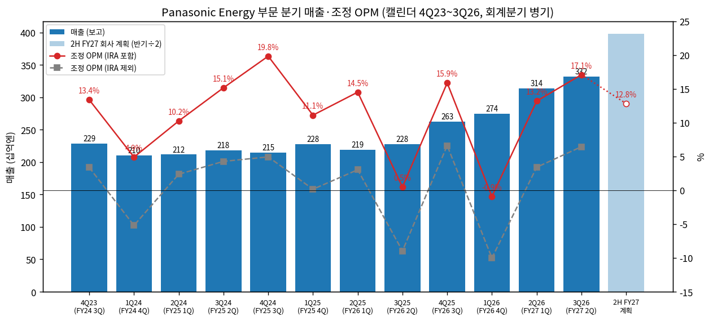
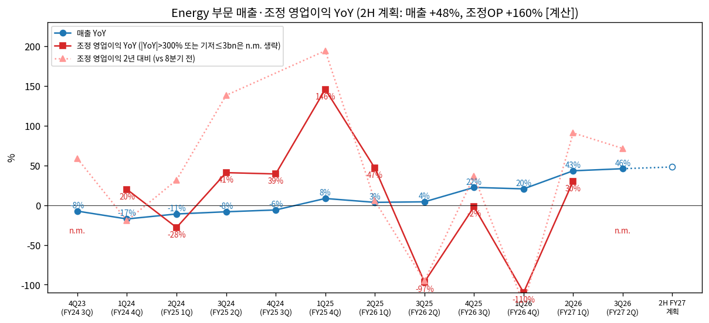
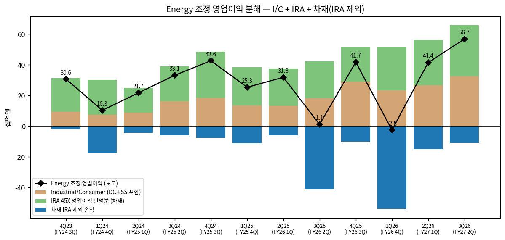

> 모드: 실적 리뷰 (v11)
> 종목: Panasonic Energy — Panasonic Holdings (6752.T, 도쿄증권거래소) Energy 세그먼트
> 섹터: 배터리
> 서브섹터: 배터리 셀 글로벌
> 분기: 2026-Q3 (캘린더 2026-07~09 = **회계 FY3/27 2Q**. Panasonic은 3월 결산 — FY3/27 1Q = 2Q26, FY3/27 2Q = 3Q26)
> 발표일: 2026-10-30 (결산 발표 + 설명회 18:00~19:00 JST)
> 작성 시각: 2026-11-14 21:30 KST
> 분석 소스: 회사 FY3/27 2Q 결산단신(News Release)·Supplemental Financial Data·결산 설명 자료(note판)·Q&A 요지(2026-10-30) + FY3/27 1Q·FY3/26 결산·FY3/26 2Q·FY3/25 3Q·FY3/24 결산·FY3/23 결산 Supplemental/설명 자료 + Integrated Report 2026 / 웹 보완 — Reuters(2026-10-30), SNE Research(헤럴드경제 2026-11-02), Placera(2026-10-30), 주가 Yahoo Finance 6752.T. 셀사이드 리포트 첨부 없음 — 쟁점은 Q&A 요지 + 숫자로 구성. 같은 폴더 `company-overview/6752.T_기업개요.md` 시계열 재사용
> 리뷰 깊이: 숫자 중심 | 리서치 첨부 0건 (1차 출처: 회사 IR 決算短信·決算説明資料, 보도 인용은 "보도" 표기)
> 다음 발표: FY3/27 3Q(=4Q26) — **2027-02 초 예상** (회사 미공지, 전년 2026-02-04)

> **분석 단위·지표 정의**: 숫자는 모두 **Panasonic HD 'Energy' 보고 세그먼트**(= Panasonic Energy Co., Ltd.)다. 이익 지표는 회사 **조정 영업이익(Adjusted OP = 매출 − 매출원가 − 판관비)** — 한국식 영업이익에 가장 가깝다 (IFRS 영업이익은 기타손익 포함, 병기). 단위 **십억엔(¥bn)**
> **IRA 45X 처리**: 세액공제 총액 중 약 절반은 '고객과의 유효 활용분'으로 **매출에서 차감**, 나머지가 **조정 영업이익에 포함** (전액 차재 귀속). 한국 LGES·삼성SDI의 AMPC와 비교하기 위해 **IRA 포함(보고) / IRA 제외(= 조정OP − IRA 영업이익 반영분)** 를 모두 표기
> 원화 환산 참고: 3Q26 평균 **₩8.89/¥** (Yahoo JPYKRW=X 2026-07~09 일평균 [계산]) → 3Q26 Energy 매출 ≈ **₩2.95조**, 조정 영업이익 ≈ **₩5,043억** (IRA 제외 ≈ ₩2,090억, IRA 반영분 ≈ ₩2,953억)
> 분기 영업이익 공시: ✓ (세그먼트·하위 사업 모두 분기 공시) → 섹터 합산 포함 가능

# Panasonic Energy 3Q26 (FY3/27 2Q) 실적 리뷰

## 0. 한 줄 판정

> 성장 델타: 가속 | 내러티브: 강화 → 적극 구간 (매출 YoY 3분기 연속 확대·IRA 제외 이익 QoQ 2배, 단 연간 상향분 절반이 IRA·관세 — 주가는 8월 고점 대비 −32% 디레이팅 중)

→ 숫자: 매출 ¥331.9bn (**+45.8% YoY**, 분기 최대), 조정 영업이익 ¥56.7bn (OPM **17.1%**, 분기 최대). 보고 YoY는 3Q25 기저(¥1.1bn — 관세·Kansas 램프업)로 n.m. → 조정 기준으로 판정: 매출 YoY 20.4%(1Q26) → 43.2% → **45.8%**, IRA 제외 영업이익 ¥11.7bn → **¥23.5bn (QoQ 2배)**, 2년 전 동기(3Q24 ¥33.1bn) 대비 +71%
→ 쟁점 ①: **DC ESS(BBU)는 QoQ 정체** — 데이터센터 매출 ¥113.0bn(2Q26) → ¥114.9bn(3Q26). 회사 "납기 타이밍, 수요 약화 없음", FY3/27 ¥550bn 유지·FY3/29 목표 ~¥1조로 상향. I/C 마진은 18.5%로 사상 최고
→ 쟁점 ②: **연간 상향(Energy 조정OP ¥173bn → ¥200bn, +¥27bn)의 절반이 IRA(+¥14bn)** — 상향 주체는 DC(I/C 계획 ¥132 → ¥134bn)가 아니라 차재(¥41 → ¥66bn, 5월 대비). 3Q26 차재는 IRA 제외 시 여전히 **−¥11.0bn 적자**, 관세 영향 YoY +¥15.5bn(환급 포함)도 들어 있다
→ 쟁점 ③: DC 수요의 지속성 — 회사 스스로 "향후 2년 정도 강하다", 데이터센터 전력·인력 제약과 메모리 등 타 부품 병목을 리스크로 언급
→ 다음 분기 관건: 2H 회사 계획(매출 ¥795.1bn·조정OP ¥101.9bn, OPM 12.8%)은 상반기 15.2%보다 낮다 — **4Q26 DC 매출이 ¥115bn 박스를 넘어 재가속하는지(연 ¥550bn 달성엔 2H 평균 ¥161bn/분기 필요 [계산])**

## 1. 숫자

① Energy 세그먼트 분기 표 (¥bn) — 캘린더 분기 (회계 분기)

| 항목 | 4Q23 (FY24 3Q) | 1Q24 (FY24 4Q) | 2Q24 (FY25 1Q) | 3Q24 (FY25 2Q) | 4Q24 (FY25 3Q) | 1Q25 (FY25 4Q) | 2Q25 (FY26 1Q) | 3Q25 (FY26 2Q) | 4Q25 (FY26 3Q) | 1Q26 (FY26 4Q) | 2Q26 (FY27 1Q) | **3Q26 (FY27 2Q)** | 2H FY27 계획 (4Q26+1Q27) |
|---|---|---|---|---|---|---|---|---|---|---|---|---|---|
| 매출 | 228.8 | 210.3 | 211.9 | 218.5 | 214.9 | 227.9 | 219.3 | 227.6 | 262.8 | 274.5 | 314.0 | **331.9** | 795.1 |
| 조정 영업이익 | 30.6 | 10.3 | 21.7 | 33.1 | 42.6 | 25.3 | 31.8 | 1.1 | 41.7 | −2.5 | 41.4 | **56.7** | 101.9 |
| 조정 OPM | 13.4% | 4.9% | 10.2% | 15.1% | 19.8% | 11.1% | 14.5% | 0.5% | 15.9% | −0.9% | 13.2% | **17.1%** | 12.8% |
| (IRA 반영분) | 22.0 | 22.6 | 16.2 | 22.6 | 30.3* | 24.9 | 24.3 | 24.0 | 22.6 | 28.2 | 29.7 | **33.2** | 70.1 |
| IRA 제외 조정 영업이익 | 8.6 | −12.3 | 5.5 | 10.5 | 12.3 | 0.4 | 7.5 | −22.9 | 19.1 | −30.7 | 11.7 | **23.5** | 31.8 |
| IRA 제외 OPM | 3.4% | −5.2% | 2.4% | 4.3% | 4.9% | 0.2% | 3.0% | −9.0% | 6.6% | −10.0% | 3.4% | **6.4%** | 3.7% |
| 영업이익 (IFRS) | 30.2 | 6.1 | 21.6 | 32.7 | 42.0 | 23.9 | 31.9 | 1.2 | 40.5 | −3.8 | 40.9 | **55.6** | 101.5 |
| 매출 YoY | −7.5% | −17.4% | −11.1% | −8.3% | −6.1% | 8.4% | 3.5% | 4.2% | 22.3% | 20.4% | 43.2% | **45.8%** | 48.0% |
| 조정 영업이익 YoY | n.m. | 19.8% | −28.1% | 40.9% | 39.2% | 145.6% | 46.5% | −96.7% | −2.1% | 적자전환 | 30.2% | **n.m. (+5,055%)** | 160.0% |
| **매출 YoY 델타 (%p)** | −6.0 | −9.9 | +6.3 | +2.8 | +2.2 | +14.5 | −4.9 | +0.7 | +18.1 | −1.9 | +22.8 | **+2.6** | +2.2 |
| **조정 영업이익 YoY 델타 (%p)** | n.m. | n.m. | −47.9 | +69.0 | −1.7 | +106.4 | −99.1 | −143.2 | +94.6 | n.m. | n.m. | **n.m.** | — |

→ (출처: Supplemental Financial Data FY3/24 결산·FY3/25 3Q·FY3/26 결산·FY3/27 2Q, IRA 표 p.10. 2H FY27 계획 = 10/30 연간 계획(매출 1,441.0·조정OP 200.0·OP 198.0·IRA 133.0) − 1H 실적 [계산]. IRA 제외 OPM의 분모는 IRA 매출 차감분을 되돌린 매출 [계산]. YoY·델타 [계산]. \*4Q24 IRA에 전극 활물질 과년도분 포함. 4Q23 YoY 기저 4Q22 ¥0.6bn)
→ **컨센 대비**: Energy 세그먼트 컨센서스 집계 [미확보] — 회사 연간 계획 대비로 판정. 1H 진척률 조정OP **49%** (98.1/200.0), 매출 45% [계산]
→ **조정 기준 판정**: 보고 YoY는 3Q25(관세 −¥12.0bn·Kansas/와카야마 램프업 −¥11.8bn, 회사 YoY 요인)와 1Q26(과거 제조공정 문제 일회성, FY −¥40.0bn) 기저 때문에 쓸 수 없다. 대신 ① 매출 YoY가 4Q25 이후 22% → 20% → 43% → **46%**로 확대, ② 2년 전 대비 조정OP 2Q26 +91% → 3Q26 +71%, ③ IRA 제외 이익 QoQ +¥11.8bn → **가속**으로 판정 `[판단]`
→ **경로**: 회사 2H 계획은 매출 YoY +48%로 상반기 수준을 유지하지만 조정 OPM 12.8%(상반기 15.2%)로 낮춘다 — 3Q26의 관세 환급·IRA 효과가 2H엔 덜하다는 가정 `[판단]`. IRA 제외 2H 계획 ¥31.8bn은 3Q26 단독(¥23.5bn)보다도 낮은 반기 수치 → **보수적 계획이거나, 3Q26이 분기 고점**이라는 뜻 [계산]

→ (출처: 회사 Supplemental Financial Data, 2H FY27 = 10/30 연간 계획 − 1H [계산])

→ (출처: 회사 Supplemental Financial Data. 기저 ¥3bn 이하 또는 |YoY| 300% 초과는 n.m.)

② 하위 사업별 매출·조정 영업이익 (¥bn)

| 사업 | 항목 | 3Q25 | 4Q25 | 1Q26 | 2Q26 | **3Q26** | QoQ | YoY |
|---|---|---|---|---|---|---|---|---|
| In-vehicle (차재) | 매출 | 98.4 | 108.8 | 120.6 | 141.7 | **153.6** | +8.4% | **+56.1%** |
| | 조정OP (IRA 포함) | −16.9 | 12.5 | −25.7 | 14.6 | **22.2** | +52% | 흑자전환 |
| | OPM | −17.2% | 11.5% | −21.3% | 10.3% | **14.5%** | +4.2%p | +31.7%p |
| | 조정OP (IRA 제외) | −40.9 | −10.1 | −53.9 | −15.1 | **−11.0** | 적자 축소 | 적자 축소 |
| | 북미 판매 (GWh) | 9.8 | 8.9 | 9.9 | 10.2 | **11.4** | +11.8% | +16.3% |
| Industrial / Consumer | 매출 | 127.7 | 153.2 | 151.3 | 170.7 | **175.3** | +2.7% | **+37.3%** |
| | 조정OP | 18.2 | 29.0 | 23.3 | 26.5 | **32.4** | +22.3% | **+78.0%** |
| | OPM | 14.3% | 18.9% | 15.4% | 15.5% | **18.5%** | +3.0%p | +4.2%p |
| (I/C 내) 데이터센터 매출 | | 72.7 | — | — | 113.0 | **114.9** | +1.7% | **+58.0%** |

→ (출처: Supplemental Financial Data p.6 "Voluntarily Disclosed Business", IRA 표 p.10, 결산 설명 자료 p.14(DC 매출 = DC Power Solutions BU, 일부 비DC 포함), FY3/27 1Q Key Points(2Q26 DC ¥113bn). 4Q25·1Q26 DC 분기 [미공시]. QoQ·YoY·IRA 제외 [계산])
→ **매출 델타를 끄는 건 차재**(+¥55.2bn YoY, 증가분의 53% [계산]) — Kansas 가동률 상승으로 북미 판매 11.4GWh (분기 최대). **이익 증가(+¥55.6bn)는 차재 +¥39.1bn, I/C +¥14.2bn** [계산]
→ 차재 이익 +¥39.1bn의 구성(회사 YoY 요인): 북미 매출 증가 + **미국 관세 영향 +¥15.5bn(환급 포함)** + IRA 증가(+¥9.2bn [계산: 33.2−24.0]) — 셋 중 둘은 정책·일회성 성격 `[판단]`
→ **I/C는 마진이 레벨업** — 매출 +37%에 이익 +78%, OPM 18.5% (사상 최고). 회사: "분기 변동은 믹스·관세 영향, 연간 계획 궤도"

→ (출처: 회사 Supplemental Financial Data. 차재 IRA 제외 = 차재 조정OP − IRA 반영분 [계산])

(2-1) IRA 45X 세액공제 (¥bn)

| | 3Q25 | 4Q25 | 1Q26 | 2Q26 | **3Q26** | FY3/27 계획 (7월 → 10월) |
|---|---|---|---|---|---|---|
| 세액공제 총액 | 51.7 | 49.0 | 60.4 | 59.3 | **66.4** | 235.0 → **265.0** |
| 고객 공유분 (매출 차감) | −27.7 | −26.4 | −32.2 | −29.6 | **−33.1** | −116.0 → −132.0 |
| 조정 영업이익 반영분 | 24.0 | 22.6 | 28.2 | 29.7 | **33.2** | 119.0 → **133.0** |
| 순이익 반영분 (비과세) | 30.9 | 29.1 | 36.1 | 37.0 | **41.3** | 148.0 → 166.0 |
| 북미 판매 (GWh) | 9.8 | 8.9 | 9.9 | 10.2 | **11.4** | 46.0 (유지) |

→ (출처: Supplemental Financial Data p.10, 결산 설명 자료 p.25. 계획 '7월'은 7/30 기준 — 표의 May 12 열 ¥235bn과 같은 값)
→ 셀 $35/kWh × GWh + 전극 활물질 생산비 10%. FY3/27분은 직접환급(direct pay)으로 현금화 예정, FY3/25분 순 ¥108.8bn은 FY3/27 1Q에 입금 (회사)
→ **비교**: 3Q26 IRA 영업이익 반영분 ≈ ₩2,953억 [계산] — LGES AMPC 4,169억, 삼성SDI 1,225억 (같은 폴더 기업개요). 매출 대비 IRA 비중 Panasonic **10.0%** vs LGES 4.3%·SDI 2.6% [계산]

(2-2) 가이던스 변화 (Energy, ¥bn)

| 항목 | 5/12 계획 | 7/30 계획 | **10/30 계획** | 변화 (7월 → 10월) |
|---|---|---|---|---|
| 매출 | 1,372.0 | 1,372.0 | **1,441.0** | +69.0 |
| 조정 영업이익 | 173.0 | 173.0 | **200.0** | +27.0 |
| 조정 OPM | 12.6% | 12.6% | 13.9% | +1.3%p |
| └ 차재 매출 / 조정OP | 544.0 / 41.0 | [미공시] | **609.0 / 66.0** | +65.0 / +25.0 (5월 대비) |
| └ I/C 매출 / 조정OP | 823.0 / 132.0 | [미공시] | **823.0 / 134.0** | 0 / +2.0 (5월 대비) |
| IRA 영업이익 반영분 | — | 119.0 | **133.0** | +14.0 |
| 데이터센터 매출 | 550.0 | 550.0 | **550.0** | 유지 |
| CapEx | 238.0 | 238.0 | **267.0** | +29.0 |
| 북미 판매 (GWh) | 46 | 46 | **46** | 유지 |

→ (출처: Supplemental Financial Data p.3·p.6·p.8·p.10, 결산 설명 자료 p.14~16. 하위 사업 계획은 5/12·10/30 열만 공시)
→ **상향의 원천**: 조정OP +¥27bn 중 **IRA +¥14bn(52%)**, 나머지는 차재 북미 판매·관세 환급·환율(2H USD ¥150 가정, 7월 ¥145) `[판단: 회사 그룹 차원 요인 분해에서 관세 +¥25bn·환율 +¥36bn]` — **DC 계획은 그대로**
→ AI 인프라 관련 FY3/29 목표: 그룹 ¥1.38조 → **¥1.6조**, 이 중 Energy(DC ESS) **~¥1조**(종전 ¥950bn+). 회사: Energy 목표 상향엔 **환율 영향도 반영**, 그룹 상향의 주원인은 Industry (CFO Q&A)

③ 연간 (¥bn)

| 항목 | FY3/23 | FY3/24 | FY3/25 | FY3/26 | FY3/27F (회사) |
|---|---|---|---|---|---|
| 매출 | 971.8 | 915.9 | 873.2 | 984.2 | 1,441.0 |
| 조정 영업이익 | 39.6 | 94.6 | 122.7 | 72.1 | 200.0 |
| 조정 OPM | 4.1% | 10.3% | 14.1% | 7.3% | 13.9% |
| IRA 제외 조정 영업이익 | 39.6 | 7.8 | 28.7 | −27.0 | 67.0 |
| 매출 YoY | 25.8% | −5.8% | −4.7% | 12.7% | 46.4% |
| 조정 영업이익 YoY | −44.1% | 138.9% | 29.7% | −41.2% | 177.4% |

→ (출처: 회사 Supplemental Financial Data. FY3/22 매출 772.8·조정OP 70.8. YoY [계산]. FY3/28 이후 회사 계획·컨센 [미확보])
→ 발표 전후 연간 계획 변화: Energy 조정OP ¥173bn → ¥200bn (+15.6%), 그룹 조정OP ¥650bn → ¥780bn (+20.0%) — 증권사 컨센 변화 [미확보]

## 2. 시장 쟁점

① 2-0 지난 분기 체크

→ 첫 리뷰 — 직전 체크 없음

② 이번 분기 쟁점 4개 (Q&A 요지 기준, 질문자 소속 미공개 — 회사 요지에 "기관투자가·애널리스트" / "기자"로만 구분)

| # | 쟁점 | 근거 |
|---|---|---|
| (1) | DC ESS 매출 QoQ 정체와 I/C 마진 급등의 원인, FY3/29 목표 상향 근거 | 애널리스트 질문 1건 (복합 질문) + 기자 질문 1건(증설 필요성) |
| (2) | DC 수요 지속성 — 데이터센터 전력·인력 제약, 공급망 병목 | 애널리스트 질문 1건, 경쟁 차별화 질문 1건 |
| (3) | 연간 상향의 질 — 차재 IRA·관세·환율 의존 | 숫자에서 도출 (Q&A 미질문) `[판단]` |
| (4) | 증설·CapEx — 신공장 없이 라인 전환, CapEx 상향·감가상각 하향 | 기자 1건, 애널리스트 1건 |

③ 쟁점별 분해

(1) **DC ESS QoQ 정체 vs I/C 마진 사상 최고**

(1-1) 회사 설명
→ 그룹 CFO: "연간 계획대로 진행. 분기 매출은 고객 납기 타이밍과 다른 제품과의 조율로 분기 간 이동이 생긴다. 기저 수요 모멘텀 약화는 없다"
→ 마진: "분기 변동은 제품 믹스와 관세 영향. 연초 제시한 연간 전망 궤도"
→ FY3/29 ¥1조: "환율 영향도 반영. 고객의 기저 수요 전망엔 변화 없다"
→ 공급: 일본 차재 라인(스미노에·가이즈카) DC 전환, 멕시코 모듈 2공장 2026-09 양산, 3공장 FY3/28, Kansas DC 셀 FY3/29

(1-2) 숫자로 본 해석
→ DC 매출 1H ¥227.9bn [계산] = 연 계획 ¥550bn의 41% → **2H에 ¥322bn(분기 평균 ¥161bn) 필요** — 3Q26 대비 +40% 점프를 가정한 계획 [계산]
→ I/C 매출 연 계획 ¥823bn, 1H ¥346.0bn(42%) → 2H ¥477bn 필요 (분기 평균 ¥239bn, 3Q26 ¥175bn 대비 +36%) [계산]
→ 반대로 I/C 이익 계획은 연 ¥134bn, 1H ¥58.9bn → 2H ¥75.1bn (OPM 15.7%) — **매출은 크게 늘리고 마진은 낮추는 보수적 계획** [계산]

(1-3) 공통 vs 갈림
→ 공통: DC ESS 수요는 공급 제약 상태(회사 "수급 타이트"), I/C 마진은 15~19% 레벨에 안착
→ 갈림: 2H 매출 램프(+40%)가 납기 이연분 회수로 가능한지, 아니면 1H 페이스(분기 ¥114bn)가 실제 공급 능력인지

(1-4) [판단]
→ 1Q26→3Q26 DC 매출이 ¥113~115bn에 머문 건 모듈 공급 능력(멕시코 2공장 9월 양산 개시)과 맞물린 것으로 보인다. **4Q26 DC 매출이 ¥140bn 이상이면 "타이밍" 설명이 확인**, ¥120bn 이하면 연 ¥550bn 하향 위험. 연간 계획 달성 여부가 Energy 내러티브의 1순위 검증점

(2) **DC 수요의 지속성과 공급망 병목**

(2-1) 회사 설명
→ 그룹 CEO: "AI 관련 수요는 향후 2년 정도 강할 것. 그 이후는 시장을 보고 판단". "데이터센터 건설은 전력·인력 부족으로 지연될 수 있고, 수요가 실제 주문으로 이어지는지 면밀히 보고 있다"
→ "콘덴서 수요가 강해도 메모리 등 다른 부품 공급 제약이 BBU 출하에 영향을 줄 수 있다 — 하이퍼스케일 고객의 조달 전략에 달렸다"
→ Energy DC는 "특정 하이퍼스케일 고객의 투자계획에 좌우" — 고객이 다양한 Industry와 성장 특성이 다르다 (CEO)
→ 차별화: 차세대 AI 서버 아키텍처 초기 개발부터 다수 하이퍼스케일러와 협업, 필요 시 셀 단위 개발, 미국 내 현지 공급망 (CEO)

(2-2) 숫자로 본 해석
→ FY3/29 ~¥1조는 FY3/26(¥322bn)의 3.1배 → 3년 CAGR 약 +46% [계산]. 회사가 말한 "2년 강세"는 FY3/28까지 — FY3/29 목표 연도는 회사 스스로 가시성이 낮다고 한 구간 `[판단]`

(2-3) 공통 vs 갈림
→ 공통: 수요는 강하고 경쟁 우위는 고객 공동 설계·미국 공급망
→ 갈림: 고객 집중(특정 하이퍼스케일러)과 데이터센터 프로젝트 지연 리스크를 얼마나 할인할지

(2-4) [판단]
→ 회사가 먼저 "2년"이라는 시계와 공급망 병목을 꺼낸 것은 보수적 커뮤니케이션이다. 숫자가 이를 반박하려면 **4Q26·1Q27 DC 매출 YoY +50% 이상 + 새 하이퍼스케일 고객(또는 HVDC BBU·CBU 신제품 매출) 확인**이 필요하다

(3) **연간 상향의 질 — 차재 IRA·관세·환율**

(3-1) 회사 설명
→ 차재 증익: "북미 공장 매출 증가, 미국 관세 영향, IRA 증가(판매 증가)" (설명 자료 p.6). 그룹 2Q 관세 환급 ¥14.7bn 계상, 연간 환급 계획 ¥24bn
→ 북미 판매 FY3/27 46GWh 유지. "전략 고객 수요가 시장을 크게 상회", 미국 EV 판매는 FY3/26 수준 (Kansas·Nevada 생산 극대화)

(3-2) 숫자로 본 해석
→ 3Q26 차재 조정OP ¥22.2bn = IRA ¥33.2bn − 본업 ¥11.0bn 적자. 관세 YoY +¥15.5bn까지 빼면 본업 개선폭은 작다 [계산]
→ 연간 상향 +¥27bn 중 IRA +¥14bn. 차재 IRA 제외 연간 계획 **−¥67bn** [계산: 66 − 133] — FY3/26(−¥111bn, 일회성 −¥40bn 포함)보다 낫지만 여전히 대규모 적자
→ 9M26 Panasonic EV 배터리 사용량 35.6GWh (−0.8% YoY, 점유율 3.6%), 이 중 34.9GWh가 테슬라 북미향 — 시장 +19.7%에 못 미침 (SNE Research, 헤럴드경제 2026-11-02)

(3-3) 공통 vs 갈림
→ 공통: 차재는 Kansas 가동률이 오르며 매출이 회복 중 (+56% YoY)
→ 갈림: 차재가 IRA 없이도 손익분기에 갈 수 있는지 — 45X는 2030년부터 감액, PFE 요건 강화(가이드라인 2026-12-31)

(3-4) [판단]
→ Energy 보고 이익의 **59%가 IRA**(3Q26 33.2/56.7)다. 섹터 합산·LGES·SDI 비교는 반드시 IRA 제외 기준(¥23.5bn, OPM 6.4%)으로 해야 한다. 차재 IRA 제외 적자가 **분기 −¥5bn 이내로 줄면** Kansas 고정비 흡수가 끝났다는 신호

(4) **증설·CapEx — 신공장 없이 라인 전환**

(4-1) 회사 설명
→ CFO: "신공장 건설 계획 없음. BBU에서 셀은 총원가의 20% 미만, 가치는 모듈·시스템. 차재처럼 대규모 셀 CapEx가 필요 없다. 중장기 수요도 Kansas 포함 기존 CAPA로 대응 가능"
→ CapEx 상향·감가상각 하향: "사업 지연이 아니라 투자 집행 시점 재추정" (CFO)

(4-2) 숫자로 본 해석
→ Energy CapEx FY3/25 ¥501bn(피크) → FY3/27 계획 ¥267bn (7월 ¥238bn에서 상향), 감가상각 계획 ¥80bn → ¥74bn
→ Energy 1H CapEx ¥112.6bn — 연 계획의 42% [계산]

(4-3) 공통 vs 갈림
→ 공통: DC는 자본 효율이 차재보다 높다 (셀 비중 20% 미만)
→ 갈림: Kansas 차재 라인의 DC 전환(FY3/29)이 차재 CAPA 32GWh 계획을 사실상 줄이는 것인지

(4-4) [판단]
→ "신공장 없음 + CapEx 감소 + DC 고마진"은 FCF 개선 스토리다. 다만 이 그림은 테슬라 물량(46GWh)이 유지된다는 전제 위에 있다

④ 주가 반응 (보조)

→ 10/30 발표일 ¥3,683 → ¥3,548 (**−3.7%**), 11/2 ¥3,740 (+5.4%), 11/4~11/6 3거래일 **−19.6%** (¥3,008, 장중 ¥2,808), 11/13 ¥3,193 — 8/14 종가 고점(¥4,721) 대비 −32% [Yahoo Finance, 계산]
→ 11월 급락의 직접 원인 보도는 확인하지 못했다 [미확보]. 실적·계획 상향(그룹 조정OP +20%, 배당 ¥40 → ¥70)과 주가가 반대로 움직인 구간 — **숫자보다 AI 인프라 멀티플 쪽이 움직이는 국면** `[판단]`

## 3. 내러티브 점검

① 성장 스토리 정의
→ "테슬라 원통형 셀(IRA로 이익 보전)에서, **하이퍼스케일러 AI 서버 배터리 백업(BBU) 1위권 공급자**로 이익 중심을 옮긴다 — DC 매출 FY3/26 ¥322bn → FY3/29 ~¥1조, 차재 라인 전환으로 CapEx 없이"

② 이번 분기가 스토리에 준 영향
→ 강화: Energy 분기 매출·이익 최대, I/C 마진 18.5%, FY3/29 DC 목표 ~¥1조로 상향, 멕시코 모듈 2공장 양산, CBU·HVDC BBU 일정 유지
→ 약화 요인: DC 매출 QoQ 정체(¥113 → ¥115bn), 연간 상향의 주체가 DC가 아니라 IRA·관세가 있는 차재, 회사 스스로 "2년" 시계 제시
→ 시장: 숫자·계획 상향에도 주가는 11월 −20% — 스토리 자체보다 가격(멀티플) 쪽 조정 `[판단]`

③ 국면 판단
→ 델타 가속(매출 YoY 46%, IRA 제외 이익 QoQ 2배) + 내러티브 강화(DC 목표 상향) → **적극 구간**
→ BT 프레임상 주의점: ① 2H 계획 OPM 12.8%로 3Q26(17.1%)이 분기 고점일 수 있고 ② DC 매출 QoQ 정체가 4Q26에도 이어지면 델타 판정이 "유지"로 내려간다 `[전망]`

④ 트리거와 리스크
→ 트리거: ① 4Q26 DC 매출 ¥140bn+ (2H ¥322bn 경로) ② HVDC BBU·CBU 신제품 양산·신규 하이퍼스케일 고객 ③ 2026-12 45X PFE 가이드라인이 일본계 공급망에 유리하게 확정
→ 리스크: ① DC 납기 이연 지속·하이퍼스케일러 CapEx 조정 ② 테슬라 북미 물량 감소(4680 발주 미확정 포함) ③ 관세 환급·IRA 효과 소멸 시 차재 적자 노출

## 4. 향후 봐야 할 것

① **DC ESS 매출 재가속 — 4Q26 ¥140bn+, FY3/27 ¥550bn 유지** (델타 판정 1순위)
→ 무엇을: 데이터센터 매출 분기 ¥115bn 박스 돌파, I/C 매출 YoY +40% 이상, I/C OPM 15%+ 유지
→ 어떤 데이터로: FY3/27 3Q 결산 설명 자료(DC 매출 슬라이드), Supplemental p.6
→ 언제: 2027-02 초

② **차재 IRA 제외 손익 — 분기 적자 −¥5bn 이내**
→ 무엇을: 차재 조정OP − IRA 반영분, 관세 환급 효과 제외 후 수치, 북미 판매 11GWh+ (연 46GWh 경로)
→ 어떤 데이터로: Supplemental p.6·p.10, 결산 설명 자료 관세 표
→ 언제: 2027-02 초

③ **45X PFE 가이드라인과 IRA 계획 ¥133bn**
→ 무엇을: 美 재무부 PFE(금지외국기업) 조달 비율 가이드라인 내용, 회사 IRA 연간 계획 변경 여부
→ 어떤 데이터로: 美 재무부 발표, 회사 IRA 표
→ 언제: 2026-12-31 (가이드라인), 2027-02 (회사 반영)

④ **테슬라 물량·4680**
→ 무엇을: 테슬라 4Q26 인도(북미), 와카야마 4680 양산 발주 확정 여부, Kansas 2동 라인 가동(2027)
→ 어떤 데이터로: 테슬라 4Q26 실적(같은 폴더 `2026-Q3_TSLA_리뷰.md` 후속), SNE Research 월간 사용량, Nikkei 보도
→ 언제: 2027-01 초~하순

⑤ **신제품·고객 다변화 — HVDC BBU·CBU 양산, 2026-12 Investor Day**
→ 무엇을: CBU FY3/27 양산 개시 확인, HVDC BBU 양산 준비 완료, 신규 하이퍼스케일 고객 언급, 2027-05 새 중기 목표 예고 내용
→ 어떤 데이터로: 회사 보도자료, Investor Day 자료
→ 언제: 2026-12 ~ 2027-05
