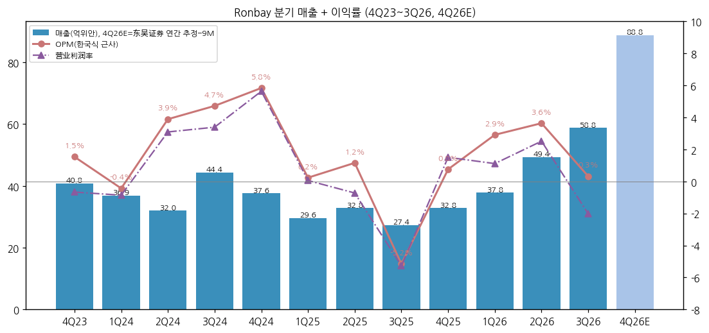
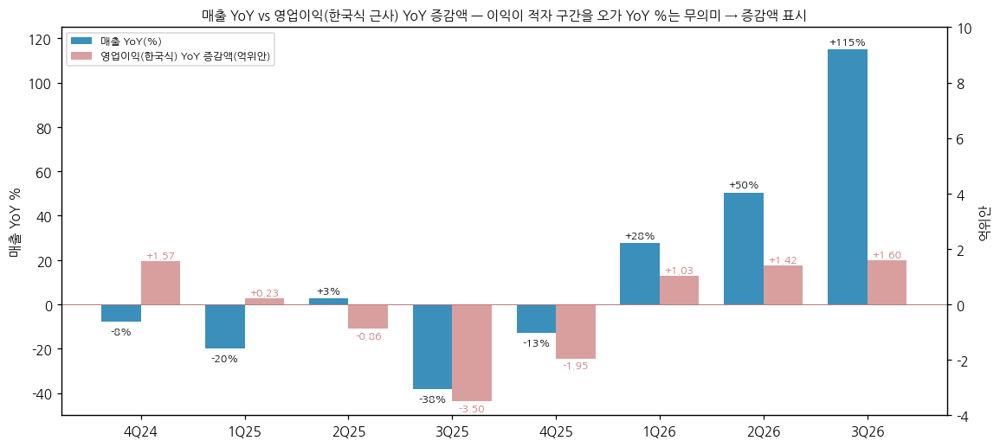
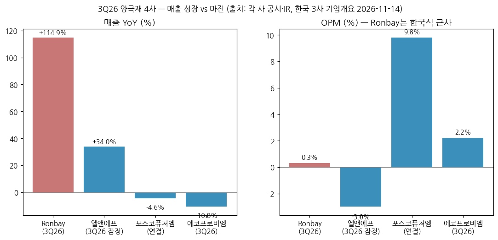

> 모드: 실적 리뷰 (v11)
> 종목: Ronbay / 容百科技 (688005.SS, 상해거래소 과창판)
> 섹터: 배터리
> 서브섹터: 양극재 글로벌
> 분기: 2026-Q3 (캘린더 = 회계 분기, 9/30 종료)
> 발표일: 2026-10-30 (장 마감 후 3분기 보고서, 거래소 게재 10/31)
> 작성 시각: 2026-11-14 KST
> 분석 소스: [1차 — 회사 원문] 상해거래소 공고 PDF(东方财富 공고 미러 경유) — 2026년 3분기 보고서(10/31), 2026년 반기 보고서(7/23), 2026년 1분기 보고서(4/30), 2025년 연간 보고서(4/11), 2025년 3분기 보고서, 회사 공고 2026-059(한국 자회사 공장 임대·무형자산 양도 관련거래, 10/21 이사회, cninfo). 분기 단독 손익 = 东方财富 F10 재무 API(회사 공시 집계, 9M26 营业利润 원문 일치 확인). [보도·리서치 인용] 东吴证券 3Q26 점평(11/3, 2026~28E — 셀사이드 1건), 每日经济新闻(10/21), 同花顺(10/24), 腾讯新闻(4/18, 공시 처분), SNE리서치(헬로티 8/11·아시아경제 10/12), 주가·환율 Yahoo Finance. 업적설명회(컨콜) Q&A 원문은 미확보 — 쟁점은 회사 공시 설명 + 리서치·기사로 구성
> 리뷰 깊이: 숫자 중심 | 리서치 첨부 0건 (웹 수집 리포트 1건)
> 다음 발표: 2026 연간보고서·4Q26 = 2027-04 중순 예상 [추정: 2025 연간 4/11·2024 연간 4/10 공시 패턴] / 2026 연간 실적예고는 2027-01 중순 가능 (2025 예고 2026-01-13)

# Ronbay 3Q26 실적 리뷰 — 매출 +115%인데 다시 적자. 볼륨은 터졌고 메탈가 래깅이 마진을 지웠다

## 0. 한 줄 판정

> 성장 델타: 꺾임 | 내러티브: 약화 → 델타 꺾임 + 내러티브 약화 → 매매 제외 구간 (4Q26 흑자 복귀와 한국 공장 구조 확정 전까지)

→ **판정 지표**: 중국 회계의 营业利润(이하 "중국식 영업이익")은 투자수익·기타수익·자산/신용손상·재무비용을 포함해 K-IFRS 영업이익과 다르다. 그래서 ① 중국식 영업이익 ② **한국식 영업이익 근사** (= 매출총이익 − 세금및부가 − 판매비 − 관리비 − R&D) ③ 지배순이익을 함께 보고, 판정은 셋의 방향으로 한다. 이익이 적자와 흑자를 오가 YoY %가 의미 없어서, **YoY 증감액(억위안)** 으로 델타를 본다
→ **숫자**: 3Q26 매출 58.83억위안 (+114.9% YoY, +19.1% QoQ), 한국식 영업이익 0.19억 (OPM 0.3%), 중국식 영업이익 −1.19억, 지배순이익 −1.25억, GPM 5.3% (QoQ −4.1%p). 이익 YoY 개선폭이 2Q26 대비 급감 — 중국식 영업이익 +1.48억 → +0.25억, 순이익 +1.51억 → +0.10억. 한국식 영업이익은 QoQ −89% (1.80 → 0.19억)
→ **왜**: 삼원 판매 3.8만톤+ (+81% YoY, +36% QoQ)로 볼륨은 사상 최대권인데, 3Q 메탈가(리튬) 반락 → 판매 마진 축소 + 재고평가손실 약 0.8억 (회사·东吴证券). 한국식 근사에는 재고손실이 빠져 있어, K-IFRS 기준으로 보면 3Q26 영업이익은 적자 (약 −0.6억위안 [계산])
→ **쟁점**: (1) 볼륨 vs 래깅 — 매출 +115%의 대부분은 가격·저기저, 이익은 메탈가 방향에 종속 (2) 한국 충주 공장(6.7만톤)을 실소유주 관련회사 AKB에 임대 — 북미 PFE 규제 대응이지만 2027 연결 매출 감소·관련거래 (3) LFP·나트륨 신사업 램프 = CapEx·재고·차입 확대 (재고 50억, 순차입 53.8억)
→ **원화 참고**: 3Q26 매출 ≈ 1조 2,364억원, 한국식 영업이익 ≈ 40억원, 중국식 영업이익 ≈ −250억원 [계산: 3Q26 평균 CNY/KRW 210.16 = Yahoo USD/KRW ÷ USD/CNY 일별 평균]
→ **다음 분기 관건**: 东吴 추정 4Q26 매출 88.8억 (+171% YoY)·순이익 1.43억 [계산: 2026E − 9M26] — 메탈가 반락이 이어지면 재고손실이 반복된다. 그리고 한국 공장 임대 주총 통과·미국 PFE 세부 규칙(연말 예정)

---

## 1. 숫자

① 연결 기준 분기 표 (단위: 억위안, %, 중국 기업회계준칙)

| 항목 | 4Q23 | 1Q24 | 2Q24 | 3Q24 | 4Q24 | 1Q25 | 2Q25 | 3Q25 | 4Q25 | 1Q26 | 2Q26 | **3Q26** | 4Q26E (东吴) |
|---|---|---|---|---|---|---|---|---|---|---|---|---|---|
| 매출 | 40.83 | 36.92 | 31.96 | 44.36 | 37.64 | 29.64 | 32.85 | 27.37 | 32.82 | 37.81 | 49.40 | **58.83** | 88.81 |
| 매출총이익률 | 8.0 | 5.2 | 10.8 | 11.2 | 12.7 | 8.2 | 8.9 | 4.3 | 7.7 | 9.4 | 9.4 | **5.3** | — |
| 영업이익 (한국식 근사) | 0.63 | −0.16 | 1.24 | 2.09 | 2.20 | 0.07 | 0.38 | −1.41 | 0.25 | 1.10 | 1.80 | **0.19** | — |
| OPM (한국식 근사) | 1.5 | −0.4 | 3.9 | 4.7 | 5.8 | 0.2 | 1.2 | −5.2 | 0.8 | 2.9 | 3.6 | **0.3** | — |
| 중국식 영업이익 (营业利润) | −0.27 | −0.32 | 0.99 | 1.50 | 2.12 | 0.02 | −0.24 | −1.44 | 0.49 | 0.42 | 1.24 | **−1.19** | — |
| 지배순이익 | −0.35 | −0.37 | 0.48 | 1.06 | 1.80 | −0.15 | −0.53 | −1.35 | 0.16 | 0.12 | 0.98 | **−1.25** | 1.43 |
| 매출 YoY | −62.3 | −55.9 | −29.4 | −21.9 | −7.8 | −19.7 | +2.8 | −38.3 | −12.8 | +27.6 | +50.4 | **+114.9** | +170.6 |
| 영업이익(한국식) YoY | −89.5 | 적전 | +6.0 | −41.3 | +249 | 흑전 | −69.4 | 적전 | −88.6 | +1,471 | +374 | **흑전** | — |
| **영업이익(한국식) YoY 증감액 (억위안)** | −5.37 | −5.44 | +0.07 | −1.47 | +1.57 | +0.23 | −0.86 | −3.50 | −1.95 | +1.03 | +1.42 | **+1.60** | — |
| **중국식 영업이익 YoY 증감액 (억위안)** | −5.98 | −4.11 | +0.14 | −1.58 | +2.39 | +0.34 | −1.23 | −2.94 | −1.63 | +0.40 | +1.48 | **+0.25** | — |
| **지배순이익 YoY 증감액 (억위안)** | −4.70 | −3.48 | −0.20 | −1.31 | +2.15 | +0.22 | −1.01 | −2.41 | −1.64 | +0.27 | +1.51 | **+0.10** | +1.27 |
| **매출 YoY 델타 (%p)** | −35.8 | +6.4 | +26.5 | +7.5 | +14.1 | −11.9 | +22.5 | −41.1 | +25.5 | +40.4 | +22.8 | **+64.5** | +55.7 |

→ (출처: 4Q23~3Q26 = 东方财富 F10 분기 단독 손익 (회사 공시 집계 — 2023~2025 분기 합계가 연간보고서와 일치, 9M26 营业利润 0.48억 = 3Q26 보고서 원문 47,529,443.98위안 일치). 한국식 영업이익·YoY·증감액·델타 [계산]. 4Q26E = 东吴证券 2026E 매출 234.85억·지배순이익 1.28억 (2026-11-03) − 9M26 실적 [계산] `[전망]`)
→ **이익 YoY %가 무의미한 이유**: 전년 분기가 적자이거나 0에 가까워 % 변화가 수십~수천 %로 튄다 (1Q26 +1,471%). 그래서 증감액 행으로 델타를 판정했다
→ **컨센 대비**: 공개 집계 컨센서스 [미확보]. 东吴证券 "3Q 실적 기본 부합" (2026-11-03) — 시장 기대 자체가 낮았다
→ **델타 해석**: 매출은 3개 분기 연속 YoY 확대 (+28% → +50% → +115%) = **가속**. 반면 이익은 중국식 영업이익·순이익 모두 YoY 개선폭이 2Q26 정점(+1.48억·+1.51억) 대비 1/6 이하로 줄었다. 한국식 근사 증감액(+1.60억)만 커 보이는 건 3Q25가 −1.41억 적자였던 기저효과 — QoQ는 −89%, OPM 3.6% → 0.3%. **이익 기준 판정 = 꺾임**
→ **재고손실 반영 시**: 3Q26 자산손상 0.81억 중 재고평가손실 약 0.8억 (东吴). K-IFRS는 재고평가손실을 매출원가에 넣으므로 한국 양극재 3사와 같은 기준의 3Q26 영업이익은 약 −0.6억위안 (OPM 약 −1.0%) [계산: 0.19 − 0.8]
→ **경로**: 东吴 2026E 순이익 1.28억 → 4Q26E 1.43억 (4Q25 0.16억 대비 증가) — 4Q가 추정대로면 순이익 증감액이 다시 +1억대로 회복. 다만 东吴 2027E 매출 179.67억 (−23.5%)은 한국 공장이 AKB로 넘어가 연결 매출이 빠지는 경로 → **연결 매출 YoY 정점은 4Q26** `[전망]`

→ (출처: 东方财富 F10 분기 단독 손익 = 회사 공시, 4Q26E 东吴证券 연간 추정 − 9M26 [계산])

→ (출처: 동일, 영업이익 = 한국식 근사 [계산])

② 사업(케미스트리)별 — 매출·영업이익은 **미공개**, 판매량·회사 설명으로 대체

(2-0) 원가·비용 분해 (억위안, QoQ로 3Q 마진 하락 원인 확인)

| 항목 | 3Q25 | 1Q26 | 2Q26 | **3Q26** | QoQ | YoY |
|---|---|---|---|---|---|---|
| 매출 | 27.37 | 37.81 | 49.40 | **58.83** | +9.43 | +31.46 |
| 매출총이익 | 1.19 | 3.57 | 4.63 | **3.13** | **−1.50** | +1.94 |
| GPM | 4.3% | 9.4% | 9.4% | **5.3%** | −4.1%p | +1.0%p |
| 관리비 | 1.32 | 1.20 | 1.42 | **1.53** | +0.11 | +0.21 |
| R&D | 1.08 | 1.03 | 1.07 | **1.11** | +0.04 | +0.03 |
| 재무비용 | 0.50 | 0.66 | 0.44 | **0.15** | −0.29 | −0.35 |
| 자산손상 (재고 중심) | −0.11 | 0.02 | −0.32 | **−0.81** | −0.49 | −0.70 |
| 신용손상 | −0.06 | −0.05 | 0.05 | **−0.31** | −0.36 | −0.25 |
| 투자수익 | 0.54 | −0.12 | −0.24 | **0.02** | +0.26 | −0.52 |

→ (출처: 东方财富 F10 = 회사 공시, 증감 [계산])
→ 매출이 9.4억 늘었는데 매출총이익은 1.5억 줄었다 — **판가는 이미 오른 메탈가로 받고, 3Q 들어 메탈가가 내려가며 판가가 먼저 꺾인 반면 원가에는 비싸게 산 재고가 남은 구조** (래깅의 역방향). 여기에 재고손실 0.81억·신용손상 0.31억이 겹쳐 중국식 영업이익이 −1.19억
→ 회사 설명: "3분기 이후 주요 원재료 가격 하락 → 3분기 판매 마진 하락, 재고평가충당금 증가 + 해외 기지 운영 확대로 관리비 증가 → 3분기·9M 수익성이 기대 미달" (3Q26 분기보고서)

(2-1) 판매량 (톤)

| 제품 | 3Q25 | 1Q26 | 2Q26 | **3Q26** | 9M26 | 출처 |
|---|---|---|---|---|---|---|
| 삼원 정극 | 약 2.1만 ⚠️ | 약 2.4만 ⚠️ (정극 전체 약 2.5만) | 약 2.8만 ⚠️ | **3.8만+** (+81% YoY, +36% QoQ) | 약 9만 (+25%) | 회사 / ⚠️ = 회사 증감률 역산 |
| └ 한국 공장분 | — | — | — | 약 1만+ | — | 东吴 추정 |
| 나트륨 정극 | — | — | 1H 근 1천 | **근 2천** | 약 3천 | 회사 |
| LMFP | — | — | 1H +약 50% YoY | 감소 (1,400~1,500 東吳 추정) | — | 회사·东吴 |
| LFP | — | — | — | 1차 라인 시운전 (판매 미미) | — | 회사 |

→ **삼원이 델타를 끈다**: 3Q 매출 증가분 31.5억 (YoY) 중 대부분이 삼원 볼륨 (+81%) × 판가 상승. 9계 고니켈 비중 약 35% (1H26), 6계 중니켈 신규 고객 다기지 공급 (3Q26)
→ **꺾인 건 LMFP**: 1H 풀가동 → 3Q 리튬가 하락·소형 동력 고객 인수 연기로 판매 감소 (회사)
→ **나트륨은 아직 적자**: 3Q 약 1천만위안 적자 (东吴 추정), 2027 흑자 전환 기대
→ 블렌디드 ASP ⚠️ 약 14만위안/톤 [추정: 58.83억 ÷ 약 4.15만톤] vs 2025 연간 11.3만 → 판가 +20%대 [계산]

(2-2) 한국 양극재 3사 대비 (3Q26)

| 항목 | **Ronbay** | 에코프로비엠 | 포스코퓨처엠 | 엘앤에프 |
|---|---|---|---|---|
| 매출 | **58.83억위안 (≈ 1조 2,364억원)** | 5,579억원 | 8,348억원 (양극재 4,323억) | 8,744억원 [잠정] |
| 매출 YoY | **+114.9%** | −10.8% [계산] | −4.6% (양극재 −14.9% [계산]) | +34.0% |
| 매출 QoQ | +19.1% | −3.3% [계산] | +22.9% | −1.2% [계산] |
| 영업이익 | 한국식 0.19억위안 / 营业利润 −1.19억 | 120억원 | 821억원 (에너지소재 518억) | −265억원 |
| OPM | **0.3% (재고손실 반영 시 약 −1.0%)** | 2.2% | 9.8% (에너지소재 11.3%, 고객 보상금 포함) | −3.0% |
| 영업이익 YoY | 흑자전환 (한국식) / 적자 축소 (중국식) | −76.2% | +23.1% | 적자전환 |
| 판매량 증가율 | **삼원 +81% YoY, +36% QoQ** | [미공시] — EV 매출 −34% QoQ | [미공시] | NCM +10% YoY, −5% QoQ |
| 재고·메탈 영향 | 재고손실 약 0.8억위안 (≈ 168억원) | 저마진 (메탈가 하락) | — (보상금이 마진 지지) | 재고평가 −426억, 환율 손실 약 −220억 |
| SNE 1H26 삼원 적재량 | **1위 6.9만톤** | 8위 2.8만톤 (에코프로) | 10위 2.4만톤 | 3위 4.0만톤 (+53.8%) |

→ (출처: Ronbay = 3Q26 분기보고서·F10 [계산], 원화 환산 3Q26 평균 CNY/KRW 210.16 [계산]. 한국 3사 = 각 사 기업개요 2026-11-14 (DART·회사 IR·보도자료). SNE = 헬로티 2026-08-11)
→ **볼륨 성장은 Ronbay가 압도적, 마진은 4사 모두 얇다** — 3Q 메탈가 반락이 4사 공통 악재 (Ronbay·엘앤에프 재고손실, 에코프로비엠 OPM 2%대). 포스코퓨처엠만 고객 미이행 보상금으로 마진이 높게 찍혔다
→ Ronbay의 +115%는 ① 판매량 +81% ② 판가 +20%대 ③ 3Q25 저기저(−38%) 효과의 곱 — 한국 3사와 "업황 차이"보다 "Ronbay 고객(중국 내수 1위 셀메이커 + 해외 2·3위 고객) 볼륨 차이"로 보는 게 맞다 [판단]

→ (출처: 각 사 공시·IR, Ronbay OPM = 한국식 근사)

③ 연간 (억위안)

| 항목 | 2022 | 2023 | 2024 | 2025 | 2026E | 2027E | 2028E |
|---|---|---|---|---|---|---|---|
| 매출 | 301.23 | 226.57 | 150.88 | 122.67 | 234.85 | 179.67 | 170.73 |
| 영업이익 (한국식 근사) | 17.62 | 10.64 | 5.38 | −0.71 | — | — | — |
| OPM (한국식) | 5.8% | 4.7% | 3.6% | −0.6% | — | — | — |
| 중국식 영업이익 | 16.18 | 7.44 | 4.30 | −1.17 | — | — | — |
| 지배순이익 | 13.53 | 5.81 | 2.96 | −1.87 | 1.28 | 4.53 | 5.21 |
| 매출 YoY | +193.6% | −24.8% | −33.4% | −18.7% | +91.4% | −23.5% | −5.0% |
| 삼원/정극 판매량 (톤) | 89,050 | 99,446 | 121,689 | 103,899 | 삼원 약 12만 (东吴) | 삼원 2026과 비슷 (AKB 포함 시) | — |

→ (출처: 2022~2025 회사 연간보고서 / 2026~2028E 东吴证券 2026-11-03 (단일 증권사 추정 `[전망]`))
→ 발표 전후 추정 변화: 东吴 2026/2027/2028E 지배순이익 **4억/8억/10억 → 1.3억/4.5억/5.2억** (−68%/−43%/−48%) — "삼원 마진 반락 + 한국 공장 임대 후 수익 구조 변경" 반영. 공개 집계 컨센서스 [미확보]
→ 2027E 매출 감소는 실적 악화가 아니라 **연결 범위 변화** (한국 공장 물량이 AKB 매출로 이동, Ronbay는 임대료·지분법만 인식) — 2027 YoY는 기준 단절로 봐야 한다

---

## 2. 시장 쟁점

① 2-0 지난 분기 체크

→ 첫 리뷰 — 직전 체크 없음

② 이번 분기 쟁점 4개

| # | 쟁점 | 근거 |
|---|---|---|
| (1) | 매출 +115%인데 왜 적자인가 — 볼륨 vs 메탈가 래깅 | 회사 3Q26 보고서 설명, 东吴 이익 추정 하향의 1순위 사유 |
| (2) | 한국 충주 공장 AKB 임대 — 북미 PFE 대응인가, 관련거래 리스크인가 | 회사 공고 2026-059, 东吴·每日经济新闻·同花顺 |
| (3) | LFP·나트륨 신사업 램프 — 언제 이익이 되나, 그 사이 재무 부담은 | 회사 3Q26 보고서, 东吴 (2027 나트륨 7~8만톤) |
| (4) | 고객 집중·공시 신뢰 — CATL 협약 처분과 1위 고객 55% | 증감회 처분 (2026-04), 2025 연간보고서 |

③ 쟁점별 분해

(1) **매출 +115%인데 왜 적자인가**

(1-1) 회사 설명
→ "매출 증가는 판매량 증가 + 판가 상승. 9M 주력제품 판매량 +30%, 3Q 단독 +78% (전년 3Q 대비). 주요 원재료 평균가가 크게 올라 판가가 따라 올랐다" (3Q26 보고서)
→ "판매량 증가·가동률 상승으로 단위 고정비가 희석돼 이익에 긍정적. 다만 3Q 이후 원재료 가격 반락으로 3Q 판매 마진 하락, 재고평가충당금 증가, 해외 기지 운영 확대로 관리비 증가" (3Q26 보고서)
→ 1H26 흑자(순이익 1.09억)의 이유 중 하나는 "원재료 가격 상승기에 재고 관리로 이익에 플러스" (반기보고서) — 즉 1H는 래깅 수혜, 3Q는 래깅 역풍

(1-2) 시장 해석

| 출처 | 핵심 가정·추정 | 논리 |
|---|---|---|
| 东吴证券 (11/3) | 3Q 삼원 사업 "대체로 손익분기", 4Q 단위 이익 QoQ 보합 | 메탈가 반락으로 단위 이익 압박, 재고손실 약 0.8억 |
| 东吴证券 (11/3) | 2026E 순이익 4억 → 1.3억 | 삼원 마진 반락이 하향의 첫 번째 이유 |
| 회사 (반기보고서) | 1H 래깅 수혜 명시 | 메탈가 방향이 분기 이익을 정한다는 걸 회사도 인정 |

(1-3) 공통 vs 갈림
→ 공통: 볼륨은 진짜다 (삼원 3.8만톤+, 가동률 상승). 이익 변동은 메탈가 래깅
→ 갈림: 4Q26 — 东吴는 4Q 순이익 1.4억 [계산]으로 회복을 그리지만, 메탈가가 4Q에도 내려가면 재고 50억(연초 대비 +134%)에서 추가 손실이 날 수 있다

(1-4) [판단]
→ Ronbay의 이익은 "얼마나 파느냐"보다 "메탈가가 어느 쪽으로 움직이느냐"에 더 민감하다. 3Q26이 그 증거 — 사상 최대권 볼륨에서도 적자. 재고가 연초의 2.3배라 메탈가 추가 하락 시 손실 폭이 3Q보다 커질 수 있다. 4Q26에 GPM이 8%대로 돌아오고 자산손상이 0.3억 아래면 "3Q는 일회성 래깅", 5%대에 머물면 "구조적 저마진"으로 본다

(2) **한국 충주 공장 AKB 임대**

(2-1) 회사 설명
→ 배경: 미국 「One Big Beautiful Bill Act」 공급망 규제(PFE — 중국계 지분 25% 초과 기업)와 북미 고객의 구매 조정. 2026-03 한국 JS를 분할해 JS Old 지분을 AKB에 0.97억달러에 팔기로 했으나 **인수자 자금 조달 지연으로 미교부** (회사 공고 2026-059)
→ 대안: JS Old·JS New의 충주 공장을 AKB에 임대 — 월 38.84억원 (약 1,899만위안), 첫 6개월 233.04억원, 10년 의향 4,660.8억원 (약 22.79억위안) + 무형자산 양도 1,350만달러 → 관련거래 상한 약 23.70억위안, **주총 승인 필요**. 과도기에는 JS Old가 원료를 대고 AKB가 수탁가공 (약 1,867만달러, 3개월)
→ 이유: 공장 유휴 시 감가상각·인건비로 **연 2억위안+ 손실** 예상. 임대 후 운영자금 약 10억위안 회수 예상. JS New가 AKB 지분 24.9% 보유
→ AKB 지배: 싱가포르 지주(75.1%) 등기주주 白厚善 — 白厚善·刘相烈·Jonathan Krane 85:5:10 권익 약정 → **실소유주 관련회사**. 관련 이사 3명 회피 의결
→ 회사 리스크 고지: 갱신 6개월 자동연장으로 "갱신 주도권이 임차인 쪽", 자산 회수·용도 변경 유연성 제한

(2-2) 시장 해석

| 출처 | 핵심 가정·추정 | 논리 |
|---|---|---|
| 东吴证券 (11/3) | 한국 6.7만톤 임대 → 연 임대 순이익 약 2,587만위안 + AKB 24.9% 지분 수익 | 2027 연결 판매량 감소, 삼원 출하는 AKB 포함 시 2026과 비슷 |
| 每日经济新闻 (10/21) | 고객 전환 2026년 말 완료 목표 | 미국 규정 준수를 위한 응급 조치 |
| 同花顺 (10/24) | 회사 "임대 후 공장은 더 이상 자체 생산하지 않는다" | 북미 고객 대응 목적, 미국 세부 규칙은 연말 나올 예정 |

(2-3) 공통 vs 갈림
→ 공통: 한국 공장은 Ronbay 연결 실적에서 빠지는 방향 — 2027 연결 매출 −23.5% (东吴)
→ 갈림: ① 임대 구조가 미국 PFE 기준을 통과하는지 (세부 규칙 미발표) ② 실소유주 관련회사에 핵심 해외 자산을 넘기는 구조를 소액주주가 받아들이는지 (주총)

(2-4) [판단]
→ 이 쟁점은 숫자보다 지배구조 문제다. 연 순이익 기여 약 2,600만위안 (2025 순손실 −1.87억 대비 작다)으로 실적 영향은 제한적이지만, 북미 하이니켈 수요를 실소유주 회사가 가져가는 구조라 상장사 주주 입장에서는 성장 옵션 이전에 가깝다. 한국 양극재 3사 입장에서는 **중국계 경쟁자의 북미 공급 경로가 공식적으로 막혔다**는 확인 신호 [판단]

(3) **LFP·나트륨 신사업 램프와 재무 부담**

(3-1) 회사 설명
→ 나트륨: 3Q 판매 근 2천톤, 셴타오 30만톤 계약 (7/30, 1기 5만톤 설계·장비 확정), 샹양 20만톤 계획 (10월, 주총 필요), 고객 선수금 6.4억 확보. "量产一代、研发一代、储备一代" (3Q26 보고서)
→ LFP: 34만톤 프로젝트 일부 라인 시운전, 중점 고객 배치 안정성 심사·샘플 테스트 진행, 4·5세대 제품 공정 확정 (3Q26 보고서)
→ 현금: 3Q 영업CF −2.54억 — "증설에 따른 운전자본 증가, 고객 주문 대응 사전 비축, 은행인수어음 위주 회수·할인 관리" (3Q26 보고서)

(3-2) 시장 해석

| 출처 | 핵심 가정·추정 | 논리 |
|---|---|---|
| 东吴证券 (11/3) | 나트륨 2026E 약 5천톤 → 2027E 7~8만톤, 2027 흑자 전환 | 셴타오 1기 2027-05 완공, 샹양 2026-11 착공·12개월 |
| 东吴证券 (11/3) | LFP 2027E 유효 캐파 약 30만톤, LMFP 2027E 1만톤+ | 신사업이 2027~28 이익 증가 (4.5억 → 5.2억)의 원천 |
| 东吴证券 (11/3) | CapEx 2026E 21억·2027E 17억, 2026E 영업CF −4.9억 | 증설기 현금 유출 |

(3-3) 공통 vs 갈림
→ 공통: 신사업 이익 기여는 2027 이후. 2026은 투자·적자 구간
→ 갈림: LFP는 선발 업체(중국 점유 90%+, 기존 강자들) 대비 원가 경쟁력 — 회사도 "후발 진입 리스크"를 고지 (2025 연간보고서)

(3-4) [판단]
→ 재무 체력이 얇아지고 있다 — 순차입 53.8억 (2023말 순현금 +1.5억), 부채/자산 69.6% (상장 후 최고), 재고 50억. 신사업 램프가 늦어지면 증자 가능성 (회사는 해외 지분 투자유치 추진 언급, 반기보고서) `[판단]`

(4) **고객 집중·공시 신뢰**

(4-1) 회사 설명
→ 1위 고객 비중 2025 55.1% (2023 62.6%), 1H26 "2·3위 고객은 해외 고객, 합산 30% 초과" — 다변화 진행 (연간·반기보고서)
→ 2026-01 CATL과 LFP 장기협약 (2026~2031 약 305만톤, 최소 70% 구매) — 회사가 "추정 매출 1,200억위안+"로 공시 → 거래소 문의 → **2026-04-10 증감회 닝보국 처분**: 회사 경고·벌금 450만위안, 白厚善 300만, 이사회비서 200만 (공시에 오해 소지) (腾讯新闻 2026-04-18)

(4-2) [판단]
→ CATL 협약 자체는 LFP 진입의 가장 강한 근거지만, "1,200억" 숫자가 처분으로 이어진 뒤 시장은 회사의 장기 숫자 제시를 할인해 듣기 시작했다. 2026-05-08 52주 고가 40.80 → 11-13 17.76 (−56%)의 하락은 이 신뢰 할인 + 3Q 적자 + 한국 관련거래가 겹친 결과 [판단]

④ 낙관 vs 보수

→ 낙관 (东吴证券 매수 유지): 나트륨 CATL 60%+ 장기협약·고객 선수금, LFP 30만톤, LMFP 2027 흑자 → 2027E 순이익 4.5억 (P/E 28배)
→ 보수 (같은 리포트의 하향 폭 + 회사 리스크 고지): 2026E 순이익 −68% 하향, 메탈가 반락·재고 50억, 한국 공장 이전, LFP 후발
→ 주가 vs 셀사이드: 东吴은 "부합·매수 유지"인데 주가는 3Q 발표 후 하락 지속 — 11/3 종가 17.92 → 11/13 17.76, 11/2 장중 52주 저점 17.53. 시장은 추정치 하향 폭(−68%)과 지배구조 이슈 쪽에 무게를 두고 있다 [판단]

⑤ 추정치·TP 변화 (압축)

| 출처 | 직전 TP | 현재 TP | 4Q26 E | 2026E / 2027E 지배순이익 | 핵심 변화 |
|---|---|---|---|---|---|
| 东吴证券 (11/3, 매수 유지) | 미제시 | 미제시 | 매출 88.8억·순이익 1.4억 [계산] | 4억 → 1.3억 / 8억 → 4.5억 | 삼원 마진 반락 + 한국 공장 임대 후 수익 구조 변경 |

→ 하향 1건 (확보 범위). **하향의 원인은 실적 하향** (멀티플 아님) — 2026~28E 순이익 −43~−68%
→ 공개 집계 컨센서스·TP 평균 [미확보] (중국 A주 Wind 컨센서스 미접근)

---

## 3. 내러티브 점검

① 성장 스토리 정의
→ "세계 1위 하이니켈 삼원 양극재 업체가 한국 공장으로 북미를, CATL 장기협약으로 LFP·나트륨을 잡아 멀티 케미스트리 플랫폼으로 볼륨과 이익을 같이 키운다"

② 이번 분기가 스토리에 준 영향
→ 강화: 삼원 볼륨 (3.8만톤+, +81%), 나트륨 분기 2천톤·선수금 6.4억, 매출 +115%
→ 약화: ① 볼륨이 터져도 메탈가 래깅이면 적자라는 게 확인됨 ② **한국 공장 = 북미 성장 경로가 상장사 밖(실소유주 관련회사)으로 이동** ③ 셀사이드 추정 −43~−68% 하향 ④ 재무 부담 확대
→ 스토리의 "북미" 한 축이 빠지고 "LFP·나트륨" 축은 2027 이후로 밀렸다 → 내러티브 **약화** (훼손까지는 아님 — CATL 나트륨·LFP 협약은 유효)

③ 국면 판단
→ 매출 델타 가속이지만 이익 델타 꺾임 (중국식 영업이익·순이익 YoY 개선폭 1/6로 축소, OPM 3.6% → 0.3%) + 내러티브 약화 → **매매 제외 구간**
→ BT 프레임 주의점: 2027 연결 매출은 한국 공장 이탈로 기준이 끊긴다 (东吴 −23.5%) — 2027 분기 YoY는 "그룹 출하(AKB 포함)"와 "나트륨·LFP 판매량"으로 따로 봐야 델타를 읽을 수 있다 `[전망]`

④ 트리거와 리스크
→ 트리거: ① 4Q26 순이익 1억+ 흑자 복귀 + GPM 8%대 회복 ② 셴타오 나트륨 1기 조기 가동·CATL 물량 확정 ③ LFP 대형 고객 양산 공급 개시
→ 리스크: ① 메탈가 추가 하락 → 재고 50억에서 손실 반복 ② 한국 임대 관련거래 주총 부결 또는 미국 PFE 세칙상 불인정 → 공장 유휴 시 연 2억+ 손실 ③ LG화학 특허 가처분 인용 (한국 라인)

---

## 4. 향후 봐야 할 것

① **4Q26 흑자 복귀와 마진 (델타 판정 1순위)**
→ 무엇을: 지배순이익 1.4억 [东吴 추정 역산] 달성 여부, GPM 8%대 회복, 자산손상(재고) 0.3억 이하
→ 어떤 데이터로: 2026 연간 실적예고(业绩预告)·快报, 2026 연간보고서 / 리튬·니켈 가격 (SMM·上海有色网)
→ 언제: 실적예고 2027-01 중순~하순, 연간보고서 2027-04 중순 [추정]

② **한국 공장 AKB 임대 확정과 미국 PFE 세칙**
→ 무엇을: 관련거래 주총 통과, 고객 전환 연말 완료, 미국 PFE 세부 규칙상 AKB 구조 인정 여부, LG화학 가처분 결과
→ 어떤 데이터로: 회사 주총 결의 공고 (cninfo), 미 재무부·IRS 지침, 한국 법원 결정 보도
→ 언제: 주총 2026-11~12, 미국 세칙 2026 연말 (同花顺), 고객 전환 2026말

③ **나트륨·LFP 램프**
→ 무엇을: 나트륨 2026 약 5천톤·2027 1H 약 6천톤 (东吴), 셴타오 1기 2027-05 완공, 샹양 착공 / LFP 34만톤 첫 대형 고객 양산 공급
→ 어떤 데이터로: 회사 분기보고서 "기타 제시사항", 착공·주총 공고, CATL 나트륨 배터리 출하 뉴스
→ 언제: 2026-11 샹양 착공, 1Q27 보고서 (2027-04 말)

④ **재무 체력**
→ 무엇을: 재고 50억 감소 여부, 영업CF 흑자 전환, 순차입 53.8억 확대 여부, 해외 지분 투자유치·증자 공시
→ 어떤 데이터로: 연간보고서 재무상태표·현금흐름표, 자금조달 공고
→ 언제: 2027-04

⑤ **삼원 볼륨 지속 (한국 3사 비교 축)**
→ 무엇을: 4Q26 삼원 판매 3.8만톤 유지·2026 약 12만톤 (东吴), SNE 1~12월 삼원 1위 유지 여부 vs 엘앤에프·에코프로비엠
→ 어떤 데이터로: SNE리서치 연간 양극재 적재량 (2027-02 전후), 회사 연간보고서 产销量表
→ 언제: 2027-02~04
