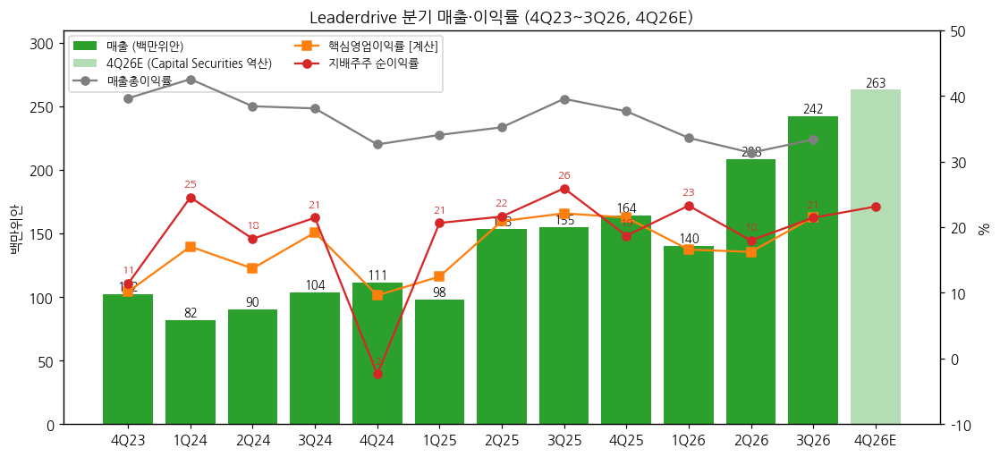
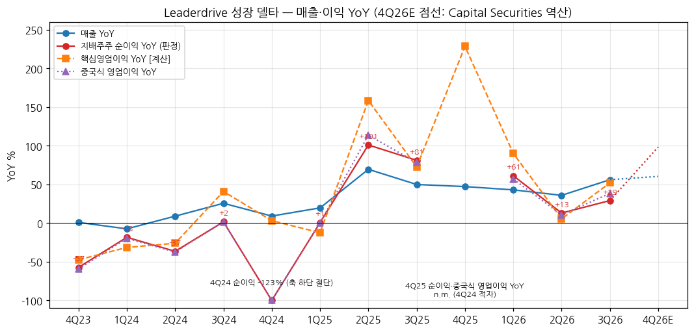
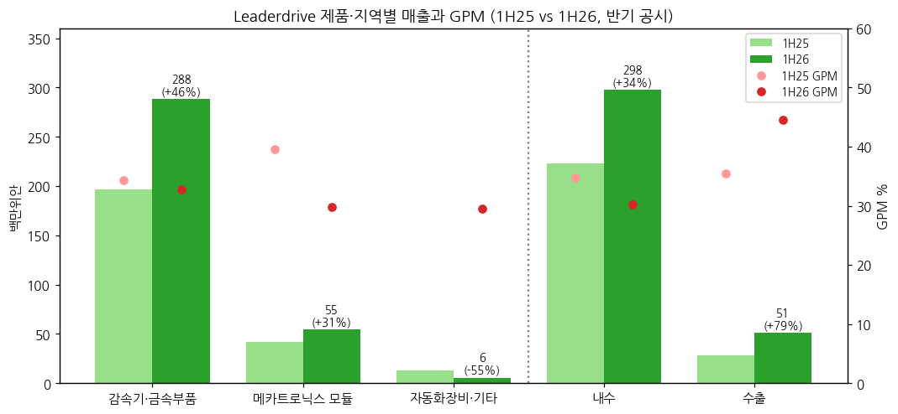

> 모드: 실적 리뷰 (v11)
> 종목: Leaderdrive / 绿的谐波 Leader Harmonious Drive Systems (688017.SS)
> 섹터: 로봇
> 서브섹터: 로봇 부품
> 분기: 2026-Q3 (캘린더 = 회계 분기, 9/30 종료)
> 발표일: 2026-10-30 (3분기 보고서 공시, 거래소 게재 10/31) — 2026-11-03 정정본 공시(주주표 수치 오기 정정, 재무 수치 변동 없음)
> 작성 시각: 2026-11-14 19:55 KST
> 분석 소스: [1차 — 회사 원문] 상해거래소 공고 PDF(东方财富 공고 미러 경유) — 2026년 3분기 보고서 更正后(11/3) + 정정 공고, 2026년 반기 보고서(8/27), 2026년 1분기 보고서(4/23), 2025년 연간 보고서 更正后(7/10), 2025년 3분기·반기 보고서. 분기 단독 손익 세부는 东方财富 F10 재무 API(회사 공시 집계)로 받고 원문과 대조. [보도·리서치 인용] 群益证券(香港) 3Q26 리뷰(11/2, 매수·TP 305위안), 东吴证券 3Q26 리뷰(10/30, 增持). 업적설명회 Q&A 원문 미확보
> 리뷰 깊이: 숫자 중심 | 리서치 첨부 0건 (웹 공개 증권사 리뷰 2건 인용)

# Leaderdrive 3Q26 실적 리뷰 — 매출 +56%로 분기 최대, 순이익 YoY +13% → +29% 재가속. 다만 GPM 33.4%(-6.2%p)로 "물량은 늘고 마진은 내려가는" 성장

> 성장 델타: 가속 | 내러티브: 유지 → 델타 가속 + 내러티브 유지 → 우호 구간 (매출총이익률 하락 멈춤 확인 전까지 강도는 제한)

→ **판정 지표**: 지배주주 순이익(归母净利润)으로 판정했다. 중국식 영업이익(营业利润)에는 투자수익·공정가치 변동·보조금이 순이익의 40%대로 섞여 있어(9M26) K-IFRS 영업이익과 다르다. 그래서 순이익을 주 지표로, **핵심영업이익(매출 − 원가 − 세금 − 판매·관리·연구개발비) [계산]**과 중국식 영업이익을 방향 확인용으로 병기했다. 네 지표 모두 3Q26에 가속이다
→ **숫자**: 3Q26 매출 242.3백만위안(+56.1% YoY, 분기 최대), 지배주주 순이익 52.0(+29.1%), 핵심영업이익 52.2(+52.0%), 중국식 영업이익 62.1(+38.4%), 매출총이익률 33.4%(-6.2%p). 순이익 YoY가 +61.2%(1Q26) → +13.0%(2Q26) → +29.1%(3Q26)로 반등(델타 +16.1%p), 매출 YoY는 +35.9% → +56.1%(+20.2%p)
→ **쟁점**: (1) 성장 동력은 회사 설명상 "산업로봇 점유율 상승 + 구현형 AI 로봇 사업 규모 급증" — 비중은 미공시 (2) 매출총이익률은 2025년 36.9% → 9M26 32.7%로 하락 중, 증설 감가상각·판가가 원인 (3) 판관비율 -6.1%p로 마진 하락을 비용 레버리지가 상쇄 (4) 9M26 영업CF -71.3백만위안, 재고 +49.8%
→ **다음 분기 관건**: 4Q26 매출 250~263백만위안(YoY +51~60%, 증권사 2026E 역산) 달성과 분기 GPM 33% 유지. 4Q25 순이익 기저(30.7, 순이익률 18.7%)가 낮아 순이익 YoY는 +100% 안팎으로 재가속할 경로다 [보도 인용 역산]

---

## 1. 숫자

① 연결 기준 분기 표 (단위: 백만위안, %, 중국 기업회계준칙)

| 항목 | 4Q23 | 1Q24 | 2Q24 | 3Q24 | 4Q24 | 1Q25 | 2Q25 | 3Q25 | 4Q25 | 1Q26 | 2Q26 | **3Q26** | 4Q26E (群益) | 4Q26E (东吴) |
|---|---|---|---|---|---|---|---|---|---|---|---|---|---|---|
| 매출 | 102.2 | 81.9 | 90.5 | 103.5 | 111.5 | 98.0 | 153.4 | 155.2 | 164.1 | 140.1 | 208.4 | **242.3** | 263.1 | 248.4 |
| 매출총이익률 | 39.7 | 42.6 | 38.4 | 38.1 | 32.6 | 34.1 | 35.2 | 39.6 | 37.7 | 33.6 | 31.3 | **33.4** | — | — |
| 핵심영업이익 [계산] | 10.4 | 14.0 | 12.4 | 19.9 | 10.7 | 12.2 | 32.1 | 34.3 | 35.2 | 23.3 | 33.9 | **52.2** | — | — |
| 핵심영업이익률 | 10.2 | 17.1 | 13.7 | 19.2 | 9.6 | 12.5 | 20.9 | 22.1 | 21.5 | 16.6 | 16.2 | **21.5** | — | — |
| 중국식 영업이익 (营业利润) | 9.6 | 23.1 | 17.8 | 25.2 | -5.3 | 23.2 | 38.0 | 44.9 | 39.4 | 36.4 | 42.1 | **62.1** | — | — |
| 지배주주 순이익 (판정 지표) | 11.7 | 20.1 | 16.5 | 22.2 | -2.7 | 20.2 | 33.2 | 40.3 | 30.7 | 32.6 | 37.5 | **52.0** | 60.9 | 89.5 |
| 지배주주 순이익률 | 11.4 | 24.6 | 18.2 | 21.5 | -2.4 | 20.7 | 21.6 | 25.9 | 18.7 | 23.3 | 18.0 | **21.4** | 23.1 | 36.0 |
| 비경상 제외 순이익 (扣非) | 8.1 | 16.2 | 17.7 | 18.5 | -6.3 | 16.5 | 25.9 | 33.2 | 23.7 | 23.4 | 34.7 | **46.5** | — | — |
| 매출 YoY | +0.9 | -7.5 | +9.0 | +25.6 | +9.1 | +19.7 | +69.5 | +49.9 | +47.2 | +43.0 | +35.9 | **+56.1** | +60.3 | +51.4 |
| 순이익 YoY | -57.3 | -18.4 | -36.5 | +1.6 | 적자전환 | +0.7 | +101.0 | +81.2 | n.m. | +61.2 | +13.0 | **+29.1** | +98.4 | +191.5 |
| 핵심영업이익 YoY | -47.4 | -31.5 | -26.1 | +40.9 | +3.1 | -12.5 | +158.5 | +72.6 | +228.5 | +90.1 | +5.5 | **+52.0** | — | — |
| 중국식 영업이익 YoY | -59.4 | -19.7 | -37.4 | +1.5 | 적자전환 | +0.3 | +113.8 | +78.2 | n.m. | +57.0 | +10.7 | **+38.4** | — | — |
| **매출 YoY 델타 (%p)** | — | -8.4 | +16.5 | +16.6 | -16.5 | +10.6 | +49.8 | -19.6 | -2.7 | -4.2 | -7.1 | **+20.2** | +4.2 | -4.7 |
| **순이익 YoY 델타 (%p)** | — | +38.9 | -18.1 | +38.1 | n.m. | n.m. | +100.3 | -19.8 | n.m. | n.m. | -48.2 | **+16.1** | +69.3 | +162.4 |
| **핵심영업이익 YoY 델타 (%p)** | — | +15.9 | +5.4 | +67.0 | -37.8 | -15.6 | +171.0 | -85.9 | +155.9 | -138.4 | -84.6 | **+46.5** | — | — |

→ (출처: 3Q26 = 2026 3분기 보고서 "本报告期"(3개월). 다른 분기 = 东方财富 F10 분기 단독 손익(회사 분기·반기·연간 보고서 집계) — 1H26 합계 348.5/70.1이 반기 보고서와 일치함을 확인. 4Q26E = 증권사 2026E − 9M26 누적 [계산]: 群益 매출 854·순이익 183(11/2), 东吴 매출 839.3·순이익 211.6(10/30) [보도 인용]. 중국 쪽 컨센서스 집계는 출처·증권사 수를 확인하지 못해 쓰지 않았다. 회사는 분기·연간 가이던스를 내지 않는다)
→ **3Q 단독 산출 방식**: 회사 3분기 보고서가 "本报告期"(7~9월 3개월) 숫자를 직접 공시한다. 교차 검증으로 **3Q 단독 = 9M 누적 − 1H 누적**을 계산했다: 매출 590.88 − 348.55 = 242.33, 순이익 122.08 − 70.11 = 51.97, 扣非 104.68 − 58.17 = 46.51 — 공시 3개월 숫자와 일치 [계산]
→ **4Q 단독**은 연간 − 9M 누적으로 계산 (东方财富 F10과 동일). 4Q24는 자산손상 23.9백만위안(재고·설비)으로 분기 적자라, 4Q25 순이익·중국식 영업이익 YoY는 n.m.이다
→ **YoY 위치**: 2Q25(+101.0%)가 순이익 YoY 1차 정점, 2Q26(+13.0%)이 저점, 3Q26 반등. 증권사 2026E대로면 4Q26 순이익 YoY는 +98%(群益) ~ +192%(东吴)로 4Q25 저기저 효과까지 더해 정점을 만든다. YoY 정점은 4Q26 이후로 밀려 있다 [보도 인용 역산]
→ **[판단] 델타 = 가속**: 판정 지표(순이익) YoY가 +13.0% → +29.1%로 확대, 매출 YoY도 +20.2%p 확대 → 기준상 "강한 가속". 단 순이익 YoY(+29%)가 매출 YoY(+56%)를 크게 밑돈다 — 매출총이익률 -6.2%p, 투자수익 감소(-3.4백만위안), 신용손상 증가(-2.7백만위안)가 이익 레버리지를 깎았다

→ (출처: 회사 분기·반기·연간 보고서, 东方财富 F10 분기 단독 손익. 4Q26E는 群益 2026F 역산 [보도 인용])

→ (출처: 동일. 4Q26E 점선은 群益 2026F − 9M26 [계산])

② 제품·지역별 매출과 매출총이익률 (단위: 백만위안, %, 반기 공시 — 분기 사업부 미공시)

| 구분 | 항목 | 2024 | 1H25 | 2025 | **1H26** | 1H26 YoY |
|---|---|---|---|---|---|---|
| 하모닉 감속기·금속부품 | 매출 | 325.4 | 196.9 | 476.5 | **288.1** | +46.3% |
| | GPM | 36.1 | 34.3 | 36.8 | **32.8** | -1.5%p |
| 메카트로닉스 모듈 | 매출 | 52.6 | 41.6 | 74.3 | **54.7** | +31.5% |
| | GPM | 41.1 | 39.6 | 40.9 | **29.8** | -9.8%p |
| 자동화 장비·기타 | 매출 | 9.4 | 12.8 | 19.9 | **5.7** | -55.5% |
| 내수 | 매출 (GPM) | 337.8 (36.9) | 222.9 (34.7) | 507.4 (36.8) | **297.7 (30.2)** | +33.6% (-4.5%p) |
| 수출 | 매출 (GPM) | 44.9 (37.4) | 28.5 (35.4) | 58.3 (35.2) | **50.9 (44.6)** | +78.6% (+9.2%p) |

→ (출처: 2026 반기 보고서 "营业收入、营业成本的分解信息", 2025 연간 보고서 主营业务分产品·分地区, 东方财富 F10 主营构成(1H25·2024). 3Q26 제품별은 미공시)
→ **델타를 끄는 것은 하모닉 감속기**다. 매출 비중 83%(1H26), 1H26 매출 +46.3%. 2025년 판매량 42.5만대(+72.5%)가 매출(+46.4%)보다 빨리 늘어 대당 매출이 내려가고 있다 [계산 — 금속부품 포함이라 근사]
→ 메카트로닉스 모듈(휴머노이드 관절 일체형)은 매출 +31.5%지만 GPM이 9.8%p 급락했다. 신규 고객·신제품 초기 원가로 보이나 회사 설명은 없다 [판단]
→ 수출은 +78.6%, GPM 44.6%로 가장 수익성이 좋다. 내수 GPM 30.2%와 14%p 차이

→ (출처: 2026 반기 보고서, 东方财富 F10 主营构成)

(1) 수주·선행지표 (단위: 백만위안)

| 항목 | 2025 말 | 2026-06 말 | **2026-09 말** | 연초 대비 |
|---|---|---|---|---|
| 재고 | 285.0 | 미정리 | **427.0** | +49.8% |
| 매출채권 | 194.5 | 미정리 | **301.6** | +55.0% |
| 계약부채(선수금) | 3.3 | 미정리 | **6.7** | +105% |
| 건설중인자산 | 184.2 | 미정리 | **326.1** | +77.0% |
| 장기지분투자 (SKF 합작 등) | 57.0 | 미정리 | **136.4** | +139% |

→ (출처: 2026 3분기 보고서 재무상태표) 회사는 수주·수주잔고를 공시하지 않는다. 선수금이 매출의 1% 수준이라 수주 선행지표로 쓰기 어렵고, 재고·매출채권 증가가 출하 확대의 대리 지표다
→ 생산·판매량은 연간 보고서에만 있다: 2025 하모닉 감속기 생산 43.4만대(+72.3%) / 판매 42.5만대(+72.5%), 메카트로닉스 판매 1.22만세트(+72.1%) (2025 연간 보고서)

(2) 회사 가이던스 — 이전 → 이번

| 항목 | 이전 | 이번 |
|---|---|---|
| 매출·이익 가이던스 | 없음 | 없음 (회사는 분기·연간 전망치를 내지 않는다. 2025년엔 1월 실적 예고·2월 실적 快报를 냈다) |
| 증설 | 2024-12 증자 자금 "신세대 정밀전동장치 스마트제조 프로젝트" 2025년 착공 | 群益: 완공 목표 2026년 말 → **2028년 말**로 연기, 기존 캐파 가동률 우선 [보도 인용, 회사 공고 미대조] |
| 자본 정책 | 2025 결산 배당 10주당 2.10위안 (배당성향 31%) | 2026-08-27 홍콩 H주 상장 추진 공시 [보도 인용] |

→ (출처: 2025 연간 보고서, 群益 11/2, 东吴 10/30) 다음 숫자 이벤트는 2026 연간 실적 예고(관례상 1월 말) 또는 实绩快报(2월 말)

③ 연간 (단위: 백만위안, %)

| 항목 | 2022 | 2023 | 2024 | 2025 | 2026E (群益) | 2026E (东吴) | 2027E (群益) | 2027E (东吴) |
|---|---|---|---|---|---|---|---|---|
| 매출 | 445.7 | 356.2 | 387.4 | 570.7 | 854 | 839.3 | 1,307 | 1,225.8 |
| 매출총이익률 | 48.7 | 41.1 | 37.5 | 36.9 | — | — | — | — |
| 핵심영업이익 [계산] | 138.7 | 61.7 | 57.0 | 113.9 | — | — | — | — |
| 지배주주 순이익 | 155.3 | 84.2 | 56.2 | 124.4 | 183 | 211.6 | 281 | 322.9 |
| 순이익률 | 34.8 | 23.6 | 14.5 | 21.8 | 21.4 | 25.2 | 21.5 | 26.3 |
| 매출 YoY | +0.5 | -20.1 | +8.8 | +47.3 | +49.6 | +47.1 | +53.0 | +46.0 |
| 순이익 YoY | -17.9 | -45.8 | -33.3 | +121.4 | +46.8 | +70.1 | +54.2 | +52.6 |

→ (출처: 2022~2025 东方财富 F10 연간(회사 연간 보고서 집계). 2026E·2027E 群益(11/2), 东吴(10/30) [보도 인용]. 东吴는 "2026~2028 순이익 추정 2.1/3.2/4.3억위안 유지"라고 밝혔다 — 발표 후 추정치 변화 없음)
→ 9M26 순이익 122.1은 2026E의 58~67%. 4Q26에 61~90백만위안이 필요하다 — 3Q26(52.0)보다 많아야 하는 숫자다

---

## 2. 시장 쟁점 (회사 설명 + 증권사 공통 질문)

① 지난 분기 체크
→ 첫 리뷰 — 직전 체크 없음

② 이번 분기 쟁점 4개

| # | 쟁점 | 근거 |
|---|---|---|
| (1) | 매출 +56%의 원천 — 산업로봇인가, 휴머노이드인가 | 3분기 보고서 변동 사유, 群益·东吴 |
| (2) | 매출총이익률 하락은 언제 멈추나 — 증설 감가상각 vs 판가 | 3분기 보고서 손익, 반기 보고서 원가 설명, 群益 |
| (3) | 이익의 질 — 영업CF 마이너스, 재고·매출채권 급증 | 3분기 보고서 현금흐름 설명, 东吴 |
| (4) | 증설 연기와 H주 상장 — 캐파 전략 변화 | 群益, 东吴 |

③ 쟁점별 분해

(1) **성장 원천 = 산업로봇 점유율 + 구현형 AI, 비중은 미공시**
→ 회사 설명: "主要系2026年公司工业机器人行业份额提升以及具身智能机器人业务规模大幅增长，生产运营效率提升，产能扩张等原因所致" — 산업로봇 업계 점유율 상승과 구현형 AI 로봇 사업 규모의 큰 폭 증가, 생산 효율 개선, 캐파 확대 (2026 3분기 보고서). 반기 보고서도 "具身智能赛道进入产业化落地的高速发展阶段"이라고 썼다
→ 숫자: 群益은 2026년 1~9월 중국 산업로봇 생산 79.5만대(+29.1%)를 인용했다 [보도 인용]. 회사 매출 +45.3%(9M)가 산업로봇 생산 증가율의 1.6배 [계산] — 그 초과분이 점유율 상승 + 휴머노이드다
→ **[판단]** 휴머노이드 매출 비중을 회사·증권사 모두 숫자로 내지 않는다. 산업로봇 사이클(+29%)만으로도 매출 성장의 상당 부분이 설명돼, "휴머노이드 성장주"라는 시장 가격(PER 280배+)을 숫자가 아직 증명하지는 않았다

(2) **매출총이익률 -6.2%p = 증설 감가 + 믹스**
→ 회사 설명: "营业成本变动原因：主要系营业收入增长带动成本同步增加，同时处于产能快速扩张阶段" — 매출 증가와 함께 원가가 늘었고 캐파 급확대 단계에 있다 (2026 반기 보고서)
→ 숫자: 분기 GPM 39.6%(3Q25) → 37.7% → 33.6% → 31.3% → 33.4%(3Q26). 2Q26이 저점이고 3Q26 +2.1%p QoQ 반등 [계산]. 1H26 메카트로닉스 GPM -9.8%p, 내수 GPM -4.5%p
→ 상쇄: 판관비율 17.9% → 11.8%(-6.1%p), 연구개발비 16.3(-2.8% YoY) — 매출이 늘어도 비용은 거의 그대로라 핵심영업이익률은 21.5%로 전년(22.1%)과 비슷하게 지켰다 [계산]
→ **[판단]** GPM 하락은 감가상각이 매출보다 먼저 들어오는 증설기 패턴이다. 3Q26 QoQ 반등이 4Q26에도 이어지면(33%+) 마진 바닥 통과, 다시 31% 아래면 판가 경쟁 쪽 해석이 맞다

(3) **이익의 질 — 영업CF -71.3백만위안(9M)**
→ 회사 설명: 판매 대금으로 받은 은행 인수어음을 장기자산(설비) 구입에 배서해 쓰고, 영업 매입채무는 지급어음으로 결제 → 지급어음 만기 시 영업CF가 줄었다 (2026 3분기 보고서)
→ 숫자: 9M26 영업CF -71.3(전년 +110.2 [계산 — 회사 공시 증감률 -164.68%에서 역산]), 재고 +142.0, 매출채권 +107.1, 매입채무 +186.8 (연초 대비) [계산]
→ **[판단]** 어음 배서는 중국 제조업의 일반적 결제 관행이라 회사 설명은 타당하다. 다만 재고(+49.8%)가 매출(+45.3%)보다 빨리 늘어 휴머노이드 고객 양산 지연 시 재고 손상 위험이 있다 — 4Q24 자산손상 23.9(분기 적자)의 전례

(4) **증설 연기와 H주 — 캐파 전략**
→ 群益: 신공장(정밀전동장치 스마트제조 프로젝트) 완공 목표를 2026년 말 → 2028년 말로 연기, 기존 캐파 가동률 우선. SKF와 로봇 관절 정밀 베어링 합작(회사 40%) [보도 인용]
→ 东吴: 2026-08-27 홍콩 H주 상장 추진 공시 [보도 인용]
→ **[판단]** 공장 연기는 "수요가 신공장을 기다릴 만큼 급하지 않다"는 신호로도, "기존 라인 효율로 충분하다"는 신호로도 읽힌다. 현금성 자산이 22억위안인데 H주로 추가 조달하는 것은 해외 고객·인수 대비로 보이나 회사 설명은 확인하지 못했다

→ 업적설명회 Q&A 원문은 확보하지 못했다. 위 쟁점은 회사 공시 설명 + 증권사 리뷰 2건(群益·东吴)의 공통 주제다. 东吴는 3Q GPM을 "+6.20pct"로 적었으나 원문 계산상 -6.2%p(39.6% → 33.4%)라 群益 쪽이 맞다 [계산]

---

## 3. 내러티브 점검

→ **성장 스토리**: 중국 1위 하모닉 감속기 업체가 산업로봇 회복 + 휴머노이드(구현형 AI) 관절 수요를 동시에 받는다. 시장은 "휴머노이드 양산 시 관절 1대당 감속기 수십 개"의 옵션을 산다 (PER 2026E 244~282배)
→ **이번 분기**: 매출 +56%·순이익 재가속으로 물량 스토리는 확인됐다. 반면 GPM 하락, 휴머노이드 비중 미공시, 신공장 연기, 증권사 추정치 변화 없음(东吴 유지) → 스토리가 강화될 새 숫자는 없다 → **내러티브 유지**
→ **판정**: 델타 가속 + 내러티브 유지 → 우호 구간. 다만 이익 성장(+29%)이 매출 성장(+56%)의 절반이라, 매출총이익률이 33%대에서 멈추는지가 국면 강도를 정한다 [판단]
→ **스토리 강화 트리거**: ① 휴머노이드 매출 비중 공시 또는 대형 휴머노이드 고객 공급 공시 ② 분기 GPM 35% 회복 ③ H주 상장 시 해외 고객·캐파 계획 공개
→ **훼손 리스크**: ① 분기 GPM 30% 아래(가격 경쟁) ② 휴머노이드 양산 지연으로 재고 손상(4Q24 전례) ③ 산업로봇 생산 증가율 둔화
→ **한국 로봇 부품 피어 시사점**: Leaderdrive의 매출 +56%·판매 +72%(2025)는 중국 로봇 관절 부품 수요가 실제 물량으로 나오고 있다는 증거다. 동시에 GPM 하락은 하모닉 감속기가 가격 경쟁 구간에 들어섰다는 신호라, 에스비비테크 등 한국 감속기 업체의 판가 전제에 부담이다 [판단]

---

## 4. 향후 봐야 할 것

(1) **4Q26 매출·순이익 YoY 재가속 폭** (1순위 — 델타 판정 변수)
→ 무엇을: 4Q26 매출 250백만위안 이상(YoY +52% 이상), 순이익 61백만위안 이상(YoY +98% 이상, 群益 경로). 순이익 45백만위안 미만(YoY +47% 미만)이면 증권사 추정 하향 → "유지/둔화" 검토
→ 어떤 데이터로: 2026 연간 실적 예고(2027-01 말) 또는 实绩快报(2027-02 말), 연간 보고서(2027-04)
→ 언제: 2027-01 말 ~ 04 말

(2) **분기 매출총이익률 33% 유지 / 바닥 통과**
→ 무엇을: 4Q26 GPM 33% 이상이면 바닥 통과(2Q26 31.3% 저점), 31% 미만이면 판가 경쟁 해석. 메카트로닉스 GPM(1H26 29.8%) 회복 여부
→ 어떤 데이터로: 2026 연간 보고서 主营业务分产品, 4Q 단독 손익(연간 − 9M)
→ 언제: 2027-04 말

(3) **구현형 AI(휴머노이드) 매출 비중·고객 공시**
→ 무엇을: 회사 공시·H주 투자설명서(招股书)에 휴머노이드 매출 비중·주요 고객이 처음 나오는지
→ 어떤 데이터로: 홍콩거래소 H주 신청서류, 2026 연간 보고서, 중국 휴머노이드 업체(Unitree·UBTech) 양산 공시
→ 언제: H주 신청서 공개 시점(미정), 2027-04

(4) **재고·영업CF 정상화**
→ 무엇을: 연말 재고 427백만위안(9월 말)에서 감소 여부, 연간 영업CF 플러스 회복, 4Q 자산손상 규모(4Q24 23.9, 4Q25 15.2)
→ 어떤 데이터로: 2026 연간 보고서 재무상태표·현금흐름표·자산손상 주석
→ 언제: 2027-04 말

(5) **중국 산업로봇 생산 증가율**
→ 무엇을: 1~9월 +29.1%가 연말까지 +20% 이상 유지되는지 (산업로봇이 매출의 기반)
→ 어떤 데이터로: 중국 국가통계국 월간 산업로봇 생산량
→ 언제: 매월 중순
