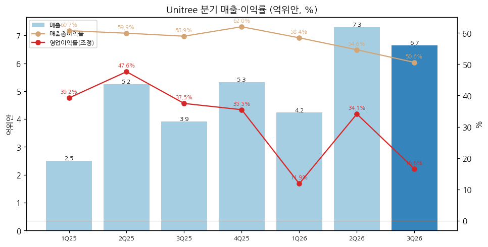
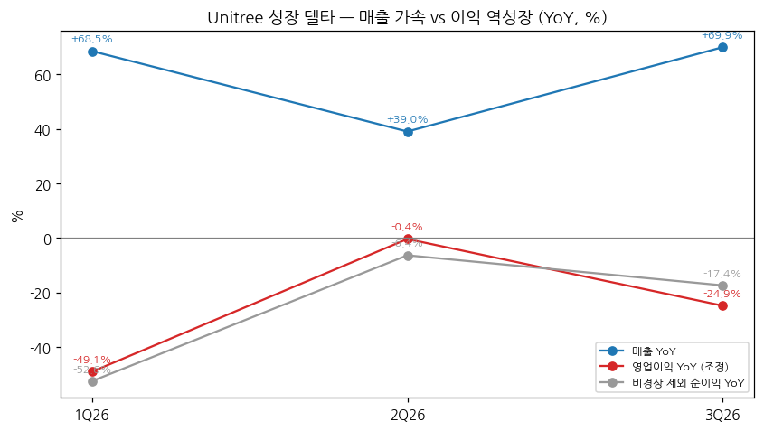
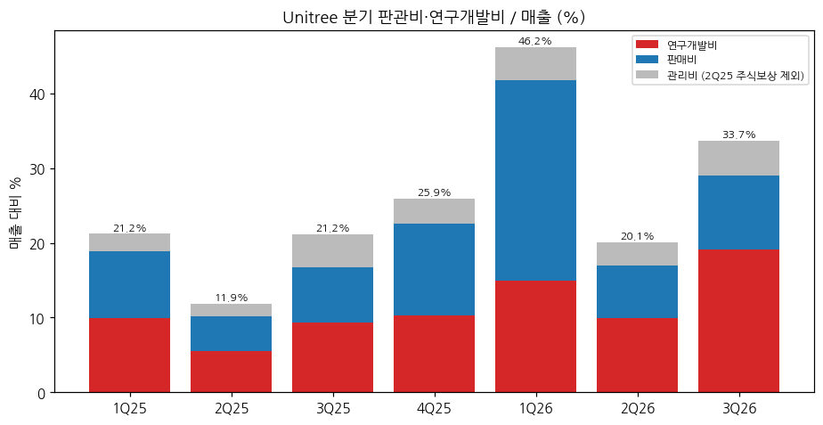

> 모드: 실적 리뷰 (v11)
> 종목: Unitree / 宇树科技 (688836.SS)
> 섹터: 로봇
> 서브섹터: 휴머노이드 완성체
> 분기: 2026-Q3 (캘린더 = 회계 분기, 9/30 종료)
> 발표일: 2026-10-28 (장 마감 후 3분기 보고서 공시, 거래소 게재일 10/29)
> 작성 시각: 2026-11-14 KST
> 분석 소스: [1차 — 회사 원문] 상해거래소 공고 PDF(东方财富 공고 미러 경유 원문) — 2026년 3분기 보고서(10/28), 상장공고서(上市公告书, 8/18 — 1H26 재무·주식보상 3.49억위안 명시), 투자설명서 최종본(招股说明书, 8/14 — 2023~2025 제품별 매출·판매대수, 1Q26 실적, 1H26 실적 예상). 분기 단독 손익 세부(원가·판관비·연구개발비)는 东方财富 F10 재무 API(회사 공시 집계)로 받고 원문(3Q26·1H26 합계)과 대조. [보도 인용] 雷峰网(新浪 전재, 10/30), 凤凰网科技(10/29), 每日经济新闻(10/28). 상장 후 첫 정기 보고라 컨퍼런스콜·업적설명회 Q&A 원문은 미확보, 셀사이드 리포트 미확보
> 리뷰 깊이: 숫자 중심 | 리서치 첨부 0건

# Unitree 3Q26 실적 리뷰 — 매출 +69.9%로 재가속, 영업이익은 -24.9%로 3개 분기 연속 역성장. 연구개발비가 분기 매출의 19%까지 올라왔다

> 성장 델타: 꺾임 | 내러티브: 유지 → 매출 델타는 가속, 이익 델타는 꺾임 → 이익 기준 매매 제외 구간 (분기 영업이익 YoY 플러스 복귀 확인 전까지)

→ **판정 지표**: K-IFRS에 가깝게 다시 계산한 영업이익(매출 − 원가 − 세금 − 판매비 − 관리비 − 연구개발비) [계산]. 2Q25에 일회성 주식보상비용 3.49억위안(관리비)이 있어 2Q25는 이를 더한 조정치로 비교했다. 중국식 营业利润·비경상 제외 순이익(扣非)도 같은 방향(역성장)이다
→ **숫자**: 3Q26 매출 6.65억위안(+69.9% YoY), 영업이익 1.10억위안(-24.9%), 영업이익률 16.6%(-20.9%p YoY), 매출총이익률 50.6%(-8.3%p). 영업이익 YoY는 -49.1%(1Q26) → -0.4%(2Q26) → -24.9%(3Q26)로 다시 내려갔다(델타 -24.5%p). 매출 YoY는 +39.0% → +69.9%로 +30.9%p 올랐다
→ **쟁점**: (1) 이익 역성장은 연구개발비(+249.6% YoY, 매출 대비 19.1%)와 판매비 때문이다 — 회사는 "구현형 대형 모델·컴퓨팅 투자"라고 설명한다 (2) 매출총이익률이 4개 분기 연속 하락(62.0% → 50.6%)했지만 제품별 공시가 없어 원인을 나눌 수 없다 (3) 매출은 고기저(2Q25)를 지나 다시 가속했다
→ **다음 분기 관건**: 4Q25 기저가 영업이익 1.89억위안(이익률 35.5%)으로 높다. 4Q26 영업이익 YoY가 플러스가 되려면 1.89억위안 이상이 필요하다 — 3Q26(1.10억)의 1.7배. 회사 가이던스·공개 컨센서스는 없다

---

## 1. 숫자

① 연결 기준 분기 표 (단위: 억위안, %, 중국 기업회계준칙 — 분기 단독은 1Q25부터 공시)

| 항목 | 1Q25 | 2Q25 | 3Q25 | 4Q25 | 1Q26 | 2Q26 | **3Q26** | 4Q26E |
|---|---|---|---|---|---|---|---|---|
| 매출 | 2.51 | 5.25 | 3.91 | 5.32 | 4.23 | 7.29 | **6.65** | 가이던스·컨센 없음 |
| 영업이익 (K-IFRS식, 조정) | 0.98 | 2.50 | 1.47 | 1.89 | 0.50 | 2.49 | **1.10** | — |
| 영업이익률 (조정) | 39.2 | 47.6 | 37.5 | 35.5 | 11.9 | 34.1 | **16.6** | — |
| 매출 YoY | — | — | — | — | +68.5 | +39.0 | **+69.9** | — |
| 영업이익 YoY (조정) | — | — | — | — | -49.1 | -0.4 | **-24.9** | — |
| **매출 YoY 델타 (%p)** | — | — | — | — | — | -29.5 | **+30.9** | — |
| **영업이익 YoY 델타 (%p)** | — | — | — | — | — | +48.7 | **-24.5** | — |
| 매출총이익률 | 60.7 | 59.9 | 58.9 | 62.0 | 58.4 | 54.6 | **50.6** | — |
| 중국식 영업이익 (营业利润, 보고) | 1.08 | -0.93 | 1.54 | 1.98 | 0.49 | 2.53 | **1.13** | — |
| 지배주주 순이익 (보고) | 0.96 | -1.28 | 1.36 | 1.74 | 0.50 | 2.24 | **1.13** | — |
| 비경상 제외 순이익 (扣非) | 0.85 | 2.18 | 1.27 | 1.61 | 0.40 | 2.04 | **1.05** | — |
| 扣非 YoY | — | — | — | — | -52.6 | -6.4 | **-17.4** | — |

→ (출처: 3Q26 매출·순이익·扣非·YoY = 2026 3분기 보고서 원문. 분기 원가·판관비·연구개발비·营业利润 = 东方财富 F10 분기 단독 손익 — 1H26 营业利润 합계 3.02억위안이 상장공고서 원문 30,223.84만위안과 일치, 3Q26 매출 665,044,497.90위안이 원문과 일치. 2Q25 보고 영업이익 -0.99억위안 + 주식보상 3.49억위안(상장공고서 "去年同期 确认了非经常性损益股份支付费用 34,906.55万元") = 조정 2.50억위안 [계산])
→ 서프라이즈: 회사 가이던스·공개 컨센서스가 없어 판단 불가. 참고로 회사가 투자설명서에서 낸 1H26 예상(매출 10.52~11.28억, 扣非 2.36~2.83억위안) 대비 실제 1H26은 매출 11.52억(상단 +2.1%), 扣非 2.44억위안(범위 하단부)였다 (투자설명서, 상장공고서)
→ **YoY 위치**: 영업이익 YoY는 공시 시작(1Q26) 이후 한 번도 플러스가 아니다. 2Q26 -0.4%는 2Q25 주식보상을 조정한 결과이고, 조정하지 않으면 2Q25가 적자라 YoY 계산이 안 된다. 2025년 연간 조정 영업이익률 40.2%가 정점이고, 9M26은 22.5%다 [계산]
→ **[판단] 델타 = 꺾임**: 판정 지표(영업이익) YoY가 마이너스다. 매출 YoY는 +30.9%p 올라 강한 가속이지만, 기준표상 "영업이익 YoY 마이너스"가 우선한다. 이익 감소의 원인이 수요가 아니라 비용 투입이라는 점은 쟁점 (1)에서 분해했다

→ (출처: 회사 3분기 보고서·상장공고서, 东方财富 F10 분기 단독 손익. 영업이익률은 2Q25 주식보상 조정 [계산])

→ (출처: 동일. 분기 단독 공시가 1Q25부터라 YoY는 1Q26부터 [계산])

② 사업부별 매출·영업이익 (단위: 억위안, % — 연간만 공시, 분기·반기 제품별 미공시)

| 제품 | 항목 | 2023 | 2024 | 2025 | 3Q26 |
|---|---|---|---|---|---|
| 휴머노이드 | 매출 | 0.03 | 1.07 | **8.68** | 미공시 |
| | 매출 YoY | — | n.m. | **+708.8** | |
| | 매출총이익률 | 87.7 | 69.3 | **63.2** | |
| | 판매대수 (평균단가 만위안) | 5 (59.3) | 412 (26.0) | **5,215 (16.6)** | |
| 사족보행 | 매출 | 1.19 | 2.31 | **6.98** | 미공시 |
| | 매출 YoY | — | +93.1 | **+202.6** | |
| | 매출총이익률 | 43.7 | 51.7 | **56.7** | |
| | 판매대수 (평균단가 만위안) | 3,121 (3.83) | 7,136 (3.23) | **23,037 (3.03)** | |
| 로봇 부품 | 매출 | 0.27 | 0.45 | **1.04** | 미공시 |
| | 매출총이익률 | 48.8 | 56.9 | **59.4** | |
| 합계 (주영업수입) | 매출 | 1.58 | 3.88 | **16.76** | — |
| | 매출총이익률 | 44.2 | 56.7 | **60.1** | (전사 50.6) |

→ (출처: 투자설명서 "主营业务收入构成" "主要产品价格变动" "主营业务毛利率". YoY [계산]. 사업부 영업이익은 미공시. 3분기 보고서는 제품별 매출·판매대수를 공시하지 않는다)
→ **2025년 델타를 끈 것은 휴머노이드다**. 매출 비중 27.7% → 51.8%, 판매 412대 → 5,215대. 평균단가는 26.0 → 16.6만위안으로 36% 내렸다(G1 비중 확대 + 2025년 가격 인하 — 회사)
→ 2026년 분기에 휴머노이드가 몇 대 팔렸는지는 공시가 없다. 상장공고서는 1H26 성장이 "휴머노이드 제품 수입이 상대적으로 빠르게 증가"한 덕분이라고만 적었다
→ 휴머노이드 출하량은 회사가 연간으로만 밝힌다(2025 출하 5,511대, 회사 주장 글로벌 1위) — 다음 숫자는 2026 연간 보고서다

(1) 비용 구조 — 이익이 꺾인 이유 (매출 대비 %)

| 항목 | 1Q25 | 2Q25 | 3Q25 | 4Q25 | 1Q26 | 2Q26 | **3Q26** |
|---|---|---|---|---|---|---|---|
| 판매비 | 9.0 | 4.6 | 7.5 | 12.3 | 26.8 | 7.0 | **9.9** |
| 관리비 (주식보상 제외) | 2.3 | 1.7 | 4.5 | 3.4 | 4.5 | 3.2 | **4.7** |
| 연구개발비 | 9.9 | 5.5 | 9.3 | 10.3 | 14.9 | 10.0 | **19.1** |
| 연구개발비 (억위안) | 0.25 | 0.29 | 0.36 | 0.55 | 0.63 | 0.73 | **1.27** |

→ (출처: 东方财富 F10 분기 단독 손익 [계산]. 3Q26 연구개발 투입 1.27억위안 +249.6% YoY는 3분기 보고서 원문)

→ (출처: 동일. 1Q26 판매비 급증은 2026 춘완 등 브랜드 홍보 — 상장공고서)
→ 3Q26 영업이익 감소 0.36억위안 [계산]을 분해하면: 매출총이익 +1.06억 vs 연구개발비 -0.91억, 판매비 -0.37억, 관리비 -0.14억 [계산]. 연구개발비 증가분이 매출총이익 증가분과 맞먹는다

(2) 회사 가이던스 — 이전 → 이번

| 항목 | 이전 | 이번 | 비고 |
|---|---|---|---|
| 1H26 실적 예상 (투자설명서) | 매출 10.52~11.28억 (+35.6~45.4%), 扣非 2.36~2.83억 (-22.0~-6.4%) | 실적: 매출 11.52억 (+48.5%), 扣非 2.44억 (-19.3%) | 매출 상단 초과, 이익 하단부 |
| 2026 연간·4Q26 | 없음 | 없음 | 3분기 보고서에 예상 없음 |

→ (출처: 투자설명서 "财务报告审计截止日后" 항목, 상장공고서. 회사는 분기·연간 가이던스를 내지 않는다)

③ 연간 (단위: 억위안, %)

| 항목 | 2022 | 2023 | 2024 | 2025 | 9M26 |
|---|---|---|---|---|---|
| 매출 | 1.23 | 1.59 | 3.93 | 16.99 | 18.17 |
| 영업이익 (조정) | -0.32 | -0.30 | 0.69 | 6.84 | 4.09 |
| 영업이익률 (조정) | -26.0 | -19.0 | 17.6 | 40.2 | 22.5 |
| 매출 YoY | — | +29.5 | +146.8 | +332.6 | +55.7 |
| 영업이익 YoY (조정) | — | n.m. | 흑전 | +889.4 | -17.3 (9M) |

→ (출처: 투자설명서 감사치, 3분기 보고서. 9M25 조정 영업이익 4.95억위안 대비 [계산]. 공개 컨센서스는 집계 출처·증권사 수를 확인하지 못해 쓰지 않았다)
→ 9M26 매출 18.17억위안은 이미 2025 연간(16.99억)을 넘었다. 영업이익은 9M26 4.09억위안으로 2025 연간 조정치 6.84억의 60%다

---

## 2. 시장 쟁점 (회사 설명 + 반복 질문)

① 지난 분기 체크
→ 첫 리뷰 — 직전 체크 없음 (상장 후 첫 정기 보고)

② 이번 분기 쟁점 4개

| # | 쟁점 | 근거 |
|---|---|---|
| (1) | 매출이 +70% 늘었는데 왜 이익은 -25%인가 — 일시적 투자인가, 구조적 마진 하락인가 | 3분기 보고서 회사 설명, 雷峰网·凤凰网 |
| (2) | 매출총이익률 62% → 51%: 가격 인하·제품 믹스·원가 중 무엇인가 | 투자설명서(2025 가격 인하), 雷峰网 |
| (3) | 매출 재가속(+39% → +70%)은 지속되나 — 연구·교육 시장 의존도 | 투자설명서 고객 구성, 상장공고서 |
| (4) | 2,800억위안 시총(PSR 약 120배)을 지지하는 것은 숫자인가 이벤트인가 | 每日经济新闻·雷峰网 주가 보도 |

③ 쟁점별 분해

(1) **이익 역성장 = 연구개발 투입 (구현형 AI 모델)**
→ 회사 설명: 연구개발 투입 증가는 "구현형 지능 분야, 특히 구현형 대형 모델 관련 모델 연구개발과 컴퓨팅 투입 대폭 증가, 연구개발 인력 확충, 신제품 개발" 때문 (3분기 보고서). 1H26에는 "춘완 등 플랫폼 브랜드 홍보와 판매 인력 증가"로 판매비가 크게 늘었다고 설명 (상장공고서)
→ 숫자: 3Q26 연구개발비 1.27억위안(매출 19.1%), 9M26 2.63억위안(14.5%) — 2023~2025년 8.5~10% 구간에서 두 배로 올랐다. 9M26 판매비 2.30억위안(+202% [보도 인용 凤凰网]). 연구개발+판매비 합계 매출 대비 27.1% [보도 인용]
→ 모델 성과: UnifoLM-WLA-1.0(60억 파라미터, 실제 로봇 데이터 약 2,500시간) 9월 오픈소스, 10/22 물리AI 대회에서 왕싱싱이 "물리 AI 자기 진화 V1.0 모델 사전 연구 중", "1~3년 내 돌파" 발언 [보도 인용 雷峰网]
→ **[판단]** 비용 증가가 의도된 투자라는 회사 설명은 숫자와 맞는다(연구개발 증가분 ≈ 매출총이익 증가분). 다만 투자 국면이 언제 끝나는지 회사가 밝히지 않았고, 공모 자금 59억위안의 1순위 용도가 "지능형 로봇 모델 연구개발"이라 연구개발비 비율은 2027년까지 높게 유지될 가능성이 크다 [전망]. 이익 YoY 플러스 복귀는 매출 증가 속도에 달려 있다

(2) **매출총이익률 하락 — 원인 미공시**
→ 회사 설명: 3분기 보고서에 원인 언급 없음. 투자설명서는 2025년 휴머노이드 이익률 하락(69.3% → 63.2%)을 "G1(중형, 단가·이익률 낮음) 비중 확대와 2025년 판매가 인하"로 설명했다
→ 숫자: 분기 매출총이익률 62.0%(4Q25) → 58.4% → 54.6% → 50.6%. 9M26 54.0%(-5.7%p YoY). 영업원가 +77.9%가 매출 +55.7%보다 빠르다 [보도 인용 凤凰网]
→ 보도 추정: 휴머노이드 양산 초기 수율 변동, 일부 모델 가격 인하, 연산·핵심 부품 원가 상승, 저마진 산업 주문 비중 확대 [보도 인용 雷峰网, 회사 확인 없음]
→ **[판단]** 2023~2025년 패턴(신모델 G1 → 단가 인하 → 물량 확대)이 2026년에도 반복되고 있을 가능성이 높다. 경쟁사(UBTech 1H26 44.7%, 越疆 46.5%)와의 이익률 격차가 좁혀지는 중이라 "전 스택 자체 개발 원가 우위" 프리미엄이 줄어드는 신호다

(3) **매출 재가속 — 지속성은 고객 구성에 달림**
→ 회사 설명: 1H26 성장은 "휴머노이드 하위 응용 장면 확대, 시장 수요 호조"가 이끌었고, 동시에 "기저 확대, 업계 열기 완화, 경쟁 심화로 증가율이 과거보다 낮아졌다" (상장공고서). 3분기는 "제품 혁신과 사업 확장, 제품 라인 확충"으로 설명 (3분기 보고서)
→ 숫자: 3Q26 +69.9%는 3Q25 기저(3.91억, 2025년 4개 분기 중 최저)의 영향이 크다. 2Q26(+39.0%)은 2Q25 기저 5.25억 대비였다. 기저를 빼고 보면 QoQ -8.8%로 2Q26 → 3Q26 매출은 오히려 줄었다 [계산]
→ 고객 구성: 2025 1~9월 휴머노이드 매출 중 연구·교육 73.6%, 상업·소비 17.4%, 산업 응용 9.0% [보도 인용, 투자설명서 원출처]. 재고 10.19억위안(연초 대비 +177%)과 매입채무 증가는 4Q 출하 준비로 읽을 수 있다 [판단]
→ **[판단]** 3Q26 매출 YoY 가속은 기저 효과 몫이 크다. 4Q25 기저(5.32억)는 다시 높아 4Q26 매출 YoY가 +70%를 유지하려면 9.0억위안이 필요하다 [계산]

(4) **밸류에이션과 주가 — 이벤트 드리븐**
→ 사실: 공모가 150.80위안 → 상장일 시가 부근 1,100위안 → 10/15 404.03위안(-63%) → 11/13 696.00위안. 10월 반등 계기는 H2-X 공개(10/21), 물리AI 대회(10/22), 기관 등급 상향, A주 희소성 [보도 인용 雷峰网]. 회사는 10/21·10/27 주가 이상 변동 공시를 냈고, 10/26 기준 롤링 PER 465배 vs 업종 평균 38.5배 [보도 인용 每日经济新闻]
→ **[판단]** 3Q26 발표(10/28 장후) 이후 주가는 10/28 종가 695.90위안 → 11/13 696.00위안으로 보합이다(중간 저점 10/29 662.39, 고점 11/11 765.00 — Yahoo 일간 종가). 이익 역성장에 반응하지 않았다. 시장은 이 종목을 분기 이익이 아니라 휴머노이드 산업 이벤트(제품·모델·생태계)로 거래한다

→ 컨퍼런스콜·업적설명회 Q&A 원문은 확보하지 못했다. 위 쟁점은 회사 공시 설명과 언론 보도 3건에서 공통으로 나온 주제다

---

## 3. 내러티브 점검

→ **성장 스토리**: 전 스택 자체 개발로 원가를 낮춘 휴머노이드·사족 출하량 1위 업체가, 구현형 AI 모델까지 갖춰 "중국판 휴머노이드 플랫폼"이 된다. 시장은 출하량 1위 + 물리 AI 옵션을 산다
→ **이번 분기**: 매출 재가속(+69.9%)과 신제품(G1+, H2-X)·모델(UnifoLM-WLA-1.0)은 스토리를 유지했다. 이익률(16.6%)·매출총이익률(50.6%) 하락은 "원가 우위" 축을 약하게 만들었지만, 회사가 투자로 설명하고 시장도 수용(주가 보합) → **내러티브 유지**
→ **판정**: 델타 꺾임(이익) + 매출 가속 + 내러티브 유지 → 이익 기준 매매 제외 구간. 단, 이 종목은 이익보다 이벤트로 가격이 움직이는 구간이라 BT의 델타 프레임이 주가 설명력을 갖기 어렵다 [판단]
→ **스토리 강화 트리거**: ① 2026 연간 휴머노이드 출하 2만대 이상(2025 5,511대의 3.6배) 공시 ② 산업 응용 매출 비중 30% 이상 ③ 분기 영업이익 YoY 플러스 복귀 + 매출총이익률 55% 이상 회복
→ **훼손 리스크**: ① 매출총이익률 45% 미만(가격 경쟁 심화) ② 미국 제재 목록 편입(해외 매출 43.6%) ③ 매출 YoY +30% 미만으로 둔화(연구·교육 수요 포화)
→ **한국 로봇 기업 대비 시사점**: Unitree의 2025 휴머노이드 평균단가 16.6만위안과 5,215대 물량은 연구용 휴머노이드 시장의 가격 기준이다. 레인보우로보틱스·로보티즈의 연구·교육용 휴머노이드는 이 가격대와 직접 비교된다 [판단]

---

## 4. 향후 봐야 할 것

(1) **4Q26 영업이익 YoY 플러스 복귀 여부** (1순위 — 델타 판정 변수)
→ 무엇을: 4Q26 영업이익 1.89억위안 이상(4Q25 기저) → YoY 플러스, 매출 9.0억위안 이상이면 매출 YoY +70% 유지. 1.1억위안 수준이면 4개 분기 연속 역성장
→ 어떤 데이터로: 2026 연간 실적 예고·快报(과창판 규정상 2027-01 말 전후 가능), 2026 연간 보고서
→ 언제: 2027-01 말(실적 예고/快报), 2027-03~04(연간 보고서)

(2) **연구개발비 비율과 매출총이익률 방향**
→ 무엇을: 분기 연구개발비 매출 대비 15% 이상 지속 여부, 매출총이익률 50% 하회 여부
→ 어떤 데이터로: 2026 연간 보고서 손익계산서·연구개발 투입 표, 제품별 이익률
→ 언제: 2027-03~04

(3) **2026 연간 휴머노이드 판매대수·평균단가·고객 구성**
→ 무엇을: 휴머노이드 판매(2025 5,215대) 증가율, 평균단가(16.6만위안) 하락폭, 산업 응용 비중(2025 1~9월 9.0%)
→ 어떤 데이터로: 2026 연간 보고서 "产销量" 표, 회사 IR 활동 기록(上证e互动·투자자 관계 활동 기록표)
→ 언제: 2027-03~04, IR 기록은 수시

(4) **제품·모델 이벤트와 경쟁사 가격**
→ 무엇을: H2-X 양산·출하 시점, UnifoLM 후속 모델, 경쟁사(UBTech Walker S2 연 5,000~10,000대 목표, 智元) 가격 인하
→ 어떤 데이터로: 회사 공식 채널 발표, UBTech 공시, 중국 휴머노이드 입찰 공고
→ 언제: 수시, UBTech 2026 연간 실적(2027-03)

(5) **미국 제재·수출 통제**
→ 무엇을: 미 상무부·국방부 목록 편입 여부(회사가 투자설명서에서 리스크로 명시), 해외 매출 비중(2025 43.6%) 변화
→ 어떤 데이터로: Federal Register, 미 의회 중국 로봇 관련 법안 보도
→ 언제: 수시
