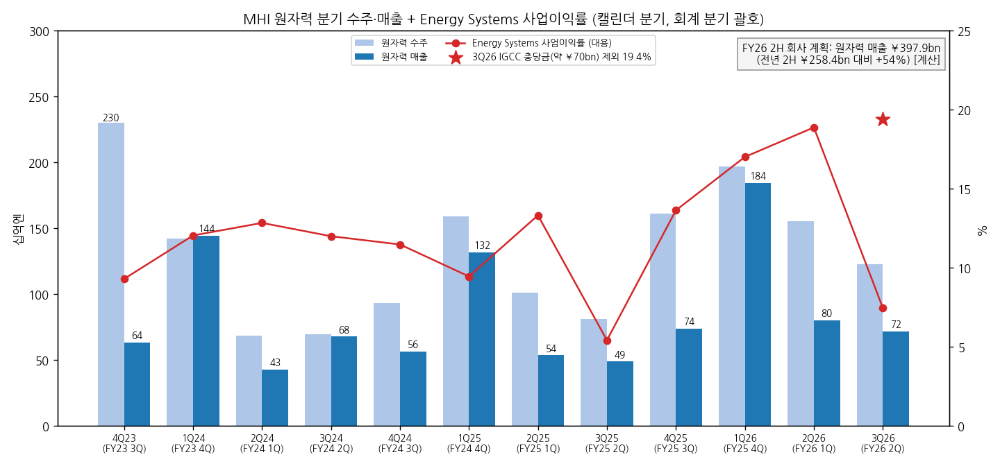
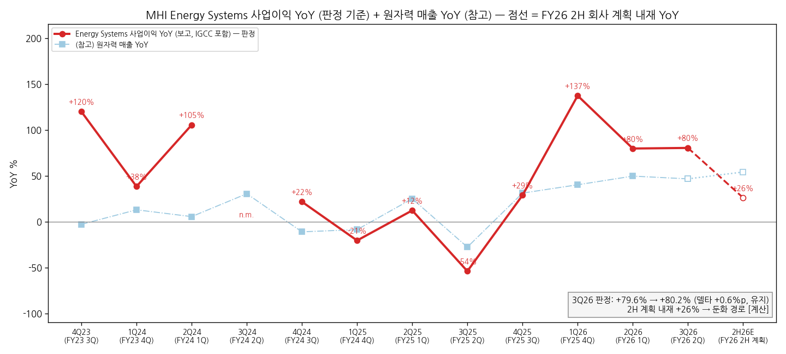
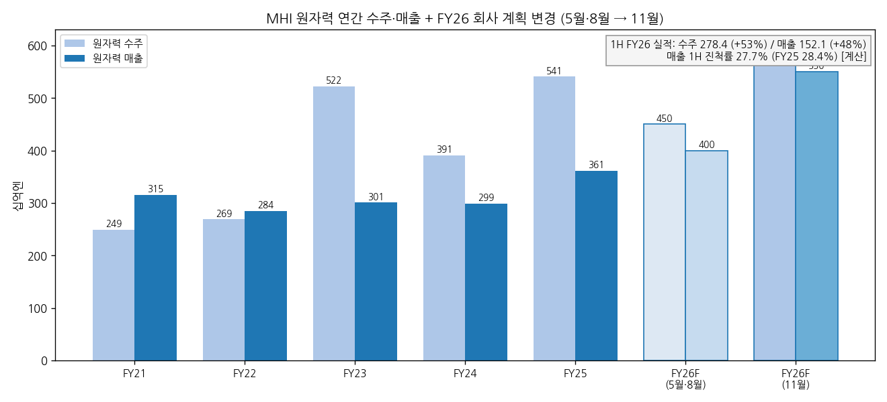

> 모드: 실적 리뷰 (v11)
> 종목: Mitsubishi Heavy — 원자력 부문 (Nuclear Power, Energy Systems 내) (7011.T, 도쿄증권거래소) / 모회사 = Mitsubishi Heavy Industries, Ltd.
> 섹터: 원전
> 서브섹터: 원전 기자재 글로벌
> 분기: 2026-Q3 (캘린더 2026-07\~09 = **회계 FY2026 2Q**. MHI는 3월 결산 — FY26 1Q = 2Q26, FY26 2Q = 3Q26. 회사는 누적(1Q·1H)만 공시 → 분기 단독값은 1H − 1Q [계산])
> 발표일: 2026-11-06 (1H FY2026 결산 발표·설명회, 결산단신 + 자사주 매입 공시 동시)
> 작성 시각: 2026-11-16 15:40 KST
> 분석 소스: 회사 1H FY2026 결산 설명자료(Financial Results presentation, 2026-11-06)·결산단신(Consolidated Financial Results, 영문판)·설명회 Q&A 요지(2026-11-06, 8쪽 중 6\~7쪽은 이미지 → OCR 판독) + FY26 1Q·FY25 결산·FY25 2Q\~3Q 설명자료·Q&A 요지 / 같은 폴더 `company-overview/7011.T_기업개요.md` (원자력 26분기·Energy Systems 30분기 시계열, `quarterly.json`) 재사용 / 주가 Yahoo Finance 7011.T / 웹 보완 — 롯카쇼·원자력 관련 신규 보도는 기업개요 이후(11/15\~) 추가 확인 못 함. 셀사이드 리포트 첨부 없음
> 델타 판정 기준: **Energy Systems 사업이익(보고치, IGCC 충당금 포함) YoY와 직전 분기 대비 변화** — v11 이익 기준 (BT 결정 2026-11-16: 이익이 출렁이는 종목도 보고 이익으로 엄격히 판정, TTM 평활·매출/수주 대체 불가). 원자력 이익 미공시 → 원자력을 포함하는 최소 공시 이익 단위 = Energy Systems. 원자력 매출·수주·TTM, IGCC 제외 이익은 참고 행으로만
> 리뷰 깊이: 숫자 중심 | 리서치 첨부 0건 (1차 출처: 회사 IR 決算説明資料·決算短信·Q&A 요지. 보도 인용은 "보도" 표기, 비공식 요약·판독 추정은 "비공식" 표기)
> 다음 발표: FY26 3Q(=4Q26) 결산 — **2027-02 초 예상** (회사 미공지, 전년 2026-02-04)

> **분석 단위·지표 정의 (멀티 세그먼트 피어 룰 — 원자력 부문만 추출)**: 숫자의 중심은 **Energy Systems 부문 'Nuclear Power' 사업의 수주·매출**이다. 회사는 원자력 **사업이익·수주잔고를 공시하지 않는다** → 이익률은 포함 부문인 **Energy Systems 사업이익률(Profit from Business Activities 기준)을 대용**으로 쓴다 (원자력은 FY25 Energy Systems 매출의 17.5%라 대용 지표는 GTCC·증기발전 영향을 크게 받는다). **성장 델타 판정은 Energy Systems 사업이익(보고치) YoY로 한다** — 원자력 매출·수주 YoY는 사업 흐름을 보여주는 참고 지표. 단위 **십억엔(¥bn)**
> 원화 환산 참고: 2026-11-13 현물 **₩8.34/¥** (Yahoo JPYKRW=X) → 3Q26 원자력 매출 ≈ **₩5,990억**, 수주 ≈ ₩1.02조 [계산]
> 분기 영업이익 공시: ✗ (원자력 이익 미공시, Energy Systems 사업이익만 분기 누적 공시) → 섹터 합산 시 이익 델타는 Energy Systems 사업이익(보고) YoY, 원자력 매출·수주 YoY는 참고 병기
> 모회사 트리거: **발동 2건** — (2-2) 자사주 매입 최대 ¥300bn, (2-4) 그룹 FY26 가이던스 매출·사업이익 +11% → 2번 ⑤에 맥락으로만 기재

# Mitsubishi Heavy 원자력 3Q26 (FY26 2Q) 실적 리뷰

## 0. 한 줄 판정

> 성장 델타: 유지 | 내러티브: 강화 → 델타 유지(ES 사업이익 YoY +79.6% → +80.2%, 단 회사 2H 계획은 +26%로 둔화 경로) + 내러티브 강화 → 관심 구간 (원자력 매출은 강하지만 판정 이익 단위가 Energy Systems이고, 매매 수단 7011.T의 주가는 GTCC·방산·그룹 이슈가 결정 — 순수 노출 아님)

→ 숫자(판정): Energy Systems 사업이익(보고, IGCC 충당금 포함) ¥43.8bn, 이익률 7.5%. 사업이익 YoY 1Q26 +137.2% → 2Q26 +79.6% → **3Q26 +80.2% (델타 +0.6%p, ±5%p 이내 → 유지)**. 3Q25 기저가 ¥24.3bn(이익률 5.4%)으로 낮았던 덕이 크다 — 보고 이익률 자체는 2Q26 18.9% → 7.5%로 급락 [계산]
→ 참고: 원자력 매출 ¥71.8bn (+46.5% YoY), 수주 ¥122.9bn (+51.7% YoY), TTM 매출 ¥410.5bn(사상 최고). 원자력 사업 흐름은 강하지만 판정에는 쓰지 않는다
→ 쟁점 ①: **FY26 원자력 계획 상향 — 수주 ¥450bn → ¥600bn, 매출 ¥400bn → ¥550bn (+52% YoY)**. 회사 설명은 "핵연료 사이클 공사 추가"와 "프로젝트 순조 진행". 다만 상반기 매출 진척률은 27.7%로 최근 4년 중 가장 낮다 → **하반기에 ¥397.9bn(+54% YoY, 역대 최대 하반기 ¥258.4bn의 1.5배)이 몰린 계획**이다 [계산]
→ 쟁점 ②: 원자력 마진은 미공시. 대용 지표인 Energy Systems 사업이익률은 3Q26 **7.5%**까지 내려왔지만, 증기발전 IGCC 충당금(약 ¥70bn, 원자력과 무관)을 빼면 **19.4%**로 분기 최고다 (설명회에서 질문자가 "20% 바로 아래"로 계산, 회사 반박 없음)
→ 쟁점 ③: 설명회 Q&A 질문 11개 중 **원자력 질문은 0개**였다 — 시장 관심은 IGCC·GTCC(데이터센터)·자사주 ¥300bn에 쏠렸다. 원자력 신규 정보는 설명자료의 **원자력 생산능력 투자 약 ¥100bn ("신규 건설 대비")** 1줄
→ 다음 분기 관건: 4Q26(FY26 3Q) Energy Systems 사업이익 **¥116bn 이상(YoY +75% 이상)이어야 "유지"**, ¥119bn 초과면 "가속". 회사 2H 계획(ES 사업이익 ¥234.9bn, YoY +26%)을 FY25 분기 배분대로 나누면 4Q26 약 ¥83bn(+26%) → **기본값은 "둔화"** `[추정]`. 원자력 매출은 ¥110bn 이상(YoY +49%)이 계획 경로 확인선 (참고) [계산]

## 1. 숫자

① 원자력 + Energy Systems 분기 표 (¥bn) — 캘린더 분기 (회계 분기)

| 항목 | 4Q23 (FY23 3Q) | 1Q24 (FY23 4Q) | 2Q24 (FY24 1Q) | 3Q24 (FY24 2Q) | 4Q24 (FY24 3Q) | 1Q25 (FY24 4Q) | 2Q25 (FY25 1Q) | 3Q25 (FY25 2Q) | 4Q25 (FY25 3Q) | 1Q26 (FY25 4Q) | 2Q26 (FY26 1Q) | **3Q26 (FY26 2Q)** | FY26 2H 계획 (4Q26+1Q27) |
|---|---|---|---|---|---|---|---|---|---|---|---|---|---|
| 원자력 매출 (참고) | 63.5 | 144.4 | 43.0 | 67.9 | 56.4 | 131.7 | 53.7 | 49.0 | 73.9 | 184.5 | 80.3 | **71.8** | 397.9 |
| 원자력 수주 (참고) | 230.0 | 142.1 | 68.6 | 69.9 | 93.3 | 159.0 | 101.4 | 81.0 | 161.2 | 197.0 | 155.5 | **122.9** | 321.6 |
| 원자력 매출 YoY | −3.1% | +12.8% | +5.4% | +30.3% | −11.2% | −8.8% | +24.9% | −27.8% | +31.0% | +40.1% | +49.5% | **+46.5%** | +54.0% |
| 원자력 수주 YoY | +334.8% | +43.7% | +27.7% | −27.5% | −59.4% | +11.9% | +47.8% | +15.9% | +72.8% | +23.9% | +53.4% | **+51.7%** | −10.2% |
| 원자력 매출 YoY 델타 (%p, 참고) | −2.9 | +15.9 | −7.4 | +24.9 | −41.5 | +2.4 | +33.7 | −52.7 | +58.9 | +9.1 | +9.4 | **−3.0** | +7.5 |
| 원자력 수주 YoY 델타 (%p, 참고) | n.m. | n.m. | −15.9 | −55.2 | −31.9 | +71.3 | +35.9 | −31.9 | +56.9 | −48.9 | +29.5 | **−1.6** | n.m. |
| 원자력 매출 TTM (참고) | 284.4 | 300.8 | 303.0 | 318.8 | 311.7 | 299.0 | 309.7 | 290.8 | 308.3 | 361.1 | 387.7 | **410.5** | 550.0 (FY26) |
| 원자력 매출 TTM YoY (참고) | −13.9% | +5.8% | +5.8% | +11.3% | +9.6% | −0.6% | +2.2% | −8.8% | −1.1% | +20.8% | +25.2% | **+41.2%** | +52.3% (FY26) |
| Energy Systems 매출 | 453.4 | 530.9 | 391.5 | 440.6 | 446.7 | 536.9 | 423.2 | 447.8 | 483.7 | 707.9 | 536.3 | **586.2** | 1,527.5 |
| **Energy Systems 사업이익 (보고, 판정 기준)** | 42.2 | 64.0 | 50.3 | 52.9 | 51.3 | 50.8 | 56.4 | 24.3 | 66.0 | 120.5 | 101.3 | **43.8** | 234.9 |
| Energy Systems 사업이익률 | 9.3% | 12.1% | 12.8% | 12.0% | 11.5% | 9.5% | 13.3% | 5.4% | 13.6% | 17.0% | 18.9% | **7.5%** | 15.4% |
| (참고) IGCC 충당금 제외 이익률 | | | | | | | | | | | | **19.4% (113.8)** | |
| Energy Systems 매출 YoY | +5.3% | −1.5% | +6.9% | +7.2% | −1.5% | +1.1% | +8.1% | +1.6% | +8.3% | +31.8% | +26.7% | **+30.9%** | +28.2% |
| **Energy Systems 사업이익 YoY (판정)** | +119.8% | +38.2% | +105.3% | n.m. | +21.6% | −20.6% | +12.1% | −54.1% | +28.7% | +137.2% | +79.6% | **+80.2%** | +26.0% |
| **ES 사업이익 YoY 델타 (%p, 판정)** | n.m. | n.m. | n.m. | n.m. | n.m. | −42.2 | +32.8 | −66.2 | +82.7 | +108.5 | −57.6 | **+0.6** | −54.2 |

→ (출처: 회사 결산 설명자료 FY23 3Q\~FY26 2Q 'Main Businesses'·세그먼트 누적표 → 분기 단독 차감 [계산]. FY26 2H 계획 = 2026-11-06 연간 계획 − 1H 실적 [계산]. 2H 계획 YoY 기저 = FY25 2H (원자력 매출 258.4·수주 358.2, Energy 매출 1,191.6·사업이익 186.5). YoY·TTM·델타 [계산]. 3Q24 ES 사업이익 YoY는 기저 ¥10.8bn이라 n.m. 처리)
→ **기준 단절**: Energy Systems는 FY24(2024-04)·FY25(2025-04)·FY26(2026-04) 조직개편으로 소급 조정 — 4Q23\~1Q24는 원 공시치, 2Q24\~1Q25는 2025-04 소급치, 2Q25 이후는 2026-04 소급치. YoY가 기준이 섞인 구간은 ±수%p 오차 가능. **원자력 수치는 재작성 전후 동일** (기업개요 확인)
→ **컨센 대비**: 원자력·Energy Systems 컨센서스 [미확보] — 셀사이드 없음. 회사 연간 계획 대비로 판단: 1H 진척률 원자력 매출 **27.7%** (FY25 28.4%, FY24 37.1%, FY23 30.9%), 수주 46.4%, Energy Systems 사업이익 38.2% [계산]
→ **판정 근거 (v11 이익 기준)**: Energy Systems 사업이익(보고) YoY 2Q26 +79.6% → 3Q26 +80.2%, 델타 **+0.6%p** → ±5%p 이내라 **유지**. 2개 분기 연속 둔화가 아니므로(1Q26 → 2Q26 −57.6%p 후 3Q26 +0.6%p) 꺾임 조건에도 해당하지 않는다. IGCC 충당금을 포함한 보고치 그대로 판정한다 — 충당금 제외 이익률 19.4%는 참고
→ **이익의 질**: YoY +80%는 3Q25 기저(¥24.3bn, 이익률 5.4% — 회사 1H FY25 bridge상 남아공 프로젝트 등 일회성 −¥30bn이 1H에 있었고 분기 배분은 미공시)가 낮아서 나온 숫자다. 보고 이익률은 QoQ −11.4%p(18.9% → 7.5%)로 급락 — 엄격히 보면 "고원 유지"가 아니라 **"낮은 기저 위의 유지"** `[판단]`
→ **경로**: 회사 2H 계획은 ES 사업이익 ¥234.9bn(YoY **+26.0%**), 이익률 15.4%. 1H 실적 YoY +79.8%에서 크게 낮아지는 계획 → **4Q26\~1Q27 판정은 "둔화"가 기본값** [계산]. 원자력 매출 2H 계획은 +54%로 가속이지만 판정 이익 단위(ES)에서는 GTCC 신규 기 비중 확대·증기발전이 섞여 이익 YoY가 내려간다 `[판단]`
→ **참고 — 원자력 매출 흐름**: 단일 분기 매출 YoY 델타 −3.0%p, TTM YoY +25.2% → +41.2%. 회계 4Q(1\~3월)에 연 매출의 44\~55%가 몰려 분기값은 공사 타이밍 노이즈가 크다. 2H 수주 계획은 −10% YoY라 수주 YoY는 마이너스로 찍힐 수 있다 [계산]

→ (출처: 회사 결산 설명자료 누적표 → 분기 차감 [계산]. 사업이익률은 Energy Systems 부문 대용 지표. ★ = IGCC 충당금 약 ¥70bn 가산 [계산, 충당금 규모는 회사 1H 이익 bridge 기준])

→ (출처: 회사 결산 설명자료 [계산]. 판정 시계열 = Energy Systems 사업이익(보고, IGCC 포함) YoY. 점선 = 2026-11-06 연간 계획 − 1H 실적으로 구한 FY26 2H 내재 YoY. |YoY| 200% 초과는 절단 표시)

② 사업별 (Energy Systems 내, ¥bn — 원자력 외 사업은 맥락)

| 사업 | 항목 | 1H FY25 | **1H FY26** | YoY | 3Q25 (FY25 2Q) | **3Q26 (FY26 2Q)** | 분기 YoY | FY26 계획 (8월 → 11월) |
|---|---|---|---|---|---|---|---|---|
| **원자력** | 수주 | 182.4 | **278.4** | **+52.6%** | 81.0 | **122.9** | **+51.7%** | 450 → **600** |
| | 매출 | 102.7 | **152.1** | **+48.1%** | 49.0 | **71.8** | **+46.5%** | 400 → **550** |
| | 애프터서비스 비율 | 71% | 71% | 0%p | (≈68%) | (≈77%) | — | — |
| GTCC | 수주 | 1,438.7 | 1,568.7 | +9.0% | | | | 2,400 → 3,000 |
| | 매출 | 427.3 | 587.1 | +37.4% | | | | 1,100 → 1,280 |
| 증기발전 | 매출 | 180.3 | 175.9 | −2.4% | | | | 330 → 400 |
| 항공엔진 | 매출 | 125.7 | 171.3 | +36.3% | | | | 260 → 330 |
| **Energy Systems 합계** | 매출 | 871.0 | **1,122.5** | +28.9% | 447.8 | **586.2** | +30.9% | 2,200 → 2,650 |
| | 사업이익 | 80.7 | **145.1** | +79.8% | 24.3 | **43.8** | +80.2% | 340 → 380 |
| | 사업이익률 | 9.3% | **12.9%** | +3.6%p | 5.4% | **7.5%** | +2.1%p | 15.5% → 14.3% |
| | 사업이익률 (IGCC 제외) | — | **19.2%** | — | — | **19.4%** | — | 약 17% (Q&A 질문자 계산) |
| | 수주잔고 (기말) | — | **8,064.0** (FY25말 6,983.2) | +15.5% (반기) | | | | |

→ (출처: 1H FY26 결산 설명자료 p.10\~11·p.18\~19·p.23 / FY26 1Q 설명자료 / 1H FY25 설명자료. 분기값·YoY·IGCC 제외 [계산]. 사업별 사업이익은 미공시)
→ **애프터서비스 분기 비율 (≈ 표기)은 비공식 근사** — 회사는 1Q(FY25 74% → FY26 66%)와 1H(71% → 71%) 누적 비율만 공시, 반올림된 비율로 2Q 단독을 역산하면 FY25 2Q 약 68% → **FY26 2Q 약 77%**, 애프터서비스 매출 약 ¥33bn → 약 ¥55bn [계산, ±수 ¥bn 오차]. 3Q26 원자력 증가분(+¥22.8bn)의 대부분이 정비·개조·연료사이클 공사 등 **애프터서비스 쪽에서 나왔다**는 뜻 `[판단]`
→ **원자력은 Energy Systems 매출 증가의 주역은 아니다**: 1H Energy 매출 +¥251.5bn 중 GTCC +¥159.8bn(64%), 원자력 +¥49.4bn(20%), 항공엔진 +¥45.6bn(18%) [계산]. 그러나 **성장률은 원자력이 1위**(+48%, GTCC +37%)
→ **이익 대용 지표의 한계**: 1H 회사 설명은 사업이익 증가 요인으로 "GTCC·항공엔진·원자력"을 들었고, 감소 요인은 증기발전 IGCC 손실이다 (설명자료 p.11). 원자력이 Energy 이익률을 끌어내린 흔적은 공시상 없다

③ FY26 계획 변화 (¥bn)

| 항목 | 5/12 계획 | 8/4 계획 | **11/6 계획** | 변화 (8월 → 11월) | FY25 실적 | FY26 YoY |
|---|---|---|---|---|---|---|
| **원자력 수주** | 450.0 | 450.0 | **600.0** | **+150.0 (+33%)** | 540.6 | +11.0% |
| **원자력 매출** | 400.0 | 400.0 | **550.0** | **+150.0 (+38%)** | 361.1 | **+52.3%** |
| Energy Systems 수주 | 3,450.0 | 3,550.0 | **4,400.0** | +850.0 | 3,936.7 | +11.8% |
| Energy Systems 매출 | 2,200.0 | 2,200.0 | **2,650.0** | +450.0 | 2,062.6 | +28.5% |
| Energy Systems 사업이익 (이익률) | 340.0 (15.5%) | 340.0 (15.5%) | **380.0 (14.3%)** | +40.0 | 267.2 (13.0%) | +42.2% |
| (맥락) 그룹 매출 | 5,400.0 | 5,400.0 | **6,000.0** | +600.0 (+11%) | 4,974.1 | +20.6% |
| (맥락) 그룹 사업이익 | 540.0 | 540.0 | **600.0** | +60.0 (+11%) | 432.2 | +38.8% |

→ (출처: FY25 결산 설명자료 p.17\~20(5/12), FY26 1Q 설명자료(8/4), 1H FY26 설명자료 p.16\~19(11/6). YoY [계산])
→ 원자력 상향 폭(매출 +¥150bn)은 **Energy Systems 매출 상향(+¥450bn)의 1/3**이다 — GTCC(+¥180bn)와 비슷한 크기 [계산]
→ 회사 설명: 수주 상향 = "further nuclear fuel cycle work" / 매출 상향 = "steady project execution" (p.18). FY25 3Q(2026-02)에도 원자력 수주 상향 사유는 "핵연료 사이클 관련 프로젝트 증가"였다 (FY25 3Q Q&A — 질문자는 롯카쇼 재처리공장 포함 여부를 물었음)
→ 2023-06 원자력 사업 설명회에서 회사가 '2030년대 초 신규 건설 개시 시' 수준으로 제시한 매출 약 ¥400bn을 FY26 계획 ¥550bn이 **수년 앞당겨 넘었다** (기업개요 ⑥ 정리) `[판단: 계획 기준]`

④ 연간 (¥bn)

| 항목 | FY21 | FY22 | FY23 | FY24 | FY25 | FY26F (11/6) |
|---|---|---|---|---|---|---|
| 원자력 수주 | 249.2 | 268.7 | 522.2 | 390.8 | 540.6 | 600.0 |
| 원자력 매출 | 315.2 | 284.4 | 300.8 | 299.0 | 361.1 | 550.0 |
| 원자력 매출 YoY | +7.7% | −9.8% | +5.8% | −0.6% | +20.8% | **+52.3%** |
| 원자력 수주 YoY | +5.6% | +7.8% | +94.3% | −25.2% | +38.3% | +11.0% |
| Book-to-bill | 0.79 | 0.94 | 1.74 | 1.31 | 1.50 | 1.09 |
| Energy Systems 매출 | 1,651.0 | 1,738.6 | 1,761.5 | 1,815.7 | 2,062.6 | 2,650.0 |
| Energy Systems 사업이익률 | 5.2% | 4.9% | 8.0% | 11.3% | 13.0% | 14.3% (IGCC 제외 약 17%, Q&A 질문자 계산) |

→ (출처: 회사 결산 설명자료 각 연도, 기업개요 ③ (1). FY23 Energy는 원 공시치. YoY·B/B [계산]. FY27 이후 원자력 계획·컨센 [미확보] — 회사는 2027 중기경영계획(2027-05 예상)에서 제시할 전망)
→ FY20\~FY24 '¥300bn 박스'를 FY25(+21%)에 벗어났고, FY26 계획은 +52% — **2년 연속 +20% 이상이면 기업개요의 분류 재평가 트리거 ①(지속성장 → 고성장) 발동** 조건에 해당한다 `[전망]`
→ 그룹 컨센 변화(발표 전 → 후) [미확보]

→ (출처: 회사 결산 설명자료 FY21\~FY25, FY26 계획 5/12·8/4·11/6. 진척률 [계산])

## 2. 시장 쟁점

① 2-0 지난 분기 체크

→ 첫 리뷰 — 직전 체크 없음
→ 참고로 기업개요(2026-11-15) 분류 재평가 트리거 점검: ① 원자력 매출 2년 연속 +20% — FY25 +20.8% 확인, FY26 계획 +52% (진행 중) / ② SRZ-1200 첫 정식 수주 — 미발생 / ③ 매출 ¥300bn 아래 복귀 — 해당 없음 / ④ 원자력 이익 별도 공시 — 미발생

② 이번 분기 쟁점 4개 (회사 설명 + Q&A 반복 질문 기준. Q&A 요지는 질문자 소속 미공개 — "Participant 1\~4"로만 구분)

| # | 쟁점 | 근거 |
|---|---|---|
| (1) | 원자력 계획 +¥150bn 상향의 구성과 하반기 몰림 (2H 매출 +54% 필요) | 설명자료 p.11·p.18 (Q&A 질문 0건 — 숫자에서 도출 `[판단]`) |
| (2) | 원자력 마진 — 미공시, Energy Systems 이익률(대용)의 IGCC 착시 | Q&A 질문 4건 (IGCC 충당금 2건, ES 이익률 2건) |
| (3) | 재가동·연료사이클·신규 건설 파이프라인 — ¥550bn 이후 지속성 | 설명자료 p.25 원자력 생산능력 투자 약 ¥100bn (Q&A 질문 0건) |
| (4) | 그룹 맥락 — 시장 관심은 GTCC·데이터센터·자사주, 주가 반응 | Q&A 질문 7건 (GTCC·데이터센터·잔고 5건, 자사주 2건) |

→ **Q&A 11개 질문 중 원자력 0개** — 4명의 질문자 모두 IGCC·GTCC·자사주에 질문을 썼다. 원자력은 시장이 "그룹 안의 조용한 성장 사업"으로 보고 있다는 신호 `[판단]`

③ 쟁점별 분해

(1) **원자력 계획 상향의 구성과 하반기 몰림**

(1-1) 회사 설명
→ "In Nuclear Power, both order intake and revenue strong" (1H 설명자료 p.11). 1H 그룹 하이라이트: 수주는 "GTCC·원자력·금속기계에서 크게 증가", 매출은 "GTCC·방산·원자력에서 크게 증가", 사업이익은 "GTCC·원자력에서 크게 증가" (p.5)
→ 수주 상향: "further nuclear fuel cycle work in Nuclear Power" / 매출 상향: "steady project execution" (p.18)
→ 이익 bridge: "GTCC·원자력·방산이 당초 예상보다 강하다 → 사업이익 ¥700bn 이상으로의 지속 성장 궤도" (p.17)

(1-2) 숫자로 본 해석
→ 2H 원자력 매출 계획 ¥397.9bn = FY25 2H(¥258.4bn)의 **1.54배**, FY23 2H(¥207.9bn)·FY24 2H(¥188.1bn)의 2배 [계산]
→ 1H 진척률 27.7%는 FY23(30.9%)·FY24(37.1%)·FY25(28.4%)보다 낮다 — **연간 상향 ¥150bn이 사실상 전부 하반기 몫** [계산]
→ FY25 패턴(회계 3Q = 2H의 29%)을 그대로 쓰면 4Q26 ≈ ¥114bn, 1Q27 ≈ ¥284bn `[추정]` — 1Q27(회계 4Q) 단일 분기가 FY25 연간의 79%에 해당하는 크기 [계산]
→ 원자력 매출 구성(FY25, 회사 막대 차트 판독 — 비공식 추정): 국내 경수로 약 54%, 핵연료 사이클 약 30%, 차세대로·기타 약 16% (기업개요 ① (1)). 상향 사유가 연료사이클이라 **롯카쇼 재처리공장·J-MOX 공정이 하반기 매출의 핵심 변수** `[판단]`

(1-3) 공통 vs 갈림
→ 공통(회사·숫자): 수주(B/B 1H 1.83)가 매출보다 빠르게 쌓여 있어 매출 레벨업 자체는 근거가 있다 — FY20\~1H FY26 누적 수주가 누적 매출을 약 ¥480bn 초과 (기업개요 [계산])
→ 갈림: 하반기 ¥398bn이 **공사 진행률 인식(진척 기준)으로 고르게 나오는지**, 아니면 **준공·검수 시점에 한꺼번에 인식되는 구조**라 롯카쇼 등 일정이 밀리면 FY27로 넘어가는지 — 회사는 인식 방식을 따로 설명하지 않았다 [미확보]

(1-4) [판단]
→ 회사가 8월까지 유지하던 계획을 반년 만에 +38% 올린 건 **수주 확정 + 공정 가시성**이 있다는 뜻으로 읽는다. 다만 FY23\~FY25에도 원자력 매출은 연말(1\~3월)에 크게 몰렸고 계획 대비 결과가 공시된 적이 적어 신뢰 이력이 짧다. **4Q26 원자력 매출 ¥110bn 이상**(9M 진척률 약 48%, FY25 49%와 비슷)이면 계획 신뢰도 확인, **¥90bn 미만**이면 FY26 ¥550bn 하향 또는 1Q27 단일 분기 의존도가 과도하다는 신호

(2) **원자력 마진 — 대용 지표의 IGCC 착시**

(2-1) 회사 설명
→ IGCC(나코소·히로노 석탄가스화 복합발전, 2021년 인도) 부품 교체 비용 약 ¥70bn 충당금 — "해당 부품은 두 발전소에만 쓰였다, 다른 플랜트로 번지지 않는다", "현재 최선의 추정" (CFO, Q&A Participant 3)
→ "Energy Systems 2Q 단독 이익률이 IGCC 제외 20% 바로 아래"라는 질문에 회사는 수치를 반박하지 않고 GTCC 애프터서비스·신규 기 마진 개선을 설명 (Q&A Participant 2)
→ ES 이익률 중장기: "예전에 20% 가능성을 말했지만, 마진이 낮은 GTCC 신규 기 비중이 커져 ES 전체 25%는 쉽지 않다. 다만 이익 금액은 예전 예상보다 더 커질 여지" (CFO, Q&A Participant 3)
→ 원자력 이익 언급은 없음. 직전 FY25 결산 Q&A(2026-05)에서 애널리스트가 "이미 마진이 높은 원자력"이라고 전제했고 회사는 부정하지 않았다

(2-2) 숫자로 본 해석
→ ES 사업이익률 IGCC 제외: 1H **19.2%**, 3Q26 **19.4%**, FY26 계획 약 17% (IGCC 제외, Q&A 질문자 계산 — 회사 반박 없음) [계산]
→ 원자력 매출 중 애프터서비스(정비·개조) 71% — GTCC(42%)보다 높다 (1H FY26, 설명자료 p.23). 애프터서비스 비중이 높을수록 마진이 높다는 게 회사의 GTCC 설명 논리다 (Q&A Participant 2·3) → 원자력이 ES 평균보다 마진이 높을 개연성 `[판단]`
→ 정량화 불가: 원자력 이익을 ES 평균 이익률(IGCC 제외 약 17\~19%)로 가정하면 3Q26 원자력 이익 약 ¥12\~14bn `[추정 — 회사 미공시, 가정치]`

(2-3) 공통 vs 갈림
→ 공통: ES 대용 이익률이 3Q26에 급락한 원인은 증기발전 IGCC이고 원자력과 무관 (회사 p.11 "Steam Power recognized losses related to IGCC plants")
→ 갈림: 원자력 마진이 ES 평균보다 높은지 낮은지는 공시로 확인 불가 — 연료사이클 대형 공사는 신규 공사 성격이라 정비보다 마진이 낮을 수도 있다 `[판단]`

(2-4) [판단]
→ 섹터 합산에서 MHI의 이익 델타는 **ES 사업이익 보고치(IGCC 포함)**로 판정하고, IGCC 제외치와 원자력 매출·수주 YoY는 참고로 병기한다. 원자력 마진이 숫자로 나오는 유일한 경로는 회사가 2027 중기경영계획에서 원자력 이익을 따로 내는 경우다 (기업개요 트리거 ④)

(3) **재가동·연료사이클·신규 건설 파이프라인**

(3-1) 회사 설명
→ 1H 설명자료 Capital Allocation(p.25): 생산능력 증설 계획에 **원자력 약 ¥100bn — "Includes upgrades to large composite machine tool in anticipation of new builds"** (GTCC 약 ¥500bn, 방산 ¥250bn, 상선 ¥100bn, 엔진 ¥100bn과 함께). 원자력 증설 투자를 **신규 건설 대비**라고 명시한 것
→ 원자력 Q&A 없음. 직전 공개 발언: CFO "신규 건설 매출은 2030년대 후반", "원자력 인력 FY25\~27 약 10% 증원" (보도 — Reuters 2026-03-04, 기업개요 인용)

(3-2) 숫자·사실로 본 파이프라인 (기업개요 정리, 2026-11-15 기준)
→ **재가동**: 일본 재가동 누적 15기 중 PWR 12기 전부 MHI 건설. 다음은 홋카이도 도마리 3호기 **2027년 초 재가동 예정** (보도 — nippon.com 2026-10-06). BWR은 가시와자키가리와 6호기 2026-01 재가동. 감소 요인 — 주부전력 하마오카 내진 데이터 문제로 3·4호기 심사 신청 철회 (보도)
→ **연료사이클**: 롯카쇼 재처리공장 준공 목표 FY2026 내(2027-03), 27차례 연기. NRA 설명이 예정보다 반년 이상 늦어져 추가 연기 관측 (보도 — 교도 2026-06-08). 이후 진척 보도는 이번 리뷰에서 추가 확인 못 함 [미확보]
→ **신규 건설**: 간사이전력 미하마 신설 사전조사 2027-03 전후 완료, 상세조사 2027-04\~2030, 후보 노형 SRZ-1200 거론 (보도 — WNN 2025-11-05, Reuters 2026-03-04). 2026-08 경산성 보조사업 3건(SRZ 요소기술·표준로형 / 국산 SMR / 공급망) 채택 (회사 보도자료 2026-08-05)
→ **해외**: EDF 크뤼아스 2호기 교체 증기발생기 3기 납품(2026-10), 잔여 6기 2028\~ (회사 보도자료 2026-10-15)

(3-3) 공통 vs 갈림
→ 공통: FY26\~FY27은 재가동 공사 + 연료사이클 공사로 매출이 받쳐진다
→ 갈림: **롯카쇼 준공 후(공사 종료) → 신규 건설 착공(2030년대) 사이에 공백이 생기는지** — 2023 설명회는 준공 후 40년 정비·고도화 매출로 이어진다고 설명했지만, 공사 피크 대비 규모는 미공시

(3-4) [판단]
→ "신규 건설 대비 ¥100bn 증설"은 회사가 SRZ-1200 수주 가능성을 투자로 먼저 반영하기 시작했다는 첫 숫자다. 다만 투자 시점은 FY27 이후(2027 MTBP)이고 첫 수주는 미정 — **내러티브 강화 요인이지만 매출 델타에는 2030년대까지 영향 없음**

(4) **그룹 맥락 — 모회사 트리거 2건과 주가 반응** (멀티 세그먼트 룰: 맥락으로만)

(4-1) 회사 발표
→ 그룹 3Q26 단독: 매출 ¥1,329.0bn (+23.1% YoY), 사업이익 ¥89.7bn (+19.8%, 이익률 6.7%). IGCC 충당금 제외 시 사업이익 약 ¥159.7bn (12.0%) [계산 — 1H − 1Q, FY25 Logisnext 제외 재작성 기준]
→ FY26 그룹 계획 매출 ¥5.4조 → **¥6.0조**, 사업이익 ¥540bn → **¥600bn**, 순이익 ¥380bn → ¥440bn, ROE 12% → 14%. **자사주 최대 ¥300bn / 1.2억 주(3.6%), 2026-11-09\~2027-11-08 시장 매입 후 전량 소각** (결산단신)
→ 정상화 이익: "FY26 ¥600bn + IGCC 약 ¥70bn + 리스크 버퍼 ¥20bn = ¥690bn을 2027 MTBP 출발점으로 봐도 되나" → CFO "맞다" (Q&A Participant 1)
→ 시장 질문의 중심: 가스터빈 수요(데이터센터 비중, 연 70GW+ → 2026년 약 100GW), GTCC 잔고 약 ¥6조·취소 없음, GTCC 증설 약 ¥500bn, 자사주 타이밍 (Q&A)

(4-2) 주가 반응
→ 11/5 ¥3,052 → **11/6 ¥2,912.5 (−4.6%)** → 11/9 ¥3,063 (+5.2%) → 11/12 ¥3,155 → **11/13 ¥2,920.5 (−7.4%)**. 사상 최고 종가 ¥5,195(2026-03-02) 대비 −43.8% [Yahoo Finance, 계산]
→ 10/28(¥3,550) → 11/6까지 6거래일 −18% — 실적 발표 전부터 하락. 11월 급락의 직접 원인 보도는 확인 못 함 [미확보]

(4-3) 공통 vs 갈림
→ 공통: 그룹 가이던스 상향·자사주는 숫자로 강하다
→ 갈림: 시장은 GTCC의 데이터센터 연동 리스크(질문 5건)를 할인하는 쪽 — 원자력 숫자는 주가 논의에 들어오지 않았다

(4-4) [판단]
→ 원자력은 그룹 매출의 약 6\~9%다. **7011.T는 원자력 델타를 사는 수단으로는 희석이 크다** — 원전 섹터 리뷰에서 MHI는 "델타 확인용 피어"로, 매매 판단은 GTCC·방산과 함께 본다

## 3. 내러티브 점검

① 성장 스토리 정의
→ "일본 PWR 24기를 모두 지은 유일한 벤더가 **재가동·대형 정비 + 롯카쇼 등 핵연료 사이클 공사**로 원자력 매출을 10년 박스(¥300bn)에서 ¥550bn으로 레벨업하고, **SRZ-1200 신규 건설**을 다음 성장 옵션으로 갖는다"

② 이번 분기가 스토리에 준 영향
→ 강화: FY26 원자력 계획 매출 +38%·수주 +33% 상향, 1H 매출 +48%·수주 +53%, 원자력 증설 약 ¥100bn을 "신규 건설 대비"로 명시, 애프터서비스(정비) 쪽 증가가 확인됨 (근사)
→ 약화 요인: 상향분이 전부 하반기(특히 1Q27 단일 분기)에 몰린 계획, 원자력 이익 미공시 지속, 시장 관심 부재(Q&A 0건)
→ 결론: 내러티브 **강화** — 회사 계획이 숫자로 스토리를 올렸다. 다만 확인은 4Q26\~1Q27

③ 국면 판단
→ 판정 이익(ES 사업이익 보고치) YoY +80.2%, 델타 +0.6%p → **델타 유지 + 내러티브 강화 → 관심 구간**. 다만 낮은 기저 덕의 유지이고, 회사 2H 계획(+26%)대로면 다음 분기는 둔화 — 원자력 매출(+47%, 2H 계획 +54%)과 판정 이익의 방향이 갈린다
→ BT 프레임상 주의점: ① 원자력 매출이 좋아도 판정 이익 단위(ES)는 GTCC·증기발전이 좌우하고, 7011.T 주가는 GTCC·방산·그룹 이슈(IGCC·데이터센터)가 결정한다 ② 2H 수주 YoY는 계획상 −10%라 수주 지표만 보면 "꺾임"으로 오독될 수 있다 `[전망]`

④ 트리거와 리스크
→ 트리거: ① 4Q26 ES 사업이익 ¥119bn 초과(YoY 가속) + 원자력 매출 ¥110bn+ (계획 신뢰도 확인) ② 롯카쇼 준공(2027-03) 또는 준공 후 정비 계약 공개 ③ SRZ-1200 첫 정식 계약·간사이 미하마 사전조사 결과 ④ 2027 MTBP(2027-05 예상)에서 원자력 매출·이익 목표 별도 제시
→ 리스크: ① 롯카쇼 28번째 연기로 연료사이클 매출 이연 ② 재가동 지연(도마리 3·하마오카 등 BWR 파이프라인 축소) ③ 그룹 리스크 전이(IGCC 추가 비용, GTCC 데이터센터 수요 조정)로 주가가 원자력과 무관하게 움직임

## 4. 향후 봐야 할 것

① **4Q26(FY26 3Q) Energy Systems 사업이익(보고) ¥116bn+ (YoY +75% 이상)** (델타 판정 1순위)
→ 무엇을: 4Q25 기저 ¥66.0bn 대비 YoY. ¥119bn 초과(+80.2%↑) 가속 / ¥116\~119bn 유지 / 그 아래 플러스면 둔화. 회사 2H 계획 배분 시 약 ¥83bn(+26%)이라 **둔화가 기본값** `[추정]`. IGCC 등 일회성도 보고치에 포함해 판정
→ 어떤 데이터로: FY26 3Q 결산 설명자료 세그먼트 표 — 9M 누적 − 1H [계산], 이익 bridge의 one-time expenses
→ 언제: 2027-02 초

② **원자력 매출 ¥110bn+ (YoY +49%), FY26 계획 수주 ¥600bn / 매출 ¥550bn 유지** (참고 — 사업 흐름)
→ 무엇을: 9M 매출 진척률 약 48%(FY25 49%) 도달 여부, ¥90bn 미만이면 ¥550bn 하향 위험. 2H 수주는 계획상 −10%라 9M B/B 1.3 이상이면 정상
→ 어떤 데이터로: FY26 3Q 설명자료 'Main Businesses' 표·계획 표
→ 언제: 2027-02 초

③ **IGCC 추가 비용 없음, ES 이익률 회복 (보고 15%+), 원자력 애프터서비스 비율 70%대**
→ 무엇을: 충당금 추가 여부(회사 "최선의 추정"), 리스크 버퍼 ¥20bn 사용 여부, 애프터서비스 비율
→ 어떤 데이터로: 설명자료 이익 bridge, Appendix 애프터서비스 비율, Q&A 요지
→ 언제: 2027-02 초

④ **롯카쇼 재처리공장 준공(2027-03 목표) — 28번째 연기 여부**
→ 무엇을: 일본원연(JNFL) 준공 시기 변경 발표, NRA 설계·공사계획 인가 진척. 연기 시 연료사이클 매출 이연 vs 추가 공사 수주 중 어느 쪽인지
→ 어떤 데이터로: JNFL 발표, NRA 심사회의, 키워드 "六ヶ所 竣工 延期", 회사 FY26 결산(2027-05)의 원자력 수주 사유
→ 언제: 2026-12 \~ 2027-03

⑤ **재가동·신규 건설 마일스톤 — 도마리 3 재가동, 미하마 사전조사, SRZ-1200, 2027 MTBP**
→ 무엇을: 도마리 3호기 재가동(2027 초), 간사이 미하마 사전조사 완료·SRZ-1200 노형 결정(2027-03 전후), 2027 MTBP의 원자력 매출 목표·원자력 증설 ¥100bn 집행 일정
→ 어떤 데이터로: 전력사·NRA 발표, MHI 보도자료, 2027 MTBP 설명자료
→ 언제: 2027-01 \~ 2027-05
