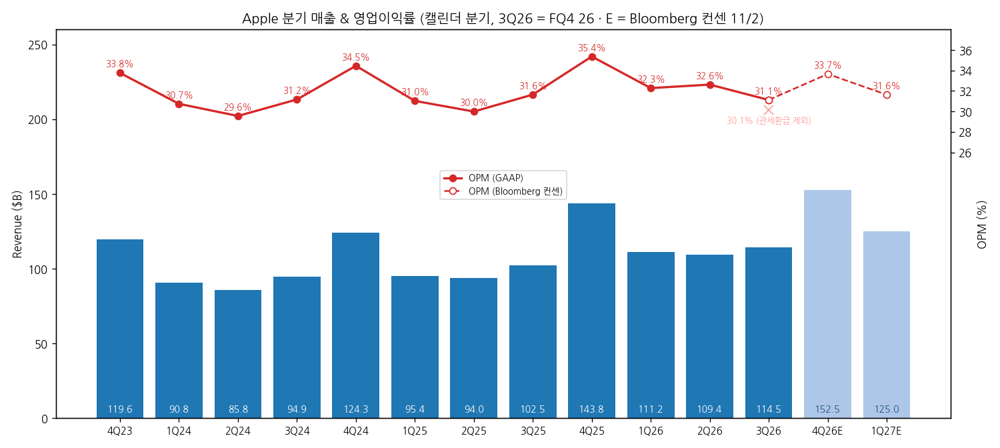
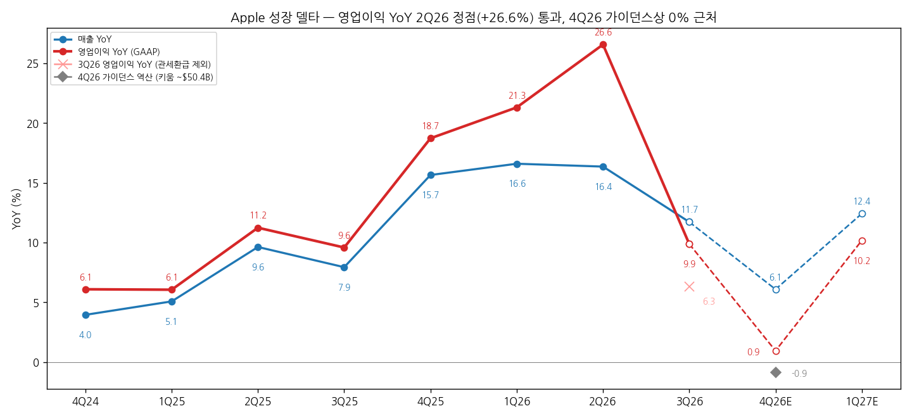
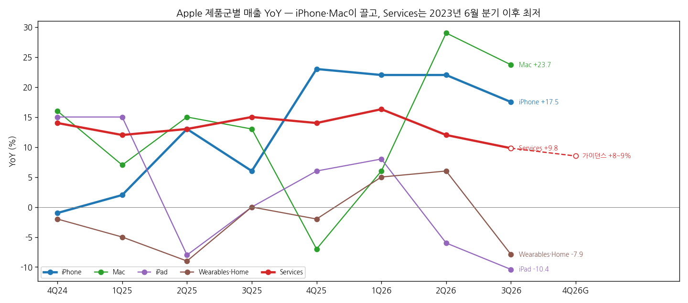
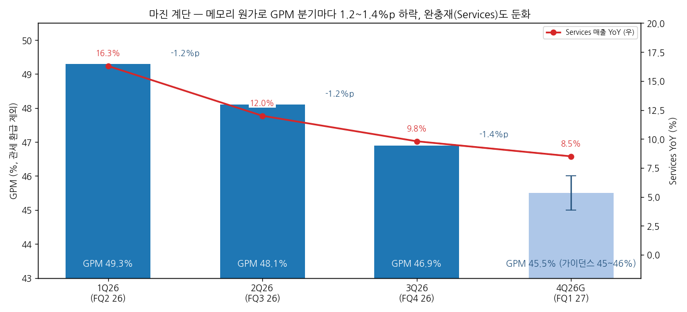

# Apple 3Q26 (FQ4 26) 실적 리뷰

> 모드: 실적 리뷰 (v11)
> 종목: Apple (AAPL)
> 섹터: 미국 빅테크
> 서브섹터: 소비자·모빌리티
> 분기: 2026-Q3 (Apple 회계 FQ4 26, 9월 분기)
> 발표일: 2026-11-02 (미 동부 장 마감 후)
> 작성 시각: 2026-11-16 13:50 KST
> 분석 소스: 해외 IB 3건(JP모건 11/02 · 에버코어 ISI 11/09 · 번스타인 11/12, 번역본) + 국내 4건(삼성 11/03 · 키움 11/03 · 하나 11/04 · 미래에셋 11/10, 커버리지 개시). 회사 IR·컨콜 원문은 첨부되지 않아 회사 발언은 리포트의 컨콜 정리를 인용. 컨센은 Bloomberg(11/2, 키움·삼성 인용). 웹서치 보완 없음
> 리뷰 깊이: 풀 | 리서치 첨부 7건

---

## 0. 한 줄 판정

> 성장 델타: **둔화** (12월 분기 가이던스상 꺾임 예고) | 내러티브: **약화** (가격 결정력 확인 ↔ 메모리 원가·Services 둔화로 이익 추정치 하향) → **경계 구간. 주가는 이익이 아니라 "AI 안전자산" 멀티플(CY27 P/E 37배, 사상 최고)로 버티는 중**

→ **숫자**: 매출 $114.5B(+11.7% YoY), 영업이익 $35.6B(+9.9%, OPM 31.1%). 컨센 대비 매출 +0.9%, 영업이익 +2.3%. 하지만 영업이익 YoY는 2Q26 **+26.6% → 3Q26 +9.9%(-16.7%p)**, 관세 환급(약 $1.1B)을 빼면 **+6.3%**. 12월 분기 가이던스 역산 영업이익 약 $50.4B = **YoY -1%** (키움)
→ **쟁점 1 — 메모리 원가**: 관세 환급 제외 GPM이 49.3% → 48.1% → 46.9% → 가이던스 중간 45.5%로 **분기마다 1.2~1.4%p 계단식 하락**. 재고(YoY 2.5배)로 늦춰 온 원가가 12월 분기 이후 본격 반영, 회사는 "메모리 가격 상승은 12월 이후에도 지속"
→ **쟁점 2 — Services 둔화**: +9.8%로 2023년 6월 분기 이후 최저, 12월 가이던스 +8~9%(컨센 +12%). 마진을 받쳐 온 완충재(전사 매출총이익의 43.7%)가 약해지는 중. 반대편엔 가격 결정력 — Mac 약 17%, iPhone 18 Pro +$100 인상에도 iPhone(+17.5%)·Mac(+23.7%) 9월 분기 사상 최대
→ **주가와 TP**: 시간외 -2.3%였지만 11/9 $350.69로 발표 전($338.32) 대비 +3.7%. AI 섹터 매도 속 "CapEx 부담 없는 안전자산"으로 자금 유입(번스타인). TP는 JPM $360 → $355 하향(EPS 하향), 에버코어 $380 유지, 번스타인 $380, 미래에셋 $410 개시 — **TP는 이익이 아니라 멀티플(34~40배)로 지탱**
→ **다음 분기 관건**: 12월 분기 영업이익이 YoY 마이너스로 확정되는지(=꺾임), 3월 분기 GPM이 45%를 지키는지, Siri AI 유료 티어 가격

---

## 1. 숫자

### ① 연결 기준 분기 표

| 항목 ($M) | 4Q23 | 1Q24 | 2Q24 | 3Q24 | 4Q24 | 1Q25 | 2Q25 | 3Q25 | 4Q25 | 1Q26 | 2Q26 | **3Q26** | 4Q26E | 1Q27E |
|---|---|---|---|---|---|---|---|---|---|---|---|---|---|---|
| (회계분기) | FQ1 24 | FQ2 24 | FQ3 24 | FQ4 24 | FQ1 25 | FQ2 25 | FQ3 25 | FQ4 25 | FQ1 26 | FQ2 26 | FQ3 26 | **FQ4 26** | FQ1 27 | FQ2 27 |
| 매출액 | 119,575 | 90,753 | 85,777 | 94,930 | 124,300 | 95,359 | 94,036 | 102,466 | 143,756 | 111,184 | 109,417 | **114,477** | 152,507 | 124,991 |
| 영업이익 | 40,373 | 27,900 | 25,352 | 29,591 | 42,832 | 29,589 | 28,202 | 32,427 | 50,852 | 35,894 | 35,695 | **35,631** | 51,332 | 39,545 |
| OPM | 33.8% | 30.7% | 29.6% | 31.2% | 34.5% | 31.0% | 30.0% | 31.6% | 35.4% | 32.3% | 32.6% | **31.1%** | 33.7% | 31.6% |
| 매출 YoY | 2.1% | -4.3% | 4.9% | 6.1% | 4.0% | 5.1% | 9.6% | 7.9% | 15.7% | 16.6% | 16.4% | **11.7%** | 6.1% | 12.4% |
| 영업이익 YoY | 12.1% | -1.5% | 10.2% | 9.7% | 6.1% | 6.1% | 11.2% | 9.6% | 18.7% | 21.3% | 26.6% | **9.9%** | 0.9% | 10.2% |
| **매출 YoY 델타 (%p)** | — | -6.4 | +9.2 | +1.2 | -2.1 | +1.1 | +4.6 | -1.7 | +7.7 | +0.9 | -0.2 | **-4.6** | -5.6 | +6.3 |
| **영업이익 YoY 델타 (%p)** | — | -13.6 | +11.7 | -0.5 | -3.6 | 0.0 | +5.2 | -1.7 | +9.1 | +2.6 | +5.3 | **-16.7** | -8.9 | +9.2 |
| 영업이익 (관세 환급 제외) | | | | | | | | | | | | **약 34,490** | | |
| 영업이익 YoY (관세 환급 제외) | | | | | | | | | | | | **약 6.3%** | | |

→ (출처: 회사 실적 — 키움·하나·삼성 인용. 4Q26E·1Q27E = Bloomberg 컨센 11/2(키움). 관세 환급 효과 = GPM 약 100bp(JPM) ≈ $1.1B, 매출 대비 단순 환산)
→ 컨센 대비: 매출 **+0.9%**, 영업이익 **+2.3%**, EPS $2.10 vs $2.00 (관세 환급 $0.05 + 낮은 세율 15.0% 포함 — JPM). 관세 환급을 빼면 영업이익은 컨센(34,822) 부근
→ **12월 분기 가이던스**: 매출 +7~10%(하단 $153.8B > 컨센 $152.5B), GPM 45~46%(컨센 46.3~46.7%), 영업비용 $20.4~20.8B(컨센 $19.9B), Services +8~9%(컨센 +12%). 역산 영업이익 **약 $50.4B = YoY -1.0%, 컨센 -1.9%** (키움). 매출은 늘어도 이익은 제자리
→ **YoY 정점**: 영업이익 YoY는 4Q25 +18.7% → 1Q26 +21.3% → **2Q26 +26.6%(정점)** → 3Q26 +9.9% → 4Q26 가이던스 약 -1%. 컨센 경로상 1Q27E +10.2%로 반등하지만 이는 GPM 가이던스 반영 전 컨센이라 하향 여지가 크다 `[판단]`

→ (출처: 회사 실적, Bloomberg 컨센 11/2. 3Q26 x표 = 관세 환급 제외 OPM)

→ (출처: 회사 실적, Bloomberg 컨센 11/2, 키움 가이던스 역산)

### ② 사업부별 매출·이익

(1) 제품군별 매출 ($M)

| 제품군 | 3Q25 | 4Q25 | 1Q26 | 2Q26 | **3Q26** | 비중 | YoY | 직전 분기 YoY | 컨센 대비 |
|---|---|---|---|---|---|---|---|---|---|
| iPhone | 49,025 | 85,269 | 56,994 | 54,252 | **57,583** | 50% | **+17.5%** | +22% | Beat ($56.5B) |
| Mac | 8,726 | 8,386 | 8,399 | 10,352 | **10,792** | 9% | **+23.7%** | +29% | Beat ($9.7B) |
| iPad | 6,952 | 8,595 | 6,914 | 6,191 | **6,229** | 5% | **-10.4%** | -6% | Miss |
| Wearables·Home·Acc. | 9,013 | 11,493 | 7,901 | 7,883 | **8,300** | 7% | **-7.9%** | +6% | Miss |
| Services | 28,750 | 30,013 | 30,976 | 30,739 | **31,573** | 28% | **+9.8%** | +12% | In-line ($31.6B) |
| 합계 | 102,466 | 143,756 | 111,184 | 109,417 | **114,477** | 100% | +11.7% | +16% | +0.9% |

→ (출처: 하나 도표 1, 컨센은 JPM·삼성)

(2) Products vs Services 매출총이익 (사업부 영업이익은 미공개 — 매출총이익으로 대체)

| 구분 | 3Q25 매출 | 3Q25 GPM | 1Q26 GPM | **3Q26 매출** | **3Q26 GPM** | 3Q26 매출총이익 | 매출총이익 YoY |
|---|---|---|---|---|---|---|---|
| Products | 73,716 | 36.2% | 38.7% | **82,904** | **37.2%** (관세 환급 제외 약 35.8%) | 약 30,840 | +15.6% (환급 제외 약 +11%) |
| Services | 28,750 | 75.3% | 76.7% | **31,573** | **76.0%** | 약 23,995 | +10.8% |
| 전사 | 102,466 | 47.2% | 49.3% | **114,477** | **47.9%** (환급 제외 46.9%) | 약 54,835 | +13.4% |

→ (출처: 3Q26 GPM = JPM, 3Q25·1Q26 GPM = 회사 실적. 매출총이익 = 매출 × GPM 단순 계산. 관세 환급 $1.1B은 전액 Products로 가정 `[추정]`)
→ **델타를 끄는 쪽**: iPhone(+17.5%)·Mac(+23.7%) — **물량이 아니라 가격**. 미래에셋 추정 iPhone 출하량 약 -4%, ASP 약 +20%. Mac은 6월 말 약 17% 가격 인상 후에도 분기 최대(키움)
→ **꺾이는 쪽**: Services(+16.3% → +12.0% → +9.8% → 가이던스 +8~9%), iPad(-10%)·Wearables(-8%). Products GPM은 YoY +1.0%p처럼 보이지만 관세 환급을 빼면 **약 -0.4%p**로 이미 하락 전환 `[추정]`
→ 지역: Greater China $17.5B(+21%)로 컨센 $18.7B 하회, 1Q26 +38% → 2Q26 +22% → 3Q26 +21%로 둔화. 일본 -1%, 유럽 +12%, 미주 +10% (하나 도표 2)

→ (출처: 하나 도표 1, 회사 가이던스)

→ (출처: 관세 환급 제외 GPM = 키움 11/03, 가이던스 = 회사. Services YoY = 회사 실적·가이던스 중간값)

### ③ 연간 (9월 결산)

| 항목 ($B) | FY22 | FY23 | FY24 | FY25 | **FY26** | FY27E | FY28E |
|---|---|---|---|---|---|---|---|
| 매출액 | 394.3 | 383.3 | 391.0 | 416.2 | **478.8** | 523.1 | 551.1 |
| 영업이익 | 119.4 | 114.3 | 123.2 | 133.1 | **158.1** | 166.3 | 177.7 |
| OPM | 30.3% | 29.8% | 31.5% | 32.0% | **33.0%** | 31.8% | 32.2% |
| 매출 YoY | 7.8% | -2.8% | 2.0% | 6.4% | **15.1%** | 9.2% | 5.4% |
| 영업이익 YoY | 9.6% | -4.3% | 7.8% | 8.0% | **18.8%** | 5.2% | 6.9% |

→ (출처: 회사 실적(삼성·키움 인용), FY27E·FY28E = Bloomberg 컨센 11/2)
→ **발표 후 연간 추정**: FY27 영업이익을 JPM $161.1B(+1.9%), 미래에셋 $161.7B(+2.3%), 하나 $164.8B(+4.2%)로 제시 — 발표 전 Bloomberg 컨센 $166.3B(+5.2%) 대비 **-1~-3%**. 3사 모두 "FY27은 매출 +9~10%, 영업이익 +2~4%" — **매출 성장과 이익 성장의 갭이 벌어지는 해**

---

## 2. 시장 쟁점

### ⓪ 지난 분기에 "봐야 할 것"으로 남긴 항목 체크

> 직전 분기(2Q26) 리뷰가 없어 **1Q26 리뷰 기반 팔로업(`2026-Q2_AAPL_팔로업.md`, 대상 2Q26)** 항목을 2Q·3Q 누적으로 체크

| 직전 팔로업 항목 | 2Q26 → 3Q26 결과 | 판정 |
|---|---|---|
| CEO 승계(9/1) + WWDC AI | Ternus CEO 취임(9/1). Siri AI 일부 지역 베타, Gemini 기반 AFM, 중국은 12월 Qwen 탑재 예정. 기능은 경쟁 에이전트 대비 제한적(에버코어) | 부분 확인 |
| 2Q26 매출 가이던스 +14~17% | +16.4% | 확인 |
| GPM 49.3% 지속성 (가이던스 47.5~48.5%) | 관세 환급 제외 48.1% → 46.9% → 가이던스 45~46% | **반대로 나옴** |
| Greater China +28% 지속성 | +22% → +21%, 3Q26 컨센 $18.7B 하회 | 부분 확인 (둔화) |
| $100B 자사주 매입 페이스 | 분기 매입액은 첨부 리포트에 미기재. 순현금 중립 목표 폐지는 컨콜에서 재확인(삼성 Q&A) | 미확인 |
| Services — Apple Business 등 신규 BU | Services +16.3% → +12.0% → +9.8%, 가이던스 +8~9% | **반대로 나옴** |
| iPhone 18 사이클 | 9월 출시, iPhone 18 Pro +$100, 폴더블 Duo $1,999. 9월 분기 iPhone 사상 최대, Duo는 공급 제약 | 확인 |

### ① 이번 분기 쟁점 4개

| # | 쟁점 | 한 줄 정의 | 언급 |
|---|---|---|---|
| 1 | 메모리 원가 — 마진 계단은 어디까지 | GPM이 분기마다 1.2~1.4%p 하락, 12월 이후에도 지속 | 7/7 |
| 2 | Services 둔화 — 일시적인가 구조적인가 | FX·App Store·검색 라이선스·Siri AI 비용이 겹친 +8~9% | 6/7 |
| 3 | 가격 결정력 — 물량 대신 가격으로 버티나 | 가격 인상에도 iPhone·Mac 사상 최대, 다만 공급 제약·탄력성 리스크 | 6/7 |
| 4 | 멀티플 — AI 안전자산 37배는 정당한가 | 이익 성장 한 자릿수인데 P/E 사상 최고, Siri AI 수익화가 근거가 될 수 있나 | 5/7 |

### ② 쟁점별 분해

#### 쟁점 1. 메모리 원가 — 마진 계단은 어디까지

(1) 회사 설명
→ "12월 분기 GPM 45~46%. 9월 분기 관세 환급 효과를 제외하면 중간값 기준 약 140bp 하락, 대부분은 메모리 비용 상승과 Siri AI 출시 관련 비용" (삼성·JPM 컨콜 정리)
→ "메모리 가격 상승은 전례 없는 수준이며 12월 분기 이후에도 지속. 재고 보유에 따른 완충 효과는 점차 감소" (JPM). 9월 분기 제조 구매 약정 **+$33B** 확대(삼성·키움·하나)
→ 공급: 첨단 공정(2nm) 제약은 완화, 대신 **12월 분기엔 메모리 때문에 Mac·iPad 공급 제약** (JPM·하나)

(2) 증권사별 해석

| 증권사 | 핵심 가정·추정 | 논리 |
|---|---|---|
| 키움 | GPM 49.3 → 48.1 → 46.9 → 45.5%, 재고 YoY 2.5배 | 구매 약정 $33B은 높은 가격에 확보한 물량 → **메모리 가격이 꺾여도 원가 하락은 시차를 두고 온다**. 3월 분기 GPM이 첫 확인 지점 |
| JPM | FY27 GPM 46.5%(FY26 48.8%), FY28 47.6% | Products·Services GPM 모두 독자적으로 하락 + 저마진 Products 비중 확대 → EPS 하향 |
| 삼성 | 하드웨어 GPM YoY +1.0%p는 관세 환급 효과 | "레거시 방어선의 끝자락" — 이익률이 방어선 끝에 와 있다는 신호 |
| 하나 | FY27 GPM 47.1%, 영업이익 $164.8B | 애플이 비메모리 부품 단가 인하로 상쇄 → **부담이 공급망(벤더)으로 전가**, 애플 벤더 판가 우려 |
| 미래에셋 | FY27 영업이익 +2.3% → FY28 +6.2% | FY27이 원가 부담의 정점, FY28부터 완화 |
| 번스타인 | FY27 GPM 46.6%, FY28 47.5% | 마진 하락은 인정하나 멀티플 논의의 변수로 보지 않음 |

(3) 공통 결론 vs 갈리는 지점
→ 공통: **FY27(=CY 4Q26~3Q27)은 GPM 하락의 해**, 12월 분기에서 끝나지 않는다
→ 갈림: **언제 바닥인가** — 미래에셋·번스타인은 FY28 회복(GPM 47.5%)을 기본값으로, 키움은 구매 약정 시차 때문에 메모리 가격 피크 이후에도 원가 부담이 남는다고 본다

(4) `[판단]`
→ 회사가 "12월 이후에도 지속"이라고 명시했고 재고 완충이 줄어드는 구조라, 3월 분기 GPM은 45%를 밑돌 가능성이 더 높다. 가격 인상은 이미 9월(iPhone 18 Pro)에 썼기 때문에 추가 상쇄 카드가 적다
→ 결론이 바뀌는 조건: DRAM 계약가 상승 둔화가 3월 분기에 확인되고 회사가 3월 GPM 가이던스를 45% 이상으로 제시하는 경우

#### 쟁점 2. Services 둔화 — 일시적인가 구조적인가

(1) 회사 설명
→ 12월 분기 Services +8~9% — 3자 라이선스(검색)와 환율이 역풍 (JPM). 설치 기반 **25억 대 이상** 사상 최대, Siri 요청 일 25억 건 (JPM·미래에셋)
→ Siri AI는 무료 제공, 사용량이 많으면 상위 iCloud 티어로 과금하는 구조를 언급 (에버코어·키움)

(2) 증권사별 해석

| 증권사 | 핵심 가정·추정 | 논리 |
|---|---|---|
| 키움 | 3월 +16.3% → 9월 +9.8% 둔화폭 7.8%p 중 **약 4.5%p는 FX** | 나머지는 ① App Store 정체(미국 판결로 열린 수수료 없는 웹 결제 + 일본 외부 결제 허용 + 모바일 게임 부진) ② 검색 라이선스 계약 1년 제한 ③ Siri AI 서버 비용·기기 매출 일부 이연. 외부 결제 대법원 판단(변론 2027년)이 회복 변수 |
| JPM | Services 성장 가정 하향(컨센 +12% vs 가이던스 +8~9%) | 모바일 게임·App Store 모델 변화·3자 라이선스(구글 포함) 역풍이 **장기 성장률 자체에 의문**. 당분간은 하드웨어가 성장 동력인 새 국면 |
| 미래에셋 | FY26 Services $123.3B(+13%), GPM 76%, 이익 비중 40% | 25억 대 설치 기반 × 유료 구독 15억 건 → 구조적 성장 유지, **밸류에이션 프리미엄의 핵심** |
| 에버코어 | Siri AI 호환 사용자 5.5~5.6억 명, 구독 $21B(1.25억 명 × 월 $14) 또는 거래 수수료 $45B | Siri AI가 새로운 Services 성장 동력 — 단 백그라운드 실행·작업 기억 부재가 선결 과제 |
| 삼성 | Siri AI 정착이 다음 성장의 전제 조건 | "미래를 긍정하나 확신으로 넘어갈 증거를 찾지 못했다" |

(3) 공통 결론 vs 갈리는 지점
→ 공통: 둔화의 절반 이상은 FX·라이선스 같은 비영업 요인이지만, **App Store 수수료 구조 변화는 되돌아오지 않는다**
→ 갈림: **Siri AI가 언제 숫자가 되느냐** — 에버코어·미래에셋은 설치 기반 수익화로 구조적 재가속을, JPM·삼성·키움은 수익화 전까지 비용(서버 추론)만 먼저 들어온다고 본다

(4) `[판단]`
→ 숫자로 확인된 건 비용 쪽(12월 GPM 가이던스에 Siri AI 비용 반영)이고, 매출 쪽은 아직 시나리오다. Services 마진이 전사 이익의 44%를 받치는 구조에서 성장률이 한 자릿수로 내려오면 메모리 원가를 흡수할 여력이 줄어든다 — **쟁점 1과 2는 같은 방향으로 겹친다**
→ 결론이 바뀌는 조건: Siri AI 유료 티어 가격·출시 시점 발표, 또는 3월 분기 Services 가이던스가 FX 정상화와 함께 두 자릿수로 복귀

#### 쟁점 3. 가격 결정력 — 물량 대신 가격으로 버티나

(1) 회사 설명
→ 9월 분기 iPhone·Mac 사상 최대, Mac 글로벌 점유율 분기·연간 모두 상승 (키움). 12월 분기 매출 사상 최대 예상, 공급 제약에도 +7~10% (삼성)
→ Duo는 공급 제약 지속, 수급 균형 시점 가시성 낮음 (JPM)

(2) 증권사별 해석

| 증권사 | 핵심 가정·추정 | 논리 |
|---|---|---|
| 키움 | Mac 약 17%·iPhone 18 Pro +$100 인상에도 사상 최대 | 같은 분기 갤럭시 영업적자, Windows OEM -22%와 대조 — **가격 결정력이 차이를 만들었다**. 12월 매출 가이던스 하단이 컨센 상회 = 가격 올려도 수량 하락은 제한적이라는 자신감 |
| 미래에셋 | 9월 분기 iPhone 출하 약 -4%, ASP 약 +20%. FY27 출하 -3%, ASP +13% → iPhone 매출 +9.6% | 하드웨어는 출하량보다 가격·믹스 |
| 번스타인 | iPhone 가격 탄력성 약 1.3 vs 타 스마트폰 약 2.5, 교체 시 충성도 90% | 소비재 우량주(코스트코 회원 갱신 90%)와 같은 성격 |
| JPM | FY27 Products 매출 추정 상향(Mac·iPad·iPhone 가격) | 하드웨어 사이클이 설치 기반을 늘려 Services 회복의 토대 |
| 하나 | 공급 제약 완화 중이나 메모리로 Mac·iPad 제약 | 가격 인상 대신 벤더 판가 압박이 병행 |

(3) 공통 결론 vs 갈리는 지점
→ 공통: 가격 인상이 수요를 꺾지 않았다는 건 이번 분기에 확인됐다
→ 갈림: **가격이 매출은 지키지만 이익률은 지키지 못한다** — 가격 인상분이 메모리 원가 상승분을 다 상쇄하지 못해 GPM은 하락 중. 중국(+21%, 컨센 하회)에서는 탄력성 리스크가 먼저 보인다

(4) `[판단]`
→ 이번 분기 매출 서프라이즈의 원천은 가격이고, 12월 분기도 iPhone 18 Pro 인상분과 Duo($1,999) 반영이 매출 가이던스를 끌어올렸다. 다만 가격 레버는 이미 당겼기 때문에 다음 분기부터는 원가 쪽 숫자가 더 크게 보인다
→ 결론이 바뀌는 조건: Duo 공급 정상화로 12월 매출이 가이던스 상단(+10%)을 넘고 중국 판매가 가격 인상 후에도 +20% 이상 유지

#### 쟁점 4. 멀티플 — AI 안전자산 37배는 정당한가

(1) 회사 설명
→ 순현금 중립(Net Cash Neutral)을 더 이상 자본 구조 목표로 두지 않음, 현금과 부채를 독립적으로 관리하되 주주 환원 기조 유지 (삼성 Q&A)
→ AI 모델은 구글 Gemini 협력(AFM)과 온디바이스 처리 중심 — CapEx는 매출의 약 2%(FY26 $9B) (번스타인)

(2) 증권사별 해석

| 증권사 | 핵심 가정·추정 | 논리 |
|---|---|---|
| 번스타인 | CY27 컨센 EPS 대비 **37배(사상 최고)**, 시장 대비 2.0배(사상 최고). TP = FY28E EPS × 34배 | 하이퍼스케일러 CapEx 강도 27~54% vs 애플 2% → AI CapEx 하락 리스크와 FCF 붕괴 리스크 모두 면역. 코스트코 46배·월마트 39배보다 싸다, 역DCF 영구성장률 4%는 합리적 |
| 미래에셋 | TP = FY28E EPS $10.15 × **40배**(FY24~25 평균 30.9배 + 30% 프리미엄) | 이익의 질(Services 이익 40%)과 현금 창출력이 프리미엄 근거 |
| JPM | TP = CY28 EPS × 약 35배, TP $360 → $355 | 멀티플은 유지, **이익 추정치만 하향**(FY28 EPS $10.60 → $10.00) |
| 에버코어 | FY27 EPS $9.06, TP $380 유지 | Siri AI가 수익화 플랫폼이 되면 하드웨어 고착도까지 높아짐 |
| 삼성 | 자체 TP 없음, 블룸버그 평균 TP $335.71(현재가 하회) | 신규 동력의 실체 확인이 필요한 순간 |

(3) 공통 결론 vs 갈리는 지점
→ 공통: 멀티플 상승은 이익 때문이 아니라 **AI 섹터 매도 속 상대적 안전성** 때문이다 (번스타인이 명시, 주가 경로로도 확인)
→ 갈림: 이 프리미엄을 **"소비재 우량주 재평가"로 영구화(번스타인·미래에셋)** 하느냐, **"이익 성장 한 자릿수에 37배는 Siri AI 수익화 전까지 불안정"(삼성·컨센 TP가 현재가 하회)** 으로 보느냐

(4) `[판단]`
→ 멀티플이 AI 섹터와 반대로 움직이는 자금 흐름에 기대고 있어, AI 주식 반등 시 자금이 빠져나갈 수 있다. BT 프레임에서 이 주가는 이익 델타로 설명되지 않는 구간 — 이익은 꺾이는데 주가는 오르는 괴리
→ 결론이 바뀌는 조건: Siri AI 유료화 숫자가 나와 이익 추정치가 다시 오르기 시작하면 멀티플이 이익으로 뒷받침된다

### ③ 낙관 vs 보수 — 논리 대비

| 구분 | 증권사 | 무엇을 다르게 가정했나 |
|---|---|---|
| 가장 낙관 | 미래에셋(매수 개시, $410) · 번스타인(OP, $380) | 멀티플 34~40배를 "이익의 질·현금 창출력·충성도"로 정당화, FY28 원가 부담 완화와 EPS 재가속(FY28 EPS +8~14%) |
| 가장 보수 | 삼성(자체 TP 없음, 컨센 TP $335.71 < 현재가) · 키움(마진 하락 지속) · JPM(EPS 하향) | 메모리 원가가 시차를 두고 3월 분기 이후까지, Services 장기 성장률 의문, Siri AI는 비용이 먼저 |

→ 셀사이드와 바이사이드의 어긋남: 셀사이드는 추정치를 내렸는데(JPM EPS -5.6%, FY27 영업이익 컨센 대비 -1~-3%), 주가는 시간외 -2.3% 이후 11/9 $350.69(+3.7%)로 52주 신고가권. 번스타인 "AI 매도 속 안전자산 지위가 멀티플을 사상 최고로"

### ④ 추정치·TP 변화

| 증권사 | 직전 TP | 현재 TP | 12월 분기 영업이익 E | FY27E / FY28E 영업이익 | 핵심 변화 한 줄 |
|---|---|---|---|---|---|
| JP모건 (11/02) | $360 | **$355** | $50.9B | $161.1B / $169.7B | OW 유지, FY28 EPS $10.60 → $10.00, Products↑ Services·GPM↓ |
| 에버코어 ISI (11/09) | $380 | **$380** | — (EPS $2.93) | — (EPS $9.06) | OP 유지, Siri AI 에이전트 심층 분석 |
| 번스타인 (11/12) | — | **$380** | — | — (EPS $9.78 / $11.13) | OP, FY28E × 34배 |
| 미래에셋 (11/10) | 신규 | **$410** | — | $161.7B / $171.8B | 매수 개시, FY28E × 40배 |
| 하나 (11/04) | — | 컨센 $340.7 인용 | — | $164.8B / $176.2B | 애플 벤더 판가 우려 |
| 삼성 (11/03) | — | 컨센 $335.71 인용 | — | — | AI 전환의 분기점 |
| 키움 (11/03) | — | 컨센 $335.71 인용 | 가이던스 역산 $50.4B | — | 원가 상승 속 1차 여진 |
| Bloomberg 컨센 (11/02, 발표 전) | — | $335.71 | $51.3B | $166.3B / $177.7B | — |

→ (출처: 각사 리포트. 에버코어·번스타인 개별 영업이익 추정은 원문에 EPS만 제시)
→ 직전 TP가 확인된 2개사 평균 $370 → $367.5(**-0.7%**), 하향 1 · 유지 1 · 신규 1. 해외 3사·미래에셋 TP $355~410은 모두 현재가($348.51, 11/10) 위, Bloomberg 컨센 TP $335.71은 아래
→ 연간: 발표 후 FY27 영업이익 $161~165B(3사) vs 발표 전 컨센 $166.3B → **-1~-3% 하향**
→ **TP 하향의 원인은 실적 하향** (JPM: 멀티플 35배 유지, EPS만 -5.6%). 반대로 신규·유지 TP는 **멀티플 상향**(미래에셋 40배, 번스타인 34배 vs 과거 평균 31배)으로 지탱

---

## 3. 내러티브 점검

(1) 성장 스토리 정의
→ **"25억 대 설치 기반 위에서 하드웨어는 가격으로, Services는 고마진 구독으로 이익을 복리로 늘리고, AI는 CapEx 없이 온디바이스·파트너로 붙인다"**

(2) 이번 분기가 스토리에 준 영향

| 축 | 방향 | 근거 |
|---|---|---|
| 하드웨어 가격 결정력 | 강화 | 가격 인상에도 iPhone·Mac 9월 분기 사상 최대, 12월 매출 가이던스 컨센 상회 |
| 마진(이익의 질) | 약화 | 관세 환급 제외 GPM 3분기 연속 하락, 12월 45~46%, "12월 이후에도 지속" |
| Services 복리 | 약화 | +9.8%(3년여 최저) → +8~9%, App Store 구조 변화·라이선스 역풍 |
| AI (Siri AI) | 유지 | 베타·Gemini/Qwen 파트너 확정, 수익화 경로(iCloud 티어) 언급 — 숫자는 아직 비용만 |
| CapEx 없는 AI = 안전자산 | 강화 | AI 섹터 매도 속 P/E 37배 사상 최고, 주가 발표 후 +3.7% |

(3) 국면 판단
→ 영업이익 YoY 26.6% → 9.9%, 12월 가이던스상 약 -1% (**둔화, 다음 분기 꺾임 예고**) × 이익 추정치 하향이 이어지는 스토리(**약화**) → **경계 구간**
→ 단 이번 분기 주가는 이익 델타가 아니라 "AI 안전자산" 자금 흐름으로 움직였다 — 숫자 판정과 주가 방향이 엇갈리는 구간. 모멘텀 매매의 근거(이익 가속)는 없고, 멀티플만 남아 있다

(4) 트리거와 리스크

| 다시 강하게 만들 트리거 | 깨뜨릴 리스크 |
|---|---|
| Siri AI 유료 티어 가격·가입자 공개 → Services 재가속 숫자 | 3월 분기 GPM 45% 하회 + 메모리 원가 가이던스 추가 악화 |
| DRAM 계약가 상승 둔화 → FY28 마진 회복 시점 앞당김 | AI 섹터 반등 → 안전자산 자금 이탈, 37배 멀티플 되돌림 |
| Duo 공급 정상화 + 2027년 20주년 iPhone 사이클 기대 | 외부 결제 확대(대법원·각국 규제)로 App Store 수수료 구조 추가 훼손 |

---

## 4. 향후 봐야 할 것 (4Q26 = FQ1 27)

| 순위 | 무엇을 (변수·임계값) | 어떤 데이터로 | 언제 |
|---|---|---|---|
| 1 | **12월 분기 영업이익 YoY 마이너스 여부** — 가이던스 역산 약 $50.4B(YoY -1%) vs 컨센 $51.3B. 마이너스 확정 시 델타 **꺾임** | FQ1 27 실적, 매출 +7~10% 중 상단 여부 | 2027년 1월 말 |
| 2 | **GPM 계단의 바닥** — 12월 45~46% 달성 여부와 3월 분기 GPM 가이던스 45% 유지 여부 | DRAM·NAND 계약가(TrendForce), 구매 약정·재고 변화(10-Q), 메모리 업체 실적 코멘트 | 1월 말 / 수시 |
| 3 | **Services 바닥** — 12월 +8~9% 이후 3월 가이던스 두 자릿수 복귀 여부 | App Store 매출 추적(Sensor Tower), 구글 검색 라이선스 갱신 뉴스, 외부 결제 판결·규제 | 수시 / 1월 말 |
| 4 | **Siri AI 수익화** — 중국 Qwen 탑재(12월), 상위 iCloud 티어 가격·출시 시점, 서버 비용 규모 | 회사 발표, 앱 개발자 접근 확대, iOS 업데이트 | 12월~ |
| 5 | **가격 인상 후 수요** — Duo 공급 정상화, Mac·iPad 메모리 공급 제약 해소, 중국 판매 +20% 유지 | Counterpoint·IDC 출하, 중국 판매 데이터, 공급망 뉴스 | 12월~1월 |

→ 이 목록이 다음 분기 리뷰의 ⓪ 체크 대상, `earnings-followup/2026-Q4_AAPL_팔로업.md`, 캘린더 시그널로 이어진다
