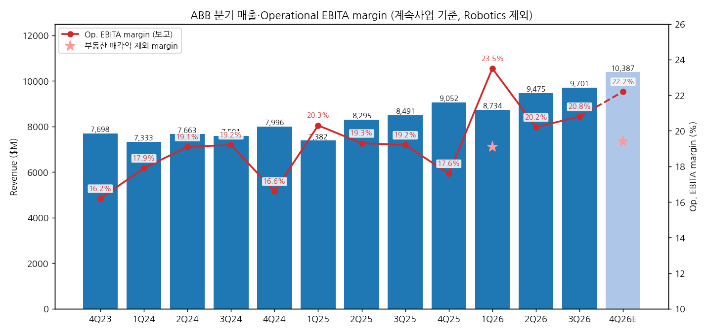
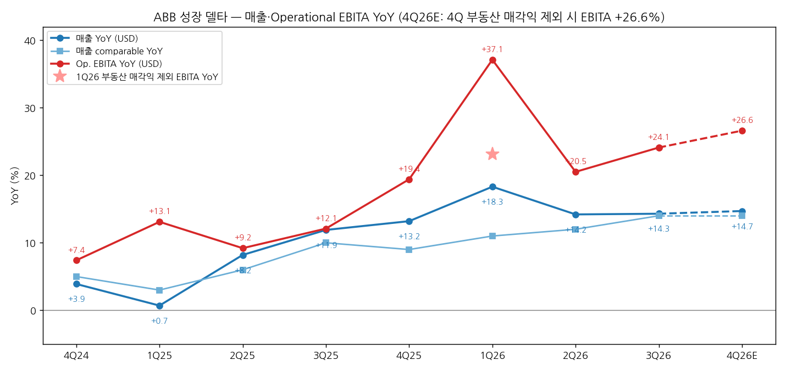
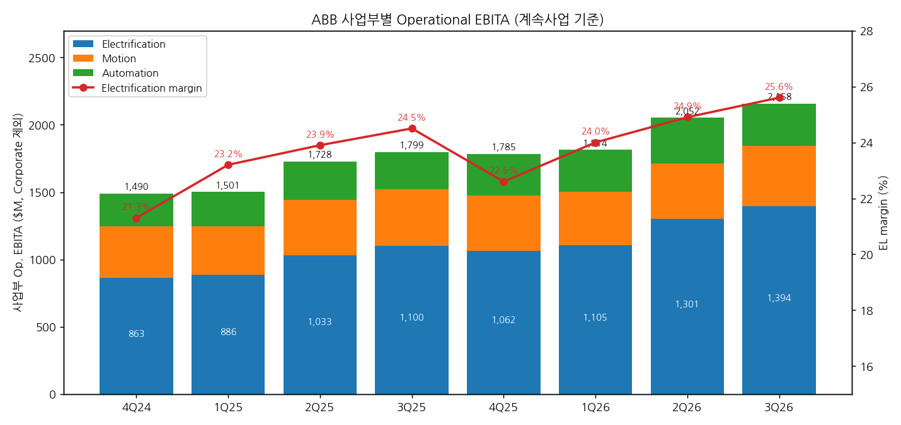

> 모드: 실적 리뷰 (v11)
> 종목: ABB (ABBN.SW / ADR ABBNY)
> 섹터: 전력 인프라
> 서브섹터: 배전·DC 전력관리
> 분기: 2026-Q3
> 발표일: 2026-10-20 (Zurich, 보도자료·Financial Information·IR PT + 컨퍼런스콜)
> 작성 시각: 2026-11-03 13:40 KST
> 분석 소스: 회사 자료 — ABB Q3 2026 Press Release·Financial Information·Group results presentation(10/20), 계속사업 기준 과거 분기는 Q4 2025~Q2 2026 보도자료·IR PT(Robotics 제외 재작성치), 컨콜 트랜스크립트(Investing.com 게재본, Motley Fool은 ABBNY 미수록). 셀사이드 첨부 1개 — NH투자증권(10/21, 이민재). 웹서치 보완(셀사이드 부족분, 2번 쟁점·2-4 표): Bloomberg(Energy Connects·swissinfo 10/20 — 주가 반응·수주 컨센·Citi 코멘트), wallstreet-online(10/22·11/1 — RBC·Deutsche Bank·Berenberg·Bernstein·UBS·Goldman TP), Goldesel(10/30 — Goldman·LBBW TP 변경), Investing.com(EPS 컨센), Quartr(백로그 전환율). 4번 (3)항은 효성중공업 3Q26 리뷰의 중간선거·FERC 데이터(Axios·Forbes·Ballotpedia·대신증권) 재사용. 직전 분기는 2026-Q1 리뷰 + 2026-Q2 팔로업 기준 (2Q26 리뷰 미작성)

# ABB 3Q26 실적 리뷰 — 수주 40% 급증·마진 최고치, 그러나 주가는 AI 심리에 묶였다

> 성장 델타: 가속 | 내러티브: 유지 → 델타 가속 + 내러티브 유지 → 숫자는 적극 구간, 멀티플은 12월 FERC·ERCOT까지 대기

→ **숫자**: 매출 $9,701M(+14.3% YoY, comparable +14%), Operational EBITA $2,026M(+24.1% YoY, 환율 제외 +24%), margin 20.8%(+160bp, 3분기 기준 최고). Op EBITA YoY가 2Q26 +20.5%에서 +24.1%로 3.6%p 높아졌고, 환율 효과를 뺀 기준(+18% → +24%)으로는 6%p 확대돼 가속 판정이다. 매출은 컨센(Bloomberg $9,766M) 대비 -0.7%로 사실상 부합, 수주는 컨센 $11.4B 대비 +5.7% 상회
→ **쟁점 ①**: 수주 $12,055M(+40%), Electrification 수주 $7,671M(+70%, 북미 +117%). 데이터센터 수주는 2개 분기 연속 세 자릿수 증가다. 데이터센터를 뺀 Electrification 수주도 +10%대 후반이다. 회사는 "선주문(pre-ordering) 없음, 선수금·취소 조항 보유"라고 답했다
→ **쟁점 ②**: 영업은 사상 최고였지만 주가는 10/20 장중 -6.7%였다. 조정 EPS $0.69가 컨센 $0.79를 12.6% 밑돌았는데, 원인은 Rotork 인수 관련 환헤지 평가손 약 $115M과 Robotics 중단사업 손실(-$43M) 등 영업 외 항목이다. 이후 TP는 Goldman 82 → 79 CHF, LBBW 85 → 75 CHF로 내려갔다. 이익 추정 하향이 아니라 AI 투자 사이클 심리에 따른 멀티플 조정이다
→ **쟁점 ③**: 2026 가이던스를 comparable 성장 "low double-digit~low teens" → "low teens"로 좁혀 올렸고, 연간 Op EBITA margin을 "최소 +270bp"(≥21.7%)로 처음 수치화했다. 역산하면 4Q26 Op EBITA는 부동산 매각익을 빼고 약 $2.0B(YoY +27%)다 ([계산])
→ **다음 분기 관건**: 4Q26 매각익 제외 Op EBITA $2.0B 이상(YoY +26%)이면 가속이 유지된다. 1월 FY2027 가이던스에서 백로그 $32.3B 중 약 40%(약 $13B)의 2027년 전환을 숫자로 확인해야 한다. 11/3 중간선거부터 12월 FERC·ERCOT 결론까지는 데이터센터 비중이 높아진 Electrification 수주의 할인율을 정하는 구간이다

---

## 1. 숫자

① 연결 기준 분기 표 (단위: $M, %, 계속사업 기준 — Robotics 제외 재작성치)

| 항목 | 4Q23 | 1Q24 | 2Q24 | 3Q24 | 4Q24 | 1Q25 | 2Q25 | 3Q25 | 4Q25 | 1Q26 | 2Q26 | **3Q26** | 4Q26E | FY26 가이던스 |
|---|---|---|---|---|---|---|---|---|---|---|---|---|---|---|
| 매출액 | 7,698 | 7,333 | 7,663 | 7,591 | 7,996 | 7,382 | 8,295 | 8,491 | 9,052 | 8,734 | 9,475 | **9,701** | 10,387 | comparable 성장 "low teens" |
| Operational EBITA (주 지표) | 1,238 | 1,322 | 1,463 | 1,457 | 1,330 | 1,495 | 1,598 | 1,633 | 1,588 | 2,049 | 1,925 | **2,026** | 2,310 (매각익 제외 2,010) | margin ≥21.7% |
| Op EBITA margin | 16.2 | 17.9 | 19.1 | 19.2 | 16.6 | 20.3 | 19.3 | 19.2 | 17.6 | 23.5 | 20.2 | **20.8** | 22.2 (제외 19.4) | 전년 19.0% 대비 +270bp 이상 |
| Income from operations (GAAP) | — | — | — | — | 1,094 | 1,474 | 1,466 | 1,602 | 1,505 | 1,780 | 1,585 | **1,846** | — | — |
| GAAP 영업이익률 | — | — | — | — | 13.7 | 20.0 | 17.7 | 18.9 | 16.6 | 20.4 | 16.7 | **19.0** | — | — |
| 매출 YoY (USD) | — | — | — | — | +3.9 | +0.7 | +8.2 | +11.9 | +13.2 | +18.3 | +14.2 | **+14.3** | +14.7 | — |
| 매출 YoY (comparable) | +8 | +4 | +5 | +3 | +5 | +3 | +6 | +10 | +9 | +11 | +12 | **+14** | 3Q와 유사 (~+14) | low teens |
| Op EBITA YoY (USD) | — | — | — | — | +7.4 | +13.1 | +9.2 | +12.1 | +19.4 | +37.1 | +20.5 | **+24.1** | +45.5 (제외 +26.6) | — |
| Op EBITA YoY (환율 제외) | — | — | — | — | — | — | — | — | +14 | +28 | +18 | **+24** | — | — |
| **매출 YoY 델타 (%p)** | — | — | — | — | — | -3.2 | +7.6 | +3.6 | +1.4 | +5.1 | -4.1 | **+0.0** | +0.5 | USD 기준 |
| **Op EBITA YoY 델타 (%p)** | — | — | — | — | — | +5.7 | -3.9 | +2.9 | +7.3 | +17.7 | -16.6 | **+3.6** | +2.5 (제외 기준) | USD 기준 |

→ (출처: 4Q24~3Q26은 ABB 분기 보도자료의 계속사업 재작성치, 4Q23~3Q24 매출·Op EBITA·comparable 성장률은 ABB Q4 2025·Q1~Q3 2026 IR PT 차트 수치. 4Q26E 매출은 Bloomberg 컨센(NH투자증권 10/21 인용), 4Q26E Op EBITA는 회사 가이던스 역산 [추정]. 2023년 이전 분기는 재작성치가 없어 2024년 USD YoY는 생략)
→ **기준 단절**: Robotics 사업부는 SoftBank 매각 합의(2025년 10월)로 4Q25부터 중단사업으로 분리됐고, 과거 분기도 같은 기준으로 다시 작성됐다. Machine Automation(B&R)은 Process Automation에 편입돼 "Automation" 사업부가 됐다. 매각 종결은 연말 목표다(10/20 컨콜, CEO). 위 표는 전 구간 계속사업 기준이라 단절 없이 비교 가능하다. 단, 보고 당시(Robotics 포함) 수치와는 다르다 (예: 3Q25 매출 보고 당시 $9,083M, 재작성 $8,491M)
→ **일회성**: 1Q26 Op EBITA에는 부동산 매각익 $377M(1Q25는 $137M)이 들어 있다. 이를 빼면 1Q26 Op EBITA는 $1,672M(margin 19.1%), YoY +23.1%다 ([계산]). 4Q26에도 스위스 부동산 매각익 약 CHF 240M(약 $300M)이 잡힌다(10/13 거래 완료). 회사의 4Q margin 가이던스는 이를 뺀 기준이다
→ 3Q26 서프라이즈: 매출 컨센($9,766M) 대비 -0.7%, EBITDA 컨센($2,102M) 대비 -1.3% (실적 $2,075M, Bloomberg, NH투자증권 인용). 수주는 컨센 $11.4B 대비 +5.7%(Bloomberg). 조정 EPS $0.69는 컨센 $0.79 대비 -12.6%(Investing.com). Op EBITA 컨센 수치는 확보하지 못했고, NH투자증권은 "컨센서스 부합"으로 평가했다
→ Op EBITA YoY는 1Q26 +37%(매각익 포함)가 겉보기 정점이다. 매각익을 빼면 +23% → +21%(2Q) → +24%(3Q)로 20%대 초중반 고원에서 다시 올라오는 모양이다. 매출 comparable 성장률은 3% → 6% → 10% → 9% → 11% → 12% → 14%로 6개 분기째 대체로 높아지고 있다
→ 컨센·가이던스 경로상 4Q26 매각익 제외 Op EBITA는 약 $2,010M(YoY +26.6%)이다. 2026년 연간은 매출 +15.3%, GAAP 영업이익 +20.2%, 2027년은 +12.6%·+19.7%다(FactSet, NH). 이 경로대로면 Op EBITA YoY 정점은 4Q26~1H27이고, 2027년부터 성장률이 10%대 후반으로 내려온다
→ **[판단] 델타 = 가속**: USD 기준 Op EBITA YoY 델타는 +3.6%p로 "유지"(±5%p)와 경계선이다. 2Q26에는 환율이 매출을 2%p 밀어올렸고(USD +14% vs comparable +12%), 3Q26은 환율 효과가 0%였다. 그래서 판정은 환율 제외 기준(+18% → +24%, +6%p)으로 한다. 매출 comparable(+12% → +14%)과 GAAP 영업이익 YoY(+8.1% → +15.2%)도 같은 방향이다

→ (출처: ABB 분기 보도자료·IR PT 계속사업 재작성치. 4Q26E 매출은 Bloomberg 컨센(NH 인용), margin은 가이던스 역산 [추정]. 연한 막대·점선 = E, 별표 = 부동산 매각익 제외 margin [계산])

→ (출처: 동일. 4Q26E Op EBITA YoY는 매각익 제외 기준 [추정], 별표는 1Q26 매각익 제외 YoY [계산])

② 사업부별 매출·Operational EBITA (단위: $M, %)

| 사업부 | 항목 | 4Q24 | 1Q25 | 2Q25 | 3Q25 | 4Q25 | 1Q26 | 2Q26 | **3Q26** |
|---|---|---|---|---|---|---|---|---|---|
| Electrification | 수주 | 3,908 | 4,394 | 4,518 | 4,522 | 5,323 | 6,647 | 7,231 | **7,671** |
| Electrification | 매출 | 4,046 | 3,825 | 4,331 | 4,499 | 4,702 | 4,613 | 5,200 | **5,424** |
| Electrification | Op EBITA | 863 | 886 | 1,033 | 1,100 | 1,062 | 1,105 | 1,301 | **1,394** |
| Electrification | margin | 21.3 | 23.2 | 23.9 | 24.5 | 22.6 | 24.0 | 24.9 | **25.6** |
| Electrification | 수주 YoY (comp) | — | — | — | — | +33 | +44 | +58 | **+70** |
| Electrification | 매출 YoY (comp) | — | — | — | — | +12 | +15 | +19 | **+21** |
| Electrification | Op EBITA YoY | — | — | — | — | +23 | +25 | +26 | **+27** |
| Motion | 수주 | 1,866 | 2,156 | 2,112 | 2,162 | 2,189 | 2,548 | 2,592 | **2,455** |
| Motion | 매출 | 2,038 | 1,840 | 2,065 | 2,082 | 2,260 | 2,142 | 2,217 | **2,320** |
| Motion | Op EBITA | 383 | 360 | 407 | 421 | 412 | 398 | 413 | **449** |
| Motion | margin | 18.7 | 19.6 | 19.8 | 20.1 | 18.3 | 18.5 | 18.5 | **19.1** |
| Motion | 매출 YoY (comp) | — | — | — | — | +6 | +7 | +4 | **+9** |
| Motion | Op EBITA YoY | — | — | — | — | +8 | +11 | +1 | **+7** |
| Automation | 수주 | 1,893 | 2,197 | 2,814 | 2,100 | 2,817 | 2,464 | 2,454 | **2,114** |
| Automation | 매출 | 1,967 | 1,818 | 2,010 | 2,013 | 2,243 | 2,147 | 2,193 | **2,126** |
| Automation | Op EBITA | 244 | 255 | 288 | 278 | 311 | 311 | 338 | **315** |
| Automation | margin | 12.4 | 14.2 | 14.2 | 13.9 | 13.9 | 14.7 | 15.4 | **14.8** |
| Automation | 수주 YoY (comp) | — | — | — | — | +41 | +5 | -14 | **0** |
| Automation | 매출 YoY (comp) | — | — | — | — | +9 | +10 | +7 | **+5** |
| Automation | Op EBITA YoY | — | — | — | — | +27 | +22 | +17 | **+13** |

→ (출처: ABB Q4 2025·Q1~Q3 2026 보도자료 사업부 표. Op EBITA YoY는 USD 기준. 1Q25~3Q25 사업부 YoY는 2024년 재작성치가 없어 생략. Corporate and Other(3Q26 -$132M, E-mobility -$18M·Robotics 관련 잔여비용 -$25M 포함)는 표에서 제외)
→ 3Q26 매출 비중은 Electrification 55.9%, Motion 23.9%, Automation 21.9%다. 사업부 Op EBITA 합계 중 Electrification 비중은 64.6%다 ([계산])
→ **델타를 끄는 것은 Electrification 하나다.** 수주 YoY(comparable)가 +33% → +44% → +58% → +70%, 매출 +12% → +15% → +19% → +21%, Op EBITA +23% → +25% → +26% → +27%로 4개 분기 연속 모두 가속했다. margin 25.6%는 사상 최고이며, 3Q26 Op EBITA 증가분 $393M 중 $294M(75%)을 Electrification이 만들었다 ([계산])
→ **꺾이는 쪽은 Automation이다.** 매출 comparable +10% → +7% → +5%, Op EBITA YoY +22% → +17% → +13%로 3개 분기 연속 둔화했고, 수주는 2개 분기째 0% 이하다. 회사는 대형 프로젝트 수주 시점 문제이며 기본 수주(base orders)는 늘었다고 설명했다(컨콜, Morgan Stanley 질문). 중동은 1Q부터 약세가 이어지고 있지만 별개 사안이라고 했다
→ Motion은 margin이 4개 분기째 18~19%대로 전년보다 낮다. Gamesa Electric 인수 희석이 약 40bp이고, 이를 빼도 -60bp다. 회사는 4Q에 이례적으로 전분기 대비 margin 개선을 가이드했다

→ (출처: ABB 분기 보도자료. Corporate and Other 제외)

(1) 수주·백로그·지역 — 선행지표 (단위: $M, %)

| 항목 | 4Q25 | 1Q26 | 2Q26 | **3Q26** |
|---|---|---|---|---|
| 그룹 수주 | 10,316 | 11,298 | 12,042 | **12,055** |
| 그룹 수주 YoY (comp) | +32 | +24 | +28 | **+40** |
| Book-to-bill | 1.14 | 1.29 | 1.27 | **1.24** |
| 그룹 백로그 | 25,282 | 27,515 | 30,007 | **32,256** |
| Electrification 백로그 | 9,438 | 11,460 | 13,676 | **16,007** |

→ (출처: ABB 분기 보도자료)
→ 3Q26 지역별 수주: Americas $5,980M(+70% comp, 그룹 수주의 49.6%), 그중 미국 +82%(대형 수주 제외 base 수주 약 +50%), Europe $3,020M(+10%, 25.1%), 아시아·중동·아프리카 $3,055M(+29%, 25.3%, 중국 +25%). 지역별 매출은 Americas $3,931M(40.5%), Europe $2,982M(30.7%), AMEA $2,788M(28.7%)다 (보도자료·IR PT, 비중 [계산])
→ Electrification의 Americas 수주는 +117%다. 백로그 $16.0B는 1년 전 $8.75B의 1.8배이고, 그룹 백로그 $32.3B는 2025년 연간 매출($33.2B)과 거의 같다
→ 회사 설명 기준 백로그 전환율은 2026년 26%, 2027년 41%다(Quartr 요약, CFO "내년 약 40%"). $32.3B × 40% = 약 $12.9B가 2027년 매출로 넘어간다 ([계산])

③ 연간 (단위: $M, %, 계속사업 기준)

| 항목 | 2024 | 2025 | 2026E | 2027E | 2028E |
|---|---|---|---|---|---|
| 매출액 | 30,583 | 33,220 | 38,292 | 43,133 | 47,645 |
| Operational EBITA | 5,572 | 6,314 | ≥8,310 | — | — |
| Op EBITA margin | 18.2 | 19.0 | ≥21.7 | — | — |
| Income from operations (GAAP) | 4,735 | 6,047 | 7,267 | 8,697 | 9,939 |
| GAAP 영업이익률 | 15.5 | 18.2 | 19.0 | 20.2 | 20.9 |
| 매출 YoY (USD) | — | +8.6 | +15.3 | +12.6 | +10.5 |
| 매출 YoY (comparable) | — | +7 | low teens (가이던스) | — | — |
| GAAP 영업이익 YoY | — | +27.7 | +20.2 | +19.7 | +14.3 |

→ (출처: 2024·2025는 ABB Q4 2025 보도자료 계속사업 기준. 2026E~2028E 매출·GAAP 영업이익은 FactSet 컨센(NH투자증권 10/21). 2026E Op EBITA는 "margin 최소 +270bp" 가이던스 × 컨센 매출로 역산한 하한 [계산]. 2023년 이전 계속사업 재작성치는 미확보)
→ 2026E Op EBITA 하한 $8,310M에서 9개월 누적 $6,000M을 빼면 4Q26 내재치는 $2,310M(매각익 약 $300M 포함), 제외 시 약 $2,010M이다 ([계산])
→ 발표 전 대비 연간 컨센 변화(집계 증권사 수 포함)는 확인하지 못했다. FactSet·Bloomberg 원자료 접근이 없고 첨부 리포트도 1개다. Citi는 수주 서프라이즈가 2027~28년 추정치 상향 여지라고 언급했다(Bloomberg 10/20)

---

## 2. 시장 쟁점

> 셀사이드 범위: 첨부 리포트는 NH투자증권 1개다. 쟁점은 회사 자료 + 10/20 컨콜 Q&A(애널리스트 11개사 질문) + 웹서치로 확인한 해외 IB 등급·TP 변경(RBC·Deutsche Bank·Berenberg·Bernstein·Goldman Sachs·LBBW·UBS)과 언론 코멘트(Citi)로 구성했다. 해외 IB 리포트 원문은 보지 못했으므로, 2-2의 해외 IB 논리는 언론 보도에 인용된 범위에 그친다

① 지난 분기 체크 (2026-Q2 팔로업의 "봐야 할 것" 5개 기준. 2Q26 리뷰는 미작성)

| 직전 팔로업 항목 | 2Q26~3Q26 결과 | 판정 |
|---|---|---|
| (1) 2Q 매출 comparable high single~low double-digit 달성 | 2Q26 +12%, 3Q26 +14% | 확인 (상단 초과) |
| (2) 데이터센터 수주 세 자릿수 증가 지속 | 2Q26·3Q26 모두 세 자릿수. 3Q26 EL 북미 수주 +117% | 확인 |
| (3) 중동 영향 확대 여부 | 1Q 이후 약세 지속이지만 확대 언급 없음. Automation 수주 0%는 시점 문제로 별개라고 설명 | 확인 (확대 안 됨) |
| (4) $4B급 M&A 발표 | 7/16 Rotork 인수(EV 약 $5.5B, 사상 최대) + 10/20 Mitsubishi Electric 저압 JV 51%($495M) | 확인 (초과) |
| (5) FY26 가이던스 추가 상향 | 2Q: high single~low double → low double~low teens, 3Q: low teens + margin 최소 +270bp | 확인 |

② 이번 분기 쟁점 4개

| # | 쟁점 | 다룬 곳 |
|---|---|---|
| (1) | 데이터센터 수주는 지속 가능한가 — 2개 분기 연속 세 자릿수, 선주문·취소 리스크 | NH + 컨콜 Kepler·Rothschild·CIC + Bloomberg(Citi) |
| (2) | 기록적 수주에도 왜 주가가 -6.7%였나 — EPS 미스의 정체와 TP 하향의 원인 | 언론(Bloomberg·wallstreet-online), RBC·Goldman·LBBW·Deutsche Bank·Citi |
| (3) | Electrification margin 25.6%는 어디까지 가나 — 증설 램프업과 미국 margin | 컨콜 UBS·BofA·Oddo + NH(가격) |
| (4) | 2027년 성장은 수주가 아니라 무엇이 정하나 — 백로그 전환과 capa | 컨콜 Nordea·SEB + NH(리드타임) |

③ 쟁점별 분해

(1) 데이터센터 수주 — 지속 가능한가

(1-1) 회사 설명 (10/20 보도자료·컨콜)
→ 데이터센터 수주는 세 자릿수 증가했고 "고객의 수요 둔화나 capex 망설임 신호가 없다"(CEO). "둔화는커녕 백로그 기준으로는 가속"(CEO, Bloomberg 인용)
→ 대형 데이터센터 주문은 대부분 상당한 선수금 또는 명확한 취소 조항이 붙는다. 표준 제품이라도 특정 부지(인허가·계통 접속·자금 조달 완료)를 위한 설계 주문이라 선주문은 없다고 했다(CEO, Kepler 질문)
→ 리드타임은 12~24개월이며, 올해 받은 주문은 2027~28년에 출하된다. ABB는 납기 병목이 아니고, 변압기·가스터빈 등이 더 긴 품목이라고 했다
→ 다만 CFO는 "매 분기 세 자릿수 성장을 기대하는 것은 무리"라며 주문 시점과 커진 기저를 언급했다. 데이터센터를 뺀 Electrification 수주도 +10%대 후반이다
→ 고객은 하이퍼스케일러·코로케이션이 "압도적 다수"이고 일부 네오클라우드다(CEO)

(1-2) 증권사·시장별 해석 편차

| 출처 | 핵심 가정·추정 | 논리 |
|---|---|---|
| NH투자증권 (10/21) | EL 수주 $78억(+70%), 미국 +82%, 리드타임 최대 24개월 유지 | 선수금·취소 조건, 인허가·계통·자금 확보 후 발주라 리스크 제한적. 북미 수요 둔화 없음 |
| Citi (Martin Wilkie, Bloomberg 10/20) | 수주 서프라이즈 → 2027·28년 추정치 상향 여지 | 숫자는 충분, 주가 상승에는 AI 테마 심리 개선이 필요 |
| Kepler Cheuvreux (컨콜 질문) | 북미 2개 분기 연속 +130% 이상 | 경기 변화 시 취소·선주문 리스크 점검 요구 |
| Rothschild (컨콜 질문) | 하이퍼스케일러 투자수익률 | AI 생태계 수요 측이 지금 capex를 뒷받침할 수 있나 |

(1-3) 공통 결론 vs 갈리는 지점
→ 공통: 현재 수주는 실수요이고 계약 구조상 취소 리스크가 작다는 회사 설명에 이견이 없다. 수주 컨센($11.4B)도 크게 넘었다
→ 갈림: 숫자 자체가 아니라 "AI capex 사이클이 2027년 이후에도 이어지나"라는 질문이다. 셀사이드는 숫자를 인정하면서도 등급은 Hold가 다수(FactSet Buy 9·Hold 26·Sell 2)다

(1-4) **[판단]** — 데이터센터 비중을 숫자로 분해
→ 회사는 데이터센터 수주 금액을 공개하지 않는다. EL 수주가 $4,522M → $7,671M(+70%)이고 데이터센터 제외분이 +18%(high teens)라고 두자. 3Q25에 데이터센터가 EL 수주의 18~28%였다면, 데이터센터 수주 증가율은 +200~300%가 된다. 이 경우 3Q26 데이터센터 수주는 약 $3.3~3.8B로, **EL 수주의 43~50%, 그룹 수주의 27~32%**다 ([계산], 1Q26 컨콜 "ABB의 90%는 데이터센터가 아니다" 발언을 기저 비중의 상한 근거로 사용)
→ 즉 매출 기준으로는 그룹의 10% 남짓이지만, **신규 수주 기준으로는 이미 EL의 절반 가까이를 데이터센터가 차지한다.** 이 수주가 2027~28년 매출이 되므로, 2027년 이후 ABB 성장률은 데이터센터 사이클에 지금보다 훨씬 민감해진다
→ 회사가 말하는 계약 안전장치(선수금·취소 조항)는 "이미 받은 주문"의 리스크를 낮출 뿐 "다음 주문"의 속도는 보장하지 않는다. CFO가 스스로 세 자릿수 지속을 낮춰 잡은 만큼, 4Q26~1Q27 EL 수주 YoY가 +30%대로 내려와도 회사 설명과 모순은 아니다
→ 결론이 바뀌는 조건: 4Q26 EL 수주가 $6.5B 아래(전분기 대비 -15% 이상)로 떨어지거나, 데이터센터 제외 수주 성장률이 한 자릿수로 내려가면 "데이터센터 + 본업 동반 강세" 서사가 "데이터센터 단일 동력"으로 바뀐다

(2) 기록적 수주에도 주가 -6.7% — EPS 미스의 정체와 TP 하향의 원인

(2-1) 회사 설명
→ EPS $0.65(-2%)는 두 가지 때문이다. Rotork 인수 관련 조건부 환헤지의 비현금 평가손 약 $115M(Finance net), Robotics 매각 준비 과정의 세금 비용으로 중단사업 손실 -$43M이다. Rotork 종결(1H27)까지 Finance net 변동성이 더 있을 수 있다고 했다(CEO)
→ GAAP 영업이익에서도 미실현 환율·원자재 파생상품 손실 약 $80M, 지분투자 공정가치 변동 약 $60M, 인수·매각 비용 약 $30M이 빠졌다. 모두 Op EBITA에는 영향이 없다(보도자료)
→ Op EBITA margin 20.8%는 3분기 기준 사상 최고, ROCE 29.9%다

(2-2) 증권사별 해석 편차

| 증권사 | 등급·TP | 논리 |
|---|---|---|
| RBC (10/20) | Sector Perform, 82 CHF 유지 (10/9 83 → 82) | 수주는 기대보다 훨씬 좋았지만 EPS는 시장 기대에 확실히 못 미쳤다 (Sebastian Kuenne) |
| Deutsche Bank (10/21) | Hold, 76 CHF 유지 | EL 주문 강세 확인, 등급·TP 변경 없음 |
| Berenberg (10/20~21) | Hold, 80 CHF | 변경 없음 |
| Bernstein (10/20) | 80 CHF (등급 미확인) | 변경 없음 |
| LBBW (10/23) | Hold, 85 → 75 CHF (-11.8%) | 하향 사유 원문 미확인 |
| Goldman Sachs (10/30) | Neutral, 82 → 79 CHF (-3.7%) | 하향 사유 원문 미확인 |
| Citi (10/20, 코멘트) | — | 주가 상승에는 AI 테마 심리 개선이 필요 |
| NH투자증권 (10/21) | 해외기업분석(등급 없음), FactSet 컨센 TP 84.7 CHF 인용 | 실적 컨센 부합, 데이터센터 전망 견조 |

(2-3) 공통 결론 vs 갈리는 지점
→ 공통: 영업 실적(수주·마진·현금흐름)은 강했고, EPS 미스는 비현금·영업외 항목이라는 데 이견이 없다. 확인된 범위에서 등급 하향은 없었다
→ 갈림: 주가를 무엇이 누르는지다. RBC는 EPS 미스 자체를, Citi와 Bloomberg는 AI 투자 사이클 우려(같은 날 Siemens·Schneider도 -4% 이상)를 짚었다

(2-4) **[판단]**
→ 10/20 하락은 ABB 고유 요인보다 **섹터·테마 요인이 컸다.** 같은 날 Siemens·Schneider가 함께 4% 넘게 빠졌고, EPS를 깎은 항목은 모두 비현금이거나 중단사업이다. Op EBITA는 컨센 부합, 수주는 +5.7% 상회했다
→ TP 하향(LBBW -11.8%, Goldman -3.7%)은 발표 후 이익 추정이 내려갈 재료가 없다는 점에서 **멀티플 하향**으로 본다. 주가는 52주 고점 88.6 CHF(6/22) 대비 10/20 기준 71.0 CHF로 -20%, 3개월 -10.5%다(NH). 2026E PER은 22.3배로, 2025년 33.2배에서 이미 많이 내려왔다(FactSet, NH)
→ 결론이 바뀌는 조건: Rotork 헤지 평가손이 4Q에도 반복되면 GAAP EPS 미스가 두 분기 연속이 돼 "숫자는 좋은데 EPS는 안 나온다"는 인식이 굳을 수 있다. 반대로 Robotics 매각 종결(연말 목표)과 Rotork 종결(1H27)로 영업외 노이즈가 걷히면 EPS와 Op EBITA의 괴리가 줄어든다

(3) Electrification margin 25.6% — 어디까지 가나

(3-1) 회사 설명
→ EL margin 25.6%(+110bp)는 물량 증가에 따른 영업 레버리지가 주동력이다. 가격 기여는 약 3%로 2Q보다 커졌고, 이제 원자재 인플레이션을 대체로 상쇄한다(CFO)
→ 30~35%의 operational gearing(증분 매출 대비 증분 이익)은 증설 램프업 중에도 "비슷하게 유지된다"(CFO, UBS 질문)
→ 지역별로 미국 margin이 아직 뒤처져 있고 개선 여지가 남았다(CEO, BofA 질문)
→ 4Q EL: comparable 매출 high teens~low 20%대 성장, margin은 계절적으로 내려가되 과거 평균 약 150bp보다 덜 내려간다(CFO)
→ 일부 제품군은 가동률이 높아졌고, 진행 중인 투자가 2027년에 걸쳐 가동된다. capex는 연 약 $1B 수준에서 중기적으로 더 늘리지 않는다(보도자료·CFO)

(3-2) 해석 편차

| 출처 | 핵심 가정·추정 | 논리 |
|---|---|---|
| NH투자증권 | 3Q 가격 인상 2%p, GAAP 영업이익률 2026E 19.0% → 2028E 20.9% | 공급 부족 지속, 가격은 원자재 상쇄 수준까지 인상 |
| UBS (컨콜 질문) | 내년 수주 성장 가속 시 증설 비용 | 램프업 비용이 drop-through를 깎지 않나 |
| Oddo (컨콜 질문) | Motion margin -100bp(Gamesa 제외 -60bp) | Motion의 가격·비용 구조 |

(3-3) 공통 결론 vs 갈리는 지점
→ 공통: EL margin 상승은 물량 레버리지이고, 가격이 원자재를 상쇄하기 시작했다는 데 이견이 없다
→ 갈림: 2027년 증설 가동기에 margin이 계속 오르는지다. 회사는 gearing 유지를 말하고, UBS는 램프업 비용을 의심한다

(3-4) **[판단]**
→ 3Q26 EL 증분 매출 $925M 대비 증분 Op EBITA $294M으로 gearing은 31.8%다 ([계산]). 회사가 말한 30~35% 범위 하단이다. 4Q 가이던스(성장 high teens~low 20%, margin 하락 150bp 미만)를 적용하면 4Q26 EL Op EBITA는 약 $1.35~1.40B, YoY +27~32%다 ([추정], 매출 $5.6~5.7B × margin 24.2~24.6%)
→ 그룹 margin 경로상 핵심은 EL이 아니라 Motion·Automation이다. 두 사업부 margin이 각각 19%·15% 근처에 머물러 그룹 margin을 EL보다 4~5%p 낮게 잡아두고 있다. 회사가 4Q에 Motion 개선과 Automation 유지를 가이드한 만큼, 4Q에 그룹 margin(매각익 제외)이 19.4% 이상이면 "계절성 축소"가 확인된다
→ 결론이 바뀌는 조건: 2027년 1Q·2Q에 EL 매출이 +15% 이상 늘었는데 margin이 전년보다 낮아지면 램프업 비용 우려(UBS 질문)가 현실화된 것으로 본다

(4) 2027년 성장은 수주가 아니라 무엇이 정하나 — 백로그 전환과 capa

(4-1) 회사 설명
→ 백로그 $32.3B는 데이터센터·선박·철도 등 리드타임이 긴 주문 비중이 높아졌다. 2027년 전환율은 약 40%다(CFO). 2027 가이던스는 1월 4Q 발표 때 제시한다(CEO, Nordea 질문)
→ 납기 제약은 ABB 자체 capa와 고객 현장 일정이 함께 결정한다. ABB가 병목인 경우는 드물다고 했다
→ 부동산 매각익을 포함한 4Q 실적과 함께, 2026년 FCF는 2025년 $4.6B를 넘어 $5B에 근접할 것으로 봤다(컨콜 요약)

(4-2) 해석 편차

| 출처 | 핵심 가정·추정 | 논리 |
|---|---|---|
| NH투자증권 | 2027E 매출 $43.1B(+12.6%), GAAP 영업이익 $8.7B(+19.7%). SST 수주 2027년 하반기 본격화. 데이터센터 전력 인프라 white:grey 비중 45:55 → 25:75 | 증설·가동률이 매출 성장 동인, DC 전환으로 ABB 주력(grey space) 확대 |
| Nordea (컨콜 질문) | EL 백로그 +85% | 2027년 전환의 제약은 ABB capa인가 고객인가 |
| SEB (컨콜 질문) | 2027~29년 capex | 높아진 가동률에 capex를 더 늘려야 하지 않나 |

(4-3) 공통 결론 vs 갈리는 지점
→ 공통: 2027년 매출은 백로그로 상당 부분 정해졌다. 회사·NH 모두 2027년 +10%대 성장을 무리 없는 수준으로 본다
→ 갈림: 성장률 수준이다. 수주가 4개 분기 평균 +30% 이상 늘었는데 컨센 매출 성장은 2027년 +12.6%로 낮다. 리드타임이 길어진 만큼 2028년으로 넘어가는 몫이 크다는 가정이다

(4-4) **[판단]**
→ 2027년 백로그 전환 약 $12.9B는 2026E 매출 $38.3B의 34%다. 나머지는 단기 주기(short-cycle) 사업이 채운다. 회사가 "2027년에 걸쳐 투자분이 가동"이라고 한 만큼, **2027년 매출 성장률은 수주보다 capa 가동 속도가 정한다.** 효성중공업에서 본 "수주 → 증설 → 매출화" 구조와 같다
→ 1월 가이던스가 comparable "low teens" 이상이면 컨센(+12.6%, USD)과 부합하고, "high single-digit"이면 데이터센터 리드타임 장기화가 매출 인식을 늦춘다는 신호로 읽는다
→ 결론이 바뀌는 조건: capex를 연 $1B 이상으로 다시 늘린다고 하면 "capa 병목" 신호로, 수주가 꺾이기 전에 매출 가속이 먼저 멈출 수 있다는 뜻이 된다

④ 낙관 vs 보수 — 논리 대비
→ **가장 낙관(UBS 88 CHF 발표 전, FactSet 컨센 상단 96.8 CHF)**: 확인된 TP 중 가장 높은 UBS도 Neutral이다. 낙관 논리는 Citi 코멘트처럼 수주 서프라이즈가 2027~28년 추정치 상향으로 이어진다는 것이다
→ **가장 보수(LBBW 75 CHF, Deutsche Bank 76 CHF)**: 둘 다 Hold다. 원문을 보지 못해 가정 차이는 확인할 수 없다. LBBW가 발표 후 TP를 10 CHF 낮춘 점이 가장 큰 변화다
→ 셀사이드 vs 시장: FactSet 기준 Buy 9·Hold 26·Sell 2로 셀사이드는 원래부터 중립적이다. 그런데 주가는 발표 후에도 컨센 TP(84.7 CHF)보다 16% 아래(10/20 종가 71.0 CHF 기준)에 있다. 숫자가 좋아도 등급이 오르지 않는 것은, 시장이 ABB를 "AI 인프라 베타"로 거래하고 있다는 뜻이다

⑤ 추정치·TP 변화 (단위: CHF, $M)

| 증권사 | 직전 TP | 현재 TP | 4Q26 영업이익 E | 2026 / 2027 영업이익 E | 핵심 변화 한 줄 |
|---|---|---|---|---|---|
| LBBW (10/23) | 85 | 75 (-11.8%) | — | — | Hold 유지, 발표 후 최대 폭 하향 |
| Goldman Sachs (10/30) | 82 | 79 (-3.7%) | — | — | Neutral 유지 |
| RBC (10/20) | 82 | 82 (유지) | — | — | Sector Perform, 수주 호조 vs EPS 미스 |
| Deutsche Bank (10/21) | 76 | 76 (유지) | — | — | Hold, EL 수주 강세 확인 |
| Berenberg (10/20~21) | 80 | 80 (유지) | — | — | Hold |
| Bernstein (10/20) | 80 | 80 (유지) | — | — | 등급 미확인 |
| UBS (10/12, 발표 전) | — | 88 | — | — | Neutral, 발표 후 변경 미확인 |
| NH투자증권 (10/21, FactSet 컨센) | — | 84.7 (컨센) | Bloomberg 매출 10,387, EBITDA 2,132 | GAAP 7,267 / 8,697 | 실적 컨센 부합, 가이던스 "추가 조정 없음"으로 서술 |

→ (출처: wallstreet-online 10/22·11/1, Goldesel 10/30, NH투자증권 10/21. 해외 IB의 분기·연간 추정치는 원문 미확보로 공란)
→ 확인된 6곳(LBBW·Goldman·RBC·Deutsche Bank·Berenberg·Bernstein) 평균 TP는 80.8 → 78.7 CHF(-2.7%)다. 하향 2건, 유지 4건, 상향 0건이다 ([계산])
→ 발표 전 대비 연간 컨센 변화는 확인하지 못했다(1-③ 참고)
→ **TP 하향의 원인 = 멀티플 하향.** 회사 가이던스가 상향됐고 수주가 컨센을 넘었으므로 이익 추정을 내릴 근거는 약하다. 하향은 AI 인프라 피어 전반의 밸류에이션 조정과 같이 움직였다 [판단]
→ 참고: NH는 "가이던스 추가 조정 없음"으로 썼지만, 회사는 매출 범위를 상단("low teens")으로 좁히고 margin 하한(+270bp)을 처음 수치화했다. Bloomberg와 회사(CEO "slight upgrade")는 소폭 상향으로 본다

---

## 3. 내러티브 점검

① 성장 스토리 정의
→ AI 데이터센터와 전력망 투자가 Electrification의 저압·중압 배전 제품(차단기·스위치기어·UPS·버스웨이) 수요를 끌어올리고, 물량 레버리지로 margin이 오른다. 직류(DC) 전환이 오면 ABB의 주력인 grey space(전력실) 비중이 55%에서 75%로 커져 수혜가 더 넓어진다. 시장은 "데이터센터 수주 → EL 물량 → margin 확장 → DC 전환 옵션"을 산다

② 이번 분기 평가
→ **강화된 부분**: EL 수주 +70%·margin 25.6%·4개 분기 연속 가속, 데이터센터 제외 EL 수주도 +10%대 후반, 가이던스 소폭 상향과 margin 하한 수치화, Infinitus DC 포트폴리오 출시(SST 2H27 수주), Mitsubishi Electric JV로 일본·동남아 저압 시장 진입. 숫자 쪽은 2026년 들어 가장 강하다
→ **약해진 부분**: 주가와 TP다. 발표 후 TP는 유지·하향만 있었고, 등급은 Hold 우위 그대로다. 데이터센터가 신규 수주의 절반 가까이로 커지면서([계산]) 스토리가 AI capex 사이클과 한 몸이 됐다. 이는 숫자가 좋아도 테마 심리에 묶이는 구조다. Automation은 3개 분기째 둔화다
→ **[판단] 내러티브 = 유지**: 숫자는 스토리를 강화했지만, 기준표의 "강화"에 필요한 추정치·TP 상향이 따라오지 않았다. 핵심 전제(데이터센터 수요·EL margin)가 깨진 것도 아니므로 "약화"도 아니다
→ 1번 델타 "가속"과 합치면 **숫자는 적극 구간, 멀티플은 대기 구간**이다. 4Q26 Op EBITA(매각익 제외) $2.0B와 1월 FY27 가이던스가 확인되고, 12월 FERC·ERCOT 결론이 데이터센터 접속을 크게 막지 않으면 내러티브는 "강화"로 넘어갈 수 있다

③ 스토리를 다시 강하게 만들 트리거
→ 4Q26 매각익 제외 Op EBITA $2.0B 이상, EL 수주 $7B 이상 유지 (1월 말~2월 초 실적)
→ FY2027 가이던스 comparable "low teens" 이상 + margin 개선 (1월)
→ 12월 FERC·ERCOT 대형부하 접속 결론이 데이터센터 접속을 허용하는 방향

④ 스토리를 깨뜨릴 리스크
→ 하이퍼스케일러 capex 가이던스 감속 → EL 데이터센터 수주 급감 (신규 수주의 절반 가까이가 노출 [계산])
→ 12월 FERC 결론이 데이터센터의 망 보강비 전액 부담·착공 전 100% 재무 보증 쪽으로 강화돼 미국 부지 착공이 늦어짐
→ Rotork 헤지 평가손 반복 등 영업외 노이즈로 GAAP EPS 미스 연속

---

## 4. 향후 봐야 할 것 (우선순위 순)

(1) **4Q26 Op EBITA $2.0B 이상(부동산 매각익 제외), 연간 margin 21.7% 이상** — 델타 판정을 바꾸는 1순위 변수
→ 무엇을: 매각익(약 CHF 240M) 제외 Op EBITA $2.0B 이상(YoY +26%, margin 19.4% 이상)이면 "가속" 유지, $1.9B 미만(YoY +20% 미만)이면 "둔화"다. 매각익 포함 보고치 $2.3B 이상이면 연간 margin 가이던스(+270bp)를 지킨 것이다. EL margin은 24.2% 이상(계절 하락 150bp 미만)인지 본다
→ 어떤 데이터로: ABB Q4 2026 보도자료·IR PT(사업부 표, Corporate 내 매각익 분리)
→ 언제: 2027년 1월 말~2월 초 (날짜 미공시, 2026년은 1/29)

(2) **Electrification 수주 $7B 이상 유지, 데이터센터 세 자릿수 지속 여부**
→ 무엇을: 4Q26 EL 수주 $7B 이상(4Q25 $5,323M 대비 +30% 이상)이면 수요 서사 유지, $6.5B 미만이면 경고다. 데이터센터 제외 EL 수주가 +10%대를 지키는지 같이 본다. CFO가 이미 세 자릿수 지속을 낮춰 잡았으므로, 데이터센터 성장률이 두 자릿수로 내려오는 것 자체는 예정된 경로다
→ 어떤 데이터로: ABB 4Q 보도자료 사업부 수주, 피어 데이터센터 코멘트(Schneider·Eaton·Vertiv 4Q 실적), 하이퍼스케일러 4Q capex 가이던스(1월 말~2월 초). 뉴스 키워드 "ABB data center orders", "hyperscaler capex 2027 guidance"
→ 언제: 2027년 1월 말~2월 초

(3) **11/3 중간선거 → 11월 RTO 보고 → 12월 FERC·ERCOT 결론** — 멀티플 방향을 정하는 섹터 공통 이벤트 구간
→ 무엇을: 세 이벤트 모두 "데이터센터 전력 비용을 누가 내나"를 다룬다. 중간선거에서 데이터센터 반대 주민투표가 연이어 통과하면, 12월 FERC 결론도 비용 전가 차단·재무 보증 강화 쪽으로 기울 가능성이 커진다
→ ABB 노출 [판단]: **미국 비중** — 3Q26 Americas는 그룹 매출의 40.5%, 수주의 49.6%이고, 미국 수주는 +82%로 성장을 가장 크게 끌었다. 미국 단독 매출 비중은 분기 자료에 없다. **데이터센터 비중** — 매출 기준으로는 그룹의 10% 남짓이지만, 신규 수주 기준으로는 EL 수주의 43~50%, 그룹 수주의 27~32%로 추정된다([계산], 2번 (1-4)). 제품이 데이터센터 부지 안의 전력실(grey space) 배전 장비라, 효성중공업의 765kV 송전망보다는 하이퍼스케일러 직접 발주처럼 부지 착공·계통 접속 일정에 직접 연결된다. 그래서 12월 결론에 대한 민감도는 한국 송변전 3사보다 높다. **분산** — 수주의 절반은 미국 밖이다(Europe 25.1%, AMEA 25.3%, 중국 +25%). 유틸리티 수주는 3개 지역 모두 두 자릿수 이상 성장 중이고, 일본 JV도 더해진다. 미국 데이터센터 착공이 늦어져도 그룹 전체가 꺾일 구조는 아니다. **부분 헤지** — 제도가 데이터센터의 자체 전원·망 안정화 부담을 키우는 방향이면, ABB의 중압 UPS·BESS·동기조상기(Infinitus 포트폴리오 구성품) 수요는 오히려 늘 수 있다. 결론적으로 12월 결론은 ABB의 "그룹 성장"보다 "EL 데이터센터 수주의 할인율"을 정하는 이벤트다
→ 어떤 데이터로: (1) 11/3 데이터센터 관련 지역 주민투표 결과(10~13개 주 41~50건, 오하이오 21건 최다, 2026년 기결정 6건은 모두 개발 반대로 결론) + 9개 주 공공요금위원회 선거 결과 (2) FERC 대형부하 소명명령 관련 6개 RTO 보고(11/16~20) (3) ERCOT 적격성 감사 완료(12/10)·본심사 재개 (4) FERC 이해관계자 반론 시한(12/16). 제도 개선안에는 망 보강비의 데이터센터 전액 부담, 착공 전 100% 재무 보증 등이 포함된다
→ 언제: 11/3 ~ 12월 중순, 제도 시행은 1H27. 효성중공업·HD현대일렉트릭·LS일렉트릭에도 같은 변수가 걸리는 섹터 공통 일정
→ (출처: 대신증권 표 2·본문, Axios 10/31, Forbes 11/2, Ballotpedia 11/2 — 효성중공업 3Q26 리뷰 4번 (3)항 재사용. ABB 지역·사업부 비중은 ABB Q3 2026 보도자료 [계산])

(4) **FY2027 가이던스 — comparable 성장 "low teens" 이상, margin 개선**
→ 무엇을: 2027 comparable 매출 성장 가이던스가 "low teens" 이상이면 컨센(+12.6%)과 부합, "high single-digit"이면 리드타임 장기화로 매출 인식이 늦어진다는 신호다. 백로그 2027년 전환율 40% 유지, capex 연 $1B 유지 여부를 함께 본다
→ 어떤 데이터로: ABB Q4 2026 보도자료 Outlook, 컨콜 2027 가이던스 설명
→ 언제: 2027년 1월 말~2월 초 (4Q 실적과 동시)

(5) **영업외 노이즈 정리 — Robotics 매각 종결, Rotork 종결·헤지 평가손**
→ 무엇을: Robotics 매각(SoftBank)이 연말 목표대로 종결되는지, Rotork 조건부 환헤지 평가손이 4Q에도 $100M 이상 나오는지. 둘 다 Op EBITA와 무관하지만 GAAP EPS 미스가 연속되면 TP 하향 명분이 된다. Mitsubishi Electric JV(2H27 종결 예정) 규제 진행도 본다
→ 어떤 데이터로: ABB 공시(Robotics 종결 발표), 4Q Finance net, Rotork 규제 승인 뉴스. 키워드 "ABB Robotics SoftBank closing", "ABB Rotork approval"
→ 언제: 12월 ~ 1H27
