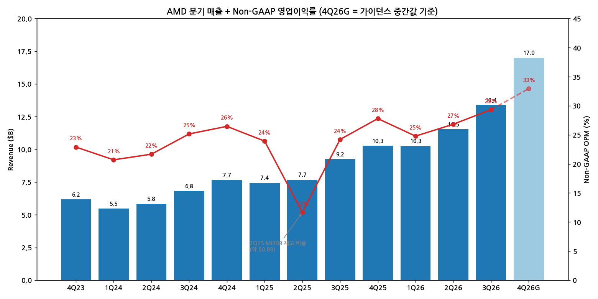
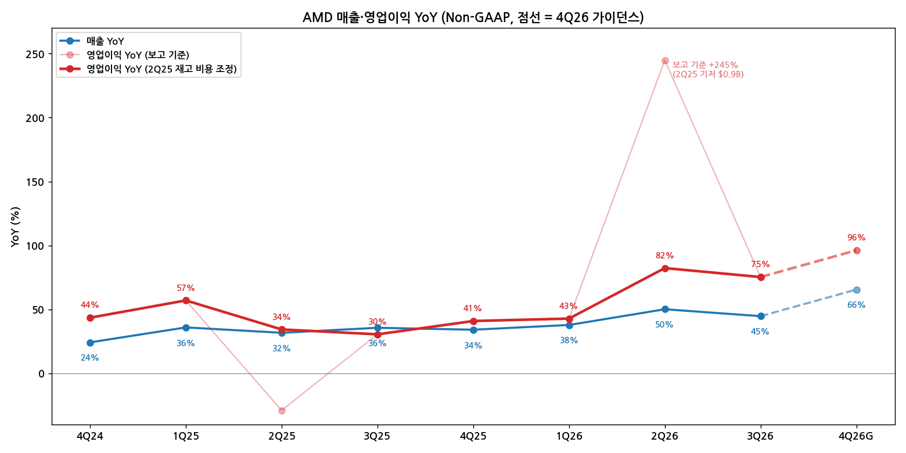

> 모드: 실적 리뷰 (v11)
> 종목: AMD (AMD)
> 섹터: 반도체
> 서브섹터: 로직·CPU
> 분기: 2026-Q3
> 발표일: 2026-11-03 (ET, AMC) / 2026-11-04 KST
> 작성 시각: 2026-11-14 KST
> 분석 소스: 회사 실적·컨콜 내용(첨부 리포트 인용 기준) + 첨부 셀사이드 8개 — Citi(11/04, 국문 번역본), IBK투자증권(11/04), KB증권 AI 실적속보(11/04), 삼성증권(11/04), 신한투자증권(11/04), 하나증권(11/04), NH투자증권(11/05), KB증권(11/06) + 웹서치 보완(11/5 주가 급락 배경 1건)
> 리뷰 깊이: 풀 | 리서치 첨부 8건

# AMD 3Q26 실적 리뷰 — 숫자는 잠시 숨을 골랐고, 가이던스는 다시 가속을 그렸다

## 0. 한 줄 판정

> 성장 델타: **둔화 (일시 — 조정 기준 영업이익 YoY 82% → 75%, 4Q 가이던스 +96%로 재가속)** | 내러티브: **강화** → **메모리와 달리 델타가 아직 위로 열려 있는 '가속 대기 구간' — 4Q 실적이 가이던스를 확인하면 적극 구간 재진입** [판단]

→ 숫자: 매출 $13.38B(+44.7% YoY), Non-GAAP 영업이익 $3.92B(+75.3% YoY), OPM 29.3%. 컨센 대비 매출 +2.3%, 영업이익 +6.7%. 2Q25 MI308 재고 비용(약 $0.8B)으로 부풀었던 2Q26 YoY(+245%)를 조정하면 82% → 75%로 소폭 둔화
→ 가이던스: 4Q26 매출 $17.0B(±3%, +66% YoY, 컨센 $16.2～16.3B), 가이던스 내재 영업이익 약 $5.6B(+96% YoY). **2027 매출 +80% 이상, 서버 CPU 약 2배(직전 +70%), 데이터센터 비중 80% 이상**
→ 쟁점: ① 2027 +80%는 공급이 받쳐주나 ② AI GPU 믹스·HBM 원가로 GPM 55%가 지켜지나(Citi 2027 EPS −11%) ③ FCF $0.55B(−64%)·재고 +$3B는 선투자인가 ④ PC·게이밍 급감을 데이터센터가 메우나
→ 주가: 11/3 $483.9 → 11/5 $404.4. 발표 다음날(11/4)은 약 +1%였고, 11/5 −17%는 S&P 500 −4.4%·반도체 동반 급락일(웹서치, Trefis) — 실적보다 매크로
→ 다음 분기 관건: 4Q 데이터센터 +50% QoQ·AI GPU > 서버 CPU 달성, GPM 55% 유지, 1Q27 비수기에도 QoQ 성장

---

## 1. 숫자

① 연결 기준 분기 표

단위: $M, %. **Non-GAAP 영업이익** (AMD가 주 지표로 사용. 3Q26 GAAP 영업이익 약 $2.8B — IBK. GAAP 순이익에는 고객사 워런트 공정가치 비현금 비용 $1.1B 반영 — KB)

| 항목 | 4Q23 | 1Q24 | 2Q24 | 3Q24 | 4Q24 | 1Q25 | 2Q25 | 3Q25 | 4Q25 | 1Q26 | 2Q26 | **3Q26** | 4Q26 가이던스 |
|---|---|---|---|---|---|---|---|---|---|---|---|---|---|
| 매출액 | 6,168 | 5,473 | 5,835 | 6,819 | 7,658 | 7,438 | 7,685 | 9,246 | 10,270 | 10,253 | 11,536 | **13,377** | 17,000 (±3%) |
| 영업이익 | 1,412 | 1,133 | 1,264 | 1,715 | 2,026 | 1,779 | 897 | 2,238 | 2,854 | 2,540 | 3,094 | **3,923** | 약 5,600 [계산] |
| OPM | 22.9 | 20.7 | 21.7 | 25.2 | 26.5 | 23.9 | 11.7 | 24.2 | 27.8 | 24.8 | 26.8 | **29.3** | 약 32.9 |
| 매출 YoY | +10.2 | +2.2 | +8.9 | +17.6 | +24.2 | +35.9 | +31.7 | +35.6 | +34.1 | +37.8 | +50.1 | **+44.7** | +65.5 |
| 영업이익 YoY | +11.4 | +3.2 | +18.4 | +35.7 | +43.5 | +57.0 | −29.0 | +30.5 | +40.9 | +42.8 | +244.9 | **+75.3** | 약 +96.2 |
| 영업이익 YoY (조정) | — | — | — | — | — | — | +34.3 | +30.5 | +40.9 | +42.8 | +82.3 | **+75.3** | 약 +96.2 |
| **매출 YoY 델타 (%p)** | — | −8.0 | +6.7 | +8.7 | +6.6 | +11.7 | −4.2 | +3.9 | −1.5 | +3.7 | +12.3 | **−5.4** | +20.8 |
| **영업이익 YoY 델타 (%p, 조정)** | — | −8.2 | +15.2 | +17.3 | +7.8 | +13.5 | −22.7 | −3.8 | +10.4 | +1.9 | +39.5 | **−7.0** | +20.9 |

→ (출처: 1Q25～3Q26 삼성증권·신한투자증권 Non-GAAP 정리(회사 발표치), 4Q23～4Q24 회사 발표치. 4Q26 = 회사 가이던스 매출 $17.0B·GPM 55%로 하나증권이 계산한 영업이익 약 $5.6B, EPS $2.92)
→ 조정 기준: 2Q25 Non-GAAP 영업이익에 포함된 중국향 MI308 재고·관련 비용 약 $0.8B를 되돌려 2Q25를 약 $1,697M로 놓고 계산 [계산]. 2Q25·2Q26 YoY만 바뀌고 나머지 분기는 동일

서프라이즈: 매출 컨센 $13.08B 대비 **+2.3%**, 영업이익 $3.68B 대비 **+6.7%**, EPS $2.09 vs $1.97 **+6.1%** (FactSet·LSEG — 신한·삼성·NH). 4Q 가이던스 매출은 컨센 $16.2～16.3B 대비 **+4～5%**, 내재 영업이익은 컨센 대비 **+10.4%**(하나), EPS $2.92 vs $2.68 **+9%**(Citi)

(1) YoY 위치
→ 매출 YoY는 2Q26 +50%에서 3Q26 +45%로 한 번 쉬었다가 4Q26 가이던스 +66%로 **사상 최고 성장률**을 다시 쓴다. 영업이익 YoY(조정)도 82% → 75% → 96%
→ 컨센 경로상 정점은 아직 보이지 않는다. 회사 2027 가이던스(매출 +80% 이상)가 맞다면 2027년 분기 매출 YoY는 대부분 +60～100% 구간 [전망]

(2) QoQ로 다시 보기
→ 영업이익 QoQ: −11%(1Q26) → +22%(2Q26) → +27%(3Q26) → 약 +43%(4Q26G). 분기 증가액 +$0.55B → +$0.83B → 약 +$1.68B로 **QoQ 기준으로는 오히려 가속 중**
→ 3Q26 YoY 둔화는 Client·Gaming 감소(C&G 매출 −8% YoY)가 만든 숫자이고, 데이터센터는 4개 분기 연속 성장률이 올라가고 있다(KB) [판단]

→ (출처: 회사 발표치, 삼성·신한증권 정리, 4Q26G = 가이던스 중간값·하나증권 계산 영업이익)

→ (출처: 동일. 연한 선 = 보고 기준, 진한 선 = 2Q25 재고 비용 조정 기준 [계산])

② 사업부별 매출·영업이익

단위: $M, %. 사업부 영업이익은 GAAP 부문 기준(회사 공시, IBK 정리). All Other(상각·SBC 등) 약 −$1.1B 별도

(1) 이번 분기 스냅샷

| 부문 | 3Q26 매출 | 비중 | 매출 QoQ | 매출 YoY | 3Q26 영업이익 | OPM | 2Q26 OPM | 3Q25 OPM | 영업이익 YoY |
|---|---|---|---|---|---|---|---|---|---|
| **Data Center** | **8,546** | **63.9** | **+27** | **+96.9** | **약 2,880** | **33.7** | 31.3 | 24.7 | **+168.3** |
| Client & Gaming | 3,722 | 27.8 | −3 | −8.1 | 약 573 | 15.4 | 15.2 | 21.4 | −33.9 |
| └ Client | 2,949 | 22.0 | −4 | +7.2 | — | — | — | — | — |
| └ Gaming | 773 | 5.8 | −1 | −40.4 | — | — | — | — | — |
| Embedded | 1,109 | 8.3 | +14 | +29.4 | 약 452 | 40.8 | 39.5 | 33.0 | +60.1 |
| **합계** | **13,377** | 100 | +16 | +44.7 | 3,923 (Non-GAAP) | 29.3 | 26.8 | 24.2 | +75.3 |

(2) 부문별 매출 YoY 추이

| 부문 | 4Q25 | 1Q26 | 2Q26 | **3Q26** | 4Q26 가이던스 | 방향 |
|---|---|---|---|---|---|---|
| Data Center | +39.4 | +57.2 | +107.3 | **+96.9** | 약 +138 (QoQ +50%) | 가속 지속 |
| Client & Gaming | +37.0 | +22.6 | +6.1 | **−8.1** | 약 −24 (QoQ −20% 이상) | 꺾임 |
| Embedded | +2.9 | +6.1 | +18.6 | **+29.4** | 약 +29 (QoQ 두 자릿수) | 가속 |

→ (출처: IBK 부문 표, 4Q26은 회사 부문 가이던스로 계산 [계산])

(3) 해석 — 누가 델타를 끌고 누가 꺾이나
→ **델타를 끄는 곳 = Data Center.** 3Q26 매출 증가분(QoQ +$1.84B) 전부가 DC(+$1.83B)에서 나왔고, DC OPM은 24.7% → 33.7%로 9%p 올랐다. 클라우드·엔터프라이즈 서버 CPU 매출이 YoY 2배 이상(2Q +70%에서 가속, 삼성), MI455X 대량 출하와 Helios 랙 매출 인식 시작
→ **꺾인 곳 = Client & Gaming.** 부품(메모리) 가격 상승이 PC 가격에 전가되며 Client QoQ −4%, Gaming은 콘솔 사이클 후반으로 −40% YoY. 4Q는 C&G −20% 이상 감소 가이던스, 2027 PC 출하 두 자릿수 감소 전제
→ **조용한 가속 = Embedded.** 항공우주·방산, 테스트·에뮬레이션 FPGA 수요로 4개 분기 연속 성장 가속, OPM 41%로 전사 최고(KB)
→ DC 내부: 3Q26 서버 CPU 약 $4.8B, AI GPU 약 $3.7B [추정, KB 그림 판독]. 4Q26에 **AI GPU 매출이 서버 CPU를 처음으로 상당 폭 추월**(회사). 2026 매출 중 서버 CPU 비중 약 35%(Citi)

③ 연간

단위: $M, %, Non-GAAP

| 항목 | 2023 | 2024 | 2025 | **2026E** | 2027E | 2028E |
|---|---|---|---|---|---|---|
| 매출액 | 22,680 | 25,785 | 34,639 | **약 52,166** | 90,060～96,430 | 129,589～144,971 |
| 영업이익 | 4,842 | 6,138 | 7,768 | **약 15,157** | 30,647～32,981 | 47,661～49,506 |
| OPM | 21.3 | 23.8 | 22.4 | **약 29.1** | 34.0～34.6 | 36.8～37.1 |
| 매출 YoY | −3.9 | +13.7 | +34.3 | **+50.6** | +73～85 | +41～50 |
| 영업이익 YoY | −19.3 | +26.8 | +26.6 | **+95.1** | +102～118 | +50～51 |

→ (출처: 2023～2025 회사 발표치. 2026E = 1～3Q 실적 + 4Q 가이던스 합산 [계산]. 2027E 범위 = 하나·신한·NH(90.1～91.9B)·FactSet 컨센(KB 11/6, 95.4B/33.0B)·Citi(96.4B), 영업이익 범위는 정의가 같은 하나·신한·NH·FactSet 기준. 2028E = NH·FactSet(영업이익·OPM), 매출 상단은 Citi. 2023 YoY는 2022 매출 $23.6B·Non-GAAP 영업이익 $6.0B 대비)
→ 연간 컨센 변화: 회사가 2027 서버 CPU를 +70% → 약 +100%로 올렸고, 당시 컨센은 서버 CPU +73%를 반영하고 있었다(삼성). 반대로 Citi는 매출을 올리면서도 낮아진 GPM 가정으로 **2027 EPS를 $18.84 → $16.70(−11%)으로 하향**, 2026은 +3% 상향. 매출 상향 vs 마진 하향이 동시에 일어난 분기

---

## 2. 시장 쟁점

① 2-0. 지난 리뷰에서 "봐야 할 것"으로 남긴 항목 체크

> 직전 분기(2026-Q2) 리뷰는 작성되지 않음. 2026-Q1 리뷰 기반 팔로업(`earnings-followup/2026-Q2_AMD_팔로업.md`) 4번 항목을 두 분기 누적 체크

| 직전 팔로업 항목 | 이번까지 결과 | 판정 |
|---|---|---|
| Q2 서버 CPU +70% YoY | 2Q +70% 달성 → 3Q 클라우드·엔터프라이즈 CPU YoY 2배 이상으로 가속(삼성·KB) | **확인** (기대 초과) |
| MI450 Helios Q3 초기 물량 + Q4 본격 램프 | 3Q MI455X 대량 출하·Helios 매출 인식 시작. Anthropic·Meta·Microsoft·OpenAI·Oracle 운영 중, 4Q 대폭 확대 | **확인** |
| Verano(AI 최적화 CPU) 출시 시점 | 첨부 리포트에 언급 없음. 대신 에이전트용 랙 Helion(CPU/GPU 비율 조절형) 공개(IBK), 최대 144 CPU 랙(신한) | **미확인** |
| 삼성전자 HBM4 공급 | 첨부 리포트에 공급사별 언급 없음. "HBM 공급 부족"·HBM 원가 고객 분담만 언급 | **미확인** |
| Gaming 2H 둔화 + MI450 GPM 압박 | Gaming −40% YoY, GPM 56.2%(2Q) → 55.9%(3Q) → 55%(4Q 가이던스) | **확인** (예상대로) |

→ 성장 축(서버 CPU·Helios)은 기대 이상, 비용 축(GPM 희석)은 예고대로. 미확인 2건은 다음 분기로 이월

② 2-1. 이번 분기 쟁점

| # | 쟁점 | 한 줄 정의 | 언급 증권사 |
|---|---|---|---|
| 1 | 2027 매출 +80% — 공급이 받쳐주나 | 수요는 확실, 웨이퍼·패키징·HBM이 따라오나 | 8/8 |
| 2 | 마진 희석 — GPM 55%를 지키나 | AI GPU 믹스·HBM 원가 상승이 이익 레버리지를 얼마나 깎나 | 7/8 |
| 3 | 현금흐름·재고 급증 | FCF −64%, 재고 +$3B, 패키징 장비 직접 투자는 선투자인가 리스크인가 | 5/8 |
| 4 | PC·게이밍 붕괴와 CPU 점유율 | PC 수요 급감 속 데이터센터가 메우고, 인텔 대비 CPU 대안이 되는가 | 7/8 |

③ 2-2. 쟁점별 분해

(1) 쟁점 1 — 2027 매출 +80%, 공급이 받쳐주나

(1-1) 회사 설명
→ "수년간 고객 배치 일정과 웨이퍼·기판·어드밴스드 패키징·메모리를 함께 계획해 왔다. 수요가 공급보다 많은 것은 사실이며 공급 확대를 지속 추진 중. 전사 80% 이상, 서버는 높은 기저 위에서 약 2배, 데이터센터 AI는 강한 가시성" (컨콜, KB 11/6 정리)
→ "서버 상향은 Client → 서버 웨이퍼 재배분이 아니라 수요 때문. 웨이퍼 투입이 매출로 이어지는 데 약 6개월" (Citi)
→ "추가 공급은 웨이퍼·패키징·OSAT·메모리·랙 부품 전반에서 개선" — 백엔드 패키징 장비를 직접 사서 OSAT에 위탁(3Q capex 약 $0.6B) (Citi)
→ 2027년 약 3GW 배치, GW당 매출 $15～20B 유지 (KB 11/6)

(1-2) 증권사별 해석 편차

| 증권사 | 2027E 매출 / 영업이익 | 논리 |
|---|---|---|
| Citi (Buy, TP $800) | $96.4B / EBIT $30.3B | DC 2027 추정 $33.1B → $74.5B(전사 82%). "AI 매출이 탈출 속도 도달", 제약은 수요가 아니라 공급 |
| FactSet 컨센 (KB 11/6) | $95.4B / $33.0B | 3년 매출 CAGR 57%, PEG 0.4배로 성장 대비 저평가 |
| NH | $91.9B / $31.5B | 단기 변수는 부품 공급. 부품 병목에 따른 매출 지연·수익성 우려는 존재 |
| 신한 | $90.8B / $31.0B | 2027 가이던스 "서프라이즈". CPU·GPU 동반 성장 구간 |
| 하나 | $90.1B / $30.6B | 수요가 확보한 공급을 웃돌아 추가 생산능력 확보 시 성장 여력 |
| IBK | — | "AI 고객 수요 대비 공급 부족", 2027 CPU +70% 이상·DC +100% |

(1-3) 공통 결론 vs 갈리는 지점
→ 공통(8/8): 2027 성장 제약은 수요가 아니라 공급. 회사가 이미 확보한 공급 기준으로 +80%를 제시했다는 점에서 가시성 높음
→ 갈림: **+80% 이상의 상단**. Citi(+84%)·FactSet(+83%)은 회사 가이던스를 그대로 반영, 국내 3사(+75～78%)는 부품 병목을 일부 할인

(1-4) [판단]
→ 회사가 "확보한 공급 기준"으로 +80%를 냈고, 패키징 장비를 직접 사는 수준까지 공급망에 들어갔다는 점에서 하방은 단단하다. 다만 HBM은 메모리 3사가 "2029년까지 완판"을 말하는 품목 — AMD의 2027 상단은 결국 **HBM 배정량**이 정한다. SK하이닉스·삼성전자 컨콜의 "고객 요청이 공급의 2배"가 AMD에게는 제약 요인으로 작동 [판단]

(2) 쟁점 2 — 마진 희석, GPM 55%를 지키나

(2-1) 회사 설명
→ 3Q Non-GAAP GPM 55.9%(−0.3%p QoQ), 4Q 가이던스 55% — "AI GPU 매출 비중 확대가 전사 평균에 일부 부담" (하나·삼성)
→ "HBM을 비롯한 부품 원가 인플레이션은 일부 공급사·고객과 장기계약, 추가 원가는 고객과 분담" (KB 11/6)
→ "2027 영업비용 증가율은 매출 증가율의 절반 이하. 데이터센터 AI가 GPM에 소폭 희석적이지만 매출총이익 달러는 크게 증가, 분기별로는 서버·AI 믹스에 따라 변동" (KB 11/6)

(2-2) 증권사별 해석 편차

| 증권사 | 핵심 가정·추정 | 논리 |
|---|---|---|
| Citi | 2027 GPM 54.2%, 2028 53.7% | GPM 하락 반영해 2027 EPS −11% 하향. 그래도 영업 레버리지로 EBIT 마진 31.4% |
| 삼성 | 4Q GPM 가이던스 55%는 컨센 55.4% 소폭 하회 | GPU 비중 확대 영향, AI GPU가 CPU를 크게 넘는다는 점은 Helios 기대 충족 |
| Citi (4Q 비교) | 4Q GPM 55%는 컨센 54.3% 상회 | 같은 가이던스를 컨센 출처에 따라 반대로 해석 |
| 신한 | GPM −1%p는 Helios·MI450 램프 영향 | 일시적 램프 비용 성격 |
| KB 11/6 | 리스크 1순위 = HBM 등 부품 원가 상승에 따른 마진 희석 | 영업이익률은 매출 믹스로 확대 지속 |

(2-3) 공통 결론 vs 갈리는 지점
→ 공통: GPM은 55% 언저리에서 정체·소폭 하락, 영업이익률은 opex 레버리지로 상승 (2027E OPM 34～35%)
→ 갈림: GPM 하락의 **크기**. Citi는 2028까지 53%대로 내려가는 경로를 넣었고, 국내사는 55% 근처 유지를 가정

(2-4) [판단]
→ 메모리 섹터 리뷰에서 본 "HBM 가격 2027 큰 폭 인상(삼성전자 HBM ASP +150%, KB)"이 AMD에게는 그대로 원가다. 메모리 3사의 이익 레버리지와 AMD의 GPM 희석은 같은 동전의 양면 — AMD 영업이익의 상방은 GPM이 아니라 **opex 레버리지**(매출 +80%, opex +40% 이하)에서 나온다 [판단]
→ 결론을 바꿀 데이터: 1Q27 GPM 가이던스가 54% 아래로 내려가는지, 2027 HBM4·HBM4E 계약 가격 보도

(3) 쟁점 3 — 현금흐름·재고 급증

(3-1) 회사 설명
→ 3Q FCF $0.55B(−64% YoY, −64% QoQ), 재고 약 +$3B QoQ — "강한 고객 수요를 충족하기 위한 선제 투자". 재고는 리드타임이 긴 Instinct·HBM 중심, 4Q에도 추가 증가 예정 (하나·Citi)
→ 후공정 생산능력 확보 투자(패키징 장비 OSAT 위탁, 3Q 약 $0.6B). 2027에도 재고·생산능력 투자 지속 (하나·Citi)
→ GAAP: MI450 출하와 함께 고객사 워런트 공정가치 비현금 비용 $1.1B — 주가·조건 충족 확률에 따라 분기마다 변동 (KB 11/6)

(3-2) 증권사별 해석 편차

| 증권사 | 핵심 가정·추정 | 논리 |
|---|---|---|
| 하나 | 수요 부진 신호 아님 | 고객 공급계획에 근거한 투자 |
| Citi | 2026 FCF $6.5B → 2027 $21.1B | 운전자본 −$6.2B(2026)·−$6.8B(2027) 가정에도 2027 FCF 3배 |
| KB 11/6 | 리스크 = 워런트 비현금 비용·향후 주식 희석, 고객 DC 인프라 지연 | 재고 증가는 수요 대응 |
| KB 11/4 (AI) | FCF 감소 요인 = 운전자본·설비투자 | 사실 요약 |

(3-3) 공통 결론 vs 갈리는 지점
→ 공통: 재고·capex 증가는 2027 램프 대비 선투자
→ 갈림: 워런트 희석과 고객 인프라(전력·부지) 지연 리스크를 얼마나 할인할지 — KB만 리스크로 명시

(3-4) [판단]
→ 팹리스가 패키징 장비를 직접 사고 재고를 $3B씩 쌓는 건 이례적이다. 수요가 확실할 때는 공급 확보 무기, 고객 배치가 늦어지면 재고 부담 — **2027 상반기 고객 데이터센터 가동 일정**이 이 선투자의 성패를 가른다. 회사는 "GPU가 어느 데이터센터 어느 위치로 가는지까지 가시성 확보"라고 답했다 (KB 11/6) [판단]

(4) 쟁점 4 — PC·게이밍 붕괴와 CPU 점유율

(4-1) 회사 설명
→ "부품 가격 상승이 시스템 가격에 전가돼 소비자 시장이 민감하게 반응. 2027 PC 시장 두 자릿수 감소 전제, 엔터프라이즈·프리미엄·데스크톱 집중. PC와 데이터센터 간 공급 전용 가능해 수요 많은 쪽으로 이동" (KB 11/6)
→ 1Q27 Client·Gaming HSD～LDD% QoQ 감소, 2H27이 1H27보다 나을 것이나 재고 부담으로 통상적 계절 회복은 기대 안 함 (Citi)
→ 서버 CPU: 가속기에 붙는 헤드노드 CPU 점유율 확대, 코어 수 증가로 ASP 점진 상승. 에이전트 AI가 CPU 수요를 키운다 (Citi·하나)

(4-2) 증권사별 해석 편차

| 증권사 | 핵심 가정·추정 | 논리 |
|---|---|---|
| 삼성 | "PC 없이도 숫자 잘 나온다" | 인텔 미스·폭락에 동반 하락은 억울. 12MF P/E 33배 vs 인텔 35배 — CPU 테마의 펀더멘털·밸류 대안 |
| 하나 | "여전히 인텔보다 AMD" | 서버 CPU 성장은 가격보다 출하·코어 수 → 점유율 확대 |
| 신한 | "CPU 왕좌 확보, GPU로 진격" | 2027 PC 두 자릿수 감소 → 공급망 재고 조정 4Q26 시작 |
| NH | 데이터센터 중심 사업 모델로 전환 | Client는 부진 지속, 데이터센터로 물량 전환 |
| KB 11/6 | 리스크 2순위 = PC 클라이언트 부진 | 2027 Client는 전사 매출의 10% 수준(Citi) |

(4-3) 공통 결론 vs 갈리는 지점
→ 공통: PC는 2027년까지 역성장, 영향은 매출 비중 축소로 희석(2027 DC 80% 이상, Client 약 10%)
→ 갈림: 거의 없음. 셀사이드 전원이 "PC 약세 < 서버 CPU 강세"로 정리

(4-4) [판단]
→ PC 약세의 원인이 메모리 가격 상승이라는 점이 핵심이다. 메모리 사이클이 강할수록 AMD는 ① HBM 원가(쟁점 2)와 ② PC 수요(쟁점 4) 두 경로로 비용을 치르고, 서버 CPU·AI GPU 수요로 보상받는다. 지금까지는 보상이 비용보다 훨씬 크다 [판단]

④ 2-3. 낙관 vs 보수 — 논리 대비

| 구분 | 증권사 | 무엇을 다르게 가정했나 |
|---|---|---|
| 가장 낙관 | Citi (Buy, TP $800) | 2027 DC $74.5B(전사 82%), 2028 매출 $145B. 데이터센터 가속을 반영해 SOTP 멀티플 상향. 단 GPM 하락으로 2027 EPS는 −11% |
| 낙관 | KB 11/6 (운용 비중 확대) | 성장 조정 배수(EV/Sales 16.0, PEG 0.4배)가 S&P 500의 절반 이하 |
| 보수 | NH | 부품 병목에 따른 매출 지연·수익성 악화 우려, 고객 투자 스케줄과 부품 가격 인상이 주가 변수 |
| 보수 | 삼성 | 12MF P/E 33배는 절대적으로 낮지 않음 — "인텔보다 낫다"는 상대 논리 |

→ 핵심 차이는 **부품(HBM) 공급·원가**를 얼마나 할인하느냐. 등급은 모두 긍정(국내사 컨센 TP 인용, Citi Buy)
→ 셀사이드 vs 시장: 실적·가이던스 모두 상회했고 발표 다음날(11/4) 주가는 약 +1%. 그러나 11/5 −17.3%(S&P 500 −4.4%, 반도체 피어 5개사 모두 −9% 이상 — 웹서치, Trefis)로 52주 고점($658.52, 10/6) 대비 약 −39%. 보도는 중간선거 결과에 따른 AI 규제 우려를 원인으로 들었다 — 회사 고유 이슈가 아닌 섹터·매크로 매도 [판단]

⑤ 2-4. 추정치·TP 변화

단위: $, $M. 국내 증권사는 해외기업 자체 TP 없음 → 인용 컨센 TP 기재

| 증권사 | 의견 / TP | TP 변화 | 4Q26 영업이익 E | 2026E / 2027E 영업이익 | 핵심 변화 한 줄 |
|---|---|---|---|---|---|
| Citi | Buy / **$800** | 유지 | (EPS $2.97) | EBIT 13,185 / 30,267 | 2026 EPS +3%, 2027 EPS −11%(GPM 하향), DC 2027 $74.5B로 상향 |
| KB 11/6 | 운용 비중 확대 / FactSet $657.59 | — | — | 14,966 / 32,981 (컨센) | 성장 대비 저평가 |
| KB 11/4 | — / FactSet $658.3 | — | — | — | AI 실적속보 |
| NH | — / 컨센 $649.1 | — | 5,280 (발표 전 컨센) | 14,697 / 31,526 | 데이터센터 중심 모델 전환 |
| 하나 | — / 컨센 $647.71 | — | 약 5,600 (가이던스 내재) | 14,442 / 30,647 | 4Q 가이던스 컨센 대비 영업이익 +10.4% |
| 신한 | ★★★★★ / LSEG $630.1 | — | 5,071 (발표 전 FactSet) | 14,357 / 30,960 | 중장기 가이던스가 서프라이즈 |
| 삼성 | — / Bloomberg $653.44 | — | — | — | CPU 테마의 대안 |
| IBK | — | — | — | — | 공급 부족, 2027 DC +100% |

→ 인용 컨센 TP $630～658(6개 출처), Citi $800. 11/5 종가 $404.4 대비 컨센 TP 기준 +56～63%
→ 직전 TP 비교: 국내사는 자체 TP가 없어 변화 집계 불가. Citi는 TP 유지(멀티플은 상향, EPS는 하향 — 서로 상쇄)
→ 4Q26 영업이익 컨센: 발표 전 $5.07～5.28B → 가이던스 내재 약 $5.6B(**+6～10%**)
→ **하향이 있다면 원인은 마진이지 매출이 아니다** — Citi는 매출을 크게 올리고 GPM 가정만 낮췄다. 주가 하락은 실적 하향이 아니라 11/5 섹터 전반의 멀티플 압축 [판단]

---

## 3. 내러티브 점검

① 성장 스토리 정의
→ "x86 서버 CPU 점유율을 계속 빼앗고, 에이전트 AI로 CPU 수요 자체가 커지는 가운데, Helios 랙으로 **엔비디아의 유일한 범용 GPU 대안**이 되어 데이터센터 매출이 매년 2배씩 커진다"

② 이번 분기 평가 — **강화**
→ 서버 CPU: 2027 성장 가이던스 +70% → 약 +100%, 클라우드·엔터프라이즈 CPU 이미 2배 성장 중
→ AI GPU: MI455X·Helios 매출 첫 인식, 4Q에 AI GPU가 서버 CPU를 추월, 고객 5곳(Anthropic·Meta·Microsoft·OpenAI·Oracle) 공개
→ 전사: 2027 매출 +80% 이상, 데이터센터 비중 80% 이상 — 1년 전(47%) 대비 회사 정체성이 바뀌었다
→ 균열 신호(훼손 아님): GPM 정체, FCF 급감, PC 붕괴, 워런트 희석

③ 국면 — 델타 일시 둔화 × 내러티브 강화
→ 메모리 3사가 "이익 레벨은 최고, 델타는 정점 통과"였다면 AMD는 반대다. 3Q 영업이익 YoY는 75%로 한 번 쉬었지만 4Q 가이던스 +96%, 2027 매출 +80%로 **델타가 아직 위로 열려 있다** [판단]
→ 비유하면 메모리는 정상을 지난 등산객, AMD는 중턱 쉼터에서 물 마시고 다시 오르기 시작한 등산객. 다만 AMD가 오르는 길(HBM)은 메모리가 가격을 올리고 있는 길이라 체력(마진) 소모가 크다
→ BT 프레임: 판정 기준상 이번 분기는 '둔화'지만, 4Q 실적이 가이던스대로 나오면 다음 리뷰는 '가속' — **적극 구간 재진입 대기** [판단]

④ 다시 강해질 트리거
→ 4Q 실적에서 데이터센터 +50% QoQ·AI GPU > 서버 CPU 확인 + 1Q27 가이던스가 계절성에도 QoQ 성장
→ Helios 신규 고객(5곳 외) 또는 GW 단위 추가 계약 발표
→ MI500(2027) 일정·HBM4E 공급 확정

⑤ 깨뜨릴 리스크
→ HBM 배정 부족으로 2027 Helios 출하 지연 — 쟁점 1·2가 동시에 터지는 시나리오
→ 고객 데이터센터 전력·부지 지연 → 재고 $3B+ 부담으로 전환
→ AI 규제·AI 기업 신용위험 등 매크로로 하이퍼스케일러 CapEx 조정

---

## 4. 향후 봐야 할 것

| 순위 | 무엇을 (변수·임계값) | 어떤 데이터로 | 언제 |
|---|---|---|---|
| 1 | **4Q26 매출 $17B·영업이익 $5.6B 달성 & 데이터센터 +50% QoQ(약 $12.8B)** — 달성 시 델타 '가속' 복귀, 미달 시 '둔화' 지속 | AMD 4Q26 실적·컨콜 | 2027-02 초 |
| 2 | **1Q27 가이던스 — 계절성 속 QoQ 성장 여부, GPM 54% 이상 유지** | 4Q 컨콜 가이던스, Citi·FactSet 1Q27 컨센 | 2027-02 초 |
| 3 | **HBM 공급·원가** — 2027 HBM4/4E 배정, 원가 분담 구조, 삼성전자 HBM4 공급 여부 | SK하이닉스·삼성전자 4Q 컨콜(1월), 마이크론 FQ1 27(12월), TrendForce | 2026-12 ～ 2027-01 |
| 4 | **현금흐름·재고 정상화** — 재고 증가 둔화, FCF 회복, 워런트 비현금 비용 규모 | 4Q 10-K·실적 자료 | 2027-02 |
| 5 | **하이퍼스케일러 2027 CapEx·Helios 신규 고객** — 매크로(규제·금리) 속 AI 투자 지속 여부 | MSFT·META·GOOGL·AMZN·ORCL 4Q 실적(1～2월), AMD 고객 발표 | 2027-01 ～ 02 |

→ 1순위가 델타 판정을 바꾼다. 4Q는 회사가 "AI GPU가 서버 CPU를 크게 넘어서는 분기"를 2027 믹스의 벤치마크로 제시한 분기 — 숫자와 GPM을 함께 봐야 한다

---

> Sources: Citi Research(2026-11-04, 국문 번역본), IBK투자증권·KB증권·삼성증권·신한투자증권·하나증권(2026-11-04), NH투자증권(2026-11-05), KB증권(2026-11-06) — 원문은 비공개 보관. 웹서치: [Trefis, What Just Happened To AMD Stock? (2026-11-06)](https://www.trefis.com/stock/amd/articles/623346/what-just-happened-to-amd-stock/2026-11-06)
