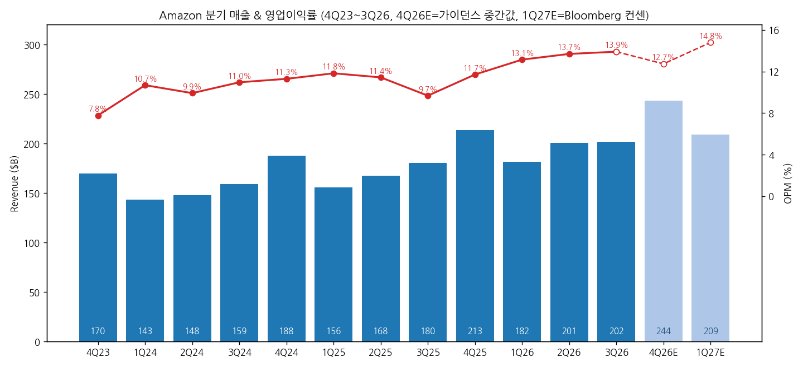
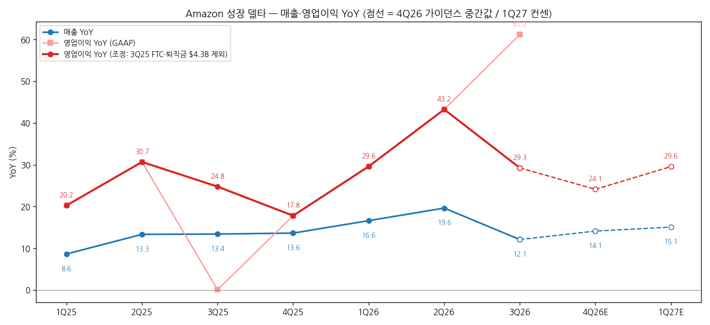
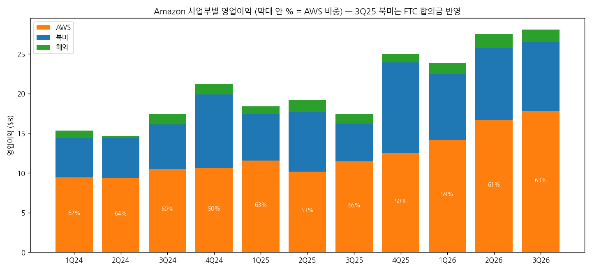
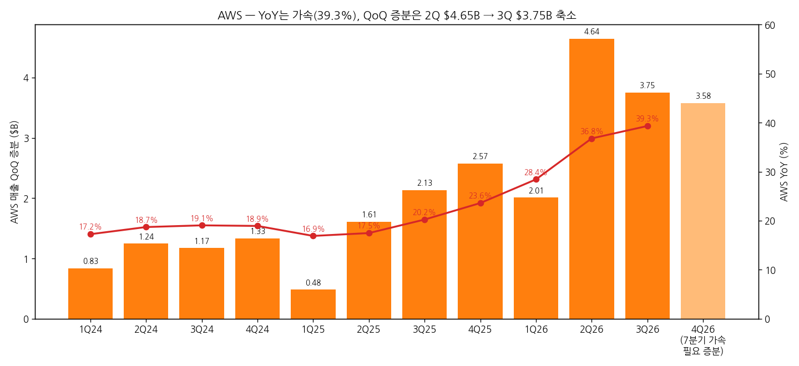
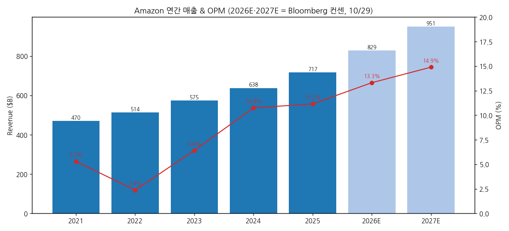

# Amazon 3Q26 실적 리뷰

> 모드: 실적 리뷰 (v11)
> 종목: Amazon (AMZN)
> 섹터: 미국 빅테크
> 분기: 2026-Q3
> 발표일: 2026-10-29 (미 동부 장 마감 후)
> 작성 시각: 2026-11-01 11:30 KST
> 분석 소스: 국내 셀사이드 7개사(NH투자 10/30 · 키움 10/30 · 한화투자 10/30 · SK 10/30 · KB 10/30(AI 속보) · 삼성 10/30 · IBK투자 11/02) + 웹 보완: Amazon 3Q26 8-K/10-Q 헤드라인, 3Q25 보도자료(특별비용), The Fly 경유 해외 IB 8개사 TP 변경(Yahoo/Stocktwits 10/30), Motley Fool 10/30 주가 마감. 회사 IR 원본·컨콜 원문은 첨부되지 않아 경영진 발언은 증권사 Q&A 정리에서 인용

---

## 0. 한 줄 판정

> 성장 델타: **둔화** (조정 기준) | 내러티브: **유지** (AWS 강화 ↔ 현금·조달 약화가 상쇄) → **경계 구간. 4Q AWS 증분과 FCF 반전이 재진입 트리거**

→ **숫자**: 영업이익 $28.1B(OPM 13.9%, 사상 최고)로 컨센 대비 +7~8% Beat. GAAP YoY +61%는 3Q25 특별비용 $4.3B(FTC 합의금 $2.5B + 퇴직금 $1.8B) 기저효과. 이를 빼면 YoY **+29.3%로 2Q26 +43.2% 대비 -13.9%p 둔화**. 매출 YoY는 Prime Day 2Q 이동으로 19.6% → 12.1%
→ **쟁점 ①**: AWS는 YoY 39.3%로 6분기 연속 가속, 백로그 $578B(+$82B QoQ). 하지만 QoQ 증분이 $4.65B → $3.75B로 줄었고 AI ARR을 공시하지 않아 "가속의 질"에 의문(SK·BofA·Mizuho). 바이사이드 기대는 42%까지 올라가 있었음
→ **쟁점 ②**: 3Q 분기 FCF **-$33.5B**(컨센 -$7.7~9.9B), TTM -$42.4B. 9개월간 장기부채 $65.7B → $173.1B, 순현금이 순부채로 전환(키움). 주가는 시간외 -7%, 10/30 장중 -5.9%까지 밀렸다가 -1.4%로 마감
→ **해외 IB 8개사 TP 변경: 하향 5 · 상향 3**, 평균 -0.6%. 2026E 영업이익은 3Q Beat(+$2.0B)와 4Q 가이던스 중간값 미달(-$2.1B)이 상쇄돼 사실상 그대로 → **실적 하향이 아니라 멀티플 하향**. 12MF EV/EBITDA 9.1배로 2023년 이후 최저(삼성)
→ **다음 분기 관건**: 4Q 영업이익 가이던스 중간값($31.0B)은 YoY +24% → 실현되면 조정 YoY 2개 분기 연속 둔화로 **꺾임 경계**. AWS 4Q 증분 $3.58B 초과(7분기 연속 가속) + 4Q FCF 흑자 전환이 동시에 나와야 내러티브가 다시 강화로 돌아선다

---

## 1. 숫자

### ① 연결 기준 분기 표

| 항목 ($M) | 4Q24 | 1Q25 | 2Q25 | 3Q25 | 4Q25 | 1Q26 | 2Q26 | **3Q26** | 4Q26 가이던스 | 4Q26E 컨센 | 1Q27E 컨센 |
|---|---|---|---|---|---|---|---|---|---|---|---|
| 매출액 | 187,792 | 155,667 | 167,702 | 180,169 | 213,386 | 181,519 | 200,606 | **201,944** | 240,000~247,000 | 244,587 | 208,860 |
| 영업이익 (GAAP) | 21,203 | 18,405 | 19,171 | 17,422 | 24,977 | 23,852 | 27,461 | **28,076** | 28,500~33,500 | 33,124 | 30,901 |
| 영업이익 (조정) | 21,203 | 18,405 | 19,171 | 21,722 | 24,977 | 23,852 | 27,461 | **28,076** | — | — | — |
| OPM | 11.3% | 11.8% | 11.4% | 9.7% | 11.7% | 13.1% | 13.7% | **13.9%** | 12.7% (중간값) | 13.5% | 14.8% |
| 매출 YoY | 10.5% | 8.6% | 13.3% | 13.4% | 13.6% | 16.6% | 19.6% | **12.1%** | 14.1% (중간값) | 14.6% | 15.1% |
| 영업이익 YoY (GAAP) | 60.5% | 20.2% | 30.7% | 0.1% | 17.8% | 29.6% | 43.2% | **61.2%** | 24.1% (중간값) | 32.6% | 29.6% |
| 영업이익 YoY (조정) | 60.5% | 20.2% | 30.7% | 24.8% | 17.8% | 29.6% | 43.2% | **29.3%** | 24.1% (중간값) | 32.6% | 29.6% |
| **매출 YoY 델타 (%p)** | -0.5 | -1.9 | +4.7 | +0.1 | +0.2 | +3.0 | +3.0 | **-7.5** | +2.0 | +2.5 | +0.5 |
| **영업이익 YoY 델타 (조정, %p)** | +4.9 | -40.3 | +10.5 | -5.9 | -7.0 | +11.8 | +13.6 | **-13.9** | -5.2 | +3.3 | -3.0 |

→ (출처: 실적 = 삼성증권 3Q26 Review 분기 요약표(Amazon 공시, GAAP), 4Q26 가이던스 = 회사 3Q26 발표, 4Q26E·1Q27E = Bloomberg 컨센(10/29, 키움 인용). 조정 영업이익 = 3Q25 보도자료 "FTC 합의금 $2.5B·추정 퇴직금 $1.8B 제외 시 $21.7B")
→ 3Q26 서프라이즈: **매출 컨센 대비 -0.1~-0.2%, 영업이익 +7.0~7.7%, GAAP EPS $1.89는 -4.1%** (FactSet $202.2B/$26.2B/$1.97 · Bloomberg $202.3B/$26.1B). EPS Miss는 영업외손익이 전년 +$10.2B(Anthropic 평가이익 $9.5B) → 올해 -$0.7B로 돌아선 영향이며 영업과 무관
→ 4Q 가이던스: 매출 중간값 $243.5B는 컨센 대비 -0.5%, 영업이익 중간값 $31.0B는 -6~7% (컨센 $33.1~33.5B). LEO 비용 자산화가 2027년 1Q로 밀려 4Q에도 대부분 비용 처리되고, 연료비·간선운송비 부담이 3Q보다 커진다고 회사가 설명 (한화·NH Q&A)

→ (출처: 삼성증권 분기 요약표(Amazon 공시), 4Q26E = 회사 가이던스 중간값, 1Q27E = Bloomberg 컨센 10/29)

→ (출처: 동일. 조정선은 3Q25 특별비용 $4.3B 가산 기준)

(1) YoY는 어디에 있나
→ 조정 영업이익 YoY의 이번 사이클 정점은 **2Q26 +43.2%**. 단 2Q26은 Prime Day가 3Q에서 2Q로 당겨진 분기라 정점 자체가 부풀려져 있다
→ Prime Day 이동을 상쇄하려고 2Q+3Q를 합쳐 보면 영업이익 YoY **+35.8%**(2Q25+조정 3Q25 $40.9B → $55.5B)로 1Q26 +29.6%보다 높다. 매출은 +15.7%로 1Q26 +16.6%와 비슷 `[판단]` 반기 기준으로는 구조적 꺾임이 아니라 "타이밍 이동 + 2Q 정점 착시"에 가깝다
→ 컨센 경로: 4Q26 가이던스 중간값 +24.1% → 1Q27E +29.6%. 가이던스 중간값이 맞다면 조정 YoY는 **2개 분기 연속 둔화**(43 → 29 → 24)가 되어 판정 기준상 "꺾임" 경계에 닿는다. 아마존은 영업이익 가이던스를 보수적으로 주는 편이라(1Q26은 상단 $18B 대비 $23.9B) 실제 4Q가 컨센 $33.1B(+32.6%)에 가까우면 둔화는 1개 분기로 끝난다 `[전망]`

### ② 사업부별 매출·영업이익

(1) 지역 세그먼트

| 세그먼트 ($M) | 3Q25 | 1Q26 | 2Q26 | **3Q26** | 매출 YoY | 매출 비중 | 영업이익 3Q25 | 영업이익 2Q26 | **영업이익 3Q26** | OPM 3Q26 | 영업이익 YoY |
|---|---|---|---|---|---|---|---|---|---|---|---|
| 북미 | 106,267 | 104,140 | 116,177 | **112,852** | +6.2% | 55.9% | 4,789 | 9,123 | **8,723** | 7.7% | +82.1% |
| 해외 | 40,896 | 39,790 | 42,197 | **43,108** | +5.4% | 21.3% | 1,199 | 1,717 | **1,580** | 3.7% | +31.8% |
| AWS | 33,006 | 37,587 | 42,232 | **45,984** | +39.3% | 22.8% | 11,434 | 16,621 | **17,773** | 38.7% | +55.4% |

→ (출처: 키움 상세 실적표 · 삼성 분기 요약표(Amazon 공시). 1Q26 북미·해외 매출은 1Q26 리뷰(회사 보도자료). 3Q25 북미 영업이익은 FTC 합의금 반영분이라 북미 YoY +82%는 과장 — 특별비용의 세그먼트 배분은 미공개)

(2) 영업이익 YoY 추이 (8개 분기)

| 세그먼트 영업이익 YoY | 4Q24 | 1Q25 | 2Q25 | 3Q25 | 4Q25 | 1Q26 | 2Q26 | **3Q26** |
|---|---|---|---|---|---|---|---|---|
| AWS | +48.3% | +22.6% | +8.8% | +9.4% | +17.2% | +22.6% | +63.6% | **+55.4%** |
| AWS OPM | 36.9% | 39.5% | 32.9% | 34.6% | 35.0% | 37.7% | 39.4% | **38.7%** |
| 북미 | +43.3% | +17.2% | +48.4% | -15.4% | +23.9% | +41.5% | +21.4% | **+82.1%** |
| 북미 OPM | 8.0% | 6.3% | 7.5% | 4.5% | 9.0% | 7.9% | 7.9% | **7.7%** |
| 해외 OPM | 3.0% | 3.0% | 4.1% | 2.9% | 2.1% | 3.6% | 4.1% | **3.7%** |

→ (출처: 삼성 분기 요약표 기반 계산. AWS 2Q·3Q26 YoY 50~60%대는 2Q25·3Q25 OPM 32.9%·34.6% 저점의 기저 영향이 섞여 있음)

→ (출처: 삼성 분기 요약표(Amazon 공시))

(3) 매출 상세 — 사업 라인별 YoY

| 사업 라인 | 3Q26 매출 ($M) | 1Q26 YoY | 2Q26 YoY | **3Q26 YoY** | 2Q+3Q 합산 YoY | 3Q 컨센 대비 |
|---|---|---|---|---|---|---|
| 온라인 스토어(1P) | 68,470 | +11.9% | +14.6% | **+1.6%** | +7.8% | -1.7% |
| 3P 셀러 서비스 | 46,492 | +13.9% | +15.9% | **+9.4%** | +12.6% | +2.4% |
| 광고 | 19,637 | +24.0% | +26.0% | **+10.9%** | +18.0% | -5.7% |
| 구독 | 14,006 | +14.6% | +12.5% | **+11.4%** | +11.9% | +1.4% |
| AWS | 45,984 | +28.4% | +36.8% | **+39.3%** | +38.1% | +0.7% |

→ (출처: SK(Bloomberg 컨센)·삼성 분기 요약표, 2Q+3Q 합산은 계산. 광고 YoY는 SK 기준 "Advertising Services")
→ `[판단]` Prime Day 이동을 상쇄한 2Q+3Q 합산으로 봐도 **광고는 +18%로 1Q의 +24%보다 확실히 느려졌다.** 온라인 스토어·3P도 합산 기준 1Q보다 낮다. AWS만 합산 기준에서도 가속
→ 판매량(units)은 +12%였지만 단위당 리테일 매출은 약 -6.6% — 생필품·신선식품 비중 확대 영향 (키움)

→ (출처: 삼성 분기 요약표 기반 계산. 4Q26 필요 증분 $3.58B = 4Q25 $35.58B × 1.393 − 3Q26 $45.98B, 키움 동일 계산 $3.59B)

### ③ 연간

| 항목 ($B) | 2022 | 2023 | 2024 | 2025 | 2026E | 2027E |
|---|---|---|---|---|---|---|
| 매출액 | 514.0 | 574.8 | 638.0 | 716.9 | 829.0 | 951.0 |
| 영업이익 | 12.2 | 36.9 | 68.6 | 80.0 | 110.4 | 141.7 |
| OPM | 2.4% | 6.4% | 10.8% | 11.2% | 13.3% | 14.9% |
| 매출 YoY | 9.4% | 11.8% | 11.0% | 12.4% | 15.6% | 14.7% |
| 영업이익 YoY | -50.8% | 200.9% | 86.1% | 16.6% | 38.1% | 28.3% |

→ (출처: 실적 = 삼성 포괄손익계산서, 2026E·2027E = Bloomberg 컨센 10/29(키움). NH(FactSet) 2026E/2027E 영업이익은 $111.3B/$144.3B)
→ 발표 후 2026E 영업이익: 1~3Q 실적 $79.4B + 4Q 가이던스 중간값 $31.0B = **$110.4B로 발표 전 컨센과 동일**. 3Q Beat를 4Q 가이던스가 그대로 되돌린 셈. 발표 후 컨센 집계치는 확인 불가

→ (출처: 삼성증권, Bloomberg 컨센(키움 인용))

---

## 2. 시장 쟁점

### ⓪ 지난 분기에 "봐야 할 것"으로 남긴 항목 체크

> 직전 분기(2Q26) 리뷰가 없어 **1Q26 리뷰 기반 팔로업(`2026-Q2_AMZN_팔로업.md`, 대상 2Q26)** 항목을 2Q·3Q 누적 결과로 체크

| 직전 팔로업 항목 | 2Q26 → 3Q26 결과 | 판정 |
|---|---|---|
| AWS YoY +28% 이상 유지, 백로그 $400B+ | 36.8% → 39.3%, 백로그 $578B(+189% YoY) | 확인 (초과) |
| AWS OPM 37% 이상 유지 | 39.4% → 38.7% | 확인 |
| CapEx 정량 가이던스 제시 | 2026년 $220B 제시·유지, 2027년은 "의미 있게 증가"(정성) | 확인 — 대신 FCF 급악화라는 대가 |
| 광고 +22% 이상 가속 | +26.0% → **+10.9%** (2Q+3Q 합산 +18%) | 반대로 나옴 |
| LEO 3Q 상업 개시·비용 자산화 | 연내 초기 서비스, 자산화는 2027년 1Q로 지연 | 미확인 (지연) |
| Stores 마진 (북미 8%·해외 4%), units +12% | 북미 7.9% → 7.7%, 해외 4.1% → 3.7%, units +12% | 부분 확인 (units만 충족) |
| Anthropic 평가 변동성 | 영업외 2Q +$53.4B → 3Q -$0.7B, EPS 변동 극단화 | 확인 (변동성 확대) |

### ① 이번 분기 쟁점 5개

| # | 쟁점 | 한 줄 정의 | 언급 |
|---|---|---|---|
| 1 | AWS 가속의 질 | YoY 39.3%는 가속인데 증분은 줄었다 — 성장 엔진이 식는 건가 | 7/7 + 해외 4 |
| 2 | FCF 쇼크와 자금 조달 | 분기 FCF -$33.5B, 순부채 전환 — CapEx를 무엇으로 감당하나 | 6/7 + 해외 2 |
| 3 | 2027~28 AWS 40%+ 가이던스 | 이 숫자는 상한인가 하한인가 | 6/7 + 해외 1 |
| 4 | AWS 마진과 자체 칩 전략 | AI 비중이 커지는데 38.7%가 유지되나, Trainium은 왜 외부 판매를 늦추나 | 5/7 |
| 5 | 리테일·광고 둔화와 4Q 가이던스 | Prime Day를 빼고도 광고가 느려졌나, 4Q 영업이익 가이던스는 왜 컨센을 밑도나 | 5/7 + 해외 1 |

### ② 쟁점별 분해

#### 쟁점 1. AWS 가속의 질 — "39.3%는 충분한가"

(1) 회사 설명
→ "수요가 용량을 앞서 약 14초마다 AI 가속기 1개를 설치하면 바로 흡수된다", 분기별 증분 편차는 증설 물량의 타이밍 차이 (키움·SK 정리)
→ 3Q 기준 추론(inference)이 AI 매출의 과반, Bedrock 토큰 처리량 YoY 약 17배, 포춘 500 사용액 약 7배 (NH·KB)

(2) 증권사별 해석

| 증권사 | 핵심 가정·추정 | 논리 |
|---|---|---|
| SK | 2Q AI ARR $25B + 3Q 연환산 증분 $15B = 최대 $40B, AI 런레이트 QoQ 증가율 67% → 60% | AI ARR 미공시 자체를 경쟁력 약화 신호로 해석. 증분 $4.6B → $3.8B, 연환산 증분 $18B → $15B. Azure 가이던스를 올린 MSFT와 대비 |
| NH | 연환산 $184B 규모에서도 가속 | 인프라 매출은 데이터센터 가동 시점에 따라 분기 편차 — 과도한 우려 불필요 |
| 키움 | AWS 매출 = 설치 용량 × 가동률 | 수요 > 용량 구조라 설치 속도가 곧 성장 속도. 4Q 증분 $3.59B 초과 여부가 첫 확인 지점 |
| 삼성 | 1Q 28.4% → 2Q 36.8% → 3Q 39.3%, 백로그 +17% QoQ | "AWS는 여전히 순항 중" |
| BofA (The Fly) | 2%p 가속했지만 바이사이드 기대는 42%까지 | 기대 대비 미달이 주가 반응의 원인 |
| Mizuho (The Fly) | 투자자는 2Q 수준의 QoQ 증가를 기대 | AWS가 기대보다 약간 약했고, 높은 투자·음(-)의 FCF가 2년 전망을 가렸다 |

(3) 공통 결론 vs 갈리는 지점
→ 공통: YoY 가속(6분기 연속)과 백로그 급증은 모두 인정. 수요가 공급을 앞서는 구조라는 점도 이견 없음
→ 갈림: **QoQ 증분 축소를 "설치 타이밍 노이즈"(NH·키움)로 볼지 "AI 런레이트 둔화 + 공시 회피"(SK)로 볼지**

(4) `[판단]`
→ 숫자는 NH·키움 쪽에 더 가깝다. 3Q 증분 $3.75B는 2Q($4.65B)를 빼면 역대 최대이고, 백로그 증가(+$82B)가 매출 증분의 20배를 넘는다 — 수요 둔화의 흔적은 없다
→ 다만 SK가 짚은 **AI ARR 미공시는 정보 공백**이라 시장은 보수적으로 해석할 수밖에 없다. 4Q 증분이 $3.58B 미만이면(= YoY 가속 중단) SK 논리가 맞는 것으로 결론이 바뀐다

#### 쟁점 2. FCF 쇼크와 자금 조달 — "CapEx를 무엇으로 감당하나"

(1) 회사 설명
→ 2026년 CapEx 약 $220B 유지, 2027년 "의미 있게 증가". "투자 기회가 짧은 기간에 집중돼 CapEx를 장기 분산하기 어렵지만 현재 계획을 감당할 자금조달 능력이 있다", AI 투자 회수 기간은 계속 단축 (NH·KB Q&A)
→ 데이터센터는 대부분 자가 보유 또는 장기 임차, 대형 고객은 수백 MW~1GW를 사전 예약 (IBK·NH)

(2) 증권사별 해석

| 증권사 | 핵심 가정·추정 | 논리 |
|---|---|---|
| 삼성 | 3Q CapEx $77.3B(컨센 $58.7B), FCF -$33.5B(컨센 -$9.9B). 4Q는 반등 가능성 높음 | 3Q 집중 집행 영향. 4Q 실적에서 2027 CapEx 자금 조달 계획을 명확히 하는 것이 디스카운트 해소의 선결 조건 |
| 키움 | 9M FCF 적자 $58.4B + OpenAI·Anthropic 지분투자 $60B ≈ 장기채 발행 $115.1B. 장기부채 $65.7B → $173.1B, 순현금 $57.4B → 순부채 $58.9B | 4Q 현금 CapEx $47.8B(-37% QoQ) → 4Q OCF가 전년 수준($54.5B)만 돼도 FCF 흑자. 단 OpenAI·Anthropic 약정이 백로그의 최대 43% — 투자처 집중 리스크 |
| NH | 3Q CapEx $75.9B(예상 $58.3B) | 백로그 +16.5% QoQ로 4Q FCF 반전 기대 |
| IBK | TTM CapEx $210.7B(+81.8%), TTM OCF $168.3B, TTM FCF -$42.4B(2Q -$7.6B) | 숫자 정리 중심, 판단 유보 |
| 한화 | TTM FCF -$42.4B(전년 +$14.8B) | 적자 전환으로 AI 투자 지속 가능성 우려 심화 → 시간외 -7.3% |
| Citizens (The Fly) | TP $315 → $275 (-12.7%) | 해외 IB 중 최대 하향 |

→ (주: 3Q CapEx는 삼성 $77.3B(유무형자산 취득 총액) vs NH·한화·IBK $75.9B(매각대금 차감 순액) — 기준 차이)

(3) 공통 결론 vs 갈리는 지점
→ 공통: 3Q FCF는 컨센을 크게 밑돌았고 이것이 주가 하락의 직접 원인. 4Q는 CapEx 감소(연간 가이던스 역산)로 FCF가 개선될 것
→ 갈림: **2027년의 "의미 있는 증가"를 감당할 조달 구조** — 삼성·키움은 부채 레버리지와 투자처 집중을 리스크로, NH는 백로그를 근거로 회수 가시성을 더 크게 본다

(4) `[판단]`
→ 4Q FCF 흑자 전환은 산술적으로 가능성이 높다(키움 계산). 그러나 이건 연간 가이던스 역산의 결과일 뿐이라 시장이 원하는 답이 아니다. 진짜 질문은 **2027년 CapEx 규모와 조달 믹스(채권·리스·지분 매각)** 이며, 이것이 4Q 컨콜에서 숫자로 나오기 전까지 멀티플 디스카운트는 남는다
→ 결론이 바뀌는 조건: 2027 CapEx 가이던스가 OCF 성장률 이내로 제시되거나, Anthropic 등 지분 일부 현금화가 공식화될 경우

#### 쟁점 3. 2027~28 AWS 40%+ 가이던스 — 상한인가 하한인가

(1) 회사 설명
→ "AWS는 2027년과 2028년 각각 40% 이상 성장할 수 있다", 대형 고객 계약으로 2027~28년 수요 가시성 확보, 2029년 일부 파악. "5~10년 내 매출 $1T 이상 사업" (KB·NH·IBK)
→ 향후 8~10개 분기에 걸쳐 상당한 용량 추가 (IBK·NH)

(2) 증권사별 해석

| 증권사 | 핵심 가정·추정 | 논리 |
|---|---|---|
| SK | 2Q 제시 "2025년 말 대비 2027년 말 전력 용량 2배" = 연 약 41% | 용량 증가율을 그대로 성장률로 제시 = GPU 임대료 상승·세대 교체(Vera Rubin MW당 처리량 최대 10배) 레버를 반영 안 함 → 처리량 증가는 단가 인하로 상쇄될 것. "공급 부족 레버가 지속되기 어렵다는 인정" |
| 키움 | 2027년 분기 증분 약 $4.6B(2Q 최대치 수준), 2028년 평균 약 $7.1B 필요 | 예약 용량 기반이라 "예측"보다 "설치 일정"에 가깝다 |
| NH | 2027E/2028E 영업이익 $144.3B/$188.8B | 수주잔고 확대로 중장기 성장 가시성 더 높아짐 |
| 삼성 | 메모리 등 부품가 상승·감가상각을 감안해도 회수 기간 단축 | AWS 순항 근거로 사용 |
| UBS (The Fly) | TP $348 → $352 | 40%+ 전망, $1T 잠재력, $578B 백로그 → 지속 가속·마진 개선·컨센 상향 여지 |

(3) 공통 결론 vs 갈리는 지점
→ 공통: 2027~28년 40%+는 예약 용량에 근거한 높은 가시성의 숫자
→ 갈림: **SK는 "용량 = 성장"이라는 상한형 가이던스로, UBS·NH는 바닥으로 읽는다.** 핵심 변수는 AI 인프라 단가(임대료)의 방향

(4) `[판단]`
→ 회사가 "추론 비용을 낮추는 것이 핵심 과제"라고 반복하고 장기 고정가 계약·원가 절감분 환원을 강조한 점에서 SK의 해석(단가 레버 미반영)이 더 정확해 보인다. 그래도 연 40%는 $184B 런레이트 기준 절대 증분이 연 $70B 이상이라 숫자 자체는 강하다
→ 결론이 바뀌는 조건: 4Q 또는 re:Invent(12월)에서 Trainium3 기반 가격 인하나 공격적 프라이싱이 나오면 "단가 하락으로 처리량 증가 상쇄" 시나리오가 확인됨

#### 쟁점 4. AWS 마진과 자체 칩 전략

(1) 회사 설명
→ AWS OPM 38.7%는 비용 효율화·용량 최적화·자체 칩 확대 덕분. AI 사업 마진은 같은 단계의 기존 클라우드보다 높지만 현재는 기존 클라우드보다 낮아 AI 비중 확대가 이익률 부담, 부품가 상승도 역풍 (NH Q&A)
→ 네오클라우드 용량 사용 시 장기 임차 대비 영업이익률이 약 3,500bp 불리. Bedrock 워크로드 대부분이 Trainium에서 구동, 고객에 약 20% 비용 절감 (NH·키움)
→ Graviton·Trainium 매출 약정 각각 20배 이상 증가. Trainium 외부 판매는 2027년 말부터 — 외부 판매는 출하 시 일시 인식, 내부 활용은 5~6년에 걸쳐 매출 창출로 누적 매출·FCF가 더 큼 (IBK·키움·NH)

(2) 증권사별 해석

| 증권사 | 핵심 가정·추정 | 논리 |
|---|---|---|
| 키움 | AWS OPM 38.7%(+4.0%p YoY), 증분 매출의 48.8%가 영업이익 | 임대 GPU에 기대지 않는 구조가 차별점. 네오클라우드와 $60B+ 계약한 MSFT, 외부 용량을 빌려 4Q 클라우드 마진 부담을 예고한 GOOGL과 대비. TPU 판매로 매출을 당기는 구글과 달리 누적 현금 우선 |
| 삼성 | AWS OPM 38.7% vs 컨센 37.4% | 컨센 상회 |
| NH | Trainium 외부 판매 = 추가 실적 성장 | Bedrock·Trainium이 AWS 고성장의 두 축 |
| 한화 | 자체 칩 비용 효율화 기대 | AI 사업 확대·부품가 상승으로 단기 수익성 부담 |
| SK | 원가 절감분 고객 환원 | 마진보다 단가 하락 리스크 강조 |

(3) 공통 결론 vs 갈리는 지점
→ 공통: 자가 보유·장기 임차 + 자체 칩 구조가 피어 대비 마진 방어력의 원천이라는 데 대체로 동의
→ 갈림: 단기 마진 방향 — 키움·삼성은 유지, 한화·SK는 AI 믹스·부품가·단가 환원으로 하방 압력

(4) `[판단]`
→ 3Q까지 숫자(37.7% → 39.4% → 38.7%)는 유지 쪽. 다만 회사 스스로 "AI 비중 확대가 이익률 부담"이라고 말한 만큼 **37% 아래로 내려가면 마진 하락 국면 진입**으로 본다. 2027년 말 Trainium 외부 판매는 단기 실적보다 "칩 경쟁력의 외부 검증" 의미가 크다

#### 쟁점 5. 리테일·광고 둔화와 4Q 가이던스

(1) 회사 설명
→ 주요국 Prime Day가 3Q에서 2Q로 이동 → 리테일 매출 성장률 약 4%p 둔화 (한화·KB). 4Q 광고 YoY 10%대 후반, Prime Day 기저 완화와 NBA 중계 재개 기대 (한화)
→ 생필품이 다른 품목보다 약 3배 빠르게 늘어 판매량의 절반, 신선식품 당일배송 이용 고객은 생필품을 약 7배 더 구매. 물류 로봇 100만대 이상 (NH Q&A)
→ 4Q 연료비·간선운송비 부담이 3Q보다 커지며 가이던스에 반영, FBA 유류할증료로 일부만 회수 (NH Q&A)

(2) 증권사별 해석

| 증권사 | 핵심 가정·추정 | 논리 |
|---|---|---|
| 삼성 | 광고 $19.6B vs 컨센 $20.8B, 온라인 $68.5B vs 컨센 $69.7B, 4Q 영업이익 가이던스 중간값 $31.0B vs 컨센 $33.2B | 북미·해외 모두 컨센 하회, 3P·구독만 상회 |
| 키움 | 온라인 +2%, 판매량 +12%, 단위당 매출 -6.6% | 리테일 성장은 단가보다 구매 빈도가 이끈다 — 저가·고빈도 품목으로 무게 이동 |
| 한화 | 광고 둔화 = Prime Day + 전년 고기저 | 4Q 광고 10%대 후반으로 회복 전망 |
| SK | 광고 컨센 대비 -6% | 컨센 대비 가장 큰 미스 라인 |
| TD Cowen (The Fly) | TP $350 → $340 | AWS가 광고의 소폭 미스를 상쇄, 매도세는 과도 |

(3) 공통 결론 vs 갈리는 지점
→ 공통: 3Q 리테일·광고 둔화의 상당 부분은 Prime Day 이동 효과
→ 갈림: 광고 둔화가 **일시적(한화·TD Cowen)인지, 구조적(전년 고기저 + 2Q+3Q 합산으로도 둔화)인지**는 리포트들이 명시적으로 다루지 않음

(4) `[판단]`
→ 2Q+3Q 합산 광고 YoY +18%는 1Q +24% 대비 확실한 감속이라, Prime Day만으로는 설명이 끝나지 않는다. 4Q 회사 전망(10%대 후반)이 맞으면 광고는 **20%대에서 10%대 후반으로 한 단계 내려온 것**으로 봐야 한다 `[전망]`
→ 4Q 영업이익 가이던스 하회는 LEO 비용 자산화 지연 + 연료비라는 회사 설명이 구체적이라 수요 문제로 볼 근거는 약하다

### ③ 낙관 vs 보수 — 논리 대비

| 구분 | 증권사 | 무엇을 다르게 가정했나 |
|---|---|---|
| 가장 낙관 | UBS ($352↑) · MoffettNathanson ($315 → $357) · NH | 2027~28 40%+를 바닥으로 보고 백로그 $578B를 매출 가시성으로 직접 환산. 증분 축소는 설치 타이밍 노이즈 |
| 가장 보수 | SK ("기대하지 않았던 약한 모습") · Citizens ($315 → $275) | AI ARR 미공시 = 경쟁력 약화, 40%는 용량 증가율 그대로 = 단가 레버 소멸. 부채 레버리지 기반 CapEx의 지속 가능성 |

→ 셀사이드와 바이사이드의 어긋남: 셀사이드는 해외 60명 중 58명이 Buy/Strong Buy(Koyfin)이고 TP는 평균 -0.6%로 사실상 유지했지만, 주가는 시간외 -7.3% → 10/30 장중 저점 $229.36(-5.9%) → 종가 $240.35(-1.4%). 바이사이드 AWS 기대치는 42%였다(BofA). Stocktwits 리테일 심리는 '중립 → 극단적 강세'로 전환 — 기관이 판 물량을 개인이 받은 하루

### ④ 추정치·TP 변화

| 증권사 | 직전 TP | 현재 TP | 4Q26 영업이익 E | 2026E / 2027E 영업이익 | 핵심 변화 한 줄 |
|---|---|---|---|---|---|
| UBS | $348 | $352 | — | — | 40%+ 전망·$1T·백로그 → 컨센 상향 여지 |
| MoffettNathanson | $315 | $357 | — | — | 해외 IB 중 최대 상향 (+13.3%) |
| Mizuho | $330 | $335 | — | — | AWS 기대 미달·FCF가 2년 전망을 가림, 그래도 상향 |
| BofA | $320 | $317 | — | — | AI 섹터 멀티플 압축 반영한 SOTP 하향 |
| Wells Fargo | $329 | $326 | — | — | 소폭 하향 |
| TD Cowen | $350 | $340 | — | — | 매도세는 과도 |
| Baird | $310 | $300 | — | — | 혼조 실적, 눌림목 매수 권고 |
| Citizens | $315 | $275 | — | — | 최대 하향 (-12.7%) |
| Morgan Stanley | $350 | $335 | — | — | Overweight 유지 |
| NH (국내) | — | 컨센 $329.8 인용 | 컨센 $33.5B | $111.3B / $144.3B | 긍정적 의견 유지 |
| 키움 (국내) | — | 컨센 $333.5 인용 | 컨센 $33.1B | $110.4B / $141.7B (컨센) | 4Q AWS 증분이 첫 확인 지점 |
| 국내 기타 5사 | — | 자체 TP 없음 (Not Rated·속보) | — | — | 삼성: 조달 계획이 디스카운트 해소 조건 |

→ (출처: 해외 = The Fly 경유 Yahoo/Stocktwits 10/30, Morgan Stanley는 웹서치 보도. 국내 = 각사 리포트. 해외 IB의 개별 추정치는 원문 미입수로 공란)
→ 해외 8개사(The Fly 표) 평균 TP $327.1 → $325.3 (**-0.6%**), 상향 3·하향 5. Morgan Stanley 포함 9개사 기준 상향 3·하향 6. 전체 컨센 평균 TP는 약 $332.4(Koyfin 60명), 범위 $230~405
→ **TP 하향의 원인은 멀티플 하향**: 2026E 영업이익은 발표 전후 $110.4B로 동일(3Q Beat와 4Q 가이던스 미달 상쇄). BofA는 하향 사유를 "AI 섹터 멀티플 압축"으로 명시. 12MF EV/EBITDA 9.8배 → 시간외 반영 9.1배로 2023년 AI 사이클 시작 이후 최저(삼성)

---

## 3. 내러티브 점검

(1) 성장 스토리 정의
→ **"AWS가 AI 인프라(Trainium·Bedrock)로 재가속하고, 리테일·광고는 마진 레버리지로 이익을 키운다 — 그래서 사상 최대 CapEx가 정당화된다"**

(2) 이번 분기가 스토리에 준 영향

| 축 | 방향 | 근거 |
|---|---|---|
| AWS 재가속 | 강화 | YoY 6분기 연속 가속(39.3%), 백로그 $578B(+$82B QoQ), 2027~28 40%+ 이례적 장기 가이던스 |
| AWS 마진 | 유지 | 38.7%(컨센 37.4% 상회), 단 회사가 AI 믹스 부담 인정 |
| 리테일·광고 레버리지 | 약화 | 연결 OPM은 사상 최고(13.9%)지만 광고 성장이 20%대 → 10%대 후반으로 한 단계 하락 신호 |
| CapEx 정당화 (현금) | 약화 | 분기 FCF -$33.5B, 순부채 전환, OpenAI·Anthropic 투자처 집중. 숫자가 아니라 "조달 구조"가 새 질문으로 등장 |

(3) 국면 판단
→ 조정 영업이익 YoY 43% → 29%(**둔화**) × 스토리 핵심축(AWS)은 강화·주변축(현금·광고)은 약화(**유지**) → **경계 구간**
→ 추정치는 그대로이고 멀티플만 내려간 분기라, 숫자가 꺾인 게 아니라 "숫자를 얼마에 쳐줄지"가 바뀌었다. 모멘텀 관점에서는 내러티브가 다시 한쪽으로 정리될 때까지(4Q 실적, 2027년 2월 초) 관망이 맞는 구간 `[판단]`

(4) 트리거와 리스크

| 다시 강하게 만들 트리거 | 깨뜨릴 리스크 |
|---|---|
| 4Q AWS 증분 $3.58B 초과 → 7분기 연속 가속, 40% 진입 | 4Q AWS 증분 $3.58B 미만 → 가속 종료 + AI ARR 미공시와 겹쳐 "엔진 둔화" 확정 |
| 2027 CapEx 정량 가이던스 + 조달 계획 명시, 4Q FCF 흑자 전환 | 2027 CapEx가 OCF 증가를 크게 웃돌고 추가 대규모 채권 발행 → 순부채 확대 지속 |
| AI ARR 재공시 또는 Bedrock·Trainium 외부 고객 대형 계약 | OpenAI·Anthropic 중 한 곳의 약정 조정·지분 가치 하락 → 백로그·평가이익 동시 타격 |

---

## 4. 향후 봐야 할 것 (4Q26)

| 순위 | 무엇을 (변수·임계값) | 어떤 데이터로 | 언제 |
|---|---|---|---|
| 1 | **AWS 4Q QoQ 증분 $3.58B 이상 (YoY 39.3% 초과 = 7분기 연속 가속)**, AWS OPM 37% 이상 | 4Q26 실적 보도자료 세그먼트, re:Invent 발표(Trainium3·가격 정책), MSFT·GOOGL 4Q 클라우드 증분 | re:Invent 12월 초 / 실적 2027년 2월 초 |
| 2 | **4Q 조정 영업이익 YoY** — 가이던스 중간값 $31.0B(+24%)면 2개 분기 연속 둔화로 꺾임 경계, $33.5B(+34%) 상단 이상이면 둔화 1개 분기로 종료 | 4Q26 실적, 1Q27 가이던스 | 2027년 2월 초 |
| 3 | **4Q FCF 흑자 전환 + 2027 CapEx 정량 가이던스·조달 믹스** (연간 $220B 유지 시 4Q 현금 CapEx 약 $48B) | 4Q 현금흐름표, 컨콜 CapEx 코멘트, SEC 8-K·424B(채권 발행) | 수시(채권) / 2027년 2월 초 |
| 4 | **광고 YoY 10%대 후반 회복 여부, units +12% 유지** | 4Q 광고 매출, 블랙프라이데이·사이버먼데이 데이터(Adobe Analytics), NBA·Prime Video 광고 | 11월 말~12월 / 2027년 2월 |
| 5 | **AI ARR 재공시, 백로그 $650B+, OpenAI·Anthropic 집중도** | 4Q 컨콜, Anthropic·OpenAI 펀딩·IPO 뉴스, 영업외손익(지분 평가) | 수시 / 2027년 2월 |

→ 이 목록이 다음 분기 리뷰의 ⓪ 체크 대상, `earnings-followup/2026-Q4_AMZN_팔로업.md`, 캘린더 시그널로 이어진다
