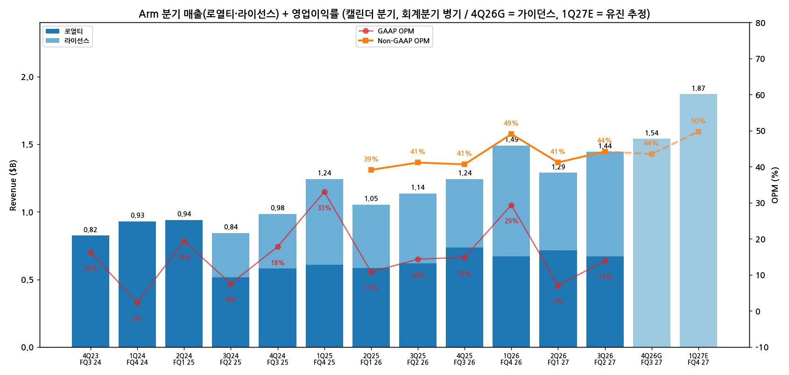
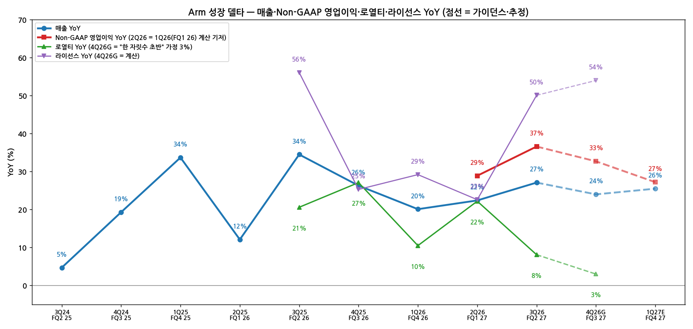

> 모드: 실적 리뷰 (v11)
> 종목: Arm Holdings (ARM)
> 섹터: 반도체
> 서브섹터: 로직·CPU
> 분기: 2026-Q3 (Arm 회계 FY27 Q2, 2026년 7～9월)
> 발표일: 2026-11-04 (ET, AMC) / 2026-11-05 KST
> 작성 시각: 2026-11-16 KST
> 분석 소스: SEC XBRL(6-K·20-F, GAAP 분기 매출·영업이익) + 첨부 셀사이드 2개 — 유진투자증권(11/05), NH투자증권(11/05). 회사 컨콜 내용은 NH Q&A 정리 인용 기준. 웹서치 보완 없음
> 리뷰 깊이: 풀 | 리서치 첨부 2건

# Arm 3Q26 (FQ2 FY27) 실적 리뷰 — 라이선스가 끌어올린 숫자, 모바일이 깎아 먹은 로열티

## 0. 한 줄 판정

> 성장 델타: **가속 (Non-GAAP 영업이익 YoY +28.9% → +36.6%, 매출 YoY +22.4% → +27.1%) — 단, 라이선스(+50%) 일시 급증이 만든 가속이고 로열티 YoY는 +22.2% → +8.1%로 둔화, 가이던스상 다음 분기 영업이익 YoY 약 +33%로 소폭 감속** | 내러티브: **유지 (AI CPU 축 강화 · 모바일 로열티 축 약화가 상쇄)** → **경계 구간 — 숫자는 가속이지만 반복 매출(로열티)이 꺾여 있다. 재진입 신호는 AGI CPU 첫 매출과 로열티 재가속이 겹치는 1Q27(FQ4 27)** [판단]

→ 숫자: 매출 $1,443M(+27.1% YoY, +11.9% QoQ), Non-GAAP 영업이익 $638M(+36.6% YoY, OPM 44.2%), Non-GAAP EPS $0.52. 컨센 대비 매출 +4.6%, 영업이익 +11.0%, EPS +8.3% (FactSet, NH). GAAP 영업이익 $201M(OPM 13.9%, SEC XBRL)
→ 매출 구성: 라이선스 $773M(+50.1% YoY, 신규 ATA 3건·CSS 4건) vs 로열티 $670M(+8.1% YoY). 로열티 안에서 데이터센터 약 2배·Physical AI +50%, 모바일(Edge AI)은 보합 (NH)
→ 쟁점 ①: 메모리 가격 상승 → 스마트폰 출하 감소가 로열티를 직격 — FQ3 로열티도 "한 자릿수 초반" 성장 가이던스 (유진·NH)
→ 쟁점 ②: AGI CPU FY27～28 누적 출하 가시성 $20억으로 2배 상향(컨센 $12.7억), 본격 매출은 FQ4 27(2027년 1～3월). 1세대 GPM 30%대 후반～40%대 초반 — 전사 마진 희석 요인
→ 가이던스: FQ3 매출 $1.54B(+24.0% YoY), EPS $0.56 — NH 기준 컨센(매출 $1,538M·EPS $0.57) 부합, 유진은 "상회"로 평가
→ 주가: 11/04 $191.8, 1개월 −37.6%, 52주 고점($439.5, 6/18) 대비 −56% [계산] — "AI CapEx 지속성 의심 국면"(유진)
→ 다음 관건: FQ3 로열티 YoY 바닥 확인 → FQ4 AGI CPU 첫 본격 매출·NVIDIA Vera 로열티로 재가속 여부

---

## 1. 숫자

① 분기 표 (캘린더 분기, 회계분기 병기)

단위: $M, %. **영업이익 = GAAP** (SEC XBRL). Arm의 주 지표는 **Non-GAAP 영업이익** — 리포트 공개 분기만 병기, 성장 델타 판정은 Non-GAAP 기준

| 항목 | 4Q23 (FQ3 24) | 1Q24 (FQ4 24) | 2Q24 (FQ1 25) | 3Q24 (FQ2 25) | 4Q24 (FQ3 25) | 1Q25 (FQ4 25) | 2Q25 (FQ1 26) | 3Q25 (FQ2 26) | 4Q25 (FQ3 26) | 1Q26 (FQ4 26) | 2Q26 (FQ1 27) | **3Q26 (FQ2 27)** | 4Q26 가이던스 (FQ3 27) | 1Q27E (FQ4 27) |
|---|---|---|---|---|---|---|---|---|---|---|---|---|---|---|
| 매출액 | 824 | 928 | 939 | 844 | 983 | 1,241 | 1,053 | 1,135 | 1,242 | 1,490 | 1,289 | **1,443** | 1,540 | 1,870 |
| 영업이익 (GAAP) | 134 | 22 | 182 | 64 | 175 | 410 | 114 | 163 | 185 | 438 | 91 | **201** | — | — |
| OPM (GAAP) | 16.3 | 2.4 | 19.4 | 7.6 | 17.8 | 33.0 | 10.8 | 14.4 | 14.9 | 29.4 | 7.1 | **13.9** | — | — |
| 영업이익 (Non-GAAP) | — | — | — | — | — | — | 412 [계산] | 467 | 505 | 731 | 531 | **638** | 670 | 930 |
| OPM (Non-GAAP) | — | — | — | — | — | — | 39.1 | 41.1 | 40.7 | 49.1 | 41.2 | **44.2** | 43.5 | 49.7 |
| 매출 YoY | +13.8 | — | +39.1 | +4.7 | +19.3 | +33.7 | +12.1 | +34.5 | +26.3 | +20.1 | +22.4 | **+27.1** | +24.0 | +25.5 |
| 영업이익 YoY (GAAP) | −45.1 | n.m. | +64.0 | n.m. | +30.6 | n.m. | −37.4 | +154.7 | +5.7 | +6.8 | −20.2 | **+23.3** | — | — |
| 영업이익 YoY (Non-GAAP) | — | — | — | — | — | — | — | — | — | — | +28.9 [계산] | **+36.6** | +32.7 | +27.2 |
| **매출 YoY 델타 (%p)** | — | — | — | −34.4 | +14.6 | +14.4 | −21.6 | +22.4 | −8.2 | −6.2 | +2.3 | **+4.7** | −3.1 | +1.5 |
| **영업이익 YoY 델타 (%p, Non-GAAP)** | — | — | — | — | — | — | — | — | — | — | — | **+7.7** | −3.9 | −5.5 |

→ (출처: 매출·GAAP 영업이익 = SEC XBRL(6-K 분기치, 3월 분기는 20-F 연간 − 3개 분기 [계산]). Non-GAAP 영업이익 = NH(FactSet, 3Q25～3Q26)·유진(Bloomberg). 2Q25(FQ1 26) Non-GAAP = FY26 연간 $2,115M − 나머지 3개 분기 [계산]. 4Q26 = 회사 가이던스 매출 $1.54B, 영업이익은 유진 추정 $0.67B(NH 컨센 $671M). 1Q27E = 유진 추정)
→ GAAP 영업이익은 주식보상비용(SBC) 변동이 커서 YoY가 −45%～+1,764%로 튄다(3Q24 기저는 상장 직후 SBC로 −$156M 적자, 1Q24 $22M). **판정은 Non-GAAP 조정 기준**
→ 1Q24(FQ4 24) 매출 YoY는 1Q23 분기치(2Q22 분기 미공개로 역산 불가)가 없어 공란

서프라이즈: 매출 컨센($1,380M) 대비 **+4.6%**, Non-GAAP 영업이익($575M) **+11.0%**, EPS($0.48) **+8.3%** (FactSet, NH). FQ3 가이던스 매출 $1.54B는 컨센 $1,538M과 사실상 같고(+0.1%), EPS $0.56은 컨센 $0.57을 소폭 밑돈다 (NH 표 [계산]) — 유진은 "컨센 상회"로 기술해 출처별 컨센 기준이 다르다

(1) YoY 위치
→ 매출 YoY는 1Q26 +20.1% 저점 → 2Q26 +22.4% → 3Q26 +27.1%로 2개 분기 연속 상승. 그러나 가이던스 +24.0%, 유진 1Q27E +25.5%로 **20%대 중반 고원**
→ Non-GAAP 영업이익 YoY는 +28.9% → +36.6%로 가속했지만 4Q26 +32.7%, 1Q27 +27.2%로 다시 내려온다. **컨센 경로상 영업이익 YoY 정점은 이번 분기(3Q26)** — 다음 재가속은 AGI CPU·Vera가 실리는 2Q27(FQ1 28, 2027년 4～6월)부터(유진 매출 YoY FQ1 28 +35%, FQ3 28 +37%) [판단]

(2) 성장 분해 — 이번 분기 증가분은 거의 라이선스
→ 매출 증가 +$308M YoY 중 라이선스 +$258M(84%), 로열티 +$50M(16%) [계산]
→ 다음 분기 가이던스 $1.54B에 로열티 "한 자릿수 초반"(3% 가정 시 약 $760M)을 넣으면 라이선스는 약 $780M(+54% YoY) [계산] — 다음 분기도 라이선스가 성장을 혼자 끈다

→ (출처: SEC XBRL, NH(라이선스·로열티 분기 매출, Non-GAAP 영업이익), 유진(4Q26G 영업이익·1Q27E). 라이선스·로열티 분할은 3Q24부터)

→ (출처: 동일. 4Q26G 로열티 YoY는 회사 "한 자릿수 초반" 코멘트를 3%로 가정, 라이선스 YoY는 그 가정에서 역산 [계산])

② 사업부별 매출 (라이선스 vs 로열티)

단위: $M, %. **사업부별 영업이익은 미공개** (IP 사업 단일 세그먼트)

| 구분 | 3Q24 | 4Q24 | 1Q25 | 2Q25 | 3Q25 | 4Q25 | 1Q26 | 2Q26 | **3Q26** | 4Q26G |
|---|---|---|---|---|---|---|---|---|---|---|
| 라이선스 | 330 | 403 | 634 | 468 | 515 | 505 | 819 | 574 | **773** | 약 780 [계산] |
| 로열티 | 514 | 580 | 607 | 585 | 620 | 737 | 671 | 715 | **670** | 약 760 [계산] |
| 로열티 비중 | 60.9 | 59.0 | 48.9 | 55.6 | 54.6 | 59.3 | 45.0 | 55.5 | **46.4** | 약 49 |
| 라이선스 YoY | — | — | — | — | +56.1 | +25.3 | +29.2 | +22.6 | **+50.1** | 약 +54 |
| 로열티 YoY | — | — | — | — | +20.6 | +27.1 | +10.5 | +22.2 | **+8.1** | 한 자릿수 초반 |

→ (출처: NH 그림1(Arm Holdings 발표치), 분기 합계는 SEC XBRL 매출과 일치. YoY [계산]. 4Q26G는 가이던스 매출 $1.54B, 로열티 +3% 가정 [계산])
→ **델타를 끄는 곳 = 라이선스.** 신규 ATA(Arm Total Access) 3건·CSS(Compute Subsystems) 4건, 대형 계약 반영 시점 효과 (NH)
→ **꺾인 곳 = 모바일 로열티.** 로열티 최종시장별 (NH, 회사 발표 YoY): 데이터센터 약 2배, Physical AI +50%, Edge AI(스마트폰 중심) 보합. 직전 리뷰(1Q26)의 로열티 +11% 둔화 → 2Q26 +22% 회복 → 3Q26 +8% 재둔화
→ 회사 코멘트로 본 데이터센터 비중: FY27 중 전체 로열티의 1/3 도달은 "확신하기 어렵지만 조만간 가능" (NH Q&A). 데이터센터 로열티는 Amazon·Google·Microsoft·NVIDIA 4개사가 대부분

③ 연간 (3월 결산)

단위: $M, %

| 항목 | FY24 | FY25 | **FY26** | FY27E | FY28E | FY29E |
|---|---|---|---|---|---|---|
| 매출액 | 3,233 | 4,007 | **4,920** | 6,087 (유진 6,077) | 8,301 (유진 8,254) | 10,815 |
| 영업이익 (GAAP) | 111 | 831 | **900** | — | — | — |
| 영업이익 (Non-GAAP) | — | 1,870 | **2,115** | 2,719 (유진 2,708) | 3,801 (유진 3,774) | 5,237 |
| OPM (Non-GAAP) | — | 46.7 | **43.0** | 44.7 | 45.8 | 48.4 |
| 매출 YoY | +20.7 | +23.9 | **+22.8** | +23.7 | +36.4 | +30.3 |
| 영업이익 YoY (Non-GAAP) | — | — | **+13.1** | +28.6 | +39.8 | +37.8 |

→ (출처: 매출·GAAP 영업이익 = SEC XBRL 20-F. Non-GAAP·추정치 = NH(FactSet)·유진(Bloomberg). FY23 매출 $2,679M·GAAP 영업이익 $671M)
→ FY26 Non-GAAP OPM이 46.7% → 43.0%로 낮아진 것은 AGI CPU 등 R&D 확대. 유진은 AGI CPU(하드웨어) 매출이 붙는 FY28 GPM을 91.2%(FY26 98.2%)로 낮춰 잡는다 — 이익률보다 이익 절대액이 커지는 구조
→ 연간 컨센 변화: 첨부 2건에 발표 전 추정치가 없어 미확인. 참고로 직전 리뷰(5월) 기록의 FY27 EPS 컨센 $2.30 대비 현재 유진 $2.24·NH $2.2 — **추정치는 거의 그대로, 주가만 하락**

---

## 2. 시장 쟁점

① 2-0. 지난 리뷰에서 "봐야 할 것"으로 남긴 항목 체크

> 직전 분기(2026-Q2, FQ1 FY27) 리뷰는 작성되지 않음. 2026-Q1 리뷰 기반 팔로업(`earnings-followup/2026-Q2_ARM_팔로업.md`) 항목을 두 분기 누적 체크

| 직전 팔로업 항목 | 이번까지 결과 | 판정 |
|---|---|---|
| 스마트폰 로열티 정상화 (FQ1 27 로열티 +20%) | FQ1 27 로열티 $715M(+22.2%)로 달성 → FQ2 27 $670M(+8.1%), FQ3도 "한 자릿수 초반" (NH·유진) | **반대로 나옴** (한 분기 회복 후 재악화, 원인은 메모리 가격발 스마트폰 출하 감소) |
| 데이터센터 로열티 "2배" 지속 | FQ2 27 데이터센터 로열티 전년비 약 2배, "향후 수년간 세 자릿수 성장 자신" (NH) | **확인** |
| AGI CPU 첫 양산 출하 + 추가 고객 | 본격 출하는 FQ4 27 목표, FQ3 일부 가능하나 소규모. Meta 핵심 + 복수 추가 고객(NH: 오라클 등), 지난 90일 구매 주문 확보 | **부분 확인** (고객·주문은 확인, 출하는 다음 분기 이후) |
| FY27 가이던스 — 라이선스·로열티 모두 +20% | 라이선스 FQ1 +22.6%·FQ2 +50.1% (초과), 로열티 +22.2%·+8.1% (FQ2부터 미달). FY27E 매출 +23.7%(NH) | **엇갈림** (총액은 확인, 구성은 라이선스 쏠림) |
| NVIDIA Vera 출하 시점 | 2026년 말부터 출하 본격 확대 예정, NVIDIA F2027 CPU 매출 $200억·F2028 2배 이상 전망 (유진) | **확인** (일정 유지, 로열티 반영은 2027) |

→ AI 데이터센터 항목은 확인, 모바일 항목이 반대로 나왔다. 5월 리뷰가 1순위로 둔 "스마트폰 로열티 정상화"가 이번 분기 핵심 실망 요인이 됐다
→ 데이터 정합성 메모: 2026-Q1 리뷰의 FQ4 26 "Non-GAAP OPM 62%"·일부 분기 라이선스/로열티 값은 이번 NH 표(FQ4 26 Non-GAAP 영업이익 $731M, OPM 49.1%)·SEC XBRL과 맞지 않는다. 이번 리뷰는 SEC XBRL 합계와 일치하는 NH 수치를 기준으로 했다

② 2-1. 이번 분기 쟁점

| # | 쟁점 | 한 줄 정의 | 언급 증권사 |
|---|---|---|---|
| 1 | 모바일 로열티 둔화 | 메모리 가격 → 스마트폰 출하 감소가 로열티를 +8%로 끌어내렸다 — 언제, 무엇으로 재가속하나 | 2/2 |
| 2 | 라이선스 $773M의 지속성 | ATA·CSS 대형 계약이 만든 +50% — 일회성인가, 로열티 선행지표인가 | 2/2 |
| 3 | AGI CPU 가시성 vs 마진 희석 | FY27～28 누적 $20억으로 2배 상향, 본격 매출 FQ4 27, 1세대 GPM 30%대 후반～40%대 초반 | 2/2 |
| 4 | 데이터센터 로열티와 하이퍼스케일러 점유율 | 데이터센터 로열티 2배, 하이퍼스케일러 CPU 내 Arm 점유율 2026년 말 60% 돌파 — 고객 4곳 집중 | 2/2 |

③ 2-2. 쟁점별 분해

(1) 쟁점 1 — 모바일 로열티 둔화

(1-1) 회사 설명
→ FQ2 로열티: 데이터센터 전년비 2배, Physical AI +50%인데 스마트폰 출하 둔화로 Edge AI는 보합 → 전체 +8% (NH)
→ "외부 기관과 고객들은 내년 스마트폰 출하를 전년 대비 보합 수준으로 예상. 다만 Armv9 채택률이 이미 50%를 넘었고 CSS 채택 확대, 차세대 CSS의 더 높은 로열티율 효과로 **스마트폰 출하가 정체돼도 모바일 관련 매출은 내년 최소 두 자릿수 성장** 가능" (컨콜, NH)
→ "칩당 로열티는 제품 믹스 영향이 크다. 모바일보다 서버·Physical AI의 칩 가치와 로열티가 높다" (컨콜, NH)

(1-2) 증권사별 해석 편차

| 증권사 | 핵심 가정·추정 | 논리 |
|---|---|---|
| 유진 | FQ3 로열티 한 자릿수 초반 → 2027 재가속 | "메모리 가격 상승으로 모바일 약세가 데이터센터 로열티 성장을 **지속적으로 상쇄하는 구조**." 재가속 트리거는 하이퍼스케일러 헤드노드 CPU와 Vera |
| NH | FQ3 로열티 한 자릿수 초반, "당분간 단기 실적 역풍 불가피" | 제목 자체가 "모바일 수요 악화 직격". 신규 라이선스가 로열티로 반영되기까지 12～24개월 시차 |

(1-3) 공통 결론 vs 갈리는 지점
→ 공통: 로열티 둔화의 원인은 메모리 가격 상승 → 스마트폰·세트 출하 감소. FQ3까지는 바닥권, 재가속은 2027
→ 갈림: 회사의 "내년 모바일 최소 두 자릿수" 주장을 받아들이는지 — 유진·NH 모두 회사 주장을 인용만 하고, 숫자로는 FQ3 로열티 한 자릿수 초반을 그대로 쓴다 [판단]

(1-4) [판단]
→ 같은 원인을 피어가 이미 확인했다. Intel은 "메모리 가격 상승과 가용성 악화로 PC 재고조정 가속, 2026 PC TAM −12%(하반기 −20% 이상)·2027 −10%", AMD는 "2027 PC 두 자릿수 감소 전제"(각 3Q26 리뷰). Arm은 스마트폰·PC 양쪽에서 같은 경로로 로열티를 잃는다 — 메모리 사이클이 강할수록 Arm 모바일 로열티는 약해진다
→ 회사 논리(칩당 로열티 상승으로 출하 정체를 상쇄)는 출하가 "보합"일 때만 성립한다. 메모리 가격이 2027년 상반기에도 오르면 스마트폰 출하가 보합이 아니라 감소로 가고, 이 경우 FQ4 27 로열티 YoY도 한 자릿수에 머문다 — **결론을 바꿀 변수는 2027년 스마트폰 출하 가이던스(삼성·애플·중국 OEM)와 DRAM 모바일 계약가**

(2) 쟁점 2 — 라이선스 $773M의 지속성

(2-1) 회사 설명
→ "분기 $7.73억을 매 분기 반복 가능한 새로운 기준점으로 단정하기는 어렵지만, **FQ3 라이선스는 추가 확대되고 FQ4에도 한 차례 더 상승**할 것" (컨콜, NH)
→ "라이선스 파이프라인이 연초 예상보다 강하다. 신규 계약 대부분은 ATA·CSS 중심이며 Architecture License는 매우 제한적. ATA·CSS 계약은 Design-win을 거쳐 약 12～24개월 후 로열티로 전환" (컨콜, NH)

(2-2) 증권사별 해석 편차

| 증권사 | 핵심 가정·추정 | 논리 |
|---|---|---|
| 유진 | "ATA·CSS 같은 고부가가치 계약 확대는 로열티 성장 가속의 **선행 지표**" | 라이선스 호조 = 2027～2028 로열티 재가속 근거 |
| NH | 신규 ATA 3건·CSS 4건은 긍정적이나 "실제 로열티 반영까지 12～24개월 시차" | 라이선스 호조가 단기 로열티 둔화를 메우지 못한다 — 시차가 핵심 |

(2-3) 공통 결론 vs 갈리는 지점
→ 공통: 라이선스는 FQ3·FQ4에도 강하고, ATA·CSS 비중 확대는 로열티율 상승으로 이어진다
→ 갈림: 같은 사실을 **유진은 미래 로열티의 선행지표**로, **NH는 지금 로열티 공백을 못 메우는 시차**로 읽는다

(2-4) [판단]
→ 라이선스는 대형 계약 시점에 따라 출렁인다(1Q26 $819M → 2Q26 $574M → 3Q26 $773M). 모멘텀 트레이더에게 라이선스 주도 가속은 "질이 낮은 가속"이다 — 이번 분기 영업이익 YoY 가속(+7.7%p)을 그대로 믿기 어려운 이유
→ 다만 회사가 FQ3·FQ4 라이선스 추가 상승을 직접 말했기 때문에 FY27 하반기 숫자는 라이선스가 받친다. 로열티 공백이 이어지는 동안에도 총 매출 YoY 20%대 중반은 유지될 가능성이 높다 [전망]

(3) 쟁점 3 — AGI CPU 가시성 vs 마진 희석

(3-1) 회사 설명
→ "AGI CPU 수요는 3월 Arm Everywhere 행사 당시 예상보다 강해졌다. Meta가 핵심 고객이며 복수의 추가 고객 수요 발생. **지난 90일 동안 여러 고객의 구매 주문 확보**, 웨이퍼·기판·테스트·메모리 공급망 물량 확보 진전" (컨콜, NH)
→ FY27～28 합산 AGI CPU 매출 목표를 전분기 2배 수준인 **$20억으로 상향** (NH). 유진: F2028(CY2028 1분기)까지 누적 출하 가시성 $20억 vs 컨센 $12.7억, F2031 가이던스 $150억(컨센 $139억)
→ "본격 출하는 **FQ4 27** 목표. FQ3에도 일부 매출 가능성은 있으나 규모는 크지 않을 것" (컨콜, NH)
→ "1세대 GPM은 대체로 30% 후반～40% 초반 목표, 초기에는 다소 낮을 수 있다. 차세대부터 업계 수준인 50% 이상 목표. 초기 AGI CPU는 전사 마진 희석 요인" (컨콜, NH). TSMC·삼성전자 등과 추가 부품 공급 계약 체결 (NH)
→ 서버 CPU 시장: "에이전트가 CPU 코어에서 VM 형태로 구동 → 128코어 → 256코어 → 500코어 이상. 2030년 CPU 시장 기존 약 $1,000억 예상에서 업계는 $2,000억 이상도 거론" (컨콜, NH)

(3-2) 증권사별 해석 편차

| 증권사 | 핵심 가정·추정 | 논리 |
|---|---|---|
| 유진 | FY28 GPM 91.2%(FY26 98.2%), FY28 매출 $8.25B(+36%) | 공급망 확보로 출하 가시성 상승 — "꿈은 현실 위에 선다". 메타 Muse·오픈AI Dots 등 상시형 에이전트 경쟁이 CPU 수요를 키운다 |
| NH | FY28 매출 $8.30B(+36%), OPM 45.8% | "단기 실적 우려를 딛고 반전하려면 AGI CPU의 본격적 매출 기여 확대가 필요" — FQ4 27이 분기점 |

(3-3) 공통 결론 vs 갈리는 지점
→ 공통: AGI CPU 가시성은 높아졌고(2배 상향), FY28 매출 +36%의 핵심이다. 두 곳의 FY28 추정치 차이는 1% 이내
→ 갈림: 첨부 2건 안에서는 숫자 이견이 거의 없다. 차이는 톤 — 유진은 "중장기 유효, 단기 주가 반전엔 한계", NH는 "AGI CPU 성과를 기다리며"

(3-4) [판단]
→ AGI CPU는 IP 회사(GPM 98%)가 하드웨어 회사(GPM 40%)를 하나 더 붙이는 일이다. 매출은 2배 가까이 커질 수 있지만 OPM은 크게 오르지 않는다(NH FY28 45.8% vs FY26 43.0%). 시장이 PER 85배(NH FY27)를 IP 마진에 줬다면 AGI CPU 믹스가 커질수록 멀티플 논리가 "이익 성장률"로 바뀌어야 한다
→ 메모리 가격 상승은 여기서도 비용이다 — 회사는 "가격 탄력성으로 전가 가능"이라 했지만 1세대 GPM 하단이 30%대 후반이라 여유가 작다. **FQ4 27 첫 본격 매출 규모와 GPM**이 결론을 바꾼다

(4) 쟁점 4 — 데이터센터 로열티와 하이퍼스케일러 점유율

(4-1) 회사 설명
→ "데이터센터 로열티는 향후 수년간 **세 자릿수 성장에 대한 자신감 유지**. 코어 수 증가와 CSS 채택 확대가 동시에 진행" (컨콜, NH)
→ "Amazon·Google·Microsoft가 현재 데이터센터 로열티에 가장 크게 기여하고 NVIDIA도 빠르게 확대. 4개 고객이 대부분 — 단기 고객 집중도는 높다" (컨콜, NH)
→ 하이퍼스케일러 자체 CPU는 헤드노드(AI XPU와 함께 컴퓨트 트레이에 탑재)에서 채택 확대: Google TPU v8 + Axion, AWS Trainium3 NL72 + Graviton, Azure Maia300 + Cobalt (유진)

(4-2) 증권사별 해석 편차

| 증권사 | 핵심 가정·추정 | 논리 |
|---|---|---|
| 유진 | 하이퍼스케일러 CPU 내 Arm 점유율 2024년 15% → 2026년 말 60% 초과 | Vera 출하 2026년 말 본격화, 이후 퀄컴 Dragonfly C1000 — 2027 재가속 |
| NH | 연말 60% 돌파, 메타·오라클 등 고객 추가 | 탈 x86 전환(Vera Rubin, Axion 등) |

(4-3) 공통 결론 vs 갈리는 지점
→ 공통: 데이터센터 로열티 성장은 의심하지 않는다 — 문제는 아직 전체 로열티의 1/3 미만이라 모바일 둔화를 못 덮는다는 것
→ 갈림: 없음. 시장의 의문은 Arm 개별이 아니라 "AI CapEx 지속성"(유진: 프론티어 모델랩 성장 둔화·중간선거 결과 계기)

(4-4) [판단]
→ 데이터센터 2배·Physical AI +50%인데 전체 로열티가 +8%라는 것은 데이터센터 비중이 아직 작거나, 모바일이 "보합"보다 약했다는 뜻이다 (최종시장별 금액 미공개로 분해 불가). 데이터센터 비중이 1/3을 넘는 시점부터 모바일 변동이 로열티 YoY를 좌우하지 못한다 — 회사도 "조만간 1/3 도달 가능"이라 했다. 이 비중이 FY28 로열티 재가속의 크기를 정한다
→ Intel이 공급 제약으로 서버 출하가 묶이고(3Q26 리뷰), AMD가 서버 CPU 2027 약 2배를 말하는 국면에서 하이퍼스케일러 자체 Arm CPU는 x86 공백을 메우는 세 번째 공급원이다. 수요 쪽 근거는 피어 리뷰와 일치 [판단]

④ 2-3. 낙관 vs 보수 — 논리 대비

| 구분 | 증권사 | 무엇을 다르게 가정했나 |
|---|---|---|
| 상대적 낙관 | 유진 | AGI CPU 공급망 확보 + 하이퍼스케일러 헤드노드 + Vera로 2027 재가속. 성장 궤적은 유효, 다만 "단기 주가 반전에는 한계" |
| 상대적 보수 | NH | 모바일 역풍이 "당분간 불가피", 라이선스→로열티 시차 12～24개월. 반전은 FQ4 27 AGI CPU 매출 확인 이후 |

→ 핵심 차이는 **시간**이다. 두 곳 모두 FY28 매출 +36%로 같은 숫자를 쓰지만, 유진은 "꿈이 현실 위에 선다"(가시성 상승)에, NH는 "그 사이 실적 공백"에 무게를 둔다
→ 셀사이드 vs 시장: FactSet 컨센 TP $307.2(Buy 19 / Hold 6 / Sell 0, 최고 $480·최저 $125) 대비 현재가 $191.8은 +60% 괴리 (NH). 1개월 −37.6%(유진) — 셀사이드는 추정치를 유지하는데 시장은 AI CapEx 지속성을 의심하며 멀티플을 깎는 중. 발표 다음날 주가 반응 수치는 첨부 자료에 없음

⑤ 2-4. 추정치·TP 변화

| 증권사 | 의견 / TP | TP 변화 | 다음 분기 영업이익 E | FY27 / FY28 영업이익 E | 핵심 변화 한 줄 |
|---|---|---|---|---|---|
| 유진 | NR / 없음 | — | $670M (Non-GAAP, OPM 43.7%) | $2,708M / $3,774M | AGI CPU 가시성 상향, 단기 주가 반전 한계 |
| NH | 컨센 인용 / FactSet 평균 $307.2 | — | 컨센 $671M (OPM 43.6%) | $2,719M / $3,801M | 모바일 역풍, AGI CPU 대기 |

→ 첨부 2건 모두 자체 TP 없음 — TP 상향·하향 건수와 발표 전 대비 연간 컨센 변화는 이번 리뷰에서 미확인
→ 다음 분기 영업이익: 유진·NH 컨센 모두 $670M 수준(+32.7% YoY) — FQ3 가이던스 EPS $0.56이 컨센 $0.57과 거의 같아 큰 괴리 없음
→ 주가 하락은 실적 하향이 아니라 **멀티플 하향**. FY27 EPS 추정치는 5월 리뷰 기록 $2.30 → 현재 $2.2대(유진 $2.24)로 소폭 변동에 그쳤는데 주가는 52주 고점 대비 −56% — FY27 PER 85배대(유진 85.6배·NH 85.7배)까지 내려왔다 [판단]

---

## 3. 내러티브 점검

① 성장 스토리 정의
→ "모바일 CPU를 독점한 IP 회사가 **AI 데이터센터 CPU(하이퍼스케일러 자체 칩·Vera)로 로열티 무게중심을 옮기고, AGI CPU로 직접 칩을 팔아 FYE31 매출 $250억(현재 5배)으로 간다**" — 시장이 PER 80배 이상을 주는 이유

② 이번 분기 평가 — **유지**
→ 강화 요소: AGI CPU 누적 가시성 $20억으로 2배 상향(컨센 $12.7억), 지난 90일 구매 주문, 데이터센터 로열티 2배·"수년간 세 자릿수", 하이퍼스케일러 점유율 60%, 라이선스 파이프라인 연초 예상 상회, 서버 CPU TAM $2,000억 거론
→ 약화 요소: 로열티 +8%(FQ3도 한 자릿수 초반), 모바일 역풍이 메모리 사이클과 연결돼 기간이 불확실, AGI CPU 1세대 GPM 마진 희석, 데이터센터 로열티 4개 고객 집중
→ AI 축은 강해졌고 모바일 축은 약해졌다 — 두 축이 상쇄되며 추정치는 거의 그대로. 스토리의 핵심 전제(AI CPU 점유율 확대)는 깨지지 않았다 → **유지** [판단]

③ 국면 — 델타 가속(질 낮은 가속) × 내러티브 유지
→ 숫자는 가속이지만 가속의 84%가 라이선스이고, 반복 매출인 로열티는 둔화했다. 컨센 경로상 영업이익 YoY는 이번 분기가 정점이고 다음 두 분기 감속 → **경계 구간** [판단]
→ 로직·CPU 서브섹터 안에서 위치: AMD(델타 위로 열림, 가속 대기) > Arm(경계) > Intel(꺾임, 매매 제외). Arm은 AMD와 같은 AI CPU 수요를 갖지만 Intel과 같은 메모리발 소비자 기기 역풍을 함께 맞는다 — 둘 사이에 서 있다 [판단]
→ 비유하면 Arm은 두 엔진 비행기다. AI 엔진(데이터센터·AGI CPU)은 출력을 올리고 있는데, 모바일 엔진이 메모리 가격 때문에 공회전 중이다. 지금 속도는 라이선스라는 보조 추진기가 받치고 있다

④ 다시 강해질 트리거
→ FQ4 27(1Q27) AGI CPU 본격 매출 시작 + GPM 30%대 후반 확인
→ NVIDIA Vera 출하 본격화(2026년 말～) → 데이터센터 로열티 비중 1/3 돌파
→ 메모리 가격 안정 → 스마트폰 출하 보합 이상 → 모바일 로열티 두 자릿수 회복

⑤ 깨뜨릴 리스크
→ FQ3 로열티가 가이던스(한 자릿수 초반)마저 밑돌아 마이너스 근처로 가는 경우 — 모바일 역풍 심화
→ AGI CPU 첫 출하 지연 또는 GPM 30%대 초반 — 공급망·메모리 원가
→ 하이퍼스케일러 CapEx 감속(시장이 의심하는 그것) → 데이터센터 로열티 2배 성장 둔화

---

## 4. 향후 봐야 할 것

| 순위 | 무엇을 (변수·임계값) | 어떤 데이터로 | 언제 |
|---|---|---|---|
| 1 | **FQ3 로열티 YoY 바닥 확인 & FQ4 재가속 가이던스** — 한 자릿수 초반(약 $760M) 미달이면 델타 '둔화'로 하향, FQ4 가이던스 로열티 두 자릿수면 재진입 신호 | Arm FQ3 FY27 실적·컨콜 | 2027-02 초 |
| 2 | **AGI CPU 첫 본격 매출 (FQ4 27) & 1세대 GPM 30%대 후반～40%대 초반** — FY27～28 누적 $20억 경로 유지 | Arm 컨콜, Meta·오라클 배치 뉴스 | 2027-02 (가이던스) ～ 2027-05 (실적) |
| 3 | **스마트폰 출하·메모리 가격** — 2027 스마트폰 출하 보합 전제 유지 여부, 모바일 DRAM 계약가 | 삼성전자·애플·퀄컴·미디어텍 실적, Counterpoint·IDC 출하, DRAM 계약가 | 2027-01～02 |
| 4 | **데이터센터 로열티 비중 1/3 돌파 & NVIDIA Vera 출하** — "세 자릿수 성장" 지속 | Arm 컨콜, NVIDIA FQ3·FQ4 실적(Vera 출하), Graviton·Axion·Cobalt 배치 | 2026-11 하순(NVDA) ～ 2027-02 |
| 5 | **라이선스 FQ3·FQ4 추가 상승** (회사 코멘트) — FQ3 라이선스 $780M 이상, ATA·CSS 신규 건수 | Arm FQ3 실적 | 2027-02 초 |

→ 1순위가 델타 판정을 바꾼다. Arm FQ3 발표 전에 퀄컴(FQ1 FY27)·삼성전자 4Q 실적에서 스마트폰 출하 신호를 먼저 읽는다

---

> Sources: SEC EDGAR XBRL(Arm Holdings 6-K·20-F, CIK 0001973239), 유진투자증권(2026-11-05), NH투자증권(2026-11-05) — 리포트 원문은 비공개 보관
