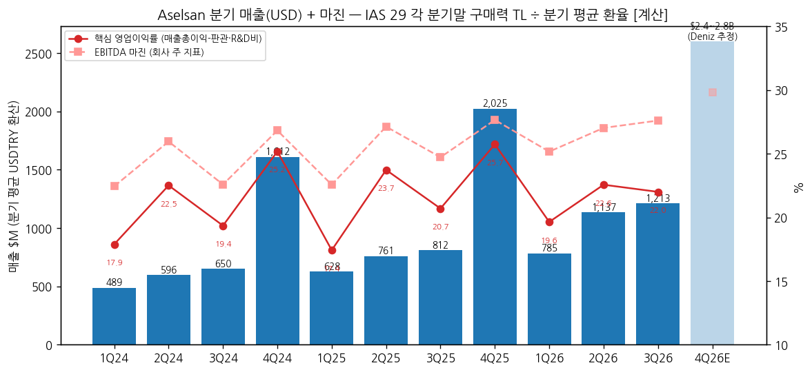
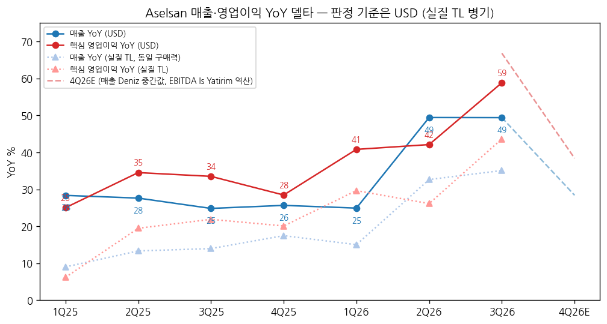

> 모드: 실적 리뷰 (v11)
> 종목: Aselsan (ASELS)
> 섹터: 방산
> 서브섹터: 방산 글로벌
> 분기: 2026-Q3
> 발표일: 2026-10-27 (KAP, 장 마감 후)
> 작성 시각: 2026-11-14 18:30 KST
> 분석 소스: 회사 9M26 발표(KAP·보도, 2026-10-27) + KAP 재무제표 영문본(9M25·1Q26·1H26) + 셀사이드 PDF — İş Yatırım 3Q26 분석(10/28)·2Q26(08/05)·4Q25(02/25)·3Q25·2Q25, İnfo Yatırım 2Q26(08/05) + 웹 보완 — Deniz Yatırım 3Q26 노트(10/28, 보도), 컨센서스(Matriks 18곳, CNBC-e 10/27·BloombergHT 10/27), 수주 공시 보도(Daily Sabah 10/07, Hürriyet 11/04), 주가(Yahoo ASELS.IS). 컨콜 트랜스크립트 미확보 → 회사 설명은 CEO 발표문 기준
> IAS 29 적용: TAS 29 초인플레이션 회계 (FY2023~). 명목 TL YoY는 쓰지 않고 **실질 TL YoY(같은 보고서 내 동일 구매력 비교)와 USD 환산 YoY**를 병기, 델타 판정은 USD 기준
> 다음 발표: FY2026 / 4Q26 — 2027년 2월 하순 예상 (FY25 발표 2026-02-25)

# Aselsan 3Q26 실적 리뷰

## 0. 한 줄 판정

> 성장 델타: 가속 | 내러티브: 강화 → 적극 구간 (단, 투자기 순차입금 증가 경계)

→ 숫자: 3Q26 매출 TL 58.1bn (실질 +35%, USD 환산 $1.21B **+49%**), 핵심 영업이익 TL 12.8bn (실질 +44%, USD **+59%**), EBITDA 마진 27.6% (+2.9%p). 핵심 영업이익 USD YoY가 1Q26 +41% → 2Q26 +42% → 3Q26 +59%로 **2개 분기 연속 확대**
→ 컨센 대비 매출 +5%, EBITDA +12%, 순이익 +25% (시장 컨센, İş Yatırım 집계) — 서프라이즈의 원천이 화폐성 손익이 아니라 **영업**이었다
→ 쟁점의 중심은 **잔고 $30.7B를 얼마나 빨리 매출로 바꾸는가**와 그 대가인 **현금흐름**: 3Q 신규수주 $9.12B (10월 상반 계약 포함), Book-to-bill 4.4x. 반면 FCF TL −19.0bn, 순차입금 1분기 만에 +54%
→ 셀사이드: İş Yatırım TP 450 → 535 TL (AL), 2026·2027 EBITDA 추정 +11%·+15% 상향. Deniz Yatırım은 TUT·TP 341 (순차입금 증가가 하방 리스크). 발표 다음날 주가 +5.2%
→ 다음 분기 관건: 4Q26 매출 $2.4~2.8B (Deniz 잔고 에이징) — 4Q25 기저가 $2.0B로 커서 USD YoY는 +18~38%로 둔화가 예정돼 있다. 둔화 폭이 이 범위 안이면 델타 판정은 유지 `[전망]`

## 1. 숫자

① 연결 분기 표 (USD 환산 = 각 분기말 구매력 TL ÷ 분기 평균 USDTRY [계산])

| 항목 | 1Q24 | 2Q24 | 3Q24 | 4Q24 | 1Q25 | 2Q25 | 3Q25 | 4Q25 | 1Q26 | 2Q26 | **3Q26** | 4Q26E |
|---|---|---|---|---|---|---|---|---|---|---|---|---|
| 매출 ($M) | 489 | 596 | 650 | 1,612 | 628 | 761 | 812 | 2,025 | 785 | 1,137 | **1,213** | 2,600 |
| 핵심 영업이익 ($M) | 88 | 134 | 126 | 406 | 109 | 181 | 168 | 521 | 154 | 257 | **267** | — |
| 핵심 OPM | 17.9% | 22.5% | 19.4% | 25.2% | 17.4% | 23.7% | 20.7% | 25.7% | 19.6% | 22.6% | **22.0%** | — |
| EBITDA ($M) | 110 | 155 | 147 | 432 | 142 | 206 | 201 | 560 | 197 | 307 | **335** | 775 |
| EBITDA 마진 | 22.4% | 26.0% | 22.6% | 26.8% | 22.6% | 27.1% | 24.7% | 27.7% | 25.2% | 27.0% | **27.6%** | 29.8% |
| 매출 YoY (USD) | | | | | 28.4% | 27.6% | 24.8% | 25.7% | 24.9% | 49.4% | **49.4%** | 28.4% |
| 영업이익 YoY (USD) | | | | | 25.0% | 34.5% | 33.5% | 28.5% | 40.8% | 42.1% | **58.8%** | — |
| EBITDA YoY (USD) | | | | | 29.1% | 33.4% | 36.7% | 29.5% | 39.3% | 48.9% | **66.8%** | 38.4% |
| **매출 YoY 델타 (%p)** | | | | | | −0.8 | −2.8 | +0.9 | −0.8 | +24.5 | **0.0** | −21.0 |
| **영업이익 YoY 델타 (%p)** | | | | | | +9.5 | −1.0 | −5.0 | +12.3 | +1.3 | **+16.7** | (EBITDA −28.4) |
| 매출 (TL m, 분기말 구매력) | 15,140 | 19,308 | 21,811 | 55,682 | 22,791 | 29,550 | 33,132 | 85,614 | 34,306 | 51,782 | **58,063** | 120~140bn |
| 매출 실질 YoY | | | | 12.0% | 9.0% | 13.3% | 14.0% | 17.5% | 15.0% | 32.6% | **35.1%** | |
| 핵심 영업이익 실질 YoY | | | | — | 6.2% | 19.5% | 21.9% | 20.1% | 29.7% | 26.1% | **43.6%** | |
| EBITDA 실질 YoY | | | | 55.0% | 9.6% | 18.4% | 24.8% | 21.1% | 28.3% | 32.2% | **50.8%** | |
| USDTRY 분기 평균 | 30.94 | 32.39 | 33.54 | 34.55 | 36.28 | 38.84 | 40.82 | 42.27 | 43.72 | 45.55 | **47.88** | |

→ (출처: 손익 = İş Yatırım 실적 분석 2Q25(08/06/25)·3Q25(11/05/25)·4Q25(02/25/26)·2Q26(08/05/26)·3Q26(10/28/26) 요약표 + KAP 1Q26 재무제표(1Q25·1Q26). 1Q24 = 1H24 − 2Q24. 각 분기를 KAP 재무제표의 TÜİK CPI 재작성 계수로 해당 분기말 구매력으로 맞춘 뒤 Yahoo Finance TRY=X 분기 평균 종가로 나눔 [계산]. 4Q24 실질 YoY = İş Yatırım 4Q24 웹 요약(2025-02-26). 핵심 영업이익 = 매출총이익 − 판관비 − R&D비 (İş의 "Faaliyet Karı"), 재무제표 "Operating Profit"은 환차익 등 기타영업손익 포함이라 제외)
→ 4Q26E: 매출 = Deniz Yatırım 잔고 에이징 추정 $2.4~2.8B (TL 120~140bn)의 중간값, EBITDA = İş Yatırım FY26 EBITDA 추정 $1,614M − 9M26 USD 합계 $839M [계산, 환산 방식 차이로 오차 큼]. 핵심 영업이익 E 미확보
→ 환산 방식 점검: 3Q26 매출 USD YoY는 분기 평균 환율 +49.4%, 분기말 환율 +48.6% — İş Yatırım 공시 "+49%"와 같다
→ 컨센 대비: 매출 +5.3% (시장 55,166 TL m), EBITDA +11.5% (14,372), 지배순이익 +25.2% (8,964) — İş Yatırım 3Q26 표의 시장 컨센. Matriks 18곳 순이익 평균 8,875 대비 +26.5% (CNBC-e)
→ 델타 위치: 매출 USD YoY는 2Q26에 +25%p 뛰어 +49%에서 유지, 영업이익 YoY는 3Q26에 +59%로 시계열 최고. 실질 TL로도 영업이익 YoY 26% → 44%로 같은 방향 `[판단]`
→ 정점 경로: 4Q25 기저(연 매출의 48%)가 커서 4Q26 매출 USD YoY는 +18~38%로 내려온다. 1Q27 기저는 다시 작아(1Q26 $785M) 반등 가능 — **YoY 정점은 3Q26, 다만 "꺾임"이 아니라 계절 기저에 의한 둔화** `[전망]`

→ (출처: İş Yatırım 분기 요약표·KAP 재무제표, USD 환산 [계산], 4Q26E Deniz 추정)

→ (출처: 동일. 실선 USD, 점선 실질 TL)

② 사업부별 — 사업부 손익 미공시, 내수·수출 + 수주로 대체

| 항목 | 3Q25 | 2Q26 | **3Q26** | YoY (USD) |
|---|---|---|---|---|
| 내수 매출 ($M) | 762 | 913 | **987** | +29.6% |
| 수출 매출 ($M) | 50 | 224 | **226** | +350% |
| 수출 비중 | 6.2% | 19.7% | **18.6%** | +12.4%p |
| 신규수주 ($B, 분기) | 2.86 | — (1H26 누계 4.9) | **9.12** | +219% |
| 그중 수출 신규수주 ($B) | — | — | **1.0** | |
| 수주잔고 ($B, 기말) | 17.9 | 23.2 | **30.7** | +72% |

→ (출처: 3Q25 내수·수출 = KAP 9M25 재무제표 Note 14 (국내 TL 31,087m / 수출 2,046m), 2Q26 = KAP 1H26 재무제표 Note 14 (국내 41,600m / 수출 10,183m), 3Q26 수출 비중 18.6% = İş Yatırım 3Q26. USD 환산 [계산]. 수주·잔고 = İş Yatırım 3Q26·회사 발표. 2Q26 분기 신규수주는 미확보 — 1H26 누계 $4.9B (+72%, 회사). 2Q26 수출 비중은 재무제표 기준 19.7%, İş Yatırım 표기 20.3%)
→ **섹터 합산에 쓸 방산 기준 = 전사** (사업부 손익 미공시, 수주잔고의 97%가 방산 — İnfo Yatırım 2Q26. 민수 UGES 비중은 작아 별도 차감하지 않음)
→ 델타를 끄는 건 **수출**이다: 수출 매출이 1년 새 USD 4.5배, 수출 비중 6% → 19%. 내수도 USD +30%로 견조. 수출은 마진이 높은 것으로 알려져 EBITDA 마진 +2.9%p와 같은 방향 `[추정]`
→ 9M26 누적: 신규수주 $14.0B (9M25 $5.7B), 그중 수출 $1.93B (+34%), Book-to-bill 4.4x (9M25 2.5x). 잔고 통화는 USD 54%·EUR 42% (2Q26, İnfo)
→ 주의: İş Yatırım은 3Q26 잔고·신규수주에 **10월 상반 체결 계약이 포함**됐다고 밝혔다 (공개 계약 약 $7.9B 추정). 분기말 엄격 기준 잔고는 이보다 작다

③ 연간 (간략)

| 항목 | FY23 | FY24 | FY25 | FY26E | FY27E |
|---|---|---|---|---|---|
| 매출 (USD) | $3.04B | $3.35B | $4.23B | 약 $5.7B [추정] | — |
| 매출 (TL bn, 기말 구매력) | 73.6 | 120.2 | 180.4 | 약 275 (Deniz 역산) | 약 400 (Deniz) |
| 핵심 영업이익 (TL bn) | 12.6 | 26.9 | 41.8 | — | — |
| EBITDA (USD) | $0.66B [계산] | $0.84B | $1.11B | **$1.61B** (İş) | **$2.19B** (İş) |
| EBITDA 마진 | 21.8% | 25.2% | 26.2% | 가이던스 >24% | — |
| 매출 실질 YoY | — | +13.1% | +14.7% | 가이던스 >+10% (9M +28%) | — |
| 핵심 영업이익 실질 YoY | — | +47.8% | +18.5% | 9M +33% | — |

→ (출처: KAP FY2024 감사보고서, İş Yatırım 4Q25·3Q26, Deniz Yatırım 3Q26 노트(보도: 9M 매출이 FY26E의 약 55%, 2027 매출 약 TL 400bn). FY26E 매출 USD = 9M26 $3.14B + 4Q26E $2.6B [추정]. EBITDA USD FY24·FY25 = 분기 합산 [계산])
→ 발표 전후 추정 변화: İş Yatırım 2026E/2027E EBITDA $1,455M/$1,903M → **$1,614M/$2,188M** (+11%/+15%). 2026 신규수주 추정 $14B → $17.5B
→ 회사 2026 가이던스 (실질 매출 +10% 초과, EBITDA 마진 24% 초과, CapEx TL 50bn 초과)는 **유지** — 9M 실적(+28%, 26.8%)이 가이던스를 크게 웃돌지만 상향하지 않았다

## 2. 시장 쟁점

> 분석 범위: 컨콜 트랜스크립트 미확보 → 회사 발표문(CEO 코멘트) + 튀르키예 셀사이드 PDF 2건(İş·İnfo) + 셀사이드 노트·컨센 보도 3건(Deniz·Matriks/CNBC-e·BloombergHT) + 수주 공시 보도. 해외 IB(JP모간·골드만 등) 3Q26 코멘트는 미확보

① 2-0. 지난 분기 체크

→ 첫 리뷰 — 직전 체크 없음

② 2-1. 이번 분기 쟁점

| # | 쟁점 | 다룬 곳 |
|---|---|---|
| 1 | 서프라이즈의 질 — 영업인가, 화폐성 손익인가 | İş·Deniz·컨센 보도 3곳 |
| 2 | 잔고 $30.7B의 매출 전환 속도 (10월 계약 포함 논란) | İş·Deniz·회사 3곳 |
| 3 | 투자기 현금흐름 — FCF −TL 19bn, 순차입금 +54% | İş·Deniz·회사 3곳 |
| 4 | 수출 성장과 중동·아시아 방공 경쟁 | İş·İnfo·회사·수주 보도 4곳 |
| 5 | 밸류에이션 — 피어 디레이팅 속 할인 축소 여부 | İş·Deniz 2곳 |

③ 2-2. 쟁점별 분해

(1) 서프라이즈의 질

(1-1) 회사 설명 — 9M26 EBITDA 마진이 190bp 오른 26.8%, 금융비용 −10.3%. 운영 효율과 고부가 제품 비중 확대를 이유로 들었다 (회사 발표, 2026-10-27)

(1-2) 해석 편차

| 출처 | 핵심 가정·숫자 | 논리 |
|---|---|---|
| İş Yatırım | 순이익 11.23bn vs 자체 8.11bn·시장 8.96bn, EBITDA 자체 대비 +16% | 순이익 초과의 주 원인은 영업. 순금융비용(−4.2bn)·화폐성 손실(−1.2bn)은 오히려 늘었다 |
| Deniz Yatırım | 매출 58.1bn vs 컨센 55.1bn, EBITDA 16.0bn vs 14.3bn | 실질 성장·EBITDA 마진 회복 지속 — 긍정 |
| 컨센 (Matriks 18곳) | 순이익 평균 8.87bn | 18곳 모두 하회 추정 (+26.5% 서프라이즈) |

(1-3) 공통 결론: 3Q는 2Q(화폐성 손실 급감 효과가 컸던 분기)와 달리 **EBITDA 단계에서 이긴 분기**. 갈리는 지점은 없음

(1-4) `[판단]` 매출총이익률은 30.7%로 2Q(32.5%)보다 낮았다 — 마진 개선이 원가가 아니라 매출 규모 대비 판관비 레버리지(판관+R&D비/매출 9.9% → 8.7%)에서 나왔다. 4Q에 계절적으로 매출이 커지면 레버리지는 더 붙는다. 반대로 GPM이 30% 아래로 내려가면 수출 믹스 효과 논리가 약해진다

(2) 잔고의 매출 전환 속도

(2-1) 회사 설명 — CEO: 잔고가 사상 처음 $30B를 넘었고, 최우선 과제는 이를 "납기 내 인도와 생산 능력 확대로 전환"하는 것 (Defence Industry Europe, 10/28)

(2-2) 해석 편차

| 출처 | 핵심 가정·숫자 | 논리 |
|---|---|---|
| İş Yatırım | 잔고에 10월 상반 계약 포함 (공개 계약 약 $7.9B), 2026 말 잔고 $32B 전망, 2026~28 USD 매출 CAGR 33% (피어 중간값 17%) | 잔고가 성장 가시성을 피어보다 높인다 → 성장 프리미엄 정당 |
| Deniz Yatırım | 잔고 에이징상 4Q 매출 $2.4~2.8B (TL 120~140bn), 2027 매출 약 TL 400bn | 현재 추정과 부합 — 추가 상향 여지는 영업 마진 쪽 |
| İnfo Yatırım (2Q) | 잔고 97% 방산, USD 54%·EUR 42% | 외화 잔고라 리라 약세 시 TL 매출 방어 |

(2-3) 공통 결론: 잔고 규모는 문제가 아니다. 쟁점은 **인도 속도 = 증설 속도**. 갈리는 지점은 대형 내수 방공(Çelik Kubbe) 계약의 인도 일정이 2027~2030 어디에 몰리는지 — 회사는 개별 일정 미공개

(2-4) `[판단]` 9M26 Book-to-bill 4.4x는 매출보다 수주가 훨씬 빠르다는 뜻이고, 매출 성장이 잔고 증가를 따라가려면 CapEx 2배 증설이 실제 출하로 이어져야 한다. Oğulbey 1단계 가동(3Q26)의 출하 기여가 4Q26~1H27 매출로 보이면 결론 강화

(3) 투자기 현금흐름

(3-1) 회사 설명 — 9M26 설비 투자 $684M (+228%), R&D $1.3B (+36%), 영업현금흐름 TL 23bn, 금융부채/총자산 14%. "전년 연간 CapEx의 약 2배를 9개월에 집행" (CEO)

(3-2) 해석 편차

| 출처 | 핵심 가정·숫자 | 논리 |
|---|---|---|
| İş Yatırım | 3Q OCF 6.94bn (3Q25 12.2bn), 운전자본 +10.7bn, CapEx 26.0bn → FCF −19.0bn, 순차입금 35.7 → 55.2bn (0.8x) | 투자·운전자본이 FCF를 누르는 구간 — 사실 서술 |
| Deniz Yatırım | 순차입금 증가를 부정 요인·하방 리스크로 명시 | TUT 유지의 한 근거 |
| 회사 | 1H 순차입금/EBITDA 0.55x로 "투자기에도 오히려 하락" 강조 (08/04) | 3Q에 0.8x로 올라 이 논리는 약해짐 |

(3-3) 공통 결론: 레버리지 절대 수준(0.8x)은 낮다. 갈리는 지점은 **방향** — 2026 CapEx 가이던스(TL 50bn 초과)를 9M에 이미 약 60bn 집행해 4Q에도 투자가 이어지면 1x를 넘을 수 있다

(3-4) `[판단]` 4Q는 연말 인도·대금 회수가 몰리는 분기라 운전자본이 풀리는 경향 (FY25 OCF/EBITDA 104%). 4Q26에 FCF가 플러스로 돌아오지 않으면 "성장의 질" 쟁점이 커진다

(4) 수출 성장과 경쟁

(4-1) 회사 설명 — 9M26 신규 수출 계약 $1.93B (+34%). 3Q 이후 해외 방공 €488.5M (10/2), 해외 레이더·대드론·C2 $442.5M (10/23), 해외 방공 $1.1B (11/3) — 고객 모두 비공개 (KAP 공시 보도)

(4-2) 해석 편차

| 출처 | 핵심 가정·숫자 | 논리 |
|---|---|---|
| İş Yatırım | 수출 매출 비중 6.2% → 18.6% (2Q 20.3%), 3Q 수출 신규수주 $1.0B | 수출이 성장·마진의 새 축 |
| İnfo Yatırım | FY25 수출 매출 TL 27.5bn, 2025 수출 인도 $958M (+89%), 16개 제품 첫 수출 | NATO 5% 목표가 방공·레이더·EW 수요 촉매 |

(4-3) 공통 결론: 수출 모멘텀은 숫자로 확인. 갈리는 지점은 **고객 비공개** — 어느 지역·어떤 체계인지 알 수 없어 지속성 판단이 어렵다

(4-4) `[판단]` 10~11월에만 해외 방공·레이더 계약 약 $2.1B [계산: €488.5M ≈ $0.57B + $0.44B + $1.1B]로 2025년 연간 수출 수주($2.1B)와 맞먹는다. 중동·아시아 방공 입찰에서 LIG D&A 천궁-II·한화시스템 레이더와 겹치는 시장이라, Aselsan 수출 계약이 비공개 고객으로 계속 쌓이는 건 **한국 방공 수출의 경쟁 강도 상승 신호**로 본다

(5) 밸류에이션

(5-1) 회사 설명 — 해당 없음

(5-2) 해석 편차

| 출처 | 핵심 가정·숫자 | 논리 |
|---|---|---|
| İş Yatırım | TP 450 → 535 (AL), 목표 배수 EV/EBITDA 20x → 17.5x, P/E 30x → 25x로 낮춤. 2026T/2027T EV/EBITDA 19.5x/14.4x = 피어 대비 14%/22% 할인 | 피어 주가 하락으로 배수는 낮췄지만 추정치 상향·DCF 2027 이월로 TP 상향 |
| Deniz Yatırım | TUT, TP 341 (현 주가 수준) | 실적 긍정, 그러나 순차입금 증가·이미 반영된 밸류 |

(5-3) 공통 결론: 실적 추정은 오르는데 **글로벌 방산 배수는 내려가는 국면** (İş: STOXX 유럽 방산지수 연초 대비 −7%). 갈리는 지점은 Aselsan이 피어 디레이팅을 피할 만큼 성장 격차(USD 매출 CAGR 33% vs 17%)를 인정받느냐

(5-4) `[판단]` 주가는 USD 기준 5월 고점 대비 약 −29% (İş, 10/28). 실적 상향과 주가 하락이 겹쳐 배수가 압축된 상태 — 한국 방산의 멀티플 디레이팅(market_signals Mid)과 같은 흐름이지만, Aselsan은 이익 추정이 **오르는** 쪽이라 성격이 다르다

④ 2-3. 낙관 vs 보수

→ 낙관 (İş Yatırım): 잔고·수출이 2026~28 USD 매출 CAGR 33%를 만든다 → 피어 대비 할인은 부당, TP +57% 상승여력
→ 보수 (Deniz Yatırım): 숫자는 좋지만 현재 추정(2027 매출 TL 400bn)에 이미 들어 있고, 투자기 순차입금이 리스크 → 중립
→ 차이는 실적 해석이 아니라 **추정치 상향 여지와 현금흐름 가중치**에서 갈린다
→ 주가 반응: 발표 다음날(10/28) TL 340.75 → 358.50 (+5.2%), 11/13 345.50으로 상승분 대부분 반납 (Yahoo Finance) — 셀사이드 긍정 vs 바이사이드 관망

⑤ 2-4. 추정치·TP 변화

| 출처 | 직전 TP | 현재 TP | 의견 | 2026E / 2027E EBITDA | 핵심 변화 |
|---|---|---|---|---|---|
| İş Yatırım (10/28) | 450 | **535** | AL | $1,614M / $2,188M (전 $1,455M / $1,903M) | 신규수주 2026E $14B → $17.5B, 목표 배수는 하향 |
| Deniz Yatırım (10/28) | — | **341** | TUT | — (2026 매출 약 TL 275bn 역산, 2027 약 400bn) | 실적 긍정·순차입금 부정, 포트 비중은 11%로 확대 |
| Vakıf Yatırım (참고, 3Q25) | 247 | 272 | AL | — | 1년 전 기준 (3Q26 노트 미확보) |

→ 확보 2곳 기준 TP 방향: 상향 1 (İş +19%), 유지/미상 1. 표본이 작아 평균 TP 변화율은 산출하지 않는다
→ İş의 TP 상향은 **실적 상향(+11~15%)이 배수 하향(EV/EBITDA −12.5%)을 이긴 것** — 실적 하향·멀티플 하향 중 멀티플만 내려간 경우

## 3. 내러티브 점검

→ 성장 스토리: "튀르키예 통합방공(Çelik Kubbe)과 NATO 재무장이 만든 대형 잔고를 증설로 매출화하고, 방공·레이더·전자전 수출로 내수 의존을 줄이는 방산 전자 고성장주"
→ 이번 분기: ① 잔고 $30.7B·Book-to-bill 4.4x ② 수출 비중 19% ③ 영업이익 USD YoY +59%로 **세 축 모두 숫자로 확인** → 내러티브 강화
→ 델타 판정과 합치면: 영업이익 YoY 2분기 연속 확대 + 추정치·TP 상향 → 적극 구간. 단 4Q26은 기저 때문에 YoY가 내려오는 게 정상이므로 4Q 둔화를 "꺾임"으로 오독하지 않도록 4Q는 USD 매출 절대 수준($2.4B 이상)으로 본다 `[판단]`
→ 스토리를 강화할 트리거: 4Q 매출 $2.6B+ 달성, FY27 가이던스에서 실질 매출 +15% 이상, 공개 고객 대형 수출(중동·유럽)
→ 깨뜨릴 리스크: 순차입금/EBITDA 1x 돌파 + FCF 적자 지속, 튀르키예 재정 긴축으로 SSB 대금 지연, 증설 지연으로 잔고 대비 매출 정체

## 4. 향후 봐야 할 것

① **4Q26 매출 $2.4~2.8B와 EBITDA 마진** — 4Q USD 매출 $2.4B 이상이면 연 USD 매출 +35% 안팎, EBITDA 마진 27% 이상 유지 여부. *FY26 실적 공시(KAP, 2027년 2월 하순), İş·Deniz 실적 분석*

② **순차입금/EBITDA 1x와 4Q FCF** — 3Q 0.8x에서 4Q 운전자본 회수로 내려오는지, CapEx가 TL 70bn+로 늘어 1x를 넘는지. *FY26 재무제표 현금흐름표, 회사 발표 "Net Debt/EBITDA"*

③ **수출 수주 연간 $3B+와 수출 매출 비중 20%** — 10~11월 비공개 고객 약 $2.1B 추가로 연간 $3B+ 사실상 확보. 매출 비중이 4Q에도 18~20% 유지되는지. *KAP 계약 공시(“foreign end user”), FY26 Note 매출 구성*

④ **2027 가이던스** — 실질 매출 성장률(2026 >10%보다 높이는지), EBITDA 마진(>24% 상향 여부), CapEx 규모. *FY26 실적 발표(2027년 2월)*

⑤ **중동·동남아 방공 입찰 경쟁** — 사우디·카타르·인도네시아 등 방공 프로젝트에서 튀르키예(HİSAR·SİPER)와 한국(천궁-II·한화시스템 레이더) 수주 결과. *수주 공시, 현지 국방 매체, LIG D&A·한화시스템 4Q 수주 발표*
