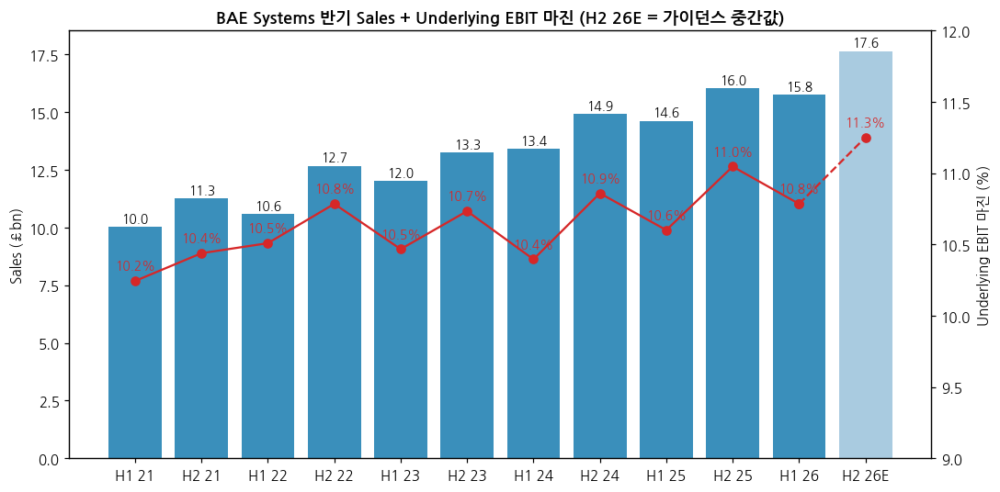
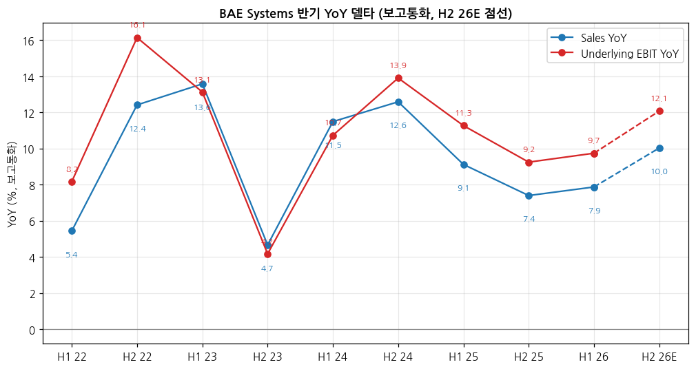
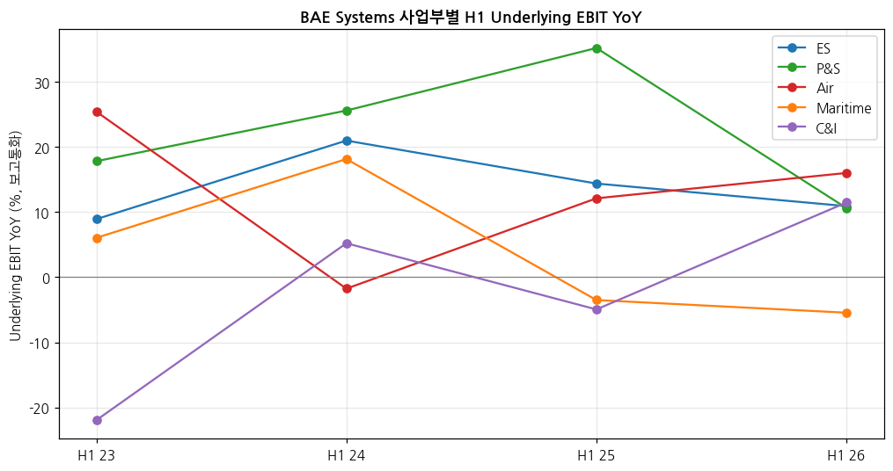

> 모드: 실적 리뷰 (v11)
> 종목: BAE Systems plc (BAE / LSE: BA.)
> 섹터: 방산
> 서브섹터: 방산 글로벌
> 분기: 2026-Q3 (손익은 H1 2026 반기 기준 — 회사는 3Q 손익을 공시하지 않고 11/12 Market update로 가이던스·수주만 발표)
> 발표일: 2026-11-12 (Market update) / 손익 최근 발표 2026-07-30 (H1 2026) / 다음 발표 2027-02-19 (2026 연간 예비실적)
> 작성 시각: 2026-11-14 18:00 KST
> 분석 소스: 회사 자료 — Half-yearly Report 2026(7/30)·2025·2024·2023·2022 원문(Investegate RNS), Market update(11/12) 원문, Annual Report 2021~2025 + H1 2026 컨콜 Q&A 정리(Investing.com) + 웹 보도(Investing.com 11/12 Jefferies 코멘트, Breaking Defense 8/18, LRT 6/18, Yahoo Finance 주가). **셀사이드 리포트 첨부 없음** — 쟁점은 컨콜 Q&A 반복 질문 + 웹 기사로 구성, 증권사 TP 변경은 웹에서 확인된 범위만

# BAE Systems 3Q26 (H1 2026 + 11월 Market update) 실적 리뷰

## 0. 한 줄 판정

> 성장 델타: 판정 제외 (반기 실적만 공시) | 내러티브: 유지 → 중립 관찰 구간 (이익 성장은 10%대 꾸준, 주가는 미 국방예산 우려로 멀티플 조정 중)

→ 숫자: H1 2026 Sales £15,772m(+7.9% 보고 / +9% cc), Underlying EBIT £1,701m(+9.7% 보고 / +11% cc), 마진 10.8%(+0.2%p). 반기 EBIT YoY는 H1 25 +11.3% → H2 25 +9.2% → **H1 26 +9.7%로 둔화가 멈췄다**. 가이던스 중간값이 맞으면 H2 26E EBIT YoY는 +12%로 다시 올라간다 `[계산]`
→ 11/12 Market update: 매출·EBIT·EPS 가이던스(+8~10% / +10~12% / +11~13%, cc) **유지**, FCF만 >£2.0bn → **약 £3.0bn 상향**(선수금 효과). 연초 이후 수주 £33bn — 2025년 연간(£36.8bn)의 90%
→ 쟁점: ① Maritime 마진(6.1%, Type 26 초도함) 회복 시점 ② FCF 상향의 질(선수금) ③ 미국 탄약·우주 증산이 언제 숫자로 오나 ④ 유럽 지상(CV90·Archer) — 한화 K9에 미 육군 자주포 경쟁 패배
→ 주가는 ATH(3월 2,360p) 대비 -20%(11/13 1,886p). 11월 초 "미 국방비 증액 둔화" 우려로 방산주 동반 급락 — 이익 하향이 아니라 멀티플 조정 `[판단]`
→ 다음 관건: 2027-02-19 연간 실적에서 **2027 가이던스(매출 +8% 이상 유지 여부)**와 Maritime 7% 복귀 경로, 그리고 CV90 5개국 계약 체결

## 1. 숫자

① 반기 표 (£m — 회사는 분기 손익 미공시, 반기 시계열로 대체)

| 항목 | H1 23 | H2 23 | H1 24 | H2 24 | H1 25 | H2 25 | **H1 26** | H2 26E |
|---|---|---|---|---|---|---|---|---|
| Sales | 12,018 | 13,266 | 13,399 | 14,936 | 14,621 | 16,041 | **15,772** | 17,650 |
| Underlying EBIT | 1,258 | 1,424 | 1,393 | 1,622 | 1,550 | 1,772 | **1,701** | 1,986 |
| 마진 (RoS) | 10.5% | 10.7% | 10.4% | 10.9% | 10.6% | 11.0% | **10.8%** | 11.3% |
| Sales YoY | 13.6% | 4.7% | 11.5% | 12.6% | 9.1% | 7.4% | **7.9%** | 10.0% |
| EBIT YoY | 13.1% | 4.2% | 10.7% | 13.9% | 11.3% | 9.2% | **9.7%** | 12.1% |
| **Sales YoY 델타 (%p)** | +1.2 | -8.9 | +6.8 | +1.1 | -3.5 | -1.7 | **+0.5** | +2.1 |
| **EBIT YoY 델타 (%p)** | -3.0 | -8.9 | +6.5 | +3.2 | -2.6 | -2.1 | **+0.5** | +2.4 |
| 수주 (£bn) | 21.1 | 16.6 | 15.1 | 18.6 | 13.2 | 23.6 | **16.4** | 약 16.6 |
| 잔고 (£bn, 기말) | 66.2 | 69.8 | 74.1 | 77.8 | 75.4 | 83.6 | **84.0** | — |

→ (출처: HY2023~2026 Report, AR2023~2025. H2 = 연간 - H1 [계산]. YoY·델타는 보고통화 [계산] — 회사 발표 cc 기준 H1 26 Sales +9%·EBIT +11%. H1 22 Sales 10,581·EBIT 1,112, H2 22 12,675·1,367은 YoY 기준치)
→ **H2 26E** = 2026 가이던스 중간값(Sales +9%, EBIT +11%, cc, $1.32 기준) - H1 26 [계산]. 범위: Sales £17.3~18.0bn(YoY +8.1~11.9%), EBIT £1.95~2.02bn(+10.2~14.0%). 연초 이후 평균 환율 $1.34로 환산 손실 약 매출 -£200m·EBIT -£28m(회사 민감도로 [계산]) 반영 시 H2 EBIT YoY 약 +10.5%
→ H2 26E 수주 ≈ 11/12 기준 연간 £33bn - H1 £16.4bn [계산] (연말까지 추가 계약 기대 — 회사)
→ 컨센 대비: 셀사이드 컨센 미확보. 11/12 FCF 가이던스 약 £3.0bn은 Jefferies 집계 컨센 약 £2.3bn을 크게 상회(Investing.com 11/12)
→ **YoY 위치**: 반기 EBIT YoY 정점은 H2 22(+16.1%, 우크라이나 전쟁 후 첫 수주 반영) — 이후 +10% 안팎에서 등락. H1 26 +9.7%로 바닥을 다졌고, 가이던스는 H2에 재가속(+10~14%)을 그린다. "정점 통과 후 꺾임"이 아니라 **+10% 전후 고원(plateau)** `[판단]`

→ (출처: HY Report·AR, H2 26E = 가이던스 중간값 [계산])

→ (출처: HY Report·AR, 보고통화 기준 [계산], H2 26E 점선)

② 사업부별 Sales·Underlying EBIT (£m)

| 사업부 | 항목 | H1 24 | H1 25 | H2 25 | **H1 26** | YoY (보고) | YoY (cc, 회사) |
|---|---|---|---|---|---|---|---|
| Electronic Systems | Sales | 3,383 | 3,599 | 3,929 | **3,866** | +7.4% | +11% |
| | EBIT | 473 | 541 | 621 | **600** | +10.9% | +15% |
| | 마진 | 14.0% | 15.0% | 15.8% | **15.5%** | +0.5%p | |
| Platforms & Services | Sales | 2,085 | 2,478 | 2,561 | **2,728** | +10.1% | +12% |
| | EBIT | 216 | 292 | 284 | **323** | +10.6% | +11% |
| | 마진 | 10.4% | 11.8% | 11.1% | **11.8%** | 0.0%p | |
| Air | Sales | 4,009 | 4,343 | 4,956 | **4,863** | +12.0% | +11% |
| | EBIT | 446 | 500 | 608 | **580** | +16.0% | +16% |
| | 마진 | 11.1% | 11.5% | 12.3% | **11.9%** | +0.4%p | |
| Maritime | Sales | 2,929 | 3,233 | 3,564 | **3,407** | +5.4% | +4% |
| | EBIT | 228 | 220 | 237 | **208** | **-5.5%** | -7% |
| | 마진 | 7.8% | 6.8% | 6.6% | **6.1%** | -0.7%p | |
| Cyber & Intelligence | Sales | 1,182 | 1,186 | 1,211 | **1,194** | +0.7% | +3% |
| | EBIT | 101 | 96 | 127 | **107** | +11.5% | +14% |
| | 마진 | 8.5% | 8.1% | 10.5% | **9.0%** | +0.9%p | |
| HQ·내부거래 | EBIT | (71) | (99) | (105) | **(117)** | | |
| **그룹** | Sales / EBIT | 13,399 / 1,393 | 14,621 / 1,550 | 16,041 / 1,772 | **15,772 / 1,701** | +7.9% / +9.7% | +9% / +11% |

→ (출처: HY2024~2026 Report segment table, H2 25 = AR2025 연간 - H1 25 [계산]. HQ Sales 및 내부거래 매출은 표에서 생략 — 합계는 회사 Sales)
→ **델타를 끄는 건 Air(EBIT +16%)와 ES(+11%, cc +15%)**. 두 사업부가 H1 26 사업부 EBIT 합계의 65% [계산]. Air는 Typhoon 생산 증가(튀르키예 착수)와 리스크 해소, ES는 우주(SMS cc +29%)
→ **꺾이는 곳은 Maritime 하나** — EBIT YoY H1 25 -3.5% → H1 26 -5.5%, 마진 7.8% → 6.8% → 6.1%로 3개 반기 연속 하락. 회사는 Type 26·Hunter·Dreadnought 초도함 단계 때문이라고 설명
→ P&S는 EBIT YoY가 H1 25 +35% → H1 26 +11%로 둔화했지만 기저(H1 24 마진 10.4%) 효과 소멸 — 유럽 지상(Hägglunds·Bofors) 매출은 여전히 약 +30% (회사)

→ (출처: HY2023~2026 Report, 보고통화 [계산])

(2-1) 사업부별 수주·잔고 (£bn)

| 사업부 | H1 25 수주 | **H1 26 수주** | H1 25 잔고 | **H1 26 잔고** | H2 26 주요 수주 (11/12 발표) |
|---|---|---|---|---|---|
| ES | 3.8 | **4.8** | 12.1 | **14.4** | 탄약 펀딩 약 $1.0bn (APKWS·THAAD 탐색기) |
| P&S | 2.4 | **2.1** | 14.2 | **14.2** | AMPV 약 $0.8bn, 탄약공장 약 $0.5bn |
| Air | 3.8 | **6.8** | 26.5 | **34.3** | GCAP 약 £1.6bn, MBDA 몫 약 £1.5bn |
| Maritime | 2.0 | **1.5** | 21.7 | **19.7** | Dreadnought 약 £4.3bn, 호주 A-OTHR 약 A$1.3bn |
| C&I | 1.4 | **1.4** | 1.8 | **2.3** | — |
| 그룹 | 13.2 | **16.4** | 75.4 | **84.0** | 연초 이후 누계 £33bn |

→ (출처: HY2025·2026 Report, Market update 11/12. H1 26 Air 수주에는 튀르키예 Typhoon 지원 약 £2.5bn·MBDA 약 £2bn·F-35 약 £1bn 포함)
→ Maritime 잔고는 H1 26에 줄었지만(21.7 → 19.7) H2에 Dreadnought £4.3bn이 들어와 연말엔 다시 늘어날 전망 `[전망]`
→ P&S 잔고가 정체(14.2 → 14.2)인 건 **CV90 5개국 공동구매가 아직 계약 전**이기 때문 — 이 딜은 H1 26 컨콜에서 회사가 "Hägglunds 2027년 400대+ 생산 계획에 미포함"이라고 밝힌 상방 요인

③ 연간 (£m)

| 항목 | 2022 | 2023 | 2024 | 2025 | 2026E (가이던스 중간) |
|---|---|---|---|---|---|
| Sales | 23,256 | 25,284 | 28,335 | 30,662 | 33,422 |
| Underlying EBIT | 2,479 | 2,682 | 3,015 | 3,322 | 3,687 |
| 마진 | 10.7% | 10.6% | 10.6% | 10.8% | 11.0% |
| Sales YoY (보고) | 9.1% | 8.7% | 12.1% | 8.2% | +9% cc |
| EBIT YoY (보고) | 12.4% | 8.2% | 12.4% | 10.2% | +11% cc |
| Underlying EPS (p) | 55.5 | 63.2 | 68.5 | 75.2 | 84.2 (+12%) |
| FCF | 1,950 | 2,593 | 2,505 | 2,158 | 약 3,000 |

→ (출처: AR2023~2025, 2026E = 회사 가이던스 중간값 cc [계산] — 셀사이드 컨센 아님)
→ 가이던스 변화: 2026-02 최초 (Sales +7~9% / EBIT +9~11% / EPS +9~11% / FCF >£1.3bn) → 7/30 상향 (+8~10% / +10~12% / +11~13% / >£2.0bn) → **11/12 FCF만 약 £3.0bn**. 손익 가이던스는 7월 이후 변동 없음

## 2. 시장 쟁점

① 2-0 지난 분기 체크

→ 첫 리뷰 — 직전 체크 없음

② 이번 분기 쟁점 4개

| # | 쟁점 | 근거 (컨콜 질문·기사) |
|---|---|---|
| (1) | Maritime 마진은 언제 7%로 돌아오나 | 컨콜 Jefferies·Morgan Stanley 질문, 11/12 회사 명시, Jefferies 11/12 코멘트 |
| (2) | FCF 상향의 질 — 선수금이 빠지면 얼마인가 | 컨콜 Berenberg 질문, 11/12 가이던스 문구 |
| (3) | 미국 탄약·우주 증산은 언제·얼마의 마진으로 오나 | 컨콜 Vertical Research·JP모간·Rothschild 질문, 11/12 회사 강조 |
| (4) | 유럽 지상(CV90·Archer) 성장의 지속성과 한국 경쟁 | 컨콜 Bernstein 질문, 미 육군 자주포 선정(8/18), CV90 6개국 이행협정(6/18) |

③ 쟁점별 분해

(1) **Maritime 마진은 언제 7%로 돌아오나**

(1-1) 회사 설명
→ H1 26 컨콜: Type 26·Hunter·Dreadnought가 모두 초도함(first-in-class) 단계라 마진이 낮다. H2 Maritime 마진은 연간 가이던스 근처, 리스크 해소에 따라 중기 7% 초과로 가는 경로 (Greve, Jefferies 질문 답변)
→ 11/12: H2에도 ES·Air·P&S 강세가 Maritime의 "부진한 성장과 마진"을 상쇄 — Type 26 초도함 단계 명시

(1-2) 시장 해석

| 출처 | 핵심 가정·추정 | 논리 |
|---|---|---|
| Jefferies (11/12 코멘트) | Maritime 의미 있는 마진 회복은 "시간이 걸린다" | ES 강세는 안심 요인, Maritime은 지연 |
| 회사 (컨콜) | H2 개선 → 중기 >7% | 초도함 리스크 해소가 열쇠 |

(1-3) 공통 결론 vs 갈리는 지점
→ 공통: 2026년 Maritime은 그룹 성장의 발목(사업부 EBIT 비중 11%)이지만 그룹 가이던스를 깨진 않는다
→ 갈림: 회복 시점 — 회사는 "H2부터 경로", 시장은 "2027 이후"

(1-4) [판단]
→ 숫자는 시장 쪽이다 — 마진이 3개 반기 연속 하락(7.8 → 6.8 → 6.6 → 6.1%)했고 11월에도 회사가 "부진" 표현을 유지. 2026 연간 Maritime 마진이 6.5%를 넘으면 회사 설명이 맞는 것 `[판단]`

(2) **FCF 상향의 질 — 선수금이 빠지면 얼마인가**

(2-1) 회사 설명
→ H1 FCF £1,791m 중 순 선수금 약 £1.6bn(대부분 Air). H2 가이던스는 신규 대형 선수금 미포함, H1 선수금 일부는 H2에 소진 (컨콜)
→ 11/12: 약 £3.0bn은 "지금까지 받은 선수금 일부 포함, 연말 추가 선수금 제외". 2024~2026 누적 >£6.7bn (7월 상향)

(2-2) 시장 해석

| 출처 | 핵심 가정·추정 | 논리 |
|---|---|---|
| Jefferies (컨센 집계) | 2026 FCF 컨센 약 £2.3bn → 가이던스 약 £3.0bn | 컨센 대비 대폭 상회 |
| 기사 (Investing.com 11/12) | 선수금 의존 — 연도별 FCF가 들쭉날쭉할 수 있음 | 질 문제 제기 |

(2-3) 공통 결론 vs 갈리는 지점
→ 공통: 주주환원(2026 약 £1.6bn) 재원은 충분, 순차입금 감소
→ 갈림: 2027 FCF — 선수금 역전으로 2027이 2026보다 낮아질 가능성 (2024 £2.5bn → 2025 £2.2bn처럼)

(2-4) [판단]
→ FCF 상향은 손익 가이던스를 바꾸지 않았다. 모멘텀 관점에서 이익 델타 신호가 아니라 **환원 여력 신호** — 2027-02 3년 누적 FCF 가이던스(2025~2027, 2026~2028) 상향 여부가 진짜 확인점 `[판단]`

(3) **미국 탄약·우주 증산은 언제·얼마의 마진으로 오나**

(3-1) 회사 설명
→ 미 국방부 증산 우선 탄약 12종 중 10종 공급, 다년 프레임워크 5건 체결·3건 협상, THAAD 탐색기 4배 증산 7년 프레임워크, APKWS 4만 발+ 추가 승인 (컨콜)
→ BAE는 탄약에서 tier 2(부품·탐색기) — ES·SMS 마진에 시간이 지나며 accretive (Greve, Vertical Research 질문)
→ 2026 미국 CapEx 약 +40%(대부분 탄약), FY27 미 국방비 "상당히 증가" 기대 (컨콜). H2 수주에 탄약 펀딩 약 $1.0bn (11/12)
→ 우주 SMS H1 cc +29%, Epoch 2 미사일 경보 위성 PDR 9개월 만에 완료

(3-2) 시장 해석

| 출처 | 핵심 가정·추정 | 논리 |
|---|---|---|
| Berenberg (2026-03, 기사 요약) | 2027 미 국방예산 증가 → 이익 상향 여지 | TP·추정치 상향 |
| 시장 (11월 초 주가) | 미 중간선거 후 국방비 증액 둔화 우려 | 11/3 2,075p → 11/6 1,846p (-11%) |

(3-3) 공통 결론 vs 갈리는 지점
→ 공통: ES가 그룹 최고 마진(15.5%)·최고 성장 사업부라는 점
→ 갈림: 미국 예산 — 증산 프레임워크가 실제 연도별 펀딩(appropriation)으로 이어지는지

(3-4) [판단]
→ 이번 분기의 주가 하락은 BAE 고유 숫자가 아니라 미국 예산 리스크 프리미엄. ES EBIT YoY(+11%, cc +15%)가 유지되는 한 이익 경로 훼손은 아니다. FY27 미 국방 세출법 통과·CR 기간이 판정 변수 `[판단]`

(4) **유럽 지상(CV90·Archer) 성장의 지속성과 한국 경쟁**

(4-1) 회사 설명
→ Hägglunds 2026년 약 300대 → 2027년 400대+ 생산 계획, 5개국 CV90 딜은 별도. Bofors 여러 제품 생산 3~4배 증가, 스웨덴 정밀가공 업체 인수 (컨콜, Bernstein 질문)
→ H1 26 Bofors 수주: 스웨덴 Archer $200m+, TRIDON Mk2 $180m

(4-2) 시장·경쟁 동향

| 출처 | 내용 | 의미 |
|---|---|---|
| Breaking Defense (2026-08-18) | 미 육군 차세대 자주포(SPH-M) 시제 — **한화 차륜형 K9 선정**(6대, 최대 $233m, 옵션 12대). BAE Archer·Rheinmetall RCH155·KNDS Caesar·Elbit Sigma 비선정 | M109A7 후속 시장에서 BAE 첫 패배 — 장기적으로 P&S 미 자주포 매출 위협 |
| LRT (2026-06-18) | 리투아니아 등 6개국 CV90 MkIV 공동구매 이행협정, 스웨덴이 협상 대표, 국가별 계약 2026 하반기 | 북유럽·발트 IFV 시장 CV90 고착 — 한화 레드백·K21 진입 장벽 |

(4-3) 공통 결론 vs 갈리는 지점
→ 공통: 유럽 지상은 BAE에서 가장 빠른 성장(약 +30%)이나 P&S 매출의 약 23%(Hägglunds 17%+Bofors 6%, 2025)에 그친다
→ 갈림: 미국 자주포 — 시제 단계라 당장 매출 영향 없음 vs 2030년대 M109 후속 양산 상실 위험

(4-4) [판단]
→ 한국 관점: **궤도형 IFV(유럽)는 BAE 우위, 자주포(미국)는 한화 우위**로 갈렸다. 한화에어로 K9의 미국 진입은 BAE M109A7(현 미 육군 독점)의 2030년대 매출을 잠식하는 구조적 이벤트 `[판단]`

④ 낙관 vs 보수 — 논리 대비

→ 낙관 (Berenberg·회사): 미국 2027 국방예산 증액 + 탄약·우주·GCAP·Typhoon 증산 → 2027 이후 두 자릿수 이익 성장 지속
→ 보수 (Jefferies Hold·Bernstein·Deutsche Bank 하향 이력, 기사 요약): "적정가 도달", Maritime 마진·FCF 선수금 의존·영미 예산 감당 능력 우려
→ 바이사이드: 7/30 가이던스 상향 후 런던 주가 +1.5%(7/30)·+2.1%(7/31) → 8/12 2,270p까지 상승 후 반납. 11/12 FCF 상향 당일 -1.1%(1,917.5p → 1,896p) — **좋은 숫자에도 주가가 안 오르는 구간** [Yahoo Finance 종가 계산]

⑤ 추정치·TP 변화 (웹에서 확인된 범위)

| 증권사 | 일자 | 의견 / TP | 핵심 한 줄 |
|---|---|---|---|
| Jefferies | 11/12~13 | Hold 유지 (TP 미확인) | Maritime 회복 지연, ES 안심 |
| Deutsche Bank | 8/11 | TP 상향 (수치 미확인) | H1 후 상향 (MarketBeat 헤드라인) |
| Berenberg | 3/5 | TP·추정치 상향 | 2027 미 국방예산 상방 |

→ 셀사이드 리포트 미첨부 + 웹 접근 제한(MarketBeat·DefenseWorld 403)으로 TP 수치·평균 변화율 집계 불가. **11월 주가 조정은 실적 하향이 아니라 멀티플 하향** — 손익 가이던스 불변·FCF 상향인데 주가는 11/3 대비 -9% [계산] `[판단]`

## 3. 내러티브 점검

→ 시장이 BAE를 사는 이유: **"미·영·유럽 국방비 증가를 가장 넓은 포트폴리오로 받는 장기 프로그램 컴파운더 — 잔고 £84bn, 연 10% 안팎 이익 성장, 낮은 실행 리스크"**
→ 이번 분기: 손익(H1 cc EBIT +11%)·수주(연초 이후 £33bn)·현금(FCF £3bn) 모두 스토리를 확인. 단 손익 가이던스는 7월 이후 추가 상향이 없었고, Maritime은 3개 반기 연속 마진 하락 → **강화가 아닌 유지**
→ 성장 델타 판정은 제외(반기 공시)지만, 반기 EBIT YoY +9.7%가 직전(+9.2%)보다 소폭 높고 H2 가이던스가 +10~14%를 함의 → 숫자상 "둔화 멈춤" `[판단]`
→ 스토리를 다시 강하게 만들 트리거: ① 2027 가이던스 두 자릿수 매출 성장 ② CV90 6개국 국가별 계약 ③ 미 FY27 국방 세출법 정상 통과 + 탄약 프레임워크 3건 추가
→ 깨뜨릴 리스크: ① 미 국방예산 CR 장기화·삭감 ② Maritime 마진 6% 미만 고착 ③ M109 후속 시장 한화 K9 확대

## 4. 향후 봐야 할 것

| 순위 | 무엇을 (변수·임계값) | 어떤 데이터로 | 언제 |
|---|---|---|---|
| 1 | **2027 가이던스** — 매출 cc +8% 이상·EBIT +10% 이상 유지 여부 (성장 고원 vs 둔화) | 2026 연간 예비실적 | 2027-02-19 |
| 2 | **Maritime 마진** — 2026 연간 6.5% 이상이면 회복 경로, 6% 미만이면 고착 | 연간 실적 segment table, H2 = 연간 - H1 | 2027-02-19 |
| 3 | **미 FY27 국방 세출·탄약 프레임워크** — CR 기간, THAAD·APKWS 다년계약 추가 3건 | 미 의회 세출법, DoD 계약 공시, BAE 보도자료 | 2026-12 ~ 2027-03 |
| 4 | **CV90 6개국 국가별 계약** — 리투아니아 100대 등 체결 시 P&S 잔고 £14bn대 돌파 | 각국 국방부·BAE 발표 | 2026 연말 ~ 1H27 |
| 5 | **FCF 3년 누적 가이던스** (2025~27·2026~28) 상향 여부 + 2027 선수금 역전 폭 | 연간 실적 | 2027-02-19 |

→ 섹터 합산용 방산 기준: **BAE는 그룹 전체를 방산 기준으로 사용** (민수는 ES 내 상업 항공전자 약 11% = 그룹 매출의 약 3% [계산], 손익 분리 미공시)
