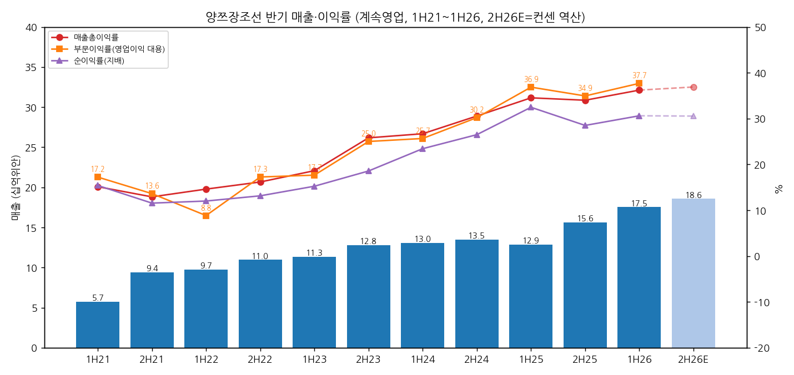
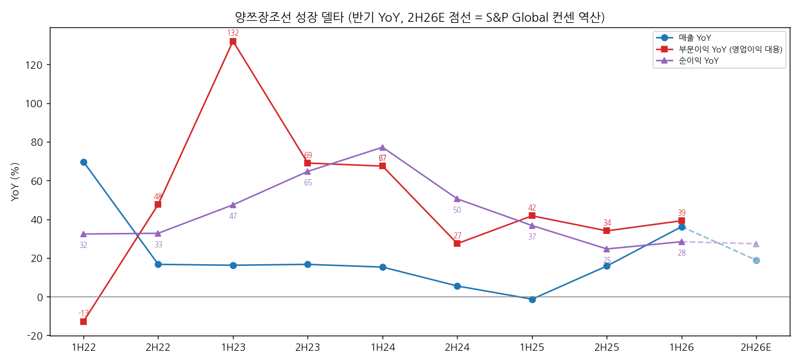
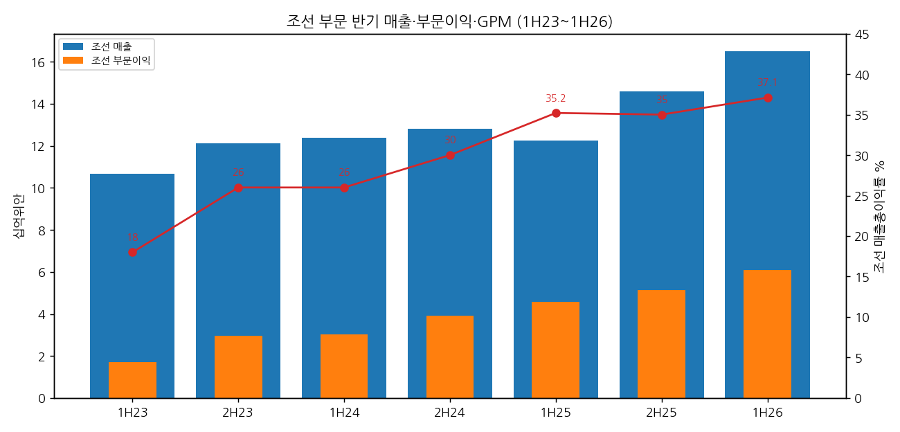

> 모드: 실적 리뷰 (v11)
> 종목: 양쯔장조선 / Yangzijiang Shipbuilding (BS6.SI)
> 섹터: 조선
> 서브섹터: 조선 글로벌
> 분기: 2026-Q3 (손익 미공시 — 3Q26 Business Update 기준. 손익 판정은 직전 반기 1H26으로 병기)
> 발표일: 2026-11-10 (3Q26 Business Update, SGX — 손익 없이 수주·인도·잔고만) / 직전 손익: 2026-08-06 (1H26 Results Announcement·Press Release·Presentation, SGX)
> 작성 시각: 2026-11-14 19:12 KST
> 분석 소스: [1차·회사 원문] SGX 공시 원문 — 1H26 Results Announcement·Press Release·Results Presentation(8/6), FY2025 Results Announcement·Press Release(2026-02-25), FY2024 Results Announcement(2025-02-26), 1H2025·1H2024 Results Announcement, FY2023 Press Release, FY2022·1H2022 Announcement(투자부문 분할 전후 계속영업 기준). [보도 인용] 3Q26 Business Update 수치 — Baird Maritime(11/11), NextInsight의 DBS 리포트 발췌(11/11), 2Slides 덱 요약(SGX 11/10 제출본 설명); 1Q26 수주·잔고 — Hellenic Shipping News(4/2); 3Q25 업데이트 — The Edge Singapore(UOB KH·CGS·DBS 2025-11-18~19 인용). [컨센] S&P Global 2026 연간 컨센(12곳, 8/11 갱신, StockAnalysis 표시). [질문·해석] OCBC 개시 리포트(10/9)·CGS·UOB KH 발췌(NextInsight 5/21·10/16). 3Q26 업데이트 SGX 원문 PDF는 직접 확보하지 못함
> 리뷰 깊이: 숫자 중심 | 리서치 첨부 0건

# 양쯔장조선 3Q26 리뷰 — 손익은 반기로만 보이지만, 10개월 수주가 연간 목표의 155%를 채웠다

> 성장 델타: 판정 보류 (분기 영업이익 미공시) — 반기 기준 가속 (2H25 순이익 YoY +24.6% → 1H26 +28.4%, 부문이익 +34.0% → +39.2%) | 내러티브: 강화 → 델타 가속(반기) + 내러티브 강화 → 적극 구간 후보 (2H26 컨센 경로는 순이익 YoY +27%로 "유지", 3월 FY26 실적 전까지 분기 확인 수단 없음)

→ **숫자 (반기)**: 1H26 매출 175.3억위안(+36.2% YoY), 매출총이익 63.5억위안(GPM 36.2%), 부문이익 합계(영업이익 대용) 66.1억위안(+39.2%), 지배주주 순이익 53.7억위안(+28.4%). 2H25 대비 매출 YoY는 +15.8% → +36.2%(+20.4%p), 부문이익 YoY는 +34.0% → +39.2%(+5.2%p)로 함께 올라 영업단 기준 "가속"이다. 순이익 YoY 델타는 +3.8%p로 기준표상 ±5%p 안이다. 이자수익 -53%, 환손실 2.3억위안 등 영업 밖 항목이 순이익 증가를 깎았다 [계산]
→ **숫자 (3Q26 업데이트)**: 1~10월 수주 69.8억달러로 연간 목표 45억달러의 155%다. 2025년 연간 수주(24.6억달러)의 2.8배다. 수주잔고는 263억달러(285척, 10/31)로 사상 최대이고, 6월 말 224억달러 대비 +17%다. 인도는 47척으로 연간 목표 58척의 81%다 (보도 인용)
→ **쟁점 ①**: 24,000TEU LNG 이중연료 컨테이너선 12척과 210,000DWT 벌크선 10척이 들어왔다. 2024년 말 이후 첫 초대형선 수주다. "2025년 수주 공백은 수요가 아니라 슬롯 문제였다"는 해석이 숫자로 확인됐다 (DBS)
→ **쟁점 ②**: 조선 GPM 37.1%(1H26)가 2023~24년 고가 수주분 소진 뒤에도 30%대를 지키는가. 회사는 높은 계약가와 제품 믹스를 이유로 들었다. 시장은 위안화 강세, 훙위안 신규 야드 통합에 따른 희석, 컨테이너선 선가 하락을 반복해서 묻는다
→ **다음 반기 관건**: 2H26 컨센(역산)은 매출 185.7억위안(+18.8%), 순이익 56.7억위안(+27.3%)이다. 컨센대로면 순이익 YoY는 +28.4% → +27.3%로 "유지"다. FY2026 실적(2027년 2월 말 예상)에서 조선 GPM 35% 이상 유지와 훙위안 매출 기여가 판정을 가른다

---

## 1. 숫자

① 반기 5지표 (계속영업 기준, 단위: 백만위안, %)

| 항목 | 1H21 | 2H21 | 1H22 | 2H22 | 1H23 | 2H23 | 1H24 | 2H24 | 1H25 | 2H25 | **1H26** | 2H26E (컨센 역산) |
|---|---|---|---|---|---|---|---|---|---|---|---|---|
| 매출액 | 5,739 | 9,398 | 9,741 | 10,964 | 11,321 | 12,791 | 13,049 | 13,493 | 12,878 | 15,627 | **17,534** | 18,566 |
| 매출총이익 | 870 | 1,215 | 1,424 | 1,773 | 2,110 | 3,301 | 3,484 | 4,124 | 4,447 | 5,314 | **6,350** | 6,850 |
| 부문이익 합계 (영업이익 대용) | 990 | 1,282 | 862 | 1,893 | 2,000 | 3,199 | 3,349 | 4,076 | 4,747 | 5,461 | **6,609** | — |
| 부문이익률 | 17.2 | 13.6 | 8.8 | 17.3 | 17.7 | 25.0 | 25.7 | 30.2 | 36.9 | 34.9 | **37.7** | — |
| 지배주주 순이익 | 885 | 1,087 | 1,171 | 1,442 | 1,726 | 2,376 | 3,058 | 3,575 | 4,181 | 4,456 | **5,368** | 5,672 |
| 매출 YoY | — | — | +69.7 | +16.7 | +16.2 | +16.7 | +15.3 | +5.5 | -1.3 | +15.8 | **+36.2** | +18.8 |
| 부문이익 YoY | — | — | -12.9 | +47.7 | +132.0 | +69.0 | +67.4 | +27.4 | +41.8 | +34.0 | **+39.2** | — |
| 순이익 YoY | — | — | +32.3 | +32.7 | +47.4 | +64.7 | +77.2 | +50.5 | +36.7 | +24.6 | **+28.4** | +27.3 |
| **매출 YoY 델타 (%p)** | — | — | — | -53.0 | -0.5 | +0.5 | -1.4 | -9.8 | -6.8 | +17.1 | **+20.4** | -17.4 |
| **부문이익 YoY 델타 (%p)** | — | — | — | +60.6 | +84.3 | -63.0 | -1.6 | -40.0 | +14.4 | -7.8 | **+5.2** | — |
| 순이익 YoY 델타 (%p) | — | — | — | +0.4 | +14.7 | +17.3 | +12.5 | -26.7 | -13.8 | -12.1 | **+3.8** | -1.1 |
| 매출총이익률 | 15.2 | 12.9 | 14.6 | 16.2 | 18.6 | 25.8 | 26.7 | 30.6 | 34.5 | 34.0 | **36.2** | 36.9 |
| 순이익률 | 15.4 | 11.6 | 12.0 | 13.2 | 15.2 | 18.6 | 23.4 | 26.5 | 32.5 | 28.5 | **30.6** | 30.6 |

→ (출처: SGX 공시 원문. 1H21~2H22는 FY2022·1H2022 Announcement의 계속영업 재작성치, 1H23~1H26은 각 반기·연간 Results Announcement. 2H 수치는 회사가 직접 공시한 2H 열(2H21~2H25). 부문이익 합계 = 보고부문(조선·해운) + 기타 부문의 segment result 합계로, 미배분 관리비·환차손익·예금이자 반영 전 금액이다. 회사는 영업이익(Operating profit) 항목을 공시하지 않는다. 2H26E는 S&P Global 2026 연간 컨센(12곳, 8/11 갱신, StockAnalysis 표시: 매출 361.0억·매출총이익 132.0억·순이익 110.4억위안)에서 1H26 실적을 뺀 값 [계산])
→ **이 분기(3Q26)의 손익**: 회사는 반기 결산만 하고 1·3분기에는 수주·인도·잔고만 내는 Business Update를 공시한다. 그래서 3Q26 매출·영업이익은 존재하지 않으며, 분기 델타 판정은 `판정 보류`다. 손익 판정은 직전 반기(1H26)로 한다. 다음 손익 공시는 FY2026 실적(2H26 포함)으로 2027년 2월 말이 예상된다(전년 2/25, 전전년 2/26 발표)
→ **기준 단절 (2022년 투자부문 분할)**: 2022년 4월 투자·금융 부문을 Yangzijiang Financial Holding으로 분할 상장했다. 회사는 2021년부터 계속영업으로 재작성했다. 2020년 이전 수치(그룹 기준)에는 투자부문 매출·이익(2020년 부문이익 19.5억위안)이 섞여 있어 직접 비교하지 않는다. 브리프의 "2023년 분할"은 공시상 2022년 4월이다 (1H2022 Announcement: 1H22 discontinued operations 1.9억위안 = 분할 전 4개월분)
→ **1H26 순이익률이 내려간 이유** (32.5% → 30.6%): 매출총이익(+42.8%)과 부문이익(+39.2%)은 순이익(+28.4%)보다 빨리 늘었다. 차이는 영업 밖에서 났다. 예금이자 수익이 4.9억 → 2.3억위안(-53%, 예금 감소와 달러 예금 비중 축소), 순환손실 2.3억위안, R&D 중심 관리비 3.6억 → 5.3억위안(+48%)이다. 선박 6척 매각이익 2.3억위안이 일부를 메웠다 (1H26 Announcement 8번 항목)
→ **[판단] 반기 델타 = 가속**: 영업단(매출총이익 YoY +28.9% → +42.8%, 부문이익 +34.0% → +39.2%)과 매출(+15.8% → +36.2%)이 모두 확대됐다. 순이익 기준(+3.8%p)만 보면 기준표상 "유지"의 경계지만, 둔화 원인이 이자수익·환율 같은 영업외라 영업 기준으로 판정한다. 2H26 컨센 경로는 순이익 YoY +27.3%로 1H26과 거의 같아, 다음 반기는 "유지"가 기본값이다

→ (출처: SGX 반기·연간 공시 원문, 2H26E는 S&P Global 컨센 역산(연한 막대·점선))

→ (출처: 동일. 부문이익 2H26E는 컨센 항목이 없어 표시하지 않음)

② 사업부별 매출·부문이익 (단위: 백만위안, %)

| 사업부 | 항목 | 1H23 | 2H23 | 1H24 | 2H24 | 1H25 | 2H25 | **1H26** |
|---|---|---|---|---|---|---|---|---|
| 조선 | 매출 | 10,659 | 12,129 | 12,398 | 12,818 | 12,249 | 14,576 | **16,513** |
| 조선 | 부문이익 | 1,703 | 2,965 | 3,045 | 3,926 | 4,575 | 5,142 | **6,098** |
| 조선 | 부문이익률 | 16.0 | 24.4 | 24.6 | 30.6 | 37.4 | 35.3 | **36.9** |
| 조선 | 매출총이익률 | 18 | 26 | 26 | 30 | 35.2 | 35 | **37.1** |
| 조선 | 매출 YoY | — | — | +16.3 | +5.7 | -1.2 | +13.7 | **+34.8** |
| 조선 | 부문이익 YoY | — | — | +78.9 | +32.4 | +50.2 | +31.0 | **+33.3** |
| 해운 | 매출 | 532 | 489 | 604 | 638 | 511 | 630 | **585** |
| 해운 | 부문이익 | 336 | 232 | 307 | 353 | 178 | 332 | **470** |
| 기타 (터미널·무역·설계·부동산) | 매출 | 129 | 173 | 46 | 37 | 117 | 421 | **436** |
| 기타 | 부문이익 | -39 | 2 | -3 | -203 | -6 | -13 | **41** |

→ (출처: 각 반기·연간 Results Announcement 4.1 Segment information. 조선 GPM은 회사 MD&A 문구(1H23 18%, 2H23 26%, 1H24 26%, 2H24 30%, 2H25 35%)와 Press Release(1H25 35.2%, 1H26 37.1%). 부문이익에는 조인트벤처(YAMIC) 지분이익이 일부 포함된다. 1H26 매출 비중: 조선 94.2%, 해운 3.3%, 기타 2.5% [계산])

→ (출처: 각 반기·연간 Results Announcement 부문 정보, 조선 GPM은 회사 MD&A·Press Release)
→ **델타를 끄는 것은 조선이다.** 조선 매출 YoY가 +13.7% → +34.8%로 뛰었다. 고가 계약 건조 진행, 초대형 컨테이너선·VLEC 믹스, 신규 훙위안(Hongyuan) 야드의 첫 매출 5.45억위안(2Q26)이 원인이다(회사). 훙위안을 빼도 조선 매출은 +30.4%다 [계산]
→ 조선 부문이익 YoY는 +31.0% → +33.3%로 소폭 확대에 그쳤다. 매출이 이익보다 빨리 늘면서 조선 부문이익률이 37.4%(1H25) → 36.9%로 0.5%p 내려갔다. GPM은 올랐지만(+1.9%p) R&D·관리비가 늘어난 결과다 [판단]
→ 해운 부문이익 470백만위안(+164%)에는 선박 6척 매각이익(2.3억위안, 해운 부문 귀속)이 들어 있다. 이를 빼면 약 2.4억위안으로 경상 개선 폭은 작다 [계산]
→ 지분법이익 4.83억위안(1H26): YAMIC 3.42억, 쓰네이시 저우산 1.08억, Poseidon(Seaspan 지주사, 10%) 0.34억(5월 말 편입, 약 1개월분). Poseidon은 2H26부터 6개월분이 잡힌다

③ 수주·잔고·인도 (단위: 억달러, 척)

| 항목 | 2022 | 2023 | 2024 | 2025 | 1Q26 | 1H26 | 7M26 | **10M26 (3Q26 업데이트)** |
|---|---|---|---|---|---|---|---|---|
| 신규 수주 (누적) | 44.3 | 70.5 | 146.0 | 24.6 | 9.8 | 17.5 | 19.6 | **69.8** |
| 수주 척수 (누적) | — | — | 126 | — | 22 | 38 | 42 | **87** |
| 연간 수주 목표 | — | — | — | — | 45 | 45 | 45 | **45 (달성률 155%)** |
| 수주잔고 (기말) | 105 | 145 | 244 | 224 | 227.8 | 224 | — | **263 (10/31)** |
| 잔고 척수 | 140 | 182 | 245 | 245 | 256 | 256 | — | **285** |
| 인도 척수 (누적, YAMIC 포함) | 67 | 56 | 61 | 56 | — | 27 | — | **47 (목표 58, 81%)** |

→ (출처: 2022~1H26 수주·잔고·척수는 1H26 Results Presentation p.14·17(회사 원문), 2024 수주 척수는 The Edge(2025-11) 보도 인용, 인도 척수는 FY2023 Press Release·FY2024·FY2025 Announcement·1H26 Press Release. 1Q26은 Hellenic Shipping News(4/2) 보도 인용 — 같은 시점을 UOB KH는 223억달러·252척으로 인용해 0.5억달러 어긋남. 10M26은 Baird Maritime(11/11)·DBS(11/11)·2Slides 덱 요약 보도 인용 — SGX 원문 미대조)
→ 잔고 263억달러의 구성 (10/31, 보도 인용): 컨테이너선 173척 194억달러(74%), 탱커 44척 24억달러, 벌크선 43척 23억달러, 가스선(LNGB·LPG·VLAC·VLEC) 25척 22억달러. 친환경(이중연료 등) 선박이 금액의 67%다. 잔고 인도 시점은 2026~2030년(Baird)으로 보도됐고, 덱 요약은 2031년까지로 적었다
→ 7~10월 4개월 수주가 52.3억달러(69.8 − 17.5)로, 1~6월(17.5억달러)의 3배다 [계산]. 캘린더 3Q(7~9월)만의 수주는 공시 구간이 10월 말까지라 분리할 수 없다
→ 잔고 증가(224 → 263억달러, +39억달러)는 4개월 수주 52.3억달러에서 인도·진행분 약 13억달러가 빠진 결과다 [계산]. 같은 기간 인도는 20척(27 → 47척)이다
→ 수주 델타 [판단]: 연간 수주는 2024년 146억달러(정점) → 2025년 24.6억달러(-83%) → 2026년 10개월 69.8억달러다. 2025년이 바닥이었고 2026년은 2023년 수준(70.5억달러)을 이미 회복했다. 이익 델타보다 수주 델타가 먼저 돌아선 셈이다

④ 가이던스·회사 목표 (이전 → 이번)

| 항목 | 이전 | 이번 (3Q26 업데이트까지) | 변화 |
|---|---|---|---|
| FY2026 수주 목표 | 45억달러 (2026-02-25 FY2025 실적 발표. 보도자료 원문은 "RMB4.5 billion"으로 표기 — 이후 회사 자료는 모두 US$4.5bn) | 45억달러 유지, 10월 말 69.8억달러로 155% 달성 | 목표 초과 (목표 상향 공시 여부 미확인) |
| FY2026 인도 목표 | 58척 | 58척 유지, 10월 말 47척(81%) | 순항 |
| 인도 슬롯 | 2029년 잔여 슬롯 우선, 2030년 순차 오픈 (2/25) | 2029년 "거의 만석"(8/6) → 업계 슬롯 2029년까지 대부분 소진, 2030년 슬롯 채우는 중 (11/10) | 진척 |
| 조선 마진 | 경영진: 2026년 조선 마진 2025년과 비슷 (2025-11, UOB KH 인용) | 1H26 조선 GPM 37.1% (FY2025 35.1%) | 상회 |
| 훙위안 야드 | 2026년 완공 목표, 1Q26 강재 가공 착수 (2/25) | 2Q26 첫 매출 5.45억위안, 2027년 초 완전 가동·첫 인도 2027년 (11/10) | 일정대로 |
| 배당 성향 | FY2024 38% → FY2025 50% (주당 20센트) | FY2026~27 50% 지속 가능하다고 가이던스 (OCBC 인용) | 유지 |
| 손익 가이던스 | 없음 | 없음 | — |

→ (출처: FY2025 Press Release(2/25), 1H26 Press Release·Announcement(8/6), Baird Maritime·DBS·2Slides(11/10~11). 2025-11 마진 코멘트는 The Edge Singapore의 UOB KH 리포트 인용(2025-11-19), 배당 지속 가이던스는 OCBC 개시 리포트(10/9) 인용)

⑤ 연간 (단위: 백만위안, %)

| 항목 | 2021 | 2022 | 2023 | 2024 | 2025 | 2026E (컨센) |
|---|---|---|---|---|---|---|
| 매출액 | 15,137 | 20,705 | 24,112 | 26,542 | 28,505 | 36,100 |
| 매출총이익 | 2,084 | 3,197 | 5,410 | 7,608 | 9,761 | 13,200 |
| 매출총이익률 | 13.8 | 15.4 | 22.4 | 28.7 | 34.2 | 36.6 |
| EBIT (회사 제시) | — | — | 5,227 | 8,302 | 10,792 | — |
| 지배주주 순이익 | 1,971 | 2,613 | 4,102 | 6,634 | 8,637 | 11,040 |
| 매출 YoY | — | +36.8 | +16.5 | +10.1 | +7.4 | +26.6 |
| 순이익 YoY | — | +32.6 | +57.0 | +61.7 | +30.2 | +27.8 |
| ROE (회사 제시) | — | 14.9 | 19.6 | — | — | 1H26 연율 32.3 |

→ (출처: 2021~2025 SGX 연간 공시 원문(계속영업), EBIT는 1H26 Results Presentation p.7, ROE는 FY2023 Press Release·1H26 Presentation. 2026E는 S&P Global 컨센(12곳, 8/11 갱신, StockAnalysis 표시). 2027E는 무료 범위에서 확보 못 함)
→ 컨센 2026E 순이익 +27.8%는 1H26(+28.4%)과 같은 속도를 2H26에도 가정한다. 3Q26 업데이트(수주 155%) 이후 컨센 변화는 확보하지 못했다

---

## 2. 시장 쟁점 — 회사 설명 + 반복된 질문

① 지난 분기 체크
→ 첫 리뷰 — 직전 체크 없음. (참고: 섹터 리뷰 `(서브) 중국 조선 2사 트래킹`이 1H26 반기 가속을 기록해 두었고, 이번 리뷰가 원문 대조로 같은 숫자를 확인했다)

② 이번 분기 쟁점 4개

| # | 쟁점 | 반복해서 나온 곳 |
|---|---|---|
| (1) | 2025년 수주 공백은 수요 문제였나, 슬롯 문제였나 — 초대형선 복귀의 의미 | DBS(11/11), OCBC(10/9), CGS(2025-11·2026-10), UOB KH |
| (2) | 조선 GPM 37%는 언제까지 가나 — 고가 수주분 소진·위안화·훙위안 희석 | OCBC, UOB KH, DBS, CGS, 회사 컨퍼런스 |
| (3) | 순이익이 매출총이익보다 덜 늘었다 — 이자수익 감소와 Poseidon 투자 | 회사 MD&A(8/6), CGS |
| (4) | 증설·다각화(훙위안·LNG 터미널·수리조선·LNG선)가 다음 성장 다리가 되나 | 회사(8/6·11/10), DBS, OCBC, CGS |

③ 쟁점별 분해

(1) 수주 공백은 수요 문제였나, 슬롯 문제였나

(1-1) 회사 설명
→ "업계 인도 슬롯이 2029년까지 대부분 찼다. 선종·계약 조건을 골라 잔고 질을 지키는 선별 수주를 한다." 수주는 "초대형 LNG 이중연료 컨테이너선과 대형 벌크선이 이끌었다" (Ren Letian 회장, 11/10 업데이트, Baird 보도 인용)
→ 8/6에는 "수요가 큰 컨테이너선에서 탱커·가스선·중소형 컨테이너선으로 이동하고, 벌크선 수요도 서서히 회복 중"이라고 했다. 컨테이너선·가스선·벌크선 선가는 고점에서 완만히 내렸고 탱커만 올랐다 (1H26 Announcement 11번 항목)

(1-2) 반복된 질문
→ 2025년 수주 24.6억달러(전년 146억달러 대비 -83%)는 사이클 정점 신호였나. OCBC는 "추세가 아니라 일시적 공백"으로 봤고, DBS는 이번 초대형선 수주로 "슬롯 제약이었다"는 견해가 확인됐다고 했다
→ 2025년 11월 CGS는 경영진이 "증설한 중국 2선 야드와의 경쟁이 심해졌다"고 했다고 전했다. 2H25 중국 수주의 약 40%가 2026~27년 인도분이었다(클락슨, CGS 인용) — 이른 슬롯을 가진 경쟁 야드가 물량을 가져갔다는 뜻이다

(1-3) **[판단]**
→ 10개월 69.8억달러, 87척은 2023년 연간(70.5억달러)과 같은 규모다. 7~10월에만 52억달러가 들어왔다. "공백 → 회복"은 숫자로 확인됐다
→ 다만 잔고 74%가 컨테이너선이고 신규 수주도 컨테이너선(53척)이 중심이다. 회사 스스로 대형 컨테이너선 수요가 다른 선종으로 이동한다고 말한 해에 초대형 컨테이너선을 받은 것이라, 2027년 수주 지속성은 컨테이너선 한 선종에 걸려 있다
→ 결론이 바뀌는 조건: 2027년 1Q 업데이트(4월 말~5월)에서 수주가 분기 10억달러 미만으로 다시 끊기고 컨테이너선 선가가 더 내리면 "슬롯이 아니라 수요" 해석이 힘을 얻는다

(2) 조선 GPM 37%는 언제까지 가나

(2-1) 회사 설명
→ 1H26 조선 GPM 37.1%(+1.9%p YoY)는 "더 높은 가격에 확보한 잔고와 더 유리한 제품 믹스" 덕분이다. 2026년에도 2023~24년 계약분을 인도한다 (1H26 Press Release·Presentation p.11)
→ 2025년 11월 경영진은 "2026년 조선 마진은 2025년과 비슷"하다고 하며 안정적 USD/RMB, 톤당 4,000~5,000위안 철강가, 미리 싸게 확보한 기자재를 근거로 들었다. 훙위안 통합 기간에는 마진이 낮아질 수 있지만 통합 뒤에는 높은 마진을 낼 수 있다고 했다 (UOB KH 2025-11-19, The Edge 인용)

(2-2) 반복된 질문
→ 고마진 컨테이너선(2023~24년 계약)이 인도되고 나면 마진이 내려가는가. OCBC는 향후 2년 "완만한 하락"을 모델에 넣으면서도 30~35%가 2~3년 더 갈 수 있다고 봤다. UOB KH는 2025년 11월에 FY26 조선 마진을 31%로 가정했는데 실제 1H26은 37.1%였다
→ 위안화 강세: 선가는 달러, 원가는 위안이다. DBS는 "위안화 절상이 역풍"이라고 했다. 1H26에도 순환손실 2.3억위안이 났다

(2-3) **[판단]**
→ 조선 GPM은 18%(1H23) → 26 → 26 → 30 → 35.2 → 35 → 37.1%로 6개 반기 동안 한 번도 내려가지 않았다. 마진 피크 우려는 반복됐지만 숫자는 매번 위로 나왔다
→ 그러나 1H26 조선 부문이익률은 36.9%로 1H25(37.4%)보다 낮다. GPM 상승분을 R&D·관리비 증가가 먹었다. 2H26부터 훙위안(초기 가동 저효율)이 매출 비중을 키우면 GPM보다 부문이익률이 먼저 꺾일 수 있다
→ 결론이 바뀌는 조건: FY2026 실적에서 2H26 조선 GPM이 35% 아래로 내려오면 "고가 수주분 소진" 국면 진입으로 본다. 37% 이상이면 마진 정점 논쟁은 2027년으로 밀린다

(3) 순이익이 매출총이익보다 덜 늘었다

(3-1) 회사 설명
→ 예금이자 4.86억 → 2.28억위안(-53%): 평균 예금 잔액 감소와 달러 예금 비중 축소(위안화 예금은 금리 낮음). 순환손실 2.27억위안, 선박 6척 매각이익 2.34억위안. 관리비 3.58억 → 5.29억위안(R&D 증가). 유효세율 19.1% → 18.7% (1H26 Announcement)
→ Poseidon Corp.(Seaspan 지주사) 지분 10%를 56.3억위안(약 8.26억달러)에 5월 말 인수했다. 회장이 Poseidon 이사회에 들어갔다. 1H26 지분법이익은 약 1개월분 0.34억위안이다
→ 현금 및 등가물은 200.8억 → 159.2억위안으로 줄었다. Poseidon 투자, FY2025 기말배당 42.2억위안, 차입 상환 13.8억위안 때문이다. 순현금은 125억위안이다

(3-2) 반복된 질문
→ Poseidon 투자가 수주 확보 장치인가, 이익 기여 수단인가. CGS는 "향후 수주를 확보하고 이익에 소폭 기여"할 것이라 보고, Poseidon 지분법이익 확대를 이익 상방 요인으로 꼽았다
→ 현금이 줄면서 이자수익 감소가 이어지는가

(3-3) **[판단]**
→ 1H26 순이익은 11.9억위안 늘었다. 같은 기간 예금이자 감소 2.6억위안과 순환손실 2.3억위안을 합치면 세전 4.9억위안이다 [계산]. 1H25의 환손익 내역은 따로 확인하지 못해 "환손실 증가분"은 계산하지 않았다. 2H26에는 Poseidon 6개월분 지분법이익이 들어와 이자 감소를 일부 상쇄한다. 컨센이 2H26 순이익 YoY +27%로 1H26과 비슷하게 잡은 것은 이 상쇄를 가정한 숫자로 읽힌다 [판단]

(4) 증설·다각화가 다음 성장 다리가 되나

(4-1) 회사 설명
→ 훙위안 야드: 부지 866,671㎡, 투자 약 30억위안, 2Q26 첫 매출, 2027년 초 완전 가동, 첫 인도 2027년. 야드 능력 +17~20%(CGS 17%, DBS 20%)
→ LNG 터미널 전환(약 20억위안, 1H27 완공), 수리·개조 전문 장쑤 양쯔 훙다 조선소 설립 준비, ENN Yangtze(톈진) 해운 JV(49%) 신설 (1H26 Announcement·11/10 덱 요약)
→ 2024년 계약 해지된 175,000㎥ LNG선 2척을 자체 재고로 계속 건조 중이다 (재고 40.3억위안, 1H26 Announcement)

(4-2) 반복된 질문
→ 훙위안 초기 가동이 마진을 희석하는가(UOB KH·회사 2025-11 언급). Runze 증설(+30%) 재가동 여부(DBS). LNG선 시장 진입(OCBC: "LNG carrier ambitions")

(4-3) **[판단]**
→ 2027년 매출 성장의 상당 부분은 훙위안 물량에서 나온다. 잔고 263억달러가 늘어난 능력을 2029~30년까지 채운다. 반대로 LNG선은 아직 해지 물량 2척 재고 건조뿐이라, 한국 조선의 핵심 선종을 위협하는 단계로 보기는 이르다

---

## 3. 내러티브 점검

① 성장 스토리 정의
→ 중국 최대 민영 조선사로, 2023~24년 고가에 받은 대형·이중연료 컨테이너선 잔고를 업계 최고 수준 마진(조선 GPM 35~37%)으로 소화하고, 순현금·배당성향 50%로 이익을 돌려준다. 시장은 "슬롯 만석 → 선별 수주 → 고마진 지속 → 배당"을 산다

② 이번 분기 평가
→ **강화**: 3Q26 업데이트로 수주가 2025년 바닥에서 목표의 155%로 돌아섰고 잔고가 사상 최대(263억달러)를 찍었다. 초대형선(24,000TEU LNG DF)이 돌아왔다. 1H26 반기 이익은 영업단 기준으로 가속했다. 셀사이드 TP는 3분기에 연속 상향됐다(OCBC 개시 S$6.10, CGS S$6.00, DBS S$6.60 — 참고용, 보도 인용)
→ **약한 고리**: 주가는 8월 월말 S$5.13 → 11/13 S$4.32(-16%)로 업데이트 전후 반응이 없었다(Yahoo 월말 종가 [계산]). 손익 확인 수단이 반기뿐이라 2H26 마진은 2027년 2월 말까지 숫자로 확인할 수 없다
→ **[판단] 내러티브 = 강화**. 0번 판정의 국면은 "적극 구간 후보"다. 반기 델타 가속과 수주 반전이 겹쳤지만, 분기 손익이 없어 델타 꺾임을 늦게 알게 되는 구조라 "후보"로 둔다

③ 한국 조선 3사 대비 시사점
→ 한국 3사 합산 3Q26 영업이익 YoY는 +34.0%로 둔화(-51%p)했고 OPM은 14.0%다 (섹터 리뷰). 양쯔장은 반기 부문이익 YoY +39.2%로 가속했고 부문이익률은 37.7%다. 이익 델타·마진 레벨 모두 양쯔장이 앞선다 [계산]
→ 맞붙는 지점은 초대형 LNG 이중연료 컨테이너선(HD현대중공업·한화오션·삼성중공업)과 MR·LR1 탱커·VLAC(HD현대 계열 중형 야드)이다. 이번 24,000TEU 12척 수주는 한국 빅3가 주도해 온 선형에서 중국 민영 야드가 슬롯·가격으로 물량을 가져간 사례다. LNG선·FLNG·특수선에서는 아직 겹치지 않는다 [판단]

④ 스토리를 다시 강하게 만들 트리거
→ FY2026 실적(2027년 2월 말)에서 2H26 조선 GPM 37% 이상 + 배당성향 50% 유지
→ 2027년 수주 목표가 45억달러 이상으로 제시되고 1Q27 업데이트에서 분기 10억달러 이상 수주 지속
→ 훙위안 첫 인도(2027년)와 LNG선 신규 수주

⑤ 스토리를 깨뜨릴 리스크
→ 위안화 강세 가속(달러 선가·위안 원가) 또는 철강가 상승으로 2H26 조선 GPM 35% 미만
→ 컨테이너선 발주 둔화로 2027년 수주가 다시 2025년 수준으로 끊김
→ 미국의 중국 건조 선박 입항 수수료 등 규제가 컨테이너선 선주의 중국 발주를 늦춤

---

## 4. 향후 봐야 할 것 (우선순위 순)

(1) **2H26 조선 GPM 35% 이상, 순이익 56.7억위안(YoY +27%) 이상** — 반기 델타 판정 1순위
→ 무엇을: 2H26 순이익이 컨센 역산 56.7억위안(+27.3%) 이상이면 "유지 이상", 49억위안(+10%) 미만이면 "둔화". 조선 GPM 35% 미만이면 마진 정점 진입으로 판정 전환
→ 어떤 데이터로: FY2026 Results Announcement·Press Release·Presentation (SGX), 2H 열의 조선 GPM·부문이익, 지분법이익(Poseidon 6개월분)
→ 언제: 2027년 2월 말 (전년 2/25)

(2) **FY2027 수주 목표와 연말 잔고 270억달러대**
→ 무엇을: 2026년 연간 수주(10월 말 69.8억달러) 최종치, 연말 잔고(10월 말 263억달러), 2027년 수주 목표(2026년 45억달러 대비)
→ 어떤 데이터로: FY2026 실적 발표, SGX 수주 공시, 뉴스 키워드 "Yangzijiang order", "24,000TEU LNG dual-fuel", "CMA CGM Yangzijiang"
→ 언제: 11~12월 수시, 2027년 2월 말

(3) **훙위안 야드 램프업과 마진 희석 여부**
→ 무엇을: 훙위안 매출(2Q26 5.45억위안) 확대, 완전 가동(2027년 초)·첫 인도(2027년), 조선 부문이익률 36.9%(1H26) 유지 여부
→ 어떤 데이터로: FY2026 실적 MD&A, 1Q27 Business Update
→ 언제: 2027년 2월 말 ~ 5월

(4) **위안화·영업외 손익 — 이자수익·환손익·Poseidon 지분법**
→ 무엇을: USD/CNY 하락(위안 강세) 폭, 순환손익, 예금이자(1H26 2.3억위안), Poseidon 지분법이익 반기 기여
→ 어떤 데이터로: USD/CNY 반기 평균, FY2026 Announcement 손익계산서 "Other gains/(losses)", Seaspan 실적
→ 언제: 월간 환율, 2027년 2월 말

(5) **컨테이너선 선가·중국 2선 야드 경쟁과 미국 규제**
→ 무엇을: 클락슨 컨테이너선 신조선가, 중국 2선 야드의 이른 슬롯 수주, USTR 중국 건조선 입항 수수료 시행·유예
→ 어떤 데이터로: 클락슨 월간 통계, 한국 3사 컨테이너선 수주 공시(맞붙는 선형 단가 비교), USTR 공지
→ 언제: 월간, 1Q27

→ 다음 공시 일정: 3Q26 Business Update는 11/10에 이미 나왔다. 다음은 FY2026 실적(2027년 2월 말 예상), 1Q27 Business Update(2027년 4월 말~5월 예상)
