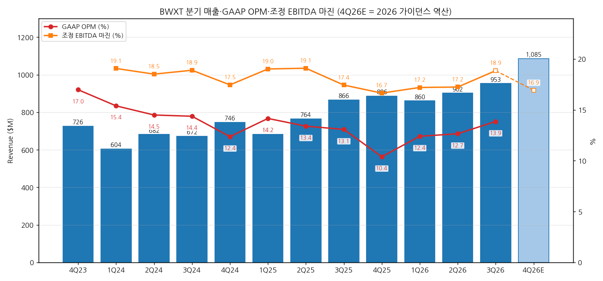
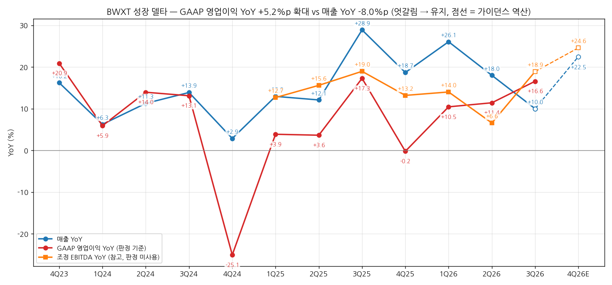
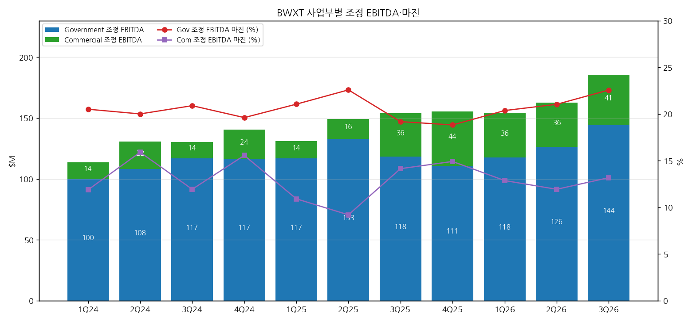
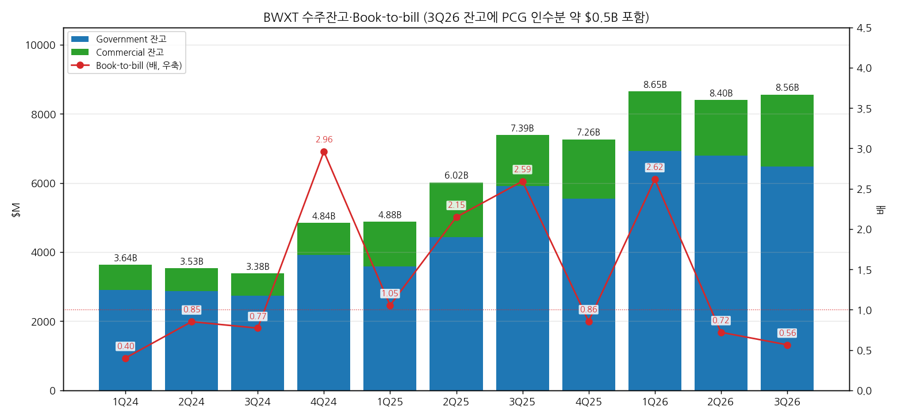

> 모드: 실적 리뷰 (v11)
> 종목: BWX Technologies (BWXT)
> 섹터: 원전
> 서브섹터: 원전 기자재 글로벌
> 분기: 2026-Q3 (캘린더 = 회계 분기, 9/30 종료)
> 발표일: 2026-11-02 (월, 장 마감 후 — 보도자료(8-K Ex.99.1)·10-Q 동시 제출, 컨퍼런스콜 같은 날 저녁)
> 작성 시각: 2026-11-16 15:50 KST
> 분석 소스: 회사 자료 — 3Q26 실적 보도자료(8-K Ex.99.1, SEC 원문), 3Q26 10-Q(11/2 SEC — 사업부 MD&A·잔고·매각예정자산 주석), 1Q25\~2Q26 분기 보도자료(SEC 8-K Ex.99.1 — 조정 EBITDA·사업부 조정 EBITDA·잔고·수주), 2014\~2026 10-K·10-Q 사업부 51분기 시계열(기업개요 v1.0 작업분 재사용), 11/3·11/4·11/13 8-K(리볼버 연장·$500M 회사채·기존 채권 공개매수). 비공식 요약(출처 등급 낮음): 3Q26 컨퍼런스콜 트랜스크립트(Motley Fool 작성본, Webull 게재 — "오류 가능" 고지), 2026 Investor Day(9/29) 2030 목표는 Quartr 요약(컨콜에서 재확인), 컨센서스는 Barchart/StockStory(S&P 집계, 11/2)·Earnings Whispers(11/2) 보도 인용. 주가는 Yahoo Finance 일간. 한국 피어 교차: 2026-Q3_두산에너빌리티_리뷰.md. 셀사이드 리포트 첨부 없음
> 리뷰 깊이: 숫자 중심 | 리서치 첨부 0건
> 델타 판정 기준: 보고 기준 GAAP 영업이익 YoY와 직전 분기 대비 변화 + 스킬 규칙의 매출 방향 (2026-11-16 BT 결정 — 조정 EBITDA·organic·기저 조정은 참고만)

# BWXT 3Q26 실적 리뷰 — 정부 사업 마진 22.6%로 이익은 재가속, 매출은 10%로 내려왔고 미국 신규원전 첫 발주는 1H27로 밀렸다

> 성장 델타: 유지 (이익 가속·매출 둔화 엇갈림) | 내러티브: 약화 → 델타 유지 + 내러티브 약화 → 경계 구간 (해군 독점 현금 엔진은 더 단단해졌지만, 주가를 움직이는 상업 원전 옵션의 시점이 한 번 더 밀렸다. 미국 첫 기자재 발주와 Gov 다년 계약 수주 확인 전까지 관망)

→ **숫자**: 매출 $953.0M(+10.0% YoY, organic +7%), GAAP 영업이익 $132.1M(+16.6%, OPM 13.9%), 조정 EBITDA $179.7M(+18.9%, 마진 18.9%). 판정 기준(보고 기준 GAAP 영업이익 YoY와 그 직전 분기 대비 변화)으로 보면 영업이익 YoY는 +11.4% → +16.6%로 **+5.2%p** 확대됐다(±5%p 범위 밖). 그러나 매출 YoY는 +26.1% → +18.0% → +10.0%로 두 분기 연속 8%p씩 내려왔다. 스킬 판정 규칙상 매출·영업이익 방향이 엇갈려 "유지"다 (조정 EBITDA YoY +6.6% → +18.9%는 참고)
→ **서프라이즈**: S&P 컨센 대비 매출 -2.1%(컨센 $973.1M), 조정 EBITDA +7.3%(컨센 $167.5M), 조정 EPS $1.26으로 +5.7%(컨센 $1.19, 보도 인용). 발표 다음 날(11/3) 주가는 +1.0%였지만 11/4 -7.8%, 11/5 $114.96으로 52주 최저를 찍었다. 11/13 종가 $122.97은 사상 최고 종가($238.42, 4/15) 대비 -48.4%다
→ **쟁점 ①**: 이익 재가속은 Government에서 나왔다. Gov 조정 EBITDA 마진 22.6%(+3.4%p YoY)는 해군 원자로 생산성, 기술서비스 지분법 이익, 그리고 전년 A.O.T. 통합비용 소멸(기저)이 만든 숫자다. 반면 Gov 매출은 +3.6%에 그쳤다
→ **쟁점 ②**: 미국 신규원전 첫 기자재 발주 시점이 "2026년" → "2026년 말 가능, 늦어도 1H27"로 밀렸다(보도 인용). 회사는 AP1000 기자재에서 **두산에너빌리티·IHI와 경쟁**하고 공급사 배분은 Westinghouse가 정한다고 했다. 가격 압력도 예상한다("Absolutely", Guggenheim 질문)
→ **쟁점 ③**: 3Q 수주 $538M(B/B 0.56배)로 잔고 $8.56B(사상 최대)의 약 $0.5B는 PCG 인수로 들어온 것이다. 인수분을 빼면 잔고는 QoQ 약 -4%다 [계산]
→ **다음 분기 관건**: 판정 기준인 4Q26 GAAP 영업이익의 기준선은 4Q25 $92.1M(OPM 10.4%, 약한 기저)이다. $112.0M(YoY +21.6%) 초과면 "가속", $102.8\~112.0M이면 "유지", $92.1\~102.8M이면 "둔화", $92.1M 미만이면 "꺾임"이다 [계산]. 회사는 GAAP 영업이익 가이던스를 주지 않는다. 참고로 2026 가이던스(매출 약 $3.8B, 조정 EBITDA 약 $667M)를 역산한 4Q26은 매출 $1,085M(+22.5%), 조정 EBITDA $184M(+24.6%)이다 [계산]. 약한 4Q25 기저 위에서 델타가 한 번 더 오르는 경로지만, 2027 예비 전망(조정 EBITDA high single\~low double digit)은 그 뒤 둔화를 가리킨다. 판정을 바꿀 변수는 4Q 숫자보다 미국 첫 기자재 발주와 해군 다년 가격계약이다

---

## 1. 숫자

① 연결 기준 분기 표 (단위: $M, %)

| 항목 | 4Q23 | 1Q24 | 2Q24 | 3Q24 | 4Q24 | 1Q25 | 2Q25 | 3Q25 | 4Q25 | 1Q26 | 2Q26 | **3Q26** | 4Q26E (가이던스 역산) |
|---|---|---|---|---|---|---|---|---|---|---|---|---|---|
| 매출액 | 725.5 | 604.0 | 681.5 | 672.0 | 746.3 | 682.3 | 764.0 | 866.3 | 885.8 | 860.2 | 901.6 | **953.0** | 1,085.2 |
| 영업이익 (GAAP) | 123.2 | 93.0 | 98.8 | 96.6 | 92.3 | 96.6 | 102.4 | 113.3 | 92.1 | 106.7 | 114.1 | **132.1** | 미제시 |
| OPM (GAAP) | 17.0 | 15.4 | 14.5 | 14.4 | 12.4 | 14.2 | 13.4 | 13.1 | 10.4 | 12.4 | 12.7 | **13.9** | — |
| 매출 YoY | +16.2 | +6.3 | +11.3 | +13.9 | +2.9 | +13.0 | +12.1 | +28.9 | +18.7 | +26.1 | +18.0 | **+10.0** | +22.5 |
| 영업이익 YoY | +20.9 | +5.9 | +14.0 | +13.1 | -25.1 | +3.9 | +3.6 | +17.3 | -0.2 | +10.5 | +11.4 | **+16.6** | — |
| **매출 YoY 델타 (%p)** | +3.5 | -10.0 | +5.0 | +2.6 | -11.0 | +10.1 | -0.9 | +16.8 | -10.2 | +7.4 | -8.1 | **-8.0** | +12.5 |
| **영업이익 YoY 델타 (%p)** | +14.0 | -15.0 | +8.0 | -0.8 | -38.2 | +29.0 | -0.2 | +13.6 | -17.5 | +10.7 | +1.0 | **+5.2** | — |
| 조정 EBITDA (회사 주 지표, 판정 미사용·참고) | — | 115.2 | 126.2 | 127.0 | 130.3 | 129.8 | 145.9 | 151.1 | 147.5 | 148.0 | 155.5 | **179.7** | 183.8 |
| 조정 EBITDA 마진 | — | 19.1 | 18.5 | 18.9 | 17.5 | 19.0 | 19.1 | 17.4 | 16.7 | 17.2 | 17.2 | **18.9** | 16.9 |
| 조정 EBITDA YoY | — | — | — | — | — | +12.7 | +15.6 | +19.0 | +13.2 | +14.0 | +6.6 | **+18.9** | +24.6 |
| **조정 EBITDA YoY 델타 (%p)** | — | — | — | — | — | — | +2.9 | +3.4 | -5.8 | +0.8 | -7.4 | **+12.3** | +5.7 |
| Non-GAAP 영업이익 | — | 94.6 | 104.6 | 105.7 | 107.9 | 105.8 | 118.6 | 125.9 | 121.1 | 121.5 | 126.6 | **149.7** | — |
| Organic 매출 YoY | — | — | — | — | — | — | — | — | — | — | — | **+7** | — |

→ (출처: 매출·GAAP 영업이익은 각 분기 10-Q, 4Q = 10-K 연간 − 3Q 누적 [계산] (기업개요 51분기 시계열과 동일). 조정 EBITDA·Non-GAAP 영업이익은 각 분기 실적 보도자료(SEC 8-K Ex.99.1) 회사 정의. 2Q25 Non-GAAP 영업이익은 보도자료 요약표 $118.6M과 Exhibit 1 $121.1M이 서로 달라 요약표 값 사용. 2023년 조정 EBITDA 분기값은 미확보라 2024년 YoY는 공란. Organic +7%는 컨콜 CFO 발언이며, 10-Q의 PCG 기여 $26.2M을 빼서 계산해도 +7.0% [계산])
→ 4Q26E는 2026 가이던스(11/2 — 매출 약 $3,800M, 조정 EBITDA 약 $667M)에서 9개월 누적(매출 $2,714.8M, 조정 EBITDA $483.2M)을 뺀 값이다 [계산]. 매출 가이던스가 "약 $3.8B"로 반올림돼 있어 4Q 매출 역산의 오차가 크다($3.75B면 $1,035M, +16.9%). 같은 방식으로 역산한 4Q26 Non-GAAP EPS는 약 $1.30(+20%)이다 [계산]. GAAP 영업이익 가이던스는 없다
→ 3Q26 서프라이즈: S&P 컨센 대비 매출 -2.1%($973.1M), 조정 EBITDA +7.3%($167.5M), 조정 EPS +5.7%($1.19) (Barchart/StockStory 11/2, 보도 인용). Earnings Whispers 집계 기준 매출은 -4.0% 미스다(보도 인용). GAAP 영업이익 컨센은 미확보
→ 해석: 매출 YoY 하락(+26.1% → +18.0% → +10.0%)은 대부분 **Kinectrics 인수 효과가 한 바퀴를 돈 결과**다. Kinectrics는 2025-05-20 편입이라 1Q26엔 전년에 없던 매출이 통째로 더해졌고, 3Q26부터는 전년에도 있다. 9개월 누적 Commercial 증가 $344.9M 중 $186.8M이 Kinectrics다 (10-Q MD&A). 3Q26에 남은 인수 효과는 PCG($26.2M) 하나다
→ 이익은 반대로 움직였다. GAAP 영업이익 YoY +11.4% → +16.6%(판정 기준)다. 참고로 조정 EBITDA YoY는 +6.6% → +18.9%다. 다만 2Q26의 조정 EBITDA YoY(+6.6%)가 낮았던 것은 2Q25 Gov 조정 EBITDA($133.0M, 마진 22.6%)가 높았던 기저 때문이고, 3Q26의 반등에는 3Q25 Gov의 A.O.T. 통합비용(약한 기저)이 들어 있다. 두 분기를 묶은 2Q\~3Q26 조정 EBITDA YoY는 +12.9%로 1Q26(+14.0%)과 비슷하다 [계산]. 기저를 걷어내면 이익 성장 속도는 1Q26과 비슷하다는 참고 정보이며, 판정에는 쓰지 않는다 [판단]
→ YoY 정점: 가이던스 역산 경로상 4Q26이 매출(+22.5%)·조정 EBITDA(+24.6%) 모두 정점이다. 4Q25 기저가 약해서다(GAAP 영업이익 YoY -0.2%, OPM 10.4%). 2027년은 매출 high single digit, 조정 EBITDA high single\~low double digit 예비 전망이므로, **회사가 그린 경로상 YoY 정점은 4Q26이고 1Q27부터 한 자릿수\~10%대 초반으로 내려온다** [판단]
→ **[판단] 델타 = 유지 (보고 기준 GAAP 영업이익 판정)**: GAAP 영업이익 YoY는 +5.2%p 확대(±5%p 범위 밖)됐지만 매출 YoY는 -8.0%p 내려와 방향이 엇갈린다. 스킬 규칙("매출·영업이익 방향이 엇갈림 → 유지")을 그대로 적용했다. 조정 EBITDA·organic·기저 조정은 판정에 쓰지 않았다. 판정을 바꿀 조건: 4Q26 GAAP 영업이익이 $112.0M(YoY +21.6%, 델타 +5%p 초과)을 넘고 매출 YoY도 확대(가이던스 역산 +22.5%)되면 "가속(강한 가속)", $92.1\~102.8M(YoY 0\~11.6%)이면 "둔화", $92.1M 미만이면 "꺾임"이다 [계산]

→ (출처: BWXT 10-Q·10-K, 분기 실적 보도자료(SEC 8-K Ex.99.1). 4Q26E는 2026 가이던스 역산 [계산], 연한 막대·점선)

→ (출처: 동일. 4Q24 GAAP 영업이익 YoY -25.1%는 4Q23 고기저(OPM 17.0%) 효과. 4Q26E 점선은 가이던스 역산 기준)

② 사업부별 매출·영업이익 (단위: $M, %)

| 사업부 | 항목 | 1Q25 | 2Q25 | 3Q25 | 4Q25 | 1Q26 | 2Q26 | **3Q26** |
|---|---|---|---|---|---|---|---|---|
| Government | 매출 | 555.3 | 589.0 | 616.7 | 589.1 | 577.9 | 601.3 | **639.1** |
| Government | 영업이익 (GAAP) | 97.7 | 109.4 | 97.4 | 90.3 | 99.1 | 105.7 | **122.6** |
| Government | OPM | 17.6 | 18.6 | 15.8 | 15.3 | 17.1 | 17.6 | **19.2** |
| Government | 매출 YoY | +14.0 | +8.9 | +10.1 | -1.0 | +4.1 | +2.1 | **+3.6** |
| Government | 영업이익 YoY | +14.0 | +18.3 | -4.1 | -8.0 | +1.4 | -3.4 | **+25.9** |
| Government | 조정 EBITDA | 116.9 | 133.0 | 118.3 | 110.9 | 117.7 | 126.5 | **144.2** |
| Government | 조정 EBITDA 마진 | 21.1 | 22.6 | 19.2 | 18.8 | 20.4 | 21.0 | **22.6** |
| Government | 조정 EBITDA YoY | +17.0 | +22.9 | +1.1 | -5.0 | +0.7 | -4.9 | **+21.9** |
| Commercial | 매출 | 128.3 | 176.1 | 251.0 | 297.7 | 283.6 | 302.5 | **314.2** |
| Commercial | 영업이익 (GAAP) | 6.5 | 6.9 | 24.0 | 20.4 | 24.0 | 24.3 | **26.3** |
| Commercial | OPM | 5.1 | 3.9 | 9.6 | 6.9 | 8.5 | 8.0 | **8.4** |
| Commercial | 매출 YoY | +9.7 | +24.5 | +121.9 | +95.5 | +121.0 | +71.8 | **+25.2** |
| Commercial | 매출 YoY (organic, 보도 인용) | — | — | — | — | +39 | +33 | **+15** |
| Commercial | 영업이익 YoY | -24.4 | -58.4 | +258.2 | +36.9 | +269.2 | +252.2 | **+9.6** |
| Commercial | 조정 EBITDA | 14.0 | 16.2 | 35.5 | 44.4 | 36.5 | 36.1 | **41.4** |
| Commercial | 조정 EBITDA 마진 | 10.9 | 9.2 | 14.1 | 14.9 | 12.9 | 11.9 | **13.2** |
| Commercial | 조정 EBITDA YoY | +0.7 | -28.0 | +163.0 | +87.3 | +160.7 | +122.8 | **+16.6** |
| 본사 (Unallocated) | 영업이익 (GAAP) | -7.6 | -13.9 | -8.0 | -18.7 | -16.5 | -15.9 | **-16.8** |
| 매출 비중 | Gov / Com | 81 / 19 | 77 / 23 | 71 / 29 | 66 / 34 | 67 / 33 | 67 / 33 | **67 / 33** |

→ (출처: 사업부 매출·GAAP 영업이익은 각 분기 10-Q, 4Q = 10-K − 9개월 [계산]. 사업부 조정 EBITDA는 각 분기 보도자료 Exhibit 1. 2024년 분기값(YoY 계산용)도 2025년 보도자료 비교 열. Commercial organic YoY는 Earnings Whispers(11/2) 보도 인용 — 3Q는 컨콜 CFO "+15% organic"과 일치. 매출 비중은 사업부 합계(제거 전) 기준 [계산])
→ **델타를 끄는 곳은 Government다.** Gov 조정 EBITDA 증가 $25.9M이 전사 증가 $28.6M의 91%다 [계산]. 매출은 +$22.4M(+3.6%)뿐인데 영업이익은 +$25.2M이다. 10-Q는 매출 증가를 A.O.T.·농축 기여($13.8M)로, 영업이익 증가를 그 효과와 "전년 동기 A.O.T. 통합비용"으로 설명한다. 컨콜은 해군 원자로(Naval Propulsion) 매출이 전년 대비 자재 조달 감소로 줄었고, 마진은 해군 원자로 생산성과 기술서비스 지분법 이익 증가가 끌었다고 했다. Non-GAAP 기준 Gov 영업이익도 $101.4M → $124.8M(+23.1%)이라 기저만으로 설명되지는 않는다 [계산]
→ **Commercial은 마진이 막혀 있다.** 매출 +25.2% 중 PCG가 $26.2M, 현장 검사·정비·개보수가 $15.3M이다. 영업이익은 +9.6%로 매출보다 덜 올랐다. 10-Q는 인수·구조조정 비용 +$1.2M과 "불리한 제품 믹스"를 들었고, 컨콜은 조정 EBITDA 마진 13.2%를 "믹스와 사업 확장 투자"로 설명했다. Kinectrics 편입 후 Commercial 조정 EBITDA 마진은 14.1% → 14.9% → 12.9% → 11.9% → 13.2%로 13% 안팎에서 맴돈다
→ **본사 비용**: -$16.8M(전년 -$8.0M)으로 구조조정·전환 +$4.5M, M&A 자문 +$1.5M, 의료비 청구 시점 영향이다 (10-Q). 조정 기준(-$5.9M)으로도 전년 -$2.8M보다 늘었다
→ 계약 유형 변화: 3Q26 Gov 매출 중 고정가 인센티브(FPIF)가 $483.6M(전년 $239.9M), 확정가(FFP)가 $11.5M(전년 $280.0M)으로 바뀌었다 (10-Q). 해군 원자로 다년 계약이 FPIF로 갱신된 영향으로 보인다 [추정]. FPIF는 원가 절감분을 회사와 정부가 나누는 구조라, 생산성 개선이 마진으로 남기 쉽다 [판단]

→ (출처: BWXT 분기 실적 보도자료 Exhibit 1 사업부 조정 EBITDA)

(1) 수주·잔고 — 선행지표 (단위: $M, 배)

| 항목 | 3Q24 | 4Q24 | 1Q25 | 2Q25 | 3Q25 | 4Q25 | 1Q26 | 2Q26 | **3Q26** |
|---|---|---|---|---|---|---|---|---|---|
| 수주잔고 (전사) | 3,380.7 | 4,843 | 4,878.7 | 6,015.2 | 7,389.1 | 7,261 | 8,650.8 | 8,398.1 | **8,556.2** |
| — Government | 2,745.3 | 3,913 | 3,583.7 | 4,435.6 | 5,905.0 | 5,541 | 6,931.1 | 6,797.6 | **6,481.8** |
| — Commercial | 635.4 | 930 | 1,295.0 | 1,579.6 | 1,484.1 | 1,720 | 1,719.7 | 1,600.5 | **2,074.4** |
| 신규 수주 (전사) | 518.4 | 약 2,209 | 719.8 | 1,640.5 | 2,245.4 | 약 758 | 2,250.4 | 648.9 | **538.2** |
| — Government | 440.1 | 약 1,763 | 226.4 | 1,412.3 | 2,086.1 | 약 225 | 1,967.6 | 467.6 | **323.0** |
| — Commercial | 78.3 | 약 447 | 493.4 | 228.2 | 159.3 | 약 534 | 282.7 | 181.3 | **215.2** |
| Book-to-bill (전사) | 0.77 | 2.96 | 1.05 | 2.15 | 2.59 | 0.86 | 2.62 | 0.72 | **0.56** |

→ (출처: 분기 잔고·수주는 각 분기 보도자료, 연말 잔고는 10-K. 4Q 수주는 보도자료에 없어 "연말 잔고 − 3Q말 잔고 + 4Q 매출"로 역산 [계산 — 인수·환율 효과 포함]. B/B = 수주 ÷ 매출 [계산])
→ 잔고 $8,556M은 사상 최대이고 YoY +15.8%다. 그러나 약 $500M은 7/1 인수한 PCG의 잔고다(컨콜). 이를 빼면 약 $8,056M으로 2Q26 대비 **4.1%** 감소다 [계산]. Gov 잔고는 1Q26 $6,931M → 3Q26 $6,482M으로 두 분기 연속 줄었다
→ 9개월 수주는 $3,437.5M(B/B 1.27배)로 전년 $4,605.7M보다 -25%다. Gov 수주는 대형 다년 해군 계약이 들어오는 분기(4Q24·3Q25·1Q26)와 그렇지 않은 분기가 번갈아 나오는 구조라 분기 B/B로는 판단하기 어렵다. 3Q 수주에는 해군 연간 연료 계약 $189M이 들어 있고, 회사는 **다음 해군 다년 가격계약(multiyear pricing agreement)을 협상 중**이다 (컨콜)
→ PCG 잔고의 75\~80%는 해군 물량인데 Commercial 사업부에 잡힌다 (컨콜, BNP 질문 답변). Commercial 잔고 증가(+$474M QoQ)는 거의 전부 PCG다 [계산]
→ 잔고 질: 미국 정부 계약 중 미배정 예산(unfunded) $1,970.9M, 2027년 말까지 잔고의 약 46% 매출 인식 예정, 잔고 미반영 옵션 약 $1.4B(2030년 $0.9B·2035년 $0.5B 발주 예상) (10-Q)

→ (출처: BWXT 분기 보도자료·10-K. 4Q B/B는 잔고 역산 [계산])

(2) 가이던스 (이전 → 이번, 단위: $M)

| 항목 | FY25 실적 | 초기 (2/23) | 1Q26 (5/4) | 2Q26 (8/3) | **3Q26 (11/2)** |
|---|---|---|---|---|---|
| 매출 | 3,198 | 약 3,750 | 3,750 초과 | 약 3,800 | **약 3,800 (유지)** |
| 조정 EBITDA | 574 | 645\~660 | 650\~665 | 662\~672 | **약 667 (중간값 고정)** |
| Non-GAAP EPS ($) | 4.01 | 4.55\~4.70 | 4.60\~4.75 | 4.70\~4.80 | **4.72\~4.77 (중간값 유지·범위 축소)** |
| FCF | 295 | 305\~320 | 315\~330 | 345\~360 | **350\~360 (하단 상향)** |
| CapEx | — | — | — | — | **매출의 약 6%** |

→ (출처: 각 분기 보도자료 Outlook 표. 2Q26부터 PCG 인수 포함 — 1Q26 보도자료는 "PCG 기여 미포함"으로 명시)
→ 조정 EBITDA 가이던스 중간값은 $652.5M → $657.5M → $667M → $667M으로 연초 대비 +2.2%다 [계산]. 3Q는 숫자를 올리지 않고 범위만 좁혔다. 발표 전 S&P 2026 조정 EBITDA 컨센은 $660.3M이었다 (보도 인용)
→ **2027 예비 전망 (컨콜)**: 매출 high single digit, 조정 EBITDA·EPS high single\~low double digit("Investor Day 프레임보다 앞선다"). Gov는 매출·EBITDA high single\~low double digit(신규 프로그램 초기 마진 믹스가 상쇄 요인). Commercial은 organic 매출 high single digit이지만 **의료사업 매각으로 전체는 low single digit**, 마진 +50\~100bp, EBITDA high single digit. FCF는 2026년과 비슷하거나 소폭 증가(연금 출연 약 $10M·운전자본·HPDU·농축 마일스톤 시점). CapEx 매출의 약 6%
→ **2030 목표 (Investor Day 9/29, 컨콜에서 재확인)**: 매출 $5.5\~6.0B, 조정 EBITDA $1.1\~1.2B. 2026 가이던스 기준 4년 CAGR은 매출 +9.7\~12.1%, 조정 EBITDA +13.3\~15.8%다 [계산]. 2027 예비 전망(EBITDA +7\~12% [추정 — high single\~low double digit])은 이 경로의 하단이라, 2028\~2030에 성장이 붙어야 목표가 맞는다. 회사는 "특정 M&A 없이 core CapEx(매출의 5\~6%)만으로" 달성 가능하다고 했다 (CFO, CJS 질문)

③ 연간 (단위: $M, %)

| 항목 | 2021 | 2022 | 2023 | 2024 | 2025 | 2026E | 2027E |
|---|---|---|---|---|---|---|---|
| 매출액 | 2,124 | 2,233 | 2,496 | 2,704 | 3,198 | 약 3,800 | 약 4,070\~4,140 |
| 영업이익 (GAAP) | 346 | 349 | 383 | 381 | 404 | 미제시 (9M 353) | 미제시 |
| OPM (GAAP) | 16.3 | 15.6 | 15.3 | 14.1 | 12.6 | — | — |
| 매출 YoY | 0.0 | +5.1 | +11.8 | +8.3 | +18.3 | +18.8 | +7\~9 |
| 영업이익 YoY | -3.6 | +0.8 | +9.9 | -0.6 | +6.3 | — | — |
| 조정 EBITDA | — | — | — | 498.7 | 574.3 | 약 667 | 약 714\~747 |
| 조정 EBITDA 마진 | — | — | — | 18.4 | 18.0 | 17.6 | 17.5\~18.0 |
| 조정 EBITDA YoY | — | — | — | — | +15.2 | +16.1 | +7\~12 |
| Non-GAAP EPS ($) | — | — | — | 3.33 | 4.01 | 4.72\~4.77 | — |

→ (출처: 2021\~2025 매출·영업이익은 10-K(분기 합산과 일치), 조정 EBITDA·Non-GAAP EPS는 4Q25 보도자료. 2026E는 11/2 가이던스. 2027E는 컨콜 예비 전망(매출 high single digit, 조정 EBITDA high single\~low double digit)을 7\~9%·7\~12%로 놓고 계산한 값 [계산 — 회사 수치 아님])
→ 발표 후 연간 컨센 변화는 미확보다. 회사 가이던스 기준으로 2026년 조정 EBITDA YoY(+16.1%)는 2025년(+15.2%)과 같은 속도고, 2027년엔 한 자릿수 후반\~10%대 초반으로 내려온다. 연간 기준으로도 **이익 성장 정점은 2026년**이다 [판단]

---

## 2. 시장 쟁점

① 지난 분기 체크

→ 첫 리뷰 — 직전 체크 없음 (2Q26 리뷰·팔로업 미작성)

② 이번 분기 쟁점 (컨콜 Q&A에서 반복된 질문)

| # | 쟁점 | 한 줄 정의 | 질문자 |
|---|---|---|---|
| 1 | Gov 마진 22.6%의 지속성 | 매출 +3.6%에 이익 +22%, 2027년에도 유지되나 | BNP Paribas(Akers), Deutsche Bank(Deuschle), TD Cowen(Bianchi) |
| 2 | 미국 신규원전 발주 지연과 AP1000 경쟁 | 첫 기자재 발주는 언제, 두산·IHI와 어떻게 나누나, 가격은 | TD Cowen, Deutsche Bank, Northland(Grampp), Guggenheim(Ciarmoli), BTIG(Madrid) |
| 3 | 수주 공백과 4Q 매출 램프 | B/B 0.56, PCG 잔고, 4Q Commercial이 가이던스를 맞추나 | BNP Paribas, JPMorgan(Sano), Northland |
| 4 | 포트폴리오 재편 후 Commercial 마진 | 의료 매각·PCG 편입 후 마진은 오르나 | Jefferies(Alexander), JPMorgan, Seaport(Campbell) |
| 5 | 2030 경로·자본배분·옵션 사업 | 현금 쓰임새, 2027 FCF, 농축·TRISO·마이크로리액터 | CJS(Labick), Wells Fargo(Korn), Baird(Arment), William Blair(Shooter), Alembic(Skibitski) |

→ (출처: 3Q26 컨콜 트랜스크립트 — Motley Fool 작성, Webull 게재. 비공식 전사본이라 인용 문구는 원문과 다를 수 있음)

③ 쟁점별 분해

(1) **Gov 마진 22.6% — 해군 원자로 생산성인가, 기저인가**

(1-1) 회사 설명
→ Gov 매출 +4%는 특수소재(Special Materials)·선행 원자력(Advanced Nuclear)이 끌었고, 해군 원자로는 전년 강했던 분기 대비 자재 조달이 줄어 감소했다. 조정 EBITDA $144M(+22%, 마진 22.6%)은 생산성 개선과 기술서비스 지분법 이익 증가 덕분이다 (CFO 준비 발언)
→ "해군 원자력 작업의 효율이 높아졌다. 신규 프로그램은 초기 단계라 큰 마진 조정은 진척이 더 된 뒤에 나온다" (CFO, BNP 질문)
→ "계획대로다. HPDU는 3·4분기에 램프업한다. 진행률(percent-complete) 회계에서 마진이 강하면 매출이 줄어든다" (CFO, Deutsche Bank 질문 — Gov organic 성장이 낮은 이유)
→ HPDU(고순도 감손우라늄) 계약 $1.6B·연 300톤, 테네시 Jonesborough 신공장이 4Q와 2027년 매출 성장을 이끈다. Erwin에서 국방용 HEU 농축시설 설계 중, 연말까지 Oak Ridge에서 원심분리기 프로토타입 시험 (컨콜)
→ 2027 Gov: 매출·EBITDA high single\~low double digit. "신규 프로그램을 키우는 데 따른 마진 믹스 효과"가 상쇄 요인 (CFO)

(1-2) [판단]
→ Gov 조정 EBITDA 마진은 2Q25 22.6% → 3Q25 19.2% → 4Q25 18.8% → 1Q26 20.4% → 2Q26 21.0% → 3Q26 22.6%로 다시 고점에 왔다. FPIF 계약 비중 확대(3Q Gov 매출의 76%, 전년 39% [계산])와 Non-GAAP 기준 영업이익 +23%를 보면 기저 효과만은 아니다
→ 그러나 회사 스스로 2027 Gov 마진 믹스를 "상쇄 요인"으로 꼽았다. HPDU·농축은 초기 마진이 낮은 신규 프로그램이다. 매출이 HPDU로 늘어나는 2027년엔 마진이 22%대에서 내려올 가능성이 크다 [판단]
→ 결론을 바꿀 데이터: 4Q26 Gov 조정 EBITDA 마진이 21% 이상을 지키면서 매출 YoY가 +5%를 넘으면(HPDU 램프 확인) "물량 + 마진" 동시 성장이다. 매출만 늘고 마진이 19%대로 내려오면 이번 분기는 고점이었다

(2) **미국 신규원전 첫 발주 지연과 AP1000 경쟁 (두산·IHI)**

(2-1) 회사 설명
→ "*Commercial nuclear demand is precipitating rapidly on a global scale now*"

→ "상업 원전 수요가 이제 전 세계적으로 **빠르게 구체화**되고 있다"

→ 시사점: 수요의 존재는 회사가 강하게 확신 → 그러나 같은 콜에서 **첫 발주 시점은 1H27로 후퇴** → 수요가 아니라 **계약 구조, 즉 리스크 배분**이 병목이라는 메시지

→ 발주 순서: SMR이 대형원전보다 먼저다. Darlington 2\~4호기(OPG BWRX-300) → TVA 10기 → AP1000 순. 미국 원자로 기자재 발주는 "연말까지 나올 수 있고, 늦어도 1H27" (CEO, TD Cowen 질문). Earnings Whispers는 이를 "기존 2026년 기대에서 후퇴"로 정리했다 (보도 인용)
→ "*the distribution of risk*" — FID를 막는 것은 금융이 아니라 하이퍼스케일러·전력사·정부·기술사 사이의 **리스크 배분**이다. AP1000과 SMR(트랜스크립트 표기 "X-300") 프로젝트는 한국·일본 국부 자금이 뒷받침하는 것으로 이해한다 (CEO, Northland 질문)
→ AP1000 기자재: "한국 자금이 들어간 AP1000에서 **두산·IHI와 경쟁**할 것이다. 전 세계 대형 부품 생산능력이 여전히 부족해 여러 공급사가 들어갈 여지가 있다. 공급 범위(content) 결정은 Westinghouse가 한다" (CEO, Deutsche Bank 질문)
→ 가격: "부품 제작은 프로젝트 수행과 리스크가 다르다. 가격 압력을 예상하고, 2030 전망에 반영했다" — 반영했냐는 질문에 "Absolutely" (CEO, Guggenheim 질문)
→ 생산능력: 캐나다 Cambridge 증설 완료(대형 부품 능력 약 +50%, 예산 이하), PCG 공장 가동률 약 50%로 상업 물량 여력, 미국 대형 증기발생기·원자로용기 공장은 설계 중이며 **연말 FID 목표 — 확정 수주와 무관하게 진행** (CEO, Seaport 질문). 폴란드 투자는 확정 수주·정부 파트너십 조건
→ 중간선거: 원전 거래는 세출 과정 밖에 있고 초당적 지지라 큰 우려 없음. "장기 목표에 이르는 경로가 여럿이고, 일부 상업 신규원전 발주는 이미 매핑돼 있다" (CEO, BTIG 질문)

(2-2) [판단]
→ 같은 지연이 두 회사 숫자에 동시에 찍혔다. 두산에너빌리티는 9M26 원자력 수주가 0.4조원으로 연간 계획 4.9조원의 8%이고, AP1000 장납기 첫 계약을 4Q26\~2027로 열어뒀다 (2026-Q3_두산에너빌리티_리뷰). BWXT는 같은 시점을 "연말\~1H27"로 말했다. **AP1000 첫 기자재 발주는 양사 공통으로 1H27이 현실적 기준선**이다 [판단]
→ 경쟁 구도: BWXT가 두산·IHI를 직접 경쟁자로 지목하고 가격 압력까지 인정한 것은, AP1000 주기기가 두산의 사실상 단독 물량이 아닐 수 있다는 신호다. 다만 BWXT의 상업 대형 부품 능력은 캐나다 Cambridge(CANDU 증기발생기 중심)에 있고 미국 공장은 아직 FID 전이다. **한국 자금이 들어간 한미 프레임워크 물량은 두산, 미국 DOE 주도 물량은 BWXT·IHI와 나눌 가능성**이 두산 리뷰의 판단과 같은 방향이다 [판단]
→ BWXT 쪽 의미: 첫 AP1000 물량보다 순서상 앞선 Darlington BWRX-300 추가 호기·TVA SMR이 먼저 BWXT 잔고로 들어올 후보다. 미국 공장 FID(연말)는 수주 전 선투자라 2027 CapEx·FCF 부담으로 먼저 나타난다
→ 결론을 바꿀 데이터: 1H27까지 미국 첫 기자재 발주가 없으면 2030 목표의 Commercial 부분이 흔들린다. 반대로 BWXT가 AP1000 원자로용기·증기발생기 일부를 받으면 두산의 "단독 공급" 가정이 깨지고 BWXT의 상업 비중 40% 돌파(기업개요 ① 분류 변경 조건)가 가까워진다

(3) **수주 공백과 4Q 매출 램프**

(3-1) 회사 설명
→ 잔고 $8.6B에는 PCG로 들어온 약 $500M이 포함된다. PCG 작업의 75\~80%는 해군이다 (CFO, BNP 질문)
→ 4Q Commercial 램프: "특별한 요인은 없다. 4Q는 원래 강하고, PCG가 YoY 성장을 더한다" (CFO, JPMorgan 질문)
→ 4Q 현금: "강한 3Q 이후의 시점 문제" (CFO, Wells Fargo 질문). 3Q FCF $150.5M(+59%)은 실적·선수금(advance billing)·운전자본 관리 덕분이다
→ 해군 연간 연료 계약 $189M을 3Q에 받았고, 다음 다년 가격계약을 협상 중이다 (CEO 준비 발언)

(3-2) [판단]
→ 가이던스 역산 4Q 매출 $1,085M은 3Q 대비 +13.9%다 [계산]. 2024·2025년 3Q → 4Q 증가율은 +11.1%·+2.3%였다 [계산]. "4Q는 원래 강하다"는 설명만으로는 부족하고, 매출 가이던스가 "약 $3.8B"로 반올림돼 있어 실제로는 $3.75B대 마감 여지가 있다. 이 경우 4Q 매출 YoY는 +17% 안팎이다 [추정]
→ 분기 B/B 0.56과 Gov 잔고 두 분기 연속 감소는 다년 해군 계약이 몰리는 분기 사이의 공백이다. 다음 해군 다년 가격계약이 4Q26\~2027에 들어오면 Gov 잔고는 다시 $7B대로 오른다 [판단]. 이 계약 전까지 BWXT 잔고는 "사상 최대"라도 실제로는 정체다

(4) **포트폴리오 재편 — 의료 매각·Kinectrics·PCG 이후 Commercial 마진**

(4-1) 회사 설명
→ 의료사업(BWXT Medical + Kinectrics의 안정동위원소 사업)을 Nordic Capital에 최대 $800M에 매각한다(7/31 계약). BWXT는 소수지분과 동위원소·방사화학 기술 지원을 유지한다. 종결은 2026년 또는 1Q27, 유의미한 처분손익은 없을 전망이다 (10-Q). 컨콜에서는 "연내 종결 순항"이라고 했다
→ 3Q26부터 의료사업은 매각예정(held for sale)으로 분류됐다. 매각예정 자산: 유형자산 $482.1M, 영업권 $86.7M, 무형자산 $73.0M, 유동자산 $40.8M, 기타 $17.7M(합계 $700.3M [계산]), 부채 $45.7M (10-Q). 의료사업 단독 매출·이익은 공시되지 않는다
→ "믹스가 마진 변화를 이끈다. 부품 성장이 마진이 높은 의료 매출 이탈을 상쇄해 순효과는 소폭 상승이다" (CFO, Jefferies 질문). 2027 Commercial 마진 +50\~100bp
→ PCG 통합: "매우 잘 되고 있다. 매출 시너지가 투자 논리가 아니었고, 원가 기회가 보이기 시작했다. 목표치는 없다" (CFO, JPMorgan 질문)
→ CANDU: 역사적으로 약 30기를 공급했고 해외 시장 점유율은 약 5%다. CANDU 수출이 미국(인디애나)으로 오면 연료·부품·피더를 공급할 가능성이 높다 (CEO, Seaport 질문)

(4-2) [판단]
→ 2027 Commercial "organic high single digit vs 전체 low single digit"의 차이로 보면 의료사업은 Commercial 매출의 약 5\~7% 규모다 [추정]. 의료는 Commercial에서 마진이 높은 부문이라, 매각 후 Commercial 조정 EBITDA 마진 13% 안팎을 지키려면 PCG·Cambridge 부품이 그만큼 마진을 올려야 한다
→ Commercial 조정 EBITDA 마진은 Kinectrics 편입 후 5개 분기째 12\~15%다. "+50\~100bp"는 13.2% → 13.7\~14.2% 수준이라 상업 원전 사업이 Gov(22.6%)에 가까워지는 그림은 아니다. 상업 부문은 이익 레버리지보다 **매출 규모와 신규원전 수주**로 평가받는 사업이다 [판단]

(5) **2030 경로·자본배분·옵션 사업**

(5-1) 회사 설명
→ 2030 목표(매출 $5.5\~6.0B, 조정 EBITDA $1.1\~1.2B) 재확인. core CapEx 매출의 5\~6% 기준이고 특정 M&A가 필요 없다. M&A는 상단 요인이고, 쓰지 않은 자본은 주주에게 돌린다. 투자 우선순위는 생산능력·특수소재·마이크로리액터 (CFO, CJS 질문). 2027년엔 희석 상쇄 수준의 소규모 자사주
→ 2027 FCF: 연금 출연 약 $10M, 성장 운전자본, HPDU·농축 마일스톤 시점이 부담 (CFO, Wells Fargo 질문)
→ 예산: 포트폴리오 대부분이 정규 프로그램(program of record)이고 이월 예산이 CR(임시예산)을 버텨왔다. 일부 기술서비스 프로그램은 작년에 빡빡했다 (CEO, Baird 질문)
→ 옵션 사업: Project Pele 노심 배럴 완성, 2027년 INL 인도. 육군 Janus(5개 기지 20기 이상 마이크로리액터)에 BANR 선정 — 1단계 Fort Campbell 부지 확정. 캐나다 New Brunswick Prodigy 이동형 원전에 BANR 선정(첫 해외 마이크로리액터). Antares와 TRISO 연료 초기 1톤 다년 계약. TRISO 생산능력은 연 수백 kg에서 최소 4배 확장 가능하나 대형 공장은 앵커 수요(Kairos Hermes 등)와 상용 HALEU가 필요 (CEO, William Blair 질문)
→ 해군 마이크로리액터(NSWC Crane)는 경쟁사가 가져갔다. BANR은 약 20MWe·철도 운송형이다 (CEO, Alembic 질문)
→ 재무: Fitch 첫 투자등급, Moody's 전망 긍정적 상향(컨콜). 11/3 $1.25B 리볼버 만기 2031년으로 1년 연장, 11/4 $500M 2034년 만기 선순위채 발행과 2028·2029년 만기 4.125% 채권 공개매수 개시, 11/11 동의 요건 충족 (8-K)

(5-2) [판단]
→ 2030 목표까지 매출 CAGR +10\~12%가 필요한데 2027 예비 전망은 +7\~9%(의료 매각 포함)다 [계산]. 회사가 "일부 상업 신규원전 발주가 이미 매핑돼 있다"고 한 것은, 2028년 이후 성장이 신규원전·SMR 수주에 기대고 있다는 뜻이다. 즉 2030 목표의 확신도는 (2)번 쟁점의 첫 발주 시점과 같이 움직인다 [판단]
→ 농축·마이크로리액터는 2027 숫자에는 비용(초기 마진 믹스)으로 먼저 들어온다. 주가에는 옵션이지만 이익 델타에는 아직 기여하지 않는다

---

## 3. 내러티브 점검

→ **성장 스토리**: 미 해군 핵추진 원자로·연료 단독 공급(현금 엔진, Gov 매출의 약 2/3)을 바탕으로, 캐나다 CANDU 수명연장·미국 신규원전·SMR 주기기(Commercial), 국방 농축·HPDU·마이크로리액터(Gov 신규)라는 원전 르네상스 옵션을 얹어 2030년 매출 $5.5\~6.0B로 가는 스토리다. 주가는 앞쪽(현금 엔진)보다 뒤쪽(옵션)의 시점에 반응해 왔다 — 사상 최고가(4/15) 대비 -48%
→ **강화된 부분**: 현금 엔진. Gov 조정 EBITDA 마진 22.6%, FCF $150.5M(+59%), 첫 투자등급(Fitch), 이자비용 $14.0M → $5.1M(0% 전환사채), 2027 EBITDA 전망이 Investor Day 프레임보다 앞섬
→ **약해진 부분**: 옵션의 시점. 미국 첫 기자재 발주 1H27로 후퇴, AP1000에서 두산·IHI와의 경쟁과 가격 압력 인정, 분기 B/B 0.56(인수분 제외 잔고 QoQ -4%), 매출 YoY 3분기째 둔화(+10%, organic +7%). 셀사이드 TP 변화는 미확보지만 주가는 발표 후 52주 최저($114.96, 11/5)를 새로 썼다
→ 그래서 **델타 유지 + 내러티브 약화 → 경계 구간**이다 [판단]. 이익은 꺾이지 않았지만, 이 종목의 멀티플(2026 Non-GAAP EPS 가이던스 중간값 기준 약 26배, 기업개요)을 받치는 것은 옵션이고 그 옵션의 시계가 늦어졌다
→ **트리거 (스토리 재강화)**: ① 미국 첫 원자로 기자재 발주(AP1000 또는 TVA·Darlington SMR) BWXT 수주 ② 해군 다년 가격계약 체결로 Gov 잔고 $7B대 복귀 ③ 미국 대형부품 공장 FID(연말)와 함께 앵커 고객 공개
→ **리스크**: ① 1H27까지 미국 발주 부재 → 2030 목표 신뢰 하락 ② AP1000 기자재가 두산·IHI 중심으로 배분 ③ 2027 Gov 신규 프로그램 마진 희석이 예상보다 큼(22% → 19%대)
→ **한국 원전 기자재(두산에너빌리티) 대비 시사점**: 두 회사 모두 "AP1000 첫 장납기 발주 대기" 상태이고, 시점 기준선(1H27)도 같다. 차이는 이익 구조다. BWXT는 해군 독점으로 이익 델타가 수주와 무관하게 유지되고(GAAP 영업이익 YoY +16.6%), 두산은 원자력 수주가 비면 이익 경로가 가스터빈에 기댄다. 경쟁 측면에서 BWXT가 두산을 직접 경쟁자로 지목하며 생산능력(Cambridge +50%, 미국 공장 FID)을 늘리는 것은 **두산의 AP1000 공급 범위·가격에 하방 압력**이다 [판단]. 반대로 BWXT의 미국 대형부품 공장은 아직 FID 전이라, 1H27 첫 발주 시점에 즉시 대응 가능한 AP1000 주기기 능력은 두산 쪽이 앞서 있다 [판단]

---

## 4. 향후 봐야 할 것 (우선순위 순)

(1) **4Q26 GAAP 영업이익 $112M 돌파 여부(4Q25 $92.1M 기준)와 2027 정식 가이던스** — 델타 판정을 정하는 1순위 변수다. GAAP 영업이익 $112.0M 초과(YoY +21.6%↑)에 매출 YoY 확대면 "가속", $102.8\~112.0M "유지", $92.1\~102.8M "둔화", $92.1M 미만 "꺾임" [계산]. 참고로 가이던스 역산 4Q26 조정 EBITDA는 $184M(+24.6%), 매출 $1,085M(+22.5%)이다. Gov 조정 EBITDA 마진 21% 유지와 HPDU 램프(Gov 매출 YoY +5% 이상)를 함께 본다
→ 데이터: 4Q26 보도자료(8-K Ex.99.1)·10-K, 컨콜 2027 Outlook
→ 시점: 2027년 2월 하순 (전년 2/23, 실적 캘린더 추정 2/22)

(2) **미국 신규원전 첫 원자로 기자재 발주와 AP1000 공급사 배분** — "연말 가능, 늦어도 1H27". 발주처(AP1000 vs TVA·Darlington SMR), BWXT 공급 범위(원자로용기·증기발생기), 두산·IHI와의 배분. 미국 대형부품 공장 FID(연말 목표) 동시 확인
→ 데이터: BWXT 8-K·보도자료, Westinghouse 발표, 두산에너빌리티 수주 공시, 뉴스 키워드 "BWXT reactor vessel order", "Westinghouse long-lead AP1000 Doosan IHI", "BWXT US manufacturing facility FID"
→ 시점: 2026년 12월\~2027년 6월

(3) **해군 다년 가격계약과 Gov 잔고 회복** — 다음 multiyear pricing agreement 체결 여부, Gov 잔고 $6.48B → $7B대 복귀, 분기 B/B 1배 이상
→ 데이터: 국방부 계약 공시(defense.gov contracts, "BWXT Nuclear Operations Group"), 4Q 보도자료 잔고 표, FY27 국방 세출법·NDAA
→ 시점: 4Q26\~1H27, 12월(예산)

(4) **의료사업 매각 종결과 Commercial 재기준** — 종결 시점(2026년 또는 1Q27), 종결 후 Commercial 매출·마진 재작성(organic high single digit, 마진 +50\~100bp), 매각 대금 사용처(부채 상환·CapEx·자사주)
→ 데이터: BWXT·Nordic Capital 종결 보도자료, 8-K, 2027 가이던스의 사업부별 수치
→ 시점: 2026년 12월\~2027년 3월

(5) **국방 농축·마이크로리액터 마일스톤** — Oak Ridge 원심분리기 프로토타입 시험(연말), Erwin HEU 농축시설에 LEU·HALEU 범위 추가, Project Pele INL 인도(2027), 육군 Janus Fort Campbell 후속 단계, Y-12 리튬 시설 다운셀렉트(1H27)
→ 데이터: DOE·NNSA·육군 발표, BWXT 보도자료, 뉴스 키워드 "BWXT centrifuge Oak Ridge", "Project Pele delivery", "Janus microreactor Fort Campbell"
→ 시점: 2026년 12월\~2027년 상반기
