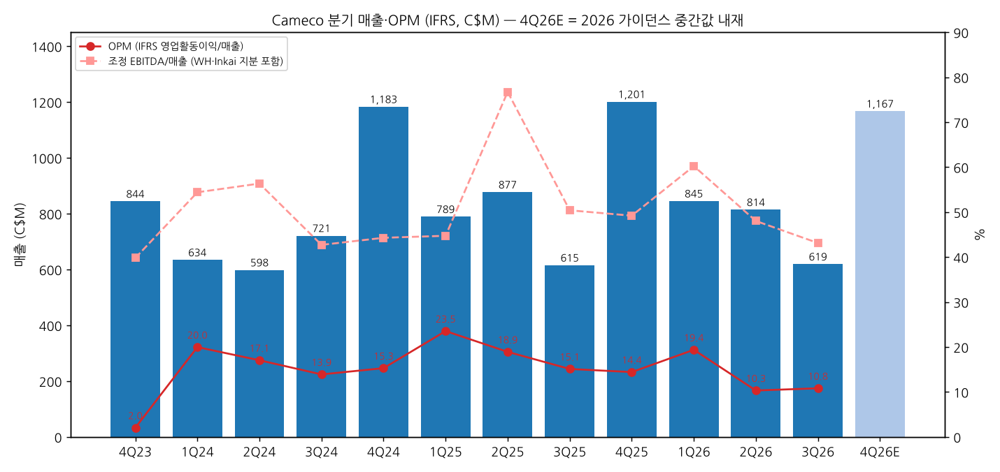
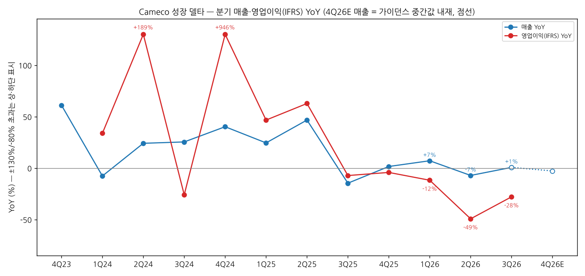
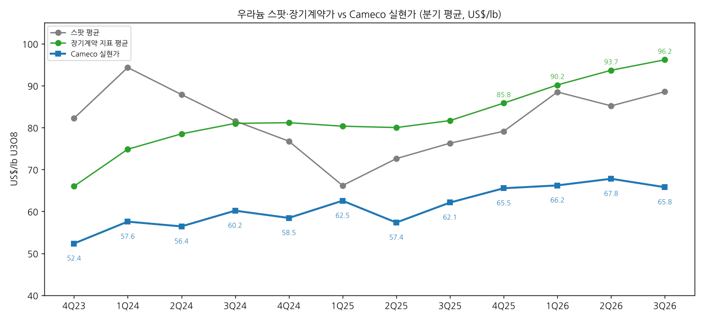
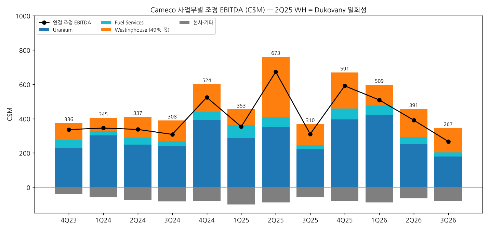

> 모드: 실적 리뷰 (v11)
> 종목: Cameco (CCJ)
> 섹터: 원전
> 서브섹터: 원전 연료 글로벌
> 분기: 2026-Q3 (12월 결산 — 캘린더 분기 = 회계 분기)
> 발표일: 2026-10-30 (목, 장 전 — MD&A·재무제표·컨퍼런스콜 08:00 ET 동시)
> 작성 시각: 2026-11-16 KST
> 분석 소스: 회사 자료 — 3Q26 MD&A·재무제표(cameco.com IR PDF, 2026-10-30), 3Q26 컨퍼런스콜 트랜스크립트(cameco.com, 2026-10-30 — 애널리스트 Q&A 5건: Goldman Sachs·Scotiabank·BofA·William Blair·Jefferies), 1Q\~2Q26·1Q\~3Q24 분기 MD&A, 2023\~2025 연간 MD&A(4Q = 연간 − 9M [계산]), 같은 폴더 `company-overview/CCJ_기업개요.md`(v1.0, 2026-11-15) 시계열 재사용. 주가 Yahoo Finance 일봉(11/13 종가까지). Westinghouse IPO 상태는 웹 검색(2026-11-16, 공개 S-1 보도 미확인). 셀사이드 리포트 첨부 없음, 공개 컨센서스 미확보. 직전 분기 CCJ 리뷰 없음 (첫 리뷰)
> 리뷰 깊이: 숫자 중심 | 리서치 첨부 0건 (1차 출처: 캐나다 회사 MD&A·FS — SEC 40-F/6-K와 동일 원문. 보도 인용은 "보도" 표기)
> 델타 판정 기준: 분기 영업이익(IFRS 영업활동이익, 보고치) YoY와 그 직전 분기 대비 변화만 사용 (v11 스킬 기준). TTM·조정 EBITDA는 참고 지표로 판정에 쓰지 않음
> 다음 발표: 4Q26·2027 가이던스 — 2027-02 중순 예상 [추정, 회사 미공지]

> **지표 정의**: 전 재무 수치는 **IFRS, 캐나다달러(C$) 백만**. 우라늄 가격·실현가는 US$/lb. "영업이익" = IFRS 연결손익계산서의 **영업활동이익(Earnings from operations)** — Westinghouse(49%)·JV Inkai(40%) 지분법이익은 이 아래에 있어 포함되지 않는다. 회사가 주 지표로 쓰는 **조정 EBITDA**(지분법 투자 몫 포함, non-IFRS)를 같이 적는다. Westinghouse 숫자는 Cameco 몫(49%, 비연결)

# Cameco 3Q26 실적 리뷰 — Key Lake 정비·판매 규율로 영업이익 YoY 5개 분기째 마이너스, 가격은 장기가 $96 신고점인데 실현가는 $66에 묶임

## 0. 한 줄 판정

> 성장 델타: 꺾임 | 내러티브: 유지 → 델타 꺾임 + 내러티브 유지 → 매매 제외(관찰) 구간 — 이익 재가속은 실현가가 장기가를 따라붙는 2027\~28년 이후, 단기 촉매는 Westinghouse IPO·장기계약 재개

→ **숫자**: 매출 C$619M(+0.7% YoY), 영업이익(IFRS) C$67M(−28.0%, OPM 10.8%). 분기 영업이익 YoY는 3Q25 −7.3%로 마이너스 전환한 뒤 4Q25 −4.3% → 1Q26 −11.8% → 2Q26 −49.3% → 3Q26 −28.0%로 **5개 분기 연속 마이너스**다. 직전 분기 대비 +21.4%p 좋아졌지만 여전히 역성장이라 판정은 "꺾임"이다 (참고: 조정 EBITDA C$267M, −13.9%)

→ **쟁점 ①**: 이익 감소는 Key Lake 정련소 장기 정비(생산 3.5M lb, −20%)와 생산 현금원가 C$40.73/lb(+62%)에서 나왔다. 회사는 "계획된 정비 + 인플레이션, 광산 품위 문제 아님"이라고 했고 연간 단위원가 가이던스를 C$63.0\~67.5 → **C$67\~70/lb**로 올렸다

→ **쟁점 ②**: 스팟 US$88.6·장기가 US$96.2(분기 평균, 12년 최고)인데 실현가는 US$65.78(−3% QoQ)이다. 시장연동 계약의 천장(ceiling) 때문이고, 회사 민감도표상 스팟 US$100이 유지돼도 실현가는 2027년 US$73, 2028년 US$80이다. 스팟 +US$5면 매출 +C$6M, 조정순이익 −C$7M로 **단기 가격 레버리지는 사실상 0**이다

→ **쟁점 ③**: 5년 평균 계약 물량은 연 2,800만 lb로 몇 분기째 그대로다(Scotiabank 질문). 회사는 신규 계약 조건을 "바닥 US$70 중후반·천장 US$160 근처·고정가 세 자릿수"로 공개하며 "물량을 쫓지 않는다"고 했다. 주가는 발표일 −7.9%, 11/13 US$70.73(10/29 대비 −15.3%, 고점 대비 −47.7%)

→ **다음 분기 관건**: 4Q26 가이던스 내재 매출 C$1,042\~1,292M(중간값 YoY −2.8%), Westinghouse 4Q 내재 조정 EBITDA는 4Q25 대비 감소 [계산]. 숫자 델타보다 **연말 유틸리티 RFP 결과(신규 장기계약 물량)와 Westinghouse 공개 S-1·한미 AP1000 선급금 US$100억 집행**이 내러티브를 다시 강하게 만들 수 있는 변수다

---

## 1. 숫자

① 연결 기준 분기 표 (단위: C$M, %)

| 항목 | 4Q23 | 1Q24 | 2Q24 | 3Q24 | 4Q24 | 1Q25 | 2Q25 | 3Q25 | 4Q25 | 1Q26 | 2Q26 | **3Q26** | 4Q26E (가이던스 내재) |
|---|---|---|---|---|---|---|---|---|---|---|---|---|---|
| 매출액 | 844 | 634 | 598 | 721 | 1,183 | 789 | 877 | 615 | 1,201 | 845 | 814 | **619** | 1,167 (1,042\~1,292) |
| 영업이익 (IFRS 영업활동이익) | 17 | 127 | 102 | 100 | 181 | 186 | 166 | 93 | 173 | 164 | 84 | **67** | — (미제시) |
| OPM | 2.0 | 20.0 | 17.1 | 13.9 | 15.3 | 23.5 | 18.9 | 15.1 | 14.4 | 19.4 | 10.3 | **10.8** | — |
| 매출 YoY | +61.1 | −7.7 | +24.1 | +25.4 | +40.2 | +24.4 | +46.7 | −14.7 | +1.5 | +7.1 | −7.2 | **+0.7** | −2.8 |
| 영업이익 YoY | — | +33.8 | +189.0 | −26.0 | +946 | +46.6 | +62.7 | −7.3 | −4.3 | −11.8 | −49.3 | **−28.0** | — |
| **매출 YoY 델타 (%p)** | — | −68.8 | +31.8 | +1.3 | +14.8 | −15.7 | +22.2 | −61.4 | +16.2 | +5.6 | −14.3 | **+7.8** | −3.5 |
| **영업이익 YoY 델타 (%p)** | — | — | +155.2 | −214.9 | n/m | n/m | +16.1 | −70.0 | +3.0 | −7.6 | −37.5 | **+21.4** | — |
| (참고) 조정 EBITDA (회사 주 지표, non-IFRS) | 336 | 345 | 337 | 308 | 524 | 353 | 673 | 310 | 591 | 509 | 391 | **267** | — |
| (참고) 조정 EBITDA YoY | — | +52.7 | +524 | +31.6 | +56.0 | +2.3 | +99.7 | +0.6 | +12.8 | +44.2 | −41.9 | **−13.9** | — |
| (참고) 조정 EBITDA (WH 제외) | 235 | 269 | 216 | 186 | 362 | 260 | 321 | 186 | 380 | 388 | 228 | **124** | — |
| (참고) 조정 EBITDA (WH 제외) YoY | — | — | — | — | +54.0 | −3.3 | +48.6 | 0.0 | +5.0 | +49.2 | −29.0 | **−33.3** | — |
| (참고) 조정순이익 (ANE) | 108 | 46 | 65 | 24 | 157 | 70 | 308 | 32 | 217 | 204 | 77 | **−2** | — |

→ (출처: 매출·영업이익 = 각 분기 재무제표 연결손익계산서(1Q\~3Q24·1Q\~3Q26 분기 FS의 당기·전년 동기), 4Q = 연간 FS − 9M [계산]. 조정 EBITDA = 각 분기 MD&A 조정 EBITDA 조정표(최신 공시치 사용 — 4Q23 336은 2024 연간 MD&A 4Q 표, 9M23 합산과 C$37M 차이는 산식 재작성 영향 [추정]). WH 제외 = 연결 조정 EBITDA − Westinghouse 몫 [계산]. 4Q26E = 2026 연결 매출 가이던스 C$3,320\~3,570M(10/30 유지) − 9M26 C$2,278M [계산])

→ 3Q26 서프라이즈: 셀사이드 컨센서스 미확보 — 판단 불가. 회사는 "대체로 우리 예상과 같았다"(CEO)고 했고, 발표일 주가는 −7.9%(US$83.49 → 76.91)

→ 분기 YoY는 인도 시점(고객이 분기를 고름)에 따라 크게 튄다 — 회사 MD&A도 "분기 실적은 연간의 좋은 지표가 아니다"라고 명시한다. 아래 TTM(최근 4개 분기 합) 표는 **참고용**이며 델타 판정에는 쓰지 않는다

| TTM — 참고 (C$M, %) | 3Q25 | 4Q25 | 1Q26 | 2Q26 | **3Q26** |
|---|---|---|---|---|---|
| 매출 | 3,464 | 3,482 | 3,538 | 3,475 | **3,479** |
| 매출 YoY | +23.8 | +11.0 | +7.5 | −2.7 | **+0.4** |
| 영업이익 | 626 | 618 | 596 | 514 | **488** |
| 영업이익 YoY | +80.7 | +21.2 | +4.7 | −18.8 | **−22.0** |
| 조정 EBITDA | 1,860 | 1,927 | 2,083 | 1,801 | **1,758** |
| 조정 EBITDA YoY | +40.3 | +27.3 | +36.9 | −3.1 | **−5.5** |

→ (출처: 위 분기 표 합산 [계산])

→ YoY 경로: TTM 영업이익 YoY의 정점은 2025년 상반기(+80%대)였고, 4Q25 이후 3개 분기 연속 내려와 3Q26 −22.0%다. 3Q26 분기 YoY가 −49.3% → −28.0%로 21.4%p 좋아진 것은 2Q25 기저(Dukovany 일회성은 지분법이라 영업이익엔 없음, 2Q25 우라늄 판매 8.7M lb 집중)가 빠진 효과다. 4Q26 매출 가이던스 중간값이 −2.8%이므로 **연간 매출은 FY25 C$3,482M 대비 −1% 수준, 연간 영업이익은 9M −29%(C$315M vs C$445M)에서 4Q가 크게 반등하지 않는 한 감소**로 끝난다 [계산·판단]

→ **[판단] 델타 = 꺾임** (판정 근거는 분기 영업이익 YoY만): 영업이익 YoY가 3Q25에 마이너스로 전환한 뒤 5개 분기째 마이너스(−49.3% → −28.0%)다. +21.4%p 개선은 2Q25 고기저(우라늄 판매 8.7M lb 집중)가 빠진 효과이고 성장률 자체는 여전히 역성장이다. 4Q26도 매출 가이던스 중간값이 −2.8%라 플러스 복귀 근거가 없다. 참고로 조정 EBITDA YoY(−41.9% → −13.9%)와 TTM 영업이익 YoY(−18.8% → −22.0%)는 판정에 쓰지 않았다

→ (출처: 분기 FS·MD&A, 4Q26E는 10/30 매출 가이던스 중간값 내재 [계산]. 연한 막대 = 4Q26E)

→ (출처: 분기 FS·MD&A [계산]. 차트는 판정 기준인 분기 영업이익(IFRS) YoY와 매출 YoY만 표시. 4Q24 영업이익 YoY +946%는 4Q23 저기저(C$17M) 때문, 상단에 고정 표시)

② 사업부별 매출·이익 (단위: C$M, %)

(1) 사업부 분기 표 — Uranium / Fuel Services / Westinghouse(49% 몫, 비연결)

| 사업부 | 항목 | 4Q24 | 1Q25 | 2Q25 | 3Q25 | 4Q25 | 1Q26 | 2Q26 | **3Q26** |
|---|---|---|---|---|---|---|---|---|---|
| Uranium | 매출 | 1,035 | 619 | 705 | 523 | 1,027 | 712 | 659 | **518** |
| | 매출 YoY | +47.6 | +10.3 | +46.6 | −12.8 | −0.8 | +15.0 | −6.5 | **−1.0** |
| | 매출총이익 | 213 | 203 | 217 | 158 | 225 | 259 | 158 | **111** |
| | GPM | 20.6 | 32.8 | 30.8 | 30.2 | 21.9 | 36.4 | 24.0 | **21.4** |
| | 조정 EBITDA (Inkai 몫 포함) | 391 | 286 | 352 | 220 | 396 | 423 | 252 | **179** |
| | 조정 EBITDA YoY | +69.3 | −5.6 | +41.9 | −8.3 | +1.3 | +47.9 | −28.4 | **−18.6** |
| Fuel Services | 매출 | 148 | 135 | 162 | 91 | 174 | 134 | 152 | **95** |
| | 매출 YoY | +9.6 | +87.5 | +37.3 | −24.2 | +17.6 | −0.7 | −6.2 | **+4.4** |
| | 조정 EBITDA | 49 | 75 | 57 | 25 | 63 | 54 | 42 | **24** |
| | 조정 EBITDA 마진 | 33.1 | 55.6 | 35.2 | 27.5 | 36.2 | 40.3 | 27.6 | **25.3** |
| | 조정 EBITDA YoY | +14.0 | +200 | +35.7 | −10.7 | +28.6 | −28.0 | −26.3 | **−4.0** |
| Westinghouse (49%) | 매출 | 841 | 770 | 1,033 | 697 | 958 | 868 | 863 | **895** |
| | 매출 YoY | n/m | +17.4 | +54.2 | −4.0 | +13.9 | +12.7 | −16.5 | **+28.4** |
| | 조정 EBITDA | 162 | 93 | 352 | 124 | 211 | 121 | 163 | **143** |
| | 조정 EBITDA 마진 | 19.3 | 12.1 | 34.1 | 17.8 | 22.0 | 13.9 | 18.9 | **16.0** |
| | 조정 EBITDA YoY | n/m | +22.4 | +190.9 | +1.6 | +30.2 | +30.1 | −53.7 | **+15.3** |
| | 순이익 (Cameco 몫) | — | — | — | −32 | — | — | — | **−24** |
| 본사·기타 | 조정 EBITDA | −78 | −101 | −88 | −59 | −79 | −89 | −66 | **−79** |

→ (출처: 각 분기 MD&A 사업부 표·조정 EBITDA 조정표, 4Q = 연간 − 9M [계산], 기업개요 사업부 분기 시계열. 사업부 IFRS 영업이익은 공시하지 않음 — 사업부 세전이익만 공시: 3Q26 Uranium C$175M(3Q25 C$172M), Fuel Services C$13M(C$17M). 4Q24 WH YoY는 4Q23이 인수 후 2개월분이라 n/m)

(2) 우라늄 KPI — 가격·물량·원가 분해

| 항목 | 3Q25 | 4Q25 | 1Q26 | 2Q26 | **3Q26** | YoY | 9M26 | 9M YoY |
|---|---|---|---|---|---|---|---|---|
| 생산 (자기지분, M lb) | 4.4 | 6.0 | 6.2 | 3.9 | **3.5** | −20% | 13.6 | −9% |
| 판매 (M lb) | 6.1 | 11.2 | 7.8 | 7.1 | **5.6** | −8% | 20.5 | −6% |
| 스팟 평균 (US$/lb) | 76.28 | 79.12 | 88.49 | 85.18 | **88.56** | +16% | 87.41 | +22% |
| 장기계약 지표 평균 (US$/lb) | 81.67 | 85.83 | 90.17 | 93.67 | **96.17** | +18% | 93.33 | +16% |
| 실현가 (US$/lb) | 62.12 | 65.53 | 66.21 | 67.79 | **65.78** | +6% | 66.64 | +10% |
| 실현가 (C$/lb) | 85.22 | — | — | — | **91.76** | +8% | 92.05 | +9% |
| 실현가 / 장기가 | 76% | 76% | 73% | 72% | **68%** | −8%p | 71% | — |
| 단위 매출원가 (C$/lb, D&A 포함) | 59.54 | — | — | — | **72.17** | +21% | 66.36 | +14% |
| 생산 현금원가 (C$/lb) | 25.20 | — | — | — | **40.73** | +62% | 29.70 | +22% |
| 생산 비현금원가 (C$/lb) | 11.16 | — | — | — | **16.67** | +49% | 12.47 | +14% |

→ (출처: 3Q26 MD&A Uranium 표·원가 표, 기업개요 분기 시계열. 실현가/장기가 [계산]. 4Q25\~2Q26 C$ 단가는 이번 리뷰에서 미수집)

→ (출처: 분기 MD&A 우라늄 표 — 스팟·장기가는 UxC·TradeTech 평균, 실현가는 Cameco)

→ 3Q 매출총이익 −C$47M의 분해(MD&A): 판매량 −8%(인도 시점 + 2026 판매 계획 자체를 낮춘 "계약 규율") + 단위원가 +21%(Key Lake 정비로 생산 고정비 흡수 저하 + 구매 단가 C$83.78/lb) vs 실현가 +8%(C$). 즉 **가격은 올랐는데 물량과 원가가 이익을 깎았다**

(3) [판단] 어느 사업부가 델타를 끌고 어디가 꺾이나

→ **Uranium(이익의 과반)이 꺾임의 진원지**: 조정 EBITDA YoY +47.9%(1Q26) → −28.4% → −18.6%. 1Q26 반짝은 판매 7.8M lb 집중 효과였고, 2Q\~3Q는 판매량 감소·원가 상승이 겹쳤다. 9M 기준으로는 C$855M(−1%)로 "횡보"가 정확하다

→ **Fuel Services는 둔화**: 9M 조정 EBITDA C$120M(−24%), 마진 41% → 31%. 회사 설명은 "제품 믹스 + 강한 C$ + 투입원가". 변환(UF6) 계약가는 역사적 고점권이지만 연초 생산 차질(9M 생산 −7%)이 컸다

→ **Westinghouse만 3Q 플러스**: 조정 EBITDA C$143M(+15%) — 연료 물량 증가(Operating Plants)가 AP1000 프로젝트 물량 감소·성장용 간접비 증가를 상쇄. 9M은 Dukovany 기저로 −25%. 순이익은 PPA 상각(D&A C$99M)·이자(C$46M) 때문에 여전히 적자(−C$24M)

→ (출처: 분기 MD&A 조정 EBITDA 조정표 [계산 — 본사·기타 = 연결 − 3개 사업부])

③ 연간 (단위: C$M, %)

| 항목 | FY2022 | FY2023 | FY2024 | FY2025 | 9M26 | FY2026E (가이던스) | FY2027E |
|---|---|---|---|---|---|---|---|
| 매출액 | 1,868 | 2,588 | 3,136 | 3,482 | 2,278 | 3,320\~3,570 (중간 3,445) | — |
| 영업이익 (IFRS) | 15 | 283 | 510 | 618 | 315 | — | — |
| OPM | 0.8 | 10.9 | 16.3 | 17.7 | 13.8 | — | — |
| 매출 YoY | +26.6 | +38.5 | +21.2 | +11.0 | −0.1 | −1.1 (중간값) | — |
| 영업이익 YoY | n/m | +1,780 | +80.3 | +21.2 | −29.2 | — | — |
| 조정 EBITDA | — | 884 | 1,531 | 1,929 | 1,166 | — (WH 몫만 US$370\~430M) | — |
| 조정 EBITDA YoY | — | — | +73.2 | +26.0 | −12.9 | — | — |

→ (출처: XBRL companyfacts·연간 MD&A(기업개요 ④(1)), 9M26 = 3Q26 FS. 9M YoY = 9M25 대비(매출 C$2,281M, 영업이익 C$445M, 조정 EBITDA C$1,338M). FY27 컨센서스 미확보)

→ 발표 전 → 발표 후 연간 컨센 변화: 셀사이드 집계 미확보. 회사 가이던스 변화로 대신한다 (아래 ④)

→ 연간 흐름: 매출 YoY +38.5%(FY23) → +21.2% → +11.0% → FY26 −1% 내외로 **3년 연속 둔화 후 역성장 진입**, 영업이익 YoY도 +80% → +21% → FY26 마이너스 [계산·판단]

④ 가이던스 변화 (2026 연간, 이전 → 이번)

| 항목 | 1Q26 (5월) | 2Q26 (7/31) | **3Q26 (10/30)** | 방향 |
|---|---|---|---|---|
| 연결 매출 (C$M) | 3,130\~3,370 | 3,320\~3,570 | **3,320\~3,570** | 유지 |
| Uranium 매출 (C$M) | 2,540\~2,730 | 2,700\~2,910 | **2,700\~2,910** | 유지 |
| Fuel Services 매출 (C$M) | 590\~630 | 610\~650 | **610\~650** | 유지 |
| 우라늄 평균 실현가 (C$/lb) | 85\~89 | 91\~96 | **91\~96** | 유지 |
| 우라늄 단위 매출원가 (C$/lb) | 61.50\~65.00 | 63.00\~67.50 | **67.00\~70.00** | 상향(악화) |
| 생산 (자기지분, M lb) | 19.5\~21.5 | 19.5\~21.5 | **19.5\~20.5** | 상단 하향 |
| 판매 (M lb) | 29\~32 | 29\~32 | **29.5\~30.5** | 범위 축소 |
| 본사 관리비 (C$M) | 245\~260 | — | **260\~280** | 상향 |
| CapEx (C$M) | — | 490\~540 | **440\~490** | 하향(이연) |
| Westinghouse 조정 EBITDA (Cameco 몫, US$M) | 370\~430 | 370\~430 | **370\~430** | 유지 |

→ (출처: 1Q26·2Q26·3Q26 MD&A Outlook 표. "—"는 이번 리뷰에서 원문 미대조. 가정: 스팟 US$89.50, 장기가 US$96.00, USD/CAD 1.35 — 9/30 기준)

→ 4Q26 내재치 [계산]: 우라늄 판매 9.0\~10.0M lb(4Q25 11.2M lb) — 4Q 물량이 전년보다 적다. 단위원가 가이던스 중간값(C$68.5)을 맞추려면 4Q 단위원가는 약 C$73/lb. Westinghouse는 9M C$427M ≈ US$312M(USD/CAD 1.37 가정)이므로 4Q 내재 US$58\~118M ≈ **C$80\~162M — 4Q25 C$211M 대비 −23\~−62%**

→ 계약 북: 2026\~2030년 연평균 약 2,800만 lb 인도 확정(2026\~28년은 평균 이상, 2029\~30년은 이하) — 2Q26과 같은 문구. 장기계약 잔량(FY25말 약 2.3억 lb, 39개 고객)은 분기 업데이트 없음

---

## 2. 시장 쟁점 — 회사 자료·컨콜 Q&A 종합

> 범위: 셀사이드 리포트 첨부 없음. 컨콜 애널리스트 질문 5건(Goldman Sachs Brian Lee, Scotiabank Orest Wowkodaw, Bank of America Lawson Winder, William Blair Mark Shooter, Jefferies Lawrence Alexander — 회사 공식 트랜스크립트) + 3Q26 MD&A로 구성. 해석 편차 표·TP 표는 숫자 중심 리뷰 기준으로 생략

① 지난 분기 체크 (2-0)

→ 첫 리뷰 — 직전 체크 없음 (다음 분기부터 4번 목록으로 체크)

② 이번 분기 쟁점 4개

| # | 쟁점 | 질문한 곳 |
|---|---|---|
| (1) | 이익 감소는 일회성인가 — Key Lake 정비 vs 구조적 원가 상승 | Goldman Sachs |
| (2) | 장기가 US$96인데 왜 실현가는 US$66인가 — 가격 레버리지는 언제 오나 | (MD&A 민감도표) + William Blair·BofA(공급 유인 가격) |
| (3) | 계약 북 2,800만 lb 정체 — 규율인가, 수요 부재인가 | Scotiabank·William Blair |
| (4) | Westinghouse — IPO, 한미 US$1,200억 프레임워크, AP1000 장납기 기자재 | Goldman Sachs·BofA |

③ 쟁점별 분해

(1) **이익 감소는 일회성인가 — Key Lake 정비 vs 구조적 원가 상승**

(1-1) 숫자

→ 3Q 생산 3.5M lb(−20%) 중 McArthur River/Key Lake 1.1M lb(−50%), Cigar Lake 2.4M lb(+9%, 지분 57.418%로 상승 반영). McArthur/Key Lake 연간 계획을 10.0\~11.5 → **10.0\~10.5M lb**로 낮췄다

→ 생산 현금원가 C$40.73/lb(+62%), 9M 누적은 C$29.70(+22%). 단위 매출원가 9M C$66.36(+14%) — 연간 가이던스 C$67\~70으로 4Q에도 높은 원가가 이어진다

(1-2) 회사 설명

→ "*No, I don't think we're seeing anything really different, not in the grade category. I think inflation certainly is a factor that everybody's dealing with.*" (CEO Tim Gitzel)

→ "아니다, 품위 쪽에서 뭔가 달라진 건 없다. **인플레이션은 분명히 모두가 겪는 요인**이다." / CFO Heidi Shockey: "생산 감소는 Key Lake 정련소 현대화를 위한 **계획 정비** 때문이고, 광산 쪽 문제는 아니다"

→ 시사점: 원가 상승의 큰 몫은 **정비 기간 고정비 흡수 저하(일시)** → 다만 인플레이션·시약(황산 등, 중동 해운 차질) 상승은 **구조적** → 2026 단위원가 가이던스가 연중 두 번 올라간(61.5\~65 → 67\~70) 점이 "일시"만은 아니라는 증거

(1-3) [판단]

→ Key Lake 정비가 끝나는 2027년 생산 정상화(McArthur 연 18M lb 계획, 100% 기준)면 단위원가는 내려온다. 하지만 정비가 "인프라 교체 + 시운전 중"이라 4Q 생산이 계획 하단(19.5M lb)에 걸릴 위험이 남는다. 결론이 바뀌는 조건: 4Q26 생산이 19.5M lb에 못 미치거나 2027 단위원가 가이던스가 C$65/lb 위에서 나오면 "구조적 원가 상승"으로 본다

(2) **장기가 US$96인데 왜 실현가는 US$66인가 — 가격 레버리지는 언제 오나**

(2-1) 숫자

→ 실현가/장기가 비율 76%(3Q25) → **68%(3Q26)**, 괴리가 커지는 중. 9M 스팟은 +22%인데 US$ 실현가는 +10% — MD&A: "시장연동 계약의 **천장 가격(ceiling)**이 실현가를 제한했다"

→ 민감도(2026 잔여): 스팟 +US$5 → 매출 +C$6M, 조정순이익 **−C$7M**, 현금흐름 −C$17M. 천장에 걸린 판매보다 구매(Inkai·시장 구매) 쪽이 가격에 더 민감해서 생기는 역설이다

→ 실현가 민감도표 (회사, 2026-09-30 계약 포트폴리오 기준, US$/lb)

| 스팟 가정 | $60 | $80 | $100 | $120 | $140 |
|---|---|---|---|---|---|
| 2026 | 65 | 67 | 68 | 68 | 69 |
| 2027 | 58 | 68 | **73** | 74 | 76 |
| 2028 | 60 | 72 | **80** | 83 | 87 |
| 2029 | 62 | 75 | **85** | 90 | 94 |
| 2030 | 63 | 76 | **88** | 94 | 99 |
| (참고) 2Q26 표 2028 | 60 | 72 | 80 | 84 | 89 |

→ (출처: 3Q26 MD&A p.23·2Q26 MD&A. 고가 시나리오의 후년도 값이 2Q 대비 소폭 낮아진 것은 회사 설명상 "한 계약의 산식 정정")

(2-2) 회사 설명 (BofA 질문 — US$90\~100 우라늄으로 신규 공급이 가능한가)

→ "*I think our actions speak really loudly that we believe the incentive or production economic price of uranium needs to move higher.*" (President·COO Grant Isaac)

→ "우리 행동이 말해준다 — **유인 가격(신규 광산이 생기는 가격)은 더 올라야 한다**고 본다." McArthur/Key를 면허 용량으로 돌리지 않고, Inkai 증산(+20%)도 미정, Rabbit Lake·미국 광산은 가동중단 유지

→ 시사점: 회사는 **현재 US$90\~100도 신규 공급을 부르기엔 낮다**고 봄 → 그래서 저가 고정 물량을 늘리지 않음 → 대가는 **2026\~27년 실현가 정체(US$66\~73)** → 장기가가 오르면 2028년 이후 실현가 US$80+가 열린다

(2-3) [판단]

→ 모멘텀 관점에서 이 구조는 불리하다: 우라늄 가격이 오르는 구간에서도 Cameco의 분기 이익은 따라 오르지 않는다(실현가 레버리지는 1\~3년 후행). **주가는 가격(장기가·스팟)에 반응하고, 이익 델타는 늦게 온다** — 즉 실적 델타로 매매하는 프레임에서는 2027년 하반기 이전 Cameco 숫자로 확인할 수 있는 가속 신호가 적다

(3) **계약 북 2,800만 lb 정체 — 규율인가, 수요 부재인가**

(3-1) 숫자

→ 5년 평균 확정 인도량 "연 2,800만 lb 이상" 문구가 몇 분기째 그대로 (Scotiabank: "five-year book at 28-million-pound average, kind of stayed unchanged for a couple quarters")

→ 업계 장기계약(UxC): 9M26 약 4,200만 lb(9M25 약 4,500만 lb, −7%). 3Q 스팟 거래량 약 900만 lb(3Q25 1,500만 lb). 회사 MD&A: "연말 전 응답 기한인 유틸리티 RFP 여러 건, 장외 직접 장기 협상 관심 증가"

(3-2) 회사 설명

→ "*What we're seeing are floors in the mid- to high 70s escalated. We're seeing ceilings touching $160 escalated, and for the base-escalated portion… we are at three-digit uranium prices.*" (Grant Isaac)

→ "**바닥 US$70 중후반(물가연동), 천장은 US$160 근처, 고정가 부분은 세 자릿수 가격**까지 보고 있다. … 이 시장에 물량을 쫓지 않는다. 시장에서 가치를 요구한다. 그게 판매 숫자에 반영돼 있다"

→ 시사점: 2,800만 lb 정체는 회사가 **조건을 거절한 결과**라는 설명 → 업계 장기계약이 2012년 이후 **교체 수요 아래(below replacement rate)**에 머물러 "유틸리티 재고가 줄고 있다"는 논리 → 단, 업계 계약 물량이 9M −7%라 "수요가 이미 돌아섰다"는 증거는 아직 숫자로 없음

(3-3) [판단]

→ 신규 계약 조건(바닥 US$70 중후반·천장 US$160)이 실현가 표의 2028\~30년 값을 끌어올리는 경로다. 결론이 바뀌는 조건: 4Q26 MD&A에서 5년 평균 물량이 2,800만 → 3,000만 lb 이상으로 바뀌거나 업계 연간 장기계약이 1.2억 lb(회사가 말한 최근 고점)를 넘으면 "규율의 보상"이 숫자로 확인된다. 반대로 RFP 결과가 저조하면 2027 판매 가이던스(2026년 29.5\~30.5M lb)가 더 낮아진다

(4) **Westinghouse — IPO, 한미 US$1,200억 프레임워크, AP1000 장납기 기자재**

(4-1) 숫자·사실

→ 3Q 조정 EBITDA C$143M(+15%), 2026 WH 가이던스 US$370\~430M 유지, 4Q 내재치는 전년 대비 감소 [계산, ① ④]. 백로그(100%, 2025-12-31): Operating Plants US$13.2B, New Plants US$0.8B — 분기 업데이트 없음

→ AP1000 파이프라인 최대 91기(105GWe) 유지: DOE 공급망 대출 최대 10기(조건부 US$175억, 2026-06), DOC 파트너십 최대 10기, LLI/EPC 5기(미국 Fairfield SC 재착공 2·폴란드 3), ESC 4기(불가리아 2·우크라이나 2), FEED 12기(슬로바키아 Bohunice 신규 — 미 국무부 자금, 2026-10), Origination 50기

→ 2026-10 폴란드 PEJ, 1호기 장납기 기자재 조달 착수 승인(원자로 격납용기 등 핵심 6품목), 폴란드 공급사 4곳 조건부 발주. 1호기 상업운전 목표 2036년

→ **한미 비구속 프레임워크(2026-09)**: 한국이 최대 US$1,200억(공사비 1,000억 + 예비비 200억) → 미국 내 대형 원전 최대 8기 = **AP1000 6기 + APR1400 2기**. APR1400에서도 Westinghouse 범위 **1기당 약 US$20억**. 2026년 말까지 선급금 **US$100억** 이전 예상, 그중 **약 US$75억이 AP1000 장납기 기자재용** (3Q26 MD&A)

→ IPO: 2026-07-31 S-1 초안 비공개 제출 이후 **공개 S-1·공모가·상장일 미확인** (2026-11-16 웹 검색 기준). 보도상 목표 기업가치 US$500억 초과(Bloomberg 2026-09-18, 보도) — Cameco 49% 단순 환산 US$245억+ vs Cameco 시총 US$308억(11/13) [계산, 기업개요]

(4-2) 회사 설명

(1) **IPO — 말할 수 없는 단계**

→ "*Last quarter, we acknowledged the S-1 draft registration statement that Westinghouse filed. Under securities rules, we are limited on what we can say about that process.*" (CEO)

→ "지난 분기 Westinghouse의 **S-1 초안 제출**을 확인했다. 증권 규정상 그 과정에 대해 말할 수 있는 범위가 **제한된다**"

→ 시사점: 3Q 콜에서 일정·지분 매각 여부 언급 **없음** → "모든 시나리오를 고려하되 전략적 파트너 역할 유지" 문구 → 구주 매출(Cameco 지분 일부 매각) 가능성은 열려 있으나 확인 불가 [판단]

(2) **한국 — 경쟁자에서 실행 파트너로**

→ "*Korean engineering, construction and manufacturing capability can complement Westinghouse AP1000 technology and improve execution.*" (CEO) / "*the IP settlement between Westinghouse and the Koreans… highlights just how powerful Westinghouse technology with Korean capabilities actually is.*" (Grant Isaac)

→ "**한국의 엔지니어링·건설·제조 역량이 AP1000 기술을 보완해 실행력을 높일 수 있다**" / "수년 전 Westinghouse와 한국의 IP 합의는 **Westinghouse 기술 + 한국 역량**의 결합이 얼마나 강력한지 보여준다"

→ 시사점: 회사 공식 화법이 **'한국 = 협력·실행 파트너'**로 고정 → 미국 시장은 규제 유틸리티 국가와 달리 "원자로 공급사·시공사·공급망·유틸리티 간 조율"이 병목(Isaac) → 한국 자금 + 한국 제조로 그 병목을 푸는 구조

(3) **장납기 기자재 — FID 전에 주문**

→ "*Things like the reactor pressure vessel, the steam generators, the reactor coolant pumps, the instrumentation and control modules, the structural module plates and the steel work required would be some of the big long-lead items… the magic of the DOE program is to find a structure that allows for those long-lead items to be ordered pre-FID.*" (Grant Isaac, BofA 질문)

→ "원자로용기, **증기발생기**, 원자로냉각재펌프, 계측제어 모듈, 구조 모듈 판재·철골 등이 대형 장납기 품목이다… DOE 프로그램의 핵심은 이 품목을 **최종투자결정(FID) 전에 주문**할 수 있게 한 구조다. 공급망 기간을 2\~4년에서 1\~3년으로 줄인다"

→ 시사점: 장납기 기자재 발주는 **FID와 분리**돼 먼저 나온다 → 한미 선급금 US$75억(AP1000 LLI용)이 연말까지 집행되면 첫 발주 → **두산에너빌리티(원자로용기·증기발생기)의 AP1000 첫 계약** 트리거 (아래 (4-3))

(4-3) [판단] 한국 원전 read-across

→ **두산에너빌리티 — AP1000 주기기 경쟁**: 두산은 미국 Vogtle 3·4호기와 중국 AP1000의 원자로용기·증기발생기 공급 이력이 있다 [일반 사실]. 경쟁자는 BWXT(캐나다 Cambridge 대형부품)·IHI다. BWXT는 3Q26 콜에서 "AP1000 기자재는 두산·IHI와 경쟁하고 배분은 Westinghouse가 결정"이라고 했고 미국 첫 신규원전 기자재 발주 시점을 2026년 말\~2027년 상반기로 늦췄다 (같은 폴더 `2026-Q3_두산에너빌리티_리뷰.md`). 한미 프레임워크 6기는 한국 자금이 들어가는 만큼 두산 몫이 클 가능성이 높고, DOE 10기는 BWXT·IHI와 나눌 가능성이 있다

→ **한미 원전 협력 프레임 — APR1400 2기의 의미**: APR1400 2기에서도 Westinghouse 몫이 1기당 약 US$20억이라는 점은 **2025-01 IP 합의 구조(한국 수출 원전 1기당 물품·용역 약 US$6.5억 + 기술료 약 US$1.75억, 한국 보도 기준·미확정)보다 큰 범위**다. 한국형 원전이 미국에 들어가도 Westinghouse 지분 이익이 크다 → Cameco 입장에서는 한국 원전 확대가 경쟁 위협이 아니라 **수익원**이다 [판단]

→ **한전·한수원·한전기술·현대건설**: 미국 APR1400 2기는 한국 기업의 직접 수혜, AP1000 6기는 한국이 자금·시공·기자재를 대고 기술·설계는 Westinghouse — 한국 원전 수출 숫자의 "미국 경로"가 Westinghouse 일정에 묶인다

→ 결론이 바뀌는 조건: 한미 프레임워크의 확정 계약(definitive agreement)과 선급금 US$100억 이전이 2026년 말을 넘기면 두산·Westinghouse 모두 2027년 상반기 이후로 밀린다. Westinghouse가 공개 S-1을 내면 한국 관련 공급 범위·백로그가 처음으로 상세 공시될 수 있다

④ 주가 반응 (보조)

| 시점 | CCJ (NYSE, US$) | 변화 |
|---|---|---|
| 2026-01-29 장중 사상 최고 | 135.24 | — |
| 2026-10-29 (발표 전일) | 83.49 | — |
| 2026-10-30 (발표일) | 76.91 | **−7.9%** |
| 2026-11-05 (저점) | 68.33 | −18.2% (vs 10/29) |
| 2026-11-13 | 70.73 | −15.3% (vs 10/29), −47.7% (vs 사상 최고) |

→ (출처: Yahoo Finance 일봉 [계산]. 공개 집계 컨센 'Buy' 21명·평균 TP US$123.99는 StockAnalysis 10/30 캐시 — 기업개요 인용, 보도·집계 기준)

→ CEO가 서두에서 "원전 관련 주식이 AI·데이터센터 기대를 재평가하며 크게 움직였다… **테마 주식의 변동성을 원전 펀더멘털 변화와 혼동하면 안 된다**"고 따로 언급했다. 주가 하락이 실적보다 원전 테마 전체의 디레이팅(조정)과 함께 움직였다는 회사 인식이다 [판단: 같은 기간 두산에너빌리티 고점 대비 −65% 등 섹터 공통]

---

## 3. 내러티브 점검

① 성장 스토리 정의

→ "서방 1위 상장 우라늄 생산사가 **장기계약가 상승을 1\~3년 후행해 실현가로 흡수**하고, **Westinghouse 49%**를 통해 AP1000 신규 원전 사이클(미국·유럽·한국 자금)에 참여한다." 시장은 우라늄 가격 레짐 + Westinghouse 옵션(IPO 시가)을 산다

② 이번 분기가 스토리에 준 영향

→ **강화된 부분**: 장기계약 지표 US$96.17(12년 최고), 신규 계약 조건(바닥 US$70 중후반·천장 US$160·고정가 세 자릿수), 한미 US$1,200억 프레임워크·DOE 조건부 US$175억·폴란드 장납기 착수로 **AP1000 파이프라인이 '종이'에서 '발주 직전'으로 이동**

→ **약해진 부분**: 숫자 — 영업이익 YoY 5개 분기 연속 마이너스, 단위원가 가이던스 연중 2회 상향, 생산 상단 하향, 계약 북 2,800만 lb 정체, 실현가/장기가 68%로 괴리 확대. Westinghouse IPO는 비공개 제출 후 3개월째 공개 진행 없음

③ 국면 판단

→ 성장 델타 **꺾임** + 내러티브 **유지**(가격·파이프라인 강화와 숫자·IPO 지연이 상쇄) → **매매 제외(관찰) 구간**. 이익 델타가 다시 플러스로 돌 근거는 2027년 Key Lake 정상화(원가)와 2028년 이후 실현가 상승(계약)으로 시차가 길다. 단기 주가 촉매는 숫자가 아니라 이벤트(WH 공개 S-1, 대형 장기계약 공시, 한미 확정 계약)다 [판단]

④ 트리거와 리스크

→ 트리거 ①: Westinghouse **공개 S-1 제출·상장** — 지분 시가 형성(보도 US$500억 기준 Cameco 몫이 시총의 약 80%) + Cameco 구주 매출 시 현금화

→ 트리거 ②: 4Q26 MD&A에서 **5년 평균 계약 물량 2,800만 → 3,000만 lb+ 상향**, 또는 연말 RFP 대형 계약 공시

→ 트리거 ③: 한미 프레임워크 **확정 계약 + 선급금 US$100억 이전** → AP1000 장납기 첫 발주 → WH New Plants 백로그 증가

→ 리스크 ①: 2027 가이던스에서 판매량 30M lb 미만 또는 단위원가 C$65/lb 이상 → 이익 델타 꺾임이 2027년까지 연장

→ 리스크 ②: Westinghouse IPO 연기·밸류 하향, 미 정부 참여권(현금배분 US$175억 초과분의 20%) 희석 부각

→ 리스크 ③: 러시아산 우라늄·농축 재유입 논의(회사도 "변환 시장의 가장 큰 위협"으로 지목), Port Hope 변환 면허 갱신(2027-02 만료, 4Q26 청문회)

---

## 4. 향후 봐야 할 것

(1) **2027 가이던스 — 판매량·단위원가·실현가 (델타 판정 1순위)**

→ 무엇을: 2027 판매 30M lb 이상 유지 여부, 단위 매출원가 C$65/lb 이하로 하락(Key Lake 정상화), 실현가 가이던스가 민감도표 2027년 값(US$68\~73) 위로 나오는지. 생산 McArthur/Key 정상화(연 18M lb, 100% 기준)

→ 어떤 데이터로: 4Q26 MD&A Outlook 표, 2026 연간 MD&A 실현가 민감도표

→ 언제: 2027-02 중순 [추정]

(2) **장기계약 물량 — 5년 평균 2,800만 lb 돌파 여부**

→ 무엇을: 5년 평균 인도 확정량 3,000만 lb 이상 상향, 장기계약 잔량(FY25말 약 2.3억 lb) 증가, 업계 연간 장기계약 1.0\~1.2억 lb 이상(교체 수요 수준 접근)

→ 어떤 데이터로: 4Q26 MD&A·연간 MD&A, UxC·TradeTech 월간 장기계약 물량, 키워드 "utility RFP uranium", "long-term contracting replacement rate"

→ 언제: 연말 RFP 응답(2026-12) → 2027-02 공시

(3) **Westinghouse IPO — 공개 S-1·공모 구조·Cameco 지분 매각 여부**

→ 무엇을: 공개 S-1 제출 시점, 기업가치(보도 US$500억 초과 목표), 구주 매출 여부와 Cameco 지분율 변화, S-1 내 백로그·AP1000 수주 상세

→ 어떤 데이터로: SEC EDGAR(Westinghouse Electric 공개 S-1), Cameco 보도자료, 키워드 "Westinghouse public S-1", "Westinghouse IPO pricing"

→ 언제: 미정 — 4Q26\~1H27 [추정]

(4) **한미 프레임워크·AP1000 장납기 첫 발주 — 선급금 US$100억 집행**

→ 무엇을: 한미 확정 계약 체결, 2026년 말까지 선급금 US$100억(AP1000 LLI 약 US$75억) 이전, DOE 공급망 대출 첫 SPV 확정, 장납기 공급사 배분(두산 vs BWXT·IHI)

→ 어떤 데이터로: 미 상무부·DOE 발표, Westinghouse 보도자료, 두산에너빌리티 수주 공시, 키워드 "AP1000 long-lead order", "Westinghouse Doosan reactor vessel"

→ 언제: 2026-12 \~ 1H27

(5) **Westinghouse 4Q 조정 EBITDA와 2027 WH 가이던스**

→ 무엇을: 4Q26 WH 몫 조정 EBITDA가 내재 범위(C$80\~162M) 상단을 넘는지, 2027 WH 가이던스(2026년 US$370\~430M 대비) 성장률, New Plants 백로그 US$0.8B(FY25말)의 증가

→ 어떤 데이터로: 4Q26 MD&A Westinghouse 표·사업 프레임워크

→ 언제: 2027-02 중순 [추정]
