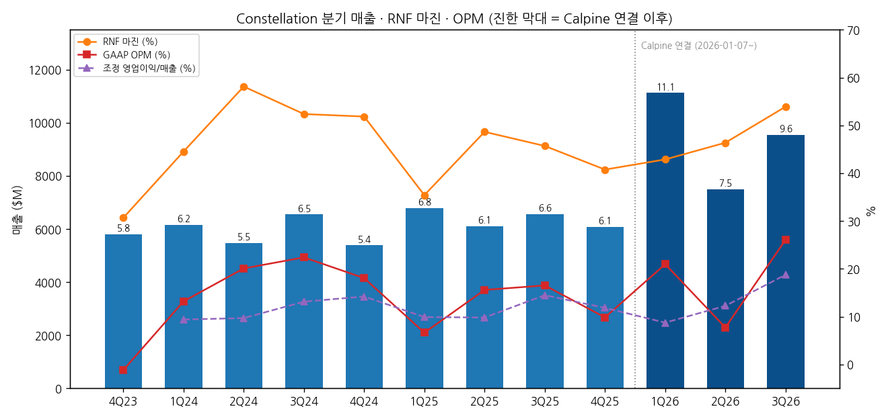
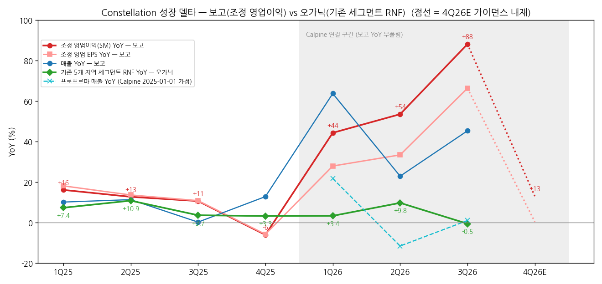
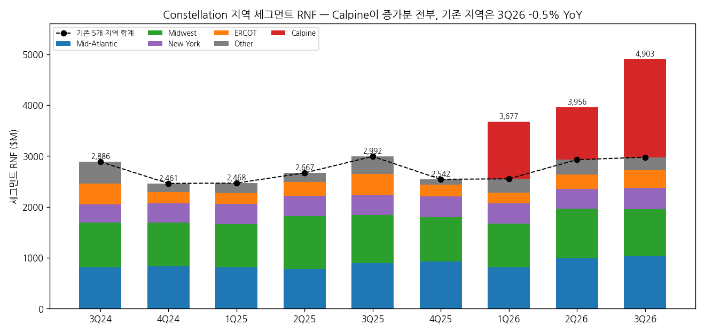

> 모드: 실적 리뷰 (v11)
> 종목: Constellation Energy (CEG)
> 섹터: 원전
> 서브섹터: 원전 운영
> 분기: 2026-Q3 (캘린더 = 회계 분기, 2026-09-30 종료)
> 발표일: 2026-11-09 (월, 장 전 — 보도자료(8-K Ex.99.1)·10-Q 동시, 컨퍼런스콜 09:00 ET)
> 작성 시각: 2026-11-16 KST
> 분석 소스: 회사 자료 — 3Q26 보도자료(SEC 8-K Ex.99.1·회사 웹사이트, 11/9), 3Q26 10-Q(SEC, 11/9: 세그먼트 RNF·발전량·가격·PTC·프로포르마 주석), 1Q26·2Q26 10-Q(프로포르마), 1Q24\~2Q26 분기 보도자료(조정 영업이익), 10-K FY21\~FY25, 기업개요 CEG_기업개요.md v1.0(2026-11-15) 분기 시계열. 컨퍼런스콜 원문 트랜스크립트 미확보 — **비공식 요약** 2건(EarningsWhispers 콜 요약, StatementDog 트랜스크립트 일부·AI 요약)으로 보완. 셀사이드 리포트 첨부 없음. 웹 보완 — 컨센·주가 반응(TIKR 11/9, 247WallSt 11/9, EarningsWhispers), 등급 1건(Stocktwits 11/10 CIBC), 주가(Yahoo Finance 일봉, 11/13 종가까지). 직전 분기 CEG 리뷰 없음 (첫 리뷰)
> 리뷰 깊이: 숫자 중심 | 리서치 첨부 0건
> 다음 발표: 4Q26·2027 가이던스 — 2027-02 하순 예정 [추정: 4Q25는 2026-02-24 발표]

# Constellation 3Q26 실적 리뷰 — 조정 EPS +66%는 Calpine 연결 효과, 기존 원전 지역 RNF는 -0.5%로 정체

> 성장 델타: 둔화 | 내러티브: 강화 → 델타 둔화(오가닉) + 내러티브 강화 → 경계 구간 (계약 8.5GW는 쌓이는데 이익 전환은 2028년부터, 4Q26 가이던스 내재 EPS YoY 약 0%)

→ **숫자 (보고)**: 매출 $9,550M(+45.4% YoY), 조정 영업이익 $1,792M(+88.2%), 조정 영업 EPS $5.06(+66.4%, 컨센 $3.88\~3.90 대비 약 +30%). 조정 영업이익 YoY는 1Q26 +44.4% → 2Q26 +53.6% → **3Q26 +88.2%**로 보고 기준은 가속이다

→ **숫자 (오가닉)**: Calpine을 뺀 기존 5개 지역 세그먼트 RNF는 $2,976M으로 **-0.5% YoY** (2Q26 +9.8% → 3Q26 -0.5%, -10.3%p). Calpine 세그먼트 RNF $1,927M이 RNF 증가분을 전부 만들었다. 프로포르마 매출(Calpine을 2025-01-01부터 연결 가정)도 +1.1%에 그친다. 판정은 오가닉 기준 **둔화**다

→ **쟁점 ①**: 가이던스는 두 번째 상향($11.50\~12.50 → $12.50\~12.80)이지만 9M 조정 EPS $10.34를 빼면 **4Q26 내재 $2.16\~2.46 (중간 $2.31, 4Q25 $2.30 대비 약 0%)**이다. 회사는 2027을 3월 전망에 묶어 두라고 했다 (비공식 콜 요약)

→ **쟁점 ②**: 장기 원전 계약이 연초 이후 8,500MW+ (Google 업레이트 890MW + 2,700MW 금융계약, Amazon Calvert Cliffs 690MW, Peak+ 270MW 등)로 쌓였다. 다만 개시 시점이 2027-06(Meta Clinton)·2H27(MSFT Crane, 1년 앞당김)·2028\~2032(업레이트)라 이익 반영은 2028년부터다

→ **다음 분기 관건**: 4Q26 조정 EPS $2.31 달성과 2027 가이던스 숫자(Calpine 연간 기저 소멸 후 오가닉 성장률), PJM 백스톱 조달(2027-03 입찰·05-10 결과)과 FERC co-location 명령(1H27)이 델타 재가속 여부를 정한다

---

## 1. 숫자

① 연결 기준 분기 표 (단위: $M, %, EPS $)

| 항목 | 4Q23 | 1Q24 | 2Q24 | 3Q24 | 4Q24 | 1Q25 | 2Q25 | 3Q25 | 4Q25 | 1Q26 | 2Q26 | **3Q26** | 4Q26E (가이던스 내재) |
|---|---|---|---|---|---|---|---|---|---|---|---|---|---|
| 매출액 | 5,796 | 6,161 | 5,475 | 6,550 | 5,382 | 6,788 | 6,101 | 6,570 | 6,074 | 11,122 | 7,504 | **9,550** | — |
| RNF (매출 − 연료·구매전력) | 1,778 | 2,744 | 3,183 | 3,431 | 2,791 | 2,404 | 2,969 | 3,003 | 2,476 | 4,770 | 3,481 | **5,150** | — |
| 영업이익 (GAAP) | -67 | 813 | 1,100 | 1,467 | 972 | 451 | 951 | 1,086 | 598 | 2,332 | 580 | **2,492** | — |
| OPM (GAAP) | -1.2 | 13.2 | 20.1 | 22.4 | 18.1 | 6.6 | 15.6 | 16.5 | 9.8 | 21.0 | 7.7 | **26.1** | — |
| 매출 YoY | -21.0 | -18.6 | +0.5 | +7.2 | -7.1 | +10.2 | +11.4 | +0.3 | +12.9 | +63.8 | +23.0 | **+45.4** | — |
| 영업이익 YoY (GAAP) | 적지 | n/m | +64.4 | +50.2 | 흑전 | -44.5 | -13.5 | -26.0 | -38.5 | +417.1 | -39.0 | **+129.5** | — |
| **매출 YoY 델타 (%p)** | — | +2.4 | +19.1 | +6.7 | -14.3 | +17.3 | +1.2 | -11.1 | +12.6 | +50.9 | -40.8 | **+22.4** | — |
| **영업이익 YoY 델타 (%p, GAAP)** | — | n/m | n/m | -14.2 | n/m | n/m | +31.0 | -12.5 | -12.5 | +455.6 | -456.1 | **+168.5** | — |
| 조정 영업이익 (회사 주 지표, Non-GAAP) | — | 579 | 531 | 860 | 765 | 673 | 599 | 952 | 719 | 972 | 920 | **1,792** | 약 813 |
| 조정 영업 EPS ($) | — | 1.81 | 1.68 | 2.74 | 2.44 | 2.14 | 1.91 | 3.04 | 2.30 | 2.74 | 2.55 | **5.06** | 2.31 (2.16\~2.46) |
| 조정 영업이익 YoY | — | — | — | — | — | +16.2 | +12.8 | +10.7 | -6.0 | +44.4 | +53.6 | **+88.2** | 약 +13 |
| **조정 영업이익 YoY 델타 (%p)** | — | — | — | — | — | — | -3.4 | -2.1 | -16.7 | +50.4 | +9.2 | **+34.6** | 약 -75 |
| 조정 영업 EPS YoY | — | — | — | — | — | +18.2 | +13.7 | +10.9 | -5.7 | +28.0 | +33.5 | **+66.4** | +0.4 |
| 기존 5개 지역 RNF (오가닉, Calpine 제외) | 2,432 | 2,298 | 2,405 | 2,886 | 2,461 | 2,468 | 2,667 | 2,992 | 2,542 | 2,551 | 2,928 | **2,976** | — |
| 기존 5개 지역 RNF YoY | — | +18.4 | +0.1 | +16.5 | +1.2 | +7.4 | +10.9 | +3.7 | +3.3 | +3.4 | +9.8 | **-0.5** | — |
| **오가닉 RNF YoY 델타 (%p)** | — | — | -18.3 | +16.4 | -15.3 | +6.2 | +3.5 | -7.2 | -0.4 | +0.1 | +6.4 | **-10.3** | — |
| 프로포르마 매출 YoY (Calpine 2025-01-01 연결 가정) | — | — | — | — | — | — | — | — | — | +21.8 | -11.5 | **+1.1** | — |

→ (출처: 매출·RNF·GAAP 영업이익은 SEC XBRL·각 분기 10-Q(4Q = 10-K 연간 − 9M [계산]), 기업개요 v1.0 분기 시계열. 조정 영업이익·EPS는 각 분기 보도자료(1Q25·2Q25·3Q25·4Q25·1Q26·2Q26·3Q26), 1Q24는 FY24 $2,735M·$8.67 − 2Q\~4Q24 [계산]. 기존 5개 지역 RNF = Mid-Atlantic + Midwest + New York + ERCOT + Other Power Regions 세그먼트 RNF 합 [계산]. 프로포르마 매출 = 1Q26·2Q26·3Q26 10-Q Note 2 (3Q26 $9,550M vs 3Q25 $9,446M). 4Q26E 조정 EPS = 2026 가이던스 $12.50\~12.80 − 9M26 $10.34 [계산], 조정 영업이익 약 $813M = 중간 $2.31 × 희석주식 약 352M [추정])

→ 3Q26 서프라이즈: 조정 영업 EPS 컨센 대비 **약 +30%** ($5.06 vs $3.88 247WallSt / $3.89 TIKR / $3.90 EarningsWhispers), 매출 +2.1% ($9.55B vs $9.35B, TIKR·247WallSt. EarningsWhispers는 컨센 $8.56B로 +11.6% 표기 — 집계처 차이)

→ **GAAP 영업이익은 판정에 쓰지 않는다**: 미실현 헤지손익(3Q26 매출 -$362M·연료비 +$482M)과 원전해체기금(NDT) 평가손익으로 분기마다 ±40%\~400%씩 튄다 (10-Q Note 5). 회사 주 지표인 **조정 영업이익**과 **세그먼트 RNF**로 판정한다

→ **Calpine 연결 왜곡**: 2026-01-07 Calpine 인수 완료 → 1Q26부터 Calpine 세그먼트(가스·지열 약 23GW + 소매 62TWh)가 더해졌다. 3Q26 Calpine 매출 $3,384M·RNF $1,927M, 발전량 38.4TWh (10-Q). 회사는 "통합·재무 일원화로 인수 이후 Calpine 이익 산정은 실무상 불가"라고 공시했다 (10-Q Note 2) → **오가닉 조정 EPS는 산출 불가**. 오가닉 대용 지표로 ① 기존 5개 지역 세그먼트 RNF ② 프로포르마 매출을 쓴다

→ 주당 희석: Calpine 대가로 신주 5,000만주 발행 → 희석주식 313M → 354M (+13%). 같은 3Q 조정 영업이익 +88.2%가 EPS로는 +66.4%로 줄어든다. 순이자비용도 $134M → $217M (+62%, Calpine 차입 승계 $12.6B) (10-Q)

→ YoY 경로: 보고 기준 조정 영업이익 YoY는 3Q26 +88.2%가 정점이다. 4Q26 가이던스 내재 EPS YoY는 약 +0.4% (영업이익 $M 기준 약 +13% [추정])이고, 1Q27부터는 Calpine이 전년 기저에 들어가 보고 YoY가 오가닉 수준으로 내려온다. 회사는 "2026의 초과 달성이 반복되지 않을 수 있고, 2027은 3월 전망에 기준을 두라, 신규 계약 이익은 2028년부터"라고 했다 (EarningsWhispers 콜 요약, **비공식**). **컨센이 그릴 YoY 정점은 3Q26**이다 [판단]

→ **[판단] 델타 = 둔화**: 보고 기준은 +53.6% → +88.2%로 가속이지만, 증가분은 Calpine 연결이다. 오가닉 대용 지표인 기존 지역 RNF YoY는 +9.8% → -0.5%로 10.3%p 꺾였고, 다음 분기 가이던스 내재 EPS YoY는 0% 근처다. 기존 지역 RNF가 마이너스로 돌아선 것은 한 분기라 "꺾임"이 아니라 "둔화"로 둔다. 원전 PTC 감소(-$131M)·주(州) 보조금 환급(-$60M 추가) 같은 정책 요인이 섞여 있어서다 (아래 ②)

→ (출처: SEC XBRL·10-Q, 조정 영업이익은 분기 보도자료. 진한 막대 = Calpine 연결 이후)

→ (출처: 동일. 4Q26E 점선 = 2026 가이던스 중간값 − 9M26 [계산]. 오가닉 = 기존 5개 지역 세그먼트 RNF)

② 사업부(지역 세그먼트)별 매출·RNF (단위: $M, %)

> CEG는 세그먼트 영업이익을 공시하지 않는다. 세그먼트 성과지표는 **RNF**(매출 − 구매전력·연료비)이고, O&M·감가상각·이자는 세그먼트에 배분하지 않는다 (10-Q Note 5) → 사업부 영업이익 = **미공개**, RNF로 대체

| 세그먼트 | 항목 | 3Q24 | 3Q25 | 4Q25 | 1Q26 | 2Q26 | **3Q26** | 9M26 |
|---|---|---|---|---|---|---|---|---|
| Mid-Atlantic (PJM 동부 원전) | 매출 | — | 1,763 | — | — | — | **1,877** | 5,279 |
| | RNF | 809 | 892 | 928 | 812 | 988 | **1,027** | 2,828 |
| | RNF 마진 | — | 50.6 | — | — | — | **54.7** | 53.6 |
| | RNF YoY | +8.7 | +10.3 | +10.9 | +0.4 | +26.3 | **+15.1** | +13.9 |
| Midwest (일리노이 원전) | 매출 | — | 1,390 | — | — | — | **1,562** | 4,862 |
| | RNF | 884 | 943 | 873 | 854 | 979 | **932** | 2,764 |
| | RNF 마진 | — | 67.8 | — | — | — | **59.7** | 56.9 |
| | RNF YoY | +13.6 | +6.7 | +2.7 | +0.5 | -5.5 | **-1.2** | -2.3 |
| New York (뉴욕 원전) | 매출 | — | 558 | — | — | — | **569** | 1,702 |
| | RNF | 357 | 399 | 403 | 409 | 390 | **412** | 1,211 |
| | RNF YoY | +12.6 | +11.8 | +6.3 | +2.0 | -1.8 | **+3.3** | +1.2 |
| ERCOT (STP 44% + 가스) | 매출 | — | 628 | — | — | — | **592** | 1,408 |
| | RNF | 403 | 415 | 237 | 209 | 284 | **345** | 837 |
| | RNF YoY | +94.7 | +3.0 | +7.2 | -2.3 | +4.8 | **-16.9** | -7.0 |
| Other Power Regions (소매·구매전력) | 매출 | — | 1,543 | — | — | — | **1,099** | 3,551 |
| | RNF | 433 | 343 | 101 | 267 | 287 | **260** | 817 |
| | RNF YoY | +0.5 | -20.8 | -42.0 | +37.6 | +58.6 | **-24.2** | +13.9 |
| **기존 5개 지역 합계 (오가닉)** | **RNF** | **2,886** | **2,992** | **2,542** | **2,551** | **2,928** | **2,976** | **8,457** |
| | **RNF YoY** | +16.5 | +3.7 | +3.3 | +3.4 | +9.8 | **-0.5** | +4.1 |
| Calpine (가스·지열·소매, 2026-01-07\~) | 매출 | — | — | — | — | — | **3,384** | 7,926 |
| | RNF | — | — | — | 1,126 | 1,028 | **1,927** | 4,081 |
| | RNF 마진 | — | — | — | — | — | **56.9** | 51.5 |
| **세그먼트 RNF 합계** | | 2,886 | 2,992 | 2,542 | 3,677 | 3,956 | **4,903** | 12,538 |
| Other (가스 판매·영국·미실현 헤지) | RNF | — | 11 | — | — | — | **247** | 863 |

→ (출처: 3Q26 10-Q Note 5 세그먼트 표(3Q·9M, 3Q25 비교치), 1Q24\~2Q26은 기업개요 v1.0 분기 시계열(각 분기 10-Q, 4Q = 연간 − 9M [계산]). YoY [계산]. 분기 세그먼트 매출은 3Q만 표기. 세그먼트 매출은 세그먼트 간 거래 포함)

→ **Calpine이 증가분 전부다**: 세그먼트 RNF 합계 +$1,911M (+63.9%) 중 Calpine이 +$1,927M, 기존 5개 지역은 -$16M. 3Q26 세그먼트 RNF 중 Calpine 비중 **39.3%** [계산] — 기업개요의 재분류 트리거(Calpine 40%+)에 거의 닿았다. 여름 피크 분기라 가스 발전 비중이 높게 나온 영향도 있다 [판단]

→ **Mid-Atlantic만 성장 (+15.1%)**: PJM 동부 용량가격 $269.92 → **$329.17/MW-day (+22.0%)**, PJM West 전력가격 $46.77 → $69.97/MWh (+49.6%). 소매 계약 단가 상승 +$160M, 실현 헤지 손실 -$70M (10-Q)

→ **Midwest는 정책 보조가 가격 상승을 상쇄 (-1.2%)**: 전력가격 상승으로 도매·발전 +$175M, 소매 +$130M을 벌었지만 원전 PTC -$105M, 일리노이 CMC -$55M이 빠졌다. 전력·용량가격이 오르면 PTC·CMC가 자동으로 줄어드는 구조다 (10-Q) — **가격 상승이 Midwest 원전 이익에 그대로 남지 않는다**

→ **Other Power Regions -24.2%·ERCOT -16.9%**: 뉴잉글랜드 부하 감소(도매 -$165M·소매 -$185M 매출), 서부 전력가격 하락. ERCOT은 ERCOT North 가격 $34.41 (-1.8%) 정체 (10-Q)

→ (출처: 10-Q 세그먼트 표, 기업개요 v1.0 분기 시계열)

(1) 원전 운영 지표 — 물량은 정점, 이익 변수는 가격

| 항목 | 3Q25 | **3Q26** | 9M25 | 9M26 |
|---|---|---|---|---|
| 원전 발전량 (GWh, 지분 기준) | 46,477 | **46,677** | 137,231 | 135,505 |
| 원전 이용률 (Salem·STP 제외) | 96.8% | **97.2%** | 95.3% | 94.2% |
| 계획정비 일수 | 23 | **20** | 152 | 205 |
| 비계획정비 일수 | 5 | **6** | 27 | 26 |
| 가스·석유·양수 EFOF (2026 신규 지표) | — | **5.9%** | — | 5.9% |
| 원전 PTC 수익 | 175 | **44** | 220 | 69 |
| 주(州) 보조 프로그램 순매출 (PTC 연동 환급) | -220 | **-280** | -30 | -555 |

→ (출처: 3Q26 보도자료·10-Q. 여름 피크 이용률 99.2%·비계획 정지 없음 (EarningsWhispers·StatementDog 콜 요약, **비공식**))

→ 3Q 이용률 97.2%는 기업개요 12년 범위(93.7\~95.7%, 연간) 위다. 다만 9M은 계획정비 205일(전년 152일)로 94.2%에 그쳤고 9M 발전량은 -1.3%다. **원전 물량으로는 성장이 없다** — 이익은 가격(용량·전력)·계약·인수에서 나온다

→ 원전 PTC는 전력가격이 높아 2026년 대부분 기에서 소멸 구간(gross receipts $26.00\~44.75/MWh 사이 phase-out)에 들어갔다 (10-Q Note 6). PTC는 가격 하방 보험이라, 지금은 이익 기여가 0에 가깝고 가격이 떨어질 때만 다시 살아난다

(2) 가이던스 — 이전 → 이번

| 시점 | 2026 조정 영업 EPS 가이던스 | 중간값 | 2025 실적 대비 |
|---|---|---|---|
| 2026-03-31 (첫 제시) | $11.00\~12.00 | $11.50 | +22.5% |
| 2026-08-06 (2Q26) | $11.50\~12.50 | $12.00 | +27.8% |
| **2026-11-09 (3Q26)** | **$12.50\~12.80** | **$12.65** | **+34.7%** |

→ (출처: 2Q26·3Q26 보도자료, 원 가이던스 $11.00\~12.00은 1Q26 보도자료 "affirmed". 2025 실적 $9.39 [4Q25 보도자료]. YoY [계산])

→ 새 하단 $12.50은 첫 가이던스 상단($12.00)보다 $0.50 높다. 다만 직전(8월) 대비 중간값 상향은 **+$0.65**로, 3Q 한 분기의 컨센 대비 서프라이즈(약 +$1.17 = $5.06 − $3.89)보다 작다 [계산] — 3Q 비트분도 다 반영하지 않았고 **4Q 전망은 오히려 보수적**이다 [판단]

(3) 연간 (단위: $M, %)

| 항목 | 2022 | 2023 | 2024 | 2025 | 2026E (가이던스 중간) |
|---|---|---|---|---|---|
| 매출액 | 24,440 | 24,918 | 23,568 | 25,533 | — |
| RNF | 6,978 | 8,917 | 12,149 | 10,852 | — (9M26 13,401) |
| 영업이익 (GAAP) | 495 | 1,610 | 4,352 | 3,086 | — (9M26 5,404) |
| OPM (GAAP) | 2.0 | 6.5 | 18.5 | 12.1 | — (9M26 19.2) |
| 매출 YoY | +24.4 | +2.0 | -5.4 | +8.3 | — (9M26 +44.8) |
| 조정 영업이익 | — | — | 2,735 | 2,944 | 약 4,497 [추정] |
| 조정 영업 EPS ($) | — | — | 8.67 | 9.39 | 12.65 |
| 조정 영업 EPS YoY | — | — | — | +8.3 | +34.7 |

→ (출처: 2022\~2025 10-K·XBRL, 조정 영업이익 2024·2025는 4Q25 보도자료, 2022·2023 조정 영업이익 미수집. 2026E 조정 영업이익 = 9M26 $3,684M + 4Q 약 $813M [추정])

→ 컨센: 2Q26 발표 전 2026 EPS 컨센 $11.72 (EarningsWhispers) → 가이던스 중간값 $12.65가 컨센 위 (TIKR "새 중간값은 애널리스트 기대 위"). 3Q 후 연간 컨센 집계치와 2027 컨센은 확보하지 못했다

→ 회사 중장기 목표: "Base EPS 2026\~2029 연 20%+ 성장" (247WallSt 11/9 인용 — 회사 자료 원문 미확인, **비공식**). 2027·2028·2030 전망은 4Q 콜에서 갱신 예정 (StatementDog 요약, **비공식**)

---

## 2. 시장 쟁점 — 회사 자료·컨콜 요약·웹 기사 종합

> 범위: 셀사이드 리포트 첨부 없음. 컨콜 원문 트랜스크립트 미확보 — EarningsWhispers 콜 요약(11/9)과 StatementDog 트랜스크립트 앞부분·AI 요약(Q&A 5건, 애널리스트 이름·소속 미표기)이 **비공식 요약**이다. 웹 기사(TIKR·247WallSt·Stocktwits)로 보완. 숫자 중심 리뷰라 증권사 해석 편차 표·TP 표는 생략

① 지난 분기 체크 (2-0)

→ 첫 리뷰 — 직전 체크 없음

② 이번 분기 쟁점 4개

| # | 쟁점 | 근거 (콜 Q&A / 기사 / 공시) |
|---|---|---|
| (1) | +66%는 얼마나 Calpine이고, 2027에 무엇이 남나 (4Q 내재 EPS YoY 0%) | 콜 요약 (2027 앵커) / 기사 3건 / 10-Q 프로포르마 |
| (2) | 하이퍼스케일러 원전 계약 8.5GW — 단가 프리미엄과 이익 개시 시점 | 콜 Q&A 2건 (Peak+, 원전 프리미엄) / 기사 4건 |
| (3) | PJM 시장 개편 — 용량가격 상한·백스톱 조달·co-location 규제 | 콜 Q&A 1건 (PJM 양자계약·규칙 지연) / 10-Q / 기사 1건 |
| (4) | 업레이트 CapEx·DOE 대출·자사주 — 자본배분 | 콜 Q&A 1건 (업레이트 비용) / 10-Q |

③ 쟁점별 분해

(1) **+66%의 분해 — Calpine을 빼면 성장은 어디서 나오나**

(1-1) 회사 설명

→ 조정 영업이익 증가 요인: "주로 우호적인 시장·포트폴리오 여건과 Calpine 편입, 이자비용 증가와 원전 PTC 포트폴리오가 일부 상쇄" (3Q26 보도자료). 요인별 주당 금액은 공시하지 않았다

→ 이자비용 $134M → $217M, 희석주식 313M → 354M. 3Q26 실효세율 18.2% (전년 33.4%) — 이연법인세 조정 $108M은 조정 이익에서 제외 (보도자료 조정표)

→ "2026의 초과 달성은 반복되지 않을 수 있다", "2027은 3월 전망에 기준", "신규 계약의 이익은 대부분 2028년 이후" (EarningsWhispers 콜 요약, **비공식**)

(1-2) 숫자로 본 분해 [계산]

| 구분 | 3Q25 | 3Q26 | 증감 |
|---|---|---|---|
| 세그먼트 RNF 합계 | 2,992 | 4,903 | +1,911 |
| 그중 Calpine | — | 1,927 | +1,927 |
| 그중 기존 5개 지역 | 2,992 | 2,976 | -16 |
| O&M | 1,511 | 1,991 | +480 |
| 감가상각 | 241 | 454 | +213 |
| 순이자비용 | 134 | 217 | +83 |
| 조정 영업이익 | 952 | 1,792 | +840 |

→ (출처: 10-Q 손익계산서·Note 5, 보도자료. O&M·감가상각 증가분 대부분은 Calpine 편입분으로 보이나 회사가 구분 공시하지 않음 [판단])

(1-3) 공통 결론 vs 갈리는 지점

→ 공통: 3Q 비트는 Calpine 여름 가스 발전(38.4TWh)과 PJM 용량가격에서 나왔다 (TIKR·247WallSt·콜 요약)

→ 갈림: **Calpine이 인수 가정보다 얼마나 더 버는가** — 회사는 인수 후 Calpine 이익 산정이 "실무상 불가"라 했고(10-Q), 프로포르마 순이익은 3Q26 $1,835M vs 3Q25 $1,550M (+18.4%, GAAP·헤지 손익 포함)이라 오가닉 이익 성장률을 숫자로 확정할 수 없다

(1-4) [판단]

→ 3Q 조정 영업이익 증가 $840M 중 기존 지역 RNF는 기여가 없다(-$16M). 즉 **+66%는 거의 전부 인수 효과 + 가스 발전의 계절성**이다. 4Q 가이던스 내재 EPS가 4Q25와 같은 $2.31이라는 점이 이를 확인한다 — 4Q는 Calpine이 RNF를 더하는데도 EPS가 제자리라는 뜻이고, 주식 희석·이자·PTC 소멸이 그만큼 깎는다. 1Q27부터 Calpine이 기저에 들어가면 보고 YoY는 한 자릿수\~10%대로 내려올 가능성이 크다. 2027 가이던스가 "Base EPS 20%+ 성장"(비공식 인용)을 숫자로 보여주면 결론이 바뀐다

(2) **하이퍼스케일러 원전 계약 — 물량은 확보, 이익은 2027 하반기\~2032에 걸쳐 개시**

(2-1) 회사 설명

→ "*The new megawatts, which are the equivalent of a new large-scale nuclear plant,*" — 이번 분기 계약으로 1,000MW+ 신규 무탄소 설비 (CEO Joe Dominguez, 3Q26 보도자료)

→ "새로 더해지는 MW는 **대형 원전 1기에 맞먹는 규모**" — 기존 고객에게 비용을 전가하지 않는다는 설명이 함께 붙었다 (CEO, 보도자료)

→ 시사점: 신규 원전 건설 없이 **업레이트·재가동으로 약 2GW 신규 설비** → 자본비용은 신규 원전 대비 낮고 개시 시점은 2027\~2032로 분산 → 이익 기여는 2028년부터 본격화

| 상대방 | 내용 | 개시 | 출처 |
|---|---|---|---|
| Microsoft | Crane(구 TMI-1) 재가동 835MW, 20년 | **2H27로 1년 앞당김·예산 이하** | 10-K / 콜 요약 (**비공식**) |
| Meta | Clinton 1,092MW, 20년 (+30MW 업레이트) | 2027-06 (일리노이 ZEC·CMC 2027-05 종료 대체) | 10-K |
| 투자등급 고객 (Walmart 176MW 포함) | 920MW, 15\~20년 | 2029\~2032 | 10-Q |
| Amazon | Calvert Cliffs 690MW, 20년 + 소매 공급, $3B+ 투자·190MW 증설 | 증설 2030\~2032 | 10-Q·보도자료 |
| Google | 11기 업레이트 약 890MW 20년 PPA ($4.3B+) + PJM 2,700MW 15년 금융 부하추종 계약 | 첫 업레이트 2028 | 10-Q·보도자료 |
| Peak+ (첫 거래) | 270MW, 20년 (에너지·용량·속성) | 2028 | 보도자료 |
| CyrusOne (Calpine) | Freestone 380MW (+380MW 2단계 독점), Thad Hill 400MW | — | 10-Q |

→ 연초 이후 장기 계약 **8,500MW+**, 2Q 이후 약 4,560MW. 2032년 계약 무탄소 발전량 약 91백만MWh = 무탄소 함대의 **약 45%** (EarningsWhispers 콜 요약, **비공식**)

(2-2) 콜 Q&A에서 반복된 질문 (StatementDog 요약, **비공식** — 질문자 소속 미표기)

→ **원전 계약 프리미엄**: 회사는 시장가 대비 **$20\~50/MWh 프리미엄** 범위가 여전히 유효하고, PTC 하한이 물가에 연동돼 상방이 있다고 답했다

→ **Peak+ 경제성**: 신규 설비·수요반응을 묶은 상품을 **$110\~130/MWh**에 제공 — 신규 건설 원가·리스크와 경쟁 가능. 판매 목표치는 제시하지 않았다

(2-3) 공통 결론 vs 갈리는 지점

→ 공통: 원전 장기계약 물량은 이번 분기에 한 단계 올라섰다 (Google·Amazon 동시). 기업개요 분류 트리거 ①(장기 계약이 원전 발전량 50%+)에 2032년 약 45%로 근접 [판단]

→ 갈림: **계약 단가가 미공시**다. 고정가 잔여 이행의무는 $12.1B (2026 $0.4B · 2027 $1.9B · 2028 $1.7B · 2029 $1.5B · 2030 $1.0B · 2031\~ $5.6B, 10-Q Note 4)로 직전 분기와 비교한 증가 폭이 크지 않다 — 변동가·파생 계약(Google 2,700MW 금융계약 등)은 빠져 있어 계약 가치를 숫자로 확인할 수 없다

(2-4) [판단]

→ 내러티브는 강해졌다. 다만 이익 개시 순서는 Meta(2027-06) → Crane(2H27) → Google 업레이트(2028\~) → Amazon 증설(2030\~)이라, **2027년 이익 성장에 기여하는 계약은 Meta·Crane 정도**다. 계약 발표가 이익 델타로 넘어오는 것은 2028년부터다

(3) **PJM 시장 개편 — 용량가격은 상한에 묶였고, 규칙은 2027 상반기까지 미정**

(3-1) 회사 설명 (10-Q)

→ PJM 용량가격 상·하한(약 $325 / $175 MW-day)을 2028/29·2029/30 경매까지 연장 — FERC 2026-04 승인

→ 일회성 신뢰도 백스톱 조달: PJM 10/29 수정 제출, **2027-03-01\~03-28 입찰, 05-10 결과 발표** 제안. 부하예측은 2027-04-28 확정

→ 50MW+ 신규 대형부하 감축 리스크를 지우는 PJM Interim Resource Adequacy 제안은 FERC가 대부분 기각. co-location: FERC가 PJM에 2029-06보다 빠른 시행을 압박, PJM 8월 준수 제출 → FERC 명령 대기 (1H27 예상, TIKR)

→ "선거 결과에 시장이 다소 과잉 반응했다" (CEO, StatementDog 트랜스크립트 원문 일부). 11월 초 중간선거 후 주(州) 차원의 데이터센터 규제 우려로 AI 전력주가 급락했다 (TIKR 11/9)

(3-2) [판단]

→ 3Q26 실현 용량가격 $329.17는 2027/28 $333.44 → 2028/29 $325.00(상한)으로 **2029년까지 사실상 고정**이다. 용량가격 상승이 Mid-Atlantic·Midwest RNF를 끌어올린 동력(2025/26 $269.92 → 2026/27 $329.17)은 2027-06 이후 더 커지지 않는다 → **PJM에서 다음 성장 동력은 가격이 아니라 양자 계약(PPA)**이다. 회사가 "규칙 지연이 오히려 고객과 협상할 시간을 줬다"고 답한 것(비공식 요약)도 같은 방향이다

(4) **자본배분 — 업레이트 CapEx, DOE 저리 대출, 자사주**

(4-1) 회사 설명

→ 업레이트 증분 성장 CapEx 약 $3B (2028\~2032) (EarningsWhispers 요약, **비공식**). DOE 조건부 대출보증 최대 **$5.0B** (30년, 국채 +0.375%) — 세전 이자 연 약 $40M 절감 (요약, **비공식**) / 10-Q는 $5.0B, StatementDog 요약은 "$6B"로 표기 → 10-Q 숫자 채택

→ 자사주: 3Q26 380만주 약 $1.0B, 9M26 1,090만주 약 $3.0B, 잔여 한도 약 $2.0B. 자사주 업데이트는 4Q 콜 전후 (10-Q, 요약)

→ 포트폴리오 조정: PJM 가스 5개소 4.4GW를 LS Power에 $5.0B 매각(연내 종결 예정), Brazos Valley 606MW $860M 매각 완료, Rhode Island State Energy Center 609MW $715M 인수(승인 대기, "즉시 EPS 증가·신용 중립") (10-Q, 요약)

(4-2) [판단]

→ 9M 자사주 $3.0B(희석주식 연환산 약 -3%)가 4Q·2027 EPS를 받치는 주된 장치다. LS Power 매각 대금 $5.0B가 들어오면 추가 자사주 여력이 생기지만, 매각 가스 4.4GW의 이익도 빠진다 — 2027 가이던스에서 매각 희석과 자사주 증가를 함께 봐야 한다

④ 회사 vs 시장 — 숫자 대비

→ **회사 쪽 (낙관 근거)**: 가이던스 2회 상향, 5년 연속 원래 가이던스 중간값 초과(요약), 계약 8.5GW, Crane 1년 앞당김

→ **보수 쪽 근거**: 4Q 내재 EPS YoY 약 0%, 기존 지역 RNF -0.5%, PJM 용량가격 상한 고정, 원전 PTC 소멸, 2027 "3월 전망 앵커"

→ 주가: 발표일 **+10.5%** (11/6 $249.95 → 11/9 $276.09), 11/13 $280.20 [Yahoo, 계산]. 선거 직후 11/5 $239.65 저점에서 +16.9% 반등. 연초 대비 -20.7%, 2025-10-15 사상 최고 $403.95 대비 -30.6% (기업개요 v1.0). Forward P/E 약 21배(발표 전) → 약 22배, 3년 평균 26배 (TIKR)

→ 등급: CIBC Outperform 유지, TP $343 → $346 ("인상적인 설비 가용률", Stocktwits 11/10). Koyfin 평균 TP $337.90, 25명 중 매수 20·보유 5 (Stocktwits 11/10 인용) — 셀사이드 원문 미확보, 참고용

---

## 3. 내러티브 점검

→ **성장 스토리 (시장이 CEG를 사는 이유)**: "미국 최대 원전 함대(약 22GW)를 하이퍼스케일러 20년 PPA와 업레이트·재가동으로 장기 고정가에 팔아, 전력가격 사이클주에서 인프라형 지속성장주로 바뀐다. Calpine으로 가스·소매까지 더해 데이터센터 전력 공급 1위 사업자"

→ **이번 분기 평가 — 강화**: ① Google(890MW 업레이트 + 2,700MW)·Amazon(690MW)으로 연초 이후 8.5GW 계약, 2032 무탄소 발전량의 약 45% 계약(비공식 요약) ② Crane 재가동 2H27로 1년 앞당김(비공식 요약) ③ DOE 업레이트 대출보증 $5.0B로 자본비용 하락 ④ 가이던스 2회 상향

→ **숫자는 따라오지 않았다**: 1번 오가닉 델타 판정(둔화)과 합치면 **경계 구간**이다. 계약 뉴스와 이익 델타 사이에 2027년이라는 공백이 있다 — 보고 EPS는 Calpine 연결이 끝나는 1Q27부터 둔화가 보이고, 신규 계약 이익은 2028년부터 들어온다 [판단]

→ 스토리를 더 강하게 만들 트리거: ① 2027 가이던스가 Calpine 기저 후에도 EPS +15% 이상 ② Crane 2H27 재가동 확정(NRC 승인) ③ PJM 백스톱 조달·FERC co-location 명령이 양자계약 확대 쪽으로 정리

→ 깨뜨릴 리스크: ① 주(州) 정치권의 데이터센터 전력요금 반발(선거 이후) → co-location·양자계약 지연 ② 전력가격 하락 시 Calpine 가스 스프레드 축소 (원전은 PTC가 하방 방어, 가스는 방어 없음) ③ LS Power 매각 지연·RISEC 인수 승인 지연

→ **한국전력과의 대비 (같은 서브섹터, 반대 사이클)**: CEG는 비규제 발전사라 전력·용량가격이 오르면 RNF가 늘고(3Q PJM West +50% → Mid-Atlantic RNF +15%), 가격이 떨어지면 원전 PTC가 하방을 막는다. 한국전력은 규제 요금 판매사라 같은 전력·연료가격 상승이 구입전력비 부담으로 돌아온다 — 연료가격 하락·요금 인상이 이익 동력이다 [판단]. 원전 비중 확대가 이익에 유리하다는 점만 같다. 두 회사 델타를 섹터 리뷰에서 같은 축으로 합산할 때는 이 방향 차이를 표시해야 한다 (한전 숫자는 한국전력 3Q26 리뷰 참조)

---

## 4. 향후 봐야 할 것

(1) **4Q26 조정 영업 EPS $2.31 (가이던스 내재 중간값)과 2027 가이던스**

→ 무엇을: 4Q26 조정 EPS $2.16\~2.46 범위 달성(4Q25 $2.30 대비 YoY 약 0%). 2027 조정 EPS 가이던스 중간값이 2026 실적 대비 +15% 이상인지 (Calpine 연간 기저 이후 첫 오가닉 성장률). +10% 미만이면 델타 "꺾임" 재검토

→ 어떤 데이터로: 4Q26 보도자료·10-K, 2027 가이던스·다년 전망(4Q 콜), 기존 지역 세그먼트 RNF YoY

→ 언제: 2027-02 하순 [추정]

(2) **Crane 재가동(2H27)과 Meta Clinton PPA 개시(2027-06)**

→ 무엇을: NRC 운영 재개 승인 시점, 재가동 예산, Clinton PPA 개시 후 Midwest RNF가 ZEC·CMC 종료(2027-05)를 넘어서 늘어나는지

→ 어떤 데이터로: NRC 공시, 회사 보도자료, 10-Q Midwest·Mid-Atlantic RNF

→ 언제: 2027-2Q\~4Q

(3) **PJM 백스톱 조달·FERC co-location 명령**

→ 무엇을: 백스톱 조달 결과(낙찰 물량·가격, CEG 참여), co-location 규칙 확정 여부, 2028/29 이후 용량가격 상·하한 유지 여부

→ 어떤 데이터로: PJM 공시, FERC 명령, 키워드 "PJM backstop procurement"·"co-location order"

→ 언제: 입찰 2027-03, 결과 2027-05-10 (PJM 제안), FERC co-location 1H27

(4) **신규 장기 원전 계약 추가와 계약 단가**

→ 무엇을: 연간 계약 8.5GW에 더해지는 추가 PPA, 2032 계약 비중 45% → 50%+ (기업개요 분류 전환 트리거), 프리미엄 $20\~50/MWh 유지, 고정가 잔여 이행의무 $12.1B 증가 폭

→ 어떤 데이터로: 회사 보도자료, 10-Q Note 4 잔여 이행의무

→ 언제: 상시, 4Q 콜 업데이트

(5) **포트폴리오 조정과 자사주 — LS Power 매각 $5.0B, RISEC 인수, 자사주 한도 갱신**

→ 무엇을: PJM 가스 4.4GW 매각 종결(연내 예정)과 대금 사용처(자사주·차입 상환), 자사주 신규 한도, 희석주식 354M → 감소 폭

→ 어떤 데이터로: 8-K, 4Q26 보도자료, 10-K

→ 언제: 2026-12\~2027-02
