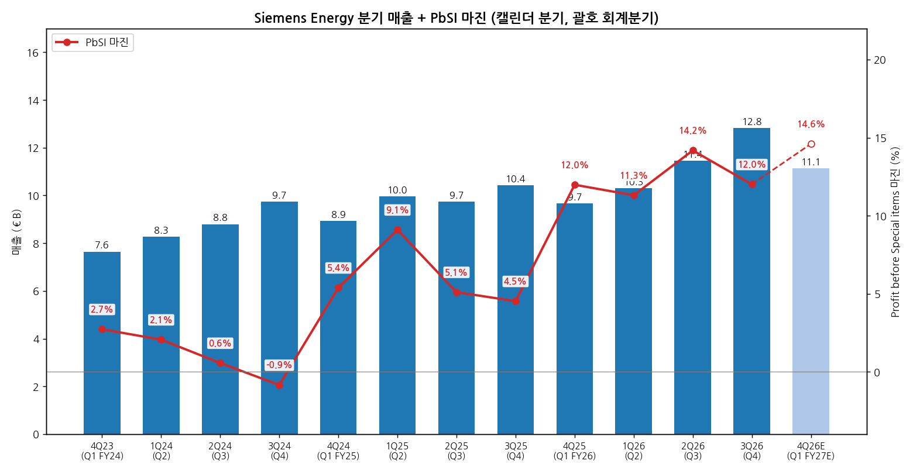
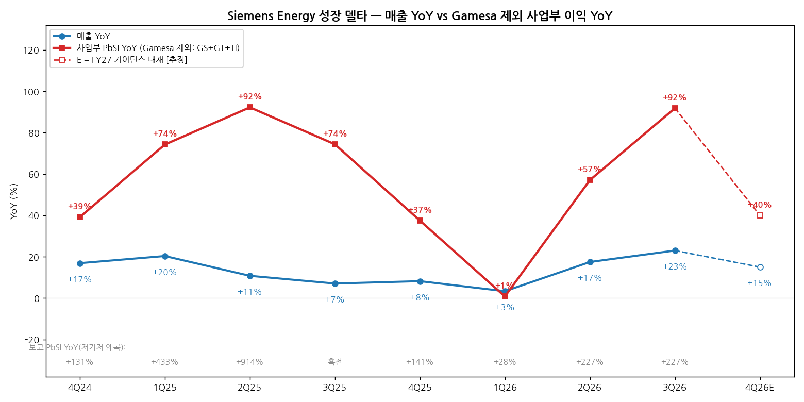
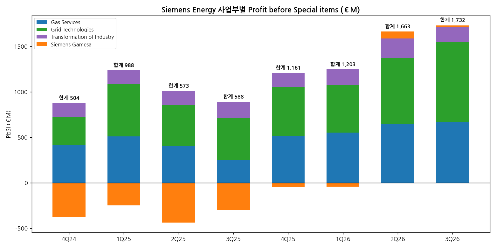

> 모드: 실적 리뷰 (v11)
> 종목: Siemens Energy (ENR)
> 섹터: 전력 인프라
> 서브섹터: 발전
> 분기: 2026-Q3 (캘린더 3Q26 = 회계 Q4 FY26, 2026-07-01 ~ 09-30, 9월 결산)
> 발표일: 2026-11-11 (수, 07:00 CET 보도자료, 11:00 CET 확대 애널리스트 콜 — FY27 가이던스·FY30 목표 동시 발표)
> 작성 시각: 2026-11-14 15:30 KST
> 분석 소스: **셀사이드 리포트 미확보 — 자체 조사(회사 자료+웹서치)**. 회사 자료 — Earnings Release Q4 FY26 (11/11, 재무제표·사업부·지역별 표 포함), 보도자료 (11/11), 확대 애널리스트 콜 트랜스크립트 (Investing.com 11/11, GS·MS·BofA·JPM·DB·Bernstein·Oxcap·UBS·Citi·Berenberg 질문), Earnings Release Q1 FY24~Q3 FY26·Q3 FY26 Analyst Presentation (기업개요 소스 재사용). 웹서치 — 컨센 대비 실적·가이던스 (Investing.com 11/11), 증권사 등급·TP 변경 (ad-hoc-news 11/12, aktiencheck.de 11/13 — dpa-AFX 집계), 주가 반응 (Investing.com·aktiencheck 11/11~13). 피어 비교는 `2026-Q3_GEV_리뷰.md`, 중간선거·FERC 일정은 `2026-Q3_효성중공업_리뷰.md` 재사용. 직전 분기 리뷰 없음 (첫 리뷰)

# Siemens Energy 3Q26 (Q4 FY26) 실적 리뷰 — 가스·그리드 이익 YoY +92%로 가속, FY30 마진 20~22% 제시. 다만 YoY 정점은 이번 분기

> 성장 델타: 가속 | 내러티브: 강화 → 델타 가속 + 내러티브 강화 → 적극 구간 (단 가이던스 경로상 이익 YoY 정점은 이번 분기 — 다음 분기부터 +40%대로 감속, 멀티플은 SRA 39GW 수주 전환과 12월 FERC 결론 확인 전까지 눌림)

→ **숫자**: 매출 €12.83B(+23.0% YoY, comp. +21.5%, 분기 최대), Profit before Special items(PbSI, 이하 영업이익) €1,540M(+227% YoY, 마진 12.0%). 보고 기준 영업이익 YoY는 2Q26 +226.6% → +227.0%로 제자리지만 전년 Gamesa 적자 기저가 낀 숫자다. **Gamesa를 뺀 사업부(GS+GT+TI) 영업이익 YoY는 +57% → +92%로 35%p 가속**했고 매출 YoY도 +17.5% → +23.0%로 함께 올라 "강한 가속"이다. 컨센 대비 매출 +2.1%, 영업이익 +4.8%, EPS +8.0% 비트, 수주는 -4.2% 미스
→ **쟁점 ①**: 가스터빈 신규 확정 수주가 4Q 2GW로 급감했다(연간 42GW). 대신 슬롯 예약(SRA)이 26 → 39GW로 늘어 총 약정은 95 → 104GW다. 회사는 "타이밍 효과, 1Q FY27도 자신 있다, SRA는 FY26 수주보다 높은 마진으로 FY27에 전환"이라고 했다. 같은 분기 GEV(11GW, SRA 8GW)와 똑같이 "확정 수주는 느려지고 예약은 쌓이는" 패턴이다
→ **쟁점 ②**: FY27 가이던스 마진 14~16%(컨센 14.7%), FY30 20~22%. CMD 2025에서 FY28로 잡았던 14~16%를 1년 당겼다. 가스 신규 유닛 잔고 마진은 FY22 대비 +26%p(FY26에만 +14%p)이고, Grid는 유럽 가격이 정체됐지만 미국은 아직 오른다. 그리드 마진 FY30 24~26%는 최대 경쟁사(Hitachi Energy)보다 5%p 공격적이라는 질문이 나왔다
→ **쟁점 ③**: FY27 순이익 가이던스 약 €5B가 컨센 €5.5B보다 약 10% 낮고 Gamesa 마진 0~2%도 컨센 2.7% 아래다. 주가는 발표일 +9.2%(€119.8 → €130.8)였지만 Goldman·BofA·LBBW가 TP를 내렸고 JPM만 올렸다. 추정치는 오르는데 TP는 내려가는 멀티플 조정 국면이다. 주가는 4월 고점(약 €191) 대비 약 -31%다
→ **다음 분기 관건**: 1Q FY27(4Q26, 2/11 발표) 마진 14% 이상, SRA 39GW의 확정 수주 전환 속도, Gamesa 3분기 연속 흑자. 북미 데이터센터 노출은 잔고의 €15B(<10%)로 작고, 12월 FERC 결론이 강화 쪽이어도 가스터빈은 상대적으로 덜 민감하다 [판단]

---

## 1. 숫자

① 연결 기준 분기 표 (단위: €M, %, 캘린더 분기 — 괄호는 회계분기)

| 항목 | 4Q23 (Q1 FY24) | 1Q24 (Q2) | 2Q24 (Q3) | 3Q24 (Q4) | 4Q24 (Q1 FY25) | 1Q25 (Q2) | 2Q25 (Q3) | 3Q25 (Q4) | 4Q25 (Q1 FY26) | 1Q26 (Q2) | 2Q26 (Q3) | **3Q26 (Q4 FY26)** | 4Q26E (Q1 FY27) [추정] |
|---|---|---|---|---|---|---|---|---|---|---|---|---|---|
| 매출액 | 7,649 | 8,278 | 8,797 | 9,741 | 8,942 | 9,962 | 9,745 | 10,428 | 9,675 | 10,294 | 11,447 | **12,826** | 11,126 |
| 영업이익 (PbSI) | 208 | 170 | 49 | -83 | 481 | 906 | 497 | 471 | 1,159 | 1,164 | 1,623 | **1,540** | 1,624 |
| OPM (PbSI 마진) | 2.7 | 2.1 | 0.6 | -0.9 | 5.4 | 9.1 | 5.1 | 4.5 | 12.0 | 11.3 | 14.2 | **12.0** | 14.6 |
| 매출 YoY | +8.3 | +3.1 | +17.2 | +14.3 | +16.9 | +20.3 | +10.8 | +7.1 | +8.2 | +3.3 | +17.5 | **+23.0** | +15.0 |
| 영업이익 YoY (보고) | 흑전 | +314.6 | 흑전 | 적자축소 | +131.2 | +432.9 | +914.3 | 흑전 | +141.0 | +28.5 | +226.6 | **+227.0** | +40.1 |
| **매출 YoY 델타 (%p)** | — | -5.2 | +14.1 | -2.9 | +2.6 | +3.4 | -9.5 | -3.7 | +1.1 | -4.9 | +14.2 | **+5.5** | -8.0 |
| **영업이익 YoY 델타 (%p)** | — | — | — | — | — | +301.7 | +481.4 | — | — | -112.5 | +198.1 | **+0.4** | -186.9 |
| 사업부 영업이익 (Gamesa 제외) | — | — | — | — | 878 | 1,237 | 1,011 | 891 | 1,207 | 1,247 | 1,588 | **1,709** | — |
| 사업부 영업이익 YoY (Gamesa 제외, 판정 기준) | — | — | — | — | +39.1 | +74.2 | +92.2 | +74.4 | +37.5 | +0.8 | +57.1 | **+91.8** | 약 +40 [추정] |
| **조정 영업이익 YoY 델타 (%p)** | — | — | — | — | — | +35.1 | +18.0 | -17.8 | -36.9 | -36.7 | +56.3 | **+34.7** | 약 -52 |

→ (출처: 각 분기 Siemens Energy Earnings Release — 4Q23~2Q26은 다음 해 Release의 전년 비교 컬럼(restated), 3Q26은 Q4 FY26 Release(11/11). 영업이익 = Profit before Special items(특수항목 차감 전 이익, 회사 주 지표). Q4 FY26 특수항목 +€184M(항공파생형 가스터빈 자산 손상 환입)은 제외됨 — 보고 Profit은 €1,725M. 사업부 합계는 Gas Services+Grid Technologies+Transformation of Industry, 연결조정(본사비용 등) 전. YoY는 명목 [계산])
→ 4Q26E는 분기 컨센 미확보로 **FY27 가이던스 중간값(매출 comp. +15%, 마진 15%)을 1Q FY26에 비례 적용한 [추정]**이다. 1Q는 계절적으로 연간 마진보다 약간 낮다(FY26 1Q 12.0% vs 연간 12.4%)
→ 컨센 대비: 매출 €12.83B vs €12.56B(+2.1%), 영업이익 €1,540M vs €1,470M(+4.8%), EPS €1.49 vs €1.38(+8.0%), 순이익 €1.36B vs €1.25B(+8.8%), 수주 €14.82B vs €15.47B(-4.2%). 사업부로는 Gas Services 영업이익 €669M vs €511M(+31%) 비트, Gamesa €23M vs €72M·TI €164M vs €208M 미스 (Investing.com 11/11 집계 컨센)

→ **판정 근거**: 보고 영업이익 YoY는 +226.6% → +227.0%(+0.4%p)로 "유지" 범위지만, 2025년 같은 분기에 Gamesa 적자(-€438M, -€303M)가 낀 저기저 숫자라 판정에 쓸 수 없다. 스킬 기준대로 조정 기준(Gamesa 제외 사업부 영업이익)으로 판정한다. 조정 YoY는 1Q26 +0.8%(GT 마진 일시 하락) → 2Q26 +57.1% → 3Q26 +91.8%로 2개 분기 연속 확대, 매출 YoY도 +3.3% → +17.5% → +23.0%로 같이 올라 **강한 가속**이다
→ **YoY 정점은 이번 분기 [판단]**: FY27 가이던스(매출 +14~16%, 마진 14~16%)를 그대로 따르면 연간 영업이익은 약 €7.6B(+39%)다. 사업부 가정(GS 매출 +25%·마진 19%, GT +23%·22%, TI 0%·12%)으로 Gamesa 제외 사업부 이익을 계산해도 약 +36%다 [계산]. 3Q26의 +92%는 FY27 평균의 2배를 넘는다. 이익 레벨은 계속 오르지만 **YoY 기준 델타는 다음 분기부터 감속 경로**다. 모멘텀 관점에서는 "가속의 끝자락"이다

→ (출처: Siemens Energy Earnings Release Q1 FY24~Q4 FY26. 4Q26E는 FY27 가이던스 비례 [추정])

→ (출처: 같은 자료 [계산]. 하단 회색 숫자는 보고 기준 영업이익 YoY — 2025년 저기저 왜곡이 커서 판정은 빨간 선(Gamesa 제외) 기준)

② 사업부별 매출·영업이익 (단위: €M, %)

| 사업부 | 항목 | 3Q25 (Q4 FY25) | 2Q26 (Q3 FY26) | **3Q26 (Q4 FY26)** | 매출 비중 3Q26 |
|---|---|---|---|---|---|
| Gas Services | 매출 | 3,094 | 3,756 | **4,172** | 31.9% |
| Gas Services | 영업이익 | 251 | 648 | **669** | |
| Gas Services | 마진 | 8.1 | 17.3 | **16.0** | |
| Gas Services | 매출 YoY (comp.) | — | +20.5 (+20.8) | **+34.9 (+31.2)** | |
| Gas Services | 영업이익 YoY | — | +59.6 | **+166.5** | |
| Grid Technologies | 매출 | 3,145 | 3,624 | **4,362** | 33.4% |
| Grid Technologies | 영업이익 | 463 | 722 | **876** | |
| Grid Technologies | 마진 | 14.7 | 19.9 | **20.1** | |
| Grid Technologies | 매출 YoY (comp.) | — | +28.6 (+28.6) | **+38.7 (+36.3)** | |
| Grid Technologies | 영업이익 YoY | — | +61.2 | **+89.2** | |
| Transformation of Industry | 매출 | 1,614 | 1,527 | **1,596** | 12.2% |
| Transformation of Industry | 영업이익 | 177 | 218 | **164** | |
| Transformation of Industry | 마진 | 11.0 | 14.3 | **10.3** | |
| Transformation of Industry | 매출 YoY (comp.) | — | +12.2 (+11.5) | **-1.1 (-2.9)** | |
| Transformation of Industry | 영업이익 YoY | — | +38.9 | **-7.3** | |
| Siemens Gamesa | 매출 | 2,744 | 2,743 | **2,939** | 22.5% |
| Siemens Gamesa | 영업이익 | -303 | 75 | **23** | |
| Siemens Gamesa | 마진 | -11.0 | 2.7 | **0.8** | |
| Siemens Gamesa | 매출 YoY (comp.) | — | +9.4 (+13.5) | **+7.1 (+9.1)** | |
| Siemens Gamesa | 영업이익 YoY | — | 흑전 | **흑전** | |

사업부 영업이익 마진 8개 분기 추이 (%)

| 사업부 | 4Q24 | 1Q25 | 2Q25 | 3Q25 | 4Q25 | 1Q26 | 2Q26 | **3Q26** | FY27 가이던스 |
|---|---|---|---|---|---|---|---|---|---|
| Gas Services | 14.6 | 16.2 | 13.0 | 8.1 | 16.6 | 15.9 | 17.3 | **16.0** | 18~20 |
| Grid Technologies | 12.5 | 20.0 | 15.9 | 14.7 | 17.6 | 17.1 | 19.9 | **20.1** | 21~23 |
| Transformation of Industry | 11.7 | 11.0 | 11.5 | 11.0 | 11.8 | 12.0 | 14.3 | **10.3** | 11~13 |
| Siemens Gamesa | -15.5 | -9.2 | -17.5 | -11.0 | -2.0 | -1.7 | 2.7 | **0.8** | 0~2 |
| GS 영업이익 YoY | +31.6 | +34.1 | +118.3 | +78.0 | +25.0 | +8.0 | +59.6 | **+166.5** | |
| GT 영업이익 YoY | +45.1 | +128.4 | +89.0 | +67.1 | +74.1 | -8.2 | +61.2 | **+89.2** | |

→ (출처: 각 분기 Earnings Release "Overview of Segment figures". 매출 비중은 사업부 합계 €13,068M 기준 [계산])

→ **델타를 끄는 것은 Grid와 Gas, 두 축 모두다**. 사업부 합계 영업이익 증가(Gamesa 제외) +€818M 중 GS +€418M, GT +€413M으로 반반이다. GT는 매출 +39%에 마진 +5.4%p로 물량과 가격(잔고 마진)이 함께 올랐다. 회사는 "제품 사업, 특히 변압기가 주도"라고 했다
→ **Gas Services 마진은 3Q26 16.0%로 전분기(17.3%)보다 낮다**. 신규 유닛 매출이 서비스보다 빨리 늘어난 믹스 영향이다(신규 유닛 외부 매출 +54% vs 서비스 +19% [계산]). 가스 신규 유닛 마진이 아직 서비스보다 낮다는 뜻이고, FY27 가이던스 18~20%는 고가 수주분이 매출로 넘어오는 속도에 달렸다
→ **꺾이는 사업부는 TI(-7%)**다. 중동 사태로 매출이 줄었다. 회사는 TI 법적 분리를 내년 초 시작한다(공동투자자 협의). 이익 비중이 10% 아래라 그룹 델타에 미치는 영향은 작다
→ **Gamesa는 2개 분기 연속 흑자**(€75M → €23M)지만 마진은 2.7% → 0.8%로 낮아졌고 컨센(€72M)에 못 미쳤다. FY27 가이던스 0~2%는 "더 개선하지 않는다"는 뜻이다. 그룹 이익 델타에 대한 Gamesa 기여(전년 적자 소멸 효과)는 FY26으로 끝난다

(1) 수주·잔고 — 선행지표 (단위: €M, €B, GW)

| 항목 | 3Q25 (Q4 FY25) | 2Q26 (Q3 FY26) | **3Q26 (Q4 FY26)** |
|---|---|---|---|
| 그룹 수주 | 14,214 | 17,926 | **14,818 (comp. +5.2%)** |
| Book-to-bill | 1.36 | 1.57 | **1.16** |
| 그룹 잔고 (€B) | 138 | 162 | **164** |
| GS 수주 / Book-to-bill | 4,769 / 1.54 | 9,967 / 2.65 | **5,260 / 1.26** |
| GT 수주 / Book-to-bill | 6,880 / 2.19 | 5,367 / 1.48 | **5,651 / 1.30** |
| GS 잔고 / GT 잔고 (€B) | 55 / 42 | 73 / 51 | **74 / 52** |
| 가스터빈 확정 잔고 + SRA (GW) | — | 69 + 26 = 95 | **65 + 39 = 104** |
| 미국 수주 (comp. YoY) | 3,501 | — | **6,080 (+70.4%)** |

→ (출처: Earnings Release Q3·Q4 FY26, Q3 FY26 Analyst Presentation(69GW·26GW), Q4 콜 CEO 발언(65GW·39GW, FY26 신규 유닛 42GW). GS·GT 3Q25 Book-to-bill과 잔고는 [계산]·기업개요 재사용)
→ 4Q 수주는 1~3Q(분기 €17.6~17.9B)보다 €3B 낮다. GT는 전년 동기 북해·스페인 HVDC 2건 기저로 -19%, GS 신규 유닛은 "대형 프로젝트 타이밍"으로 감소하고 서비스가 늘었다. 그래도 Book-to-bill 1.16으로 잔고는 또 사상 최대다
→ **미국 수주가 +70%(분기)·+71%(연간 €27.7B)**로 북미가 수주를 끈다. 연간 미국 수주가 그룹의 41%다 [계산]. 미국 매출은 분기 +59%로 아직 수주를 따라가는 중이다

③ 연간 (단위: €M, %)

| 항목 | FY22 | FY23 | FY24 | FY25 | **FY26** | FY27 가이던스 | FY30 목표 |
|---|---|---|---|---|---|---|---|
| 매출 | 29,005 | 31,119 | 34,465 | 39,077 | **44,243** | 약 50,900 [추정] | 70,000+ |
| 영업이익 (PbSI) | 225 | -2,776 | 345 | 2,355 | **5,486** | 약 7,600 [추정] | 약 14,700 [추정] |
| 마진 | 0.8 | -8.9 | 1.0 | 6.0 | **12.4** | 14~16 | 20~22 |
| 매출 YoY | — | +7.3 | +10.8 | +13.4 | **+13.2 (comp. +15.5)** | comp. +14~16 | CAGR +12~14 |
| 영업이익 YoY | — | 적전 | 흑전 | +582.6 | **+132.9** | 약 +39 [추정] | |
| 순이익 | -712 | -4,588 | 1,335 | 1,685 | **4,129** | 약 5,000 | |
| FCF pre tax | — | — | — | 4,663 | **8,799** | 약 10,000 | |

→ (출처: FY22~FY25 분기 합산·Annual Report, FY26·FY27·FY30은 Q4 FY26 Earnings Release·콜. FY27·FY30 금액은 가이던스 중간값 [추정]. FY22~FY25 영업이익·순이익은 `ENR_기업개요.md` 9년 시계열 재사용)
→ 발표 전 → 후 연간 컨센: 집계 가능한 웹 소스 기준 FY27 순이익 컨센 €5.5B에 가이던스 €5B로 약 -10%, 마진은 컨센 14.7%에 가이던스 중간 15%로 +0.3%p. JPM은 FY29까지 영업이익 추정을 최대 +21% 올렸다 (Investing.com 11/11, ad-hoc-news 11/12). 증권사 수 기준 집계 컨센 변화는 미확보
→ 순이익 가이던스가 낮은 이유는 회사가 직접 풀지 않았다. 마진 가이던스는 컨센 이상인데 순이익만 낮다는 것은 세율·소수지분(FY26 €346M)·금융손익 가정 차이로 보인다 [판단]. 영업 경로 자체의 하향은 아니다

---

## 2. 시장 쟁점

> 셀사이드 리포트 미확보 — 쟁점은 확대 애널리스트 콜 Q&A(10개 증권사 질문), 회사 보도자료·발표, 웹 보도(dpa-AFX·Reuters 인용)로 구성했다. "증권사별" 표는 "출처별"로 대체한다.

① 지난 분기 체크 (2-0)

첫 리뷰 — 직전 체크 없음. 대신 `ENR_기업개요.md`(v1.0, 11/2)의 분류 변경 조건을 점검한다.

| 기업개요 분류 변경 조건 | 이번 분기 결과 | 판정 |
|---|---|---|
| ① Gamesa 4분기 연속 PbSI ≥ 0 + 그룹 마진 2개 회계연도 연속 10%+ (FY26·FY27) → 턴어라운드 졸업, Primary "사이클" 전환 | Gamesa 2Q26 +€75M → 3Q26 +€23M (2/4분기). 그룹 FY26 12.4% (1/2년), FY27 가이던스 14~16% | 진행 중 — 4Q26·1Q27(회계 Q1·Q2 FY27) 흑자 시 충족. FY27 Gamesa 가이던스 0~2%라 적자 전환 여지가 작지 않다 |
| ② GS Book-to-bill 3분기 연속 < 1.0 + GS 백로그(GW) 감소 → Secondary 사이클 격상 | GS Book-to-bill 1.26, 확정 잔고 69 → 65GW로 줄었지만 SRA 포함 95 → 104GW 증가 | 미발동 (단 확정 GW 감소는 첫 신호로 메모) |
| ③ TI 지배지분 매각 완료 + GT 이익 비중 50%+ 4분기 → Secondary 지속성장 격상 | TI 법적 분리 FY27 초 착수·공동투자자 협의, 실행은 2028 이후(Reuters 인용). GT 이익 비중 3Q26 50.5%(Gamesa 제외 사업부 대비 51%) [계산] | 진행 중 |

② 이번 분기 쟁점

| # | 쟁점 | 언급 출처 수 |
|---|---|---|
| (1) | 가스터빈 확정 수주 2GW — SRA 39GW는 언제, 어떤 가격으로 전환되나 (GEV 대비) | 콜 질문 4곳(MS·JPM·UBS·Berenberg) + 보도 다수 |
| (2) | FY27 14~16% → FY30 20~22% 마진 경로 — Grid 가격 정체 속에 25% 마진은 가능한가 | 콜 질문 4곳(BofA·Oxcap·Citi·UBS) |
| (3) | 북미 데이터센터와 중간선거 — 수요 둔화 신호가 있나 | 콜 질문 2곳(MS·JPM) + 주가 하락 원인 보도 |
| (4) | 순이익 가이던스 €5B < 컨센 €5.5B와 TP 하향 — 실적 하향인가 멀티플 하향인가 | 보도 다수 (Investing·aktiencheck·ad-hoc-news) |

③ 쟁점별 분해

(1) 가스터빈 확정 수주 2GW — SRA 39GW는 언제, 어떤 가격으로 전환되나

(1-1) 회사 설명
→ "FY26에 42GW의 신규 유닛 주문을 확보해 사상 최대였다. 연말 총 약정은 104GW, 확정 수주 65GW와 SRA 39GW다. SRA는 FY26 수주보다 더 좋은 마진으로 FY27에 확정 수주로 전환될 것으로 본다" (CEO Christian Bruch, 발표문)
→ "4Q 2GW는 타이밍 효과다. 2026년 총 예약은 40GW를 넘어 원래 계획보다 많았다. 1Q FY27도 매우 자신 있다. 둔화는 보이지 않는다" (CEO, Morgan Stanley Max Yates 질문 답변)
→ "프로젝트가 기한 안에 진행되지 않으면 계약상 가능한 범위에서 슬롯을 다른 고객에게 재배정한다. 목표는 GW 극대화가 아니라 배치한 생산능력의 수익 극대화다" (CEO, 발표문)
→ "내년에는 2026년보다 높은 가격으로 수주할 것으로 본다. FY30 목표에는 추가 가격 인상을 넣지 않았다" (CEO·CFO, UBS Chris Leonard 질문 답변)
→ "단기 슬롯은 데이터센터처럼 시간에 쫓기는 고객에게 더 높은 마진이 나온다. 납기가 멀수록 마진은 다른 고객 수준으로 정상화된다 — 고객 세그먼트가 아니라 타이밍의 문제다" (CEO, JPM Phil Buller 질문 답변)
→ 가스터빈 시장(연간 신규 설치): FY24 64GW → FY25 108GW → FY26E 140~150GW, FY30까지 비슷한 수준, FY31~35 120~150GW. 데이터센터 제외 수요도 FY24~26에 약 +50% (발표문)

(1-2) 출처별 해석 편차

| 출처 | 핵심 가정·추정 | 논리 |
|---|---|---|
| Morgan Stanley (콜 질문) | 4Q 확정 수주 2GW, 텍사스·오하이오 등 정치 환경 변화 | SRA 취소·지연 뉴스가 나오는 중에 2GW는 전환 둔화의 시작일 수 있다 |
| JPMorgan (콜 질문 + 노트 11/12) | 신규 유닛 총마진 FY26에만 +14%p, TP €245 → €250, FY29까지 영업이익 추정 최대 +21% 상향 | 가스 신규 유닛 마진 개선이 숫자로 확인. 고객 재배치 시 마진 영향만 확인하면 된다 |
| UBS (콜 질문) | 신규 유닛 잔고 마진 26%p 개선, FY30 GS 마진 중간 26% | 가격 정상화가 언제 오나, FY30 이후 서비스 확대로 상향 여지가 있나 |
| 회사 (발표문) | 시장 140~150GW 고원, SRA 39GW 고마진 전환 | 공급 부족 지속, 확정 수주 속도보다 수익성 우선 |
| GEV 3Q26 (같은 캘린더 분기, 10/28) | 신규 계약 11GW(SRA 8GW+확정 3GW), 총 122GW, 4Q 13GW+, kW당 가격 4Q 하락 예고 | 수요가 아니라 납기 문제(6년 뒤 슬롯까지 선점) — `2026-Q3_GEV_리뷰.md` |

(1-3) 공통 결론 vs 갈리는 지점
→ 공통: 가스터빈 수요가 꺾였다는 증거는 없다. 두 회사 모두 같은 분기(7~9월)에 **확정 수주는 줄고 SRA가 늘었다**. ENR 4Q 신규 약정은 약 15GW(확정 2GW + SRA 순증 13GW, 출하 약 6GW 가정 [계산])로 GEV 11GW보다 오히려 많다
→ 갈림: 가격 방향이다. ENR은 "FY27에 FY26보다 높은 가격"을, GEV는 "4Q kW당 가격은 3Q보다 낮다(항공파생형 감소·50Hz 비중 증가)"를 말했다. 같은 시장에서 두 회사 설명이 엇갈린다

(1-4) [판단]
→ "SRA 증가 = 수요"는 맞지만 SRA는 해지 가능한 예약이다. ENR이 "슬롯 회수·재배정"을 먼저 꺼낸 것은 일부 SRA가 기한 내 전환되지 않을 수 있다는 뜻으로도 읽힌다
→ 1Q FY27(10~12월)에 SRA 확정 전환이 10GW 이상 나오면 "타이밍" 설명이 맞다. 확정 수주가 2개 분기 연속 한 자릿수 GW면 분류 조건 ②(사이클 격상)의 선행 신호로 본다
→ 가격은 ENR이 유리하다. ENR은 50Hz(유럽·중동·아시아) 비중이 높아 GEV가 말한 "50Hz 증가로 kW당 가격 하락"과 같은 현상이 ENR에는 이미 기저에 있다 [판단]

(2) FY27 14~16% → FY30 20~22% 마진 경로 — Grid 가격 정체 속에 25% 마진은 가능한가

(2-1) 회사 설명
→ "Grid 가격 환경은 평탄해지고 있다. 그래서 마진 개선은 운영 효율이다. 새 공장 생산성이 계속 오르고 있다" (CEO, BofA Alex Jones 질문 답변)
→ "유럽은 가격이 정체(plateau)되기 시작했고 미국은 아직 오른다. 그래도 새로 받는 수주는 모두 기존 잔고 마진보다 높다. 다만 과거처럼 연 9~10%씩 오르지는 않는다. 대형 변압기는 여전히 고가다" (CFO Maria Ferraro, Citi Vivek Midha 질문 답변)
→ "브라운필드 증설이 FY26부터 이익에 기여하기 시작했다. 미국 Charlotte 대형 변압기 공장은 가동 후 2년 넘게 매진이다" (CFO, Oxcap Ben Uglow 질문 답변)
→ "20~22% 마진으로 가는 다리는 대부분 우리 손 안에 있는 레버다" (CFO). 그룹 잔고 마진은 FY22 대비 +12%p, 가스 신규 유닛 잔고 마진 +26%p (발표문)
→ 생산능력: 가스터빈·대형 변압기·GIS 합산 FY26~30에 +50% 이상. 중형 가스터빈 연 50 → 80기, 대형 가스터빈 증설분은 FY27부터 (발표문)

(2-2) 출처별 해석 편차

| 출처 | 핵심 가정·추정 | 논리 |
|---|---|---|
| BofA (콜 질문) | GT FY27 22% → FY30 25%, 브랜드 수수료 종료 +100bp 이상 | 기초 개선은 200bp도 안 된다 — 보수적인가, 상쇄 요인이 있나 |
| Oxcap (콜 질문) | GT FY30 25% vs 최대 경쟁사(비미국) 훨씬 보수적 | 비슷한 사업 사이 5%p 차이는 드물다 — 생산능력·인력 가정 확인 |
| Citi (콜 질문) | GT 잔고 마진 전년비 +3%p | 가격 정체라면서 잔고 마진은 계속 오른다 — 미국 효과인가 |
| Goldman Sachs (콜 질문 + 노트) | 가이던스 컨센 상회, TP €212 → €200 (Buy 유지) | 목표는 좋지만 멀티플 조정 |
| 회사 | GT FY27 21~23%, FY30 24~26%, GS FY30 중간 약 26% | 가격 추가 인상 없이 생산성·믹스로 달성 |

(2-3) 공통 결론 vs 갈리는 지점
→ 공통: FY27 14~16%는 잔고가 이미 보장하는 숫자로 본다(FY27 매출의 약 85%가 잔고). 이견이 없다
→ 갈림: FY30 GT 25%의 지속성이다. 경쟁사(Hitachi Energy) 대비 공격적이라는 지적과 "가격 정체 후 사이클이 짧아지면(스위치기어 등) 2030년 이후 가격은 장담 못 한다"는 CEO 본인 발언이 같은 방향의 리스크다

(2-4) [판단]
→ 2026년 3분기 숫자는 회사 편이다. GT 마진이 19.9% → 20.1%로 FY27 가이던스 하단(21%)에 근접했고, 매출 +39%에 증분 마진 약 34%다 [계산: (876-463)/(4,362-3,145)]
→ 다만 그리드 피어들의 신호와 엇갈린다. GEV Electrification organic 매출이 +29% → +16%로 둔화, 효성·HD현대일렉트릭은 북미 데이터센터 수주 속도 둔화를 말했다. ENR GT의 4Q 수주 -19%(전년 HVDC 기저)는 아직 판단 근거가 아니다. **1Q FY27 GT 수주 Book-to-bill 1.2 이상**이면 경로가 맞다

(3) 북미 데이터센터와 중간선거 — 수요 둔화 신호가 있나

(3-1) 회사 설명
→ "데이터센터 관련 고객은 €164B 잔고 중 약 €15B다. 중요하지만 우리 성장 스토리는 훨씬 넓고 분산돼 있다" (CFO, 발표문)
→ "일부 지역사회가 데이터센터 설치를 망설이는 논의는 새롭지 않다. 중간선거 영향은 아직 보이지 않는다" (CEO, MS 질문 답변)
→ "미국 중간선거 이후 논의를 보면, 데이터센터 실행 속도는 결국 늘어나는 인프라를 설치할 수 있느냐에 달려 있다" (CEO, 발표문)
→ 전력망 수요 중 데이터센터는 약 1/5, 건물·제조·운송이 대부분 (발표문)

(3-2) 출처별 해석 편차

| 출처 | 핵심 가정·추정 | 논리 |
|---|---|---|
| Morgan Stanley (콜 질문) | 텍사스·오하이오 SRA 압박·취소 뉴스 | 정치 변화가 슬롯 전환을 늦추는가 |
| JPMorgan (콜 질문) | 데이터센터는 잔고 비중은 작지만 "투자자 equity case의 핵심" | 데이터센터 슬롯을 다른 고객으로 돌릴 때 마진은? |
| aktiencheck (11/13, dpa-AFX 종합) | 4월 이후 주가 약 -40%의 원인 = 미국 데이터센터 확장 속도 의구심 | 실적보다 AI 센티먼트가 주가를 결정 |
| 회사 지역 숫자 | 미국 수주 분기 +70%, 연간 +71% (€27.7B) | 북미 수요는 숫자상 가속 |

(3-3) 공통 결론 vs 갈리는 지점
→ 공통: 잔고에서 데이터센터 비중은 10% 미만이고, 미국 전체 수주는 크게 늘었다
→ 갈림: 주가는 비중(10%)이 아니라 한계 변화를 본다. 4월 이후 하락은 AI 센티먼트가 만들었고, 실적은 그 사이 계속 좋아졌다

(3-4) [판단]
→ 12월 FERC·ERCOT 대형부하 접속 결론이 "데이터센터 비용 부담 강화" 쪽이면 ENR 안에서도 Gas > Grid로 상대 우위가 이동한다. 계통 접속 비용·대기가 길어질수록 데이터센터는 자가발전(가스터빈)으로 기운다. GEV와 같은 구조다 (`2026-Q3_GEV_리뷰.md` 4번 (3))
→ 다만 ENR은 북미 비중이 GEV보다 낮아(미국 매출 비중 27% [계산: 12,137/44,243]) 이 이벤트의 상하방 모두 작다. 한국 3사(그리드 순수 노출)보다 하방이 작다

(4) 순이익 가이던스 €5B < 컨센 €5.5B와 TP 하향 — 실적 하향인가 멀티플 하향인가

(4-1) 회사 설명
→ FY27 순이익 약 €5B, FCF pre tax 약 €10B. 배당 €2.30(전년 €0.70, 조정 순이익의 약 50%), FY30까지 추가 자사주 매입 최대 €9B (보도자료)
→ "FY30은 중간 이정표일 뿐이고 2030년 이후 추가 이익 성장 여지가 있다. FY30까지 두 자릿수 EPS 성장" (CEO, 발표문)

(4-2) 출처별 해석 편차 — 2-4 표 참조

(4-3) 공통 결론 vs 갈리는 지점
→ 공통: 숫자(4Q 비트, 마진 가이던스 컨센 상회, FY30 목표)는 예상보다 좋았다. 발표일 주가 +9.2%로 DAX 1위
→ 갈림: TP 방향이다. JPM은 추정 상향 → TP 상향, Goldman·BofA·LBBW는 TP 하향. Oddo는 Neutral → Outperform 상향(TP €175), Panmure는 Sell → Hold(TP €125)

(4-4) [판단]
→ TP 하향 3건은 **실적 하향이 아니라 멀티플 하향**이다. 영업이익 추정은 올라가고(JPM +21%, 마진 가이던스 컨센 상회) TP만 내려갔다. 순이익 가이던스 €5B는 세율·소수지분 가정 차이로 보이며 영업 경로와는 무관하다 [판단]
→ 주가 €132.7(11/13) 기준 FY26 P/E 약 30배, FY27 가이던스 기준 약 25배로 GEV(약 32배)보다 낮다 (aktiencheck 11/13). 멀티플이 4월 고점에서 이미 크게 내려온 상태라 실적 상향이 이어지면 TP 컨센이 다시 따라올 여지가 있다 [판단]

④ 낙관 vs 보수 — 논리 대비

| 구분 | 출처 | 무엇을 다르게 가정했나 |
|---|---|---|
| 가장 낙관 | JPMorgan (OW, €250) | 가스 신규 유닛 총마진 개선(+14%p)이 FY27~29 이익에 그대로 반영 — 영업이익 추정 최대 +21% 상향 |
| 가장 낙관 | Evercore ISI (Buy, €250) | (세부 논리 미확보) |
| 가장 보수 | Panmure Liberum (Hold, €125) | Sell → Hold 상향했지만 적정가는 현재가 아래. 이미 가격에 반영됐다는 입장 |
| 가장 보수 | DZ Bank (Hold, €157) | (세부 논리 미확보) |

→ 같은 숫자에서 갈리는 변수는 **FY30 20~22%를 얼마나 할인하느냐**와 **가스터빈 가격 사이클이 언제 정상화되느냐**다
→ 셀사이드 vs 주가: 등급 방향은 상향(Oddo·Panmure)이 하향보다 많은데 TP는 내려간다. 주가는 발표일 +9%였지만 50일선(약 €136)에서 막혔다 (aktiencheck 11/13). 셀사이드는 실적을, 시장은 AI 센티먼트를 보고 있다

⑤ 추정치·TP 변화 (2-4)

| 출처 | 직전 TP (€) | 현재 TP (€) | 등급 | 핵심 변화 한 줄 |
|---|---|---|---|---|
| JPMorgan | 245 | **250** | Overweight | FY29까지 영업이익 추정 최대 +21% 상향 (11/12) |
| Evercore ISI | — | 250 | Buy | (변경 여부 미확인) |
| Bank of America | 250 | **220** | Buy | TP 하향 (사유 미공개) |
| Deutsche Bank | 210 | 210 | Buy | 2030년 이후 전망 유망, 가스 서비스 이익 2035년 +€3B 시나리오 (콜 질문) |
| Jefferies | 210 | 210 | Buy | 유지 |
| UBS | — | 210 | — | (11/12 기준 한 소스만 언급) |
| Bernstein | — | 210 | Outperform | 발표 전 상향 (10월) |
| Goldman Sachs | 212 | **200** | Buy | 가이던스 컨센 상회에도 TP 하향 |
| RBC | 200 | 200 | Outperform | 경영진 미팅 후 유지 — 가스 서비스·Grid 전망 |
| Oddo BHF | — | **175** | Neutral → **Outperform** | 등급 상향 (11/13) |
| LBBW | — | **173** | — | TP 하향 |
| DZ Bank | — | 157 | Hold | 적정가 |
| Panmure Liberum | — | **125** | Sell → **Hold** | 등급 상향, 최저 TP |

→ (출처: ad-hoc-news 11/12, aktiencheck.de 11/13(dpa-AFX·goldesel·finanztrends 집계, 11/6~13 리포트), Investing.com 11/11. 세부 수치는 웹 보도 2차 인용으로 원문 미확인)
→ 12곳(UBS 제외) 평균 TP €198 [계산]. 발표 전 평균 €207.5(11/6 집계) 대비 약 -4.4%. TP 상향 1건(JPM), 하향 3건(Goldman·BofA·LBBW), 등급 상향 2건(Oddo·Panmure), 하향 0건
→ 현재가 €132.7(11/13) 대비 평균 TP 상승여력 약 +49% [계산]
→ **TP 하향의 원인은 멀티플 하향이다.** 영업이익 추정은 올라가고(JPM) 마진 가이던스도 컨센 위인데 TP가 내려갔다. 순이익 가이던스(-10%)가 표면적 계기다

---

## 3. 내러티브 점검

① 성장 스토리 정의
→ **"가스터빈·그리드 공급 부족 사이클의 가격 결정력 + Gamesa 정상화로 FY22 적자 회사가 FY30 마진 20%대 회사로 바뀐다"** — 시장이 ENR을 사는 이유는 GEV와 같은 가스터빈 가격 사이클에 그리드 비중(이익의 절반)과 Gamesa 턴어라운드가 더해진 구조다

② 이번 분기 평가 — **강화**
→ 숫자: Gamesa 제외 이익 YoY +92%로 가속, GT 마진 20.1% 분기 최고, Gamesa 연간 손익분기 달성. 기업개요가 "턴어라운드 후반부"로 본 근거가 하나 더 확인됐다
→ 가이던스: FY27 마진 14~16%는 CMD 2025의 FY28 목표를 1년 당긴 것이고, FY30 20~22%·매출 €70B+는 새 목표다. 가스 신규 유닛 잔고 마진 +14%p(FY26)와 "FY27 수주 가격 > FY26"은 가격 사이클이 아직 위로 가고 있다는 회사 증언이다
→ 주주환원: 배당 3배, 자사주 €9B 추가. 현금흐름이 이익을 따라온다는 증거(FCF pre tax €8.8B)
→ 약화 요인: 4Q 확정 수주 2GW, FY27 순이익 가이던스 컨센 하회, Grid 유럽 가격 정체, Gamesa 마진 0~2%에 머무름. TP 하향 3건. 이 중 스토리 전제를 건드리는 것은 없다 — 타이밍과 기대치 문제다 [판단]

③ 국면 설명 (0번 판정 근거)
→ 델타 가속(조정 기준) + 내러티브 강화 → **적극 구간**. 같은 분기 GEV(가속|유지)보다 내러티브가 한 단계 강하다. FY30 목표라는 새 숫자가 나왔기 때문이다
→ 단, 이익 YoY 정점은 이번 분기다. 가이던스 경로상 다음 분기부터 YoY가 +90%대 → +40%대로 내려온다. 모멘텀 매매 관점에서는 **"레벨은 오르는데 델타는 감속하는" 구간이 바로 시작**된다. 1Q FY27에서 YoY 감속이 가이던스 경로(+40% 안팎)보다 가파르면 "둔화"로 내려간다 [판단]

④ 스토리를 강하게 만들 트리거
→ (1) SRA 39GW의 1Q FY27 확정 전환 10GW 이상 + 수주 가격 상승 확인
→ (2) GT 마진 21% 돌파 (FY27 가이던스 하단 진입)
→ (3) Gamesa 3·4분기 연속 흑자 → 분류 조건 ① 충족, 턴어라운드 졸업

⑤ 스토리를 깨뜨릴 리스크
→ (1) SRA 해지·슬롯 재배정이 공개적으로 늘어나는 것 (텍사스·오하이오 데이터센터 프로젝트 지연)
→ (2) 12월 FERC 결론 이후 미국 데이터센터 착공 지연 → 그리드 수주 둔화
→ (3) Gamesa 해상풍력 품질·프로젝트 손실 재발 (FY27 0~2%는 완충이 얇다)

---

## 4. 향후 봐야 할 것 (우선순위 순)

(1) **1Q FY27(4Q26) 영업이익 마진 14% 이상, 매출 comp. +14% 이상** — 델타 판정을 바꾸는 1순위 변수
→ 무엇을: 영업이익 약 €1.6B(YoY +40% 안팎, 가이던스 비례 [추정]) 이상이면 "가속 후 고원"으로 판정 유지. 마진 13% 미만·YoY +25% 미만이면 2개 분기 연속 감속으로 "둔화". GS 마진 18% 진입(4Q 16.0%), GT 마진 21% 돌파 여부
→ 어떤 데이터로: Q1 FY27 Earnings Release·콜, 사업부 표, 신규 유닛 잔고 마진 코멘트
→ 언제: 2027-02-11 (주총 2/25 — 배당 €2.30 승인)

(2) **SRA 39GW의 확정 수주 전환 — 1Q FY27 가스 신규 유닛 확정 10GW 이상, GS Book-to-bill 1.2 이상**
→ 무엇을: 4Q 2GW가 타이밍인지 확인. 확정 잔고(65GW)가 다시 늘어나는지, SRA 해지·재배정 언급이 나오는지. 수주 가격이 FY26 대비 오르는지(회사 주장)
→ 어떤 데이터로: 1Q 콜의 GW 공시, 뉴스 키워드 "Siemens Energy gas turbine order", "SGT6-9000HL", "slot reservation", 피어 GEV 4Q 계약 13GW+(1월 말)·Mitsubishi Heavy 가스터빈 수주
→ 언제: 11~12월 수시 수주 공시, 2/11 확정

(3) **11/3 중간선거 → 11월 RTO 보고 → 12월 FERC·ERCOT 결론** — 섹터 공통 이벤트 구간
→ 무엇을: 데이터센터 전력 비용·계통 접속 부담을 누가 지느냐. 강화 쪽 결론이면 ENR 안에서 Gas > Grid로 상대 우위가 이동한다. 데이터센터 잔고 €15B(<10%)·미국 매출 비중 27%로 노출이 GEV·한국 3사보다 작다 [판단]
→ 어떤 데이터로: FERC 대형부하 소명명령 RTO 보고(11/16~20), ERCOT 감사(12/10), FERC 반론 시한(12/16). 미국 수주 YoY(4Q +70%)의 1Q 유지 여부
→ 언제: 11월 중순 ~ 12월 중순 (효성중공업·HD현대일렉트릭·LS일렉트릭·GEV와 같은 일정)

(4) **Gamesa 1Q FY27 영업이익 ≥ 0 (3분기 연속 흑자)** — 분류 조건 ① 판정
→ 무엇을: 3Q26 €23M(0.8%)에서 흑자를 지키는지. 2분기 더(1Q·2Q FY27) 흑자면 기업개요 Primary를 턴어라운드 → 사이클로 바꾼다. SSE Berwick Bank B(1.4GW) 최종 계약, 발트해 €1.7B 수주 진행
→ 어떤 데이터로: 1Q 사업부 표, 뉴스 키워드 "Siemens Gamesa offshore", "SG 14-236 DD"
→ 언제: 2/11 (조건 충족 판정은 5월 Q2 FY27)

(5) **Grid 가격 — 미국 대형 변압기 가격 유지 vs 유럽 정체**
→ 무엇을: GT 잔고 마진 추가 상승(FY26 +3%p), GT 수주 Book-to-bill 1.2 이상, Charlotte 공장 램프업. Hitachi Energy·GEV Electrification과 그리드 마진·수주 비교
→ 어떤 데이터로: 1Q 콜, Hitachi Energy·GEV 4Q 실적(1월 말), 한국 3사 4Q 수주
→ 언제: 2027년 1월 말 ~ 2/11
