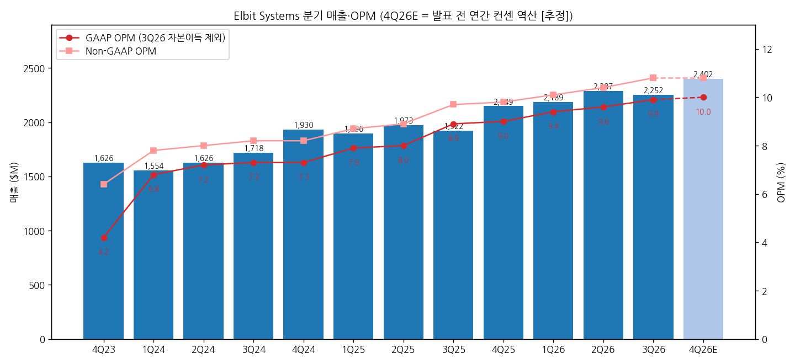
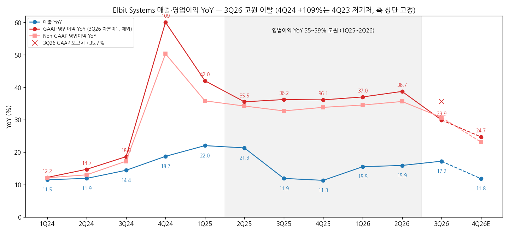
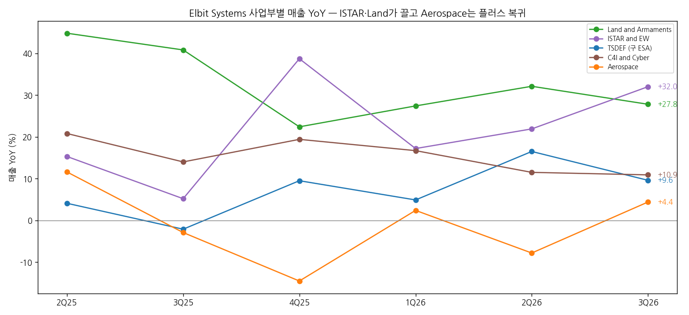

> 모드: 실적 리뷰 (v11)
> 종목: Elbit Systems (ESLT)
> 섹터: 방산
> 서브섹터: 방산전자
> 분기: 2026-Q3
> 발표일: 2026-11-17 (BMO, 컨퍼런스콜 09:00 ET)
> 작성 시각: 2026-11-22 23:30 KST
> 분석 소스: 회사 3Q26 보도자료(2026-11-17, PRNewswire — Finviz·Earnings Whispers 전재본) + 3Q26 컨퍼런스콜 트랜스크립트(Motley Fool/Nasdaq — Q&A: JPMorgan·Morgan Stanley·Jefferies) + 직전 리뷰 `2026-Q2_ESLT_리뷰.md`(과거 분기 표) + 웹 보완: 컨센(Fiscal.ai via Stocktwits, Chartmill), 주가 반응(Grafa·Stocktwits 프리마켓, stockanalysis), CEO 인터뷰(Reuters 인용 — Stocktwits), 기사(Calcalist·AWP). 셀사이드 리포트 첨부 없음 — 숫자 중심 리뷰

# Elbit Systems 3Q26 실적 리뷰

## 0. 한 줄 판정

> 성장 델타: 둔화 | 내러티브: 강화 → 고원 이탈, 그러나 수요는 더 단단해진 구간 (영업이익 YoY 35\~39% 고원 → 30%로 내려왔지만 컨센이 걱정한 20%대는 피했고, 2027 "high-teens 매출 성장 + 마진 확대" 가이던스로 다음 해 경로가 컨센보다 높아졌다)

→ 숫자: 매출 $2,252.1M(+17.2%), GAAP 영업이익 $232.5M(+35.7%, OPM 10.3%). 다만 미국 자회사 매각 자본이득 $9.9M이 영업이익에 들어 있어 이를 빼면 $222.6M(+29.9%, OPM 9.9%) — 델타 판정은 조정 기준. Non-GAAP 영업이익 $244.1M(+30.7%, OPM 10.8% 사상 최고)
→ 델타: 조정 GAAP 영업이익 YoY +38.7%(2Q26) → +29.9%, -8.8%p → "둔화". Non-GAAP 기준은 -4.9%p로 유지 경계. 6개 분기 이어진 35\~39% 고원에서 처음 내려왔다
→ 서프라이즈: 매출은 컨센(Fiscal.ai $2.257B) 대비 -0.2%로 사실상 부합, Non-GAAP EPS $4.36은 컨센 $3.57(Fiscal.ai)·$4.01(Chartmill) 대비 +9\~22%. 매출이 아니라 마진이 이긴 분기
→ 내러티브 강화: 잔고 $33.0B(+31%, 신기록) + **2027 가이던스 첫 제시 — 매출 high-teens 성장·마진 추가 확대**(발표 전 컨센 2027E 매출 +12.3%보다 높다) + FCF $276M(전년 $101M) + 이스라엘 국방부 지급 지연 보상 합의. 주가는 프리마켓 +8%로 2Q(-8.3%)와 반대
→ 다음 분기 관건: 4Q26 조정 GAAP 영업이익 YoY 20% 이상(약 $231M+) 유지와, 이스라엘 비중 37.5%가 내려가면서 유럽 매출(+3.9%)이 두 자릿수로 붙는지

## 1. 숫자

① 연결 분기 표 ($M, US GAAP / Non-GAAP 병기)

| 항목 | 4Q23 | 1Q24 | 2Q24 | 3Q24 | 4Q24 | 1Q25 | 2Q25 | 3Q25 | 4Q25 | 1Q26 | 2Q26 | **3Q26** | 4Q26E |
|---|---|---|---|---|---|---|---|---|---|---|---|---|---|
| 매출 | 1,625.8 | 1,554.0 | 1,626.2 | 1,717.5 | 1,930.2 | 1,895.8 | 1,972.7 | 1,921.6 | 2,148.6 | 2,188.8 | 2,287.1 | **2,252.1** | 2,402 |
| 영업이익 (GAAP 보고) | 67.6 | 105.4 | 116.5 | 125.8 | 141.4 | 149.7 | 157.8 | 171.4 | 192.5 | 205.1 | 218.8 | **232.5** | — |
| 영업이익 (GAAP, 자본이득 제외) | 67.6 | 105.4 | 116.5 | 125.8 | 141.4 | 149.7 | 157.8 | 171.4 | 192.5 | 205.1 | 218.8 | **222.6** | 240 |
| OPM (GAAP 조정) | 4.2% | 6.8% | 7.2% | 7.3% | 7.3% | 7.9% | 8.0% | 8.9% | 9.0% | 9.4% | 9.6% | **9.9%** | 10.0% |
| 영업이익 (Non-GAAP) | 104.8 | 121.6 | 130.5 | 140.7 | 157.5 | 165.1 | 175.1 | 186.7 | 210.8 | 222.0 | 237.5 | **244.1** | 259 |
| OPM (Non-GAAP) | 6.4% | 7.8% | 8.0% | 8.2% | 8.2% | 8.7% | 8.9% | 9.7% | 9.8% | 10.1% | 10.4% | **10.8%** | 10.8% |
| 매출 YoY | 7.9% | 11.5% | 11.9% | 14.4% | 18.7% | 22.0% | 21.3% | 11.9% | 11.3% | 15.5% | 15.9% | **17.2%** | 11.8% |
| 영업이익 YoY (GAAP 조정) | -43.9% | 12.2% | 14.7% | 18.6% | 109.2% | 42.0% | 35.5% | 36.2% | 36.1% | 37.0% | 38.7% | **29.9%** (보고 35.7%) | 24.7% |
| 영업이익 YoY (Non-GAAP) | — | 12.1% | 13.0% | 17.2% | 50.3% | 35.8% | 34.2% | 32.7% | 33.8% | 34.5% | 35.6% | **30.7%** | 23.1% |
| **매출 YoY 델타 (%p)** | -3.4 | +3.6 | +0.3 | +2.5 | +4.3 | +3.3 | -0.7 | -9.4 | -0.6 | +4.1 | +0.5 | **+1.3** | -5.4 |
| **영업이익 YoY 델타 (%p, GAAP 조정)** | -88.4 | +56.1 | +2.4 | +3.9 | +90.6 | -67.1 | -6.6 | +0.8 | -0.1 | +0.9 | +1.6 | **-8.8** | -5.2 |

→ (출처: 회사 분기 보도자료 — 3Q26 2026-11-17, 이전 분기는 직전 리뷰 표. **3Q26 자본이득 제외** = GAAP 영업이익 232.5 − 기타영업이익(미국 자회사 매각 자본이득) 9.9 [계산]. Non-GAAP은 회사 재작성값(회사도 이 자본이득을 Non-GAAP에서 뺐다). **4Q26E 매출 2,402 = 발표 전 2026E 컨센 $9,130M(stockanalysis, 2026-11) − 9M26 실적 $6,728.0M [계산]**, 영업이익은 컨센 미공개라 Non-GAAP OPM 10.8%(3Q 수준 유지) 가정, GAAP = Non-GAAP − 조정항목 약 $19M `[추정]`)
→ 컨센 대비: 매출 -0.2%(Fiscal.ai $2.257B) / -1.5%(Chartmill $2.286B) / 직전 리뷰가 쓴 tradestie $2.26B 대비 -0.4%. Non-GAAP EPS $4.36 vs $3.57(Fiscal.ai, +22%) / $4.01(Chartmill, +9%) / 직전 리뷰 $3.94(tradestie, +11%). 직전 리뷰가 역산한 3Q26E GAAP 영업이익 $214M `[추정]` 대비 실적(조정) $222.6M은 +4%
→ **고원 이탈**: 영업이익 YoY는 1Q25\~2Q26 6개 분기 35\~39%에 머물다 3Q26 30%로 내려왔다. 매출 YoY는 오히려 15.9% → 17.2%로 빨라졌으니, 이번 둔화는 **매출이 아니라 마진 개선 폭이 줄어든 것** — 조정 GAAP OPM YoY 개선 폭이 2Q26 +1.6%p(8.0 → 9.6%)에서 3Q26 +1.0%p(8.9 → 9.9%)로 작아졌다 [계산]. 기저(3Q25 OPM 8.9%)가 이미 높아진 영향이다
→ 컨센 경로: 4Q26E(발표 전 연간 컨센 역산)는 매출 +11.8%·영업이익 약 +25% `[추정]` — 2개 분기 연속 둔화 경로다. 다만 9M26 매출 YoY가 +16.2%여서 4Q도 같은 속도면 매출 약 $2,497M이고, 컨센 4Q 매출은 보수적일 가능성이 높다 `[판단]`. **영업이익 YoY 정점은 2Q26(+38.7%)으로 확정**되는 경로

→ (출처: 회사 분기 보도자료. GAAP OPM은 3Q26 자본이득 제외. 4Q26E는 연간 컨센 역산 매출 + OPM 가정 [추정], 점선·연한 막대)

→ (출처: 회사 분기 보도자료. 빨간 × = 3Q26 GAAP 보고치(자본이득 포함). E 구간 점선 [추정])

② 사업부별 매출 ($M, 내부거래 포함) — 사업부 영업이익은 분기 미공시

| 사업부 | 항목 | 3Q25 | 4Q25 | 1Q26 | 2Q26 | **3Q26** | QoQ | YoY |
|---|---|---|---|---|---|---|---|---|
| Land and Armaments | 매출 | 593.7 | 581.1 | 714.6 | 770.2 | **758.7** | -1.5% | **+27.8%** |
| | YoY 추이 | +40.8% | +22.4% | +27.4% | +32.1% | **+27.8%** | | |
| | 매출 비중 | 28.8% | 25.3% | 30.6% | 31.5% | **31.3%** | | |
| Aerospace | 매출 | 477.7 | 548.2 | 516.6 | 495.0 | **498.9** | +0.8% | **+4.4%** |
| | YoY 추이 | -2.9% | -14.5% | +2.4% | -7.8% | **+4.4%** | | |
| ISTAR and EW | 매출 | 340.7 | 456.6 | 423.1 | 447.8 | **449.7** | +0.4% | **+32.0%** |
| | YoY 추이 | +5.2% | +38.7% | +17.2% | +21.9% | **+32.0%** | | |
| TSDEF (Twenty-Six Defense, 구 ESA) | 매출 | 407.7 | 473.1 | 423.9 | 476.8 | **446.7** | -6.3% | **+9.6%** |
| | YoY 추이 | -2.1% | +9.5% | +4.9% | +16.5% | **+9.6%** | | |
| C4I and Cyber | 매출 | 243.3 | 240.8 | 256.7 | 252.9 | **269.7** | +6.6% | **+10.9%** |
| | YoY 추이 | +14.0% | +19.4% | +16.7% | +11.5% | **+10.9%** | | |
| 내부거래 제거 | | -141.5 | -151.2 | -146.1 | -155.6 | **-171.6** | | |
| **전사 (= 방산 합계)** | 매출 | 1,921.6 | 2,148.6 | 2,188.8 | 2,287.1 | **2,252.1** | -1.5% | +17.2% |
| | GAAP 영업이익 (조정) | 171.4 | 192.5 | 205.1 | 218.8 | **222.6** | +1.7% | +29.9% |

→ (출처: 3Q26 보도자료 사업부 표 — 사업부 합계 $2,423.7M, 내부거래 -$171.6M. 이전 분기는 직전 리뷰. 비중은 사업부 합계 대비 [계산]. Elbit Systems of America는 3Q26부터 **Twenty-Six Defense(TSDEF)**로 이름을 바꿨다)
→ **섹터 합산에 쓸 방산 기준: 전사 = 방산**(직전 리뷰와 같음). 기준값 3Q26 매출 $2,252.1M / GAAP 영업이익(자본이득 제외) $222.6M (전년 $1,921.6M / $171.4M), Non-GAAP $244.1M (전년 $186.7M)
→ 델타를 끄는 곳: **ISTAR and EW(+32%, 2Q +22%에서 가속)** — 아태 고출력 레이저·전자전·해양, 이스라엘 전자전·전자광학. **Land(+28%)** — 이스라엘 탄약. 두 사업부가 YoY 증분(사업부 합 $360.6M)의 76%를 냈다 [계산]
→ 돌아선 곳: **Aerospace +4.4%** — 이스라엘 무인기 증가가 아태 정밀유도무기(PGM) 감소를 일부 상쇄, 4개 분기 중 3개 분기 마이너스였던 흐름에서 플러스 복귀
→ 식은 곳: **TSDEF +16.5% → +9.6%** — 2Q 컨콜에서 회사가 "이 속도가 이어지진 않을 수 있다"고 한 대로. C4I는 +11%로 평탄

→ (출처: 회사 분기 보도자료)

(2-1) 지역별 매출 — 이스라엘 비중 37.5%, 2Q와 같은 수준 ($M)

| 지역 | 3Q25 | 3Q26 | YoY | 3Q26 비중 | 2Q26 비중 |
|---|---|---|---|---|---|
| 이스라엘 | 641.6 | 845.4 | **+31.8%** | **37.5%** | 37.4% |
| 유럽 | 536.0 | 556.9 | +3.9% | 24.7% | 24.6% |
| 북미 | 406.6 | 456.0 | +12.1% | 20.2% | 20.3% |
| 아시아태평양 | 266.2 | 289.4 | +8.7% | 12.9% | 14.0% |
| 중남미 | 20.7 | 71.2 | +244% | 3.2% | 3.7%(기타 포함) |
| 기타 | 50.5 | 33.2 | -34.3% | 1.5% | |

→ (출처: 3Q26 보도자료 지역 표, YoY [계산])
→ 증분 매출 $330.5M 중 이스라엘이 $203.8M(**62%**) — 2Q(59%)보다 더 이스라엘 의존적이다 [계산]. 유럽 매출은 +3.9%로 2Q(-0.1%)보다 나아졌지만 잔고 증가의 주역인 것에 비하면 여전히 느리다
→ CFO(JPMorgan 질문): 대부분 지역이 QoQ 평탄한 건 맞고 중남미만 2Q 대비 두 배. "중요한 건 YoY 17%"라고 답했다

(2-2) 수주잔고 ($B)

| | 3Q25 | 4Q25 | 1Q26 | 2Q26 | **3Q26** |
|---|---|---|---|---|---|
| 수주잔고 | 25.2 | 28.1 | 30.2 | 32.0 | **33.0** |
| YoY | +14% | +24% | +31% | +34% | **+31%** |
| QoQ 증가 | | +2.9 | +2.1 | +1.8 | **+1.0** |
| 이스라엘 외 비중 | 69% | 72% | 71% | 73% | **74%** |
| 단기 수행 비중 | 38% | 54%(2년) | 49% | 42% | **35%** (잔여 2026 + 2027) |
| 잔고 / TTM 매출 (배) | 3.3 | 3.5 | 3.7 | 3.7 | **3.7** |

→ (출처: 각 분기 보도자료·컨콜. 3Q26: 잔고 증가 주로 유럽, 65%는 2028년 이후 수행. 잔고/매출 [계산: TTM 매출 $8,876.6M])
→ 분기 수주 약 $3.25B [계산: 잔고 증가 $1.0B + 매출 $2.25B, 환율·취소 무시 `[추정]`] → Book-to-bill 약 1.4배로 2Q(약 1.8배)보다 낮아졌다. 분기 말 이후 유럽 PULS $235M·$260M 2건 발표(컨콜) — 4Q 잔고에 들어온다
→ 잔고 YoY가 +34% → +31%로 처음 꺾였고, 단기 수행 비중도 42% → 35%로 내려갔다. 새 잔고가 2028년 이후 물량 위주라는 뜻이다 [판단]

③ 연간 ($M)

| 항목 | 2022 | 2023 | 2024 | 2025 | 2026E | 2027E |
|---|---|---|---|---|---|---|
| 매출 | 5,511.5 | 5,974.7 | 6,827.9 | 7,938.6 | 9,130 | 10,700\~10,900 (가이던스 환산) / 10,250 (발표 전 컨센) |
| 영업이익 (GAAP, 일회성 제외) | 367.5 | 369.1 | 489.1 | 671.4 | 약 887 `[추정]` | — |
| OPM (GAAP) | 6.7% | 6.2% | 7.2% | 8.5% | 약 9.7% | 확대 (가이던스) |
| Non-GAAP 영업이익 | — | 448.7 | 550.4 | 737.8 | 약 963 `[추정]` | — |
| 매출 YoY | 4.4% | 8.4% | 14.3% | 16.3% | 15.0% | high-teens (가이던스) / 12.3% (컨센) |
| 영업이익 YoY (GAAP) | -12.2% | 0.4% | 32.5% | 37.3% | 약 32% `[추정]` | — |
| Non-GAAP EPS ($) | — | 6.70 | 8.76 | 12.75 | 약 16.9 `[추정]` (9M 12.37) / 16.31\~16.38 (발표 전 컨센) | 17.81 (발표 전 컨센) |

→ (출처: 2022\~2025 20-F·4Q 보도자료. 2026E 매출 = 발표 전 컨센(stockanalysis, 2026-11), 영업이익·EPS = 9M26 실적 + 4Q26E [추정]. 2027E 가이던스 = 컨콜 "high-teens 매출 성장 + 2026 대비 마진 확대" → 2026E $9,130M × 1.17\~1.19 [계산])
→ **발표 전 대비 연간 변화**: 9M26 Non-GAAP EPS가 이미 $12.37이라 4Q가 3Q 수준($4.36)만 나와도 2026E EPS는 약 $16.7로 발표 전 컨센($16.31\~16.38)을 넘는다. 2027 가이던스(high-teens)는 발표 전 컨센 매출 성장(+12.3%)보다 약 5\~7%p 높아 **2027E 상향 압력** `[판단]`. 집계처 수정 이력은 미확보

## 2. 시장 쟁점

① 2-0 지난 분기 체크 (2Q26 리뷰 4번 항목)

| 직전 리뷰 4번 항목 | 이번 분기 결과 | 판정 |
|---|---|---|
| ① 3Q26 영업이익 YoY — GAAP $214M(+25%) 이상인지, 30%대($223M+) 유지인지 | 조정 GAAP $222.6M(+29.9%) — $214M은 넘고 $223M엔 $0.4M 모자람. Non-GAAP +30.7%, 보고 GAAP +35.7% | **확인 (30% 경계)** — 20%대 급락은 아니고, 고원(35\~39%)은 이탈 |
| ② 잔고 $33B+와 전환율(3.7배) | 잔고 $33.0B, 잔고/매출 3.7배 유지, 단기 수행 비중 42% → 35%, CapEx $300M 집행 중 | **확인** — 잔고 증가 속도는 둔화(QoQ +$1.0B) |
| ③ 이스라엘 비중 33% 이하 + 유럽 매출 플러스 전환 | 이스라엘 37.5%(정상화 안 됨), 유럽 +3.9%(플러스 전환) | **반만 확인** — 유럽은 돌아섰고 이스라엘 의존은 그대로 |
| ④ PULS vs 천무 — 유럽 다연장 | 분기 후 PULS 유럽 2건($235M·$260M) 발표, 2027 성장 동인으로 EuroPULS 지목 | **확인 (PULS 쪽)** — 독일 EuroPULS 본계약은 미확인 |
| ⑤ 세율·R&D 장려법의 EPS 전환율 | 실효세율 11.6%(전년 8.2%, 2Q 16.4%보다 낮음), R&D 장려법 인센티브 분기 약 $20M | **반대로 나옴 (긍정)** — 세율이 2Q보다 낮아 EPS +30%가 영업이익(조정 +30%)과 같은 속도 |

② 이번 분기 쟁점 4개 (소스: 컨콜 Q&A 3개 기관 + 실적 후 기사)

| # | 쟁점 | 언급 |
|---|---|---|
| (1) | 영업이익 고원 이탈 vs 마진 확장 — "5년 연속 마진 확대"의 다음 단계 | 컨콜 Jefferies(마진 동인), 회사 2027 가이던스, 보도자료 |
| (2) | 잔고 → 매출 전환: QoQ 평탄한 지역 매출과 생산능력 | 컨콜 JPMorgan(2회)·Morgan Stanley, Calcalist |
| (3) | 2027 가이던스 high-teens — 컨센보다 높은 성장의 근거 | 컨콜 JPMorgan·Jefferies, Stocktwits |
| (4) | 이스라엘 의존(증분 62%)과 미국 군사원조 종료 가능성 | CEO Reuters 인터뷰, 보도자료 IMOD 보상 합의 |

③ 쟁점별 분해

(1) **영업이익 고원 이탈 vs 마진 확장**

(1-1) 회사 설명
→ 보도자료(CEO): 매출 high-teens 성장과 마진 확장이 이어졌고, 영업이익·EPS는 30% 넘게 늘었다
→ CFO(Jefferies 질문): 올해가 5년 연속 마진 확대. 동인은 영업레버리지, 고출력 레이저 등 R&D가 정식 프로그램으로 넘어가는 효과, 그리고 수주 선별 — "더 수익성 높은 주문을 골라 받을 수 있다"
→ 비용: R&D(순) $145.6M(매출 6.5%, 전년 6.7%) — R&D 장려법 인센티브 약 $20M 포함. 판매비 4.6%(4.7%), 관리비 4.4%(4.5%) — 판관비율이 모두 소폭 하락
→ 일회성: 기타영업이익 $9.9M(미국 자회사 매각 자본이득), 영업외로 미국 연금 해지 비용 약 $27.0M(기타비용 -$29.6M에 포함)

(1-2) 해석 편차

| 관점 | 핵심 가정·숫자 | 논리 |
|---|---|---|
| 회사 | OPM 10.8%(Non-GAAP), 2027도 확대 | 레버리지 + 프로그램 전환 + 선별 수주 |
| 발표 전 컨센 (역산) | 3Q26E EPS $3.57\~4.01 < 2Q 실적 $4.14 | 2Q 마진에 일회성이 섞였다는 가정 — 실제로는 3Q에 마진이 더 올랐다 |
| 숫자 (YoY) | 조정 GAAP 영업이익 YoY 38.7% → 29.9% | 마진은 오르지만 개선 폭(YoY)이 줄어 이익 증가율이 내려왔다 |

(1-3) 공통 vs 갈림
→ 공통: 레벨은 사상 최고(GPM 25.3%, Non-GAAP OPM 10.8%), 2Q에 의심받던 "일회성 마진"은 3Q에도 유지됐다
→ 갈림: 이 레벨에서 YoY 30%를 유지할 수 있는지. 3Q25 이후 기저 OPM이 8.9\~9.8%로 올라와 있어 4Q·1Q27의 YoY는 자연스럽게 20%대로 내려간다

(1-4) [판단]
→ 마진의 질은 2Q보다 좋아졌다 — 3Q GPM 25.3%(+0.4%p YoY), 판관비율 하락, 세율 정상화. 직전 리뷰의 "3Q26 GAAP OPM 9.5% 이상이면 구조적 개선" 조건(조정 9.9%)을 충족했다. 다만 **이익 증가율은 기저 효과로 정점을 지났다** — 레벨 강화 + 델타 둔화가 동시에 맞다

(2) **잔고 → 매출 전환**

(2-1) 회사 설명
→ CFO(JPMorgan 질문 — 지역 매출이 QoQ 평탄하거나 줄었는데 공급망·처리량 제약인가): 중남미는 2Q 대비 두 배, 나머지는 평탄. YoY 17%가 핵심 지표
→ CEO(같은 질문): 큰 문제는 보지 않고, 약속한 것을 못 할 이유가 없다
→ CFO(Morgan Stanley 질문): CapEx가 12개월간 30% 늘어 $300M. 고객이 시설을 직접 대는 사례가 처음 나왔고 이스라엘 밖으로 퍼지는 중 — 계약별로 로열티나 물량 기반 구조
→ CEO: 남부 이스라엘 생산 확대, 자동화·AI 기반 제조

(2-2) 해석 편차

| 관점 | 핵심 가정·숫자 | 논리 |
|---|---|---|
| 회사 | YoY 17%, 2027 high-teens | CapEx·고객 자금으로 전환 속도를 올린다 |
| JPMorgan (질문) | 지역 매출 QoQ 평탄 | 처리량 병목 가능성 |
| 숫자 | 잔고/매출 3.7배 유지, 단기 수행 비중 35% | 잔고는 쌓이지만 2028년 이후 물량 위주 |

(2-3) 공통 vs 갈림
→ 공통: 수요 의문은 없다. 3Q 매출 QoQ -1.5%는 2Q 일회성(ESA 믹스·이스라엘 보충)의 되돌림이 섞였다
→ 갈림: 2027 high-teens가 생산 증설로 가능한지, 아니면 이스라엘 탄약 같은 단기 소요에 기대는지

(2-4) [판단]
→ 2027 가이던스를 회사가 먼저 high-teens로 낸 것 자체가 "병목이 아니다"라는 답이다. 동인으로 든 PULS(유럽)·Iron Fist(유럽·미 Bradley)·고출력 레이저는 모두 잔고에 있는 수출 프로그램이라, 이스라엘 의존을 낮추는 성장이다. 4Q26 매출이 연간 컨센 역산($2,402M)보다 높게(9M 속도면 약 $2,497M) 나오면 전환 가속 쪽이 확인된다

(3) **2027 가이던스 high-teens**

(3-1) 회사 설명
→ CFO(JPMorgan·Jefferies 질문): Land와 ISTAR가 가장 빠르게 성장(PULS·EuroPULS, 고출력 레이저), C4I는 무전기 판매, TSDEF는 해양(Sparton)과 캐나다 수중로봇 인수(International Submarine Engineering) 효과
→ Aerospace(Jefferies 질문): F-35 생산 등 OEM 플랫폼 수요에 연동, 무인기가 항공전자보다 빠르게 성장

(3-2) 해석 편차

| 관점 | 2027 매출 성장 | 비고 |
|---|---|---|
| 회사 가이던스 | high-teens (+17\~19%) | 2026 대비 마진도 확대 |
| 발표 전 컨센 (stockanalysis) | +12.3% ($10.25B) | EPS +9% — 둔화 가정 |
| 차이 | 약 +5\~7%p | 컨센 상향 여지 [계산] |

(3-3) 공통 vs 갈림
→ 공통: 2026 매출 성장(9M +16.2%)보다 2027이 같거나 빠르다는 건 회사·잔고가 일치
→ 갈림: 셀사이드가 이 가이던스를 그대로 받을지. 6곳 평균 의견 Hold(stockanalysis)라 추정 상향이 등급·TP로 이어질지는 미확인

(3-4) [판단]
→ 직전 리뷰의 "컨센이 그리는 둔화(2027E EPS +9%)"라는 보수 논리의 근거가 이번 가이던스로 약해졌다. 내러티브 판정을 "강화"로 올린 핵심 근거다. 다만 가이던스는 범위·수치가 아닌 문장이라, 4Q 실적(2027-03)에서 숫자 가이던스로 확인돼야 한다

(4) **이스라엘 의존과 미국 군사원조**

(4-1) 사실
→ 3Q 증분 매출의 62%가 이스라엘(탄약·무인기·전자전), 이스라엘 비중 37.5%
→ 보도자료: 11월 이스라엘 국방부와 2023-10 이후 지급 지연 보상 합의. 15년 $170M IDF 포병 훈련센터 계약
→ CEO(Reuters 인터뷰 인용): 미국이 올해 이후 이스라엘 군사원조를 끝내면 이스라엘이 미국에서 사던 제품(예: 유도무기)을 자체 개발해야 해 오히려 기회. R&D는 매출의 6.5%, 연 약 $600M

(4-2) [판단]
→ 단기 이익은 이스라엘이 만들고(증분 62%), 잔고는 해외가 만든다(74%). 원조 종료는 이스라엘 국방예산의 국산화 압력이라 Elbit에는 중립\~긍정이다. 리스크는 이스라엘 수요 정상화 시점과 유럽 매출 가속 시점의 공백 — 유럽 매출 YoY가 4Q에 두 자릿수로 올라오는지가 체크포인트

④ 낙관 vs 보수

→ 낙관(회사·가이던스): 2027 high-teens + 마진 확대, 잔고 $33B, FCF 전환율 150%+, 세율 정상화, IMOD 보상 합의
→ 보수(숫자·발표 전 컨센): 영업이익 YoY 고원 이탈(38.7 → 29.9%), 잔고 YoY 첫 하락(+34 → +31%), 이스라엘 의존 심화, 단기 수행 비중 35%로 하락
→ 차이의 본질: **2027 이익 증가율이 20%대에서 버티느냐**. 매출 high-teens + 마진 확대면 영업이익 YoY 20%대 중반이 가능하다 [계산: 매출 +18% × OPM +0.5%p 가정 ≈ 영업이익 +24% `[추정]`] — 고원(35%)은 아니어도 꺾임과는 거리가 멀다

⑤ 추정치·TP 변화 (압축)

| 기관 | 직전 TP | 현재 TP | 3Q26 E | 2026E / 2027E | 핵심 변화 |
|---|---|---|---|---|---|
| JPMorgan (8/19) | $950 | $885 (Neutral) | — | — | 실적 후 갱신 미확인 |
| BofA (4/10) | — | $1,075 (Buy) | — | — | 실적 후 갱신 미확인 |
| Morgan Stanley (7/15) | — | $845 (Hold) | — | — | 실적 후 갱신 미확인 |
| 컨센 (stockanalysis) | 평균 $802 (11/14) | 평균 $801 (6곳 Hold) | EPS $3.57(Fiscal.ai)\~4.01(Chartmill), 매출 $2.257\~2.286B | EPS $16.31\~16.38 / $17.81 (발표 전) | 발표 후 수정 미확인 |

→ 주가: 실적일 프리마켓 +8%($734.99, Grafa 07:05 ET). stockanalysis 스냅샷 기준 전일 종가 $701.38 → 시가 $722.91, 장중 $721.11\~746.26 [조회 시점 2026-11 — 날짜 표기 없음, 실적일로 추정]. 2Q 실적일(-8.3%)과 반대 반응
→ TP 변화: 실적 후 개별 증권사 TP 변경은 웹에서 확인되지 않았다(리포트 첨부 없음). 판단: 발표 전 TP 하향(JPM·MS)은 멀티플 하향이었고, 이번 분기는 EPS 상향 쪽 — 실적 하향은 아니다 `[판단]`

## 3. 내러티브 점검

① 성장 스토리 정의
→ "이스라엘 전쟁 수요와 유럽 재무장을 동시에 받는 방산 통합업체. 잔고가 매출의 3배 이상 쌓여 매출 10%대 중반 성장과 마진 레벨업(OPM 7% → 10%+)이 몇 년간 이어진다"

② 이번 분기가 스토리에 준 영향
→ 강화: ① **2027 high-teens 성장·마진 확대 가이던스** — "2027년부터 성장이 둔화된다"는 컨센 가정을 회사가 직접 반박 ② Non-GAAP OPM 10.8% 최고, 직전 리뷰가 의심한 2Q 일회성 마진이 3Q에도 유지 ③ FCF $276M(전환율 150%+), 9M 영업현금흐름 $862.5M(전년 $461.0M) — 2Q 리뷰 시점 "현금흐름이 이익을 못 따라간다"는 우려 해소 ④ 세율 11.6%로 EPS 전환율 회복 ⑤ 주가 반응 플러스
→ 약화: 영업이익 YoY 고원 이탈, 잔고 YoY 하락(+31%), 이스라엘 의존 심화(증분 62%), 유럽 매출 +3.9%
→ 훼손 아님: 수요·점유율·마진 구조 전제는 그대로

③ 국면 판단
→ 델타 둔화(조정 영업이익 YoY 38.7% → 29.9%) + 내러티브 강화(2027 가이던스·현금흐름·마진 레벨) → **"고원 이탈, 그러나 수요는 더 단단해진 구간"**
→ BT 프레임으로는 델타가 꺾이기 시작한 쪽(둔화)이라 적극 매매 구간은 아니다. 다만 2027 가이던스대로면 영업이익 YoY 20%대 중반에서 안정 — "꺾임"보다 "높은 고원에서 낮은 고원으로 이동"에 가깝다 `[판단]`

④ 트리거와 리스크
→ 트리거: ① 4Q26 실적과 함께 2027 숫자 가이던스(매출·OPM 범위) 제시 ② EuroPULS 독일 본계약 등 유럽 대형 수주로 잔고 YoY 재가속 ③ 고출력 레이저(Sting·XCalibur) 해외 첫 수출
→ 리스크: ① 이스라엘 수요 정상화 + 유럽 전환 지연 → 매출 한 자릿수 ② 4Q 영업이익 YoY 20% 미만 → 2개 분기 연속 둔화 + 정점 통과로 "꺾임" ③ 일부 국가의 이스라엘산 무기 거래 제한 확대

## 4. 향후 봐야 할 것

① **4Q26 영업이익 YoY 20% 선** (델타 판정을 바꿀 1순위)
→ 무엇을: 조정 GAAP 영업이익 약 $231M(YoY +20%) 이상이면 "둔화" 유지, 미만이면 2개 분기 연속 둔화 + 2Q26 정점 통과로 "꺾임". 추정 경로 $240M(+24.7%) `[추정]`. 매출이 연간 컨센 역산 $2,402M을 넘는지(9M 속도면 $2,497M)
→ 어떤 데이터로: 4Q26 보도자료·컨콜
→ 언제: **2027-03 중순** (캘린더 추정 3/16)

② **2027 가이던스의 숫자화와 컨센 반영**
→ 무엇을: high-teens 매출 성장이 범위·OPM 목표로 구체화되는지, 컨센 2027E 매출(발표 전 $10.25B, +12.3%)과 EPS($17.81)가 얼마나 올라가는지
→ 어떤 데이터로: 셀사이드 노트(JPM·BofA·MS·Jefferies), stockanalysis·Chartmill 컨센, 4Q 컨콜
→ 언제: 2026-11 하순 \~ 2027-03

③ **이스라엘 비중 37.5% vs 유럽 매출 두 자릿수 전환**
→ 무엇을: 유럽 매출 YoY +3.9% → 10%+ 여부, 이스라엘 증분 의존(62%) 완화
→ 어떤 데이터로: 보도자료 지역 표, 이스라엘 국방예산·미국 원조 협상 뉴스
→ 언제: 4Q26 실적

④ **잔고 YoY +31% — 재가속 vs 둔화 지속**
→ 무엇을: 분기 말 이후 PULS 2건($495M)을 넣은 4Q 잔고 $34B+ 여부, 단기 수행 비중 35%의 방향, EuroPULS 독일 본계약
→ 어떤 데이터로: 6-K 수주 공시, Breaking Defense·Defense News, 한화에어로스페이스 천무 수주 공시(경합국)
→ 언제: 상시 (4Q26\~1H27)

⑤ **CapEx $300M·고객 자금 시설의 전환 효과**
→ 무엇을: 분기 매출 QoQ 정체(3Q -1.5%)가 풀리는지, 남부 이스라엘·해외 시설 가동
→ 어떤 데이터로: 컨콜 CapEx 코멘트, 분기 매출 QoQ
→ 언제: 2027-03
