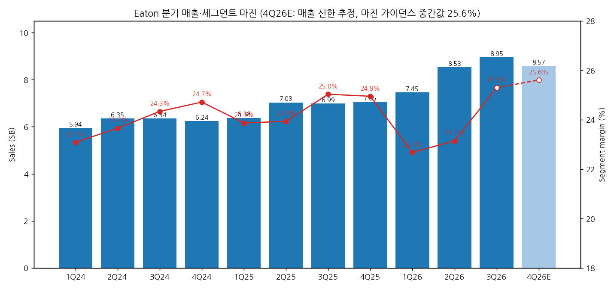
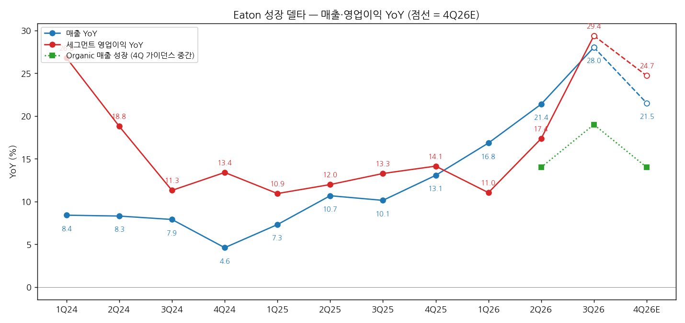
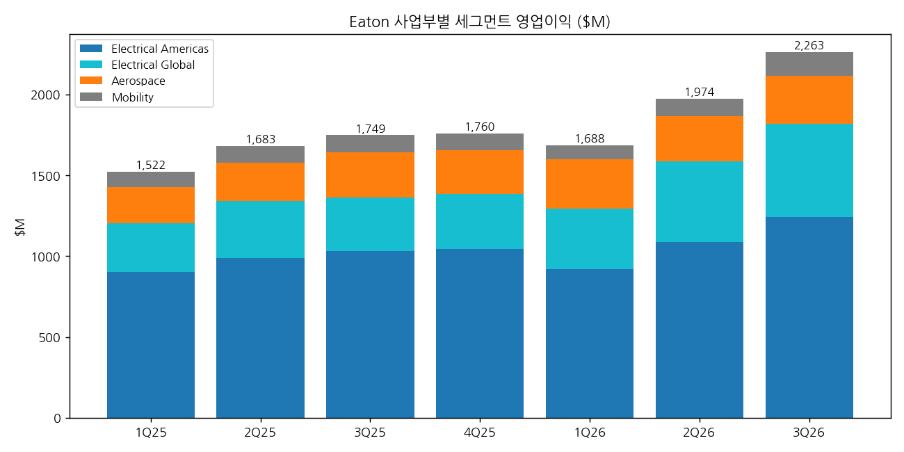

> 모드: 실적 리뷰 (v11)
> 종목: Eaton (ETN)
> 섹터: 전력 인프라
> 서브섹터: 배전·DC 전력관리
> 분기: 2026-Q3
> 발표일: 2026-11-03 (화, BMO — 보도자료·8-K, 11:00 ET 컨퍼런스콜)
> 작성 시각: 2026-11-14 17:30 KST
> 분석 소스: 셀사이드 첨부 2개(신한 11/4, 하나 9/17 직전분기 참고) + 웹서치 보완. 회사 자료 — Q3 2026 보도자료(8-K Exhibit 99, 11/3), Q2 2026 보도자료(8-K, 7/31), Q3 컨콜 트랜스크립트(Motley Fool 11/3 — Wolfe·DB·BofA·Melius·Vertical·BNP·Wells·UBS·Citi·Evercore·Bernstein 질문). 셀사이드 — 신한투자증권 「27년 기대감을 키운 호실적」(11/4, 함형도), 하나증권 「협력과 인수로 모듈형 포트폴리오 강화 중」(9/17, 김시현 — 발표 전 컨센·분기 실적 시계열). 웹서치 — 컨센 대비 실적·주가 반응(Trefis 11/4), TP 변경(RBC·Wells Fargo·TheStreet·Jefferies, 11/4~13), 2Q 수주 비교(Placera·Electrical Trends 7/31). 피어 비교는 `2026-Q3_{ABB·SU·GEV·HE·ENR·효성중공업·HD현대일렉트릭·LS일렉트릭}_리뷰.md` 재사용. 직전 ETN 리뷰 없음 (첫 리뷰)

# Eaton 3Q26 실적 리뷰 — organic +19%, 세그먼트 이익 YoY +29%로 가속. 데이터센터 수주 +101%, 북미 둔화 신호는 없다

> 성장 델타: 가속 | 내러티브: 강화 → 델타 가속 + 내러티브 강화 → 적극 구간 (단 컨센·가이던스 경로상 이익 YoY 정점은 이번 분기 — 4Q +25% 안팎, 2027년 +16% 안팎으로 감속, Boyd는 2027년 3월부터 organic 편입)

→ **숫자**: 매출 $8,947M(+28.0% YoY, organic +19%, 인수 +8%), 세그먼트 영업이익 $2,263M(+29.4% YoY), 세그먼트 마진 25.3%(분기 사상 최고). 매출 YoY는 21.4% → 28.0%(+6.6%p), 영업이익 YoY는 17.4% → 29.4%(+12.0%p)로 함께 올랐다. organic 매출도 14% → 19%로 가속해 인수 효과를 빼도 "강한 가속"이다. 컨센 대비 매출 +4.9%, Adj. EPS $3.68 +4.0%, 마진 +0.3%p 비트 (Trefis·신한)
→ **쟁점 ①**: Electrical Americas 마진이 1Q 25.6% → 2Q 27.5% → 3Q 29.8%로 회복했다. 회사는 증설 25개 중 18개 완료로 "새 생산능력이 출하로, 출하가 이익으로 바뀌고 있다"고 했고, 3Q 가격-원가가 달러 기준 플러스로 돌아섰다. 1월 2일부터 일반 가격 인상도 발표했다
→ **쟁점 ②**: 데이터센터 수주 +101%(12개월 롤링), 매출 +65%(9개 분기 연속 +35% 이상). 데이터센터 파이프라인은 307GW → 366GW. EA 롤링 수주 증가율은 41% → 39%로 2%p 낮아졌지만 분기 수주액은 $5B+ 사상 최대다. 피어 중 북미 데이터센터 "둔화" 신호(GEV Electrification, HD현대일렉트릭)는 배전·DC 전력관리 쪽에서는 나오지 않는다 [판단]
→ **쟁점 ③**: Electrical Global이 organic +9% → +18% → +27%로 가속했고 Boyd(액체냉각)가 31%p를 더했다. Boyd 2026 매출 가이던스는 $1.8B → $1.9B, 2027년 최소 $2.7B. 연간 가이던스는 organic 13~15%(+2%p), Adj. EPS $13.70~13.80(+$0.25)로 올해 세 번째 상향이다
→ **다음 분기 관건**: 4Q26 세그먼트 마진 25.4~25.8%(가이던스), EA 마진 30%+ 회복, EA 롤링 수주 증가율 35%+ 유지. 2027 가이던스(2월)에서 시장 성장 11%+α가 숫자로 나오는지. 12월 FERC·ERCOT 결론은 데이터센터 비중이 높은 EA 수주의 할인율을 정한다

---

## 1. 숫자

① 연결 기준 분기 표 (단위: $M, %)

Eaton의 주 지표는 **세그먼트 영업이익·세그먼트 마진과 Adj. EPS**다. 아래 영업이익은 세그먼트 영업이익 합계(본사비용·무형자산상각·이자·구조조정·인수 비용 차감 전)이고, GAAP 비교를 위해 세전이익 행을 붙였다. 2026년 1Q부터 Vehicle·eMobility를 Mobility로 통합해 과거 분기도 재작성됐다(합계 불변).

| 항목 | 1Q24 | 2Q24 | 3Q24 | 4Q24 | 1Q25 | 2Q25 | 3Q25 | 4Q25 | 1Q26 | 2Q26 | **3Q26** | 4Q26E |
|---|---|---|---|---|---|---|---|---|---|---|---|---|
| 매출액 | 5,943 | 6,350 | 6,345 | 6,240 | 6,377 | 7,028 | 6,988 | 7,055 | 7,451 | 8,531 | **8,947** | 8,573 |
| 세그먼트 영업이익 | 1,372 | 1,502 | 1,544 | 1,542 | 1,522 | 1,682 | 1,749 | 1,760 | 1,690 | 1,974 | **2,263** | 2,195 |
| 세그먼트 마진 | 23.1 | 23.7 | 24.3 | 24.7 | 23.9 | 23.9 | 25.0 | 24.9 | 22.7 | 23.1 | **25.3** | 25.6 |
| 매출 YoY | +8.4 | +8.3 | +7.9 | +4.6 | +7.3 | +10.7 | +10.1 | +13.1 | +16.8 | +21.4 | **+28.0** | +21.5 |
| 영업이익 YoY | +26.8 | +18.8 | +11.3 | +13.4 | +10.9 | +12.0 | +13.3 | +14.1 | +11.0 | +17.4 | **+29.4** | +24.7 |
| **매출 YoY 델타 (%p)** | — | -0.1 | -0.4 | -3.3 | +2.7 | +3.4 | -0.6 | +3.0 | +3.7 | +4.6 | **+6.6** | -6.5 |
| **영업이익 YoY 델타 (%p)** | — | -8.0 | -7.5 | +2.1 | -2.5 | +1.1 | +1.3 | +0.8 | -3.1 | +6.4 | **+12.0** | -4.7 |
| Organic 매출 성장 | — | — | — | — | — | — | — | — | — | +14 | **+19** | +13~15 (가이던스) |
| Adj. EPS ($) | 2.40 | 2.73 | 2.84 | 2.83 | 2.72 | 2.95 | 3.07 | 3.33 | 2.81 | 3.15 | **3.68** | 4.05~4.15 (가이던스) |
| GAAP 세전이익 | — | — | — | — | 1,177 | 1,186 | 1,275 | — | 1,107 | 1,144 | **1,370** | — |

→ (출처: 1Q24~2Q26 하나증권 9/17 도표 1(회사 재작성 수치), 3Q26·2Q26·3Q25 Eaton 8-K 보도자료. 2024년 분기 YoY는 하나증권 표. GAAP 세전이익 1Q는 반기−2Q로 역산 [계산]. 4Q26E 매출은 신한투자증권 추정(11/4), 마진은 회사 4Q 가이던스 중간값 25.6%, 영업이익 = 매출×마진 [계산])
→ 컨센 대비: 매출 $8,947M vs $8,530M(+4.9%), Adj. EPS $3.68 vs $3.54(+4.0%), 세그먼트 마진 25.3% vs 25.0%(+0.3%p) (Trefis 11/4, 신한 11/4 — Bloomberg 컨센). 회사 3Q 가이던스(organic 13.5~15.5%, 마진 24.6~25.0%, Adj. EPS $3.46~3.56)도 전부 상단을 넘었다
→ 4Q 가이던스: organic 13~15%, 세그먼트 마진 25.4~25.8%, Adj. EPS $4.05~4.15(중간값 YoY +23%). 신한 4Q 추정 Adj. EPS $4.10와 같다

→ **판정 근거**: 영업이익 YoY가 2Q26 +17.4% → 3Q26 +29.4%로 12%p 확대, 매출 YoY도 +6.6%p 확대 → 기준상 **강한 가속**. 인수(Boyd·Ultra PCS·Fibrebond) 효과가 8%p 있지만 organic도 14% → 19%로 함께 가속했다. GAAP 세전이익은 +7.5%에 그쳤는데, 인수 무형자산상각($314M, 전년 $130M)과 인수 차입 이자($198M, 전년 $67M) 때문이다. 이익 체력은 세그먼트 기준으로 판단한다
→ **YoY 정점은 이번 분기 [판단]**: 가이던스 기준 4Q 영업이익 YoY는 +25% 안팎, 신한 2027년 Adj. 영업이익 YoY는 +16.4%다. 2027년 3월 Boyd가 organic으로 들어가고 Mobility(2025 매출 약 $3.1B, 저마진)가 1Q에 빠지면서 표면 매출 YoY는 더 낮아진다. 레벨은 계속 오르지만 YoY 델타는 4Q부터 감속 경로다. ENR·LS일렉트릭과 같은 "가속의 끝자락" 패턴이다

→ (출처: 하나증권 9/17 도표 1, Eaton 8-K. 4Q26E는 신한 매출 추정 × 가이던스 마진 중간값 [계산])

→ (출처: 같은 자료 [계산]. 녹색 점선은 organic 매출 성장률 — 2Q26 14%, 3Q26 19%, 4Q26 가이던스 중간 14%)

② 사업부별 매출·영업이익 (단위: $M, %)

| 사업부 | 항목 | 3Q25 | 1Q26 | 2Q26 | **3Q26** | 매출 비중 3Q26 |
|---|---|---|---|---|---|---|
| Electrical Americas | 매출 | 3,410 | 3,600 | 3,951 | **4,172** | 46.6% |
| | 영업이익 | 1,034 | 922 | 1,088 | **1,243** | |
| | 마진 | 30.3 | 25.6 | 27.5 | **29.8** | |
| | 매출 YoY (organic) | +15.1 | +19.6 | +17.9 (+18) | **+22.3 (+22)** | |
| | 영업이익 YoY | +15.9 | +2.0 | +10.2 | **+20.2** | |
| Electrical Global | 매출 | 1,724 | 1,945 | 2,517 | **2,727** | 30.5% |
| | 영업이익 | 330 | 373 | 499 | **576** | |
| | 마진 | 19.1 | 19.2 | 19.8 | **21.1** | |
| | 매출 YoY (organic) | +9.6 | +20.8 (+9) | +43.6 (+18) | **+58.2 (+27)** | |
| | 영업이익 YoY | +12.2 | +24.3 | +41.4 | **+74.5** | |
| Aerospace | 매출 | 1,079 | 1,139 | 1,222 | **1,196** | 13.4% |
| | 영업이익 | 280 | 304 | 278 | **298** | |
| | 마진 | 25.9 | 26.7 | 22.8 | **24.9** | |
| | 매출 YoY (organic) | +14.1 | +16.3 | +13.1 (+7) | **+10.8 (+6)** | |
| | 영업이익 YoY | +21.7 | +34.5 | +15.8 | **+6.4** | |
| Mobility | 매출 | 775 | 766 | 841 | **852** | 9.5% |
| | 영업이익 | 105 | 89 | 109 | **146** | |
| | 마진 | 13.5 | 11.6 | 13.0 | **17.2** | |
| | 매출 YoY (organic) | -10.2 | -1.7 | -0.5 (-2) | **+9.9 (+9)** | |
| | 영업이익 YoY | -18.0 | -3.3 | +5.8 | **+39.0** | |

→ (출처: Eaton 8-K 3Q26·2Q26, 하나증권 9/17 도표 1. organic은 보도자료·컨콜 [회사], EG 1Q26 organic 9%는 컨콜 CEO 발언. 비중 [계산])
→ **델타를 끄는 것은 Electrical 두 축이다**. 세그먼트 영업이익 증가 +$514M 중 EG +$246M(48%), EA +$209M(41%), Mobility +$41M, Aerospace +$18M [계산]. 3Q26 Electrical 합산 마진은 26.4%(2Q 대비 +190bp), organic +24%다
→ **EG는 이제 두 번째 성장 엔진이다**. organic만 +27%(APAC 약 +50%, GIS·EMEA 약 +20%), 데이터센터 매출 +97%다. Boyd 기여 31%p는 매출 약 $530M [계산]. 회사는 "Boyd 제외 EG 잔고도 +76%"라고 했다. 2026~30 EG 성장 목표(5년 CAGR 5%)는 2027년에 올리겠다고 예고했다
→ **EA는 마진이 돌아오는 중이다**. 전년 대비 마진은 아직 -50bp(30.3% → 29.8%)이고, 회사는 "대부분 일시적 원자재 비용"이라고 했다. 4Q 증분마진은 3Q 20%대 후반 → 4Q 30%대 후반~40%로 높인다는 계획이다
→ **꺾이는 사업부는 Aerospace**다. organic 7% → 6%, 영업이익 YoY +16% → +6%. 수요(수주 +20%, 방산 OEM +36%, 잔고 $5.6B)는 강한데 일부 원자재 공급 문제로 잔고 전환이 늦다. 이익 비중이 13%라 그룹 델타 영향은 작다
→ **Mobility는 반등했지만 2027년 1Q에 빠진다**(Dana와 RMT, 2027년 첫 4개월 내 종결). 2027년 매출 기여는 약 $800M뿐이다

→ (출처: Eaton 8-K, 하나증권 9/17 — Mobility 재작성 기준)

(1) 수주·잔고 — 선행지표

| 항목 | 2Q26 | **3Q26** | 비고 |
|---|---|---|---|
| EA 수주 (12개월 롤링, organic YoY) | +41% | **+39%** | 분기 수주 $5B+ 사상 최대, Book-to-bill 1.3 유지 |
| EG 수주 (12개월 롤링, organic YoY) | +33% | **+51%** | 사상 최대 |
| Aerospace 수주 (12개월 롤링) | +17% | **+20%** | 방산 OEM +36% |
| Electrical 합산 수주 (12개월 롤링) | — | **+43%** | Book-to-bill 1.2 |
| 데이터센터 수주 (12개월 롤링) | — | **+101%** | 매출 +65% |
| EA 잔고 YoY | +33% | **+33%** | |
| EG 잔고 YoY | +103% | **+121%** | Boyd 제외 +76% |
| Electrical 잔고 | — | **$20B+ (+46%)** | 신한 집계 전력 잔고 $20.3B |
| Aerospace 잔고 | — | **$5.6B (+33%)** | |
| 미국 데이터센터 프로젝트 파이프라인 | 307GW | **366GW** | 설치 용량 약 50GW 대비 |

→ (출처: Eaton 8-K 2Q26·3Q26, 3Q 컨콜, 신한 11/4 수주잔고 표)
→ 데이터센터 외 수주도 강하다: 유틸리티 +20%, 주거 +25%, 기계 OEM +55%(12개월 롤링). 매출 기준으로는 C&I 중반 10%대(분기만 보면 25%+), 기계 OEM 30%대 중반, 산업시설 두 자릿수 (컨콜 CEO·CFO)
→ 선행지표: 미주 메가프로젝트 발표 연초 대비 +85%, 협상 파이프라인 +55% (컨콜)

③ 연간 (단위: $M, %)

| 항목 | 2022 | 2023 | 2024 | 2025 | 2026E | 2027E |
|---|---|---|---|---|---|---|
| 매출 | 20,752 | 23,196 | 24,878 | 27,448 | 약 33,500 | 36,742 (신한) |
| 세그먼트 영업이익 | 4,200 | 5,090 | 5,960 | 6,713 | 약 8,120 | — |
| 세그먼트 마진 | 20.2 | 22.0 | 24.0 | 24.5 | 24.1~24.5 (가이던스) | 24.8 (신한 Adj.) |
| 매출 YoY | +5.7 | +11.8 | +7.3 | +10.3 | 약 +22 | +11.5 (신한, Mobility 이탈 반영 여부 미기재) |
| 세그먼트 영업이익 YoY | — | +21.2 | +17.1 | +12.6 | 약 +21 | +16.4 (신한 Adj.) |
| Adj. EPS ($) | 7.06 | 9.12 | 10.80 | 12.07 | 13.70~13.80 (가이던스) | 16.14 (신한·Bloomberg) |

→ (출처: 2022~2025 `ETN_기업개요.md` 12년 시계열·하나증권 도표 2, 2026E는 9M 실적 + 4Q 가이던스 기준 [계산], 2027E는 신한 11/4 표. 2022 Adj. EPS는 기업개요 재사용)
→ 2026 가이던스 변화: Adj. EPS $13.00~13.50(1월) → $13.40~13.60(7월) → **$13.70~13.80(11월)**, organic 11~13% → **13~15%**. 세 번 올렸다. 세그먼트 마진 24.1~24.5%는 유지
→ 발표 전 → 후 연간 컨센: 2026 Adj. EPS $13.41~13.5(하나 9/17, LSEG·Bloomberg) → $13.57(신한 11/4, Bloomberg) +0.5~1.2%, 2027 Adj. EPS $15.75~15.9 → $16.14 +1.5~2.5%. Wells Fargo는 2026·27 EPS를 $13.65 → $13.85, $16.35 → $16.75로 올렸다
→ 2027년 회사 프레임(가이던스는 2월): 최종 시장 성장 11% 이상 + 초과 성장, 증분마진 2026년 약 23%보다 높게, Boyd $2.7B 이상(3월부터 organic), Mobility 매출 약 $800M만 반영

---

## 2. 시장 쟁점

> 셀사이드 첨부는 2개(신한 11/4 리뷰, 하나 9/17 프리뷰 성격)다. 쟁점은 두 리포트 + 컨콜 Q&A(11개 증권사 질문) + 웹 보도(TP 변경)로 구성했다. "증권사별" 표는 첨부 증권사 + 컨콜 질문자 + 웹 보도를 섞은 "출처별"로 쓴다.

① 지난 분기 체크 (2-0)

첫 리뷰 — 직전 체크 없음. 대신 `ETN_기업개요.md`의 분류 변경 조건을 점검한다.

| 기업개요 분류 변경 조건 | 이번 분기 결과 | 판정 |
|---|---|---|
| ① Mobility 분사 완료(2027 Q1) + Electrical+Aerospace 4분기 마진 25%+ → pure secular 격상 | Mobility: Dana RMT 10/16 보완 계약, 2027년 첫 4개월 내 종결 예정. Elec+Aero 마진 4Q25 26.1% → 1Q26 23.9% → 2Q26 24.3% → 3Q26 26.2% [계산] | 진행 중 — 1Q·2Q26이 25% 미달. 4Q26부터 다시 4분기 카운트 |
| ② EA 잔고 2분기 연속 감소 → 사이클 강등 검토 | EA 잔고 YoY +33%(2Q·3Q 동일), 수주 Book-to-bill 1.3 | 미발동 |
| ③ Aerospace 마진 25%+ 유지 + 매출 비중 25% → SOTP 재검토 | 마진 24.9%, 비중 13.4% | 미발동 |

② 이번 분기 쟁점

| # | 쟁점 | 언급 출처 수 |
|---|---|---|
| (1) | EA 마진 회복 — 1Q 25.6%의 마진 우려는 끝났나, 2027년 대형 3상 변압기 공장 램프업은 부담인가 | 신한 + 컨콜 3곳(Wells·UBS·Evercore) |
| (2) | 북미 데이터센터 수주 — 둔화 신호가 있나 (피어 대비) | 신한·하나 + 컨콜 2곳(DB·Wolfe) |
| (3) | EG·Boyd 가속과 M&A 전략 — 구조적인가, 인수로 산 성장인가 | 신한·하나 + 컨콜 4곳(BNP·Vertical·Melius·Bernstein) |
| (4) | 가이던스 3회 상향에도 주가는 고점 대비 -15% — 멀티플은 어디로 가나 | 신한 + 웹 보도 |

③ 쟁점별 분해

(1) EA 마진 회복 — 우려는 끝났나

(1-1) 회사 설명
→ "EA 마진 29.8%는 2Q 대비 +230bp, 1Q 대비 +400bp 이상이다. 전년 대비 하락의 대부분은 일시적 원자재 비용 역풍이다. 2Q·3Q 초에 한 가격 조치가 효과를 내 3Q 가격-원가가 달러 기준 플러스였다" (CFO Dave Foster)
→ "증설 25개 중 18개를 마쳤고 가장 가파른 램프는 지났다. 새 생산능력이 출하로, 출하가 이익으로 바뀌고 있다" (CEO Paulo Ruiz)
→ "EA 증분마진은 3Q 20%대 후반에서 4Q 30%대 후반~40% 가까이로 오른다. 다만 4Q에 4를 곱하지는 말라 — 유통 사업에 계절성이 있다" (CEO, Wells Fargo·UBS 질문 답변)
→ "10월에 대형 고객 2곳과 가격 협상을 마쳤고 4Q에 몇 곳이 남았다. 1월 2일부터 EA·EMEA·GIS 일반 가격 인상을 발표했다" (CFO)
→ 대형 3상 변압기 공장(2027년 상반기 가동): "기존보다 크지만 교훈을 얻었다. 작업자를 미리 뽑아 위스콘신 공장에서 훈련 중이다. 동시 증설이 18개에서 6개로 줄어 덜 혼란스럽다" (CEO, UBS Amit Mehrotra 질문 답변)

(1-2) 출처별 해석 편차

| 출처 | 핵심 가정·추정 | 논리 |
|---|---|---|
| 신한투자증권 (11/4) | 4Q EA 마진 +32.5% 추정(연간 가이던스 역산), 증설 24개 중 18개 완료 | 원가·물류비 상승분을 가격에 전가, 수익성 우려를 불식시킨 호실적. EA 마진이 12개 분기 만에 새 영역 진입 |
| 하나증권 (9/17, 발표 전) | 개별 가격 인상 추가, 가격 효과는 하반기로 갈수록 증가 | 2Q까지 EA 원가율 상승(매출원가율 66.5%)이 우려의 근거였다 |
| Wells Fargo (컨콜 Steve Tusa + 노트) | 4Q EA 증분마진 40~45%, 2026·27 EPS 상향, TP $503 → $485 | 마진 경로는 맞지만 데이터센터 채널 가격 정책을 확인해야 한다 |
| UBS (컨콜 Amit Mehrotra) | 대형 3상 변압기 공장 2027년 상반기 가동 | 기존 18개보다 훨씬 큰 공장 — 2027년 EA 마진의 역풍 |
| Evercore ISI (컨콜 David Raso) | 2026 비효율 비용의 2027년 축소 폭 | 가격-원가와 증설 비효율이 2027년에 얼마나 풀리나 |

(1-3) 공통 결론 vs 갈리는 지점
→ 공통: 1Q 25.6%가 바닥이었고 가격 전가가 작동한다. 4Q 30%대 회복은 가이던스가 이미 담고 있다
→ 갈림: 2027년 EA 마진. 회사는 "증설 수가 줄어 덜 혼란스럽다", UBS는 "규모가 훨씬 큰 공장 하나"를 걱정한다. 전년 동기 마진(3Q25 30.3%)을 아직 넘지 못했다는 점도 남는다

(1-4) [판단]
→ 숫자는 회사 편이다. 2개 분기 연속 +200bp 안팎 회복, 가격-원가 플러스 전환, 4Q 가이던스 마진 25.4~25.8%(그룹)는 EA 31~33%를 뜻한다(신한 32.5%)
→ 4Q EA 마진이 31% 이상이면 "증설 비효율 → 레버리지" 전환이 확정된다. 29% 아래면 원자재 역풍이 일시적이 아니라는 뜻이고, 2027년 3상 변압기 공장 리스크와 겹친다

(2) 북미 데이터센터 수주 — 둔화 신호가 있나

(2-1) 회사 설명
→ "데이터센터는 계속 우리를 놀라게 한다. 발표된 프로젝트가 366GW로 지난 콜의 307GW에서 늘었다. 설치 용량 50GW와 비교하면 엄청난 빌드아웃이고 여러 해 이어질 것이다. 매출 +65%로 9개 분기 연속 35% 이상, 수주는 +101%다. 장기 계획에 17% 성장을 넣었는데 연초 이후 60% 성장했다" (CEO, Deutsche Bank Nicole DeBlase 질문 답변)
→ "수주는 분기마다 들쭉날쭉하지만 파이프라인과 잔고가 계속 쌓인다. EA 롤링 수주 +39%, Book-to-bill 1.3" (CEO)
→ "AC에서 DC로의 전환 방향은 실재하지만 시점은 우리가 통제하지 못한다. 우리는 아키텍처 중립 — 어느 쪽이든 이긴다. 15kV 2MW SST가 10월 UL 신규 기준을 다중 메가와트급 최초로 통과했다. 파일럿 10개, 올해 15kV 프로젝트 다수 출하, 내년 물량 전환" (CEO, Wolfe Nigel Coe 질문 답변)
→ "10월 매출이 매우 강하게 출발했다" (CEO)

(2-2) 출처별 해석 편차 — 피어 3Q26 북미·데이터센터 수주

| 출처 (서브섹터) | 3Q26 북미·데이터센터 수주 | 해석 |
|---|---|---|
| **Eaton** (배전·DC) | 데이터센터 수주 +101%, EA 롤링 수주 +41% → +39%, 분기 수주액 사상 최대 | 증가율 정점권, 절대 수주는 사상 최대 |
| ABB (배전·DC) | Electrification 수주 +70%, 북미 +117%, 데이터센터 2개 분기 연속 세 자릿수 | 가속 |
| Schneider (배전·DC) | 데이터센터 수주 4개 분기 중 3개 분기 세 자릿수, 북미 organic 매출 +23.1% → +19.9% | 수주 강, 북미 매출 성장률 소폭 감속 |
| LS일렉트릭 (배전·DC) | 미국 수주 비중 66%, 누적 수주 중 데이터센터 50%+, 잔고 QoQ +0.6% | 수주 강, 잔고 증가 정체(환율) |
| GE Vernova (발전) | Electrification 데이터센터 수주 1Q $2.4B → 3Q 약 $1.4B, organic +29% → +16% | **둔화** |
| HD현대일렉트릭 (송변전) | 수주 -19%, 생산 슬롯 소진 | 공급 제약형 둔화 |
| 효성중공업 (송변전) | 중공업 수주 +122%, 하이퍼스케일러 직접 발주 | 강 |
| Hitachi Energy (송변전) | Power Grids 수주 +50%, 데이터센터 "지연 없음", FY27 5배 목표 | 강 (데이터센터 비중 10%대 초반) |
| Siemens Energy (발전) | 미국 수주 +70%, 데이터센터 잔고 €15B(<10%), 가스터빈 확정 수주 2GW(예약 SRA 39GW) | 확정 수주 타이밍 지연 |

→ (출처: 각 사 `2026-Q3_*_리뷰.md`, Eaton 컨콜)

(2-3) 공통 결론 vs 갈리는 지점
→ 공통: 배전·DC 전력관리 4사(ETN·ABB·SU·LS) 중 북미 데이터센터 수주가 줄었다는 곳은 없다. 둔화가 나온 곳은 발전(GEV 데이터센터 Electrification, ENR 가스 확정 수주)과 송변전(HD 슬롯)이고, 둘 다 회사는 "공급·타이밍"으로 설명한다
→ 갈림: "증가율"이다. Eaton EA 롤링 수주 +41% → +39%, SU 북미 매출 +23% → +20%처럼 성장률은 정점권에서 살짝 내려오는 중이다. 롤링 12개월 수치라 분기 단위 둔화가 늦게 보인다는 점도 감안해야 한다

(2-4) [판단]
→ **"북미 DC 신규수주가 둔화되는가"에 대한 답: 배전·DC 쪽은 아니다. 수주 레벨은 사상 최대이고, 증가율만 정점권에서 고원으로 들어가는 중이다.** 둔화가 확인된 곳은 발전·송변전의 대형 설비(가스터빈·대형 변압기)로, 납기가 길고 슬롯이 이미 팔린 품목이다
→ 결론이 바뀌는 조건: 4Q EA 롤링 수주 증가율이 30% 아래로 떨어지거나, 데이터센터 수주가 세 자릿수에서 두 자릿수 초반으로 내려오면 배전 쪽도 둔화로 본다. 12월 FERC·ERCOT 결론이 데이터센터 비용 부담 강화 쪽이면 EA(데이터센터 매출 성장 +54%)가 피어 중 가장 직접 노출된다

(3) EG·Boyd 가속과 M&A — 구조적인가, 인수로 산 성장인가

(3-1) 회사 설명
→ "EG organic은 1Q 9% → 2Q 18% → 3Q 27%다. Boyd는 이 숫자에 없고 31%p를 따로 더한다. 유럽 구조조정을 수요 가속 전에 먼저 했고, 글로벌 고객을 따라가며, 데이터센터·유틸리티·기계 OEM으로 포트폴리오를 옮겼고, 점유율을 따고 있다. 구조적이지 순환적이지 않다" (CEO, BNP Andrew Buscaglia 질문 답변)
→ "Boyd는 매출이 2Q 대비 +24%, 전년 대비 세 자릿수, 잔고 3배다. 2026 매출 $1.9B(Eaton 장부 $1.6B), 2027년 최소 $2.7B. 2027년 3월부터 organic이 된다" (CEO·CFO, Vertical Jeffrey Sprague 질문 답변)
→ "인수에 이미 $14B를 썼고 모든 딜이 인수 당시 예상보다 좋다. 큰 딜은 끝났다. 12개월 안에 Boyd 규모 딜은 없다. 북미에는 제품 공백이 없고 유럽·아시아 볼트온은 계속한다 — COL Group(이탈리아 중전압, €810M, 2027 1Q 종결)이 예" (CEO, Melius Scott Davis 질문 답변)
→ 모듈형: "Fibrebond는 인수 전 연 $375M에서 1년 만에 $600M, 마진은 EA 평균 이상. 2026년 미주 모듈형 매출 $1B" (CEO, BofA Andrew Obin 질문 답변)

(3-2) 출처별 해석 편차

| 출처 | 핵심 가정·추정 | 논리 |
|---|---|---|
| 신한투자증권 (11/4) | Boyd 매출 25년 $11억 → 26년 $27억(가이던스 상향, 기존 $18억으로 기재), 잔고 3배 | M&A로 기술 경쟁력 강화, 기존 사업과 시너지로 가파른 실적 성장 → 밸류 리레이팅 기대 |
| 하나증권 (9/17) | Grid-to-chip 포트폴리오 완성: Boyd(냉각)·Resilient(SST)·Fibrebond(모듈형, $14억)·Siemens Energy 500MW 온사이트 발전 모듈형 데이터센터 파트너십·Flexnode | 현장 숙련공 부족을 공장으로 옮겨 인건비 최대 50% 절감, 배치 기간 단축 |
| BNP Paribas (컨콜) | EG +18% → +27%의 지속성 | 일시적 급등인가 고성장 단계 진입인가 |
| Melius (컨콜) | 연속된 M&A | 공백 메우기를 계속할 것인가 |
| Bernstein (컨콜) | 유럽 데이터센터 점유율 | 유럽 UPS 1위를 배전까지 넓히는가 |

(3-3) 공통 결론 vs 갈리는 지점
→ 공통: EG는 인수를 빼도 가속 중이고(organic +27%, Boyd 제외 잔고 +76%), 데이터센터 고객을 따라 유럽·아시아로 같이 나간다. 대형 M&A 사이클은 끝났다
→ 갈림: 인수 비용. 무형자산상각($314M)과 이자($198M)가 GAAP 이익을 누른다(GAAP 세전이익 +7.5% vs 세그먼트 +29%). 신한·하나는 시너지에, 시장 일부는 레버리지(장기차입 $8.8B → $17.8B)에 무게를 둔다

(3-4) [판단]
→ Boyd 2027 $2.7B 가이드와 "3월 organic 편입"은 2027년 organic 성장률을 끌어올리는 회계적 장치다. 2027년 organic이 두 자릿수를 유지해도 그중 일부는 Boyd 효과라는 점을 구분해야 한다
→ 구조적 판단의 근거는 EG legacy다. EG legacy가 4Q에도 organic +20% 이상이면 "구조적 고성장" 쪽이 맞다

(4) 가이던스 3회 상향에도 주가는 고점 대비 -15%

(4-1) 회사 설명
→ "올해 세 번째 상향이다. 2026 Adj. EPS +14%, 하반기만 보면 +20%. 2027년 최종 시장은 하나도 줄지 않고 약 90%가 성장 시장, 합산 11% 성장 — 2026~30 organic 목표 6~9%보다 훨씬 높다" (CEO)
→ "데이터센터는 시장의 모든 논의에도 2028~29년 이후까지 긴 활주로가 있다" (CEO 마무리 발언)

(4-2) 출처별 해석 편차 — 2-4 표 참조

(4-3) 공통 결론 vs 갈리는 지점
→ 공통: 숫자는 기대 이상이었다. 발표일 주가 +7.0%(S&P +0.4%), 피어 중앙값 +4.1%보다 강했다 (Trefis)
→ 갈림: 그래도 주가는 8/12 고점 $459.96 대비 약 -15%, 최근 3개월 -12.2%, 12개월 +3.8%로 S&P(+11.9%)에 뒤처졌다. 9/14에는 -7.6% 하락도 있었다(원인 미확인) (Trefis 11/4). 신한 기준 1M -10.2%, 3M -10.6%다

(4-4) [판단]
→ TP·주가 하락은 실적 하향이 아니라 멀티플 하향이다. 2026·27 EPS 추정은 올라갔는데(+1~2.5%) 컨센 TP는 $490.7(9/15) → $482.7(11/3) → 약 $477(11월 중순)로 내려왔다. 신한 기준 2026F PER 28.9배, 2027F 24.3배로 하나 9/17 시점(2026F 31.5배)보다 낮다
→ 섹터 공통의 "AI 데이터센터 센티먼트 + 12월 FERC" 할인이다. GEV·ABB·HE와 같은 패턴이다

④ 낙관 vs 보수 — 논리 대비

| 구분 | 출처 | 무엇을 다르게 가정했나 |
|---|---|---|
| 가장 낙관 | RBC (Outperform, $526 → $539) | (세부 논리 미확보) 가이던스 상향·수주 가속을 TP에 반영 |
| 가장 낙관 | 신한투자증권 (★5, 컨센 TP $482.7 인용) | EA 마진 새 영역 진입 + EG 성장·마진 동반 → 2027년 실적 기대 + 밸류 리레이팅 |
| 가장 보수 | Jefferies (Neutral, $395, 11/13) | (세부 논리 미확보) 현재가 수준 적정가 — 이미 반영 |
| 가장 보수 | Wells Fargo (Overweight, $503 → $485) | EPS는 올리고 TP는 내림 — 멀티플 하향 |

→ 같은 숫자에서 갈리는 변수는 **2027년 EA 마진(3상 변압기 공장 램프업)**과 **데이터센터 사이클 지속 기간에 주는 멀티플**이다
→ 셀사이드 vs 주가: 셀사이드는 추정치를 올리는데 주가는 고점 대비 -15%다. 바이사이드는 AI 데이터센터 센티먼트와 정책 이벤트를 보고 있다

⑤ 추정치·TP 변화 (2-4)

| 출처 | 직전 TP ($) | 현재 TP ($) | 4Q26 Adj. EPS E | 2026 / 2027 Adj. EPS E | 핵심 변화 한 줄 |
|---|---|---|---|---|---|
| 컨센서스 (LSEG) | 490.7 (9/15, 하나 인용) | **482.7** (11/3, 신한 인용) | — | 13.41 → 13.57 / 15.75 → 16.14 | TP -1.6%, EPS +1~2.5% |
| 신한투자증권 | — | 컨센 인용 (★5) | 4.10 | 13.57 / 16.14 | 2027 매출 $36.7B, Adj. OPM 24.8% |
| 하나증권 (9/17) | — | 컨센 인용 | — | 13.5 / 15.9 (Bloomberg) | 발표 전 기준점 |
| RBC | 526 | **539** | — | — | Outperform 유지 |
| Wells Fargo | 503 | **485** | — | 13.65 → 13.85 / 16.35 → 16.75 | Overweight 유지, 추정 상향·TP 하향 |
| TheStreet (Pro) | — | 약 500 | — | — | 등급 Two → One 상향 |
| Jefferies | — | **395** | — | — | Neutral (11/13) |
| 주가 | $392.4 (9/15) | $391.7 (11/3 종가, 발표일 +7.0%) | | | 52주 고점 $478 대비 -18% (신한) |

→ (출처: 하나증권 9/17, 신한투자증권 11/4, RBC·Wells Fargo·TheStreet 보도(MarketBeat·TheStreet Pro 11/4), Jefferies(Defense World 11/13), Trefis 11/4. RBC·Wells·Jefferies 원문 리포트 미확인)
→ TP 상향 1건(RBC), 하향 1건(Wells), 등급 상향 1건(TheStreet), 신규 Neutral 1건(Jefferies). 컨센 TP는 $490.7 → $482.7 → 약 $477로 약 -3%
→ **TP 하향의 원인은 멀티플 하향이다.** 2026·27 EPS 컨센은 올랐다. 현재가 $391.7 대비 컨센 TP 상승여력 +23% (신한)

---

## 3. 내러티브 점검

① 성장 스토리 정의
→ **"Grid-to-chip 데이터센터 전력·냉각 풀스택(배전·UPS·모듈형·액체냉각·SST) + 유틸리티·C&I·리쇼어링의 광범위한 전력화로, 증설이 끝나는 2H26부터 마진 레버리지가 붙는 지속성장주"** — 시장이 ETN을 사는 이유는 데이터센터 노출과 이를 넘어서는 수요 폭이다

② 이번 분기 평가 — **강화**
→ 숫자: organic +19%, 세그먼트 이익 YoY +29%로 가속, 마진 사상 최고 25.3%. 1Q의 "EA 마진 우려"(1Q 발표일 주가 -5.9%)가 숫자로 해소됐다
→ 수요: 데이터센터 수주 +101%, 파이프라인 307 → 366GW, Electrical 잔고 +46%. 데이터센터 외 유틸리티 +20%·기계 OEM +55% 수주로 폭이 넓어졌다
→ 가이던스: 올해 세 번째 상향, 2027년 시장 성장 11% 프레임, Boyd 2027 $2.7B
→ 약화 요인: EA 롤링 수주 증가율 41% → 39%, Aerospace 공급 문제, GAAP 이익과 세그먼트 이익의 괴리(인수 비용), 주가 고점 대비 -15%. 스토리 전제를 건드리는 것은 없다 [판단]

③ 국면 설명 (0번 판정 근거)
→ 델타 가속 + 내러티브 강화 → **적극 구간**. 배전·DC 피어 중 ABB(가속|유지)·SU(유지|유지)보다 한 단계 강하고 LS일렉트릭(가속|강화)과 같다
→ 단, 이익 YoY 정점은 이번 분기다. 4Q +25% 안팎 → 2027년 +16% 안팎. 모멘텀 관점에서는 "레벨은 오르는데 델타는 감속하는" 구간이 4Q부터 시작된다. 4Q 영업이익 YoY가 +20% 아래면 "둔화"로 내린다 [판단]

④ 스토리를 강하게 만들 트리거
→ (1) 4Q EA 마진 31%+ → 2027년 EA 마진 30%대 정착 확인
→ (2) 2월 2027 가이던스 organic 두 자릿수(Boyd 편입 효과 포함) + EPS +15% 이상
→ (3) 800V DC·SST 물량 수주(파일럿 10개 → 2027 볼륨 전환)

⑤ 스토리를 깨뜨릴 리스크
→ (1) 데이터센터 수주 증가율 급락 (EA 롤링 30% 아래)
→ (2) 12월 FERC·ERCOT 결론 이후 미국 데이터센터 착공 지연
→ (3) 2027년 대형 3상 변압기 공장 램프업 비효율 재발 → EA 마진 재하락

---

## 4. 향후 봐야 할 것 (우선순위 순)

(1) **4Q26 세그먼트 마진 25.4~25.8%, EA 마진 31% 이상, Adj. EPS $4.05~4.15** — 델타 판정을 바꾸는 1순위 변수
→ 무엇을: 세그먼트 영업이익 약 $2.2B(YoY +25% 안팎) 이상이면 "가속 후 고원" 유지. YoY +20% 미만·EA 마진 29% 미만이면 "둔화"
→ 어떤 데이터로: 4Q 보도자료·컨콜, EA 증분마진(4Q 30%대 후반~40% 계획), 가격-원가
→ 언제: 2027년 2월 초 (4Q 실적 + 2027 가이던스 동시)

(2) **EA 12개월 롤링 수주 증가율 35% 이상, 데이터센터 수주 세 자릿수 유지**
→ 무엇을: 41% → 39%가 고원인지 하강인지. Book-to-bill 1.3 유지, 데이터센터 파이프라인(366GW) 추가 증가
→ 어떤 데이터로: 4Q 보도자료 수주 문단, 컨콜 데이터센터 수주·매출, 피어 ABB·SU 4Q 북미 수주(1월 말~2월)
→ 언제: 2027년 2월 초

(3) **11/3 중간선거 → 11월 RTO 보고 → 12월 FERC·ERCOT 결론** — 섹터 공통 이벤트
→ 무엇을: 데이터센터 전력·계통 접속 비용 부담 강화 여부. EA 데이터센터 매출 +54% 성장이라 피어 중 노출이 큰 편이다. 반대로 온사이트 발전(Siemens Energy 500MW 모듈형 파트너십)·모듈형은 계통 우회 수요로 수혜 여지가 있다 [판단]
→ 어떤 데이터로: FERC 대형부하 RTO 보고(11/16~20), ERCOT 감사(12/10), FERC 반론 시한(12/16)
→ 언제: 2026년 11월 중순 ~ 12월 중순

(4) **2027 가이던스 — organic 두 자릿수, Adj. EPS $16 이상, 증분마진 23% 초과**
→ 무엇을: 회사 프레임(시장 11%+α, Boyd $2.7B, Mobility 약 $800M)이 숫자로 나오는지. EG 2026~30 목표(CAGR 5%) 상향 여부
→ 어떤 데이터로: 2월 4Q 실적 발표 가이던스 페이지
→ 언제: 2027년 2월 초

(5) **포트폴리오 이벤트 — Mobility-Dana RMT 종결, COL Group 인수 종결, 1월 2일 가격 인상 효과**
→ 무엇을: RMT 종결(현금 약 $1.1B → 차입 상환), COL 종결(2027 1Q), Elec+Aero 마진 25%+ 4분기 카운트 재시작(분류 조건 ①)
→ 어떤 데이터로: 8-K 공시, Dana 주총, 뉴스 키워드 "Eaton Dana RMT", "Eaton COL Group"
→ 언제: 2027년 1~4월
