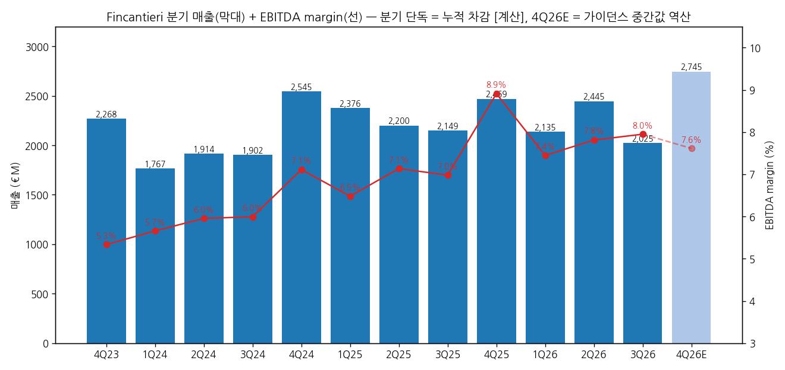
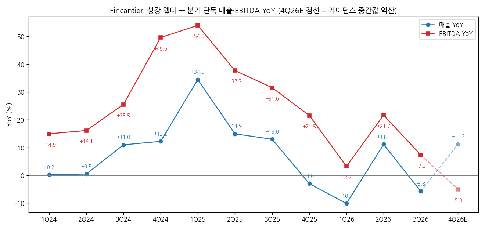
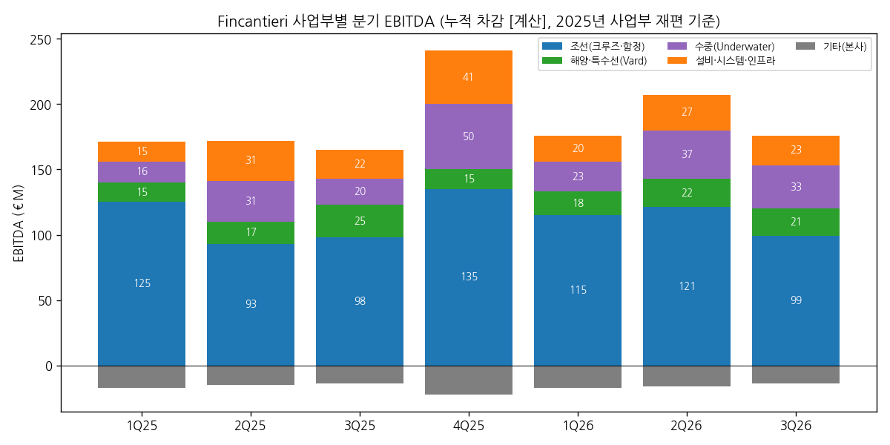

> 모드: 실적 리뷰 (v11)
> 종목: Fincantieri (FCT.MI)
> 섹터: 조선
> 서브섹터: 조선 글로벌
> 분기: 2026-Q3
> 발표일: 2026-11-12 (Trieste, 9M 2026 결과 보도자료·Results Presentation + 컨퍼런스콜). 회사는 1Q·1H·9M 누적치만 공시하므로 3Q26 단독 = 9M − 1H로 계산
> 작성 시각: 2026-11-14 19:15 KST
> 분석 소스: 회사 IR 원문 — 9M 2026 보도자료(11/12, 23쪽)·9M 2026 Results Presentation(11/12)·Data sheet 9M 2026(xlsx, 2012~2026 누적 시계열), 1H 2026 보도자료(7/29)·반기보고서, 1Q 2026 보도자료(5/11), CMD 2026 「F4」 Business Plan 2026-2030(2026-02), Underwater M&A 보도자료(7/6). 컨콜: 9M 트랜스크립트 미확보, 1H26 컨콜은 GuruFocus 요약(Refinitiv 원본 유료)만 확보 — 보도 인용. 주가: Yahoo Finance FCT.MI(11/13 종가). 셀사이드 리서치 0건, 컨센서스 미확보
> 리뷰 깊이: 숫자 중심 | 리서치 첨부 0건

# Fincantieri 3Q26 실적 리뷰 — 마진은 8%를 넘봤지만 매출은 비었다, 4Q 가이던스는 EBITDA 역성장을 깔고 있다

> 성장 델타: 둔화 | 내러티브: 유지 → 델타 둔화 + 내러티브 유지 → 경계 구간 (4Q26 가이던스 역산 EBITDA YoY -5%, 미 해군 LSM·포르투갈 FREMM EVO 본계약이 함정 매출 공백을 메우는지 확인 전까지 관망)

→ **숫자**: 3Q26 단독 매출 €2,025M(-5.8% YoY), EBITDA €161M(+7.3% YoY), EBITDA margin 8.0%(+1.0%p) [계산]. EBITDA YoY가 2Q26 +21.7%에서 14.4%p 내려와 둔화다. 회사 공시 단위인 9M 누적으로도 EBITDA YoY가 1H +12.5% → 9M +10.9%로 낮아졌다. 매출 YoY는 1Q -10.1% → 2Q +11.1% → 3Q -5.8%로 다시 마이너스다
→ **쟁점 ①**: 매출 감소의 원인은 함정(Defense)이다. 9M 함정 매출 €1,039M(-36.8%)은 2025년 1Q 인도네시아 PPA 2척 일괄 인식 기저와 미 해군 Constellation 프로그램 재편 때문이다. 회사는 "미 해군 수주는 수개월 내"라고 했지만, 실제 확보한 것은 LSM 4척 자재·설계 계약 $30M뿐이다
→ **쟁점 ②**: 마진은 크루즈 단가가 만든다. 9M 크루즈 매출 +9.1%가 "생산량보다 빠르게" 늘었고(회사), 조선 EBITDA margin이 6.5% → 7.3%로 올랐다. 다만 3Q 단독 크루즈 매출은 €1,038M으로 -1.9% YoY다 [계산]. 회사는 이 분기 둔화를 따로 설명하지 않았다
→ **쟁점 ③**: 연간 EBITDA 가이던스를 €700~710M에서 €715~725M로 올렸다. 하지만 역산한 4Q26 EBITDA는 €204~214M으로, 4Q25 €220M보다 -7.3~-2.7% 낮다 [계산]. 순이익 가이던스 €140~180M을 유지했으므로 2H26 순이익은 €38~78M(2H25 €82M)이 된다. 상향의 크기는 1H 초과분 정도다
→ **다음 분기 관건**: FY26(2027년 3월 말 예상, 미공시)에서 4Q EBITDA가 €220M 이상(YoY 플러스)이면 둔화에 머문다. 가이던스 중간값 €209M이 나오면 분기 EBITDA YoY가 마이너스로 돌아서 "꺾임" 조건에 들어간다. 주가(11/13 €11.41, 연초 대비 -29%, 발표 후 2거래일 -5.7%)를 움직일 변수는 숫자보다 함정 본계약(LSM 건조, 포르투갈 FREMM EVO 3척)과 수중 M&A 종결이다

---

## 1. 숫자

① 연결 기준 분기 표 (단위: €M, %, 분기 단독 — 누적 공시치 차감 [계산])

| 항목 | 4Q23 | 1Q24 | 2Q24 | 3Q24 | 4Q24 | 1Q25 | 2Q25 | 3Q25 | 4Q25 | 1Q26 | 2Q26 | **3Q26** | 4Q26E (가이던스 역산) |
|---|---|---|---|---|---|---|---|---|---|---|---|---|---|
| 매출 (Revenue and income) | 2,268 | 1,767 | 1,914 | 1,902 | 2,545 | 2,376 | 2,200 | 2,149 | 2,469 | 2,135 | 2,445 | **2,025** | 2,695~2,795 (중간 2,745) |
| EBITDA (회사 기준, 주 지표) | 121 | 100 | 114 | 114 | 181 | 154 | 157 | 150 | 220 | 159 | 191 | **161** | 204~214 (중간 209) |
| EBITDA margin | 5.3 | 5.7 | 6.0 | 6.0 | 7.1 | 6.5 | 7.1 | 7.0 | 8.9 | 7.4 | 7.8 | **8.0** | 7.6 |
| 매출 YoY | +4.7 | +0.2 | +0.5 | +11.0 | +12.2 | +34.5 | +14.9 | +13.0 | -3.0 | -10.1 | +11.1 | **-5.8** | +9.2~+13.2 (중간 +11.2) |
| EBITDA YoY | n/m | +14.9 | +16.1 | +25.5 | +49.6 | +54.0 | +37.7 | +31.6 | +21.5 | +3.2 | +21.7 | **+7.3** | -7.3~-2.7 (중간 -5.0) |
| **매출 YoY 델타 (%p)** | — | -4.5 | +0.3 | +10.5 | +1.2 | +22.3 | -19.5 | -2.0 | -16.0 | -7.2 | +21.3 | **-16.9** | +17.0 |
| **EBITDA YoY 델타 (%p)** | — | n/m | +1.2 | +9.4 | +24.1 | +4.4 | -16.3 | -6.1 | -10.0 | -18.3 | +18.4 | **-14.3** | -12.3 |
| 누적 EBITDA YoY (공시 단위) | — | 1Q +14.9 | 1H +15.6 | 9M +18.8 | FY +28.2 | 1Q +54.0 | 1H +45.3 | 9M +40.5 | FY +33.8 | 1Q +3.2 | 1H +12.5 | **9M +10.9** | FY +5.0~+6.5 |

→ (출처: Fincantieri Data sheet 9M 2026(누적 1Q·1H·9M·FY), 9M 2026 보도자료. 분기 단독은 누적 차감 [계산]이며 누적치가 €M 단위 반올림이라 ±€1M 오차가 있다. 4Q26E는 2026 가이던스(매출 €9.3~9.4B, EBITDA €715~725M) − 9M 실적으로 역산 [계산]. 4Q23 EBITDA YoY는 4Q22 €49M 기저로 n/m)
→ **지표 정의**: EBITDA는 회사 APM 기준이며 "extraordinary and non-recurring income and expenses"를 제외한다. 회사는 1Q·9M에 매출·EBITDA·수주·잔고·순차입금만 내고, EBIT·순이익은 1H·FY에만 공시한다. 그래서 분기 델타 판정은 EBITDA로 한다. 참고로 1H26 EBIT은 €207M(margin 4.5%, 1H25 €156M·3.4%)이다
→ **분기 단독 공시 여부**: 회사가 3Q 단독 손익을 따로 발표하지 않는다. 다만 누적 EBITDA가 1Q·1H·9M에 모두 나오므로 분기 단독 EBITDA는 계산할 수 있다. 따라서 0번 판정을 보류하지 않고 분기 단독 기준으로 했으며, 9M 누적 기준 판정(둔화)을 병기했다
→ 컨센서스 대비 서프라이즈: 9M26 컨센서스 미확보. 참고로 1Q 발표 전 2026 EBITDA 컨센은 €708M이었다(Websim 보도 인용). 이번 상향 가이던스 하단 €715M은 이보다 높다
→ EBITDA YoY 정점은 1Q25 +54.0%였다. 이후 +37.7% → +31.6% → +21.5% → +3.2% → +21.7% → +7.3%로 내려왔다. 2Q26 반등은 2Q25 낮은 기저(함정 €414M)와 크루즈·수중 동반 증가 덕이었고, 3Q26에는 다시 한 자릿수로 돌아왔다. 가이던스 경로상 4Q26E는 -5.0%로 2024년 이후 첫 분기 역성장이다
→ **[판단] 델타 = 둔화**: 3Q26 EBITDA YoY(+7.3%)는 플러스지만 직전 분기보다 14.4%p 낮다. 9M 누적(+12.5% → +10.9%)도 같은 방향이다. 4Q26 가이던스가 이미 역성장을 깔고 있어, 4Q 실적이 가이던스 중간값이면 다음 분기는 "꺾임"(EBITDA YoY 마이너스 전환) 판정이 된다

→ (출처: Fincantieri Data sheet 9M 2026 누적치 차감 [계산]. 4Q26E는 가이던스 중간값 역산 [추정], 연한 막대·점선 = E)

→ (출처: 동일. 4Q26E는 가이던스 중간값 역산 [추정])

② 사업부별 매출·EBITDA (단위: €M, %, 내부거래 제거 전, 분기 단독 [계산])

| 사업부 | 항목 | 3Q25 | 4Q25 | 1Q26 | 2Q26 | **3Q26** | 9M25 | **9M26** | 9M YoY |
|---|---|---|---|---|---|---|---|---|---|
| 조선 (Shipbuilding) | 매출 | 1,530 | 1,707 | 1,537 | 1,620 | **1,399** | 4,885 | **4,556** | -6.7 |
| 조선 | EBITDA | 98 | 135 | 115 | 121 | **99** | 316 | **335** | +5.9 |
| 조선 | margin | 6.4 | 7.9 | 7.5 | 7.5 | **7.1** | 6.5 | **7.3** | +0.8%p |
| 조선 | 매출 YoY | +12.3 | -8.5 | -15.9 | +6.1 | **-8.6** | | | |
| 조선 | EBITDA YoY | +15.3 | -2.9 | -8.0 | +30.1 | **+1.0** | | | |
| 조선 중 크루즈 | 매출 | 1,058 | 1,216 | 1,220 | 1,219 | **1,038** | 3,188 | **3,477** | +9.1 |
| 조선 중 크루즈 | 매출 YoY | +14.3 | +5.3 | +16.7 | +12.4 | **-1.9** | | | |
| 조선 중 함정 (Defense) | 매출 | 459 | 474 | 297 | 390 | **352** | 1,643 | **1,039** | -36.8 |
| 조선 중 함정 | 매출 YoY | +8.8 | -31.0 | -61.4 | -5.8 | **-23.3** | | | |
| 해양·특수선 (Vard) | 매출 | 398 | 315 | 360 | 432 | **332** | 1,041 | **1,124** | +8.0 |
| 해양·특수선 | EBITDA | 25 | 15 | 18 | 22 | **21** | 57 | **61** | +8.0 |
| 해양·특수선 | margin | 6.3 | 4.8 | 5.0 | 5.1 | **6.3** | 5.4 | **5.4** | 0.0%p |
| 해양·특수선 | 매출 YoY | +18.8 | -30.6 | +12.9 | +33.3 | **-16.6** | | | |
| 수중 (Underwater) | 매출 | 112 | 281 | 135 | 221 | **175** | 386 | **531** | +37.6 |
| 수중 | EBITDA | 20 | 50 | 23 | 37 | **33** | 67 | **93** | +40.1 |
| 수중 | margin | 17.9 | 17.8 | 17.0 | 16.7 | **18.9** | 17.3 | **17.6** | +0.3%p |
| 수중 | 매출 YoY | — | — | +42.1 | +23.5 | **+56.2** | | | |
| 수중 | EBITDA YoY | — | — | +43.8 | +19.4 | **+65.0** | | | |
| 설비·시스템·인프라 (ESI) | 매출 | 266 | 393 | 309 | 411 | **317** | 927 | **1,037** | +11.9 |
| 설비·시스템·인프라 | EBITDA | 22 | 41 | 20 | 27 | **23** | 68 | **70** | +1.8 |
| 설비·시스템·인프라 | margin | 8.3 | 10.4 | 6.5 | 6.6 | **7.3** | 7.4 | **6.7** | -0.7%p |
| 기타 (본사 비용) | EBITDA | -14 | -22 | -17 | -16 | **-14** | -46 | **-47** | |

→ (출처: 9M 2026 보도자료 사업부 표·Data sheet 9M 2026. 분기 단독은 누적 차감 [계산]. 9M YoY는 회사 발표치(천 유로 기준 계산)이며, Data sheet €M 차감과 0.1~1.3%p 다를 수 있다. 수중 사업부는 2025년 신설(WASS 2025-01 연결)이라 2024년 분기 비교치가 없다. 내부거래 제거: 3Q26 -€198M)
→ 9M26 매출 비중(제거 전): 조선 63%(9M25 68%), 해양·특수선 16%(14%), 수중 7%(5%), ESI 14%(13%)다(회사). 9M26 EBITDA 증가분 €50M 중 수중이 +€26M, 조선이 +€19M이다 [계산]
→ **델타를 끄는 쪽은 수중이다.** 3Q 단독 매출 +56%, EBITDA +65%로 사업부 중 유일하게 가속했고 margin 18.9%는 수중 사업부 분기 최고다 [계산]. U212 NFS 잠수함 공정 진행과 WASS·Remazel 성장이 원인이다(회사). 다만 그룹 EBITDA의 약 20%(3Q 33/161)라 혼자서 그룹 델타를 바꾸기는 어렵다
→ **꺾이는 쪽은 조선 매출이다.** 함정은 4개 분기 연속 YoY 마이너스(-31% → -61% → -6% → -23%)다. 3Q에는 9M 기준으로 +9%를 내던 크루즈까지 -1.9%로 내려와, 조선 EBITDA YoY가 +1.0%로 거의 멈췄다. 조선 margin(3Q 7.1%, 3Q25 6.4%)은 올랐지만 매출 기반이 줄었다
→ 해양·특수선(Vard)은 3Q 매출 -16.6%로 분기 변동이 크다(2Q26 +33%). 9M 누적으로는 매출·EBITDA 모두 +8%, margin 5.4%로 "경쟁적 환경에서 최근 수년 수준"(회사)이다

→ (출처: Data sheet 9M 2026 누적 차감 [계산]. 회색 = 본사 비용(기타 활동))

③ 수주·잔고 — 선행지표 (단위: €M, 배)

| 항목 | 1Q25 | 2Q25 | 3Q25 | 4Q25 | 1Q26 | 2Q26 | **3Q26** |
|---|---|---|---|---|---|---|---|
| 수주 (분기 단독, 발효 기준) | 11,712 | 3,032 | 1,276 | 4,311 | 3,387 | 2,734 | **3,573** |
| 분기 Book-to-bill | 4.93 | 1.38 | 0.59 | 1.75 | 1.59 | 1.12 | **1.76** |
| Backlog (hard, 기말) | 40,344 | 41,852 | 40,992 | 41,095 | 42,714 | 43,016 | **44,708** |
| Soft backlog (기말) | 17,300 | 15,800 | 20,100 | 22,100 | 31,500 | 30,900 | **27,900** |
| Total backlog (기말) | 57,644 | 57,652 | 61,092 | 63,195 | 74,214 | 73,916 | **72,608** |
| Total backlog / 2025 매출 | | | | 6.9x | 8.1x | 8.0x | **7.9x** |

→ (출처: Data sheet 9M 2026, 각 분기 보도자료. 분기 수주는 누적 차감 [계산]. Total = hard + soft)
→ 9M26 누적 수주는 €9,693M(9M25 €16,020M, -39.5%)이며 연간 목표 약 €11B의 88%다. 사업부별로 조선 €7,322M, 해양·특수선 €1,210M(+25.5%), 수중 €565M(+171%), ESI €968M(+29.8%)이다(회사). 9M25에는 1Q25 크루즈 대형 발효분(€11.7B)이 있어 비교 기저가 높다
→ **서명했지만 미발효인 계약 €12.3B**: 9M26 중 서명한 대형 계약 €12.3B가 금융 조건 미충족으로 수주에서 빠져 soft backlog에 남아 있다(회사). 크루즈 Princess 3척(인도 2039년까지), NCLH 3척, Viking 추가분, Four Seasons 3호선이 여기에 해당한다. 수중의 사우디 MU90 경어뢰 계약(WASS 사상 최대)도 미발효다. 회사는 크루즈의 soft → hard 전환율이 "역사적으로 매우 높다"고 했다
→ Hard backlog는 4개 분기 연속 늘어 €44.7B(+8.8% YTD, 2025 매출의 4.9배)로 사상 최대다. Total backlog는 1Q 정점 €74.2B에서 €72.6B로 2개 분기 연속 줄었다. soft backlog가 €31.5B → €27.9B로 줄었는데, 일부는 hard로 전환된 것(Viking 2척 등)이다
→ 함정: 9/24 이탈리아 해군 DDX 구축함 2척 계약(Orizzonte Sistemi Navali, Leonardo JV)을 체결했다. Fincantieri 몫은 약 €1.8B(옵션 €0.8B 포함)이고, 1척분이 9M 수주에 들어갔으며 매출 기여는 2027년부터다. CMD 2026의 함정 신규 수주 목표 약 €5B 대비 회사는 "상당히 근접"했다고 표현했다

④ 2026 가이던스 — 이전 → 이번 (단위: €M, 배)

| 항목 | CMD·FY25 발표 (2026-02~03) | 1Q26 (5/11) | 1H26 (7/29) | **9M26 (11/12)** | 4Q26 내재치 [계산] |
|---|---|---|---|---|---|
| 매출 | 9,200~9,300 | 9,300~9,400 (상향) | 유지 | **유지 9,300~9,400** | 2,695~2,795 (YoY +9.2~+13.2%) |
| EBITDA | ~700 | 700~710 (상향) | 유지 | **715~725 (상향)** | 204~214 (YoY -7.3~-2.7%) |
| EBITDA margin | ~7.5% | ~7.5% | ~7.5% | **명시 없음 (역산 7.7%)** | 7.6~7.7% |
| 순이익 | 2025(€117M) 초과 | 140~180 (상향) | 유지 | **유지 140~180** | 2H26 38~78 (2H25 82) |
| 조정 순차입금 / EBITDA | ~2.0x | 2.0x (증자 포함 1.3x) | 유지 | **~1.7x (증자 포함 1.0x)** | 9M26 1.0x (증자 제외 1.7x) |

→ (출처: CMD 2026 「F4」 p.47, 1Q·1H·9M 2026 보도자료. 9M26 가이던스는 7월 발표한 수중 M&A 효과를 포함하지 않는다(Presentation p.8 주석))
→ 9M26 EBITDA €511M은 상향 가이던스 하단의 71.5%다(9M25 €461M은 FY25 €681M의 67.7%) [계산]. 2025년 진도율로 단순 환산하면 FY26은 약 €755M이 된다. 회사 가이던스는 이보다 €30~40M 낮게 잡혀 있다 [계산]
→ 순이익 가이던스를 유지했으므로 2H26 순이익은 €38~78M이 된다. 1H26 €102M보다 낮고, 2H25 €82M보다도 낮다 [계산]. 회사는 9M에 EBIT·순이익을 공시하지 않아 원인(금융비용·일회성·M&A 비용)은 확인할 수 없다

⑤ 연간 (단위: €M, %)

| 항목 | 2021 | 2022 | 2023 | 2024 | 2025 | 2026G | 2028 BP | 2030 BP |
|---|---|---|---|---|---|---|---|---|
| 매출 | 6,911 | 7,482 | 7,651 | 8,128 | 9,194 | 9,300~9,400 | ~11,000 | ~12,500 |
| EBITDA | 495 | 221 | 397 | 509 | 681 | 715~725 | ~930 | ~1,250 |
| EBITDA margin | 7.2 | 3.0 | 5.2 | 6.3 | 7.4 | ~7.7 | ~8.5 | ~10 |
| EBIT | 289 | -10 | 162 | 246 | 368 | — | — | — |
| EBIT margin | 4.2 | -0.1 | 2.1 | 3.0 | 4.0 | — | — | — |
| 순이익 | 22 | -324 | -53 | 27 | 117 | 140~180 | ~220 | ~500 |
| 매출 YoY | +17.6 | +8.3 | +2.3 | +6.2 | +13.1 | +1.2~+2.2 | — | — |
| EBITDA YoY | +57.6 | -55.4 | +79.6 | +28.2 | +33.8 | +5.0~+6.5 | — | — |

→ (출처: Data sheet 9M 2026(FY 컬럼), 2026G는 9M26 보도자료, 2028·2030은 CMD 2026 Business Plan 목표. 2022 매출은 Data sheet 7,482(IR 하이라이트 페이지 7,440, 재작성 차이))
→ 2025년 EBITDA YoY +33.8%에서 2026년 +5~6.5%로 성장률이 한 단계 내려온다. 2028 목표(€930M)까지는 2년 연평균 약 +14%가 필요하다 [계산]. 함정(DDX·FREMM EVO·LSM)과 수중 M&A가 2027년부터 들어와야 다시 두 자릿수가 된다
→ 셀사이드 연간 컨센서스는 미확보

---

## 2. 시장 쟁점 — 회사 설명 + 컨콜·보도에서 반복된 질문

2-0. 지난 분기 체크: 첫 리뷰 — 직전 체크 없음

2-1. 쟁점 4개 (숫자 중심 리뷰 — 셀사이드 해석 편차 표·TP 표 생략. 9M 컨콜 트랜스크립트 미확보로, 1H26 컨콜 요약(GuruFocus·Refinitiv 요약, 보도 인용)과 9M 보도자료·PT의 회사 설명으로 구성)

① 매출 공백 — 함정 매출은 언제 돌아오나

(1) **회사 설명**: 함정 매출 감소는 2025년 인도네시아 PPA/MPCS 2척의 "일회성 이익"과 미 해군 프로그램 재편 때문이고, 수주는 "수개월 내" 나온다고 했다(9M 보도자료). 1Q26에는 "Constellation 재편에 따른 2026년 매출 영향은 이후 연도 매출로 보전된다"고 했다(1Q 보도자료). 9M PT 결론 슬라이드에서는 함정 수주를 "if가 아니라 when의 문제"라고 표현했다
(2) **반복된 질문**: 1H26 컨콜 요약의 부정 요인 1·2번이 "함정 매출 감소"와 "DDX 등 함정 프로그램 공식화의 불확실성"이었다(GuruFocus 요약, 보도 인용). DDX는 9/24 계약으로 해소됐다. 남은 것은 미 해군 LSM 건조 계약(4척, "4Q26 건조 착수 가능" — 1H 보도자료), 포르투갈 FREMM EVO 3척("몇 주 내 정식 발주" — 9M 보도자료), 그리스 FREMM 2척 이전에 따른 이탈리아 해군 FREMM EVO 2척 대체 발주다
(3) **[판단]**: 함정 매출은 9M 기준 €1.04B로 2024년 9M(€1.33B)보다도 낮다. DDX 매출은 2027년부터 들어오고, LSM은 아직 자재·설계 계약($30M)뿐이다. 따라서 4Q26~1H27 함정 매출은 낮은 수준에 머물 가능성이 크다. 결론을 바꿀 사건은 LSM 건조 본계약 발표다. 미 해군 함정 사업은 FMG(위스콘신 Marinette) 조선소의 가동률과 직결된다

② 마진의 질 — 크루즈 단가가 언제까지 끌어주나

(1) **회사 설명**: 크루즈 매출 +9.1%는 "우호적인 가격 흐름"으로 생산량보다 빠르게 늘었다. 효율화 이니셔티브와 함께 조선 EBITDA margin을 +0.8%p 올렸다(9M 보도자료). 크루즈 수주잔고 36척 중 30척이 자매선(sister ship)이어서 실행 효율과 원가 최적화가 추가 마진 확대를 지지한다고 했다(9M PT p.12)
(2) **반복된 질문**: 2025년 3Q 컨콜에서 애널리스트들이 크루즈·함정 마진 확대 지속성을 물었다(Investing.com 2025-11 트랜스크립트 요약, 보도 인용). 1H26 요약에서도 "해양·ESI 사업부 마진 압박 가능성"이 부정 요인으로 꼽혔다(GuruFocus, 보도 인용)
(3) **[판단]**: 그룹 margin 상승(3Q 8.0%)은 조선 margin(7.1%)과 수중(18.9%) 비중 확대가 함께 만든 것이다. 다만 3Q 단독 크루즈 매출이 -1.9% YoY로 처음 마이너스였다(인도 일정 영향으로 보이나 회사 설명 없음). 4Q 크루즈 인도는 2척 예정(회사 인도 일정표)이다. 크루즈 매출이 4Q에 다시 +10% 안팎으로 돌아오는지가 마진 스토리의 다음 확인점이다

③ 가이던스의 보수성 — 4Q EBITDA 역성장은 진짜인가

(1) **회사 설명**: 9M EBITDA 두 자릿수 성장과 margin 7.7%가 "연말 가이던스 상향을 뒷받침"한다고 했다(9M PT p.17). 상향 폭은 €15M이다
(2) **반복된 질문**: 1H26 컨콜 요약에 "상반기 호실적에도 가이던스 상향에 신중 — 하반기 리스크 시사"가 부정 요인으로 기록돼 있다(GuruFocus, 보도 인용). 9M 상향 후에도 4Q 내재 EBITDA는 €204~214M으로 4Q25(€220M, margin 8.9%)보다 낮다 [계산]
(3) **[판단]**: 4Q25 margin 8.9%는 분기 시계열 최고치라 기저가 높다. 회사는 2025년에도 가이던스를 넘겼고(FY25 EBITDA margin 7.4% vs 가이던스 "7% 초과", 보도 인용), CMD에서 "모든 목표 초과 달성"을 강조했다. 그래서 4Q 가이던스는 보수적일 가능성이 있다 [판단]. 그러나 판정은 숫자로 한다. 4Q EBITDA가 €220M 미만이면 분기 YoY가 마이너스가 되어 델타는 "꺾임"이다

④ 수중(Underwater) — 그룹 재평가의 축이 될 수 있나

(1) **회사 설명**: 7/6 Next Geosolutions·WSense·Graal Tech·Defcomm 과반 지분 인수(초기 지출 약 €600M)를 발표했다. 2026년 2월 €500M 증자(신주 32.6M주, 주당 €15.32) 자금으로 충당한다. 인수 후 수중 사업부는 2026년 pro-forma 매출 약 €1.1B, EBITDA 약 €220M으로 2030 목표를 4년 앞당긴다. EPS는 2028년 +30%, 2030년 +20% 증가한다고 했다(9M 보도자료·M&A 보도자료)
(2) **반복된 질문**: 1H26 컨콜 요약은 "M&A 현금 유출이 레버리지 2x 목표에 영향을 줄 수 있다"를 부정 요인으로 꼽았다(GuruFocus, 보도 인용). 회사는 9M에서 "종결이 2026 레버리지 가이던스에 영향 없고, 2028·2030 목표는 개선"이라고 답했다
(3) **[판단]**: 수중 사업부의 9M 매출은 €531M으로 그룹의 7%다. M&A가 종결되면 2027년 그룹 EBITDA에 약 €80M이 더해진다 [추정: pro-forma €220M − 유기적 수중 EBITDA 약 €140M(9M €93M + 4Q25 수준 €50M)]. 이는 2027년 EBITDA YoY를 두 자릿수로 되돌릴 수 있는 가장 확실한 변수다. 종결 시점은 9M 보도자료에 명시되지 않았다

2-2. 주가 반응: 11/11 €12.10 → 11/12 €11.915(-1.5%) → 11/13 €11.405(-4.3%), 2거래일 -5.7%다(Yahoo Finance). 연초(2025-12-31 €16.00) 대비 -28.7%, 52주 고점 €20.44 대비 -44%다. 시가총액은 약 €4.1B다(발행주식 358.8M주 × €11.405, 반기보고서 주식수 기준 [계산]). EBITDA 가이던스를 상향했는데도 주가가 하락한 것은, 시장이 이익 상향보다 매출 역성장과 4Q 역산치를 더 무겁게 봤다는 뜻이다 [판단]

---

## 3. 내러티브 점검

→ **성장 스토리**: "크루즈 슈퍼사이클(자매선·단가) + 유럽 재무장(함정·수중)으로 EBITDA margin을 7%대에서 2030년 10%로 올리는 이탈리아 국영 조선 플랫폼". CMD 2026 기준 2030년 매출 €12.5B·EBITDA €1.25B·순이익 €0.5B가 목표이고, 2035년 시나리오는 매출 €18B·margin 13%다
→ **이번 분기**: margin 축은 강화됐다(9M 7.7%, 가이던스 상향, 레버리지 1.0x). 반면 성장 축은 약해졌다(9M 매출 -1.8%, 함정 -37%, 4Q 내재 EBITDA 역성장). DDX 계약과 수중 M&A가 2027년 이후 성장을 받치므로 스토리 전제는 유지된다. 그래서 내러티브는 "유지"로 판정했다
→ **국면**: 델타 둔화 + 내러티브 유지 → 경계 구간. 2025년 대비 성장률이 한 단계 낮아지는 해(2026 EBITDA +5~6.5%)이고, 다음 가속은 2027년 함정 매출 회복과 수중 연결에 달려 있다
→ **스토리를 강하게 만들 트리거**: (1) LSM 건조 본계약 + 포르투갈 FREMM EVO 3척 정식 발주 (2) 서명 후 미발효인 €12.3B 크루즈 계약의 금융 종결(hard backlog €50B 돌파) (3) 수중 M&A 종결 + 2027 가이던스에서 EBITDA 두 자릿수 성장 제시
→ **깨뜨릴 리스크**: (1) 4Q EBITDA 역성장 확정과 2027 가이던스 매출 정체 (2) 미 해군 사업 추가 축소(FMG 가동률) (3) 크루즈 선주 금융 지연으로 soft → hard 전환 지연
→ **한국 조선 3사 대비 시사점**: 3Q26에 한국 3사도 모두 델타 "둔화"였다(한화오션·삼성중공업·HD현대중공업 리뷰). 하지만 마진 수준이 다르다. 한국 3사 OPM은 10.7~15.6%인데 Fincantieri는 EBITDA margin 8.0%(EBIT margin 1H 4.5%)다. 경쟁이 겹치는 곳은 해외 호위함 수출(동남아·중동·남미)과 미 해군 사업이다. FMG의 Constellation 재편과 LSM 수주 대기는 한화(필리조선)·HD현대의 미 해군 진출 논의와 같은 시장에서 일어나는 일이다 [판단]

---

## 4. 향후 봐야 할 것

(1) **4Q26 EBITDA €220M 이상 여부 (가이던스 내재 €204~214M)** — 델타 판정을 바꾸는 1순위 변수다. €220M 미만이면 분기 EBITDA YoY 마이너스로 "꺾임"이다. FY26 EBITDA €715~725M과 순이익 €140~180M 달성 여부, 그리고 2027 가이던스(CMD 경로상 2028년 €930M)를 함께 본다
→ 데이터: FY2026 결과 보도자료·Data sheet, 2027 가이던스
→ 시점: FY2026 이사회는 2027년 3월 말 예상(2025년 실적은 2026-03-25 발표. 2027 캘린더 미공시)

(2) **함정 공백 메우기 — LSM 건조 본계약, 포르투갈 FREMM EVO 3척, 이탈리아 FREMM EVO 2척** — 함정 매출(9M26 €1.04B, -37%)이 2027년에 반등할지를 정하는 수주들이다. CMD 함정 신규 수주 목표 약 €5B 대비 누적액도 본다
→ 데이터: 회사 보도자료, 미 해군 계약 공시(LSM), 키워드 "Fincantieri LSM construction award", "FREMM EVO Portugal contract"
→ 시점: 포르투갈은 "몇 주 내"(9M 보도자료), LSM은 4Q26 건조 착수 목표(1H 보도자료)

(3) **크루즈 €12.3B 서명 계약의 발효(soft → hard 전환)** — Hard backlog €44.7B가 €50B를 넘는지, 크루즈 분기 매출이 다시 +10% 안팎으로 돌아오는지(3Q -1.9%) 확인한다
→ 데이터: FY26 수주·잔고 표, 선주(NCLH·Carnival·Viking) 실적 발표의 신조 금융 코멘트
→ 시점: 2027년 3월 FY26 발표, 선주 4Q 실적(2027년 1~2월)

(4) **수중 M&A 종결과 연결 효과** — Next Geosolutions 등 4건의 종결 시점과 2027년 연결 매출·EBITDA(pro-forma 2026 매출 €1.1B·EBITDA €220M)를 본다. 2027 그룹 EBITDA 두 자릿수 성장 복귀의 핵심 변수다
→ 데이터: 회사 보도자료(closing), FY26 발표 2027 가이던스
→ 시점: 미공시 (2026년 말~2027년 상반기 예상 [추정])

(5) **한국 조선사와의 해외 함정 경쟁 결과** — 동남아·중동 호위함 입찰과 미 해군 해외·현지 건조 정책이 대상이다. 한국 3사(한화오션 태국 호위함, HD현대중공업 함정 수출)와 수주처가 겹치는지 본다
→ 데이터: 피어 수주 공시, 미 NDAA·국방예산 해외 건조 조항
→ 시점: 2026년 12월(NDAA 최종본)~2027년 1분기
