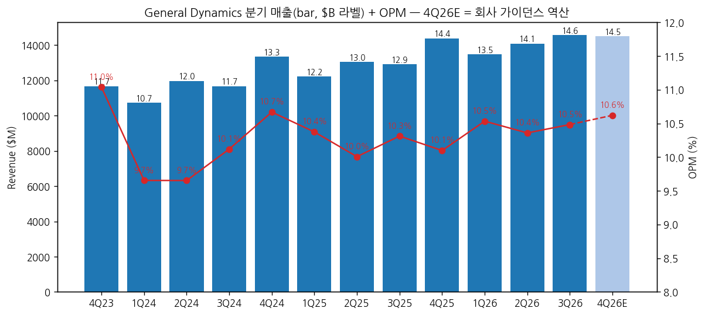
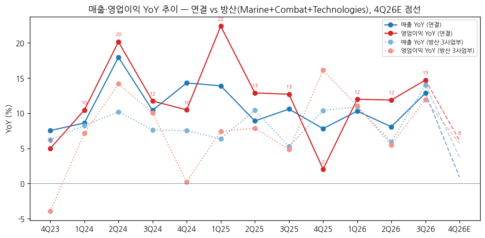
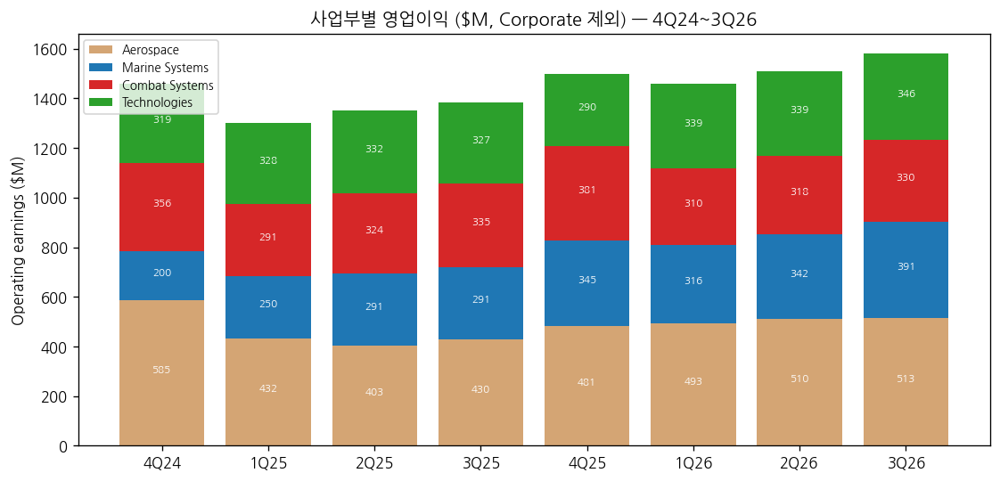

> 모드: 실적 리뷰 (v11)
> 종목: General Dynamics (GD)
> 섹터: 방산
> 서브섹터: 방산 글로벌
> 분기: 2026-Q3
> 발표일: 2026-10-30
> 작성 시각: 2026-11-14 19:30 KST
> 분석 소스: 회사 3Q26 10-Q(2026-10-30, SEC EDGAR) + 3Q26 Press Release(PR Newswire 2026-10-30) + 10-K/10-Q 과거 분기(1Q14~2Q26) + 컨콜 요약(Zacks 2026-11-02, StatementDog — 트랜스크립트 원문 미확보) + 웹 보완(stockanalysis.com 컨센·TP 2026-10-15, Zacks 컨센, Yahoo Finance 주가). 셀사이드 리포트 첨부 없음 — 쟁점은 컨콜 Q&A 반복 질문 + 웹 기사로 구성. 실적 후 IB 개별 TP 변경은 확인 못 함
> 다음 발표: 4Q26·2026 연간 + 2027 가이던스 — 2027-01 하순 예상 (전년 2026-01-28 발표 기준 [추정])

# General Dynamics 3Q26 실적 리뷰

## 0. 한 줄 판정

> 성장 델타: 가속 | 내러티브: 강화 → 적극 구간 후보 (방산 3사업부 델타 가속 + 잔고 2배, 단 4Q 일수 역효과·2027 가이던스(1월) 확인 필요)

→ 숫자: 매출 $14,566M(+12.9% YoY), 영업이익 $1,527M(+14.7%), OPM 10.5%. 영업이익 YoY가 2Q26 +11.9% → 3Q26 +14.7%(+2.8%p), 매출 YoY도 +4.8%p 확대. **방산 3사업부(Marine+Combat+Technologies)는 영업이익 YoY 5.5% → 12.0%(+6.5%p)로 더 뚜렷한 가속**
→ 컨센 대비: 매출 +6.4%, EPS $4.49 vs $4.14(+8.5%) (Zacks 컨센). 연간 EPS 가이던스 $16.80~16.90 → $17.20~17.30으로 **올해 세 번째 상향**
→ 쟁점의 중심은 **잠수함 $71.6B 수주(콜럼비아 5척 $29.5B + 버지니아 9척 $42.1B)** — 잔고 $136.5B → $220.3B. 애널리스트 질문은 Marine 마진 지속성(7.9% 중 일회성)과 증산 CAPA에 집중
→ 지상장비(Combat)는 약점: 매출 +6%지만 영업이익 -1.5%, OPM 14.9% → 13.8%. 미국 차량 감소(M10 Booker 종료·육군 재편)를 유럽(+28%)·탄약(+16%)이 메우는 구조 — 한국 지상방산과 경합하는 영역
→ 다음 분기 관건: 4Q26은 회계일수가 88일(전년 94일)이라 가이던스 역산 매출 YoY가 +0.9%로 내려간다(일수 조정 시 약 +8%). 숫자상 "둔화"로 보이는 것을 1월 2027 가이던스가 상쇄하는지가 관건

## 1. 숫자

① 연결 분기 표 ($M, US GAAP)

| 항목 | 4Q23 | 1Q24 | 2Q24 | 3Q24 | 4Q24 | 1Q25 | 2Q25 | 3Q25 | 4Q25 | 1Q26 | 2Q26 | **3Q26** | 4Q26E (가이던스 역산) |
|---|---|---|---|---|---|---|---|---|---|---|---|---|---|
| 매출 | 11,668 | 10,731 | 11,976 | 11,671 | 13,338 | 12,223 | 13,041 | 12,907 | 14,379 | 13,481 | 14,094 | **14,566** | 14,510 (14,359~14,659) |
| 영업이익 | 1,288 | 1,036 | 1,156 | 1,181 | 1,423 | 1,268 | 1,305 | 1,331 | 1,452 | 1,420 | 1,460 | **1,527** | 1,541 |
| OPM | 11.0% | 9.7% | 9.7% | 10.1% | 10.7% | 10.4% | 10.0% | 10.3% | 10.1% | 10.5% | 10.4% | **10.5%** | 10.6% |
| 매출 YoY | 7.5% | 8.6% | 18.0% | 10.4% | 14.3% | 13.9% | 8.9% | 10.6% | 7.8% | 10.3% | 8.1% | **12.9%** | 0.9% |
| 영업이익 YoY | 5.0% | 10.4% | 20.2% | 11.7% | 10.5% | 22.4% | 12.9% | 12.7% | 2.0% | 12.0% | 11.9% | **14.7%** | 6.1% |
| **매출 YoY 델타 (%p)** | +1.6 | +1.1 | +9.4 | -7.6 | +3.9 | -0.4 | -5.0 | +1.7 | -2.8 | +2.5 | -2.2 | **+4.8** | -12.0 |
| **영업이익 YoY 델타 (%p)** | +8.7 | +5.5 | +9.7 | -8.4 | -1.2 | +11.9 | -9.5 | -0.2 | -10.7 | +9.9 | -0.1 | **+2.8** | -8.6 |

→ (출처: 1Q24~3Q26 각 분기 10-Q 사업부 표(전년 동기 재작성 컬럼 우선), 4Q = 10-K 연간 − 1~3Q [계산]. 3Q26 = 10-Q 2026-10-30. 4Q26E = 2026 가이던스(매출 $56.5~56.8B, OPM 약 10.5%) − 9M26 실적 [계산], 중간값)
→ 다음 분기 가이던스 vs 컨센: 분기 가이던스는 없고 연간만 제시. 연간 매출 중간값 $56.65B는 발표 전 컨센 $55.92B(stockanalysis, 2026-10-15) 대비 +1.3%
→ 컨센 대비: 매출 $14,566M vs $13,690M(+6.4%), EPS $4.49 vs $4.14(+8.5%) (Zacks 컨센). 영업이익 컨센은 미확보
→ YoY 정점은 1Q25(영업이익 +22.4%)였고 이후 2Q25~2Q26 12% 안팎 고원. 3Q26 +14.7%로 고원 상단 돌파
→ **4Q26E YoY 급락은 회계일수 효과**: GD 분기는 일요일 마감이라 2026년 4Q는 10/5~12/31(88일), 2025년 4Q는 9/29~12/31(94일). 일수 조정 매출 YoY는 약 +7.8% [계산] — 1Q26(95일 vs 89일)에 당겨온 일수가 4Q에서 빠진다 `[판단]`

→ (출처: GD 10-Q·10-K, 4Q26E = 회사 연간 가이던스 역산)

→ (출처: GD 10-Q·10-K. 방산 3사업부 4Q26E는 [추정] — 아래 ②)

② 사업부별 매출·영업이익 ($M)

| 사업부 | 항목 | 3Q25 | 4Q25 | 1Q26 | 2Q26 | **3Q26** | QoQ | YoY |
|---|---|---|---|---|---|---|---|---|
| Aerospace (걸프스트림, 민수) | 매출 | 3,234 | 3,788 | 3,279 | 3,525 | **3,536** | +0.3% | +9.3% |
| | 영업이익 | 430 | 481 | 493 | 510 | **513** | +0.6% | +19.3% |
| | OPM | 13.3% | 12.7% | 15.0% | 14.5% | **14.5%** | 0.0%p | +1.2%p |
| Marine Systems | 매출 | 4,096 | 4,818 | 4,343 | 4,660 | **4,960** | +6.4% | +21.1% |
| | 영업이익 | 291 | 345 | 316 | 342 | **391** | +14.3% | +34.4% |
| | OPM | 7.1% | 7.2% | 7.3% | 7.3% | **7.9%** | +0.6%p | +0.8%p |
| Combat Systems | 매출 | 2,252 | 2,535 | 2,283 | 2,290 | **2,386** | +4.2% | +6.0% |
| | 영업이익 | 335 | 381 | 310 | 318 | **330** | +3.8% | -1.5% |
| | OPM | 14.9% | 15.0% | 13.6% | 13.9% | **13.8%** | -0.1%p | -1.1%p |
| Technologies | 매출 | 3,325 | 3,238 | 3,576 | 3,619 | **3,684** | +1.8% | +10.8% |
| | 영업이익 | 327 | 290 | 339 | 339 | **346** | +2.1% | +5.8% |
| | OPM | 9.8% | 9.0% | 9.5% | 9.4% | **9.4%** | 0.0%p | -0.4%p |
| **방산 3사업부 합계** | 매출 | 9,673 | 10,591 | 10,202 | 10,569 | **11,030** | +4.4% | +14.0% |
| | 영업이익 | 953 | 1,016 | 965 | 999 | **1,067** | +6.8% | +12.0% |
| | OPM | 9.9% | 9.6% | 9.5% | 9.5% | **9.7%** | +0.2%p | -0.2%p |
| | 매출 비중 | 74.9% | 73.7% | 75.7% | 75.0% | **75.7%** | | |
| Corporate | 영업이익 | -52 | -45 | -38 | -49 | **-53** | | |

→ (출처: 3Q26 10-Q Note L·MD&A, 과거 분기 10-Q/10-K. 방산 합계·4Q25는 [계산])
→ **섹터 합산에 쓸 방산 기준**: Marine+Combat+Technologies 합계 (Aerospace=걸프스트림 민수 제외, Corporate 비용 미배분). 3Q26 매출 $11,030M / 영업이익 $1,067M (OPM 9.7%) vs 3Q25 $9,673M / $953M. 4Q26E [추정] 매출 약 $10,985M / 영업이익 약 $1,074M (연결 가이던스 역산값에 3Q26 방산 비중 — 매출 75.7%, 사업부 영업이익 67.5% — 적용)

(2-1) 사업부별 YoY 추이 (매출 / 영업이익, %)

| 사업부 | 4Q24 | 1Q25 | 2Q25 | 3Q25 | 4Q25 | 1Q26 | 2Q26 | **3Q26** |
|---|---|---|---|---|---|---|---|---|
| Aerospace | 36.4 / 30.3 | 45.2 / 69.4 | 4.1 / 26.3 | 30.3 / 41.0 | 1.2 / -17.8 | 8.4 / 14.1 | 15.1 / 26.6 | **9.3 / 19.3** |
| Marine | 16.2 / -7.8 | 7.7 / 7.8 | 22.2 / 18.8 | 13.8 / 12.8 | 21.7 / 72.5 | 21.0 / 26.4 | 10.4 / 17.5 | **21.1 / 34.4** |
| Combat | 1.3 / 1.4 | 3.5 / 3.2 | -0.2 / 3.5 | 1.8 / 3.1 | 5.8 / 7.0 | 4.9 / 6.5 | 0.3 / -1.9 | **6.0 / -1.5** |
| Technologies | 2.8 / 4.6 | 6.8 / 11.2 | 5.5 / 3.8 | -1.6 / 0.3 | -0.1 / -9.1 | 4.2 / 3.4 | 4.1 / 2.1 | **10.8 / 5.8** |

→ **델타를 끄는 건 Marine**: 매출 +21%, 영업이익 +34%. 콜럼비아·버지니아 자재·인력 물량 증가($661M)와 엔지니어링·수리(+$203M) (10-Q MD&A). 단 OPM 7.9%에는 버지니아 Block IV 종료 근접에 따른 일회성 누적 호조가 포함 — 회사 기준선은 "mid-7%"
→ **Combat은 2분기 연속 영업이익 역성장**: 무기·탄약 +$134M(포병탄 증산), 해외 차량 -$14M, 미국 차량 +$14M. 9M 기준 미국 차량 -$203M(육군 재편·M10 Booker 종료). 마진 하락은 "프로그램 믹스" — Land Systems가 개발 단계 사업 비중을 늘리는 전환기 (10-Q·컨콜 요약)
→ Technologies 매출 +10.8%로 2023년 이후 최고 성장(GDIT 주도), 마진은 믹스로 -0.4%p
→ Aerospace는 인도 40대(+1대)로 물량은 평탄, 믹스·서비스(FBO·정비 +$96M)로 영업이익 +19%

→ (출처: GD 10-Q·10-K 사업부 표)

(2-2) 수주·잔고 ($B)

| 사업부 | 3Q25 | 4Q25 | 1Q26 | 2Q26 | **3Q26** | QoQ | YoY |
|---|---|---|---|---|---|---|---|
| Aerospace | 20.6 | 21.8 | 22.3 | 24.0 | **25.4** | +5.9% | +23.2% |
| Marine Systems | 53.6 | 52.3 | 64.0 | 65.2 | **146.9** | +125% | +174% |
| Combat Systems | 18.7 | 27.2 | 26.9 | 29.4 | **28.7** | -2.3% | +53.4% |
| Technologies | 16.9 | 16.7 | 17.7 | 18.0 | **19.4** | +7.9% | +14.6% |
| 합계 | 109.9 | 118.0 | 130.8 | 136.5 | **220.3** | +61.4% | +100.6% |
| 방산 3사업부 | 89.3 | 96.2 | 108.6 | 112.5 | **195.0** | +73% | +118% |

→ (출처: 10-Q·10-K 잔고 표. YoY·QoQ [계산])
→ 3Q26 수주 약 $98.8B (방산 $93.8B + Aerospace 약 $5.0B), book-to-bill 방산 8.5배 / Aerospace 1.4배 / 전사 6.8배 (Press Release). 9M 방산 book-to-bill 4.1배 (10-Q)
→ 잔고 외 추정 잠재 계약가치 $50.3B 포함 총 추정 계약가치 $270.7B
→ Combat 잔고 $28.7B는 Combat 매출(TTM $9.5B) 약 3.0년치 [계산] — 4Q25에 +$8.5B 점프 후 유지

③ 연간 ($M)

| 항목 | 2023 | 2024 | 2025 | 2026E (가이던스) | 2027E (컨센) |
|---|---|---|---|---|---|
| 매출 | 42,272 | 47,716 | 52,550 | 56,650 (56,500~56,800) | 58,610 |
| 영업이익 | 4,245 | 4,796 | 5,356 | 약 5,948 [계산] | 미확보 |
| OPM | 10.0% | 10.1% | 10.2% | 약 10.5% | — |
| 매출 YoY | 7.3% | 12.9% | 10.1% | 7.8% | 3.5% |
| 영업이익 YoY | 0.8% | 13.0% | 11.7% | 약 11.1% | — |
| 희석 EPS ($) | 12.02 | 13.63 | 15.45 | 17.20~17.30 | 18.63 |

→ (출처: 10-K, 3Q26 10-Q 연간 전망 업데이트, 2027E = stockanalysis.com 컨센(2026-10-15, 실적 전). 2026E 영업이익 = 매출 중간값 × 10.5%)
→ 연간 EPS 가이던스: 연초 $16.10~16.20 → 2Q $16.80~16.90 → 3Q $17.20~17.30 (StatementDog·Zacks 요약). 발표 전 컨센 $17.02 대비 중간값 +1.4%
→ 2027E 매출 컨센 +3.5%는 잔고 2배와 어울리지 않는 낮은 숫자다. 4Q 일수 효과(2027년 분기 일수 정상화)와 걸프스트림 G300 교체 공백이 섞인 실적 전 컨센이라 1월 가이던스 후 재설정될 여지 `[판단]`

## 2. 시장 쟁점

① 2-0 지난 분기 체크

→ 첫 리뷰 — 직전 체크 없음 (2Q26 리뷰 미작성)

② 이번 분기 쟁점 5개 (컨콜 Q&A 반복 질문 + 웹 기사 기준)

| # | 쟁점 | 근거 (질문자·기사) |
|---|---|---|
| (1) | Marine 마진 7.9%는 지속되나 — 일회성 vs 신규 계약 초기 마진 | JPMorgan 질문, StatementDog Q&A 1번, Zacks |
| (2) | 잠수함 $71.6B를 매출로 바꿀 CAPA — 인력·CapEx·FCF | StatementDog Q&A 3번, RBC(설비투자), Zacks |
| (3) | Combat Systems 마진 하락 — 미국 차량 공백 vs 유럽·탄약 | 10-Q MD&A, 컨콜 요약(Novakovic 답변) |
| (4) | 걸프스트림 200대 목표와 2027년 G280→G300 공백 | TD Cowen 질문, StatementDog Q&A 2번 |
| (5) | 2027 가이던스와 CEO 교체(Novakovic → Deep) | Zacks(1월 가이던스 예고), 8-K 2026-10-08 |

③ 쟁점별 분해

(1) **Marine 마진 7.9%는 지속되나**

(1-1) 회사 설명
→ 3Q 마진 개선(+80bp)은 성과 개선과 버지니아 Block IV 완료 근접에 따른 유리한 조정 (10-Q). 일회성을 빼면 기준선은 "mid-7%", 생산성 개선이 상방 요인 (컨콜, Zacks 요약)

(1-2) 시장 해석
| 출처 | 핵심 가정·추정 | 논리 |
|---|---|---|
| JPMorgan (Q&A) | 마진 지속성 질문 | 대형 신규 계약 초기에는 보수적 마진 booking이 관행 |
| 회사 | mid-7% 기준 + 생산성 상방 | Block IV 종료 → Block V·VI·콜럼비아로 믹스 이동 |

(1-3) 공통 vs 갈림
→ 공통: 7.9%는 일회성이 섞인 숫자. 일회성 제외 시 약 7.5% [추정]
→ 갈림: 신규 $71.6B 계약의 초기 마진이 기준선(mid-7%)보다 낮게 시작하는지

(1-4) [판단]
→ Marine 이익 성장은 마진보다 **물량(매출 +20%대)**이 끈다. 마진이 7.3~7.5%로 돌아가도 매출 +15~20%면 영업이익 +15% 안팎은 유지된다. 4Q26 Marine OPM이 7% 초반으로 떨어지면 "일회성 의존" 해석이 힘을 얻는다

(2) **잠수함 수주를 매출로 바꿀 CAPA**

(2-1) 회사 설명
→ Electric Boat 산출 +30% YoY, 연내 6,000명 채용·약 8,000명 순증 (StatementDog 요약). CapEx 9M $918M(+66%), 연간 매출의 3.5~4%, 4Q에 크게 증가, 2027년에도 높은 수준 가능 (10-Q·Zacks)
→ 9M FCF $4,827M(전년 $3,007M) — Combat·Aerospace 운전자본 감소, 연금 기여 $500M 포함 (10-Q)

(2-2) 시장 해석
| 출처 | 핵심 가정·추정 | 논리 |
|---|---|---|
| RBC (Q&A) | 설비투자 전망 질문 | CapEx 증가 → FCF 전환율 하락 우려 |
| StatementDog Q&A | 신규 인력 생산성 | 숙련 인력 부족이 조선 산업 공통 병목 (10-Q 사업환경) |

(2-3) [판단]
→ 잔고(Marine $146.9B = Marine 매출 약 8년치)는 더 이상 변수가 아니다. 변수는 **연 매출 성장 속도**(현재 +20%)를 유지할 인력·공급망이다. 4Q Marine 매출 YoY가 일수 효과(-6일)를 감안해도 +15% 이상이면 CAPA 우려는 약해진다

(3) **Combat Systems 마진 하락 — 한국 지상방산과 겹치는 영역**

(3-1) 회사 설명
→ 미 육군 재편·차세대 전환기로 단기 전투차량 생산량 소폭 감소, 탄약 수요는 높은 수준 유지 (10-Q 사업환경). 마진 하락은 Land Systems의 개발 프로그램 비중 확대 탓 (Novakovic, Zacks 요약). European Land Systems 매출 +28%, OTS 탄약 +16% (StatementDog). 고체로켓모터·포병탄 2028년 생산 마일스톤 (Zacks)

(3-2) 시장 해석
| 출처 | 핵심 가정·추정 | 논리 |
|---|---|---|
| 회사 10-Q | 미국 차량 9M -$203M, 해외 차량 +$108M, 탄약 +$343M | 미국 공백을 유럽·탄약이 메움 |
| simplywall.st 내러티브(2026-10) | Mesquite 포탄 공장 실행 리스크 | 탄약 증산 실행이 관건 |

(3-3) [판단]
→ GD Combat OPM 13.8%는 현대로템 방산(3Q26 28.1%)의 절반이다. 성장도 +6%로 한국 지상방산 대비 낮다. **유럽 지상장비 수요의 수혜는 GD(ELS +28%)도 받지만, 마진 레버리지는 한국 수출형이 크다** — 국가별 경쟁력 비교에서 한국 우위 근거 `[판단]`
→ 반대로 잔고 $28.7B(1년 전 $18.7B)는 GD도 지상장비 수주가 늘고 있다는 뜻. 미 육군 M1E3·XM30 차세대 사업이 양산으로 넘어가면 2028년 이후 미국 차량이 다시 성장축이 된다 `[전망]`

(4) **걸프스트림 200대와 G300 공백**

(4-1) 회사 설명
→ 2030년 연 200대 인도 목표, 2029년까지 200대 이상 CAPA 필요, 공급망이 따라와야 함. 2027년 G280 → G300 교체로 중형기 인도 공백, 대형기 인도 증가로 일부 상쇄. 중동 주문은 둔화 (Zacks·StatementDog 요약)
→ 9M 인도 119대(+6대), Aerospace book-to-bill 1.4배 (10-Q)

(4-2) [판단]
→ 방산 섹터 합산에서는 제외되는 사업이지만 GD 연결 델타의 25%를 차지한다. 2027 Aerospace 매출이 평탄하면 연결 매출 YoY는 방산보다 낮게 나온다 — 섹터 리뷰는 방산 3사업부 값을 써야 하는 이유

(5) **2027 가이던스와 CEO 교체**

(5-1) 회사 설명
→ 2027 전망은 1월 연간 계획 후 제시 (Kuryea, Zacks). 3Q26이 Novakovic의 CEO로서 마지막 컨콜, Danny Deep(前 Land Systems 사장·Combat EVP)이 2027-01-01 CEO 취임 (8-K 2026-10-08)

(5-2) [판단]
→ 지상장비 출신 CEO는 Combat 마진 회복(개발→양산 전환)과 운영 효율(Global Ops 경험)에 초점을 둘 가능성 `[전망]`. 1월 첫 가이던스가 보수적으로 나오면 신임 CEO의 "낮게 잡고 넘기기" 패턴으로 해석될 수 있다

④ 낙관 vs 보수 (실적 전후 웹 기사 기준)

→ 낙관: 실적 전 컨센 TP 범위 상단 $465, 7월 Susquehanna $455·BNP Paribas $430 (MarketBeat 2026-07-30). 근거는 잔고·걸프스트림 마진·FCF
→ 보수: Goldman Sachs Sell $309(2026-10-12), RBC Hold $360·Bernstein Hold $365 (stockanalysis.com). 근거는 방산 섹터 디레이팅, 의회 예산 불확실성
→ 셀사이드 vs 주가: 실적 전 10월 TP 하향 4건(RBC -12%, Bernstein -10%, Goldman -3%, TD Cowen -10%)은 실적 하향이 아니라 **섹터 멀티플 하향**. 주가는 7월 ATH $400 → 10/28 $354.35 → 실적일 10/30 $372.59(당일 +0.5%, 전일 10/29 +4.6% 선반영 — 원인 미확인) → 11/13 $363.46 (Yahoo Finance)

⑤ 추정치·TP 변화 (압축)

| 증권사 | 직전 TP | 현재 TP | 의견 | 시점 | 비고 |
|---|---|---|---|---|---|
| RBC | 410 | 360 | Hold | 2026-10-15 | 실적 전 |
| Bernstein | 407 | 365 | Hold | 2026-10-14 | 실적 전 |
| Goldman Sachs | 319 | 309 | Sell | 2026-10-12 | 실적 전 |
| TD Cowen | 420 | 380 | Buy | 2026-10-09 | 실적 전 |
| Susquehanna | — | 455 | Buy | 2026-10-07 | 실적 전 |

→ (출처: stockanalysis.com 2026-10-15 갱신분. **실적(10/30) 후 개별 TP 변경은 확인 못 함**)
→ 컨센 평균 TP $406.78(24명, 중간값 $415), 현재가 대비 +12% [계산]. 2026E EPS 컨센 $17.02 → 가이던스 중간값 $17.25로 실적 후 상향 압력 `[전망]`
→ 하향의 원인은 **멀티플**이다: 같은 기간 2026E EPS 가이던스는 오히려 올라갔다(2Q $16.85 → 3Q $17.25 중간값)

## 3. 내러티브 점검

① 성장 스토리 정의
→ "미 해군 잠수함 증산(콜럼비아·버지니아)의 독점적 수혜 + 걸프스트림 신기종으로 이익이 연 10%대 꾸준히 크는 방산 프라임"

② 이번 분기가 스토리에 준 영향
→ 강화: 잔고가 한 분기 만에 2배($220.3B), Marine 매출 +21%, 연간 EPS 가이던스 세 번째 상향, FCF 9M $4.8B(+61%)
→ 약화 요인: Combat 2분기 연속 감익(미국 차량 공백), Technologies 마진 정체, 걸프스트림 2027년 중형기 공백

③ 국면 판단
→ 델타 가속(연결 영업이익 YoY +2.8%p, 방산 +6.5%p) + 내러티브 강화(잔고·가이던스) → **적극 구간 후보**
→ 다만 4Q26은 일수 효과로 YoY가 숫자상 크게 꺾여 보인다(가이던스 역산 영업이익 +6%). BT 프레임에서 "꺾임 신호"로 오인하지 않도록 일수 조정치(+8% 안팎)로 판단해야 한다 `[판단]`

④ 트리거와 리스크
→ 트리거: ① 2027 가이던스(1월)에서 Marine 매출 +15%+ 제시 ② FY2027 국방 예산 통과(조선 증액) ③ 유럽 지상장비·탄약 추가 수주
→ 리스크: ① Marine 신규 계약 초기 마진 7% 하회 ② CR 장기화(신규 사업 착수 지연) ③ 걸프스트림 공급망(이스라엘 동체 공급사)·중동 주문 둔화

## 4. 향후 봐야 할 것

① **4Q26 실적과 2027 가이던스** (델타 판정을 바꿀 1순위)
→ 무엇을: 4Q 매출 $14.4~14.7B·영업이익 약 $1.54B(가이던스 역산) 달성, 2027 매출 가이던스가 컨센 $58.6B(+3.5%)를 넘는지, 사업부별 마진 가이드
→ 어떤 데이터로: 4Q26 Press Release·10-K, 컨콜
→ 언제: 2027-01 하순

② **Marine 마진 기준선 (mid-7%) 유지**
→ 무엇을: 일회성 없는 4Q26 Marine OPM 7.3%+ 유지, Marine 매출 YoY(일수 조정) +15%+
→ 어떤 데이터로: 4Q26 사업부 표, Electric Boat 인력·인도 일정 코멘트
→ 언제: 2027-01 하순

③ **Combat Systems 마진 바닥 확인**
→ 무엇을: Combat OPM 14% 회복 여부, 유럽(ELS)·탄약 성장 지속, 미국 차량(M1E3·XM30) 개발→양산 전환 일정
→ 어떤 데이터로: 사업부 표, 미 육군 FY27 예산, 유럽 수주 공시 — 현대로템·한화에어로 수출 수주와 같은 시장 비교
→ 언제: 2027-01 / FY27 예산 통과 시점

④ **FY2027 국방 예산과 CR**
→ 무엇을: CR 만료(2026-12-11) 이후 연장 vs 본예산 통과, 조선·탄약 증액 폭
→ 어떤 데이터로: 의회 예산안, 전쟁부 발표
→ 언제: 2026-12

⑤ **걸프스트림 수주 book-to-bill 1.0+ 유지**
→ 무엇을: Aerospace book-to-bill(3Q 1.4배), 4Q 인도 대수(연 약 160대 전후 [추정]), G300 일정
→ 어떤 데이터로: 4Q26 실적, 걸프스트림 인도 발표
→ 언제: 2027-01 하순
