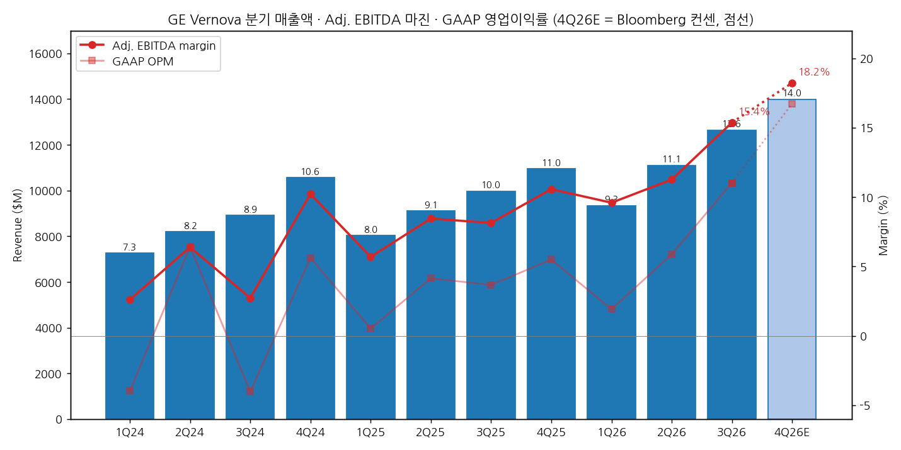
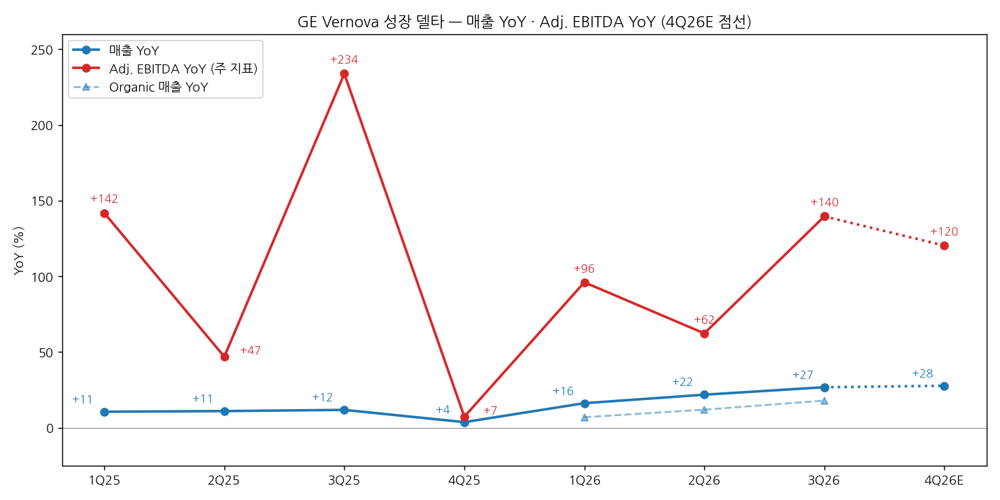
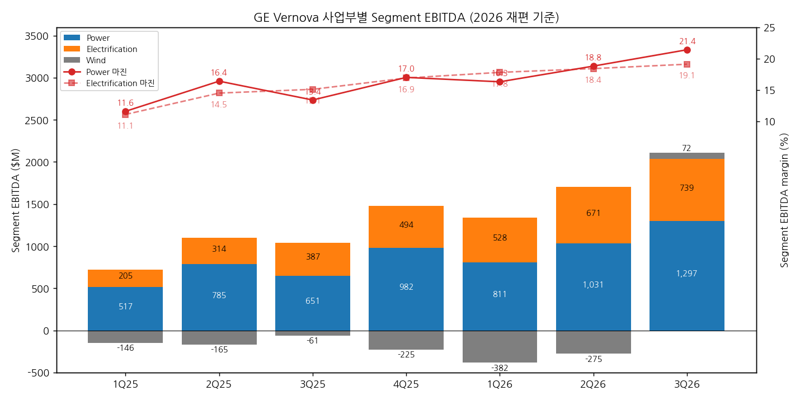

> 모드: 실적 리뷰 (v11)
> 종목: GE Vernova (GEV)
> 섹터: 전력 인프라
> 서브섹터: 발전
> 분기: 2026-Q3 (캘린더 = 회계 분기, 9/30 종료)
> 발표일: 2026-10-28 (수, 장 전 — 보도자료·10-Q·컨퍼런스콜 동시, Trench Group 인수 발표 병행)
> 작성 시각: 2026-11-03 14:00 KST
> 분석 소스: 회사 자료 — 3Q26 Press Release·Presentation·컨퍼런스콜 트랜스크립트(IR, 10/28), 10-Q(10/28 SEC), 1Q24~4Q25 보도자료·10-Q, 2025 사업부 재편 Financial Supplement. 셀사이드 6개 첨부 — NH투자증권(10/29), 하나증권(10/29), 키움증권(10/29), 신한투자증권(10/30), SK증권(10/30), iM증권(11/3). 국내 6곳 모두 자체 TP 없는 해외기업 브리프(컨센 TP 인용). 웹서치 보완: 해외 IB 등급·TP 변경(Motley Fool 10/30, TipRanks·MarketBeat 집계), 발표 후 주가 반응(Motley Fool 10/30·11/2 종가). 중간선거·FERC 데이터는 2026-Q3 효성중공업 리뷰에서 재사용(Axios 10/31·Forbes 11/2·Ballotpedia 11/2·대신증권, 4번 (3)항만). 직전 분기는 2026-Q1 리뷰 + 2026-Q2 팔로업 기준 (2Q26 리뷰 미작성)

# GE Vernova 3Q26 실적 리뷰 — Power 마진 21%로 이익 사이클 점화, 주가는 가스 신규 계약 둔화와 Trench 차입에 묶였다

> 성장 델타: 가속 | 내러티브: 유지 → 델타 가속 + 내러티브 유지 → 관심 구간 (이익 델타는 가속, 멀티플은 4Q 가스 계약 13GW+와 12월 FERC 결론 확인 전까지 눌림)

→ **숫자**: 매출 $12.64B(+26.8% YoY, organic +18%), Adj. EBITDA $1.94B(+139.6% YoY, 마진 15.4%), GAAP 영업이익 $1.39B(OPM 11.0%). 주 지표 Adj. EBITDA YoY가 2Q26 +62.3%에서 +139.6%로 77%p 확대됐고, 매출 YoY도 +21.9% → +26.8%로 함께 올라 "강한 가속"이다. Bloomberg 컨센 대비 매출 +5.4%, Adj. EBITDA +15.6%, EPS +22.1% 비트다
→ **쟁점 ①**: Power EBITDA 마진 21.4%(+800bp YoY)는 2H24 고가 수주분의 첫 5GW 출하 분기에 나왔다. 서비스 비수기인 3Q에 나온 숫자이고, 회사는 "하반기가 2027년의 출발점"이라고 했다. 6곳 모두 마진 인플렉션의 시작으로 본다
→ **쟁점 ②**: 그런데 주가는 발표일 -1.9%, 11/2 $862로 고점 대비 -28%다. 가스 신규 계약이 11GW(SRA 8GW)로 1Q 21GW·2Q 약 19GW의 절반 수준이었고, 회사가 2027년 분기 계약 규모를 3Q·4Q 수준(11~13GW)으로 제시했다. 이익 델타는 가속하는데 수주 델타는 꺾이는 엇갈림이다
→ **쟁점 ③**: Electrification은 Prolec 편입으로 매출 +51%지만 organic은 +29% → +16%로 둔화했다. 데이터센터 수주도 1Q $2.4B → 3Q 약 $1.4B로 줄었다. Trench Group($9.0B, 절반 차입)은 부품 내재화 성격이고 2027년 말 종결이라 단기 기여가 없다
→ **쟁점 ④**: 해외 IB 7곳 중 5곳이 TP를 내렸다(평균 -5.2%). 실적 추정과 가이던스는 올라갔으므로 TP 하향은 전적으로 멀티플 하향이다. 12M Fwd P/E는 55배에서 38배로 내려왔다(키움)
→ **다음 분기 관건**: 4Q26 Adj. EBITDA $2.5B(가이던스 중간값 $2.49B, 컨센 $2.55B)와 Power 마진 20%대 중반, 4Q 가스 계약 13GW+가 델타와 멀티플을 함께 정한다. 11/3 중간선거부터 12월 FERC·ERCOT 대형부하 접속 결론까지는 Electrification보다 가스터빈에 상대적으로 우호적인 변수다 [판단]

---

## 1. 숫자

① 연결 기준 분기 표 (단위: $M, %)

| 항목 | 1Q24 | 2Q24 | 3Q24 | 4Q24 | 1Q25 | 2Q25 | 3Q25 | 4Q25 | 1Q26 | 2Q26 | **3Q26** | 4Q26E (컨센) | 4Q26 가이던스 내재 |
|---|---|---|---|---|---|---|---|---|---|---|---|---|---|
| 매출액 | 7,260 | 8,204 | 8,913 | 10,559 | 8,032 | 9,111 | 9,969 | 10,956 | 9,339 | 11,104 | **12,642** | 13,996 | 13,916 (13,416~14,416) |
| 영업이익 (GAAP) | -289 | 527 | -359 | 593 | 43 | 378 | 366 | 602 | 179 | 653 | **1,394** | 2,341 | 미제시 |
| OPM (GAAP) | -4.0 | 6.4 | -4.0 | 5.6 | 0.5 | 4.1 | 3.7 | 5.5 | 1.9 | 5.9 | **11.0** | 16.7 | — |
| 매출 YoY | +6.4 | +1.0 | +8.0 | +5.1 | +10.6 | +11.1 | +11.8 | +3.8 | +16.3 | +21.9 | **+26.8** | +27.7 | +27.0 |
| 영업이익 YoY | 적자축소 | — | — | — | 흑전 | -28.3 | 흑전 | +1.5 | +316.3 | +72.8 | **+280.9** | +288.9 | — |
| **매출 YoY 델타 (%p)** | — | -5.4 | +7.0 | -2.9 | +5.5 | +0.4 | +0.8 | -8.1 | +12.5 | +5.6 | **+4.9** | +0.9 | +0.2 |
| **영업이익 YoY 델타 (%p)** | — | — | — | — | — | — | — | — | +314.8 | -243.5 | **+208.1** | +8.0 | — |
| Adj. EBITDA (주 지표) | 189 | 524 | 243 | 1,079 | 457 | 770 | 811 | 1,158 | 896 | 1,250 | **1,943** | 2,551 | 2,491 (2,189~2,799) |
| Adj. EBITDA 마진 | 2.6 | 6.4 | 2.7 | 10.2 | 5.7 | 8.5 | 8.1 | 10.6 | 9.6 | 11.3 | **15.4** | 18.2 | 17.9 |
| Adj. EBITDA YoY | 흑전 | +158.1 | +18.5 | — | +141.8 | +46.9 | +233.7 | +7.3 | +96.1 | +62.3 | **+139.6** | +120.3 | +115.1 |
| **Adj. EBITDA YoY 델타 (%p)** | — | — | -139.6 | — | — | -94.9 | +186.8 | -226.4 | +88.7 | -33.7 | **+77.2** | -19.3 | -24.5 |
| Organic 매출 YoY | — | — | — | — | — | — | — | — | +7 | +12 | **+18** | — | — |

→ (출처: 매출·Adj. EBITDA는 GE Vernova 분기 보도자료, GAAP 영업이익은 각 분기 10-Q·보도자료 손익계산서(2024 합계 $471M, 2025 합계 $1,388M로 연간 확정치와 일치). 2023년 분기 매출(6,822·8,119·8,253·10,045 [계산])과 Adj. EBITDA(-185·203·205)는 2024 보도자료 비교 열. 4Q26E 매출·Adj. EBITDA는 Bloomberg 컨센(10/28, 키움증권 인용), GAAP 영업이익은 Bloomberg 2026 연간 컨센 $4,568M(10/30, SK증권 인용)에서 9개월 누적 $2,227M을 뺀 값 [계산]. 가이던스 내재 열은 10/28 상향된 2026 가이던스(매출 $46.5~47.5B, Adj. EBITDA 마진 13.5~14.5%)에서 9개월 누적(매출 $33,084M, Adj. EBITDA $4,089M)을 뺀 값 [계산])
→ 3Q26 서프라이즈: 매출 컨센 대비 +5.4%, Adj. EBITDA +15.6%, EPS +22.1% (Bloomberg 10/28 컨센 매출 $11,992M·Adj. EBITDA $1,681M·EPS $3.94, 키움). LSEG 기준으로는 매출 +5.7%, EPS +18.8%다 (컨센 $11.96B·$4.05, 하나). GAAP 영업이익 컨센은 확보하지 못했다
→ GAAP 영업이익은 2025년까지 분기 $0~0.6B의 작은 기저 위에 있어 YoY가 +73% → +281%처럼 크게 튄다. 판정은 회사 주 지표인 Adj. EBITDA로 하고, GAAP는 방향 확인용으로 쓴다
→ **연결 범위 변경 (Prolec GE, 2026-02-02 잔여 50% 인수·연결)**: 1Q26부터 Electrification에 편입돼 2026년 YoY가 부풀어 있다. 3Q26 Prolec 매출 기여는 약 $0.9B다 (Electrification 매출 증가 $1.3B 중 organic $0.4B를 뺀 값, [계산], 신한 $0.95B). 다만 2Q26과 3Q26은 모두 Prolec 연결 분기라 **2Q → 3Q 델타 자체는 범위 변경으로 왜곡되지 않는다**. organic 기준으로도 매출 YoY는 +12% → +18%로 가속했고, organic Adj. EBITDA는 $770M → $1,721M(+123.5%)이다 (10-Q, 키움)
→ YoY 정점: Adj. EBITDA YoY는 3Q25(+234%, 저기저)와 3Q26(+140%)이 고점이다. 컨센 경로는 4Q26 +120%, 1Q27 +104%(Bloomberg 1Q27E $1,824M, 키움), 2027 연간 +50%다. 즉 **컨센이 보는 YoY 정점은 3Q26**이지만, 이후 2개 분기도 +100% 이상을 유지하는 "고원" 경로다. 매출 YoY는 4Q26 +27.7%로 한 번 더 올라 정점을 4Q26에 둔다
→ 4Q 가이던스 내재 Adj. EBITDA 중간값($2,491M)은 컨센($2,551M)보다 2% 낮다. 컨센은 가이던스 범위의 상단 쪽에 있다. 회사는 4Q에 "매출·Adj. EBITDA 성장, 마진 확대, FCF 플러스"를 제시했다 (CFO Ken Parks, 컨콜)
→ **[판단] 델타 = 가속 (강한 가속)**: 주 지표 Adj. EBITDA YoY가 +62.3% → +139.6%로 확대됐고 매출 YoY도 +4.9%p 올랐다. organic 기준(매출 +12% → +18%)으로도 같은 결론이다. 컨센대로라면 4Q26은 -19%p 둔화하지만 +120%라 "둔화" 판정이 나와도 이익 성장의 절대 속도는 이번 사이클 최고 구간이다

→ (출처: GE Vernova 분기 보도자료·10-Q, 4Q26E는 Bloomberg 컨센(키움·SK 인용). 4Q26E는 연한 막대·점선)

→ (출처: 동일. Organic 매출 YoY는 회사 발표(1Q26 +7%, 2Q26 +12%, 3Q26 +18%))

② 사업부별 매출·Segment EBITDA (단위: $M, %, 2026-01-01 사업부 재편 기준)

| 사업부 | 항목 | 1Q25 | 2Q25 | 3Q25 | 4Q25 | 1Q26 | 2Q26 | **3Q26** |
|---|---|---|---|---|---|---|---|---|
| Power | 매출 | 4,449 | 4,785 | 4,863 | 5,776 | 4,971 | 5,477 | **6,067** |
| Power | Segment EBITDA | 517 | 785 | 651 | 982 | 811 | 1,031 | **1,297** |
| Power | 마진 | 11.6 | 16.4 | 13.4 | 17.0 | 16.3 | 18.8 | **21.4** |
| Power | 매출 YoY | — | — | — | — | +11.7 | +14.5 | **+24.8** |
| Power | EBITDA YoY | — | — | — | — | +56.9 | +31.3 | **+99.2** |
| Electrification | 매출 | 1,840 | 2,162 | 2,565 | 2,921 | 2,959 | 3,637 | **3,862** |
| Electrification | Segment EBITDA | 205 | 314 | 387 | 494 | 528 | 671 | **739** |
| Electrification | 마진 | 11.1 | 14.5 | 15.1 | 16.9 | 17.8 | 18.4 | **19.1** |
| Electrification | 매출 YoY (organic) | — | — | — | — | +60.8 (+29) | +68.2 (+29) | **+50.6 (+16)** |
| Electrification | EBITDA YoY (organic) | — | — | — | — | +157.6 | +113.7 | **+91.0 (+57)** |
| Wind | 매출 | 1,850 | 2,245 | 2,647 | 2,368 | 1,432 | 2,026 | **2,741** |
| Wind | Segment EBITDA | -146 | -165 | -61 | -225 | -382 | -275 | **72** |
| Wind | 마진 | -7.9 | -7.3 | -2.3 | -9.5 | -26.7 | -13.6 | **2.6** |
| Wind | 매출 YoY | — | — | — | — | -22.6 | -9.8 | **+3.6** |

→ (출처: 2025년 분기는 GE Vernova 사업부 재편 Financial Supplement(2026-04-22), 2026년 분기는 각 분기 10-Q·보도자료. organic YoY는 10-Q MD&A. 2024년 재편 기준 사업부 수치는 미공개라 사업부 YoY는 2026년만 표기. 3Q26 매출 비중 Power 48%·Electrification 31%·Wind 22%(사업부 합계 $12,671M 기준, [계산]). 사업부 합계 EBITDA $2,109M과 Adj. EBITDA $1,943M의 차이는 Corporate 비용)
→ **델타를 끄는 것은 Power다**. Power EBITDA YoY가 +31% → +99%로 뛰었다. 매출 증가 $1,204M에 EBITDA 증가 $646M으로 증분 마진이 54%다 ([계산]). 출하량(4.0 → 5.3GW, +33%)보다 가격이 이익을 끌었다는 뜻이다. Gas Power 매출은 $5,117M(+29.6%)이다
→ **Electrification은 organic으로 둔화 중이다**. 보고 기준 매출 +51%는 Prolec 효과이고, organic은 +29% → +16%로 내려왔다. 반면 마진은 19.1%로 7개 분기 연속 상승했고 organic EBITDA도 +57%다. 매출 둔화를 마진이 메우는 구조다. 하위 사업부는 Power Transmission $1,868M(+130%, Prolec 포함), Grid Systems Integration $1,002M(+48%)이 끌고, Power Conversion & Storage $569M(-8%), Grid Automation & Software $424M(-7%)은 역성장했다 (10-Q)
→ **Wind는 7개 분기 만에 흑자($72M)로 돌아섰다**. 다만 육상 장비 출하는 줄었고, 개선은 해상 프로젝트 원가 감소·관세 환급·육상 서비스에서 나왔다 (회사, SK). 연간 손실 가이던스는 약 $400M → $400~500M으로 넓어졌다 (2027년 정비 일정 4Q 앞당김 + Vineyard Wind 합의)

→ (출처: GE Vernova 사업부 재편 Financial Supplement, 1Q26~3Q26 10-Q)

(1) 수주·잔고 — 선행지표 (단위: $M, GW)

| 항목 | 1Q25 | 2Q25 | 3Q25 | 4Q25 | 1Q26 | 2Q26 | **3Q26** |
|---|---|---|---|---|---|---|---|
| 신규수주 (전사) | 10,152 | 12,364 | 14,608 | 22,192 | 18,279 | 24,216 | **29,318** |
| Power 수주 | 6,247 | 7,088 | 7,807 | 11,693 | 10,008 | 16,729 | **21,780** |
| Electrification 수주 | 3,393 | 3,338 | 5,110 | 7,424 | 7,112 | 6,347 | **5,371** |
| 수주잔고 (RPO, 전사) | 123,438 | — | 135,269 | 약 150,000 | 163,276 | 176,284 | **196,721** |
| 가스 계약 GW (잔고+SRA) | — | — | — | 83 | 100 | 116 | **122** |
| 분기 신규 가스 계약 GW | — | — | — | — | 21 | 약 19 | **11** |
| 가스터빈 출하 GW | — | — | 4.0 | — | — | 3.3 | **5.3** |

→ (출처: 수주는 신한투자증권 표(회사 자료), RPO는 회사 보도자료·키움·2026-Q1 리뷰(4Q25는 1Q26 $163.3B에서 전분기 대비 +$13B를 뺀 근사치 [계산], 2Q25는 미확보). 가스 계약 GW는 회사 발표(연초 83GW → 1Q 100 → 2Q 116 → 3Q 122). 2Q26 신규 계약은 116 − 100 + 출하 3.3GW로 역산 [계산], 키움은 2Q SRA 18GW로 제시. 출하 GW는 10-Q)
→ 3Q26 Power 수주 $21.8B(+178% organic)는 SRA 13GW가 확정 수주로 전환된 영향이 크다. 가스 장비 잔고는 53 → 64GW로 늘고 SRA는 63 → 58GW로 줄어, 확정 잔고가 SRA를 넘어섰다. 회사는 2032년 인도 슬롯도 다수 판매했다
→ 신규 계약(잔고+SRA 순증의 원천)은 21 → 19 → 11GW로 줄었다. 4Q는 "3Q보다 약간 많은" 13GW+를 제시했다 (CEO, JPM 질문 답변)

③ 연간 (단위: $M, %)

| 항목 | 2022 | 2023 | 2024 | 2025 | 2026E | 2027E |
|---|---|---|---|---|---|---|
| 매출액 | 29,654 | 33,239 | 34,935 | 38,068 | 46,773 | 53,587 |
| 영업이익 (GAAP) | -2,881 | -923 | 471 | 1,388 | 4,568 | 8,295 |
| OPM (GAAP) | -9.7 | -2.8 | 1.3 | 3.6 | 9.8 | 15.5 |
| 매출 YoY | — | +12.1 | +5.1 | +9.0 | +22.9 | +14.6 |
| 영업이익 YoY | — | 적자축소 | 흑전 | +194.7 | +229.1 | +81.6 |
| Adj. EBITDA | — | — | 2,035 | 3,196 | 6,461 | 9,710 |
| Adj. EBITDA 마진 | — | — | 5.8 | 8.4 | 13.9 | 18.2 |
| Adj. EBITDA YoY | — | — | — | +57.1 | +102.2 | +50.3 |

→ (출처: 2022~2025 매출·영업이익은 GE Vernova 10-K(SK증권 표 인용 대조), Adj. EBITDA는 연간 보도자료. 2026E·2027E 매출·영업이익은 Bloomberg 컨센(10/30, SK증권), Adj. EBITDA는 Bloomberg 컨센(10/28 발표 전, 키움증권))
→ 발표 전 → 후 연간 매출 컨센은 2026E $46,540M → $46,773M(+0.5%), 2027E $53,329M → $53,587M(+0.5%)로 소폭 올랐다 (Bloomberg 10/28 키움 vs 10/30 SK). 영업이익 컨센의 발표 전 수치는 확보하지 못했다. 회사 가이던스는 Adj. EBITDA 기준 중간값 $5.98B(7/22 가이던스, 매출 $46.0B × 13%) → $6.58B(10/28, 매출 $47.0B × 14%)로 +10% 올라갔다 ([계산])
→ 키움에 따르면 6월 말 이후 12M Fwd EPS 컨센은 7% 상향됐다. 추정치 방향은 위쪽이다

---

## 2. 시장 쟁점

① 지난 분기 체크 (2026-Q2 팔로업의 "봐야 할 것" 5개 기준. 2Q26 리뷰는 미작성)

| 직전 팔로업 항목 | 2Q26~3Q26 결과 | 판정 |
|---|---|---|
| (1) 2Q 가스터빈 10~15GW 계약, 연말 110GW+ | 2Q 약 19GW([계산], 키움 SRA 18GW)로 상단 초과. 3Q 11GW. 연말 목표는 110GW+ → 130GW+로 상향 | 확인 (3Q 속도는 둔화) |
| (2) 데이터센터 Electrification 수주 분기 $2.4B+ 지속 | YTD $6B+, 3Q 약 $1.4B. 2Q는 약 $2.2B 이상 [계산] | 반대로 나옴 (분기 run-rate 하락) |
| (3) FY26 가이던스 추가 상향 | 7/22 매출 $45.5~46.5B·FCF $11.5~12.5B, 10/28 매출 $46.5~47.5B·마진 13.5~14.5%·FCF $16~17B로 두 번 연속 상향 | 확인 |
| (4) HVDC 아시아 후속 수주 + Prolec 통합 | 인도 Barmer HVDC $1.5B 4Q 수주 예정. Prolec은 "기대 이상", 미국 변압기 수주 $0.9B | 확인 |
| (5) 중동 영향 + Wind 손실 궤적 | 중동 언급 없음. Wind는 3Q 흑자 전환, 연간 손실 가이던스는 $400~500M로 확대 | 일부 확인 (중동 미확인) |

② 이번 분기 쟁점 4개

| # | 쟁점 | 언급 증권사 수 |
|---|---|---|
| (1) | Power 마진 21.4%는 가격 인플렉션의 시작인가 — 2027년 출발점이 되나 | 6/6 |
| (2) | 가스 신규 계약 11GW — 수요 둔화인가, 납기(슬롯 소진) 문제인가 | 6/6 (해석 제시 2곳 + 해외 IB) |
| (3) | Electrification organic 둔화와 Trench $9B — 성장 둔화를 M&A로 메우는가 | 6/6 |
| (4) | 추정치는 오르는데 TP는 왜 내려가나 — FCF 정점·차입·AI 심리 | 4/6 + 해외 IB 7곳 |

③ 쟁점별 분해

(1) Power 마진 21.4% — 가격 인플렉션의 시작인가

(1-1) 회사 설명 (10/28 컨콜)
→ "3Q는 서비스 활동이 가장 적은 분기인데도 Power가 21% 마진을 냈다. 더 좋은 가격으로 받은 5GW 출하의 첫 분기다" (CEO Scott Strazik)
→ "하반기를 2027년 전망의 출발점으로 보지 않을 이유가 없다" (Goldman Sachs Joe Ritchie 질문 답변). Joe Ritchie는 4Q Power 마진 가이던스 상단이 20%대 중반을 뜻한다고 짚었다
→ 3Q 가스 장비 수주 가격은 4Q25 대비 kW당 +20% 이상이다(항공파생형 비중 영향 포함). 4Q는 항공파생형이 줄고 50Hz가 늘어 kW당 가격이 3Q보다 낮다. 2026년 연간 수주 가격은 2025년 대비 약 +50%다
→ Power 가이던스: organic 매출 +18~20% → +19~21%, EBITDA 마진 17~19% → 19~21%로 상향

(1-2) 증권사별 해석 편차

| 증권사 | 핵심 가정·추정 | 논리 |
|---|---|---|
| 키움 | 가이던스 상단 적용 시 4Q Power 마진 20%대 중반. 장비 잔고 $104B의 60%가 2년 내 매출화 | "이제는 수주보다 이익을 볼 때" — 이익 사이클은 이제 시작 |
| SK | 출하 3GW(2Q) → 5GW(3Q), 2026 수주 kW당 가격 +50% | 고가 수주분 매출 전환으로 2027년에도 마진 상승. 서비스 비수기 달성이라 장비 이익 기여 상승 |
| 신한 | 가스터빈 판매 5GW, 수주 누적 37GW | 신공장 램프업 확인, 2H24 고가 수주분 출하 시작 |
| 하나 | HA·항공파생형 모두 가격·물량 효과 | 서비스 약한 3Q에도 21% 달성 |
| iM | 가스터빈 CAPA 15GW → 20GW(7월 완료) → 2028 24GW → 2030 30GW | 공급자 우위 시장에서 P·Q 동반 상승, 해가 갈수록 실적 개선 가속 |
| NH | 3Q 수주 kW당 +20%, 선급금 조건 유지 | Power만 떼면 2030 EBITDA 기준 20배 |

(1-3) 공통 결론 vs 갈리는 지점
→ 공통: 6곳 모두 3Q 마진을 "고가 수주분 출하의 시작"으로 보고, 2027년 추가 확장을 전제로 한다
→ 갈림: 확장 속도다. 키움은 4Q에 이미 20%대 중반을 계산했고, iM은 CAPA 30GW까지의 물량 성장을 더한다. 4Q kW당 수주 가격이 3Q보다 낮아진다는 회사 설명을 리스크로 다룬 곳은 없다

(1-4) **[판단]** — 숫자로 분해
→ Power 매출 +$1,204M에 EBITDA +$646M, 증분 마진 54%다 ([계산]). 출하 GW는 +33%인데 Gas Power 매출은 +30%, EBITDA는 거의 2배다. 이익 증가의 대부분이 가격에서 나왔다는 해석이 숫자와 맞는다
→ 가이던스로 4Q를 역산하면 Power 매출은 $7.1~7.5B, EBITDA 마진은 19.0~25.4%다 (2025 Power 매출 $19,873M × 1.19~1.21, 마진 19~21% 적용, 9개월 누적 차감, [계산]). 상단이면 키움 계산대로 20%대 중반이다
→ 다만 3Q 출하에 항공파생형이 13대(전년 6대)로 많았다 (10-Q). 항공파생형은 kW당 가격이 높아 마진 착시가 섞였을 수 있다. 4Q에 중형·50Hz 비중이 늘어도 마진이 21% 이상이면 "가격 인플렉션"이 확정이다
→ 결론이 바뀌는 조건: 4Q Power 마진이 가이던스 하단(19%)에 머물면 3Q는 믹스 효과로 해석이 바뀐다. 1월 컨콜에서 회사가 공개할 "잔고 마진 변화"가 2027년 마진의 직접 근거다

(2) 가스 신규 계약 11GW — 수요 둔화인가, 납기 문제인가

(2-1) 회사 설명 (10/28 컨콜)
→ 3Q 신규 계약 11GW(SRA 8GW + 수주 3GW), 기존 SRA 13GW를 수주로 전환, 5GW 출하. 잔고 53 → 64GW, SRA 63 → 58GW. 연말 130GW+ 목표 (보도자료)
→ "4Q 계약 GW는 3Q보다 약간 많을 것(13GW+). 2027년 분기 규모는 1Q·2Q보다 3Q·4Q에 가까울 것이나 잔고와 계약 GW는 계속 크게 늘 것" (CEO, JPM Julian Mitchell 질문 답변)
→ 2032년 인도 슬롯도 다수 판매했다. 고객은 25개국 약 100곳, 이 중 약 80%가 전통 고객(유틸리티 등), 약 20%가 데이터센터다
→ "고객 자금조달 차질, SRA 해지 요청, SRA 전환 둔화는 없다. 현금 조건(선급금)도 그대로다" (CEO, Morgan Stanley David Arcaro 질문 답변)
→ 항공파생형은 4Q에 2Q·3Q 속도보다 적다. 수요가 약해서가 아니라 공급 가능 시점이 너무 멀어졌기 때문이다 (CEO, BMO 질문 답변)

(2-2) 증권사별 해석 편차

| 증권사 | 핵심 가정·추정 | 논리 |
|---|---|---|
| 키움 | 신규 SRA 8GW, 1Q 19GW·2Q 18GW의 절반 미만. SRA 잔량 58GW | 주가 하락의 1번 원인. 하지만 수요가 아닌 납기 문제 — 6년 뒤 물량까지 선점된 상태에서 신규 속도 완만은 자연스러움 |
| 하나 | 연말 130GW 이상 | 터빈 잔고 중 자금조달·지연 문제 프로젝트 전무 → AI 센티먼트 개선 시 가장 빠르게 반등 |
| SK | 신규 수주+SRA 11GW, 잔고+SRA 116 → 122GW | 출하 확대에도 신규 계약이 웃돌아 잔고 증가 |
| 신한 | 2026 누적 수주 37GW, 122GW(확정 64·예약 58) | 실적 방향성에 주목 |
| NH | SRA 포함 122GW → 연말 130GW+ | 대형·항공 수주 확대 |
| iM | 122GW(+5.2% QoQ) | 빅테크 공급계약 본격화로 P·Q 상승 수주 증가 |
| Jefferies (웹) | — | 2027년 터빈 활동에 대한 "soft guidance" 영향이 Trench 같은 거래로 상쇄될 수 있다 (Julien Dumoulin-Smith, Motley Fool·Yahoo 인용) |

(2-3) 공통 결론 vs 갈리는 지점
→ 공통: 국내 6곳은 잔고 GW가 계속 늘고 있다는 점에 무게를 둔다. 수요 둔화로 해석한 곳은 없다
→ 갈림: 시장(주가·해외 IB)은 "신규 계약 속도"를 보고, 국내 셀사이드는 "잔고 총량"을 본다. 이 차이를 정면으로 다룬 곳은 키움뿐이다

(2-4) **[판단]**
→ 2026년 신규 계약은 약 64GW(21 + 19 + 11 + 13)다. 2027년이 분기 11~13GW라면 연 45~52GW로, 신규 계약 GW는 20~30% 줄어든다 ([계산]). **수주 델타는 2H26부터 마이너스로 돌아섰다**
→ 그래도 연 출하 CAPA는 20GW(2028년 24GW, iM)라, 연 45GW 이상 계약이면 계약/출하 비율이 2배를 넘어 잔고는 계속 는다. 이익은 2028~2029년까지 이미 판 슬롯이 결정하므로, **이익 델타와 수주 델타가 갈라지는 구간**이다
→ 모멘텀 관점에서 시장은 수주 델타에 멀티플을 매긴다. 이익이 가속해도 주가가 오르지 못한 이유가 여기에 있다
→ 결론이 바뀌는 조건: 4Q 신규 계약이 13GW를 밑돌거나 kW당 가격이 믹스 이상으로 떨어지면 "납기"가 아니라 "수요 정점" 해석이 힘을 얻는다. 반대로 4Q 15GW 이상이면 수주 델타 우려가 해소된다

(3) Electrification organic 둔화와 Trench $9B

(3-1) 회사 설명 (보도자료·컨콜)
→ 수주 $5.4B는 organic -9%다. 전년 3Q 대형 동기조상기(사우디) 수주 기저 때문이며 book-to-bill은 약 1.4다. organic 매출 +16%, 마진 19.1%(+470bp organic)
→ 데이터센터 수주는 YTD $6B 이상, 3Q 약 $1.4B다. 4Q는 통상 연중 최대 수주 분기이고, 인도 Barmer HVDC $1.5B가 들어온다. 하이퍼스케일러 첫 MV-UPS 수주, 6MW 옥외 SST 하이퍼스케일러 낙찰 통보(4Q 계약)
→ 2026 Electrification 가이던스: 매출 $14.5~15.0B(Prolec 약 $3.1B 포함), 마진 18~20%의 상단. 하반기 약 20%가 출발점이고 매년 확장 (Evercore 질문에 30% 이상 가능성을 부정하지 않음)
→ Trench Group: 인수가 $9.0B, 시너지 전 2028 EBITDA의 13배, 2027년 말 종결 예정. 2026 매출 $1.4B, 2028년 약 $2B(연 mid-teens 성장), 2028 Adj. EBITDA 마진 약 36%. 잔고+프레임워크 계약 약 $5B. 인수 자금은 현금·차입 반반(차입 약 $4.5B), 차입 후에도 부채/Adj. EBITDA 1배 미만. 원가 시너지 2030년 $50~100M
→ "GEV는 현재 부싱 대부분을 외부 조달한다. 부싱은 변압기 BOM의 5~8%, Barmer HVDC에서는 Trench 제품이 BOM의 약 10%다. Trench는 전 세계 HVDC 라인 대부분에 공급한다. Trench 매출 $1.4B 중 GEV 비중은 매우 작다" (CEO)

(3-2) 증권사별 해석 편차

| 증권사 | 핵심 가정·추정 | 논리 |
|---|---|---|
| 키움 | organic +16%로 2Q(+29%) 대비 둔화 지적. 북미 장비 수주 2배. Trench 13배(2028)·18배(2026) < GEV EV/EBITDA 24배 | 수주 감소는 기저효과, Trench로 마진 레벨업. 단 종결이 2027년 말이라 단기 기여 없음 + 절반 차입이 주가 부담 |
| 하나 | 2026 부싱 매출 $0.6B, Trench 전체 $1.4B | 대형 변압기는 고객이 부싱 업체를 지정 → 고객 상호보완. R&D 10%대 중반 증가에도 마진 19% |
| NH | 데이터센터 수주 $6B+, Prolec 북미 변압기 $0.9B | Trench는 전력기기 밸류체인 강화, 부싱 공급 업체 제한적 → 공급망 통제·납기 단축 |
| 신한 | Prolec 매출 $0.95B 추가. 800VDC 제품 수익성 기존 대비 2~3배(지난 분기 회사 언급) | 전력 부문 마진 30% 이상 가능. Trench $4.5B 부채 조달 이슈로 주가 하락 |
| SK | Trench 2028 매출 $1.9B, 마진 약 36% | 부싱 내재화로 HVDC·변전소 납기 대응력 개선 |
| iM | 전력 잔고 $34.7B(4Q25) → $46.1B(3Q26) | 데이터센터 잔고 확대가 매출로 이어지며 수익성 개선 본격화, 800VDC·SST 가시화 |

(3-3) 공통 결론 vs 갈리는 지점
→ 공통: Trench는 수직계열화로 전략적이고, Electrification 마진을 끌어올린다. 마진 경로는 20% → 30% 방향이라는 데 이견이 없다
→ 갈림: organic 매출 둔화를 지적한 곳은 키움뿐이다. Trench 차입을 주가 부담으로 본 곳은 키움·신한이고, 나머지 4곳은 전략적 의미만 다뤘다

(3-4) **[판단]**
→ 이번 분기 숫자 중 **유일하게 둔화한 줄이 Electrification organic 매출(+29% → +16%)과 데이터센터 수주(1Q $2.4B → 3Q 약 $1.4B)**다. Prolec 연결이 보고 기준 성장률(+51%)을 가려 시장이 덜 주목했다
→ 회사가 제시한 4Q Electrification 매출은 $4.0~4.5B로 4Q25 대비 +38~55%다 (가이던스 $14.5~15.0B − 9개월 $10,459M, [계산]). Prolec 효과(분기 약 $0.9B)를 빼면 organic +7~24% 범위다. 4Q가 하단이면 organic 둔화가 이어진다
→ Trench는 이익 기여가 2028년부터라 2026~2027년 델타와 무관하다. 단기적으로는 차입 $4.5B와 자사주($20B 한도)의 동시 진행이 "현금 정점 이후의 자본 배분" 질문을 키운다
→ 한국 피어 연결: 효성중공업은 10/30 브리핑에서 GEV의 Trench 인수에도 부싱 조달처를 다변화해 문제없다고 했다 (HSBC, 2026-Q3 효성중공업 리뷰). Trench가 765kV 부싱 미국 생산(노스캐롤라이나 신공장)을 시작하면 765kV 변압기 공급망의 부품 협상력이 GEV 쪽으로 이동한다 [판단]
→ 결론이 바뀌는 조건: 4Q 수주가 회사 말대로 연중 최대(Barmer $1.5B 포함 $7B 이상)가 되고 데이터센터 수주가 $2B대로 돌아오면 organic 둔화는 일시적이다

(4) 추정치는 오르는데 TP는 왜 내려가나

(4-1) 회사 설명
→ 9개월 FCF $15.3B, 연간 가이던스 $16~17B로 상향. 9개월 계약부채(선수금 등)가 $19.8B 늘었다 (10-Q). 현금 $16.8B, 자사주 한도 $10B → $20B(잔여 $10.1B). 8월 Fitch A-로 상향
→ 2026 R&D·CapEx 합계는 전년 대비 30% 이상 증가. 다음 Capital Markets Day 일정은 1월 실적 발표 때 공개, 2030 가이던스는 "바닥(floor)" 성격이 될 것

(4-2) 증권사별 해석 편차

| 증권사 | 밸류에이션 시각 | 논리 |
|---|---|---|
| 키움 | 12M Fwd P/E 55배 → 38배, 1년 평균(42배) 대비 -10% | 6월 말 고점 후 주가 -25%인데 EPS 컨센 +7% → 수주 둔화는 반영. 리레이팅 조건 = SRA 58GW 전환 속도, 4Q 잔고 마진 공개, 2027 하이퍼스케일러 CapEx. 4Q FCF는 $0.7~1.7B, 2027 FCF 컨센 $7.3B로 올해의 절반 미만 |
| 신한 | 투자판단 ★4, LSEG 컨센 TP $1,133.66(+29%) | 자금조달 우려에도 실적 방향성, 2027 가이던스에 배팅할 시점 |
| 하나 | LSEG 컨센 TP $1,194.16 | AI 전력인프라 센티먼트 개선 시 가장 빠른 반등 |
| NH | FactSet 컨센 TP $1,162(Buy 30·Hold 8·Sell 2) | Power만 2030 EBITDA 20배 |
| 해외 IB (웹) | 7곳 중 5곳 TP 하향, 2곳 상향 | 하향 이유는 전환 시점(SRA → 매출)과 마진 확장 한계 우려, AI 인프라 매도세 (Motley Fool 10/30) |

(4-3) 공통 결론 vs 갈리는 지점
→ 공통: 이익 추정은 올라갔다. 회사 가이던스가 두 분기 연속 상향됐고, 연간 매출 컨센도 +0.5% 올랐다
→ 갈림: 키움은 FCF가 2026년에 선수금으로 정점을 찍는다는 점(2027 컨센 $7.3B)을 짚었다. 하나·신한은 센티먼트 반전에 무게를 둔다

(4-4) **[판단]**
→ TP 하향은 **100% 멀티플 하향**이다. 추정치는 오르고 TP는 내렸다. 원인은 세 가지가 겹친다. ① 가스 신규 계약 속도 둔화(쟁점 2) ② 2026 FCF가 선수금 유입으로 정점이라는 점(4Q FCF $0.7~1.7B, [계산]) ③ AI 인프라 전반의 자금조달 우려와 매도세다
→ 2Q(-8.7%)에 이어 3Q(-1.9%)도 발표일 주가가 빠졌다 (키움). 두 분기 연속 "비트 + 가이던스 상향 + 주가 하락"은 시장이 이익이 아닌 수주 속도와 섹터 심리로 가격을 매기고 있다는 신호다
→ 결론이 바뀌는 조건: 1월 컨콜에서 2027 가이던스가 컨센(매출 $53.6B, 영업이익 $8.3B)을 웃돌고 잔고 마진 개선 폭이 공개되면 멀티플이 이익을 따라갈 수 있다

④ 낙관 vs 보수 — 논리 대비
→ **가장 낙관 (하나, 신한 / Guggenheim TP $1,400·Buy)**: 하나는 터빈 잔고에 자금조달·지연 문제가 전혀 없다는 점을 근거로 AI 심리 개선 시 가장 먼저 반등한다고 봤다. 신한은 2027년 가이던스가 시장 기대를 웃돌 것이라는 데 배팅한다. 둘 다 "이익 경로"를 가정의 중심에 둔다
→ **가장 보수 (키움 / Citi TP $1,000·JPM $1,035 / GLJ Sell $540)**: 키움은 이익 사이클을 인정하면서도 리레이팅에 조건 3개(SRA 전환 속도, 잔고 마진, 하이퍼스케일러 CapEx)를 걸었고, FCF 정점을 짚었다. Citi·JPM은 TP를 10% 안팎 내렸다. 차이는 "수주 속도 둔화를 이미 가격에 반영했나"에 대한 가정이다
→ 셀사이드 vs 시장: FactSet 기준 40곳 중 30곳이 Buy이고 컨센 TP($1,162)는 현재가($862, 11/2) 대비 +35%다. 그런데 주가는 52주 고점($1,195.94) 대비 -28%다. 셀사이드는 이익을, 시장은 수주 속도와 AI 자금조달 심리를 본다

⑤ 추정치·TP 변화 (단위: $, $M)

| 증권사 | 직전 TP | 현재 TP | 4Q26 영업이익 E (GAAP) | 2026 / 2027 영업이익 E | 핵심 변화 한 줄 |
|---|---|---|---|---|---|
| NH (10/29) | 자체 TP 없음 | FactSet 컨센 1,162 | 2,413 [계산] | 4,640 / 8,401 | Trench = 밸류체인 강화, Power 2030 EBITDA 20배 |
| 하나 (10/29) | 자체 TP 없음 | LSEG 컨센 1,194.16 | 2,439 [계산] | 4,666 / 8,062 | 가격 인상 효과 본격화, AI 심리 개선 시 빠른 반등 |
| 키움 (10/29) | 자체 TP 없음 | Bloomberg 컨센 1,183.62 | — | Adj. EBITDA 6,461 / 9,710 | 수주보다 이익, 리레이팅 조건 3개 |
| 신한 (10/30) | 자체 TP 없음 | LSEG 컨센 1,133.66 | 2,155 | 4,344 / 7,875 | 자금조달 우려에도 2027 가이던스 배팅 |
| SK (10/30) | 자체 TP 없음 | — | 2,341 [계산] | 4,568 / 8,295 (Bloomberg) | 가스터빈 마진 상승 본격화, 풍력 관망 |
| iM (11/3) | 자체 TP 없음 | Bloomberg 최고 1,450 / 최저 821.10 | — | — | 가격 인상 효과로 수익성 개선 가속 |
| Guggenheim (웹) | 1,450 | 1,400 (Buy) | — | — | 소폭 하향, 상승여력 60% 제시 |
| TD Cowen (웹) | 1,235 | 1,125 | — | — | 하향 |
| J.P. Morgan (웹) | 1,150 | 1,035 (OW) | — | — | 하향 |
| Citi (웹) | 1,125 | 1,000 | — | — | 하향 |
| Jefferies (웹) | 1,185 | 1,100 | — | — | 2027 터빈 "soft guidance" 지적 |
| RBC (웹) | 1,225 | 1,230 (Outperform) | — | — | 비트 반영 소폭 상향 |
| GLJ Research (웹) | 470 | 540 (Sell) | — | — | 상향, Sell 유지 |

→ (출처: 각 증권사 리포트. 4Q26 영업이익 [계산]은 각 사 2026 연간 추정치에서 9개월 누적 GAAP 영업이익 $2,227M을 뺀 값. 해외 IB TP는 Motley Fool(10/30)·TipRanks·MarketBeat 집계 웹서치로, 각 사 원문은 확인하지 못했다)
→ 해외 IB 7곳 평균 TP는 $1,120 → $1,061(-5.2%), GLJ 제외 6곳은 $1,228 → $1,148(-6.5%)이다. 하향 5건, 상향 2건이다 ([계산])
→ 국내 6곳은 모두 자체 TP가 없는 해외기업 브리프라 TP 변화를 집계할 수 없다. 컨센 TP는 $1,134~1,194 범위다
→ 발표 전 대비 연간 매출 컨센은 2026E·2027E 모두 +0.5%다. 회사 Adj. EBITDA 가이던스 중간값은 +10% 올랐다 ([계산])
→ **TP 하향의 원인 = 멀티플 하향 (전부)**. 실적 추정은 올라갔다. 12M Fwd P/E는 55배 → 38배로 내려왔다 (키움)

---

## 3. 내러티브 점검

① 성장 스토리 정의
→ 데이터센터와 전력 수요 급증으로 가스터빈이 2030년대 초까지 매진된 공급자 우위 시장에서, 2024년 하반기부터 받은 고가 수주분이 출하되며 Power 마진이 확장되고, 여기에 Electrification(Prolec·Trench)의 그리드 장비 잔고가 더해진다. 시장은 "슬롯 매진 → 가격 → 마진 → 이익 사이클"과 "계약 GW의 계속된 증가"를 함께 산다

② 이번 분기 평가
→ **강화된 부분**: 이익 축이다. Power 마진 21.4%, Adj. EBITDA +140%, 가이던스 두 분기 연속 상향, 2026 수주 가격 +50%, 2032년 슬롯 판매. 이익 사이클의 시작이 숫자로 확인됐다
→ **약해진 부분**: 수주 속도 축이다. 가스 신규 계약 21 → 19 → 11GW, 2027 분기 계약 11~13GW 가이드, Electrification organic +16%, 데이터센터 수주 $1.4B. Trench 차입과 FCF 정점도 겹쳤다
→ **[판단] 내러티브 = 유지**: 스토리의 전제(공급 부족·가격 결정력)는 오히려 단단해졌고 추정치도 올랐다. 하지만 TP는 하향됐고 주가는 두 분기 연속 발표일에 빠졌다. "강화"(추정치·TP 동반 상향)에도 "약화"(추정치·멀티플 하향)에도 맞지 않아 유지로 둔다
→ 1번 델타 "가속"과 합치면 **관심 구간**이다. 이익 델타는 사이클 최고 구간인데 멀티플이 따라오지 못하고 있다. 4Q 가스 계약 13GW+와 1월 2027 가이던스가 확인되면 내러티브는 "강화"로, 국면은 적극 구간으로 바뀔 수 있다

③ 스토리를 다시 강하게 만들 트리거
→ 4Q 가스 신규 계약 13GW 이상(15GW면 수주 델타 우려 해소), 연말 계약 130GW 초과
→ 1월 실적 발표의 2027 가이던스가 컨센(매출 $53.6B·영업이익 $8.3B)을 상회하고, Power·Electrification 잔고 마진 개선 폭 공개
→ 12월 FERC 대형부하 접속 결론이 계통 접속 비용을 데이터센터에 지우는 방향이면, 온사이트 가스발전 수요가 늘어 가스 신규 계약이 다시 빨라질 수 있다 [판단]

④ 스토리를 깨뜨릴 리스크
→ 4Q 가스 계약이 13GW 미만이거나 kW당 가격이 믹스 이상으로 하락 (수요 정점 신호)
→ 하이퍼스케일러 CapEx 둔화·자금조달 차질로 SRA 해지·전환 지연 발생 (현재까지 "없음")
→ 지역 주민투표·규제로 데이터센터 개발 자체가 늦어져 가스·그리드 장비 수요가 함께 둔화

---

## 4. 향후 봐야 할 것 (우선순위 순)

(1) **4Q26 Adj. EBITDA $2.5B 이상, Power 마진 23% 이상** — 델타 판정을 바꾸는 1순위 변수
→ 무엇을: Adj. EBITDA $2.5B(가이던스 중간 $2.49B·컨센 $2.55B, YoY +115~120%) 이상이면 "가속 후 고원" 유지. $2.19B(가이던스 하단, YoY +89%) 근처면 2개 분기 연속 둔화 경로로 진입. Power 마진 23% 이상(가이던스 내재 19.0~25.4%)이면 3Q 21.4%가 믹스가 아닌 가격 효과로 확정
→ 어떤 데이터로: 4Q26 보도자료·컨콜, 1월에 공개될 Power·Electrification 잔고 마진 변화, 2027 가이던스, Capital Markets Day 일정
→ 언제: 2027년 1월 말 (전년 4Q는 1/28 발표)

(2) **4Q 가스 신규 계약 13GW 이상, 연말 계약 GW 130 초과**
→ 무엇을: 4Q 신규 계약(SRA+수주) 13GW 이상, kW당 가격의 3Q 대비 하락 폭(회사는 항공파생형 감소·50Hz 증가로 하락 예고), 2027 분기 계약 11~13GW 가이드 변화
→ 어떤 데이터로: GEV 가스터빈 수주 보도자료, 뉴스 키워드 "GE Vernova slot reservation", "GE Vernova HA turbine order", "aeroderivative data center", 경쟁사 Siemens Energy(11월 FY 실적)·Mitsubishi Heavy 가스터빈 수주
→ 언제: 11~12월 수시, 4Q 실적 시 확정

(3) **11/3 중간선거 → 11월 RTO 보고 → 12월 FERC·ERCOT 결론** — 섹터 공통 이벤트 구간
→ 무엇을: 세 이벤트 모두 "데이터센터 전력 비용과 계통 접속 부담을 누가 지나"를 다룬다. 데이터센터 반대 주민투표가 연이어 통과하면 12월 FERC 결론도 망 보강비의 데이터센터 전액 부담, 착공 전 100% 재무 보증 등 접속 요건 강화 쪽으로 기울 가능성이 커진다
→ GEV 영향 구분 [판단]:
→ 가스터빈(데이터센터 온사이트·유틸리티 발전): **상대적으로 우호적**. 계통 접속 비용·대기 기간이 늘수록 데이터센터는 계통 밖(behind-the-meter) 자가발전 쪽으로 기운다. 숫자로 보면 GEV 가스 고객의 약 80%는 전통 고객(유틸리티 등)이고 데이터센터는 약 20%라, 접속 규제의 직접 노출은 제한적이다. 온사이트 수요에 쓰이는 항공파생형 수주는 3Q 57대(전년 9대), 9개월 127대(전년 45대)로 이미 크게 늘었다 (10-Q). CEO도 "Electrification만으로는 전력 부족을 풀 수 없고 발전 증설이 필요하다"고 했다 (Melius 질문 답변). 다만 주민투표는 데이터센터 개발 자체를 막는 것이라 전원 방식과 무관하게 부정적이다. 2026년 기결정 6건이 모두 개발 반대로 결론났다
→ Electrification(그리드): **더 민감**. 데이터센터 수주(YTD $6B+)는 계통 접속형 변전소·변압기라 접속 요건 강화의 직접 영향권이다. 이미 1Q $2.4B → 3Q 약 $1.4B로 줄었다. 반면 유틸리티 송전망(765kV·HVDC, 인도 Barmer 등)은 규제 투자라 영향이 작다
→ 정리: 12월 결론이 강화 쪽이면 GEV 안에서 "가스 > 그리드"로 상대 우위가 이동한다. 같은 변수에 걸린 효성중공업·HD현대일렉트릭(그리드 순수 노출)보다 GEV의 하방이 작다 [판단]
→ 어떤 데이터로: (1) 11/3 데이터센터 관련 지역 주민투표 결과(10~13개 주 41~50건, 오하이오 21건 최다, 2026년 기결정 6건 모두 개발 반대) + 9개 주 공공요금위원회(PUC) 선거 결과 (2) FERC 대형부하 소명명령 관련 RTO 보고(11/16~20) (3) ERCOT 적격성 감사 완료(12/10)·본심사 재개 (4) FERC 이해관계자 반론 시한(12/16), 제도 시행 1H27
→ 언제: 11/3 ~ 12월 중순. 효성중공업·HD현대일렉트릭·LS일렉트릭과 같은 섹터 공통 일정
→ (출처: 대신증권 표 2·본문, Axios 10/31, Forbes 11/2, Ballotpedia 11/2 — 2026-Q3 효성중공업 리뷰 재사용. GEV 수치는 10-Q·컨콜)

(4) **Electrification 4Q 수주 연중 최대 + organic 성장 재가속**
→ 무엇을: 4Q 수주 $7B 이상(Barmer HVDC $1.5B 포함), 데이터센터 수주 분기 $2B대 회복, SST 하이퍼스케일러 계약 체결, 4Q 매출 $4.0~4.5B 중 상단(organic 20%대 회복 여부), 마진 20%
→ 어떤 데이터로: 4Q 보도자료 Electrification 섹션, 뉴스 키워드 "GE Vernova Barmer HVDC", "GE Vernova solid state transformer hyperscaler", "Prolec GE transformer order"
→ 언제: 11~12월 수시, 2027년 1월 말 확정

(5) **FCF 정상화와 자본 배분 — 4Q FCF $0.7~1.7B, 2027 FCF 가이던스**
→ 무엇을: 선수금 유입이 꺾인 뒤 2027 FCF 가이던스가 컨센($7.3B, 키움)을 웃도는지, 자사주 잔여 $10.1B 집행 속도, Trench 차입 $4.5B 조달 조건
→ 어떤 데이터로: 4Q 현금흐름표(계약부채 증감), 2027 가이던스, 회사채 발행 공시(8-K)
→ 언제: 2027년 1월 말, 차입은 종결(2027년 말) 전 수시
