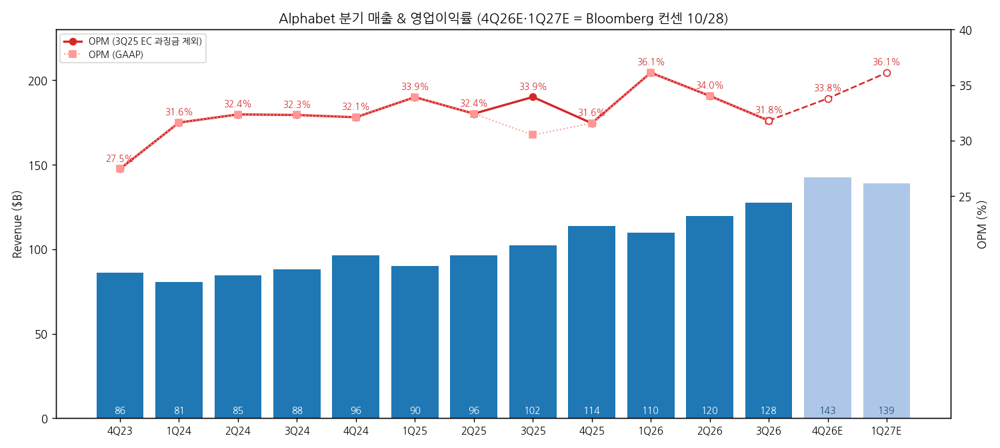
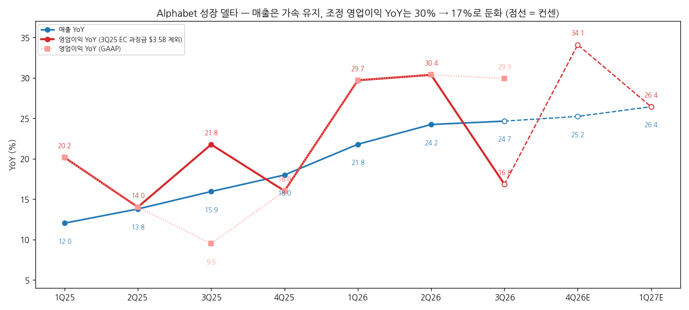
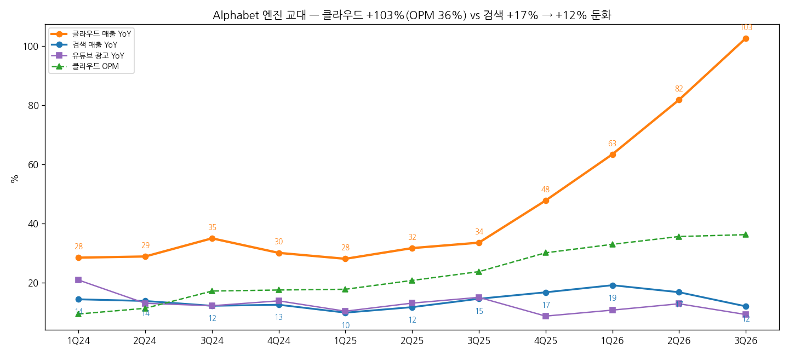
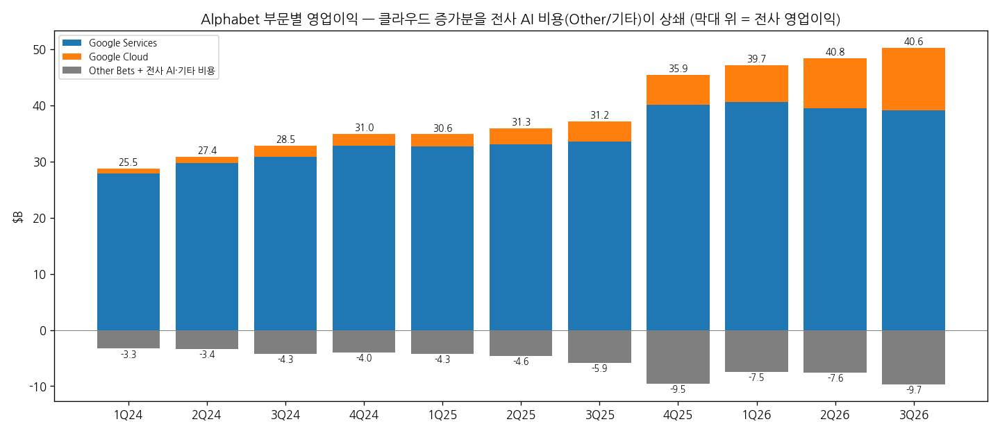

# Alphabet 3Q26 실적 리뷰

> 모드: 실적 리뷰 (v11)
> 종목: Alphabet (GOOGL)
> 섹터: 미국 빅테크
> 분기: 2026-Q3
> 발표일: 2026-10-28 (미 동부 장 마감 후)
> 작성 시각: 2026-11-01 15:30 KST
> 분석 소스: 국내 셀사이드 10개사(대신 10/28 · 미래에셋 10/29 · 키움 10/29 · 삼성 10/29 · KB 10/29(AI 속보) · SK 10/29 · 한화 10/29 · 하나 10/29 · IBK 10/30 · 신한 10/30). 웹 보완: 3Q25 보도자료(EC 과징금 $3.5B, SEC 8-K), 해외 IB TP 변경(MarketBeat·Globe and Mail 10/29~30), 주가 반응(CNBC 10/29). 회사 IR 원본·컨콜 원문은 첨부되지 않아 경영진 발언은 증권사 Q&A 정리에서 인용. 미래에셋은 1페이지 이미지로만 확인

---

## 0. 한 줄 판정

> 성장 델타: **둔화** (조정 기준) | 내러티브: **약화** (클라우드는 강화, 검색·현금은 약화) → **경계 구간 — 매매 제외 직전. 4Q 검색 YoY와 FCF가 다음 분기 판정의 분기점**

→ **숫자**: 매출 $127.6B(+24.7%, 컨센 -0.3%), 영업이익 $40.6B(GAAP +29.9%, 컨센 -6.0%). GAAP YoY는 3Q25 EC 과징금 $3.5B 기저효과 — 제외 시 **+16.8%로 2Q26 +30.4% 대비 -13.6%p 둔화**. 매출 YoY는 24.2% → 24.7%로 소폭 확대, 이익만 꺾였다
→ **쟁점 ①**: 클라우드 $30.7B(**+102.6%**, OPM 36.2%), 백로그 $561B(+9% QoQ) — 하이퍼스케일러 중 가장 빠른 성장. 그러나 검색 $63.4B(+12.0%, QoQ +0.1%)로 2Q +16.8% 대비 급감속, 컨센 -2.5%. **회사 매출의 50%인 검색이 AI 수익화를 증명하지 못한 분기**
→ **쟁점 ②**: FCF **-$9.1B**(컨센 -$2.3~2.7B)로 2분기 연속 적자. TPU 재고 축적·EU 안드로이드 과징금 $5.2B 납부로 운전자본 -$17.4B. 3Q 회사채 $28.7B + ATM 주식 $12.4B 조달, 자사주 매입 0. 2027 CapEx는 "상당한 증가"
→ **주가와 TP**: 10/29 **-12.6%**($324.89 → $283.82), 2004년 상장 후 최대 일간 하락, 시총 약 $500B 증발. 해외 IB 4곳 TP 평균 $433 → $380(-12.2%) 하향. Mirae FY27 영업이익 추정 $207.6B vs 발표 전 컨센 $221.4B — **실적 하향 + 멀티플 하향 동시**
→ **다음 분기 관건**: 4Q 검색 YoY가 10% 아래로 내려가는지(회사도 기저·환율 역풍 예고), 4Q FCF 흑자 복귀 여부, 2027 CapEx 수치(4Q 실적 때 제시)

---

## 1. 숫자

### ① 연결 기준 분기 표

| 항목 ($M) | 4Q24 | 1Q25 | 2Q25 | 3Q25 | 4Q25 | 1Q26 | 2Q26 | **3Q26** | 4Q26E 컨센 | 1Q27E 컨센 |
|---|---|---|---|---|---|---|---|---|---|---|
| 매출액 | 96,469 | 90,234 | 96,428 | 102,346 | 113,828 | 109,896 | 119,796 | **127,577** | 142,554 | 138,947 |
| 영업이익 (GAAP) | 30,972 | 30,606 | 31,271 | 31,228 | 35,934 | 39,696 | 40,770 | **40,576** | 48,184 | 50,188 |
| 영업이익 (조정) | 30,972 | 30,606 | 31,271 | 34,728 | 35,934 | 39,696 | 40,770 | **40,576** | 48,184 | 50,188 |
| OPM (GAAP) | 32.1% | 33.9% | 32.4% | 30.5% | 31.6% | 36.1% | 34.0% | **31.8%** | 33.8% | 36.1% |
| 매출 YoY | 11.8% | 12.0% | 13.8% | 15.9% | 18.0% | 21.8% | 24.2% | **24.7%** | 25.2% | 26.4% |
| 영업이익 YoY (GAAP) | 30.7% | 20.2% | 14.0% | 9.5% | 16.0% | 29.7% | 30.4% | **29.9%** | 34.1% | 26.4% |
| 영업이익 YoY (조정) | 30.7% | 20.2% | 14.0% | 21.8% | 16.0% | 29.7% | 30.4% | **16.8%** | 34.1% | 26.4% |
| **매출 YoY 델타 (%p)** | -3.3 | +0.2 | +1.8 | +2.1 | +2.1 | +3.8 | +2.4 | **+0.5** | +0.5 | +1.2 |
| **영업이익 YoY 델타 (조정, %p)** | -2.9 | -10.5 | -6.2 | +7.8 | -5.8 | +13.7 | +0.7 | **-13.6** | +17.3 | -7.7 |

→ (출처: 실적 = 삼성증권 손익계산서 요약(Alphabet 공시, GAAP). 조정 = 3Q25 G&A에 반영된 EC 과징금 $3.5B 제외(회사 3Q25 보도자료 "과징금 제외 시 영업이익 +22%, OPM 33.9%"). 4Q26E·1Q27E = Bloomberg 컨센 10/28(키움, 발표 전). 4Q24 YoY는 4Q23 $23.7B 기준)
→ 3Q26 서프라이즈: **매출 컨센 대비 -0.3%(FactSet $127.96B · Bloomberg $127.90B), 영업이익 -6.0%(Bloomberg $43.16B)~-6.1%(FactSet $43.19B), OPM 31.8% vs 33.7%. GAAP EPS $2.12 vs $2.99~3.03(-29~30%)** — 지분평가손실 -$8.2B(대부분 SpaceX 주가 하락분, 보유 지분 약 6.8%)가 EPS를 $0.55 낮춤. 평가손익 제외 EPS $2.67도 컨센 $3.01 하회 (하나·신한)
→ 4Q 가이던스(정성): 검색은 2025년 가속분 기저(약 2%p)와 커진 환율 역풍, EU 소포당 €2 처리 수수료(11월 시행)로 성장 압박. TPU 시스템 판매 4Q 확대, 외부 브릿지 컴퓨팅 사용 증가로 클라우드 마진 단기 역풍. 2026 CapEx $195~205B 유지, 2027년은 "상당한 증가"(수치는 4Q 실적 때) (신한·키움)

→ (출처: 삼성증권(Alphabet 공시), 4Q26E·1Q27E Bloomberg 컨센 10/28)

→ (출처: 동일. 조정선은 3Q25 EC 과징금 $3.5B 가산 기준)

(1) YoY는 어디에 있나
→ 조정 영업이익 YoY의 이번 사이클 정점은 **2Q26 +30.4%**(1Q26 +29.7%와 함께 2분기 고원). 3Q26 +16.8%로 한 분기 만에 거의 반토막
→ 매출 YoY는 6개 분기 연속 확대(11.8% → 24.7%) — 하지만 그 가속은 전부 클라우드에서 나오고, 클라우드 증분 이익을 전사 AI 비용이 먹고 있다(아래 ②)
→ 컨센 경로 4Q +34.1%는 **발표 전 숫자**. 회사가 4Q에 검색 역풍과 클라우드 마진 역풍을 동시에 예고했으므로 하향이 유력 `[전망]`. 4Q가 20% 아래로 나오면 "2개 분기 연속 둔화"로 꺾임 판정 요건에 근접

### ② 사업부별 매출·영업이익

(1) 부문

| 부문 ($M) | 3Q25 | 2Q26 | **3Q26** | 매출 YoY | 매출 비중 | 영업이익 3Q25 | 영업이익 2Q26 | **영업이익 3Q26** | OPM 3Q26 | 영업이익 YoY |
|---|---|---|---|---|---|---|---|---|---|---|
| Google Services | 87,052 | 94,540 | **96,302** | +10.6% | 75.5% | 33,527 (과징금 제외 37,027) | 39,544 | **39,157** | 40.7% | +16.8% (조정 **+5.8%**) |
| Google Cloud | 15,157 | 24,768 | **30,709** | +102.6% | 24.1% | 3,594 | 8,814 | **11,121** | 36.2% | +209.4% |
| Other Bets | 344 | 382 | **372** | +8.1% | 0.3% | -1,426 | -1,799 | **-2,047** | — | 적자 확대 |
| Alphabet-level 비용 (전사 AI 등) | — | — | — | — | — | -4,467 | -5,789 | **-7,655** | — | 적자 확대 |

→ (출처: 삼성증권 사업부 Breakdown(Alphabet 공시). Alphabet-level 비용 = 삼성 표의 "기타 손실"(부문에 배분되지 않는 전사 AI 모델 개발 등). Services 조정은 EC 과징금이 Services G&A에 반영됐다는 회사 공시 기준)

(2) 제품 라인 YoY 추이

| 제품 | 3Q26 매출 ($M) | 3Q25 | 4Q25 | 1Q26 | 2Q26 | **3Q26** | 3Q 컨센 대비 |
|---|---|---|---|---|---|---|---|
| 검색 & 기타 | 63,350 | +14.5% | +16.7% | +19.1% | +16.8% | **+12.0%** | -2.5% |
| 유튜브 광고 | 11,207 | +15.0% | +8.7% | +10.7% | +12.9% | **+9.2%** | -2.0% |
| 네트워크 | 7,455 | -2.6% | -1.6% | -3.9% | -0.7% | **+1.4%** | +3.2% |
| 구독·플랫폼·기기 | 14,290 | +20.8% | +16.7% | +19.3% | +15.2% | **+11.0%** | -3.5% |
| 클라우드 | 30,709 | +33.5% | +47.8% | +63.4% | +81.8% | **+102.6%** | +6.9% |
| 클라우드 OPM | — | 23.7% | 30.1% | 32.9% | 35.6% | **36.2%** | 컨센 33.9% |

→ (출처: 삼성·신한(Alphabet 공시, FactSet 컨센))
→ `[판단]` **엔진이 교대되는 분기다.** 클라우드 증분 매출(YoY +$15.6B)이 서비스 증분(+$9.3B)을 크게 넘었다(SK). 그러나 서비스 영업이익은 과징금 기저를 빼면 +5.8%에 그쳤고, 클라우드 영업이익 증가분(QoQ +$2.3B)을 전사 AI 연구개발비 증가(+$1.9B, 키움)가 거의 다 상쇄했다. R&D는 $20.6B(+36% YoY)

→ (출처: 삼성증권(Alphabet 공시))

→ (출처: 삼성증권(Alphabet 공시). 회색 = Other Bets + Alphabet-level 비용)

(3) 현금흐름·자본

| 항목 ($B) | 3Q25 | 2Q26 | **3Q26** | 3Q 컨센 |
|---|---|---|---|---|
| CapEx | 24.0 | 44.9 | **51.4** (+114% YoY) | 55.2 |
| 영업현금흐름 | — | — | **42.3** (-13% YoY) | 50.9~52.7 |
| FCF | 24.5 | 적자 | **-9.1** | -2.3~-2.7 |

→ (출처: 신한(FactSet)·삼성·키움(Alphabet 공시))
→ 운전자본 -$17.4B = TPU 재고 축적 + 2018년 EU 안드로이드 과징금 $5.2B 납부. 재고는 작년 말 $2.4B → $13.3B(대신). 3Q 선순위 회사채 $28.7B + ATM 주식 $12.4B 발행(잔여 한도 약 $27.6B), 장기부채 작년 말 $46.5B → $125.0B. 9개월 외부 조달 합계 $138.3B, 자사주 매입은 전년 동기 $39.8B → 0, 희석 주식 수 +1.35% YoY (키움·대신·신한)

### ③ 연간

| 항목 ($B) | 2022 | 2023 | 2024 | 2025 | 2026E | 2027E |
|---|---|---|---|---|---|---|
| 매출액 | 282.8 | 307.4 | 350.0 | 402.8 | 499.8 | 625.0 |
| 영업이익 | 74.8 | 84.3 | 112.4 | 129.0 | 171.6 → 169.4 | 221.4 → 207.6 |
| OPM | 26.5% | 27.4% | 32.1% | 32.0% | 33.9% | 33.2% |
| 매출 YoY | 9.8% | 8.7% | 13.9% | 15.1% | 24.1% | 25.1% |
| 영업이익 YoY | -3.9% | 12.7% | 33.3% | 14.8% | 31.3% | 22.5% |

→ (출처: 실적 = 삼성(Alphabet 공시, 2022는 SK), 추정 = 발표 전 Bloomberg 10/28(키움) → 발표 후 미래에셋 추정(10/29). OPM·YoY는 발표 후 미래에셋 기준)
→ 발표 전 → 발표 후: **2026E 영업이익 -1.3%, 2027E -6.2%**(미래에셋 단독, 광고 성장률 가정 2026 -2.4%p·2027 -1.5%p 하향). 발표 후 집계 컨센은 미확인

---

## 2. 시장 쟁점

### ⓪ 지난 분기에 "봐야 할 것"으로 남긴 항목 체크

> 직전 분기(2Q26) 리뷰가 없어 **1Q26 리뷰 기반 팔로업(`2026-Q2_GOOGL_팔로업.md`, 대상 2Q26)** 항목을 2Q·3Q 누적으로 체크

| 직전 팔로업 항목 | 2Q26 → 3Q26 결과 | 판정 |
|---|---|---|
| Cloud 백로그 모멘텀·매출 인식 페이스 | 백로그 $561B(+9% QoQ), 24개월 내 55% 인식 첫 공개 | 확인 |
| Cloud OPM 경로 (Wiz 역풍) | 35.6% → 36.2% | 확인 |
| CapEx FY26 $180~190B 가이드 검증 | $195~205B로 상향 후 유지 | 확인 (상향) |
| Search AI 광고 커버리지 20% → 25%+ | AI Mode 해외 광고·멀티턴 광고 도입했지만 검색 +16.8% → +12.0% | 반대로 나옴 |
| TPU 외부 판매 첫 매출·Gemini 4 | TPU 고객 약 100곳, 4Q 확대·2027 유의미 매출 / Gemini 4(Argon·Carbon) 출시 | 확인 |
| Antitrust·지분 평가 변동성 | EU 과징금 $5.2B 현금 납부, SpaceX 평가손 -$8.2B | 확인 (변동성 현실화) |

### ① 이번 분기 쟁점 5개

| # | 쟁점 | 한 줄 정의 | 언급 |
|---|---|---|---|
| 1 | 검색 둔화 — 환율·기저인가, AI 수익화 실패인가 | 쿼리는 5년래 최고 성장, 매출은 +12%·QoQ 0% | 9/9 |
| 2 | FCF 쇼크와 외부 조달 | 2분기 연속 FCF 적자, 회사채·주식으로 투자 | 9/9 |
| 3 | TPU — 선출(현금) 후입(수익) | 재고가 먼저 쌓이고 매출은 나중에, 마진은 비공개 | 7/9 |
| 4 | 클라우드 +103% — 가장 강한 성장, 지속성은 | 백로그 $561B, 4Q 마진 역풍 | 9/9 |
| 5 | 이익 레버리지 실종 — AI 비용이 클라우드 이익을 먹는다 | 클라우드 이익 +$2.3B QoQ에도 전사 이익 -0.5% | 6/9 |

### ② 쟁점별 분해

#### 쟁점 1. 검색 둔화 — 환율·기저인가, AI 수익화 실패인가

(1) 회사 설명
→ 순다르 피차이: "전년 대비 검색 질의 증가율이 지난 5년 중 가장 높다". 둔화 원인은 ① 환율(가장 큰 요인) ② EU 소액 수입품 면세 폐지에 따른 아시아 광고주 지출 변화 ③ 2Q 월드컵 효과 소멸 ④ AI Mode의 낮은 수익화 (대신·키움·하나)
→ "AI Mode 쿼리 다수는 증분이며 평균 3배 길다", "에이전트는 잠식이 아니라 확장". AI Mode 광고를 처음 해외로 확대, 미국에선 멀티턴 대화형 광고 도입. 2025년 하반기 가속분 기저가 3Q에 약 3%p, 4Q에도 수%p 부담 (신한·키움·한화)

(2) 증권사별 해석

| 증권사 | 핵심 가정·추정 | 논리 |
|---|---|---|
| SK | 검색 +17% → +12%, Meta 단가 +14%와 비교 | 핵심은 **경쟁 강도 강화**. ChatGPT·Muse가 있는 한 AI Mode 공격적 단가 책정은 중장기적으로 어렵다. 과거 모바일·동영상 전환기처럼 ASP 하락 과도기지만 지금 CapEx 수준은 긴 둔화를 기다려주지 않는다 |
| 삼성 | 광고 성장 1Q +15.5% → 2Q +14.4% → 3Q +10.6% | "진짜 문제는 광고". 메타가 AI+광고로 고성장하는 사이 구글 광고 펀더멘털 의심 커질 수밖에. 회사 톤상 당장 해결책이 안 보인다 |
| 키움 | 검색 QoQ +0.1%, 4Q 기저 약 2%p + 환율 + EU 수수료 | 수요 감소보다 수익화 지연. 높은 기저는 2027년 상반기까지 |
| 미래에셋 | 광고 성장률 전망보다 3.9%p 낮음, 환율 영향 약 1.5%p | 둔화는 분명하지만 쿼리 증가가 확인됐고 수익화 개선 가능 — "오히려 좋아" |
| 하나 | AI Mode 검색 대부분 추가 수요 | 경쟁력 약화로 판단하기 이르다 |
| 대신 | 검색·유튜브·구독 3개 품목 동시 둔화 | 쿼리가 늘어도 매출이 따라오지 않는다는 지적이 숫자로 드러남 (JPM 질문) |

(3) 공통 결론 vs 갈리는 지점
→ 공통: Q(쿼리)는 늘고 P(쿼리당 매출)가 못 따라오는 구조. 환율·기저가 일부 설명
→ 갈림: **P 하락이 일시적 과도기(미래에셋·하나·키움)인지, 경쟁에 의한 구조적 단가 압박(SK·삼성)인지**

(4) `[판단]`
→ 같은 분기 Meta 광고 단가는 +14%, 북미는 +23%였다. 환율·기저는 Meta도 같은 조건이었는데 결과가 반대다. **"AI가 검색 광고 단가를 지키는가"라는 질문에 이번 분기 숫자는 "아직 아니다"라고 답했다.** 회사가 4Q 추가 역풍을 예고한 만큼 4Q 검색이 +10% 아래면 SK·삼성의 구조적 해석이 확정된다

#### 쟁점 2. FCF 쇼크와 외부 조달

(1) 회사 설명
→ CapEx $51.4B, 영업현금흐름 $42.3B, FCF -$9.1B. 원인은 TPU 시스템 재고 축적과 EC 과징금 납부. 흑자 전환 시점·추가 부채 발행 계획에 대한 언급은 없음 (신한)
→ CapEx 구성 서버·네트워크 약 65%(내용연수 6년), 데이터센터 약 35%. TPU의 제3자 시설·고객 DC 배치는 자체 시설 선건설 부담을 줄이는 효과 (신한)
→ 미래 구매 약정 $924B, 착수 전 리스 등 $152B(최대 의무 기준) (신한)

(2) 증권사별 해석

| 증권사 | 핵심 가정·추정 | 논리 |
|---|---|---|
| 키움 | 9개월 외부 조달 $138.3B, 자사주 0, 희석 +1.35% | 신규 차입 없이 FCF 흑자를 지킨 MSFT와 달리 **투자를 외부 자금으로 감당하는 구조로 전환** — 시장이 부정적 반응한 이유 |
| 대신 | CapEx = 매출의 40%, 장기부채 $46.5B → $125.0B | 재원이 이익이 아니라 채권·주식. 펀더멘털은 강하지만 밸류에이션이 싸다고 보기 어렵다 |
| 삼성 | 영업현금흐름 $42.3B vs 컨센 $50.9B | ASIC에서 가장 앞선 구글이 아이러니하게도 매출 성장과 현금흐름의 미스매치가 가장 큰 하이퍼스케일러. 2027 CapEx 큰 폭 증가 언급이 불안 가중 |
| 하나 | TPU 재고는 확정 고객이 있는 재고 | 구조적 현상 아님, 출하 시 현금흐름 개선 |
| 미래에셋 | CapEx $51.3B는 예상 범위 | 영업현금흐름과 ATM으로 안정적 조달 중 |

(3) 공통 결론 vs 갈리는 지점
→ 공통: 이번 FCF 미스의 상당 부분은 일회성(과징금 $5.2B) + 타이밍(TPU 재고)
→ 갈림: 키움·대신·삼성은 "자본 구조 전환(내부 현금 → 외부 조달)"이라는 성격 변화에, 하나·미래에셋은 일시성에 무게

(4) `[판단]`
→ 과징금을 빼도 FCF는 약 -$3.9B로 컨센(-$2.3~2.7B)보다 나쁘다. 더 중요한 건 **자사주 매입 0 + ATM 상시 발행**으로 주주환원 기업에서 희석 기업으로 성격이 바뀌었다는 점이다. 같은 주 MSFT(FCF 흑자·회사채 상환)와의 대비가 주가 -12.6%의 핵심

#### 쟁점 3. TPU — 선출(현금) 후입(수익)

(1) 회사 설명
→ TPU 시스템(칩+서버+네트워크+소프트웨어) 판매 고객 약 100곳, 4Q 판매 확대, 2027년 유의미한 매출. Crux AI·Oracle과 TPU 시스템 공급 제휴, 추가 논의 중. TPU v8e/8i는 이전 세대 대비 학습 성능 최대 2.7배, 추론 가성비 80% 개선 (대신·신한)
→ 기타 매출원가 +32%의 첫 요인이 TPU 시스템 하드웨어 원가. 매출 인식 방식·마진은 제품별 비공개 (신한·대신)

(2) 증권사별 해석

| 증권사 | 핵심 가정·추정 | 논리 |
|---|---|---|
| 키움 | TPU 재고 $3.2B 축적 | 계약 → 재고 → 인도 순서라 판매가 늘수록 현금이 매출보다 먼저 나간다 — "선출 후입" |
| 삼성 | TPU 매출 본격화 2027년 | 결국 막대한 매출·현금흐름 창출 가능성 — 2027년부터 기대감 재부상 |
| SK | TPU 외판 비중은 아직 매우 작음 | 엔비디아급 GPM을 받을 수 있는지 힌트 부재 |
| 하나 | 고객 DC 직접 공급 = 자체 설비 확장 불필요 | 자본 효율 측면 장점 |
| 대신 | 바클레이즈 등이 두 분기 연속 같은 질문 | 마진 구조 비공개가 불확실성 |

(3) 공통 결론 vs 갈리는 지점
→ 공통: TPU는 구글의 가장 강력한 장기 무기, 2027년이 매출 본격화 시점
→ 갈림: 하드웨어 판매 마진이 클라우드 임대 마진보다 낮을지 — 정보 공백

(4) `[판단]`
→ 매출총이익률이 전분기 대비 -2%p(59.7%, 하나)로 이미 하드웨어 믹스 효과가 보인다. **TPU는 매출 성장을 키우지만 마진과 현금은 늦게 따라오는 사업**이라 모멘텀 관점에선 2027년 상반기까지 "매출 서프라이즈·이익 미스" 패턴이 반복될 수 있다

#### 쟁점 4. 클라우드 +103% — 지속성은

(1) 회사 설명
→ 클라우드 매출 $30.7B(+103%), OPM 23.7% → 36.2%. GCP(AI 인프라·AI 솔루션·코어 GCP)가 주효하고 TPU 시스템 판매도 기여. 백로그 $561B, 24개월 내 55% 인식. Gemini Enterprise 고객 지출 전년 4배, 연매출 $1B+ 제품라인 18개, API 토큰 분당 약 320억(+40~45% QoQ) (신한·삼성·대신)
→ 4Q에는 공급 부족을 메우기 위한 외부(3P) 브릿지 컴퓨팅 사용 증가로 클라우드 마진 단기 압박 (신한·키움)

(2) 증권사별 해석

| 증권사 | 핵심 가정·추정 | 논리 |
|---|---|---|
| 키움 | 백로그 55%/24개월 = 연평균 $154B+ > 현 연환산 $123B | 이미 계약으로 확보된 성장. 4Q 마진 하락도 수요가 설비보다 빠르다는 신호 |
| 신한 | 4Q 클라우드 OPM 33.4%(FactSet) | 2Q 예고된 3P 브릿지가 3Q 말에야 가동 → 4Q 마진 압박 |
| 미래에셋 | 클라우드 OPM 36.2%로 2027 가정(37%) 수준 도달 | 클라우드가 광고 하향을 모두 상쇄 — 목표주가 $500 유지 |
| 삼성 | 클라우드 OPM 36.2% vs 컨센 33.9% | 고성장 영업 레버리지가 외부 임대 마진 하락 상쇄 |

(3) 공통 결론 vs 갈리는 지점
→ 공통: 클라우드는 하이퍼스케일러 중 성장·마진 모두 최강, 백로그로 2년 가시성
→ 갈림: 거의 없음 — 쟁점이 아니라 "유일한 위안"으로 다뤄짐

(4) `[판단]`
→ 클라우드가 전사 매출의 24%까지 올라왔지만 아직 검색(50%)의 둔화를 이익 단에서 덮을 크기는 아니다. 4Q에 클라우드 OPM이 33%대로 내려오면 검색 둔화와 겹쳐 전사 이익 델타가 한 번 더 꺾인다

#### 쟁점 5. 이익 레버리지 실종 — AI 비용이 클라우드 이익을 먹는다

(1) 회사 설명
→ R&D $20.6B(+36% YoY, +13% QoQ) — 신규 AI 모델 개발 인력·기술 인프라 비용. Alphabet-level 비용 -$7.7B(전년 -$4.5B) (하나·삼성)

(2) 증권사별 해석

| 증권사 | 핵심 가정·추정 | 논리 |
|---|---|---|
| 키움 | 클라우드 영업이익 +$2.31B QoQ, 공통 AI R&D +$1.87B QoQ | AI 모델 비용이 먼저 손익에 잡혀 전사 영업이익은 오히려 감소 |
| 미래에셋 | R&D +36%가 영업이익 미스의 원인 | 추정치·컨센 각각 -6.8%·-6.0% 하회 |
| 신한 | 감가상각·TPU 원가 증가에도 영업 레버리지 유지 | 투자 비용이 초기에 집중된 결과, 견딜 가치 충분 |

(3) 공통 결론 vs 갈리는 지점
→ 공통: 이번 분기 영업이익 미스의 직접 원인은 R&D(AI 모델) 비용
→ 갈림: 신한은 "초기 집중 비용"으로 보고 견딜 만하다는 입장, 나머지는 2027년 감가상각까지 고려하면 레버리지 회복 시점이 불확실

(4) `[판단]`
→ 감가상각은 이제 시작이다(CapEx의 65%가 6년 내용연수 서버). **R&D + 감가상각이 동시에 늘어나는 구간에서 검색이 둔화하면 이익 YoY는 매출 YoY 아래로 내려간다** — 3Q가 그 첫 분기

### ③ 낙관 vs 보수 — 논리 대비

| 구분 | 증권사 | 무엇을 다르게 가정했나 |
|---|---|---|
| 가장 낙관 | 미래에셋(TP $500 유지, "오히려 좋아") · 하나 · 신한(★★★★☆, "급락은 장기 기회") | 검색 둔화 = 환율·기저·수익화 시차, FCF = 일회성·타이밍, 클라우드·TPU가 2027년 모든 것을 상쇄 |
| 가장 보수 | SK("본체에 대한 걱정") · 삼성("빛바랜 클라우드 고성장") · 키움 | 검색 둔화 = 경쟁(ChatGPT·Muse)에 의한 구조적 단가 압박, 자본 구조가 내부 현금 → 외부 조달로 전환 |

→ 셀사이드와 바이사이드의 어긋남: 국내 셀사이드는 대부분 "과도한 우려·매수 기회"인데, 시장은 상장 후 최악의 하루(-12.6%)로 답했다. 같은 날 발표한 MSFT는 FCF 흑자로 시간외 +4%. **시장은 "누가 AI 투자를 자기 현금으로 감당하는가"로 빅테크를 갈라 사기 시작했다** `[판단]`

### ④ 추정치·TP 변화

| 증권사 | 직전 TP | 현재 TP | 4Q26 영업이익 E | 2026E / 2027E 영업이익 | 핵심 변화 한 줄 |
|---|---|---|---|---|---|
| Citi | $447 | $375 | — | — | Buy 유지, -16.1% |
| JPMorgan | $425 | $375 | — | — | -11.8% |
| Deutsche Bank | $430 | $390 | — | — | Buy 유지, -9.3% |
| BofA | $430 | $380 | — | — | Buy 유지, -11.6% |
| Piper Sandler | — | 하향 | — | — | 수치 출처 간 불일치 |
| 미래에셋 (국내) | $500 | **$500** | — | $169.4B / $207.6B | 매수 유지, 광고 성장률 가정 하향 |
| 신한 (국내) | — | 컨센 $419.0 인용 | $47.1B(FactSet) | $170.8B / $216.7B | ★★★★☆, 4Q 브릿지 비용·감가상각이 리스크 |
| 대신 (국내) | — | 컨센 $426.9 인용 | — | $171.7B / $218.2B (컨센) | 매수(컨센 기준) |
| 국내 기타 6사 | — | 자체 TP 없음 | 키움 컨센 $48.2B | — | 삼성: 12MF P/E 19.6배 → 시간외 17.7배(3년 평균 21배) |

→ (출처: 해외 = MarketBeat·Globe and Mail(10/29~30). 국내 = 각사 리포트. 해외 IB 개별 추정치는 원문 미입수)
→ 직전 TP가 확인된 해외 4개사 평균 **$433.0 → $380.0(-12.2%), 하향 4 · 상향 0**. 컨센 평균 TP $419~430(발표 전, 각사 인용) → $410.5(MarketBeat, 발표 후)
→ **TP 하향의 원인은 실적 하향 + 멀티플 하향 동시**: 2027E 영업이익 약 -6%(미래에셋), 12MF P/E 19.6배 → 17.7배(시간외 기준, 삼성). 빅테크 3사(AMZN·META 포함) 중 유일하게 이익 추정이 의미 있게 내려간 경우

---

## 3. 내러티브 점검

(1) 성장 스토리 정의
→ **"검색은 AI로 방어·재가속하고, 클라우드·TPU·Gemini가 새 성장 엔진이 되는 유일한 풀스택 AI 기업 — 그 투자를 검색 현금이 받친다"**

(2) 이번 분기가 스토리에 준 영향

| 축 | 방향 | 근거 |
|---|---|---|
| 클라우드·TPU 엔진 | 강화 | +103%, OPM 36%, 백로그 $561B, TPU 고객 100곳 |
| Gemini 모델 경쟁력 | 강화 | Gemini 4(Argon·Carbon), 앱 사용자 10억 명, 토큰 +40% QoQ |
| 검색 AI 방어 | 약화 | 쿼리 5년래 최고 성장에도 매출 +12%·QoQ 0%, 4Q 추가 역풍 |
| "검색 현금이 받친다" | 훼손 | FCF 2분기 연속 적자, 자사주 0, 회사채·ATM 상시 조달 |

(3) 국면 판단
→ 조정 영업이익 YoY 30.4% → 16.8%(**둔화**) × 핵심 전제(검색 현금이 투자를 받친다) 약화(**약화**) → **경계 구간, 매매 제외 직전**
→ 클라우드라는 좋은 숫자가 있어도 모멘텀 국면을 결정하는 건 전사 이익 델타와 시장이 사는 스토리다. 둘 다 이번 분기에 꺾였다. 4Q 검색이 +10% 아래 + 4Q 영업이익 YoY 20% 미만이면 **꺾임 + 약화 = 매매 제외** `[판단]`

(4) 트리거와 리스크

| 다시 강하게 만들 트리거 | 깨뜨릴 리스크 |
|---|---|
| 4Q 검색 +12% 이상 유지 + AI Mode 광고 수익화 지표 공개 | 4Q 검색 +10% 미만 → 구조적 단가 압박 확정 |
| 4Q FCF 흑자 복귀(TPU 재고 출하) + ATM 발행 중단 | 2027 CapEx가 영업현금흐름을 크게 웃돌고 추가 대규모 회사채·ATM |
| TPU 외판 마진 공개(엔비디아급 근접) 또는 대형 TPU 계약 | 4Q 클라우드 OPM 33% 이하 + R&D 증가 지속 → 이익 YoY 매출 YoY 하회 고착 |

---

## 4. 향후 봐야 할 것 (4Q26)

| 순위 | 무엇을 (변수·임계값) | 어떤 데이터로 | 언제 |
|---|---|---|---|
| 1 | **4Q 검색 YoY +10% 사수 여부** — 미만이면 구조적 둔화 확정, 판정 꺾임으로 이동. AI Mode 광고 확대(해외·멀티턴) 효과 | 4Q26 실적, 블랙프라이데이·홀리데이 검색 광고 지표, 달러 인덱스 | 2027년 1월 말~2월 초 |
| 2 | **4Q 조정 영업이익 YoY 20% 이상** — 컨센 +34%(발표 전)는 하향 예상. 20% 미만이면 2분기 연속 둔화 | 4Q 실적, 발표 후 컨센 수정 | 2027년 1월 말~2월 초 |
| 3 | **FCF 흑자 복귀 + 2027 CapEx 수치·조달 계획** — ATM 잔여 $27.6B 소진 속도, 추가 회사채 | 4Q 현금흐름표, SEC 424B·8-K, 2027 CapEx 가이던스 | 수시 / 4Q 실적 |
| 4 | **클라우드 OPM 33% 이상 + TPU 4Q 매출 확대·마진 힌트** | 4Q 클라우드 실적, TPU 고객 계약(Oracle·Crux AI 등) 뉴스 | 2027년 1월 말~2월 초 |
| 5 | **SpaceX 지분 평가손익** — 보유 약 6.8%, SpaceX 12/9 락업 해제가 영업외손익·EPS 변동성 키움 | SPCX 주가, 4Q 영업외손익 | 12/9 / 4Q 실적 |

→ 이 목록이 다음 분기 리뷰의 ⓪ 체크 대상, `earnings-followup/2026-Q4_GOOGL_팔로업.md`, 캘린더 시그널로 이어진다
