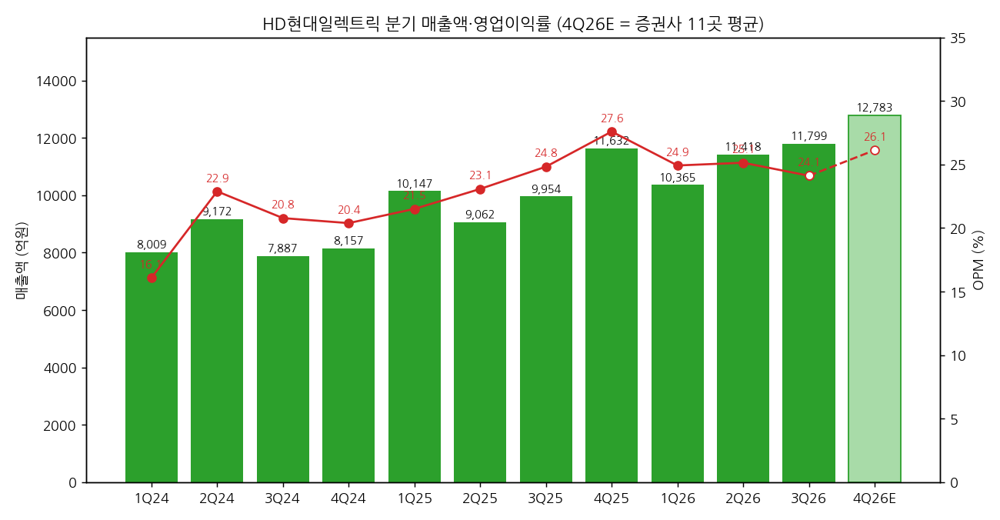
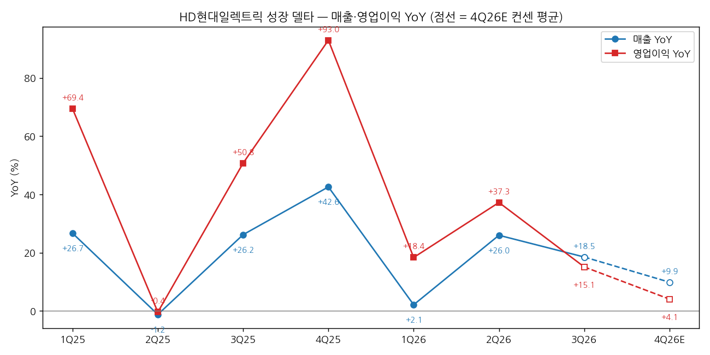
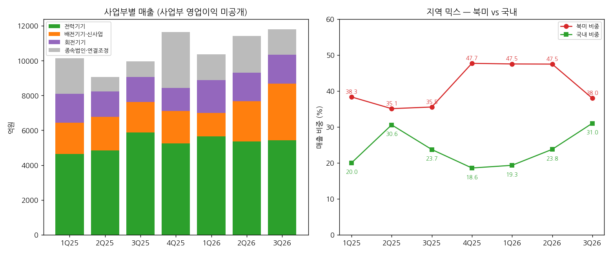

> 모드: 실적 리뷰 (v11)
> 종목: HD현대일렉트릭 (267260)
> 섹터: 전력 인프라
> 서브섹터: 송변전
> 분기: 2026-Q3
> 발표일: 2026-10-27 (잠정실적 + 컨퍼런스콜)
> 작성 시각: 2026-11-03 12:20 KST
> 분석 소스: 셀사이드 15개 첨부 — NH투자증권(10/28), LS증권(10/28), IBK투자증권(10/28), 유안타증권(10/28), 대신증권(10/28), 신한투자증권(10/28), SK증권(10/28), 한화투자증권(10/28), BNK투자증권(10/28), 다올투자증권(10/28), 삼성증권(10/27, 이미지형 PDF 렌더 판독), J.P. Morgan(10/28), Citi(10/27), Goldman Sachs(10/27), J.P. Morgan 데스크 첫인상(10/27, 세일즈 코멘트). 회사 설명은 증권사 리포트의 10/27 컨퍼런스콜 Q&A 정리로 인용. 웹서치 보완 없음 — 중간선거 데이터는 2026-Q3 효성중공업 리뷰에서 재사용(Axios·Forbes·Ballotpedia, 4번 (3)항만). 직전 분기는 2026-Q1 리뷰 + 2026-Q2 팔로업 기준 (2Q26 리뷰 미작성)

# HD현대일렉트릭 3Q26 실적 리뷰 — 사상 최대 매출, BESS·환율이 깎은 마진, 슬롯이 막은 수주

> 성장 델타: 둔화 | 내러티브: 약화 → 델타 둔화 + 내러티브 약화 → 경계 구간 (빅테크 B·C·D 장기공급계약과 12월 FERC 결론 확인 전까지 관망)

→ **숫자**: 매출 1조 1,799억원(+18.5% YoY, 분기 최대), 영업이익 2,845억원(+15.1% YoY, OPM 24.1%). 영업이익 YoY가 2Q26 +37.3%에서 +15.1%로 22%p 내려왔고, FnGuide 컨센(3,050억원) 대비 -6.7% 미스다. 컨센이 그리는 4Q26 영업이익 YoY는 +4.1%로 한 번 더 둔화한다
→ **쟁점 ①**: OPM 1.0%p 하락의 원인은 국내 안좌 BESS 매출 1,250억원(저마진)과 북미 납품 타이밍(북미 비중 47.5% → 38.0%), 원화 강세다. BESS를 빼면 OPM은 25.8~27.0%로 추정돼 본업 마진은 꺾이지 않았다 [추정]. 환율은 영업이익보다 영업외(외환손실 약 440~480억원)에서 더 크게 깎았다
→ **쟁점 ②**: 신규수주 9.8억달러(-19% YoY, -32% QoQ)는 수요 둔화가 아니라 생산 슬롯 소진 때문이라고 회사와 증권사 대다수가 해석한다. 빅테크 B·C·D사 장기공급계약은 11월 말 확정 예정이다
→ **쟁점 ③**: 14곳 중 12곳이 TP를 하향했다(평균 104만원 → 81만원, -21.7%). 이익 추정은 3~8% 하향에 그쳐 TP 하향의 주원인은 멀티플이다. 주가는 52주 고점(142만원) 대비 -68%, 12개월 선행 PER 15배(대신)까지 내려왔다
→ **다음 분기 관건**: 4Q26 영업이익 3,340억원(컨센 11곳 평균, YoY +4.1%)을 지키는지, 그리고 11월 말 빅테크 장기공급계약이 12월 FERC 대형부하 접속 결론과 맞물려 어떻게 나오는지가 델타와 멀티플을 함께 정한다

---

## 1. 숫자

① 연결 기준 분기 표 (단위: 억원, %)

| 항목 | 1Q24 | 2Q24 | 3Q24 | 4Q24 | 1Q25 | 2Q25 | 3Q25 | 4Q25 | 1Q26 | 2Q26 | **3Q26** | 4Q26E |
|---|---|---|---|---|---|---|---|---|---|---|---|---|
| 매출액 | 8,009 | 9,172 | 7,887 | 8,157 | 10,147 | 9,062 | 9,954 | 11,632 | 10,365 | 11,418 | **11,799** | 12,783 |
| 영업이익 | 1,288 | 2,099 | 1,639 | 1,663 | 2,182 | 2,091 | 2,471 | 3,209 | 2,583 | 2,870 | **2,845** | 3,340 |
| OPM | 16.1 | 22.9 | 20.8 | 20.4 | 21.5 | 23.1 | 24.8 | 27.6 | 24.9 | 25.1 | **24.1** | 26.1 |
| 매출 YoY | — | — | — | — | +26.7 | -1.2 | +26.2 | +42.6 | +2.1 | +26.0 | **+18.5** | +9.9 |
| 영업이익 YoY | — | — | — | — | +69.4 | -0.4 | +50.8 | +93.0 | +18.4 | +37.3 | **+15.1** | +4.1 |
| **매출 YoY 델타 (%p)** | — | — | — | — | — | -27.9 | +27.4 | +16.4 | -40.5 | +23.9 | **-7.5** | -8.6 |
| **영업이익 YoY 델타 (%p)** | — | — | — | — | — | -69.8 | +51.1 | +42.2 | -74.6 | +18.9 | **-22.1** | -11.1 |

→ (출처: 1Q25~3Q26은 LS증권 표6(회사 발표 기준), 1Q24~4Q24는 2025년 분기 실적과 YoY(LS·유안타 표)로 역산한 값 [계산] — 연간 합계 3조 3,225억원·6,689억원으로 2024년 확정치와 일치. 4Q26E는 NH·SK·한화·BNK·LS·다올·신한·유안타·대신·IBK·골드만 11곳 분기 추정치 단순평균. 2023년 분기 데이터가 없어 2024년 YoY는 생략)
→ 3Q26 서프라이즈: 매출은 컨센 대비 +1.5%, 영업이익은 -6.7% (컨센 매출 1조 1,630억원·영업이익 3,050억원, FnGuide, LS·IBK·한화 인용. Bloomberg 컨센 3,060억원 대비 -7%, 씨티·JPM). 세전이익은 -20.9%, 지배순이익은 -20.4% 미스다
→ 영업이익 YoY의 정점은 4Q25(+93%)였고, 이후 +18% → +37% → +15%로 들쭉날쭉하게 내려오고 있다. 9개월 누적 영업이익은 8,298억원으로 +23.1% YoY다 (씨티)
→ 컨센 경로상 4Q26 YoY는 +4.1%로 한 번 더 둔화한다. 4Q25 기저(OPM 27.6%, 분기 최고)가 높고 원/달러가 4Q25 평균 1,452원에서 1,320~1,350원대로 내려와 약 200억원의 역풍이 있기 때문이다 (골드만). 2027년 컨센은 다시 +24.8%로 재가속을 그린다. 즉 컨센이 보는 YoY 바닥은 4Q26이다
→ **[판단] 델타 = 둔화**: 영업이익 YoY가 축소됐지만 플러스를 유지했고, 1Q26 → 2Q26에서는 재가속했으므로 "2개 분기 연속 둔화"에는 아직 해당하지 않는다. 다만 4Q26이 컨센대로 +4%에 그치면 2개 분기 연속 둔화가 되고, 3,200억원(YoY 0%)을 밑돌면 "꺾임" 기준에 걸린다

→ (출처: HD현대일렉트릭, LS증권, 4Q26E는 증권사 11곳 추정 평균. 4Q26E는 연한 막대·점선)

→ (출처: 동일. 점선은 4Q26E 컨센 평균 경로)

② 사업부별 매출 (단위: 억원, %. 회사 실적발표 기준 구분)

| 사업부 | 항목 | 1Q25 | 2Q25 | 3Q25 | 4Q25 | 1Q26 | 2Q26 | **3Q26** |
|---|---|---|---|---|---|---|---|---|
| 전력기기 | 매출 | 4,637 | 4,840 | 5,878 | 5,250 | 5,640 | 5,359 | **5,423** |
| 전력기기 | 매출 YoY | +46.1 | +28.2 | +87.7 | -9.6 | +21.6 | +10.7 | **-7.7** |
| 배전기기·신사업 | 매출 | 1,792 | 1,923 | 1,750 | 1,854 | 1,359 | 2,312 | **3,251** |
| 배전기기·신사업 | 매출 YoY | -24.9 | -24.4 | +0.1 | -7.3 | -24.2 | +20.2 | **+85.8** |
| 회전기기 | 매출 | 1,668 | 1,460 | 1,434 | 1,325 | 1,888 | 1,629 | **1,671** |
| 회전기기 | 매출 YoY | +17.1 | +4.2 | +9.2 | +7.5 | +13.2 | +11.6 | **+16.5** |
| 종속법인·연결조정 | 매출 | 2,050 | 840 | 892 | 3,203 | 1,478 | 2,118 | **1,454** |
| 종속법인·연결조정 | 매출 YoY | +99.8 | -42.1 | -47.3 | 흑전 | -27.9 | +152.1 | **+63.0** |

→ (출처: LS증권 표6, 유안타 분기 표. 3Q26 매출 비중은 전력기기 46.0%·배전 27.6%·회전 14.2%·종속 12.3% (씨티))
→ **사업부 영업이익은 미공개**다. 회사는 "북미 영업이익률이 1~3분기 연속 상승했고 판가도 지속 상승"이라고만 밝혔다 (신한·유안타·다올 Q&A)
→ 델타를 끈 것은 배전기기·신사업(+85.8%)이다. 이 중 안좌 BESS 매출 1,250억원(계약 1,800억원 중, 2Q26 200억원 기인식)이 들어갔다. BESS를 빼면 배전 매출은 약 2,001억원으로 +14% YoY다 [계산]. 국내 반도체향 배전변압기와 북미 데이터센터향 중저압차단기(VCB, QoQ 4배)가 성장했다 (LS·BNK)
→ 델타를 꺾은 것은 전력기기(-7.7%)다. 영국 Gate 2(전력망 접속 심사제도) 시행과 현장 공정 지연으로 유럽향 변압기 매출이 이연됐다 (대신·LS). 유럽은 2023년 저수익 수주 물량이 매출로 반영돼 수익성도 낮았다 (유안타·JPM 데스크)
→ 종속법인은 미국 아틀란타 판매법인의 인도 물량이 2Q26에 몰린 기저로 QoQ -31% 줄었다. 이것이 북미 매출 비중 하락의 직접 원인이다 (LS)

→ (출처: LS증권 표6. 지역 비중은 LS 표의 지역 매출 ÷ 연결 매출 [계산]. 회사 발표 기준으로는 2Q26 국내 22.5%·북미 47.5%, 3Q26 국내 31%·북미 38%)

(1) 지역별 매출·수주 — 선행지표 (매출 억원, 수주 백만달러)

| 지역 | 3Q26 매출 | 매출 YoY | 매출 QoQ | 3Q26 수주 | 수주 YoY | 9M26 수주 | 잔고 비중 |
|---|---|---|---|---|---|---|---|
| 북미 | 4,479 | +26.6 | -17.3 | 451 | -40.9 | 2,619 (+36.1%) | 68% |
| 중동 | 1,677 | -20.0 | +29.2 | 80 | +2.6 | 350 (-14.8%) | 6% |
| 유럽 | 889 | -30.3 | -19.3 | 91 | -44.5 | 260 (-32.1%) | 11% |
| 국내·기타 | 4,754 | +56.1 | +32.1 | 358 | +72.9 | 988 (+19.6%) | 11%(국내) |
| **합계** | **11,799** | **+18.5** | **+3.3** | **980** | **-19.1** | **4,217 (+19.0%)** | — |

→ (출처: LS증권 지역 분석, 씨티 Figure 2·3, BNK Q&A)
→ 수주잔고는 88.4억달러(+26.6% YoY, +4.2% QoQ)로 사상 최대이며, 이번 분기에도 수주가 매출을 웃돌았다. 잔고는 2026E 송배전 매출의 2.9배다 (씨티)
→ 2026년 수주 가이던스는 51.85억달러(원화 약 7조원)로, 9개월 누적 42.17억달러(81%)를 달성했다. 4Q에 약 9.7억달러(1.3~1.4조원)가 남았다 [계산, 가이던스 출처 LS 표8]

③ 연간 (단위: 억원, %)

| 항목 | 2022 | 2023 | 2024 | 2025 | 2026E | 2027E |
|---|---|---|---|---|---|---|
| 매출액 | 21,040 | 27,030 | 33,223 | 40,795 | 46,528 | 54,887 |
| 영업이익 | 1,330 | 3,150 | 6,690 | 9,953 | 11,729 | 14,635 |
| OPM | 6.3 | 11.7 | 20.1 | 24.4 | 25.2 | 26.7 |
| 매출 YoY | +16.5 | +28.4 | +22.9 | +22.8 | +14.1 | +18.0 |
| 영업이익 YoY | +1,266 | +136.9 | +112.2 | +48.8 | +17.8 | +24.8 |

→ (출처: 2022~2025 NH투자증권 Historical Key financials·골드만 Exhibit 4, 2026E·2027E는 국내 11곳 + JPM·씨티·골드만 14곳 발표 후 추정치 단순평균)
→ 발표 후 연간 영업이익 추정치는 2026E가 FnGuide 발표 전 컨센 1조 2,060억원에서 14곳 평균 1조 1,729억원(-2.7%), 2027E가 1조 5,169억원에서 1조 4,635억원(-3.5%)으로 내려갔다 (발표 전 컨센 출처: LS증권 표8)
→ 2026E 14곳 평균 기준 4Q26 내재 영업이익은 3,431억원이다 (9개월 누적 8,298억원 차감, [계산]). 분기 추정을 낸 11곳 평균(3,340억원)보다 높은 것은 JPM(4,182억원 내재)·씨티(3,812억원 내재)가 끌어올린 결과다

---

## 2. 시장 쟁점

① 지난 분기 체크 (2026-Q2 팔로업의 "봐야 할 것" 5개 기준. 2Q26 리뷰는 미작성)

| 직전 팔로업 항목 | 2Q26~3Q26 결과 | 판정 |
|---|---|---|
| (1) 2Q26 OPM 27% 회복 (컨센 OP 2,925억원) | 2Q26 OPM 25.1%(영업이익 2,870억원), 3Q26 24.1%로 재하락 | 반대로 나옴 |
| (2) 수주 가이던스 상향 50~60억달러 | 가이던스 42.2억달러 → 51.85억달러(원화 7조원)로 상향, 9M 42.17억달러 | 확인 (하단) |
| (3) AIDC 온사이트 발전 후속 수주 | HD현대중공업 엔진향 발전기 수주가 3Q 예상에서 4Q26~1Q27로 이연 (LS·신한) | 미확인 (지연) |
| (4) 유럽 SF6-Free 420kV GIS 개발 완료 → 2H26 수주 | 3Q 리포트 15개 모두 언급 없음. 유럽은 영국 Gate 2로 수주 -45%, 매출은 2H27 본격화 전망 | 미확인 |
| (5) 미국 관세 환급 회계 처리 | 3Q 관세 비용과 보전분 상계 순비용 약 90억원 (신한·SK·씨티). 환급 규모는 반덤핑 정산 때문에 제한적 (씨티) | 부분 확인 (순비용 축소, 환급 이익 반영은 없음) |

② 이번 분기 쟁점 4개

| # | 쟁점 | 언급 증권사 수 |
|---|---|---|
| (1) | 왜 OPM이 24.1%로 떨어졌나 — 믹스(BESS·국내)와 환율을 빼면 본업 마진은 몇 %인가 | 15/15 |
| (2) | 수주 -19%는 수요 둔화인가, 슬롯 제약인가 — 빅테크 B·C·D 장기공급계약 | 15/15 |
| (3) | 증설과 배전 확대는 성장인가 마진 희석인가 — 청주 2단계·울산 신공장·추가 증설 | 14/15 |
| (4) | TP 하향은 실적 문제인가 멀티플 문제인가 — 환율 역풍과 업종 디레이팅 | 14/15 |

③ 쟁점별 분해

(1) OPM 24.1% — 믹스와 환율을 빼면 본업 마진은 몇 %인가

(1-1) 회사 설명 (10/27 컨퍼런스콜, 신한·BNK·JPM·씨티 정리)
→ 국내 매출 비중 31%(2Q 22.5%), 북미 38%(2Q 47.5%)로 변압기 비중이 높은 북미가 줄어든 것이 이익률 약 1%p 하락의 주요인이다. 환율 급락 영향도 일부 있다. 3분기 일회성은 없다 (신한)
→ 북미 영업이익률은 1~3분기 연속 상승했고 판가도 계속 오른다. 북미 비중 하락은 분기별 납품 일정에 따른 변동이다 (신한·한화)
→ 원/달러 10원 변동 시 연간 영업이익 약 80억원 영향. 다만 평균 민감도일 뿐 분기마다 기계적으로 적용하면 안 된다. 순노출의 약 40%를 선물환으로 헤지하지만 매매 목적 회계라 영업외로 잡힌다. 2027년 IFRS 18 시행 후에는 영업이익 단에 반영된다 (JPM·씨티)
→ 세전이익 감소는 기부금 등 외에 대부분 매출채권·보유 외화의 평가손실이다 (신한)

(1-2) 증권사별 해석 편차

| 증권사 | 마진 하락 원인으로 지목한 것 | 논리 |
|---|---|---|
| 신한 | 국내·북미 믹스 + 환율 (리포트 제목 "환율이 깎은 3분기") | 외환손실 -479억원이 세전이익 -4% YoY의 원인. 이익률 추정 1%p 하향 |
| 대신 | 환율 + 배전·BESS 비중 확대, "특히 저마진 BESS EPC 영향이 컸음" | BESS가 핵심, 장기적으로 초고압 마진 개선 여력은 제한 |
| 골드만 | 국내 비중 31%(+7%p), 북미 38%(-10%p QoQ)가 "가장 큰 원인" | 믹스는 일시적, 환율은 4Q·2027년의 구조적 역풍 |
| LS | 북미 비중 급락 + 원화 강세(8~9월 급격) | "일부 구조적, 일부 과도기적" |
| SK | 국내 비중 22.5% → 31% + 원화 강세 | 관세 순비용 90억원은 유의미하지 않음 |
| 삼성 | 내수 비중 확대. 수출 부문 이익률은 지속 개선 | 원화 강세·조업일수 감안하면 "우려보다 양호" |
| JPM 데스크 | 국내 믹스 + 중저압차단기 마진 압박(판가 인상은 4Q 반영) + 유럽 저마진 레거시 수주 | 바이사이드 컨센에는 부합, 시장 반응 중립 |
| 유안타 | 국내 믹스 + 유럽 2023년 저수익 물량 + 환율 일부 | 북미 수익성 약화로 해석할 필요 없음 |

(1-3) 공통 결론 vs 갈리는 지점
→ 공통: 북미 비중 하락과 국내(BESS) 비중 상승이 마진 하락의 1차 원인이고, 북미 자체 마진은 오르고 있다. 15곳 모두 일회성 비용은 없다고 본다
→ 갈림: 환율의 비중이다. 신한·골드만은 환율을 앞으로의 핵심 변수로, 삼성·유안타·다올은 "일부"로 본다. 또 배전·BESS 비중 확대가 일시적 믹스인지(골드만·씨티), 구조적 마진 희석인지(대신)가 갈린다

(1-4) **[판단]** — 숫자로 분해
→ **BESS 효과**: 국내 매출은 2Q 2,713억원에서 3Q 3,658억원으로 945억원 늘었는데, BESS 인식액 증가분(200억원 → 1,250억원, +1,050억원)이 이를 전부 설명한다. BESS를 빼면 국내 매출은 오히려 105억원 줄었다 [계산, LS 표6]. 국내 비중 상승은 사실상 BESS 하나의 효과다
→ BESS(1,250억원)의 마진을 0~10%로 가정하면, BESS 제외 영업이익은 2,720~2,845억원, OPM은 **25.8~27.0%**다 [추정]. 2Q26 OPM 25.1%보다 높거나 같다. 본업 마진은 꺾이지 않았다는 회사 설명과 숫자가 맞는다
→ **환율 효과 (영업이익)**: 분기 평균 원/달러가 2Q26 1,502원에서 3Q26 1,419원(골드만, 대신 기준 1,451원)으로 51~83원 내렸다. 회사 민감도(연 80억원/10원 → 분기 20억원/10원)를 적용하면 QoQ 영업이익 영향은 약 -100~-170억원이다 [계산]. 같은 환율을 매출에도 적용해 되돌리면 OPM은 24.4~24.5%로, 환율이 깎은 OPM은 약 0.3~0.4%p다 [계산]. 나머지 약 0.6~0.7%p가 믹스(BESS·북미 인도 타이밍) 몫이다. YoY로는 3Q25 평균 1,386원 대비 오히려 원화 약세라 환율이 15% 성장을 깎지 않았다
→ **환율 효과 (영업외)**: 영업외손익은 -437억원(씨티)으로, 2Q26 -82억원, 3Q25 +33억원에서 급락했다. 외환손실 -479억원(신한)이 핵심이다. 영업외를 3Q25 수준으로 두면 세전이익은 약 2,878억원(+15% YoY)이 된다 [계산]. **신한의 "환율이 깎은 3분기"는 영업이익보다 순이익(-4.1% YoY)에 정확히 들어맞는다**
→ 결론이 바뀌는 조건: 4Q26에 북미 비중이 45% 이상으로 돌아왔는데도 OPM이 26%를 넘지 못하면, "믹스 일시적" 해석을 버리고 배전 확대에 따른 구조적 희석(대신·골드만)을 받아들여야 한다

(2) 수주 -19% — 수요 둔화인가, 슬롯 제약인가

(2-1) 회사 설명 (신한·JPM·씨티·BNK 정리)
→ 3분기 수주 감소는 슬롯이 차서 수주할 수 없는 물량이 상당했던 영향이다. 기존 미국 유틸리티 고객 프로젝트의 지연·취소 징후는 없다. 유틸리티는 데이터센터 등 신규 수요 대응에 바빠 노후 설비 교체를 미루고 있어 잠재 수요가 쌓인다 (JPM·씨티)
→ 2026년 원화 수주 목표 7조원, 4Q 1.3~1.4조원 목표. 4Q가 3Q 수준(약 10억달러)인 것은 수요 정체가 아니라 capa 한계다 (JPM 데스크)
→ 빅테크 A사(1.1조원, 2027~28년 납품) 계약은 PO 발주가 시작됐고, 4Q부터 배전변압기 중심으로 매출이 시작된다. B·C·D사와 전력변압기·배전 패키지 장기공급계약을 협의 중이며 11월 말까지 확정 예상이다. A사와는 2029~30년 납품 조건으로 1차보다 큰 추가 물량을 협의 중이다 (신한·LS·BNK)
→ 10월에도 빅테크 고객이 본사·울산공장을 직접 방문해 발주를 논의했다. 계약에는 단계별 기성 청구와 취소 시 비용 회수 조항이 들어 있다 (씨티·BNK)

(2-2) 증권사별 해석 편차

| 증권사 | 2026 수주 추정 / 4Q 가정 | 논리 |
|---|---|---|
| LS | 가이던스 51.85억달러(+9.8%) 충분히 달성 | 상반기 집중·하반기 속도조절은 매년 반복되는 패턴 |
| 신한 | 원화 7.8조원(+34%), 2027E 6.4조원(-18%) | 2026년 몰린 대형 수주 뒤 2027년 역성장 가정 |
| 대신 | 51억달러, 2027E 55.7억달러(+9%) | 2H 기저와 느린 증설 일정 탓, 업황 부진 아님 |
| BNK | 원화 7.0조원, 2027E 7.35조원(+5%) | 4Q 빅테크 LTA 가시화 |
| 골드만 | 4Q 10억달러 필요, "문제는 수요가 아니라 capa" | 수주 경로가 이익보다 중요, 증설 발표가 주가 트리거 |
| 씨티 | 잔고 = 2026E 송배전 매출 2.9배 | 슬롯 소진, 증설 확보 시 2027년부터 수주 목표 상향 여지 |
| JPM | 수주 모멘텀 하향 반영해 2027~28E 이익 약 2% 하향 | 미국 신규수주 -40% YoY는 부담 |

(2-3) 공통 결론 vs 갈리는 지점
→ 공통: 수주잔고 88.4억달러(사상 최대)와 수주 > 매출이 유지되는 한 수요 둔화로 볼 근거는 없다. 15곳 모두 "슬롯 제약"이라는 회사 설명을 받아들였다
→ 갈림: 2027년 수주 경로다. 신한은 -18%를 가정했고, 대신·BNK는 +5~9%를 본다. 결국 2027년 수주는 추가 증설(초고압 변압기·고압차단기·회전기기) 발표 여부에 달렸다는 데까지는 의견이 같고, 그 시점이 갈린다

(2-4) **[판단]**
→ 슬롯 제약 해석이 숫자와 맞는다. 3Q 북미 수주는 -41%지만 9개월 북미 수주는 +36%이고, 잔고 내 북미 비중은 68%로 유지됐다. 수주가 막힌 곳이 고마진 북미 초고압 변압기라는 점은 오히려 공급자 우위의 증거다
→ 다만 슬롯 제약은 양날이다. 수주 성장률이 capa 증설 속도(울산 +2,000억원 2027년, 알라바마 +2,000억원 2Q27, 청주 +2,500억원 2028~29년)로 묶인다. 효성중공업(수주 +122%)과 비교해 "성장 강도가 상대적으로 약하다"는 삼성의 "우등생의 역설"이 바로 이 지점이다
→ 결론이 바뀌는 조건: 11월 말 빅테크 B·C·D 계약이 12월 이후로 밀리거나, 4Q 수주가 1.3조원에 못 미치면 "슬롯 제약"이 아니라 "빅테크 발주 지연"으로 해석이 바뀐다. 이 계약 시점은 12월 FERC 대형부하 접속 결론과 겹친다 (4번 (3)항)

(3) 증설과 배전 확대 — 성장인가, 마진 희석인가

(3-1) 회사 설명 (LS·신한·JPM·씨티 정리)
→ 청주 배전캠퍼스 2단계에 1,980억원을 투자한다. 2027년 5월 착공, 1차 2028년 7월(배전변압기 연 2,500억원 capa 확보), 2차 2029년 6월 완료다. 2028년 배전 매출 1.1조원 이상(2025년 약 7,000억원)이 목표다
→ A사 메가 프로젝트로 배전변압기 매출이 연 1,000~1,200억원에서 2027년 최대 약 3,000억원으로 늘고, 2028년엔 기존 설비로 소화가 부족하다 (신한)
→ 울산 전력변압기 신공장은 11월 본격 가동(연 40~50대, 매출 2,000억원+)이며, 당초 2027년 절반 생산 계획에서 램프업 손실 없이 전량 생산으로 목표를 올렸다. 345kV 데이터센터향 중심, 일부 765kV (LS)
→ 이번 증설은 초고압 변압기에서 벗어나는 것이 아니라 포트폴리오 확장이다. 초고압 변압기·고압차단기·회전기기 추가 증설을 "상당히 진전된 단계"에서 검토 중이다. 배전과 전력기기의 마진 격차는 크지 않다 (JPM)

(3-2) 증권사별 해석 편차

| 증권사 | 배전 확대에 대한 시각 | 논리 |
|---|---|---|
| 골드만 | 일정 수준 마진 희석 | 전력기기 매출 비중 하락, 2027년 OP 컨센보다 8% 낮게 추정 |
| 대신 | 단기 희석, 중장기 해소 | AIDC 직납은 제품 표준화·반복 생산으로 높은 수익성 가능 |
| JPM | 희석 우려는 과도 | 배전 판가 상승 + 북미 비중 확대, HV 판가 정점 신호 없음 |
| 유안타 | 초고압과 수익성 격차 크지 않음 | 표준화·생산량 확대로 외형 성장이 이익 증가로 연결 |
| LS | 증설 강도는 국내 Big 3 중 가장 약함 | 그래도 "증설에 가장 인색했던" 회사의 신규 증설은 유의미 |
| 삼성 | 선제 증설의 높은 기저로 추가 성장 강도는 경쟁사보다 완만 | 현재 할인은 과도 |

(3-3) 공통 결론 vs 갈리는 지점
→ 공통: 증설 발표 자체는 긍정적이다. 14곳 모두 청주 2단계를 빅테크 수요 확인으로 읽었다
→ 갈림: 청주 2단계의 매출 기여는 2028년 하반기부터라 2027년 실적에는 거의 들어가지 않는다. 2027년 성장은 울산(+2,000억원)과 알라바마(+2,000억원) 몫이다. 배전 비중 상승이 전사 OPM에 미치는 방향은 골드만(희석)과 JPM·유안타(중립)로 갈린다

(3-4) **[판단]**
→ 3Q 숫자로는 아직 판정할 수 없다. 배전·신사업 OPM이 공개되지 않고, 3Q 배전 매출에는 BESS(EPC, 저마진)가 섞여 있다. BESS를 뺀 배전 매출 성장은 +14%로, 데이터센터향 배전 고성장은 아직 VCB 중심이다
→ 시장이 원하는 것은 배전 증설이 아니라 **초고압 변압기 추가 증설**이다. 골드만이 말한 "주가를 돌릴 트리거"도, JPM 데스크가 전한 "미국 capa 추가 최종 결정 단계"도 이쪽이다. 배전은 마진 논쟁을 남기지만, 초고압 증설은 수주 재가속을 직접 연다
→ 결론이 바뀌는 조건: 초고압 변압기 증설이 연내 발표되면 2027년 수주 경로(신한 -18% 가정)가 상향되고, 반대로 발표가 2027년으로 밀리면 "capa가 성장을 묶는다"는 골드만 논리가 굳어진다

(4) TP 하향은 실적 때문인가, 멀티플 때문인가 — 환율 역풍과 업종 디레이팅

(4-1) 회사 설명
→ 해당 없음 (밸류에이션 쟁점). 환율 헤지 비율(40%)은 반기마다 검토하며, 최근 변동성 확대로 조정을 검토 중이지만 아직 바꾸지 않았다 (씨티)

(4-2) 증권사별 해석 편차

| 증권사 | 적용 기준 | 하향 이유 |
|---|---|---|
| NH | DCF (자기자본비용 10.5%) | 금리 상승에 따른 자기자본비용 인상 |
| 신한 | 2027F EPS × PER 29.1배 (국내 3사 평균에 할증 80% → 60%) | 원화 강세·수주 감소로 이익률 1%p 하향, 빅테크 추가 계약 확인 전 할증 축소 |
| 삼성 | 2027E EPS × PER 24배 (해외사 평균) | 기존 국내사 평균 PER에서 해외사로 기준 변경 |
| 대신 | 2027E EPS × PER 23배 | 환율 하락 반영 실적 하향, 6개월 내 목표주가 현실화 |
| LS | 2027E EPS -7.4%, 적용 PER -13.8% | 실적 하향 + 시장 체계적 위험 |
| 한화 | 2028E EPS × PER 22배 (글로벌 피어 평균) | 업종 전반 멀티플 하향 |
| 유안타 | 2028F EPS × PER 23.4배 (글로벌 Top-tier 5% 할인) | 업종 주가 조정, 환율·믹스 보수 가정 |
| BNK | 2027E EPS × PER 25.1배 | 실적 조정 + 매크로 우려 |
| IBK | — | 미국 AI 데이터센터 투자 불확실성에 따른 업종 밸류 하락 + 원화 강세 |
| JPM | SOTP, 전력기기 PER 30배 → 25배 | 글로벌 피어 하락 반영 |
| 씨티 | DCF, WACC 상향 | 순이익 7~9% 하향(외환손실) + WACC 상향, TP -36% |
| 골드만 | 2028E EPS × mid-cycle PER 22배 (Neutral) | EPS 7~11% 하향, 2027년 환율 역풍 약 1,000억원(OP의 7~8%) |

(4-3) 공통 결론 vs 갈리는 지점
→ 공통: 2026~27E 영업이익 추정 하향은 대체로 2~8%다 (LS 2026E -5.1%·2027E -5.9%, 신한 -4.9%·-7.9%, 골드만 -6.7%·-5.3%, 유안타 -3.5%·-5.2%, NH -0.3%·-3.1%, 한화 -1.6%·+1.5%). TP 하향 폭(평균 -21.7%)이 훨씬 크다
→ 갈림: 환율을 얼마나 깎았느냐다. 골드만은 2027년 OP를 컨센보다 8% 낮게 잡아 환율 역풍을 가장 크게 반영했다. 다올은 추정과 TP(100만원)를 모두 유지했다

(4-4) **[판단]**
→ 이번 TP 하향은 **멀티플 하향이 주원인, 실적(환율) 하향이 부원인**이다. 주가는 6개월 -65.5%, 1개월 -36.4%로 피어(-28%)와 KOSPI(-20%)보다 더 빠졌다 (JPM). 12개월 선행 PER 15배로 글로벌 피어 22배 대비 할인 구간이다 (대신)
→ 환율은 앞으로가 더 중요하다. 4Q26은 4Q25 평균 1,452원 대비 약 1,320~1,350원으로 약 200억원(4Q25 OP의 약 6%) 역풍이 있고 [계산, 골드만 환율·회사 민감도], 2027년은 약 1,000억원(OP의 7~8%) 역풍이다 (골드만). 컨센 4Q26 YoY +4.1%를 환율 중립으로 되돌리면 약 +10%다 [계산]
→ 결론이 바뀌는 조건: 원/달러가 1,300원 아래로 내려가면 2027년 컨센이 추가로 하향될 수 있다. 반대로 IFRS 18 적용(2027년)으로 헤지 손익이 영업이익에 들어오면 영업이익의 환율 민감도는 약 40% 줄어든다 [추정, 헤지 비율 40% 기준]

④ 낙관 vs 보수 — 논리 대비
→ **가장 낙관(NH TP 101만원, 다올 100만원, 유안타 94만원)**: NH는 DCF로 2028년 이후 장기 현금흐름을, 다올·유안타는 2028년 EPS에 PER 23~25배를 적용했다. 다올은 2027년 영업이익을 1조 6,200억원(+36%)으로 가장 높게 잡아 울산 신공장 램프업과 빅테크 배전 매출을 공격적으로 반영했다
→ **가장 보수(SK 65만원, BNK·씨티 70만원, 대신 72만원, 골드만 Neutral 76만원)**: SK는 10/19에 이미 90만원에서 65만원으로 내렸다. BNK는 2027년 영업이익을 1조 2,820억원(+13%)으로 가장 낮게 잡았다. 골드만은 "증설 여력 제한 → 피어 대비 낮은 EPS 성장"이 이미 멀티플(1년 선행 16배, steady state 근접)에 반영됐다고 보며 Neutral을 유지했다
→ 셀사이드 vs 시장: 14곳 중 13곳이 매수(Buy·OW)를 유지했고 평균 TP 81만원은 현재가 45만원 대비 +81% 상승여력이다. 그러나 JPM 데스크의 바이사이드 반응은 "결과는 바이사이드 눈높이에 부합, 중립"이었고, 공매도 잔고는 1주 새 -18%(유통주식의 약 1.8%)로 줄었다. 실적 자체보다 마진 전망과 빅테크 수요 지속성이 주가를 결정하는 구간이다

⑤ 추정치·TP 변화 (단위: 원, 억원)

| 증권사 | 직전 TP | 현재 TP | 4Q26 영업이익 E | 2026 / 2027 영업이익 E | 핵심 변화 한 줄 |
|---|---|---|---|---|---|
| NH (10/28) | 1,250,000 | 1,010,000 (-19.2%) | 3,200 | 11,500 / 14,050 | 자기자본비용 인상, DCF |
| 다올 (10/28) | 1,000,000 | 1,000,000 (유지) | 3,646 | 11,940 / 16,200 | 추정·TP 유지, 2027E 최고 |
| 유안타 (10/28) | 1,165,000 | 940,000 (-19.3%) | 3,288 | 11,586 / 15,637 | 2028F PER 23.4배 |
| JPM (10/28) | 1,130,000 | 925,000 (-18.1%) | 4,182 [계산] | 12,480 / 15,510 | 전력기기 PER 30 → 25배 |
| 신한 (10/28) | 1,000,000 | 850,000 (-15.0%) | 3,410 | 11,712 / 14,400 | 할증 80% → 60%, 2027E OP -7.9% |
| IBK (10/28) | 1,200,000 | 850,000 (-29.2%) | 3,496 | 11,794 / 14,069 | 업종 밸류 하락 + 원화 강세 |
| 한화 (10/28) | 1,000,000 | 800,000 (-20.0%) | 3,170 | 11,470 / 14,190 | 2028E PER 22배 |
| 골드만 (10/27) | 850,000 | 760,000 (-10.6%) | 3,094 | 11,390 / 13,850 | Neutral, EPS 7~11% 하향 |
| LS (10/28) | 940,000 | 750,000 (-20.2%) | 3,470 | 11,768 / 14,429 | 27E EPS -7.4%, PER -13.8% |
| 삼성 (10/27) | 1,160,000 | 750,000 (-35.3%) | 3,302 [계산] | 11,600 / 14,560 | 기준을 해외사 PER 24배로 변경 |
| 대신 (10/28) | 1,020,000 | 720,000 (-29.4%) | 3,410 | 11,700 / 14,780 | 환율 반영, 2027E PER 23배 |
| BNK (10/28) | 1,100,000 | 700,000 (-36.4%) | 3,070 | 11,370 / 12,820 | 2027E PER 25.1배, 매크로 우려 |
| 씨티 (10/27) | 1,100,000 | 700,000 (-36.4%) | 3,812 [계산] | 12,110 / 15,290 | 순이익 7~9% 하향 + WACC 상향 |
| SK (10/28) | 650,000 | 650,000 (유지) | 3,490 | 11,790 / 15,110 | 10/19 기 하향(90만 → 65만원) |

→ (출처: 각 증권사 리포트. [계산] 표시 4Q26 OP는 연간 추정에서 9개월 누적 8,298억원을 뺀 값)
→ 평균 TP는 1,040,357원 → 814,643원(-21.7%)이다. 하향 12건, 유지 2건(다올, SK는 10월에 기 하향)이다. 발표 전 FnGuide 평균 TP는 1,069,167원(18곳, 삼성 인용)이었다
→ 발표 전 대비 연간 영업이익 컨센은 2026E -2.7%, 2027E -3.5%다 (FnGuide 발표 전 vs 14곳 평균)
→ **TP 하향의 원인 = 멀티플 하향 (주) + 실적(환율) 하향 (부)**. 이익은 3~8% 내려갔지만 TP는 평균 22% 내려갔다. 차이는 적용 PER 하락(JPM 30 → 25배, 신한 할증 축소, 삼성 기준 변경)과 할인율 상향(NH·씨티)에서 나온다

---

## 3. 내러티브 점검

① 성장 스토리 정의
→ 미국 초고압 변압기 1위권 공급자로서 유틸리티 765kV 송전망과 빅테크 데이터센터 수요를 동시에 받고, 수주잔고 내 북미 비중 68%의 고마진 물량이 매출화되며 국내 전력기기 3사 중 가장 높은 OPM(24~28%)을 유지한다. 시장은 "북미 초고압 독점적 지위 → 판가 상승 → 업계 최고 마진"에 빅테크 패키지(전력+배전)라는 두 번째 성장축을 얹어 산다

② 이번 분기 평가
→ **강화된 부분**: 북미 마진 3개 분기 연속 상승과 판가 상승 지속, 빅테크 A사 PO 개시와 B·C·D사 협의, 수주잔고 88.4억달러(사상 최대), 청주 배전 증설과 울산 신공장 조기 풀가동. 수요와 가격 쪽은 변한 것이 없다
→ **약해진 부분**: "업계 최고 마진"이 BESS·국내 믹스와 환율 앞에서 흔들렸고, 2027년부터 환율 역풍(약 1,000억원)과 배전 비중 확대가 OPM 확장 속도를 늦출 수 있다는 논리가 퍼졌다. 수주 성장도 capa에 묶여 효성중공업 대비 성장 강도가 약하다는 평가(삼성·LS)가 확산됐다. 그 결과 14곳 중 12곳이 TP를, 다수가 멀티플을 내렸다
→ **[판단] 내러티브 = 약화**: 스토리의 핵심 전제(북미 수요·판가·점유율)는 깨지지 않았다. 하지만 마진 확장 경로에 의문(환율·배전 믹스)이 생겼고, 추정치와 멀티플이 함께 내려갔다. 기준표의 "약화"에 해당한다
→ 1번 델타 "둔화"와 합치면 **경계 구간**이다. 같은 서브섹터의 효성중공업(3Q26 델타 둔화·내러티브 약화)과 판정이 같다. 효성이 "이연·충당금"이라는 일시적 원인이라면 HD현대일렉트릭은 "환율·capa"라는 더 오래 가는 원인이라는 점이 다르다 [판단]
→ 4Q26 OP가 3,340억원을 넘고 빅테크 B·C·D 계약이 11월 말에 나오면 내러티브는 "유지"로 돌아갈 수 있다. 델타가 "가속"으로 돌아가는 것은 환율 역풍이 겹치는 4Q보다 울산 신공장이 매출에 들어오는 1H27 확인이 필요하다

③ 스토리를 다시 강하게 만들 트리거
→ 빅테크 B·C·D사 장기공급계약 확정 공시 (11월 말 예상)
→ 초고압 변압기·고압차단기 추가 증설 발표 (회사 "진전된 검토 단계")
→ 12월 FERC 대형부하 접속 결론이 데이터센터 접속을 허용하는 방향

④ 스토리를 깨뜨릴 리스크
→ 빅테크 계약이 연기되거나 규모 축소 — 특히 12월 FERC 결론과 맞물린 지연
→ 원/달러 1,300원 하회 고착으로 2027년 OP 추가 하향 (골드만 기준 이미 7~8% 역풍)
→ 4Q26 OPM이 북미 비중 회복에도 26%를 밑돌아 "배전 확대 = 마진 희석"이 숫자로 확인

---

## 4. 향후 봐야 할 것 (우선순위 순)

(1) **4Q26 영업이익 3,340억원 이상, OPM 26% 이상** — 델타 판정을 바꾸는 1순위 변수
→ 무엇을: 영업이익 3,340억원(컨센 11곳 평균, YoY +4.1%) 이상이면 "둔화" 유지, 3,200억원(YoY 0%) 미만이면 YoY 마이너스로 "꺾임". 북미 매출 비중이 45% 이상으로 돌아오는지, BESS 잔여분(350억원)만 남은 국내 비중이 25% 안쪽으로 내려오는지
→ 어떤 데이터로: 4Q26 잠정실적·IR 지역별 매출, 아틀란타 판매법인 인도 물량, 중저압차단기 판가 인상 4Q 반영 여부 (JPM 데스크)
→ 언제: 2027년 1월 말

(2) **빅테크 B·C·D사 장기공급계약 확정 + 4Q 수주 1.3~1.4조원, 연간 51.85억달러 달성**
→ 무엇을: 11월 말 확정 예정인 B·C·D 계약의 규모·납기·제품 구성(전력변압기+배전 패키지), A사 2029~30년 추가 물량, 4Q 신규수주 약 10억달러 이상
→ 어떤 데이터로: 단일판매·공급계약 공시, 뉴스 키워드 "HD현대일렉트릭 빅테크 공급계약", "HD Hyundai Electric hyperscaler LTA", "HD현대일렉트릭 765kV"
→ 언제: 11월 말 ~ 12월, 4Q 실적 발표 시 확정

(3) **11/3 중간선거 → 11월 RTO 보고 → 12월 FERC·ERCOT 결론** — 멀티플 방향을 정하는 섹터 공통 이벤트 구간
→ 무엇을: 세 이벤트 모두 "데이터센터 전력 비용을 누가 내나"를 다룬다. 중간선거에서 데이터센터 반대 주민투표가 연이어 통과하면, 12월 FERC 결론도 망 보강비 데이터센터 전액 부담·착공 전 100% 재무 보증 등 비용 전가 차단 쪽으로 기울 가능성이 커진다 (대신 표 2)
→ HD현대일렉트릭 노출 구분 [판단]: (1) **송전망(유틸리티)** — 765kV 초고압 변압기(텍사스 최대 전력회사 2,580억원, 765kV 송전망 운영사 983억원, MISO·SPP 유틸리티 1,730억원)는 RTO 승인 규제 투자라 직접 영향이 작다. 회사도 기존 유틸리티 프로젝트의 지연·취소 징후가 없다고 했다. 잔고 내 북미 68%의 대부분이 이쪽이다 (2) **데이터센터·하이퍼스케일러 직접 수요** — 빅테크 A사 1.12조원(배전 5,539억원 + 배전변압기 5,673억원), B·C·D사 협의 물량, 데이터센터향 VCB(QoQ 4배), BTM 발전기(HD현대중공업 엔진향)는 데이터센터 부지·접속 일정에 직접 묶인다. 전력부문 신규수주 내 데이터센터 비중은 2025년 1.8% → 2026E 6.3% → 2027E 16.0%로 커진다 (LS). 효성중공업(하이퍼스케일러 직접 발주 4억달러+)보다 노출 규모와 성장 기여 비중이 크다 (3) **타이밍이 가장 민감하다** — B·C·D 계약 확정 예정(11월 말)이 RTO 보고(11/16~20)와 FERC 반론 시한(12/16) 사이에 놓인다. 12월 결론은 HD현대일렉트릭에게 "전력망 투자 전체"보다 "두 번째 성장축(빅테크 패키지)의 할인율"을 정하는 이벤트다
→ 어떤 데이터로: (1) 11/3 데이터센터 관련 지역 주민투표 결과(10~13개 주 41~50건, 오하이오 21건 최다, 2026년 기결정 6건은 모두 개발 반대로 결론) + 9개 주 공공요금위원회(PUC) 선거 결과 (2) FERC 대형부하 소명명령 관련 RTO 보고(11/16~20) (3) ERCOT 적격성 감사 완료(12/10)·본심사 재개 (4) FERC 이해관계자 반론 시한(12/16)
→ 언제: 11/3 ~ 12월 중순, 제도 시행은 1H27. 효성중공업·LS일렉트릭에도 같은 변수가 걸리는 섹터 공통 일정
→ (출처: 대신증권 표 2·본문, LS증권 표10·11·12, Axios 10/31, Forbes 11/2, Ballotpedia 11/2)

(4) **원/달러 1,300원대 환율 역풍의 크기**
→ 무엇을: 4Q26 평균 원/달러가 1,350원 아래면 4Q25 대비 약 200억원 이상 역풍, 2027년 약 1,000억원 역풍(골드만)이 컨센(2027E OP 1조 4,635억원)에 얼마나 더 반영되는지. 헤지 비율 40% 조정 여부와 IFRS 18 적용(2027년) 후 영업이익 반영 방식
→ 어떤 데이터로: 원/달러 분기 평균, 증권사 2027E 추정 변경, 4Q 실적 컨콜의 헤지 정책 코멘트
→ 언제: 상시, 2027년 1월 말 컨콜

(5) **초고압 변압기·고압차단기 추가 증설 발표 + 울산 신공장 가동**
→ 무엇을: 회사가 "진전된 단계에서 검토 중"이라고 한 전력기기·회전기기 추가 증설 공시(규모·완공 시점), 울산 신공장 11월 본격 가동과 2027년 40~50대 풀생산 진척, 알라바마 2차 증설 2Q27 준공
→ 어떤 데이터로: 신규 시설투자 공시, 뉴스 키워드 "HD현대일렉트릭 증설", "HD Hyundai Electric Alabama expansion", "울산 변압기 신공장"
→ 언제: 4Q26 ~ 1H27
