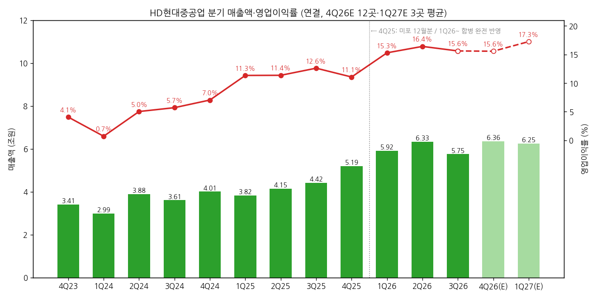
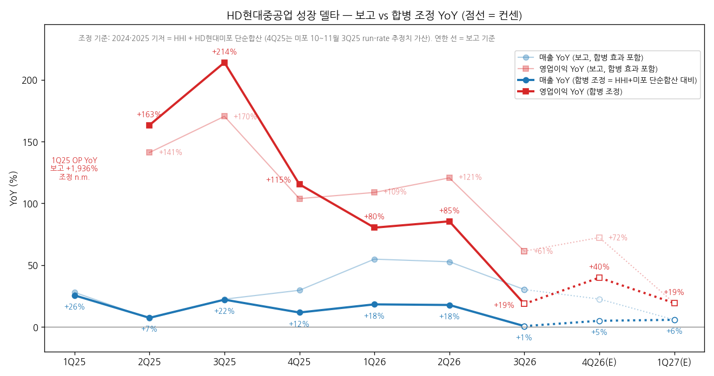
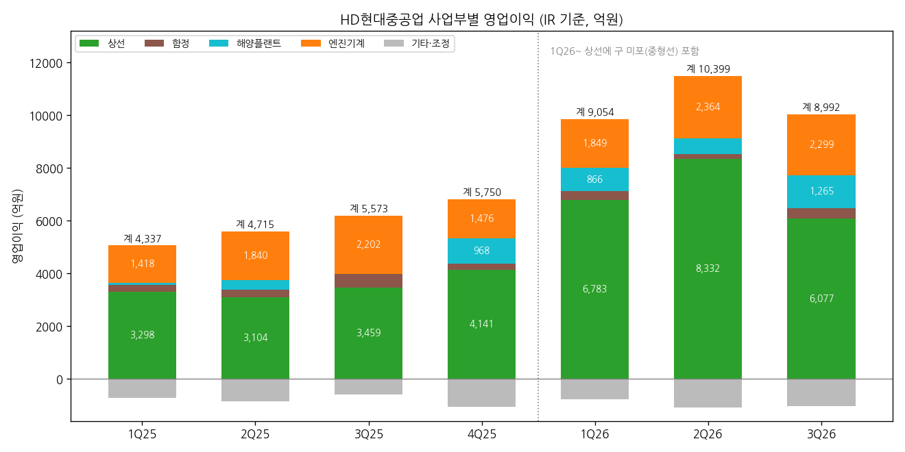

> 모드: 실적 리뷰 (v11)
> 종목: HD현대중공업 (329180)
> 섹터: 조선
> 서브섹터: 조선
> 분기: 2026-Q3
> 발표일: 2026-10-28 (잠정실적 + 컨퍼런스콜) / 3분기 분기보고서 미제출 (법정기한 11/16, 11/14 OpenDART 조회 기준 미공시) — 확정 전 작성, 3Q26 숫자는 잠정치
> 작성 시각: 2026-11-14 15:55 KST
> 분석 소스: 회사 3Q26 경영실적 IR(10/28) + OpenDART 분기 재무(4Q22~2Q26) + HD현대미포 OpenDART 분기 재무(1Q23~3Q25, 합병 조정용) + 기업개요 v1.2(상선/함정 분리·합병 PF 비교) + 셀사이드 국내 11개(KB 10/28, 키움·DS·NH·SK·다올·대신·삼성·유진 10/29, 메리츠 11/6 2027 Outlook, 유안타 11/12) + 해외 1개(J.P. Morgan 10/28). 회사 설명은 IR 자료와 증권사 리포트의 컨퍼런스콜 정리(JPM 체크리스트·KB·대신·유진·유안타)로 인용. 웹서치 보완 없음. 직전 분기 리뷰 없음 (첫 리뷰)

# HD현대중공업 3Q26 실적 리뷰 — 상선은 일회성에 눌렸고, 시장의 시선은 엔진으로 옮겨갔다

> 성장 델타: 둔화 | 내러티브: 유지 → 델타 둔화 + 내러티브 유지 → 경계 구간 (조선 3사 중 상대 우위. 4Q 이익 반등과 발전엔진 추가 수주가 확인되면 재진입 후보)

→ **숫자**: 매출 5조 7,536억원(+30.2% YoY), 영업이익 8,992억원(+61.3% YoY, OPM 15.6%) [잠정]이다. 보고 YoY는 HD현대미포 합병 효과(2025.12 합병, 과거 재작성 없음)를 포함한다. 2025년 양사 단순합산 대비로 조정하면 매출 +0.6%, 영업이익 +18.6%다. 조정 영업이익 YoY가 2Q26 +85.4%에서 67%p 내려왔다. FnGuide 컨센(9,792억원) 대비 -8.2% 미스다
→ **쟁점 ①**: 상선 OPM 14.7%(2Q 17.8%)는 중대재해 조업중단 4일(약 500억원), 원화 강세(약 450억원), 임단협 비용 75% 선반영이 겹친 결과다. 조업중단만 빼도 15.9%(JPM)다. 시장은 "외생변수"로 보고, 같은 그룹 삼호(20.2%)를 근거로 2027년 상선 마진 상승 여력을 인정한다. 한화오션 리뷰 때와 반대 방향이다
→ **쟁점 ②**: 셀사이드가 가장 많이 쓴 단어는 상선이 아니라 엔진이다. 육상 발전엔진 수주 3GW(공시 1.6GW + 비공시 1.4GW)로 2029년까지 증설 캐파를 채웠다. 2028년 1.5GW, 2029년 3GW 생산 계획이 확인됐다. 다만 2027E 엔진 영업이익 추정은 9,760억원(NH)부터 1조 5,210억원(다올)까지 1.6배 차이가 난다
→ **쟁점 ③**: 직전 TP가 확인된 11곳 평균은 76.3만원에서 57.5만원으로 -24.6%다. 9곳이 하향했다. 2026·2027년 영업이익 추정은 발표 전 대비 각각 -3.6%, -3.9%에 그쳐 TP 하향은 멀티플(조선 업종 공통 PER·P/O 하향) 요인이다. JPM은 TP를 내리면서도 Overweight를 유지했고, 한국 조선 Top pick으로 꼽았다
→ **다음 분기 관건**: 4Q26 영업이익 컨센은 9,908억원(12곳 평균)이다. 범위는 8,673~1조 1,865억원이고, 조정 YoY는 약 +40%다 [추정]. 임단협 잔여분(25%)만 남아 4Q는 일회성 부담이 가장 작은 분기다. 이 숫자가 "3Q는 일시적 저점"이라는 컨센서스 해석을 확인할지가 델타 판정을 정한다

---

## 1. 숫자

① 연결 기준 분기 표 (단위: 억원, %)

| 항목 | 4Q23 | 1Q24 | 2Q24 | 3Q24 | 4Q24 | 1Q25 | 2Q25 | 3Q25 | 4Q25 | 1Q26 | 2Q26 | **3Q26** | 4Q26E | 1Q27E |
|---|---|---|---|---|---|---|---|---|---|---|---|---|---|---|
| 매출액 | 34,131 | 29,877 | 38,840 | 36,092 | 40,056 | 38,225 | 41,471 | 44,179 | 51,931 | 59,163 | 63,322 | **57,536** | 63,594 | 62,523 |
| 영업이익 | 1,387 | 213 | 1,956 | 2,061 | 2,822 | 4,337 | 4,715 | 5,573 | 5,750 | 9,054 | 10,399 | **8,992** | 9,908 | 10,793 |
| OPM | 4.1 | 0.7 | 5.0 | 5.7 | 7.0 | 11.3 | 11.4 | 12.6 | 11.1 | 15.3 | 16.4 | **15.6** | 15.6 | 17.3 |
| 매출 YoY | +27.6 | +13.5 | +26.7 | +26.5 | +17.4 | +27.9 | +6.8 | +22.4 | +29.6 | +54.8 | +52.7 | **+30.2** | +22.5 | +5.7 |
| 영업이익 YoY | +524.8 | 흑전 | +185.5 | +1,497.7 | +103.5 | +1,936.2 | +141.1 | +170.4 | +103.8 | +108.8 | +120.6 | **+61.3** | +72.3 | +19.2 |
| **매출 YoY 델타 (%p)** | -1.9 | -14.1 | +13.2 | -0.2 | -9.1 | +10.5 | -21.1 | +15.6 | +7.2 | +25.2 | -2.1 | **-22.5** | -7.7 | -16.8 |
| **영업이익 YoY 델타 (%p)** | n.m. | n.m. | n.m. | n.m. | n.m. | n.m. | n.m. | +29.3 | -66.6 | +5.0 | +11.8 | **-59.3** | +11.0 | -53.1 |
| 매출 YoY (합병 조정) | | | | | | +25.5 | +7.3 | +22.0 | +11.6 | +18.2 | +17.7 | **+0.6** | +4.9 | +5.7 |
| 영업이익 YoY (합병 조정) | | | | | | n.m. | +163.3 | +214.0 | +115.4 | +80.3 | +85.4 | **+18.6** | +39.8 | +19.2 |
| **조정 영업이익 YoY 델타 (%p)** | | | | | | — | — | +50.7 | -98.6 | -35.1 | +5.1 | **-66.8** | +21.2 | -20.6 |

→ (출처: 4Q23~2Q26은 OpenDART 연결 재무(분기 3개월 금액, 4Q = 연간 - 3Q 누적), 3Q26은 10/28 잠정실적 공시·IR(외부감사인 검토 전). 11/14 기준 3분기 분기보고서는 미제출이다. 4Q26E는 국내 11곳과 JPM의 분기 추정 단순평균이다(12곳). 삼성·유안타는 연간 추정에서 9개월 실적(매출 18조 21억원, 영업이익 2조 8,445억원)을 빼 역산했다. 1Q27E는 SK·다올·메리츠 3곳 평균이라 소수 의견이다)
→ **합병 조정 기준**: HD현대미포는 2025.12.01 흡수합병됐다(동일지배 사업결합·장부금액법, 비교기간 재작성 없음). 4Q25에는 미포 12월분 1개월만, 1Q26부터는 3개월이 반영된다. 조정 YoY는 2024·2025년 기저를 "HHI + 미포(OpenDART 연결) 단순합산"으로 바꾼 것이다. 4Q25 기저는 HHI 보고치에 미포 10~11월분을 3Q25 run-rate로 더한 추정치다(매출 6조 600억원, 영업이익 7,089억원) [추정]. 양사 내부거래(HHI 엔진 → 미포 납품)를 빼지 않아 기저가 과대하다. 따라서 조정 성장률은 하단 추정치다 (기업개요 v1.2 ③(3))
→ 3Q26 서프라이즈: 매출은 컨센 대비 -4.4%, 영업이익은 -8.2%다(컨센 매출 6조 185억원·영업이익 9,792억원, FnGuide 3M, KB·SK·NH·대신·삼성·유진 인용. 키움 인용치는 9,889억원). 순이익은 3,543억원으로 컨센(7,530억원) 대비 -53%다. 외환관련손익 -4,006억원(외환손익 -6,980억원, 파생 +3조 4,212억원, 확정계약평가 -3조 1,238억원)이 원인이다 (IR p.8). 미헤지 외화자산(현금·매출채권)의 환평가 손실이고, 3Q에 실적을 낸 산업재 기업에 공통으로 나타났다 (삼성)
→ 보고 YoY는 2026년 내내 +50~120%대로 부풀려져 있다. 조정 기준으로 보면 1Q26 +80% → 2Q26 +85% → 3Q26 +19%다. 정점은 2Q26이었다. 다만 3Q25 기저 중 미포 영업이익(2,008억원, OPM 15.4%)이 1H25 평균(분기 790억원, OPM 6.5%)보다 이례적으로 높았다(원인 미확인). 미포 3Q25를 1H25 평균 OPM으로 바꾸면 3Q26 조정 YoY는 약 +40%다 [계산]. 즉 3Q의 급감 일부는 기저 탓이다
→ 컨센 경로상 조정 영업이익 YoY는 4Q26E +40% [추정], 1Q27E +19%(합병 왜곡이 사라지는 첫 분기)다. 연간으로는 2026E +52%(2025 PF 대비)에서 2027E +17%로 내려간다. 컨센이 그리는 YoY 정점(2Q26)은 이미 지났다. 다만 2027년에도 두 자릿수 증익이 이어진다는 점이 한화오션(2027E +6.7%)과 다르다
→ **[판단] 델타 = 둔화**: 조정 영업이익 YoY는 크게 줄었지만 플러스(+19%)다. 직전 분기는 +5.1%p로 "유지" 범위였으므로 2개 분기 연속 둔화는 아니다. 3Q 감익 요인 중 조업중단(500억원)과 임단협 선반영은 일회성이고, 4Q 컨센은 재가속(+40%)을 그린다. 따라서 "꺾임"이 아니라 "둔화"로 판정한다. 4Q26 영업이익이 7,089억원(조정 YoY 0%)을 밑돌거나 1Q27 YoY가 +10%를 밑돌면 "꺾임"으로 바꾼다

→ (출처: OpenDART, HD현대중공업 IR. 4Q26E는 12곳 평균, 1Q27E는 3곳 평균이며 연한 막대·점선으로 표시. 4Q25부터 미포 실적 포함)

→ (출처: OpenDART HHI·HD현대미포 연결 재무, IR. 굵은 선 = 합병 조정 YoY(판정 기준), 연한 선 = 보고 YoY. 1Q25 영업이익 YoY는 1Q24 저기저(213억원) 효과라 선에서 빼고 수치만 표기)

② 사업부별 매출·영업이익 (단위: 억원, %. IR 외부매출 기준, 조선 부문은 상선·함정 분리)

| 사업부 | 항목 | 1Q25 | 2Q25 | 3Q25 | 4Q25 | 1Q26 | 2Q26 | **3Q26** |
|---|---|---|---|---|---|---|---|---|
| 상선 | 매출 | 25,753 | 26,228 | 26,835 | 34,654 | 42,780 | 46,773 | **41,418** |
| 상선 | 영업이익 | 3,298 | 3,104 | 3,459 | 4,141 | 6,783 | 8,332 | **6,077** |
| 상선 | OPM | 12.8 | 11.8 | 12.9 | 11.9 | 15.9 | 17.8 | **14.7** |
| 상선 | 영업이익 YoY (보고) | — | — | — | — | +105.7 | +168.4 | **+75.7** |
| 상선 | 영업이익 YoY (합병 조정) | — | — | — | — | +70.3 | +108.4 | **+11.2** |
| 함정 | 매출 | 1,681 | 2,268 | 3,713 | 3,499 | 2,818 | 3,010 | **2,570** |
| 함정 | 영업이익 | 256 | 269 | 511 | 225 | 343 | 180 | **386** |
| 함정 | OPM | 15.2 | 11.9 | 13.8 | 6.4 | 12.2 | 6.0 | **15.0** |
| 해양플랜트 | 매출 | 1,590 | 2,460 | 2,808 | 5,531 | 4,580 | 3,772 | **3,799** |
| 해양플랜트 | 영업이익 | 85 | 368 | 5 | 968 | 866 | 601 | **1,265** |
| 해양플랜트 | OPM | 5.3 | 15.0 | 0.2 | 17.5 | 18.9 | 15.9 | **33.3** |
| 엔진기계 | 매출 | 9,010 | 10,290 | 10,603 | 8,010 | 8,790 | 9,522 | **9,511** |
| 엔진기계 | 영업이익 | 1,418 | 1,840 | 2,202 | 1,476 | 1,849 | 2,364 | **2,299** |
| 엔진기계 | OPM | 15.7 | 17.9 | 20.8 | 18.4 | 21.0 | 24.8 | **24.2** |
| 엔진기계 | 매출 / 영업이익 YoY | — | — | — | — | -2.4 / +30.4 | -7.5 / +28.5 | **-10.3 / +4.4** |
| 기타·연결조정 | 영업이익 | -720 | -866 | -604 | -1,060 | -787 | -1,078 | **-1,035** |

→ (출처: HD현대중공업 3Q26 IR p.5~7(3Q25·2Q26·3Q26), 기업개요 v1.2 상선/함정 분기표(각 분기 IR), 엔진기계 1Q25·2Q25·4Q25·1Q26 매출은 NH 분기표(십억원 단위 → 억원 환산, ±5억원 오차). 기타·연결조정은 연결 영업이익에서 사업부 합을 뺀 값 [계산]. 상선 조정 YoY는 2025년 상선에 미포 연결 영업이익을 더한 기저 대비다 [계산])
→ 3Q26 매출 비중은 상선 72.0%·함정 4.5%·해양 6.6%·엔진기계 16.5%다. 영업이익 비중(기타 차감 전 1조 27억원 기준)은 상선 60.6%·엔진기계 22.9%·해양 12.6%·함정 3.8%다 [계산]

→ (출처: HD현대중공업 IR, 위 표와 동일)

(1) 델타를 끄는 곳 = 상선, 이번에 꺾인 곳도 상선
→ 3Q 영업이익 QoQ 감소 1,407억원 중 상선이 2,255억원 감소다. 해양(+664억원)과 함정(+206억원)이 일부를 메웠다
→ 상선 조정 영업이익 YoY는 +70% → +108% → +11%다. 3Q 감익 요인은 회사·증권사 설명이 일치한다: 조업일수 47일(QoQ -14일, 하계휴가·추석에 중대재해 조업중단 4일 추가)로 약 500억원, 원/달러 평균 -79원으로 약 450억원, 임단협 예상 비용의 75% 선반영이다 (KB·DS·NH·대신·유진). 두 정량 요인(950억원)을 더하면 상선 OPM은 17.0%로 2Q(17.8%)에 근접한다 [계산]
→ 선종 믹스도 약간 나빠졌다. 가스선(LNG·LPG) 매출 비중은 2Q 74%에서 3Q 65%로 내려왔다 (KB). 반면 빈티지는 개선 중이다. 3Q 대형선 매출의 수주연도 비중은 2022년 4%·2023년 45%·2024년 31%·2025년 20%다 (컨콜, JPM·유안타). 중형선(구 미포)은 2024년 수주분이 65%다 (SK)

(2) 엔진기계 — 매출은 줄고 이익률은 사상 최고권
→ 매출 -10.3% YoY는 원화 강세와 미포 합병에 따른 미포향 엔진 매출의 내부거래 전환 때문이다(4Q25 IR 정성 언급, 금액 미공개). 영업이익은 +4.4%, OPM 24.2%로 2Q(24.8%)에 이어 24%대를 유지했다. 회사는 "원화 강세에도 판가 상승과 제품 믹스 개선", "높은 DF(이중연료) 매출 비중"을 사유로 들었다 (IR p.6~7)
→ 엔진기계 수주는 9월 누적 41.4억달러로 연간 목표의 155%다 (KB·유진)

(3) 해양플랜트·함정 — 일회성 포함이지만 기초 체력이 높다
→ 해양 OPM 33.3%에는 C/O(체인지오더) 180억원이 들어 있다. 이를 빼도 28.6%다 [계산]. Ruya 공정률 확대와 Trion 고수익 물량 덕분이다 (IR p.7, 유진). 다만 2026년 해양 수주는 1.6억달러로 목표의 5%에 그쳤다 (KB·유진)
→ 함정은 매출이 줄었지만(-14.6% QoQ) 수출 비중 확대로 OPM 15.0%를 냈다 (유진·DS). 2026년 함정 수주는 목표의 13%다 (유진)

③ 연간 (단위: 억원, %)

| 항목 | 2022 | 2023 | 2024 | 2025 | 2025 PF(E) | 2026E | 2027E | 2028E |
|---|---|---|---|---|---|---|---|---|
| 매출액 | 90,455 | 119,639 | 144,865 | 175,806 | 221,661 | 243,615 | 264,680 | 288,624 |
| 영업이익 | -2,892 | 1,786 | 7,052 | 20,375 | 25,301 | 38,353 | 44,927 | 51,893 |
| OPM | -3.2 | 1.5 | 4.9 | 11.6 | 11.4 | 15.7 | 17.0 | 18.0 |
| 매출 YoY | +8.8 | +32.3 | +21.1 | +21.4 | — | +38.6 (PF 대비 +9.9) | +8.6 | +9.0 |
| 영업이익 YoY | 적지 | 흑전 | +294.8 | +188.9 | — | +88.2 (PF 대비 +51.6) | +17.1 | +15.5 |

→ (출처: 2022~2025 OpenDART 연결. 2025 PF(E)는 HHI 연간 + 미포 1~9월 실적 + 미포 10~11월 3Q25 run-rate 추정 [추정], 기업개요 v1.2와 같은 방법. 2026E·2027E는 12곳 평균, 2028E는 10곳 평균(키움·DS 미제시)이라 2027E와 표본이 다르다)
→ 발표 전 → 발표 후 연간 컨센(영업이익): 2026E 3조 9,790억원 → 3조 8,353억원(-3.6%), 2027E 4조 6,740억원 → 4조 4,927억원(-3.9%)이다. 발표 전은 FnGuide 3M(KB 인용), 발표 후는 12곳 평균이다. Quantiwise 발표 전 컨센(SK 인용 2026E 4조 460억원·2027E 4조 7,360억원) 대비로는 각각 -5.2%, -5.1%다
→ 2027E 범위는 3조 9,040억원(NH, +2.8%)~5조 477억원(다올, +27.8%)이다. 차이의 대부분은 상선 마진(16~19.5%)과 엔진 영업이익(0.98~1.52조원) 가정에서 나온다(2번 쟁점 1·2)

---

## 2. 시장 쟁점

① 지난 분기 체크

→ 첫 리뷰 — 직전 체크 없음 (2Q26 리뷰·팔로업 미작성)

② 이번 분기 쟁점

| # | 쟁점 | 한 줄 정의 | 언급 |
|---|---|---|---|
| 1 | 상선 마진 14.7%의 성격 | 일회성을 걷어낸 상선 경상 마진은 몇 %이고, 2027년에 더 오르는가 | 12곳 전부 |
| 2 | 발전엔진 재평가 | 3GW 수주·4GW 캐파가 상선 피크아웃을 상쇄할 만큼 크며, 밸류에 얼마나 넣을 것인가 | 12곳 전부 |
| 3 | 상선 외 축의 지속성 | 해양 고마진(33%)·함정 수출과 MASGA(키윗 JV)가 수주 공백을 넘어 이어지는가 | 11곳 |
| 4 | 멀티플 디레이팅의 끝 | 이익 추정은 -4%인데 TP는 -25% — 상선 할인이 충분히 반영됐는가 | 12곳 전부 |

③ 쟁점별 분해

(1) 쟁점 1 — 상선 OPM 14.7%: 일회성인가, 마진 정점의 신호인가

(1-1) 회사 설명
→ 3분기 조선 부문 감익은 "조업일수 감소와 원화 강세 및 일회성 비용"이다 (IR p.4). 임단협은 타결됐고 관련 일회성 비용의 75%를 3Q에, 나머지를 4Q에 반영한다 (JPM 체크리스트, 유진)
→ 4Q는 조업일수가 늘고 임단협 일회성 위험이 줄어든다 (JPM 체크리스트). 2027년 신조 발주는 클락슨 전망(-30% YoY)에 대체로 동의하지만, 항로 차질에 따른 톤마일 증가로 과거 대비 높은 수준이 유지된다고 본다. LNG선은 미국 LNG FID가 이어져 발주가 개선되고, 선주들이 현재 선가를 바닥으로 본다 (JPM, 대신·다올)

(1-2) 증권사별 해석

| 증권사 | 4Q26E 상선 OPM | 2027E 상선 OPM | 핵심 논리 |
|---|---|---|---|
| 다올 | 18.1% | 19.5% | 조업일수 증가·빈티지 개선·가스선 비중 증가(선표 모델 4Q 35%). 2027년에도 남은 빈티지 개선으로 성장 |
| JPM | — | 16%대 (기존 15%) | 불리한 환율·일회성에도 14.7%(JPMe 14%), 조업중단 제외 15.8%. 2024년 수주분 비중 31% → 삼호(48%에서 20.2%)처럼 상승 여지 |
| 삼성 | — | — | 삼호가 일회성·환율 하락에도 20.2% 고수. 양사 수주전략·원가관리 차이 없어 HHI도 추가 개선 가능 |
| 유진 | — | — | 2023년 수주분 45%, 2024~25년 51%. 고선가 비중이 높아지는 2027년까지 개선 여력 충분 |
| NH | 15.2% | 16.8% | 환율 전망 조정으로 2027·2028 영업이익 -4%·-8%. 중국 증설·2029년 인도 LNG선 수요 감소로 상선 디레이팅 |
| 메리츠 | 13.1% | 16.5% | 환율 4Q26 1,320원·2027년 1,289원 가정(가장 보수적). 2028년 18%로 회복, 카타르 저선가 LNG선 해소 |
| 키움 | — | — | 중국과의 경쟁 심화·선가 상승 둔화로 상선은 2029년 이후 성장 둔화 |
| 유안타 | — | — | 2027년 가스선 비중 하락, 컨테이너선 비중 상승(대형선 매출의 36~44%). 2025년 수주분이 연 40%로 최대 기여 |

→ (출처: 각사 3Q26 리뷰. 상선 OPM을 따로 제시하지 않은 곳은 "—". 조선 부문(상선+함정) 기준 2027E OPM은 대신 17.3%·DS 17.0%다 [계산])

(1-3) 공통 결론 vs 갈리는 지점
→ 공통: 3Q 마진 하락은 외생변수(환율·조업일수·임단협)이고, 빈티지(2024~25년 고선가 수주분 비중)는 2027년까지 계속 개선된다. 12곳 중 상선 마진의 구조적 훼손을 주장한 곳은 없다
→ 갈림: ① 환율 가정 — 메리츠(2027년 1,289원)·NH가 가장 보수적이고, 다올·삼성은 삼호 사례로 상방을 본다 ② 선종 믹스 — 가스선 비중이 4Q에 올라간다(다올) vs 2027년에 컨테이너선으로 내려간다(유안타) ③ 2029년 이후 — 키움·NH는 중국 증설로 상선 성장 둔화를 명시한다

(1-4) [판단]
→ 숫자는 "일회성" 쪽과 맞는다. 정량 요인 2개(950억원)만 더해도 17.0%로 2Q 수준에 근접하고, 같은 그룹 삼호가 같은 분기에 20.2%를 냈다. 한화오션(상선 17.4%, 2Q 22.7%에서 하락)과 비교하면 HHI는 2Q 고점이 낮았던 만큼 하락폭도 작다
→ 다만 원화 강세는 일회성이 아니라 추세일 수 있다. 메리츠의 1,289원 가정이 맞으면 상선 OPM은 2027년에도 16%대에 머문다
→ 결론을 바꿀 데이터: 4Q26 상선 OPM. 일회성이 25%만 남은 4Q에 16% 이상이면 "경상 16~18%"가 확정된다. 14% 미만이면 환율이 마진 개선을 상쇄하는 구간으로 본다

(2) 쟁점 2 — 발전엔진: 상선 피크아웃을 상쇄할 두 번째 엔진인가

(2-1) 회사 설명
→ 육상 발전엔진(AI 데이터센터향 힘센엔진) 수주는 공시 1.6GW, 비공시 1.4GW로 총 3GW다. 2026.09 투자 결정한 신공장(8,336억원, 3GW)을 포함한 생산 계획은 2028년 1.5GW, 2029년 3GW이고, 이 물량은 기존 수주로 채워진다 (JPM 체크리스트 — JPM 기존 가정 1.2/2.8GW에서 상향). 2029년까지 기존 캐파 대비 완판이다 (DS)
→ 하이퍼스케일러와 직접 공급을 논의 중이고, 데이터센터 외에 국가 전력망 안정화 수요도 늘고 있다 (NH·키움·대신). 힘센엔진을 탑재한 해상 부유식 발전설비(BMPP)로 부유식 데이터센터(FDC) 시장에도 대응한다 (DS·유진). 15,000평의 여유 부지가 있다 (DS)

(2-2) 증권사별 해석

| 증권사 | 2027E 엔진 영업이익 | 2028E | 밸류에이션 반영 |
|---|---|---|---|
| 다올 | 15,210 (OPM 24.3%) | 19,540 | 2028년 1.5GW·2029년 3GW(3조원) 안내. "3차~N차 수주를 확인하며 반영" — 아직 실적에 미반영 |
| 메리츠 | 14,318 (26.2%) | 20,335 | 2026→2028 엔진 매출 +89%, 영업이익 +126%. 신공장 3GW는 2028년 30%만 반영 |
| 대신 | 11,530 (23.1%) | — | 국가전력망·DC향 수요, 하이퍼스케일러 직접 협의 |
| DS | 10,050 (22.5%) | — | MASGA와 FDC 수주가 리레이팅의 키 |
| JPM | 9,900 (24.0%) | — | 2028E 영업이익 +11% 상향의 주원인. 체크리스트의 AI DC 엔진 항목에서 마진 가정을 16% → 18%로 상향 |
| NH | 9,760 (24.4%) | 13,900 | "발전용 엔진을 통한 중장기 이익 성장은 충분히 반영되지 않았다" — 엔진 재평가 필요 |
| SK | — | — | SOTP 엔진 가치 30.1조원(4.2GW 캐파 증분, 육상발전 OPM 35%, Wartsila 2028 P/E 17.7배에 20% 할인한 14.2배) = 영업가치의 48% |
| 유안타 | — | — | SOTP 선박엔진 9조원 + 발전엔진(FY30F) 13.5조원 = 적정가치의 39% |
| 키움 | — | 2028년 엔진 매출 +36%, 영업이익 +73%(2026 대비) | 캐파 0.7GW → 2028년 이후 4GW, 연 3GW 이상 납품 |
| KB | — | — | Target P/E를 조선·해양과 엔진·서비스(Wartsila·Caterpillar·HD현대마린솔루션) 피어 평균 16.1배로 산정 |

→ (출처: 각사 3Q26 리뷰. 단위 억원. OPM은 각사 엔진 매출 기준(다올은 총매출 기준))

(2-3) 공통 결론 vs 갈리는 지점
→ 공통: 발전엔진은 상선 사이클과 무관한 성장축이고, 2028년부터 매출에 본격 반영된다. 3GW로 2029년 캐파가 차 있다는 데 이견이 없다
→ 갈림: ① 실적 반영 시점 — 2027년 엔진 이익을 크게 올린 곳(다올·메리츠)과 2028년 이후로 미룬 곳(NH·JPM) ② 밸류 방식 — 엔진을 별도 멀티플(SOTP, SK·유안타)로 떼어 보는가, 전사 PER/PBR에 섞는가(대다수) ③ 추가 증설 — 여유 부지 15,000평(DS)과 추가 수주 지속(NH·SK)을 근거로 4GW를 넘는 시나리오를 볼지

(2-4) [판단]
→ 숫자로 확인된 것은 엔진기계 OPM 24%대(2개 분기)와 수주 3GW다. 그러나 3Q 엔진 매출은 -10% YoY이고, 발전엔진 매출은 2028년부터다. 지금 주가에 들어갈 수 있는 건 "이익"이 아니라 "가시성"이다
→ 이 쟁점이 중요한 이유는 멀티플이다. 상선이 중국 조선사 수준 PER(7~8배)로 수렴하는 동안, 엔진에 Wartsila급 멀티플(17~24배)을 붙일 근거가 쌓이고 있다. SK SOTP에서 엔진이 영업가치의 48%라는 점이 그 크기를 보여준다
→ 결론을 바꿀 데이터: 3GW 이후 추가 수주(특히 하이퍼스케일러 직접 계약), 엔진기계 별도 수주에서 발전엔진 비중 공시, FDC 첫 수주. SK는 4Q26~1Q27에 본격 수주를 예상한다

(3) 쟁점 3 — 상선 외 축: 해양·함정·MASGA

(3-1) 회사 설명
→ 해양은 Ruya 공정 진행으로 4분기도 양호한 이익률이 예상되지만, 수주 부진으로 2027년 일부 프로젝트 인도 후 매출이 줄어든다. 블록이나 LNG선 물량을 투입해 고정비 부담을 줄이는 방안을 검토 중이다 (대신·유진). 신규 해상변전소(OSS) 계약을 앞두고 있고, 2027년 초 추가 수주 발표를 기대한다 (유진). 경영진은 해양 마진 전망에 강세 시각을 유지한다 (JPM)
→ 미국 대형 건설사 키윗(Kiewit)과 합작법인 계약을 맺었다. 군수지원함부터 시작해 전투함으로 넓힐 계획이고, 현지 조선소 건설 과정에서 HII에 선체 블록을 공급하는 방안도 협의 중이다. 구체적인 투자계획은 2026년 말까지 확정한다 (유진·대신·SK). 국내에서는 핵추진잠수함 초기 예산이 2027년 반영되며 참여를 준비 중이다 (유진)

(3-2) 증권사별 해석

| 증권사 | 2027E 해양 매출 / 영업이익 | 2027E 함정 | 핵심 논리 |
|---|---|---|---|
| 메리츠 | 11,105 / -2,000 | 매출 21,061 / OP 3,482 | 해양은 유의미한 프로젝트 확보 필요(2028년 영업이익 -92%), FDC 연 2건 가정. 2027년 미 해군 충남급 호위함 등 2척 수주 가정 → 2028년 함정 매출 4.2조원 |
| 다올 | 8,000 / 1,170 | 9,720 / 950 | 해양 매출 급감. 특수선 2028년 매출을 기존 대비 -34% 하향 |
| NH | 14,960 / 1,430 | 13,360 / 1,160 | Ruya 수익성이 예상보다 높고 2027년 연간 흑자 가능 |
| 대신 | 12,360 / 3,530 | — | 4Q도 Ruya로 양호, 블록·LNG선 투입으로 매출 방어 |
| JPM | 16,720 / 3,010 | — | 경영진의 해양 마진 강세 시각 반영 |
| SK | — | SOTP 특수선 3.26조원(P/E 15배) | 키윗 JV로 미 군수지원함 초도 2척과 후속 물량, HII 블록 하도급 기대 |
| 유안타 | — | SOTP 방산 8.1조원 (미국 6.39조원) | MASGA 적정가치 하향. 중간지주사와의 미국 JV 지분 미정, 신규 조선소 건립 시 미국 내 수주·매출까지 시간 소요 |
| 삼성 | — | — | 해양 이익률이 일회성 제외해도 매우 높아, 수주 지연으로 내년 매출이 줄어도 이익 하향 유인 제한 |

→ (출처: 각사 3Q26 리뷰. 단위 억원)

(3-3) 공통 결론 vs 갈리는 지점
→ 공통: 2027년 해양 매출은 줄어든다(Ruya 인도 후 수주 공백). 함정은 수출 비중 확대로 마진은 좋지만 규모(분기 2,500~3,000억원)가 작다. MASGA는 키윗 JV로 방향은 정해졌지만 투자 구조가 미정이다
→ 갈림: ① 2027년 해양 이익 — 적자 2,000억원(메리츠)부터 흑자 3,530억원(대신)까지 5,500억원 차이 ② 미 해군 수주 시점 — 메리츠는 2027년 2척을 실적에 넣었고, 유안타·다올은 오히려 가치를 깎았다

(3-4) [판단]
→ 해양의 2026년 고마진(1~3Q 평균 OPM 22%)은 Ruya·Trion 진행 기준 이익이라 2027년 매출 감소와 함께 줄어드는 것이 기본 경로다. 신규 수주 없이 블록·LNG선으로 고정비를 메우면 해양 OPM은 상선 수준으로 내려간다 [판단]
→ MASGA는 한화오션과 같은 입법·예산 변수(NDAA·FY27 국방예산) 위에 "JV 지분 구조"라는 HHI 고유 변수가 하나 더 있다. 연말 투자계획 발표에서 HHI(상장사)와 HD한국조선해양(중간지주) 중 누가 지분을 갖는지가 주주가치 귀속을 정한다 (유안타가 지적한 점)

(4) 쟁점 4 — 멀티플 디레이팅: 상선 할인은 충분한가

(4-1) 회사 설명
→ 회사는 밸류에이션에 대해 직접 언급하지 않았다. 수주는 순항 중이다. 9월 누적 상선(조선) 수주 141.8억달러로 연간 목표의 120%이고, 10월 VLGC·컨테이너선을 더하면 151.7억달러다 (KB). JPM 기준 상선 수주는 YTD 141억달러(+128% YoY)로 연간 가이던스(115억달러)를 크게 넘었다

(4-2) 증권사별 해석

| 증권사 | 현재 밸류 근거 | 디레이팅 논리 |
|---|---|---|
| NH | 2028년 PER로 중국 조선사와 비슷한 수준 | "충분히 반영된 상선 De-rating". 중국 증설·2029년 인도 LNG선 수요 감소, 시장금리 상승·특수선 기대 하향으로 Target PBR -10% |
| 다올 | 2028년 PER 7배 하회 | 적정 PER을 20배 → 조선업 공통 15배로. 코스피 하락, 신조 M/S 하락, 중국의 LNG선 시장 공격적 진입이 주가 급락 원인 |
| 대신 | 2028F EPS × 글로벌 피어 평균 12.8배 | 글로벌 경기 불확실성, 중국 캐파 확장에 따른 공급과잉 리스크로 산업 멀티플 하락 |
| JPM | 2028E P/E 12배 (P/Orderbook 0.61배) | 수주잔고 방식 → PER로 변경(투자자 관심이 미드사이클 이익으로 이동). 조선 피어 대비 프리미엄 유지 |
| 삼성 | 2027년 P/E 8배 | 순현금이 시총의 17%. 산업재·국내외 경쟁사 대비 과도한 저평가 |
| SK | SOTP 상선·해양 P/E 10배 | 상선 피크아웃 우려에 따른 조선주 급락으로 멀티플 하향 |
| 유안타 | 상선 P/O 0.7배(업종 공통) | 기간별 P/O(21~22년 0.7배, 26년 0.8배) 중 하단 적용 |

→ (출처: 각사 3Q26 리뷰)

(4-3) 공통 결론 vs 갈리는 지점
→ 공통: TP 하향은 업종 공통 멀티플 하향 때문이다(다올·대신·SK·유안타·DS가 명시). 현 주가(2028E PER 5~7배)는 상선 피크아웃을 반영했다는 데 다수가 동의한다
→ 갈림: 무엇이 할인을 되돌리나 — 엔진 재평가(NH·SK·키움), MASGA·FDC(DS), 순현금·주주환원(삼성, 2026E DPS 9,840~13,300원 → 11/11 주가 기준 배당수익률 3.7~5.1% [계산])

(4-4) [판단]
→ 숫자로 보면 시장은 상선 이익의 "수준"이 아니라 "지속 기간"을 할인하고 있다. 2027E 영업이익이 +17% 늘어나는데도 PER을 15~20배에서 12~15배로 내린 것은 2029년 이후 상선 이익 감소를 미리 반영한 것이다
→ 따라서 할인을 되돌릴 데이터는 상선 숫자보다 "2029년 이후 이익"을 보여주는 것들이다. 발전엔진 추가 수주(2029~2030년 매출), LNG선 2030년 슬롯 선가, MASGA 계약이 여기에 해당한다

④ 낙관 vs 보수 — 논리 대비

| 구분 | 증권사 | TP | 무엇을 다르게 가정했나 |
|---|---|---|---|
| 낙관 | 메리츠 | 800,000원 (11/6, 2027 Outlook) | 2028E 영업이익 6조 6,494억원(10곳 평균 5조 1,893억원 대비 +28%). 특수선 미 해군 2척(2028년 매출 4.2조원), 엔진 매출 7.2조원, 2028년 ROE 37% → PBR 4.7배 |
| 낙관 | 키움 | 720,000원 (유지) | 발전엔진 캐파 0.7GW → 4GW, 2028년 엔진 영업이익 +73%. 미국 신규 조선소로 미 군함 사업 |
| 보수 | KB | 425,000원 | 2027E 영업이익 4조 1,090억원(발표 전 컨센 대비 -12%), 12MF EPS × P/E 16.1배(조선·엔진 피어 평균) |
| 보수 | JPM | 460,000원 (Overweight 유지) | 평가 방식을 수주잔고 → 2028E P/E 12배로 바꾼 것이 하향의 전부. 이익 추정은 오히려 2027/28E +2%/+11% 상향, 한국 조선 Top pick |

→ 핵심 차이는 ① 2028년 이익에 미 해군·발전엔진 신공장을 얼마나 넣는가(메리츠 vs KB) ② 어떤 멀티플을 쓰는가(PBR 4.7배 vs P/E 12배)다. JPM은 TP는 낮지만 의견은 가장 적극적이라, "보수"는 숫자가 아니라 평가 방식의 보수성이다
→ 유안타 TP 643,000원은 SOTP 적정가치 57.0조원을 합병 전 주식수(89백만주)로 나눈 값이다. 합병 후 발행주식수(1억 496만주)로 나누면 약 543,000원이다 [계산]. 같은 리포트의 3Q26P 세전이익(2,680억원)·순이익(-1,170억원) 표기도 IR(4,749억원·3,543억원)과 달라 기재 오류로 보고 인용하지 않았다
→ 셀사이드 vs 바이사이드: 셀사이드는 "실적·임단협 불확실성 해소, 매수 기회"(SK·삼성·JPM)로 읽었다. 그러나 주가는 10/28 285,500원(52주 최저) → 11/5 271,000원(메리츠) → 11/11 262,500원(유안타)으로 리뷰 이후 8% 더 내렸다. 52주 고점(745,000원) 대비 -65%다. 같은 기간 한화오션(-9%)과 비슷해, 종목 실적보다 조선 업종 수급(중국 LNG선 진입·피크아웃 우려)이 주가를 정하고 있다 [판단]

⑤ 추정치·TP 변화

| 증권사 | 의견 | 직전 TP | 현재 TP | 4Q26E OP | 2026E / 2027E OP | 핵심 변화 |
|---|---|---|---|---|---|---|
| KB (10/28) | Buy | 500,000 | 425,000 | 10,205 [역산] | 38,650 / 41,090 | 12MF EPS × P/E 16.1배, 2026·27 OP -0.5%·-2.0% |
| 키움 | BUY | 720,000 | 720,000 | 9,135 | 37,580 / 45,216 | 유지, 발전엔진 신성장 |
| DS | 매수 | 900,000 | 600,000 | 10,555 | 39,000 / 44,760 | 2026·27 OP -5.1%·-3.1%, 업종 디레이팅으로 Target multiple 하향 |
| NH | Buy | 700,000 | 560,000 | 9,525 | 37,970 / 39,040 | 2027·28 OP -4%·-8%(환율), Target PBR -10% |
| SK | 매수 | 820,000 | 640,000 | 11,865 | 40,310 / 47,620 | SOTP, 2027 OP -7.2%, 조선 Top pick |
| 다올 | BUY | 1,040,000 | 630,000 | 11,059 | 39,504 / 50,477 | 적정 PER 20배 → 15배, 2027~29 OPM -2%p |
| 대신 | 매수 | 800,000 | 540,000 | 10,275 | 38,720 / 47,530 | 2028F EPS × 피어 평균 12.8배, 2027 OP +5.0% |
| 메리츠 (11/6) | Buy | — | 800,000 | 8,673 | 37,118 / 46,886 | 2028 ROE 37% → PBR 4.7배 (Outlook, 직전 TP 미기재) |
| 삼성 | BUY | 500,000 | 500,000 | 9,105 [역산] | 37,550 / 48,680 | 유지 (발표 직전 10/26에 806,000원에서 선하향), 2026·27 EPS -9.5%·-4.0% |
| 유안타 (11/12) | BUY | 842,000 | 643,000 | 9,115 [역산] | 37,560 / 42,380 | SOTP, 상선 P/O 0.7배·MASGA 가치 하향, 발전엔진 13.5조원 반영 |
| 유진 | BUY | 1,000,000 | 610,000 | 10,095 | 38,540 / 41,810 | 2026·27 OP -6.4%·-11.2%, 2028 BPS × PBR 4.1배 |
| JPM (10/28) | Overweight | 570,000 | 460,000 | 9,285 | 37,730 / 43,630 | P/Orderbook → 2028E P/E 12배, 2027·28 OP +2%·+11% |

→ (출처: 각사 3Q26 리뷰. 단위 원·억원. 대신 직전 TP는 하향률 -32.5%에서 역산 [계산]. KB·삼성·유안타 4Q26E는 연간 추정 - 9개월 실적 [역산]. 4Q26E는 십억원 단위 연간 추정을 억원으로 환산해 ±5억원 오차)
→ 평균 TP 594,000원(12곳). 직전 TP가 확인된 11곳 평균은 762,909원 → 575,273원(-24.6%)이다 [계산]. 하향 9곳, 유지 2곳(키움, 삼성 — 발표 직전 이미 하향), 상향 0곳이다. 삼성의 발표 직전 하향(806,000원)을 직전 TP로 넣으면 790,727원 → 575,273원(-27.2%)이다. 투자의견 변경은 없다(12곳 전원 매수/Overweight). 발표 전 컨센 TP는 791,810원(21곳, 삼성 인용)이었다
→ 4Q26E 영업이익 평균 9,908억원(발표 전 Quantiwise 컨센 1조 70억원 대비 -1.6%, SK 인용), 2026E 3조 8,353억원(-3.6%), 2027E 4조 4,927억원(-3.9%)
→ **TP 하향의 원인은 멀티플이다**: 이익 추정 하향은 4~5%인데 TP는 25% 내렸다. 멀티플 하향 사유는 업종 공통이다. 중국 캐파 증설에 따른 상선 피크아웃(다올·대신·SK·NH), 평가 방식을 수주잔고에서 PER로 변경(JPM), 업종 공통 P/O 하향(유안타)이다. 피어와 비교하면 TP 하향폭은 한화오션(-30.3%)보다 작고 삼성중공업(-20.5%)보다 크다. 한화오션처럼 특수선 할증을 지운 것이 아니라, 상선 멀티플 하향을 엔진 가치가 일부 상쇄한 구조다 [판단]

---

## 3. 내러티브 점검

① 이 종목의 성장 스토리
→ "국내 최대 조선사의 고선가 상선 빈티지 효과 + 고마진 엔진기계(2행정 DF 엔진 판가 상승) + 미포 합병에 따른 규모 확대, 여기에 MASGA(미 해군)와 AI 데이터센터 발전엔진이라는 두 개의 옵션"이 2026년 5월 고점(시총 73조원)까지의 논리였다

② 이번 분기가 스토리에 한 일
→ **상선 축 — 유지**: 14.7%는 외생변수로 설명되고, 빈티지 개선은 2027년까지 이어진다는 데 이견이 없다. 다만 시장은 2029년 이후 상선 이익 감소를 멀티플로 먼저 반영하고 있다(TP -25%, 이익 -4%)
→ **엔진 축 — 강화**: 발전엔진 3GW 수주와 2028~2029년 생산 계획이 확인됐다. JPM이 2028E 영업이익을 +11% 올린 이유이고, NH·SK·키움·DS의 리포트 제목이 모두 엔진·FDC를 앞세웠다. 엔진기계 OPM은 24%대를 2개 분기 지켰다
→ **MASGA 축 — 유지(방향 확정, 구조 미정)**: 키윗 JV는 진전이지만 투자 구조·시점이 정해지지 않았다. 유안타·다올은 가치를 깎았고 메리츠만 2027년 수주를 넣었다
→ 합치면 델타 둔화 + 내러티브 유지다. 0번 판정의 근거다. 한화오션이 "특수선 할증 소멸 → 피어와 같은 조선사"로 재평가되는 동안, HHI는 "상선 할인 + 엔진 프리미엄"으로 내러티브의 무게중심이 옮겨가는 중이다 [판단]

③ 스토리를 다시 강하게 만들 트리거
→ 발전엔진 3GW 이후 추가 수주, 특히 하이퍼스케일러 직접 계약 또는 FDC(BMPP) 첫 수주 (SK: 4Q26~1Q27)
→ 키윗 JV 투자계획 확정(연말)과 미 해군 군수지원함 초도 2척 수주. HHI 지분 구조가 명확하면 MASGA 가치가 HHI 주주에게 귀속된다
→ 4Q26 상선 OPM 16% 이상 회복 — 3Q가 일시적 저점이었음을 숫자로 확인

④ 스토리를 깨뜨릴 리스크
→ 원화 강세 지속(1,300원 안팎) — 메리츠 가정대로면 상선 마진 개선이 2027년에도 환율에 상쇄된다
→ 중국 조선소의 LNG선 점유율 확대와 LNG선 선가 하락 — 2029~2030년 슬롯 선가가 낮아지면 2029년 이후 상선 이익 감소가 숫자로 굳어진다
→ 2027년 해양 수주 공백 — 메리츠 기준 해양은 2027년 영업적자 2,000억원으로 돌아선다

---

## 4. 향후 봐야 할 것

(1) **4Q26 영업이익과 상선 OPM** — 델타 판정 1순위
→ 무엇을: 4Q26 영업이익이 컨센 평균 9,908억원(12곳, 범위 8,673~1조 1,865억원)을 넘는지, 상선 OPM이 16% 이상으로 돌아오는지(임단협 잔여 25% 포함). 영업이익이 7,089억원(4Q25 합병 조정 기저, YoY 0%)을 밑돌면 "꺾임"으로 바꾼다
→ 어떤 데이터로: 4Q26 잠정실적·IR 사업부별 손익(상선/함정 분리), 컨콜의 일회성 금액, 3Q26 분기보고서(11/16 기한)의 확정치와 잠정치 차이
→ 언제: 분기보고서 11/16, 4Q 잠정실적 2027년 1월 말

(2) **발전엔진 추가 수주와 FDC** — 내러티브 판정 1순위
→ 무엇을: 3GW 이후 추가 발전엔진 수주(하이퍼스케일러 직접 계약 여부), FDC·BMPP 첫 수주, 엔진기계 수주(9월 누적 41.4억달러)의 연말 누적과 발전엔진 비중
→ 어떤 데이터로: 단일판매·공급계약 공시, 뉴스 키워드 "HD현대중공업 발전엔진 수주", "힘센엔진 데이터센터", "HD Hyundai floating data center", 4Q IR 수주 표
→ 언제: 4Q26~1Q27 (SK)

(3) **키윗 JV 투자계획과 미 해군 수주**
→ 무엇을: 연말 확정 예정인 미국 JV 투자계획의 지분 구조(HHI vs HD한국조선해양), 미 해군 군수지원함 초도 2척, HII 블록 하도급, FY27 국방예산·NDAA 최종본의 해외건조 조항
→ 어떤 데이터로: 투자 공시, 뉴스 키워드 "HD현대 키윗 합작", "Kiewit HD Hyundai shipyard", "NDAA foreign shipbuilding", 피어 한화오션 LSM 옵션 행사
→ 언제: 11월 말~12월(예산·NDAA), 연말(JV 계획)

(4) **해양 수주 공백 해소**
→ 무엇을: OSS(해상변전소) 계약, 2027년 초 추가 수주 발표, 2026년 해양 수주(1.6억달러, 목표의 5%)의 연말 누적. Ruya 진행으로 4Q 해양 OPM이 15% 이상 유지되는지
→ 어떤 데이터로: 수주 공시, 4Q IR 해양 손익, 뉴스 키워드 "HD현대중공업 해상변전소", "Ruya"
→ 언제: 4Q26~1Q27

(5) **원/달러와 LNG선 선가**
→ 무엇을: 원/달러 분기 평균(3Q 1,418~1,423원 → 메리츠 4Q 1,320원 가정), 1,350원 이하 지속 시 2027년 상선 OPM 추정 추가 하향 여부. 클락슨 LNG선 신조선가(선주 "바닥" 인식 유지 여부), 미국 LNG FID와 2030년 슬롯 수주
→ 어떤 데이터로: 원/달러 분기 평균, 클락슨 신조선가·발주 통계, 피어(한화오션·삼성중공업) LNG선 수주 단가
→ 언제: 상시, 4Q 실적 때 연간 집계
