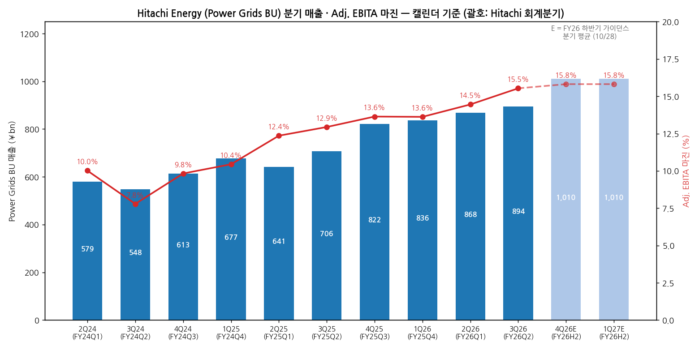
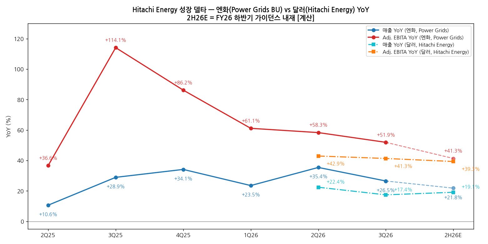
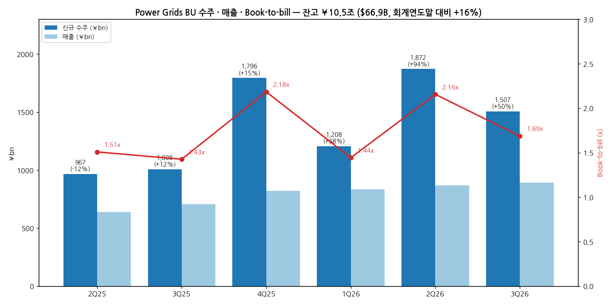

> 모드: 실적 리뷰 (v11)
> 종목: Hitachi Energy (HE, 모회사 Hitachi 6501)
> 섹터: 전력 인프라
> 서브섹터: 송변전
> 분기: 2026-Q3 (캘린더 7~9월 = Hitachi 회계 FY2026 Q2)
> 발표일: 2026-10-28 (Hitachi Ltd 2Q 실적 발표 — 보도자료·프레젠테이션·컨퍼런스콜) / 2026-11-03 Hitachi Energy Investor Day
> 작성 시각: 2026-11-14 15:00 KST
> 분석 소스: 셀사이드 리포트 미확보 — 자체 조사(회사 자료+웹서치). 회사 자료: Hitachi FY2026 Q2 프레젠테이션(10/28, 2026_2Qpre.pdf), FY2026 Q1 프레젠테이션(7/29), FY2025 연간 프레젠테이션(4/27), Hitachi Energy Investor Day CEO 자료(11/3, Schierenbeck). 컨콜: BigGo Finance·Investing.com 컨콜 요약(10/28~30, Q&A 포함). 웹서치: Hitachi Energy India 2Q 실적(Business Standard·Upstox 11/12), Stockanalysis·MarketScreener 6501 컨센(10/30), Simply Wall St 주가 반응, 수주 뉴스(Elmed·TenneT). 직전 리뷰 `2026-Q1_HE_리뷰.md`(구 양식), 피어 리뷰 6건(효성·HD·LS·GEV·ABB·SU 3Q26)

# Hitachi Energy 3Q26 실적 리뷰 — 달러 기준 EBITA +41%로 고원 유지, Investor Day가 2030 마진 목표를 19~21%로 올렸다

> 성장 델타: 유지 | 내러티브: 강화 → 델타 유지(고원) + 내러티브 강화 → 관심 구간 (송변전 피어 중 이익 체력 최상위, 다만 매매 수단은 Hitachi 6501이라 순수 노출 아님)

→ **숫자**: Hitachi Energy(달러) 매출 $5.60B(+17% YoY), Adj. EBITA $0.89B(+41% YoY), 마진 15.9%(+270bp)로 분기 최고다. 엔화 Power Grids BU는 매출 ¥893.7bn(+26.5%), Adj. EBITA ¥138.8bn(+51.9%), 마진 15.5%. 달러 기준 EBITA YoY가 2Q26 +42.9%에서 +41.3%로 1.6%p만 내려와 "유지"다. 엔화 기준(-6.4%p)으로는 둔화지만 엔화 약세 환산 효과가 섞여 있다(Energy 매출 +28% 중 환율 제외 +20%)
→ **쟁점 ①**: 마진 개선(+260bp)을 회사는 ERP·AI 생산성과 대형 프로젝트 원가 관리(예비비 범위 내)로 설명했다. 연간 Energy EBITA 가이던스를 7월(+¥76bn)에 이어 10월(+¥33bn)에 또 올렸다. 11/3 Investor Day는 FY2030 마진 목표를 16~20%에서 19~21%로 높였다
→ **쟁점 ②**: Power Grids 수주 ¥1,507bn(+50%), 상반기 ¥3,379bn(+71%), 잔고 $66.9B(회계연도말 대비 +16%). 유럽 HVDC와 미국 데이터센터가 이끌었다. 데이터센터는 매출의 10%대 초반이고 "지연·결제 문제 없음"이라고 했다. GEV의 데이터센터 수주 감소, HD의 수주 -19%와 대비된다
→ **쟁점 ③**: 주가(Hitachi 6501)는 실적이 예상에 부합했는데도 발표 후 1주일 -12%였다. DSS 일회성 손실(¥9bn), PER 30배 부담과 함께 섹터 멀티플 압축이 겹쳤다. 컨센 TP ¥6,600(15명, Buy)은 그대로다
→ **다음 분기 관건**: 하반기 가이던스는 달러 매출 +19%, EBITA +39%를 내재한다 [계산]. 4Q26(Hitachi FY26 Q3) 달러 EBITA 마진 16% 이상과 Power Grids book-to-bill 1.3배 이상이면 고원이 유지된다

---

## 1. 숫자

① 연결 기준 분기 표 — Power Grids BU (단위: ¥bn, %)

Hitachi Energy는 별도 상장이 없다. 모회사 Hitachi의 Energy 세그먼트 중 Power Grids BU가 Hitachi Energy 본체이고, 영업이익 = Adj. EBITA(조정 영업이익 + 인수 관련 무형자산 상각) 기준이다. 캘린더 분기로 통일하고 Hitachi 회계분기를 괄호에 적는다. FY23 이전 Power Grids BU 분기 수치는 공시 체계가 달라 12개 분기 중 10개 분기만 수록했다.

| 항목 | 2Q24 (FY24Q1) | 3Q24 (FY24Q2) | 4Q24 (FY24Q3) | 1Q25 (FY24Q4) | 2Q25 (FY25Q1) | 3Q25 (FY25Q2) | 4Q25 (FY25Q3) | 1Q26 (FY25Q4) | 2Q26 (FY26Q1) | **3Q26 (FY26Q2)** | 4Q26E·1Q27E (FY26 H2 가이던스 분기 평균) |
|---|---|---|---|---|---|---|---|---|---|---|---|
| 매출액 | 579.3 | 548.1 | 612.7 | 677.0 | 640.9 | 706.4 | 821.9 | 836.3 | 867.8 | **893.7** | 1,010.0 |
| Adj. EBITA | 58.0 | 42.7 | 60.2 | 70.7 | 79.2 | 91.4 | 112.1 | 113.9 | 125.4 | **138.8** | 159.7 |
| Adj. EBITA 마진 | 10.0% | 7.8% | 9.8% | 10.4% | 12.4% | 12.9% | 13.6% | 13.6% | 14.5% | **15.5%** | 15.8% |
| 매출 YoY | — | — | — | — | +10.6% | +28.9% | +34.1% | +23.5% | +35.4% | **+26.5%** | +21.8% |
| Adj. EBITA YoY | — | — | — | — | +36.6% | +114.1% | +86.2% | +61.1% | +58.3% | **+51.9%** | +41.3% |
| **매출 YoY 델타 (%p)** | — | — | — | — | — | +18.3 | +5.2 | -10.6 | +11.9 | **-8.9** | -4.7 |
| **Adj. EBITA YoY 델타 (%p)** | — | — | — | — | — | +77.5 | -27.9 | -25.1 | -2.8 | **-6.4** | -10.6 |

→ (출처: Hitachi FY2025 연간 Supplemental Excel(2026-Q1 리뷰 인용), FY2026 Q1·Q2 프레젠테이션 Energy 세그먼트 페이지. E는 FY26 Power Grids 가이던스 매출 ¥3,781.5bn·Adj. EBITA ¥583.5bn에서 상반기 실적을 뺀 하반기 값을 2로 나눈 것 [계산])

(1) 달러 기준 — Hitachi Energy (단위: $B, %)

| 항목 | 2Q25 (FY25Q1) | 3Q25 (FY25Q2) | 4Q25+1Q26 (FY25 H2 합계) | 2Q26 (FY26Q1) | **3Q26 (FY26Q2)** | 4Q26E+1Q27E (FY26 H2 가이던스) |
|---|---|---|---|---|---|---|
| 매출 | 4.41 | 4.77 | 10.62 | 5.40 | **5.60** | 12.65 |
| Adj. EBITA | 0.56 | 0.63 | 1.45 | 0.80 | **0.89** | 2.02 |
| 마진 | 12.6% | 13.2% | 13.7% | 14.8% | **15.9%** | 16.0% |
| 매출 YoY | — | — | — | +22.4% | **+17.4%** | +19.1% |
| Adj. EBITA YoY | — | — | — | +42.9% | **+41.3%** | +39.3% |
| 매출 YoY 델타 (%p) | — | — | — | — | **-5.0** | — |
| Adj. EBITA YoY 델타 (%p) | — | — | — | — | **-1.6** | — |

→ (출처: Hitachi FY2026 Q1·Q2 프레젠테이션 "Hitachi Energy" 박스 — 2Q26 $5.40B(+$0.99B)·$0.80B(+$0.24B), 3Q26 $5.60B(+$0.83B)·$0.89B(+$0.26B). 전년 분기는 YoY 증감액으로 역산, FY25 H2는 연간 $19.8B·$2.64B에서 상반기를 뺀 값, FY26 H2는 연간 가이던스 $23.65B·마진 15.7%에서 상반기를 뺀 값 [계산])

→ 컨센 대비: Energy 세그먼트 컨센은 확보하지 못했다. 그룹 실적은 "시장 예상 부합"으로 보도됐다(Investing.com 헤드라인). 회사 가이던스 대비로는 상반기 달러 EBITA $1.69B가 연간 가이던스($3.71B)의 46%로, 매출 진척률(47%)과 비슷하다
→ 위치 해석: 엔화 Power Grids EBITA YoY는 3Q25 +114%가 정점이었다(FY24 저마진 기저). 이후 4개 분기 연속 낮아졌지만 +50%대에서 내려오는 속도가 2Q26부터 느려졌다. 달러 기준은 +43% → +41% → 하반기 가이던스 +39%로 거의 평평하다. [판단] 기저효과가 끝나고 +40% 안팎의 고원 구간에 들어섰다. 컨센이 그리는 경로상 YoY 정점은 이미 지났지만(3Q25), 고원의 높이가 피어 중 최상위다
→ 환율: 3Q26 Energy 매출 +28% 중 환율 제외는 +20%다(회사 추정). Adj. EBITA 증가분 ¥51.5bn 중 특수 요인(환율 포함)이 ¥10.0bn이다. 그래서 델타 판정은 달러 기준으로 한다

→ (출처: Hitachi 분기 프레젠테이션·Supplemental. E 구간은 하반기 가이던스 분기 평균 [계산])

→ (출처: 같은 자료. 달러 기준은 Hitachi Energy 박스 수치 기준 [계산])

② 사업부별 매출·Adj. EBITA (단위: ¥bn, %)

Hitachi Energy는 BU(Grid Integration·Transformers·High Voltage·Grid Automation·Service) 단위 분기 매출·이익을 공개하지 않는다. 공개 범위는 Energy 세그먼트 = Power Grids + Nuclear Energy, 그리고 지역별 매출이다.

| 구분 | 3Q25 매출 | 3Q26 매출 | 매출 YoY | 3Q26 Adj. EBITA | 마진 | 마진 YoY | 매출 비중 |
|---|---|---|---|---|---|---|---|
| **Power Grids (= Hitachi Energy)** | 706.4 | **893.7** | +26.5% | **138.8** | 15.5% | +260bp | 93% |
| Nuclear Energy | 약 44 | 65.3 | +48% | 미공개 | — | — | 7% |
| **Energy 세그먼트 합계** | 750.8 | **960.4** | +28% (환율 제외 +20%) | **145.8** | 15.2% | +260bp | 100% |

→ (출처: Hitachi FY2026 Q2 프레젠테이션 p.24·p.33. Nuclear 3Q25는 Energy − Power Grids로 역산, 일부 기타 포함)

(1) 지역별 매출 — Energy 세그먼트 3Q26 (단위: ¥bn)

| 지역 | 매출 | YoY | 비중 |
|---|---|---|---|
| 북미 | 320.6 | **+49%** | 33% |
| 유럽 | 267.7 | +15% | 28% |
| 기타(중동·중남미·아프리카·오세아니아) | 148.9 | +6% | 16% |
| 아시아(일본·중국 제외) | 81.0 | +38% | 8% |
| 일본 | 72.5 | +37% | 8% |
| 중국 | 69.5 | +36% | 7% |

→ (출처: FY2026 Q2 프레젠테이션 p.18 Regional Revenue)
→ 델타를 끄는 곳은 **북미(+49%)**다. 회사는 "북미 중심으로 대부분 지역 확대"라고 했고, 그룹 북미 매출 증가(+29%)도 Energy의 송전·데이터센터가 주도했다. 유럽은 HVDC 대형 프로젝트 진척으로 +15%다. 중동이 포함된 "기타"만 +6%로 약하다

(2) 수주·잔고 — 선행지표 (단위: ¥bn)

| 항목 | 2Q25 | 3Q25 | 4Q25 | 1Q26 | 2Q26 | **3Q26** |
|---|---|---|---|---|---|---|
| Power Grids 수주 | 967.1 | 1,007.9 | 1,795.8 | 1,207.6 | 1,871.6 | **1,507.4** |
| 수주 YoY | -12% | +12% | +15% | +68% | +94% | **+50%** |
| Book-to-bill | 1.51x | 1.43x | 2.18x | 1.44x | 2.16x | **1.69x** |
| Hitachi Energy 잔고 | — | — | — | ¥9.2조 ($57.9B) | ¥10.3조 | **¥10.5조 ($66.9B)** |

→ (출처: Hitachi 분기 프레젠테이션 Order Results, 기업개요 분기 수주 표. Book-to-bill = 수주/매출 [계산])
→ 3Q26 수주는 유럽 HVDC 대형 수주(TenneT Nederwiek3·LanWin5 2GW×2, L&T 컨소시엄, 7/28)와 미국 데이터센터 수주가 이끌었다. 2Q26의 Elmed(이탈리아-튀니지, €770M, 6월)까지 HVDC 대형 건이 2개 분기 연속이다

→ (출처: Hitachi 분기 프레젠테이션)

③ 연간 (단위: $B, %, 회계연도 4월~3월)

| 항목 | FY21 | FY22 | FY23 | FY24 | FY25 | FY26E (10월 가이던스) | FY30 Ambition |
|---|---|---|---|---|---|---|---|
| 매출 | 9.6 | 10.4 | 12.8 | 15.7 | 19.8 | **23.65** | 약 38 |
| Adj. EBITA | 0.59 | 0.74 | 1.09 | 1.74 | 2.64 | **약 3.71** | — |
| 마진 | 6.1% | 7.1% | 8.5% | 11.1% | 13.4% | **15.7%** | 19~21% |
| 매출 YoY | — | +8% | +23% | +23% | +26% | **+19%** | CAGR 10%대 중반 (FY24~30) |
| Adj. EBITA YoY | — | +25% | +47% | +60% | +52% | **+41%** | — |

→ (출처: Hitachi Energy Investor Day CEO 자료 p.4·p.17·p.37(11/3, 명목 환율 기준), FY2025 연간 프레젠테이션. FY21~FY24 EBITA는 지분법 손익 포함·구조개혁 비용 제외 기준. EBITA 금액은 매출×마진 [계산])
→ 연간 가이던스 변화: 달러 Adj. EBITA $3.32B(4월, 마진 14.3%) → $3.50B(7월, 14.8%) → 약 $3.71B(10월, 15.7%)로 **두 번 올려 누적 +12%**다. 매출 가이던스는 7월 $23.65B 이후 그대로다. 엔화 Energy EBITA 가이던스도 ¥500bn → ¥576bn → ¥609bn이다
→ 연간 EBITA YoY는 FY24 +60% → FY25 +52% → FY26E +41%로 완만히 내려온다. 2030 Ambition(매출 약 $38B, 마진 19~21%)은 FY25~30 매출 CAGR 약 14%, EBITA CAGR 약 20%를 뜻한다 [계산]

---

## 2. 시장 쟁점

① 지난 분기 체크 (`2026-Q1_HE_리뷰.md`의 관전 포인트 기준. 2026-Q2 리뷰는 미작성 — 첫 v11 리뷰)

| 직전 리뷰 항목 | 이번 분기 결과 | 판정 |
|---|---|---|
| Power Grids EBITA 마진 13.6% → FY26 가이던스 14.1% 진행 | 2Q26 14.5%, 3Q26 15.5%. 가이던스를 14.1% → 14.5% → 15.4%로 상향 | **확인 (초과)** |
| 데이터센터 수주 정량 공개 여부 | 데이터센터 매출 비중 "10%대 초반"(CFO), Investor Day에서 데이터센터 수주 FY24 대비 FY27 5배 목표 차트 공개. 분기 금액은 미공개 | **부분 확인** |
| Shermco 통합 효과(북미 서비스) | Energy 북미 매출 +49%. Investor Day "Shermco 시너지로 북미 서비스 확대". 서비스 단독 수치 미공개 | **부분 확인** |
| HMAX Energy 매출 인식 | 그룹 HMAX 상반기 ¥238bn(연간 목표 ¥510bn). Energy 몫 미공개 | **미확인** |
| 중동 ¥40bn 리저브 | 중동 포함 "기타 지역" 매출 +6%로 부진. 리저브 언급 없음 | **미확인** |

→ 기업개요 분류 변경 조건 점검: ① 4개 분기 마진 진폭 10%p 이상 — 13.6% → 13.6% → 14.5% → 15.5%로 단조 상승, **미발동**. ② 잔고 2개 분기 연속 감소 — 잔고 +12% → +14%, **미발동**. ③ 서비스·디지털 비중 30% — 미공개. 지속성장 분류 유지

② 이번 분기 쟁점 4개

| 쟁점 | 한 줄 정의 | 다룬 출처 |
|---|---|---|
| (1) 마진 15%대 | 생산성 개선인가 일회성인가, 2030 목표 19~21%는 믿을 만한가 | 회사 프레젠테이션, 컨콜 Q&A(Fidelity), Investor Day |
| (2) 수주 +50% | 데이터센터 수주가 피어처럼 꺾이는 신호는 없는가 | 컨콜 Q&A(Bloomberg·UBS), Investor Day, 피어 리뷰 |
| (3) 엔화 vs 달러 | 엔화 숫자는 둔화, 달러 숫자는 유지 — 어느 쪽이 실체인가 | 회사 프레젠테이션(환율 제외 수치) |
| (4) 주가 반응 | 실적 부합에도 -12% — HE 문제인가 섹터·그룹 문제인가 | Investing.com, Simply Wall St, Stockanalysis, 피어 리뷰 |

③ 쟁점별 분해

(1) 마진 15.5% — 생산성인가, 일회성인가

(1-1) 회사 설명
→ CFO Kato: "마진 개선은 주로 생산성 향상 덕분이다. ERP 활용 개선과 AI 활용이 기여했다. 대형 프로젝트 손실 관리가 잘 됐고, 비용은 예비비(contingency) 범위 안에 머물렀다" (컨콜 Q&A, Fidelity 질문)
→ 가격: "수주 가격 개선 추세가 이어지고 있고 추가 개선 여지가 있다. 다만 이번 상향은 1분기에 이미 반영했다"
→ 인플레이션 전가: "장기 계약에는 항상 지수 연동 가격 조정 장치를 넣는다"
→ Investor Day(11/3): AI 활용 EBITA 기여 목표를 FY2030 연 $350M+로 상향(6월 대비 +$100M). 수주잔고의 마진과 리스크 프로필이 개선됐다고 밝혔다. FY2030 Adj. EBITA 마진 목표는 **19~21%**(2025년 10월 IR Day 16~20%), ROIC 30~40%다

(1-2) 출처별 해석 편차

| 출처 | 핵심 가정·숫자 | 논리 |
|---|---|---|
| 회사(10/28 프레젠테이션) | 3Q26 마진 15.2%(Energy) 중 정상화 기준 +250bp | 일회성 대형 프로젝트·환율을 뺀 정상화 기준으로도 +250bp라 구조적 |
| Investor Day(11/3) | FY30 마진 19~21%, FY26E 15.7% | 고마진 수주잔고가 매출로 넘어오는 중. 상반기 ROIC 54.4%(전년 41.7%) |
| 컨콜 Q&A(UBS) | Power Grids 이익 연 약 ¥200bn 증가 속도의 지속성 질문 | 회사 답: 2035년까지 성장, 성장률은 기저 상승으로 완만히 둔화하지만 증가 "절대액"은 줄지 않는다 |
| 피어(3Q26 리뷰) | ABB Electrification 계열 20.8%, HD 24.1%, GEV Electrification organic 둔화 | HE 15.5%는 피어 상단 대비 아직 낮아 개선 여지가 크다 |

(1-3) 공통 결론 vs 갈리는 지점
→ 공통: 마진 개선이 환율·일회성이 아닌 정상화 기준으로도 확인된다. 2개 분기 연속 마진 가이던스가 올랐다
→ 갈리는 지점: FY30 19~21%까지 가는 속도. 회사는 "증가 절대액 유지"를 말하지만 성장률은 완만히 둔화한다고 인정했다. HVDC 대형 프로젝트 비중이 커지면 실행 리스크(원가 초과)도 같이 커진다

(1-4) [판단]
→ 숫자는 회사 논리와 맞는다. 정상화 기준 +250bp, 6개 분기 연속 마진 상승이다. 4Q26 달러 마진이 16% 이상이면 하반기 가이던스(16.0%) 경로가 확인된다. 반대로 대형 HVDC 프로젝트에서 원가 초과(contingency 초과)가 나오면 결론이 바뀐다

(2) 수주 +50% — 데이터센터 수주가 꺾이는 신호는 없는가

(2-1) 회사 설명
→ CFO Kato(Bloomberg 질문 — AI 인프라 신용 우려로 데이터센터 프로젝트 연기·취소가 있는가): "Hitachi Energy 매출 중 데이터센터 관련 비중은 10%대 초반이다. 수주는 늘고 있지만 매출 반영까지 시차가 있어, 올해 수주는 내년 매출에 기여한다. 특정 프로젝트의 지연이나 결제 문제는 인지하지 못하고 있다"
→ 납기: "생산능력을 늘리고 있지만 잔고가 늘고 있어 납기가 크게 짧아지기는 어렵다"
→ Investor Day: 데이터센터 수주를 FY24 대비 FY27에 5배로 늘리는 목표를 냈다(고정 환율 기준 차트). 잔고 $65B+ 중 프레임 계약·생산능력 예약 계약(FA·CRA)이 약 $14B다. 잔고/매출 비율은 2.5~3배로 안정적으로 유지된다고 했다
→ 수주 내역: 3Q26 Power Grids 수주 ¥1,507.4bn(+50%), 상반기 ¥3,379.0bn(+71%). "유럽 HVDC 대형 수주와 데이터센터 수주가 주도"

(2-2) 출처별 해석 편차 — 피어 수주 비교 (3Q26)

| 출처 | 3Q26 수주 | 데이터센터 언급 | 해석 |
|---|---|---|---|
| **Hitachi Energy** | Power Grids **+50%**, 잔고 $66.9B(+16%) | 매출 10%대 초반, FY27 5배 목표, "지연 없음" | 송전 + HVDC + 데이터센터가 모두 증가 |
| ABB | 수주 +40%, Electrification +70%(북미 +117%) | 2개 분기 연속 세 자릿수 증가 | 배전·데이터센터 직접 수혜 |
| Schneider | — | 4개 분기 중 3개 분기 세 자릿수 증가 | 북미 organic은 +23% → +20%로 감속 |
| GE Vernova | 데이터센터 수주 1Q $2.4B → 3Q 약 $1.4B | 감소 | Electrification organic 둔화 |
| 효성중공업 | 중공업 수주 +122%, 잔고 18.9조원 | 하이퍼스케일러 직접 발주 | 송전 수요 강함 |
| HD현대일렉트릭 | 수주 -19% | 빅테크 장기계약 11월 말 | 생산 슬롯 소진 — 수요 아닌 공급 제약 |

→ (출처: 각 사 3Q26 리뷰 `earnings-review/2026-Q3_*_리뷰.md`)

(2-3) 공통 결론 vs 갈리는 지점
→ 공통: 송전(HVDC·초고압) 수요는 6개 피어 모두에서 꺾이지 않았다. 수주가 줄어든 곳(HD·GEV 데이터센터)은 생산 슬롯·타이밍 문제로 설명된다
→ 갈리는 지점: 데이터센터 수주의 분기 변동. HE는 데이터센터 비중이 10%대 초반이라 HVDC·유틸리티 송전이 몸통이다. 그래서 데이터센터 수주가 흔들려도 수주 총량은 덜 흔들린다

(2-4) [판단]
→ HE는 송변전 피어 중 수주 체력이 가장 강하다. Book-to-bill 1.69배, 잔고 +16%(6개월)다. 데이터센터 노출이 작은 것이 지금 국면에서는 오히려 방어 요인이다. 4Q26 Power Grids book-to-bill이 1.3배 아래로 내려가거나 Investor Day의 데이터센터 5배 목표가 하향되면 결론이 바뀐다

(3) 엔화 vs 달러 — 어느 숫자가 실체인가

(3-1) 회사 설명
→ Energy 3Q26 매출 +28% 중 환율 제외 +20%(회사 추정). 매출 증가분 ¥209.6bn 중 특수 요인(환율 등) ¥60.4bn, 정상화 기준 ¥149.1bn. Adj. EBITA 증가분 ¥51.5bn 중 특수 요인 ¥10.0bn, 정상화 ¥41.4bn
→ Hitachi Energy 박스는 "Results influenced by translation to yen"(엔화 환산 영향)이라고 별도로 표시했다

(3-2) 출처별 해석 편차

| 기준 | 3Q26 매출 YoY | 3Q26 EBITA YoY | EBITA YoY 델타 | 판정 |
|---|---|---|---|---|
| 엔화 Power Grids BU | +26.5% | +51.9% | -6.4%p | 둔화 |
| 엔화 Energy 정상화 기준 | +20% | 약 +44% [계산] | — | — |
| 달러 Hitachi Energy | +17.4% | +41.3% | -1.6%p | 유지 |

(3-3) 공통 결론 vs 갈리는 지점
→ 공통: 엔화 약세가 엔화 숫자를 부풀렸다. 정상화 기준과 달러 기준이 모두 EBITA +40% 안팎으로 수렴한다
→ 갈리는 지점: 달러 매출 YoY는 +22% → +17%로 5%p 내려왔다. 이익은 유지인데 매출은 둔화 경계선이다

(3-4) [판단]
→ 달러 기준이 실체에 가깝다. 델타 판정은 "유지"로 한다. 다만 매출 YoY 둔화(-5%p)가 4Q26에도 이어져 달러 매출 YoY가 +15% 아래로 내려가면, 이익 유지 여부와 상관없이 고원이 아니라 하강으로 봐야 한다

(4) 주가 반응 — 실적 부합에도 -12%

(4-1) 회사 설명
→ 회사는 주가 관련 언급이 없다. 그룹 연간 가이던스를 매출 ¥12조(+¥300bn), Adj. EBITA ¥1.56조(+¥40bn, 이 중 Energy +¥33bn)로 올렸다. 중간배당은 ¥32로 올렸고(직전 예상 ¥28), 자사주는 연간 계획 ¥550bn 중 52%를 집행했다

(4-2) 출처별 해석 편차

| 출처 | 내용 | 논리 |
|---|---|---|
| Investing.com(10/29) | "실적 부합, Energy 목표 상향에도 주가 하락" | 기대 대비 서프라이즈 부족 |
| Simply Wall St | 발표 후 1주일 -12%, 1개월 -7%, PER 30.5배 | 밸류에이션 부담 |
| BigGo 컨콜 요약 | DSS 특정 SI 프로젝트 일회성 손실 ¥9bn, 사이버보안 질문 | Energy 외 사업부 리스크 |
| Stockanalysis·MarketScreener(10/30) | 15명 평균 TP ¥6,600, Buy, 주가 ¥5,071~5,094 | 컨센 TP 변화 없음, 상승여력 약 30% |
| 피어(3Q26) | GEV 고점 대비 -28%, HD -68%, 효성 -61%, ABB 발표일 -6.7% | 섹터 전반 멀티플 압축 |

(4-3) 공통 결론 vs 갈리는 지점
→ 공통: 주가 하락은 HE 실적 때문이 아니다. 섹터 멀티플 압축(데이터센터 전력 규제 불확실성, 11/3 중간선거 → 12월 FERC·ERCOT 일정)과 그룹 차원의 PER 부담이 겹쳤다
→ 갈리는 지점: Hitachi 6501은 Energy 비중이 매출 약 1/3이다. HE의 이익 체력이 주가로 온전히 전달되지 않는 구조라는 점은 변하지 않는다

(4-4) [판단]
→ 숫자(이익 상향)와 주가(멀티플 하향)가 엇갈리는 구간이다. 피어(GEV·ABB·LS)와 같은 패턴이다. 12월 FERC 결론 이후 섹터 멀티플이 안정되면 HE는 이익 상향이 가장 꾸준한 종목이라 회복 탄력이 클 수 있다 [전망]

④ 낙관 vs 보수 — 논리 대비

→ **낙관(회사·Investor Day)**: 전력 슈퍼사이클은 10~15년(2026~2035 TSO 투자 $2.4조). 고마진 잔고 $65B+가 매출로 넘어오면서 마진이 FY30 19~21%까지 오른다. 데이터센터는 아직 매출 10%대 초반이라 5배 수주 목표가 추가 성장 레버다
→ **보수(컨콜 질문자들의 의문)**: UBS는 연 ¥200bn 이익 증가 속도의 지속성을, Bloomberg는 AI 인프라 신용 우려에 따른 데이터센터 연기를 물었다. 회사도 성장률이 기저 상승으로 완만히 둔화한다고 인정했다. 달러 매출 YoY는 이미 +22% → +17%다
→ 가정 차이의 핵심은 **성장률 둔화 속도 vs 마진 개선 속도**다. 매출 성장이 10%대 중반으로 내려와도 마진이 연 +100~150bp씩 오르면 EBITA는 +25~30% 성장이 가능하다 [계산]
→ 셀사이드 vs 바이사이드: 컨센 TP(¥6,600)는 그대로인데 주가는 -12%다. 셀사이드는 이익을, 바이사이드는 섹터 멀티플과 이벤트(12월 FERC)를 보고 있다

⑤ 추정치·TP 변화 (셀사이드 리포트 미확보 — 회사 가이던스와 컨센 집계로 대체)

| 출처 | 직전 | 현재 | 다음 분기(4Q26) 함의 | FY26 / FY30 | 핵심 변화 한 줄 |
|---|---|---|---|---|---|
| Hitachi Energy 달러 가이던스 | EBITA $3.50B(7월), 마진 14.8% | **약 $3.71B, 15.7%** | 하반기 $2.02B(마진 16.0%) | FY26 매출 $23.65B | 마진 +90bp 상향, 매출은 유지 |
| Power Grids 엔화 가이던스 | ¥550.5bn(7월), 14.5% | **¥583.5bn, 15.4%** | 하반기 ¥319.3bn | FY26 매출 ¥3,781.5bn | +¥33bn, 생산성 |
| FY2030 Ambition | 매출 $33B+, 마진 16~20%(2025-10) | **약 $38B, 19~21%, ROIC 30~40%** | — | FY24~30 매출 CAGR 10%대 중반 | 매출·마진 목표 동시 상향 |
| Hitachi 6501 컨센 TP | — | **¥6,600 (15명, Buy)** | — | — | 발표 후 개별 TP 변경 미확인 |

→ 상향 2건(연간 가이던스·FY30 목표), 하향 0건. 발표 전 대비 FY26 달러 EBITA 가이던스 +6%(7월 대비), 연초 대비 +12%
→ TP·주가 하락은 **실적 하향이 아니라 멀티플 하향**이다. 이익 추정은 오르는데 주가는 내려간 구간이다

---

## 3. 내러티브 점검

① 성장 스토리 정의
→ "HVDC·초고압 변압기 글로벌 1위가 10~15년 전력 슈퍼사이클의 잔고($67B, 매출 약 3년치)를 갖고, 인수 후 턴어라운드 마진을 피어 수준(20%)까지 끌어올린다." 시장은 성장 가시성(잔고)과 마진 재평가 여지를 사는 것이다

② 이번 분기 평가 — **강화**
→ 잔고: $57.9B → $66.9B(6개월 +16%), 수주 +50%로 스토리의 첫 축이 숫자로 확인됐다
→ 마진: 15.5~15.9%로 6개 분기 연속 상승, 연간 가이던스 2회 상향, FY30 목표 19~21%로 상향. 두 번째 축이 추정치 상향으로 이어졌다
→ 데이터센터: 피어(GEV)에서 수주 둔화가 나왔지만 HE는 "지연 없음, FY27 5배"를 유지했다
→ 델타 유지(달러 EBITA +41%, 고원) + 내러티브 강화 → **관심 구간**. 숫자로는 적극 구간이지만 매매 수단(Hitachi 6501)이 순수 노출이 아니고, 섹터 멀티플이 12월 이벤트 전까지 눌려 있다

③ 스토리를 다시 강하게 만들 트리거
(1) 4Q26 달러 마진 16% 이상 + Power Grids book-to-bill 1.5배 이상 — 고원이 아니라 재가속
(2) 미국 데이터센터·하이퍼스케일러 대형 수주 공시(엔드투엔드 솔루션 — Ansaldo 가스터빈 + 주파수 변환 + BESS)
(3) 12월 FERC 결론이 비용 분담을 명확히 해 북미 송전 투자 불확실성 해소

④ 스토리를 깨뜨릴 리스크
(1) 대형 HVDC 프로젝트 원가 초과 — 예비비 초과 손실이 나오면 마진 스토리 훼손
(2) 엔화 강세 전환 — 엔화 숫자가 꺾여 보이면서 모회사 주가 반응이 나빠질 수 있다
(3) 데이터센터 투자 사이클 조정이 유틸리티 송전 투자로 번지는 경우(현재는 미발생)

---

## 4. 향후 봐야 할 것 (우선순위 순)

(1) **4Q26(Hitachi FY26 Q3) 달러 Adj. EBITA 마진 16% 이상, 달러 매출 YoY +15% 이상** — 델타 판정을 바꾸는 1순위 변수
→ 무엇을: 하반기 가이던스 내재 마진 16.0%, 매출 +19%가 첫 분기에 확인되는지. 매출 YoY가 +15% 아래면 "둔화"로 내린다
→ 어떤 데이터로: Hitachi 3Q 프레젠테이션 "Hitachi Energy" 박스(달러 매출·EBITA), Energy 세그먼트 정상화 기준 수치
→ 언제: 2027년 1월 말 (Hitachi 3Q 실적)

(2) **Power Grids 수주 book-to-bill 1.3배 이상, 잔고 $70B 돌파**
→ 무엇을: 수주 YoY(4Q25 기저 ¥1,795.8bn이 높음 — YoY 마이너스 가능), book-to-bill, 잔고 증가. 데이터센터 수주 5배 경로
→ 어떤 데이터로: Hitachi 분기 수주 표, Hitachi Energy 보도자료(HVDC·데이터센터 수주), Hitachi Energy India 분기 실적(교차 확인)
→ 언제: 2027년 1월 말, 수주 뉴스는 수시

(3) **11/3 중간선거 → 11월 RTO 보고 → 12월 FERC·ERCOT 결론**
→ 무엇을: 데이터센터 전력 비용 분담 규제가 강화되는지. HE는 북미 매출 비중 33%(+49% 성장)라 섹터 공통 이벤트에 노출된다. 데이터센터 매출 비중(10%대 초반)이 작아 피어보다 영향은 작다
→ 어떤 데이터로: FERC RTO 보고(11/16~20), ERCOT 감사(12/10), FERC 반론 시한(12/16), 뉴스 키워드 "FERC large load", "Hitachi Energy data center"
→ 언제: 2026년 11월~12월

(4) **FY27 가이던스 — 매출 +15% 이상, 마진 17% 이상**
→ 무엇을: FY30 Ambition(매출 약 $38B, 마진 19~21%) 경로에 맞는 FY27 출발점인지
→ 어떤 데이터로: Hitachi FY2026 연간 실적 발표의 Energy·Power Grids 가이던스
→ 언제: 2027년 4월 말

(5) **엔화 환율과 대형 HVDC 원가**
→ 무엇을: 엔화 강세 전환 시 엔화 YoY 둔화 폭, HVDC 프로젝트 손실 발생 여부(예비비 초과)
→ 어떤 데이터로: Hitachi 분기 프레젠테이션 특수 요인(환율) 분해, 컨콜 Q&A
→ 언제: 2027년 1월 말
