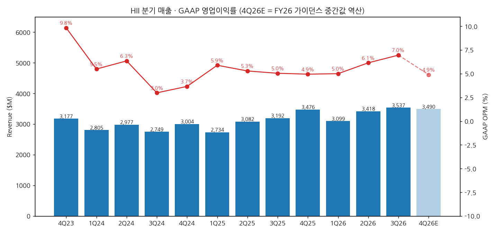
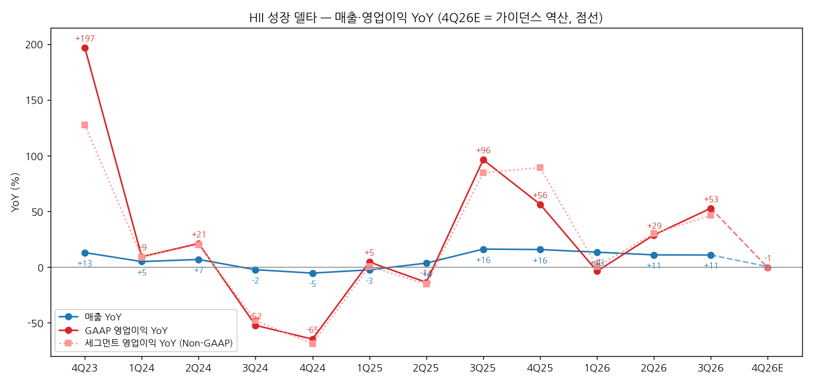
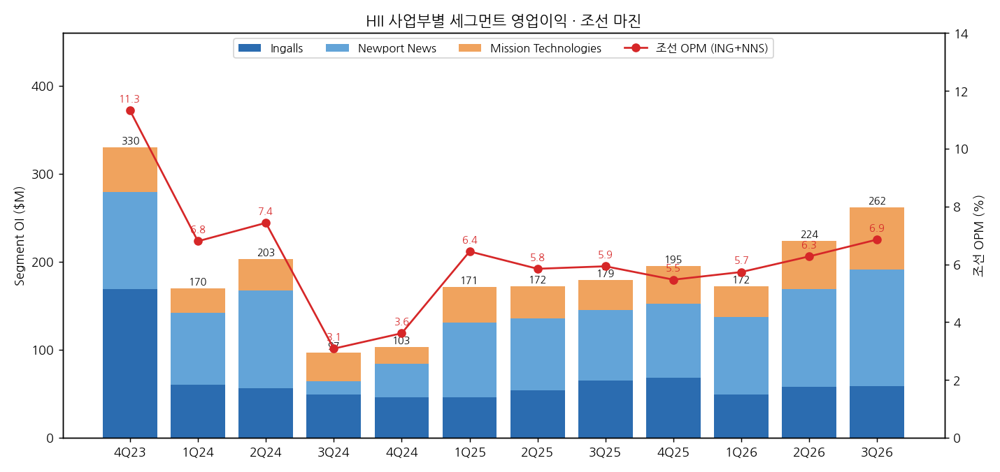

> 모드: 실적 리뷰 (v11)
> 종목: HII (HII)
> 섹터: 조선
> 서브섹터: 조선 글로벌
> 분기: 2026-Q3 (캘린더 = 회계 분기, 9/30 종료)
> 발표일: 2026-10-29 (목, 장 전 — 보도자료(8-K Ex.99.1)·10-Q·컨퍼런스콜 동시)
> 작성 시각: 2026-11-14 19:40 KST
> 분석 소스: 회사 자료 — 3Q26 실적 보도자료(8-K Ex.99.1, SEC 원문 URL 직접 접근이 차단돼 GlobeNewswire 배포 전문(MENAFN 게재)으로 확인, 수치는 10-Q와 대조 일치), 3Q26 10-Q(10/29 SEC), 1Q22~2Q26 10-Q·2021~2025 10-K(SEC EDGAR), 3Q26 컨퍼런스콜 트랜스크립트(Motley Fool, Webull 게재 10/29). 컨센: Yahoo Finance Analysis(10/23 발표 전 스냅샷 — 3Q26·4Q26 매출·EPS), StockAnalysis(S&P Global 집계, 10/14 — 2026E 영업이익·TP). 보도 인용: 2026년 2월 초기 가이던스(Baird Maritime·iTiger 요약), HD현대중공업 협력(Naval News·Korea Times 2025.10). 셀사이드 리포트 첨부 없음
> 리뷰 깊이: 숫자 중심 | 리서치 첨부 0건

# HII 3Q26 실적 리뷰 — 수주 $32.4B로 잔고 $86B, 이익 서프라이즈의 절반은 EAC 환입

> 성장 델타: 둔화 (보고 기준은 가속) | 내러티브: 강화 → 델타 둔화 + 내러티브 강화 → 관심 구간 (수주·가이던스는 강하지만 이익 델타는 EAC 환입 착시. 4Q 가이던스 역산 영업이익 YoY 0%를 넘는지와 2월 FY27 조선 마진 가이던스 확인 전까지 관망)

→ **숫자**: 매출 $3,537M(+10.8% YoY), GAAP 영업이익 $246M(+52.8% YoY, OPM 7.0%), 세그먼트 영업이익 $262M(+46.4%, 7.4%). 영업이익 YoY는 2Q26 +28.8%에서 +24%p 올라 보고 기준으로는 가속이다. 그러나 3Q26 누적 EAC 조정(net cumulative catch-up)이 +$76M(전년 -$3M)으로 이례적으로 컸다. 이를 뺀 세그먼트 영업이익은 $186M로 YoY +2.2%(2Q26 +17.6%)에 그친다 [계산]. 그래서 판정은 조정 기준 "둔화"다
→ **서프라이즈**: Yahoo 컨센(10/23 발표 전) 대비 매출 +5.0%, EPS $5.48로 +23.7%. 발표일 주가는 +13.2%($279.26 → $316.21)였고 11/13 종가는 $306.24다
→ **쟁점 ①**: 수주 $32.4B(Virginia Block VI·Columbia Build II·CVN-82 장납기 자재)로 잔고가 $57.3B → $86.2B가 됐다. 4Q에는 CVN-75 RCOH $5.1B가 더해진다. 회사는 2030년까지 조선 매출의 약 90%를 계약으로 확보했다고 밝혔다. 애널리스트(Citi)는 중기 매출 CAGR 6%가 보수적이라고 압박했지만, 회사는 2월 콜에서 다시 보겠다며 6%를 유지했다
→ **쟁점 ②**: 조선 마진 경로는 5.2%(2024) → 5.9%(2025) → 6.0~6.5%(2026 가이던스, 유지) → 장기 9~10%다. NNS의 EAC 변동은 4Q에 정리된다고 했다(CFO, "Ingalls low 7s, Newport News around 6%"가 기준선)
→ **다음 분기 관건**: FY26 가이던스 중간값을 역산하면 4Q26 영업이익은 약 $171M(YoY -0.6%)다 [계산]. EPS 컨센($5.13, 발표 전)으로 역산하면 약 $216M(+25%)다 [추정]. 이 차이가 델타 판정을 가른다. 2월 초 FY27 가이던스에서 조선 마진이 6.5%를 넘는지가 내러티브의 다음 확인 지점이다

---

## 1. 숫자

① 연결 기준 분기 표 (단위: $M, %)

| 항목 | 4Q23 | 1Q24 | 2Q24 | 3Q24 | 4Q24 | 1Q25 | 2Q25 | 3Q25 | 4Q25 | 1Q26 | 2Q26 | **3Q26** | 4Q26E (가이던스 역산) |
|---|---|---|---|---|---|---|---|---|---|---|---|---|---|
| 매출액 | 3,177 | 2,805 | 2,977 | 2,749 | 3,004 | 2,734 | 3,082 | 3,192 | 3,476 | 3,099 | 3,418 | **3,537** | 3,490 |
| 영업이익 (GAAP) | 312 | 154 | 189 | 82 | 110 | 161 | 163 | 161 | 172 | 155 | 210 | **246** | 171 |
| OPM | 9.8 | 5.5 | 6.3 | 3.0 | 3.7 | 5.9 | 5.3 | 5.0 | 4.9 | 5.0 | 6.1 | **7.0** | 4.9 |
| 매출 YoY | +13.0 | +4.9 | +6.8 | -2.4 | -5.4 | -2.5 | +3.5 | +16.1 | +15.7 | +13.4 | +10.9 | **+10.8** | +0.4 |
| 영업이익 YoY | +197.1 | +9.2 | +21.2 | -52.3 | -64.7 | +4.5 | -13.8 | +96.3 | +56.4 | -3.7 | +28.8 | **+52.8** | -0.6 |
| **매출 YoY 델타 (%p)** | +5.7 | -8.1 | +1.9 | -9.2 | -3.1 | +2.9 | +6.1 | +12.6 | -0.4 | -2.4 | -2.4 | **-0.1** | -10.4 |
| **영업이익 YoY 델타 (%p)** | +165.8 | -187.9 | +11.9 | -73.5 | -12.4 | +69.3 | -18.3 | +110.1 | -40.0 | -60.1 | +32.6 | **+24.0** | -53.4 |
| 세그먼트 영업이익 (Non-GAAP) | 330 | 170 | 203 | 97 | 103 | 171 | 172 | 179 | 195 | 172 | 224 | **262** | ~191 |
| 세그먼트 OPM | 10.4 | 6.1 | 6.8 | 3.5 | 3.4 | 6.3 | 5.6 | 5.6 | 5.6 | 5.6 | 6.6 | **7.4** | ~5.5 |
| 누적 EAC 조정 (net) | — | 2 | 24 | -72 | -80 | 0 | -10 | -3 | -15 | 1 | 10 | **76** | — |

→ (출처: 1Q22~3Q26 각 분기 10-Q, 4Q = 10-K 연간 - 3Q 누적 [계산]. 3Q26은 10-Q·보도자료 일치. 세그먼트 영업이익 = GAAP 영업이익 + FAS/CAS 조정 + 비경상 주세(회사 Non-GAAP 정의). 누적 EAC 조정은 10-Q "Net cumulative catch-up adjustments", 4Q = 10-K 연간 - 9개월 누적 [계산])
→ 4Q26E는 회사 FY26 가이던스 중간값을 역산한 값이다 [계산]. 조선 매출 $10.6B - 9개월 $7,870M = $2,730M, 조선 마진 6.25% × $10.6B - 9개월 $497M = $166M, MT 매출 $3.1B - $2,300M = $800M, MT 마진 약 6% × $3.1B - $161M = $25M, FAS/CAS -$11M, 비경상 주세 -$9M. 가이던스 범위로는 영업이익 $138M~$204M이다
→ 공개 컨센(Yahoo, 10/23 발표 전 스냅샷, 11명): 4Q26 매출 $3.51B(범위 $3.36~3.64B), EPS $5.13. EPS로 역산한 영업이익은 약 $216M이다 [추정 — 순이익 $203M, 세율 17%, 이자 -$25M, 비영업 연금이익 +$54M 가정]. 영업이익 컨센 자체는 미확보
→ 3Q26 서프라이즈: 매출은 컨센 $3.37B(12명) 대비 +5.0%, EPS는 $4.43(11명) 대비 +23.7%다. 영업이익 컨센은 미확보다(EPS 역산 약 $184M [추정] 대비 +34%)
→ 해석: GAAP 영업이익 YoY는 2024년 NNS 손실(3Q24 -$78M, 4Q24 -$74M 누적 조정) 기저 때문에 3Q25 +96%·4Q25 +56%로 튀었다. 이후 1Q26 -3.7% → 2Q26 +28.8% → 3Q26 +52.8%로 다시 올라왔다. 매출 YoY는 +16% → +13% → +11% → +11%로 완만하게 내려오는 중이다
→ **[판단] 델타 = 둔화 (조정 기준)**: 3Q26 누적 EAC 조정 +$76M은 총 유리한 조정 $232M(Columbia +$65M 포함)과 불리한 조정 $156M의 차이다. CFO 스스로 "2·3분기 NNS의 총 EAC 조정은 역사적 평균보다 컸다"고 했다. 이를 빼면 세그먼트 영업이익은 $186M(OPM 5.3%)로 전년(조정 후 $182M, 5.7%)과 비슷하다. 조정 YoY는 1Q26 0.0% → 2Q26 +17.6% → 3Q26 +2.2%다 [계산]. 보고 기준은 가속, 조정 기준은 둔화다
→ 다만 CFO는 "누적 조정을 빼서 booking rate를 계산하지 말라 — 계약가·인센티브가 움직이고 있어 너무 낮게 나온다"고 했다. 조정 기준이 실제 체력을 과소평가할 수 있다는 단서다. 판정을 바꿀 조건: 4Q26 영업이익이 $172M(전년)을 밑돌면 2개 분기 연속 둔화로 "꺾임"이다. EPS 컨센 경로($216M 안팎, +25%)가 나오면 "유지"로 올린다

→ (출처: HII 10-Q·10-K. 4Q26E는 FY26 가이던스 중간값 역산 [계산], 연한 막대·점선)

→ (출처: 동일. 4Q23 +197%는 4Q22 저기저(OPM 3.7%) 효과. 4Q26E 점선은 가이던스 역산 기준)

② 사업부별 매출·영업이익 (단위: $M, %)

| 사업부 | 항목 | 1Q25 | 2Q25 | 3Q25 | 4Q25 | 1Q26 | 2Q26 | **3Q26** |
|---|---|---|---|---|---|---|---|---|
| Ingalls | 매출 | 637 | 724 | 828 | 889 | 725 | 845 | **876** |
| Ingalls | 세그먼트 영업이익 | 46 | 54 | 65 | 68 | 49 | 58 | **59** |
| Ingalls | OPM | 7.2 | 7.5 | 7.9 | 7.6 | 6.8 | 6.9 | **6.7** |
| Ingalls | 매출 YoY | -2.7 | +1.7 | +24.7 | +20.8 | +13.8 | +16.7 | **+5.8** |
| Ingalls | 영업이익 YoY | -23.3 | -3.6 | +32.7 | +47.8 | +6.5 | +7.4 | **-9.2** |
| Ingalls | 누적 EAC 조정 | 0 | 4 | 6 | 6 | -3 | -2 | **-5** |
| Newport News | 매출 | 1,396 | 1,603 | 1,617 | 1,891 | 1,665 | 1,849 | **1,910** |
| Newport News | 세그먼트 영업이익 | 85 | 82 | 80 | 84 | 88 | 111 | **132** |
| Newport News | OPM | 6.1 | 5.1 | 4.9 | 4.4 | 5.3 | 6.0 | **6.9** |
| Newport News | 매출 YoY | -2.6 | +4.4 | +14.5 | +19.1 | +19.3 | +15.3 | **+18.1** |
| Newport News | 영업이익 YoY | +3.7 | -26.1 | +433.3 | +121.1 | +3.5 | +35.4 | **+65.0** |
| Newport News | 누적 EAC 조정 | -6 | -17 | -13 | -28 | -9 | 8 | **72** |
| Mission Technologies | 매출 | 735 | 791 | 787 | 731 | 748 | 760 | **792** |
| Mission Technologies | 세그먼트 영업이익 | 40 | 36 | 34 | 43 | 35 | 55 | **71** |
| Mission Technologies | OPM | 5.4 | 4.6 | 4.3 | 5.9 | 4.7 | 7.2 | **9.0** |
| Mission Technologies | 매출 YoY | -2.0 | +3.4 | +11.0 | +2.5 | +1.8 | -3.9 | **+0.6** |
| Mission Technologies | 영업이익 YoY | +42.9 | 0.0 | +3.0 | +126.3 | -12.5 | +52.8 | **+108.8** |
| 조선 합계 (ING+NNS) | 매출 | 2,033 | 2,327 | 2,445 | 2,780 | 2,390 | 2,694 | **2,786** |
| 조선 합계 (ING+NNS) | 영업이익 | 131 | 136 | 145 | 152 | 137 | 169 | **191** |
| 조선 합계 (ING+NNS) | 조선 OPM | 6.4 | 5.8 | 5.9 | 5.5 | 5.7 | 6.3 | **6.9** |
| 조선 합계 (ING+NNS) | 매출 YoY | -2.7 | +3.6 | +17.8 | +19.6 | +17.6 | +15.8 | **+13.9** |
| 조선 합계 (ING+NNS) | 영업이익 YoY | -7.7 | -18.6 | +126.6 | +81.0 | +4.6 | +24.3 | **+31.7** |

→ (출처: 각 분기 10-Q 세그먼트 표, 4Q = 10-K 연간 - 9개월 누적 [계산]. 매출은 사업부 간 거래 포함 총액, 3Q26 연결조정 -$41M. 3Q26 매출 비중은 NNS 54.0%·Ingalls 24.8%·MT 22.4%(연결조정 전) [계산])

→ (출처: HII 10-Q·10-K. 조선 OPM = (Ingalls + NNS 세그먼트 영업이익) / 조선 매출, 회사 Non-GAAP 정의)

(1) 델타를 끄는 곳 = Newport News(+$52M)와 MT(+$37M), 꺾이는 곳 = Ingalls
→ 세그먼트 영업이익 증가분 $83M 중 NNS가 $52M, MT가 $37M을 냈고 Ingalls는 -$6M이었다 [계산]
→ NNS: 매출 +18.1%는 잠수함·항모 물량 증가 덕분이다. OPM 6.9%(+196bp)는 Virginia급 계약 조정·인센티브와 Columbia +$65M 환입이 끌었다. 누적 EAC 조정을 빼면 NNS OPM은 3.1%(전년 5.8%)다 [계산]. CFO는 "Block VI·Columbia Build II 최초 booking, 14척 계약 인센티브(2Q 인식)와 작업범위·청구 이동으로 계산상 낮게 나온다"고 설명하며, NNS 기준선을 "around 6%"로 제시했다
→ MT: 매출은 +0.6%로 정체(무인체계 증가, Global Security 감소)인데 OPM이 9.0%(+464bp)로 뛰었다. ROMULUS(MUSV) 시험 마일스톤 달성, 무인체계 물량, 원자력·환경 JV 지분법이익($26M, 전년 $12M) 덕분이다. EBITDA 마진은 11.9%(전년 7.8%)다
→ Ingalls: 매출 +5.8%(LHA 물량)지만 OPM 6.7%로 3개 분기 연속 6%대다. 구축함(DDG) 생산 성과 저하와 -$5M 누적 조정 때문이다. 1Q 말 임금 인상 후 인력 회복이 늦었고, LPD 30·LHA 8·DDG 129 세 척을 동시에 시험 중이다 (CEO)

(2) 조선 매출 성장은 둔화 중, 마진은 상승 중
→ 조선 매출 YoY는 4Q25 +19.6% → 1Q26 +17.6% → 2Q26 +15.8% → 3Q26 +13.9%로 내려오고 있다. 2025년 2Q(NNS)·2026년 1Q(Ingalls) 임금 인상 효과를 차례로 한 바퀴 돌고 있어서다 (CFO, "Newport News는 2Q로 lap, Ingalls는 내년 1Q에 lap")
→ 처리량(throughput)은 연초 대비 +9%로 목표 +15%에 못 미친다. 회사는 "연말로 갈수록 목표를 다소 밑도는 추세"라고 인정했다(TD Cowen 질문). 다만 이 수준이 이미 EAC에 반영돼 있어 추가 손실 요인은 아니라고 답했다
→ 외주(distributed shipbuilding)는 올해 +30% 이상 성장 예상이다. 조선 매출 증가의 일부가 외주·자재 입고 시점 덕분이라는 점은 4Q 이후 성장률 둔화 요인이다 [판단]

③ 수주·잔고 (단위: $M)

| 항목 | 3Q25 | 4Q25 | 1Q26 | 2Q26 | **3Q26** |
|---|---|---|---|---|---|
| 총 잔고 | 55,679 | 53,139 | 54,033 | 57,322 | **86,181** |
| — Funded | 33,196 | 31,985 | 31,970 | 34,594 | **37,905** |
| — Unfunded | 22,483 | 21,154 | 22,063 | 22,728 | **48,276** |
| Ingalls 잔고 | 18,546 | 17,781 | 18,252 | 19,353 | **18,881** |
| Newport News 잔고 | 31,006 | 29,925 | 30,472 | 32,488 | **60,752** |
| MT 잔고 | 6,127 | 5,433 | 5,309 | 5,481 | **6,548** |
| 신규 수주 (잔고 증감 + 매출) | 2,016 | 936 | 3,993 | 6,707 | **32,396** |
| Book-to-bill (배) | 0.63 | 0.27 | 1.29 | 1.96 | **9.16** |

→ (출처: 각 분기 10-Q·10-K 잔고 표. 신규 수주·B/B는 잔고 증감 + 매출로 역산 [계산]. 3Q26 $32.4B는 회사 발표치와 일치, 연초 누적 $43.1B도 일치)
→ 잔고 $86.2B는 2025년 매출의 6.9배다 [계산]. 증가분($28.9B)의 거의 전부가 NNS(+$28.3B, Virginia Block VI·Columbia Build II)다
→ CVN-75(Truman) RCOH $5.1B는 9월 말 계약했지만 4Q 잔고에 반영된다 (CFO). MT 3Q 수주는 $1.9B(B/B 2.4배, STINGRAI $2.2B 계약 포함)다
→ 회사: "2030년까지 예상 조선 매출의 약 90%가 이미 계약돼 있다" (CEO, 보도자료·컨콜)

④ 가이던스 (이전 → 이번)

| 항목 | FY26 초기 (2026.2) | 2Q26 (7/30) | **3Q26 (10/29)** |
|---|---|---|---|
| 조선 매출 | $9.7~9.9B (보도 인용) | $10.2~10.4B | **$10.5~10.7B** |
| 조선 영업이익률 | 5.5~6.5% (보도 인용) | 6.0~6.5% | **6.0~6.5% (유지)** |
| MT 매출 | $3.0~3.2B (보도 인용) | $3.0~3.2B | **$3.0~3.2B (유지, 중간값 유력)** |
| MT 세그먼트 영업이익률 | — | ~5% | **~6%** |
| MT EBITDA 마진 | — | 8.4~8.6% | **~9%** |
| FAS/CAS 조정 | — | -$44M | **-$40M** |
| 비경상 주세 | — | ~-$20M | **-$27M** |
| 이자비용 | — | -$105M | **-$100M** |
| 실효세율 | — | ~17% | **~17%** |
| CapEx | — | 매출의 4~5% | **~$500M** |
| FCF | — | $500~600M | **$500~600M (유지)** |
| FY26+FY27 누적 FCF | — | — | **$1.2~1.3B** |

→ (출처: 3Q26 보도자료 Outlook 표(이전 vs 현재). FY26 초기 가이던스는 4Q25 실적 발표(2026.2) 보도 요약(Baird Maritime·iTiger) 인용 — 원문 미확인)
→ 조선 매출 가이던스는 두 번 연속 상향(중간값 $9.8B → $10.3B → $10.6B, +8%)됐다 [계산]. 조선 마진은 하단만 올렸다(5.5% → 6.0%). 9개월 조선 마진이 6.32%라 중간값(6.25%)을 맞추려면 4Q 조선 마진은 약 6.1%면 된다 [계산]
→ MT 마진 ~6%는 9개월 7.0%를 감안하면 4Q MT 영업이익 약 $25M(마진 약 3%)을 뜻한다 [계산]. 가이던스가 보수적이라는 신호이고, 4Q 서프라이즈 여지다 [판단]
→ FCF: 9개월 누적 -$182M이라 연간 $500~600M을 맞추려면 4Q에 $682~782M이 필요하다 [계산]. FY26+FY27 누적 $1.2~1.3B면 FY27 FCF는 약 $700M이다(JPM 질문, CFO 확인)

⑤ 연간 (단위: $M, %)

| 항목 | 2021 | 2022 | 2023 | 2024 | 2025 | 2026E | 2027E |
|---|---|---|---|---|---|---|---|
| 매출액 | 9,524 | 10,676 | 11,454 | 11,535 | 12,484 | 13,544 | 14,220 |
| 영업이익 (GAAP) | 513 | 565 | 781 | 535 | 657 | 782 | 미확보 |
| OPM | 5.4 | 5.3 | 6.8 | 4.6 | 5.3 | 5.8 | — |
| 매출 YoY | +1.7 | +12.1 | +7.3 | +0.7 | +8.2 | +8.5 | +5.0 |
| 영업이익 YoY | -35.8 | +10.1 | +38.2 | -31.5 | +22.8 | +19.0 | — |
| 희석 EPS ($) | 13.50 | 14.44 | 17.07 | 13.96 | 15.39 | 18.50 (컨센) | 21.01 (컨센) |

→ (출처: 2021~2025 각 연도 10-K. 2026E = 9개월 실적 + 4Q 가이던스 역산 [계산]. 2027E 매출·EPS = Yahoo 컨센(10/23 발표 전, 11명 · 10명). 2027E 매출 YoY는 2026E [계산] 대비)
→ 발표 전 컨센(S&P Global, StockAnalysis 10/14): 2026E 매출 $13.36B, 영업이익 $759.5M, EPS $18.50. 3Q 영업이익이 컨센 역산치를 크게 넘었으므로, 9개월 실적($611M)에 가이던스 역산 4Q($171M)만 더해도 $782M로 발표 전 컨센보다 +3% 높다 [계산]. 발표 후 컨센 변화는 미확보

---

## 2. 시장 쟁점

① 지난 분기 체크

→ 첫 리뷰 — 직전 체크 없음 (2Q26 리뷰·팔로업 미작성)

② 이번 분기 쟁점 (컨콜 Q&A에서 반복된 질문)

| # | 쟁점 | 한 줄 정의 | 질문자 |
|---|---|---|---|
| 1 | 성장률 가이던스 | 수주 $32B·5개 분기 연속 두 자릿수 성장인데, 중기 매출 CAGR 6%는 너무 낮지 않나 | Citi(Godyn), TD Cowen(Khanna) |
| 2 | NNS 마진의 실체 | EAC 조정이 커진 2·3분기 이후 NNS의 실제 booking rate는 몇 %인가, 2027년엔 안정되나 | Goldman Sachs(Poponak), Citi |
| 3 | Ingalls 인력·수상함 | Ingalls가 NNS보다 뒤처진 이유와 DDG 성과 문제의 범위 | Goldman Sachs, Wolfe(Walton 대리) |
| 4 | 현금흐름 | 9개월 FCF -$182M에서 연간 $500~600M, FY27 $700M까지의 경로 | JPMorgan(Seifman), TD Cowen |
| 5 | 경쟁·신규 프로그램 | 신규 조선소(HD현대 미국 조선소 포함)의 인력 쟁탈, 무인체계 비중, 프리깃·Trump급 전함 | Melius(Mikus), BofA(Epstein), JPMorgan, Wolfe |

③ 쟁점별 분해

(1) 쟁점 1 — 중기 매출 CAGR 6%는 보수적인가

(1-1) 회사 설명
→ CEO: "6%는 다년간 CAGR이다. 처리량 증가와 외주 확대를 실행해야 한다. 연말 콜에서 갱신하겠지만 지금은 그대로 둔다"
→ CFO: "5개 분기 연속 두 자릿수 성장이다. 처리량·외주 확대와 Ingalls(1Q26)·NNS(2Q25) 임금 인상 효과가 섞여 있다. NNS는 2Q로 한 바퀴를 돌았고 Ingalls는 내년 1Q에 돈다. 잔고가 $53B에서 $86B로 늘었으니 우리가 보수적인 쪽일 것이다"
→ 처리량: 연초 대비 +9%로 목표 15%에 못 미친다. 연말까지 다소 밑돌 전망이다(CEO, TD Cowen 질문)

(1-2) [판단]
→ 숫자는 "성장률 둔화"와 "가이던스 상향 여지"를 동시에 보여준다. 조선 매출 YoY는 +19.6% → +13.9%로 4개 분기 연속 내려왔다. 임금 인상 기저가 사라지는 2027년 1Q 이후에는 한 자릿수 후반으로 수렴할 가능성이 크다. 반면 6%는 잔고 6.9배·처리량 회복을 감안하면 하단이다
→ 결론을 바꿀 데이터: 2월 FY27 가이던스에서 조선 매출이 $11.2B(+6% vs 2026E 중간값 $10.6B) [계산]를 넘으면 상향, 못 미치면 둔화 확인이다

(2) 쟁점 2 — NNS의 실제 마진은 몇 %인가

(2-1) 회사 설명
→ CFO: "2분기에 14척 계약 인센티브를 인식했고, 3분기에 계약 자체와 추가 인센티브가 매출 쪽에 들어왔다. 작업범위·청구·자금·자본 인센티브·성과 인센티브가 동시에 움직였다. 누적 조정을 빼서 booking rate를 계산하면 너무 낮게 나온다. 계약 수정이 끝났고 예산이 나왔으니 4Q에 정리된다"
→ CFO: "Ingalls는 low 7s, Newport News는 around 6%로 보면 된다. 2027년에는 예외가 없으면 정상적인 조정 수준으로 돌아간다"
→ CEO: "조선은 여전히 9~10% 매출이익률(return on sales) 사업이다. 마진과 현금은 매년 점진적으로 개선된다"
→ CFO: "조선 마진은 2024년 5.2% → 2025년 5.9% → 2026년 가이던스 중간값 6.2%다. 2027년 말 post-COVID 계약 비중이 50~55%가 되고, 2030년까지 매년 8~10%p씩 늘어난다" (Wells Fargo 질문)

(2-2) [판단]
→ 3Q26 NNS OPM 6.9%는 +$72M 누적 조정을 포함한다. 회사 기준선(약 6%)과 조정 제외 계산치(3.1%) 사이가 실제 체력이다. 회사 설명대로 Block VI·Columbia Build II 신규 계약의 초기 booking rate가 보수적으로 잡혔다면, 2027년에 조정 없이 6%대가 나와야 한다
→ 결론을 바꿀 데이터: 4Q26 NNS OPM이 누적 조정 ±$20M 이내에서 6%대면 회사 설명이 맞다. 5% 미만이면 3Q의 환입이 "앞당겨 쓴 이익"이었다는 쪽으로 기운다

(3) 쟁점 3 — Ingalls는 왜 뒤처지나

(3-1) 회사 설명
→ CEO: "1분기 말에 임금을 올려 인력 회복이 늦게 시작됐다. 3분기 Ingalls 순증 인원은 576명으로 최근 10개 분기 중 최대다. LPD 30·LHA 8·DDG 129 세 척을 동시에 시험하는 것은 분사 이후 전례가 없다"
→ CFO: "구축함 생산 프로그램의 엔지니어링·인력·부품 리듬 문제로 약간의 drag가 있어 EAC에 반영했다. 큰 문제는 아니다. 분기 마진은 6.7%, 6.9%, 6.7%로 안정적이다"
→ 프리깃(FF(X), National Security Cutter 기반): CDR·PRR 통과, 2028년 말 진수 일정 유지. 다만 2027년 함정을 1Q27 안에 계약해야 일정이 지켜진다 (CEO, JPMorgan 질문)

(3-2) [판단]
→ Ingalls OPM은 2025년 7.2~7.9%에서 2026년 6.7~6.9%로 한 단계 내려왔다. 회사 기준선 "low 7s"와 현재 6%대 후반의 차이는 3척 인도(LPD 30 연내, LHA 8·DDG 129 2027년 초)로 메워져야 한다. 인도 일정이 밀리면 Ingalls가 조선 마진 개선을 막는 쪽이 된다

(4) 쟁점 4 — 현금흐름 경로

(4-1) 회사 설명
→ 3Q FCF $429M은 수금·지급 시점 덕분이다. "연간 FCF 기대는 변화 없다. 3Q 실적이 4Q 리스크를 줄였다" (CFO)
→ CapEx는 연초 $500~600M에서 약 $500M(매출의 약 3.6%)으로 낮췄다. 운전자본은 매출 대비 15% 중반에서 9%로 내려왔고, 4Q에 5~6%로 더 내려간다 (CFO, JPMorgan 질문)
→ 4Q 현금의 핵심은 SSN-800 Arkansas·LPD 30 인도와 계약 마일스톤·인센티브다. 55개 항목을 격주로 관리한다. IRS가 승인한 R&D 세액공제가 2027년 현금에 보탬이 된다 (CFO, TD Cowen 질문)

(4-2) [판단]
→ 4Q에만 $682~782M의 FCF가 필요하다 [계산]. 이는 2025년 연간 FCF($800M)와 맞먹는 규모다. 두 척 인도가 연내에 끝나지 않으면 FCF 가이던스가 이 회사의 첫 번째 하방 리스크다. 2026년 2월에도 FCF 가이던스 실망으로 주가가 빠졌다(보도 인용)

(5) 쟁점 5 — 경쟁 환경과 신규 프로그램

(5-1) 회사 설명
→ 신규 조선소의 인력 쟁탈(Melius 질문 — Anduril Arsenal-2의 메릴랜드 3,100명 채용, 공공 조선소 추가, HD현대의 미국 조선소 계획 언급): "조선은 지역 노동시장이다. 발표된 조선소들은 우리 조선소 근처가 아니다. 우리도 찰스턴에 제조 거점을 열어 다른 노동 풀을 쓰고 있다" (CEO)
→ "조선소를 새로 세우는 건 어렵다. 더 어려운 건 프로그램을 실행할 인력과 경험이다. 그래도 국가적으로 조선 능력을 늘리는 것은 무엇이든 긍정적이다" (CEO, BofA 질문)
→ 무인체계: 올해 매출 $200M 이상, MT 평균보다 마진이 높다. MUSV(ROMULUS 10척), Lionfish UUV 후속 생산, 매사추세츠 생산시설 25% 증설. "무인이 대형 함정을 넘어서지는 않는다" (CEO·MT 사장)
→ Trump급 전함: 초기 계획·설계 단계이며 예산에 있다. "해군이 만들라는 것을 만든다" (CEO, Wolfe 질문)

(5-2) [판단]
→ 한국 조선사 관점에서 의미 있는 대목은 두 가지다. ① HII는 신규 조선소를 위협보다 "국가 조선 능력 확대"로 보고, 외주 +30%로 외부 역량을 적극 쓰고 있다. ② 3Q 보도자료에 "HD현대중공업과 지능형 기계화 자동용접 파일럿 시작"이 Ingalls 주요 성과로 들어갔다. HII와 HD현대의 협력이 MOU 단계에서 생산 현장으로 내려왔다는 신호다

---

## 3. 내러티브 점검

→ **성장 스토리**: 미 해군 항모(유일)·상륙함(유일)·잠수함(GD Electric Boat와 2강)을 짓는 미국 최대 조선사다. post-COVID 계약으로 바뀌면서 조선 마진이 5%대에서 9~10%로 정상화되고, 잔고 확대로 매출 성장이 이어진다는 스토리다
→ **이번 분기**: 스토리의 두 다리 중 "잔고·매출"은 확실히 강화됐다(수주 $32.4B, 잔고 +50%, 2030년까지 매출의 90% 확보, 조선 매출 가이던스 2연속 상향). "마진 정상화"는 6.0~6.5% 유지로 속도 변화가 없고, 이번 분기 마진 개선의 상당 부분이 EAC 환입이었다. 그래서 델타는 둔화(조정 기준), 내러티브는 강화로 본다 [판단]
→ **트리거**: ① 2월 FY27 가이던스에서 조선 마진 6.5% 초과 ② CVN-75 $5.1B 반영 후 4Q 잔고 $90B 이상 ③ FY27 국방예산·조선 예산 확정과 프리깃 2번함 계약(1Q27)
→ **리스크**: ① 4Q FCF 미달(SSN-800·LPD 30 인도 지연) ② NNS 신규 계약 booking rate가 6%를 밑도는 것이 확인되는 경우 ③ 처리량 목표 미달이 2027년까지 이어지는 경우
→ **한국 조선 3사 대비 시사점**: HII의 조선 OPM 6.9%는 한화오션(14.2%)·HD현대중공업(15.6%)·삼성중공업(10.7%)의 절반 수준이다. 반면 잔고/매출은 6.9배로 한국 3사(약 3년치)보다 길다. 미 해군 함정 시장은 "물량 확실, 마진 낮음, 인력 병목"이라는 점이 이번 분기에도 확인됐다 [판단]. 이 병목이 한국에 열어주는 문은 신조 해외건조(법적 제약)보다 외주 블록·MRO·자동화 협력(HD현대중공업 용접 파일럿, NGLS 공동 추진) 쪽이 먼저다 [판단]

---

## 4. 향후 봐야 할 것 (우선순위 순)

(1) **4Q26 영업이익 $171M(가이던스 역산) vs $216M(EPS 컨센 역산)과 FY27 가이던스** — 델타 판정을 정하는 1순위 변수다. 영업이익이 $172M(4Q25)을 밑돌면 "꺾임", $200M 이상이면 "유지"다. FY27 조선 마진 가이던스가 6.5%를 넘는지, 중기 매출 CAGR 6%를 올리는지 본다
→ 데이터: 4Q26 보도자료·10-K, 컨콜 FY27 Outlook 표
→ 시점: 2027년 2월 초 (전년 2026-02-05) [추정]

(2) **NNS 마진 정상화 — 누적 조정 없이 6%대** — 4Q NNS 누적 EAC 조정이 ±$20M 이내로 줄고 OPM 6%대를 지키는지. Block VI·Columbia Build II booking rate의 첫 확인이다
→ 데이터: 10-K 세그먼트별 누적 조정 표, 컨콜 CFO 코멘트
→ 시점: 2027년 2월 초

(3) **4Q FCF $682~782M과 인도 2척** — SSN-800 Arkansas, LPD 30 Harrisburg 연내 인도 여부. 미달이면 FY26+27 누적 $1.2~1.3B 가이던스까지 흔들린다
→ 데이터: 해군 인도 발표(뉴스 키워드 "SSN 800 Arkansas delivered", "LPD 30 Harrisburg delivery"), 4Q 보도자료
→ 시점: 12월 인도 뉴스, 2월 실적

(4) **잔고 $90B+와 미 의회 예산** — CVN-75 RCOH $5.1B 반영, FY27 국방 세출법·NDAA 조선 예산(잠수함 2+1 체계, 프리깃, Trump급 전함), 프리깃 2번함 1Q27 계약
→ 데이터: 미 의회 세출법·NDAA 최종본, 국방부 계약 공시(defense.gov contracts)
→ 시점: 11월 말~12월(예산·NDAA), 1Q27(프리깃)

(5) **한국 조선사 연결 고리 — 해외건조 규정·HD현대 협력·한화 필리** — NDAA의 해외건조 허용 조항 여부, HII–HD현대중공업 NGLS(차세대 군수지원함) 공동 추진·자동용접 파일럿 확대, 한화 필리조선소의 미 해군 물량 확대(LSM 등)
→ 데이터: NDAA 조문, HII·HD현대 보도자료, 뉴스 키워드 "HII HD Hyundai NGLS", "Hanwha Philly Navy"
→ 시점: 12월(NDAA), 수시
