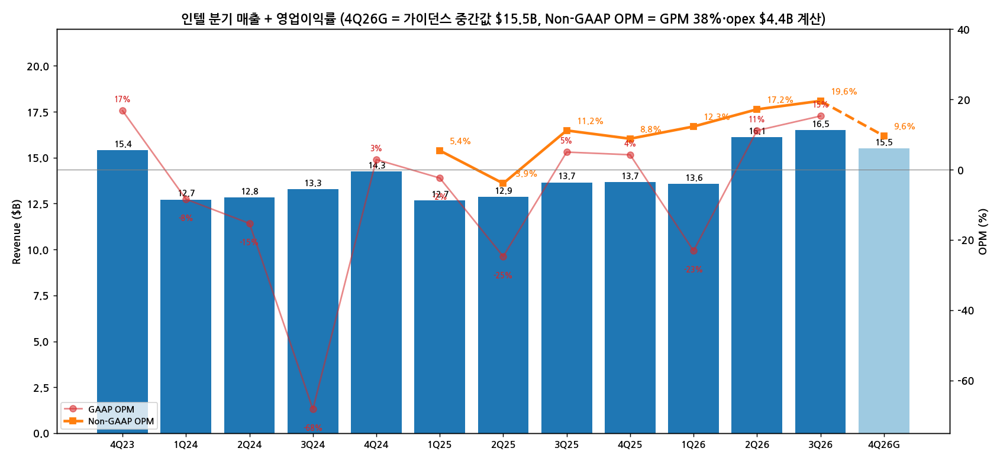
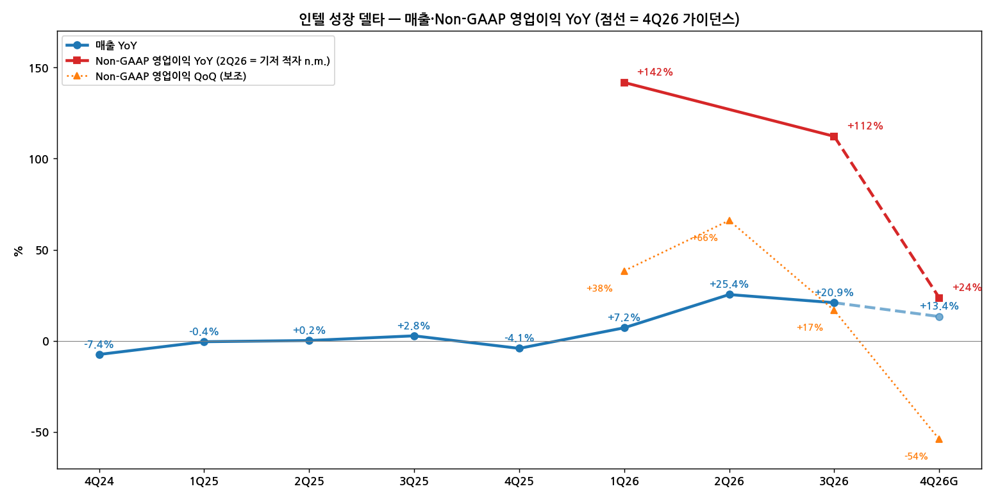

> 모드: 실적 리뷰 (v11)
> 종목: Intel (INTC)
> 섹터: 반도체
> 서브섹터: 로직·CPU
> 분기: 2026-Q3 (2026년 7～9월, 회계연도 = 캘린더)
> 발표일: 2026-10-29 (ET, AMC) / 2026-10-30 KST
> 작성 시각: 2026-11-16 KST
> 분석 소스: SEC XBRL(10-Q·10-K, GAAP 분기 매출·영업이익) + 첨부 셀사이드 6개 — 대신증권 AI 리서치(10/29), 삼성증권(10/30), IBK투자증권(10/30), 유진투자증권(10/30), 하나증권(11/02), NH투자증권(11/02). 회사 컨콜 내용은 리포트 인용 기준. 웹서치 보완 없음
> 리뷰 깊이: 풀 | 리서치 첨부 6건

# Intel 3Q26 실적 리뷰 — 서버는 15년 만의 성장, 그런데 PC·공급·현금이 한꺼번에 발목을 잡았다

## 0. 한 줄 판정

> 성장 델타: **꺾임 (조정 기준 — Non-GAAP 영업이익 YoY +142%(1Q26) → +112%(3Q26) → 4Q 가이던스 약 +24%, 매출 YoY +25.4% → +20.9% → +13.4%로 2개 분기 연속 둔화, 정점은 2Q26)** | 내러티브: **약화** → **매매 제외 구간 — 에이전틱 AI 서버 CPU 스토리는 살아 있지만, 공급 제약·PC 재고조정·2027 FCF 적자로 숫자가 스토리를 못 따라간다. 재진입은 1Q27 가이던스의 QoQ 반등 확인 후** [판단]

→ 숫자: 매출 $16.51B(+20.9% YoY, +2.4% QoQ), Non-GAAP 영업이익 $3.23B(OPM 19.6%, 8개 분기 최고), GAAP 영업이익 $2.52B(OPM 15.3%). 컨센 대비 매출 −0.1%(사실상 부합), Non-GAAP 영업이익 +21.8%, EPS $0.52 vs $0.41 +28% (FactSet, 삼성)
→ 사업부: DCAI $7.32B(+77.8% YoY, OPM 41.5%)가 끌고, CCPG $8.10B(−5.1% YoY, −8.8% QoQ)가 꺾였다. 성장축이 PC에서 데이터센터로 완전히 넘어갔다
→ 쟁점 ①: 4Q 가이던스 매출 $15.0～16.0B(중간값 컨센 $17.07B 대비 −9%), Non-GAAP GPM 38%, EPS $0.25(컨센 $0.44 대비 −43%) — 7개 분기 연속 컨센 상회 가이던스가 처음 하회. Fab 28 사고(매출 −$0.3B, GPM −2%p)를 빼도 컨센 미달, 본질은 PC 재고조정(CCPG QoQ −20% 이상)
→ 쟁점 ②: DCAI 수요는 공급 초과인데 Intel 3 수율·EMIB 기판·Fab 28로 출하가 묶였다 — 2027 성장은 "공급의 함수", 기판 증설은 2027 하반기
→ 쟁점 ③: 2027 CapEx "대폭 증액" + FCF 적자 지속 명시 → 10/29 $92.07 → 10/30 $65.80 (−28.5% [계산]). 대신 투자의견 적극매수 → 중립
→ 다음 관건: 1Q27 가이던스가 QoQ 반등(PC 바닥 + DCAI 공급 확대)을 그리는지, 2027 CapEx 실제 규모

---

## 1. 숫자

① 연결 기준 분기 표

단위: $M, %. **영업이익 = GAAP** (SEC XBRL). 인텔은 Non-GAAP을 주 지표로 쓰므로 Non-GAAP 영업이익 행 병기(삼성증권 정리, 1Q25～3Q26)

| 항목 | 4Q23 | 1Q24 | 2Q24 | 3Q24 | 4Q24 | 1Q25 | 2Q25 | 3Q25 | 4Q25 | 1Q26 | 2Q26 | **3Q26** | 4Q26 가이던스 |
|---|---|---|---|---|---|---|---|---|---|---|---|---|---|
| 매출액 | 15,406 | 12,724 | 12,833 | 13,284 | 14,260 | 12,667 | 12,859 | 13,653 | 13,674 | 13,577 | 16,128 | **16,513** | 15,500 (15,000～16,000) |
| 영업이익 (GAAP) | 2,585 | −1,069 | −1,964 | −9,057 | 412 | −301 | −3,176 | 683 | 580 | −3,136 | 1,796 | **2,522** | — |
| OPM (GAAP) | 16.8 | −8.4 | −15.3 | −68.2 | 2.9 | −2.4 | −24.7 | 5.0 | 4.2 | −23.1 | 11.1 | **15.3** | — |
| 영업이익 (Non-GAAP) | — | — | — | — | — | 690 | −503 | 1,524 | 1,205 | 1,668 | 2,770 | **3,234** | 약 1,490 [계산] |
| OPM (Non-GAAP) | — | — | — | — | — | 5.4 | −3.9 | 11.2 | 8.8 | 12.3 | 17.2 | **19.6** | 약 9.6 |
| 매출 YoY | +9.7 | +8.6 | −0.9 | −6.2 | −7.4 | −0.4 | +0.2 | +2.8 | −4.1 | +7.2 | +25.4 | **+20.9** | +13.4 |
| 영업이익 YoY (GAAP) | n.m. | n.m. | n.m. | n.m. | −84.1 | n.m. | n.m. | n.m. | +40.8 | n.m. | 흑자 전환 | **+269.3** | — |
| 영업이익 YoY (Non-GAAP) | — | — | — | — | — | — | — | — | — | +141.7 | n.m. (기저 적자) | **+112.2** | 약 +23.7 [계산] |
| **매출 YoY 델타 (%p)** | — | −1.1 | −9.5 | −5.3 | −1.2 | +7.0 | +0.6 | +2.6 | −6.9 | +11.3 | +18.2 | **−4.5** | −7.5 |
| **영업이익 YoY 델타 (%p, Non-GAAP)** | — | — | — | — | — | — | — | — | — | — | n.m. | **−29.5 (1Q26 대비)** | 약 −88.5 |

→ (출처: 매출·GAAP 영업이익 = SEC XBRL(10-Q 분기치, 4분기는 10-K 연간 − 3개 분기 [계산]). 4Q22 매출 $14,042M도 같은 방식. Non-GAAP 영업이익 = 삼성증권(회사 발표치 정리). 4Q26 가이던스 영업이익 = 매출 중간값 $15.5B × Non-GAAP GPM 38% − Non-GAAP 영업비용 $4.4B(대신, 컨콜) [계산])
→ GAAP 영업이익은 구조조정·손상(3Q24 −$9.1B, 1Q26 −$3.1B 등)으로 분기마다 부호가 바뀌어 YoY가 대부분 n.m. — **델타 판정은 Non-GAAP 기준 + QoQ 보조**로 한다. 2Q25 Non-GAAP 영업이익도 일회성 비용으로 적자(−$503M)라 2Q26 YoY는 n.m.
→ NH가 인용한 발표 후 4Q26 컨센(Bloomberg, 11/2): 매출 $15,613M, Non-GAAP 영업이익 $1,952M, EPS $0.26 — 가이던스 계산치($1.49B)보다 약 $0.46B 높다. 영업비용 가정 차이로 보이며 BT 확인 필요

서프라이즈: 매출 컨센 $16,537M 대비 **−0.1%**, Non-GAAP 영업이익 $2,654M 대비 **+21.8%**, EPS $0.52 vs $0.41 **+28.1%** (FactSet — 삼성. 대신 LSEG 기준 EPS +26.8%, 매출 −0.2%). 이익 서프라이즈는 매출이 아니라 마진(Non-GAAP GPM 44.1%, +2.3%p QoQ)에서 나왔다

(1) YoY 위치
→ 매출 YoY는 2025년 내내 0% 근처에서 1Q26 +7.2% → **2Q26 +25.4%(정점)** → 3Q26 +20.9% → 4Q26 가이던스 +13.4%. 2개 분기 연속 둔화가 가이던스로 확정
→ Non-GAAP 영업이익 YoY는 1Q26 +142% → 3Q26 +112% → 4Q26 가이던스 약 +24%. 1Q27은 기저(1Q26 $1,668M)가 높지 않지만, 회사가 PC 재고조정이 4Q～1Q에 집중되고 Fab 28 매출 영향(약 −$0.3B)이 1Q에도 남는다고 해 1Q27 YoY가 마이너스로 갈 수 있다 [전망]
→ 발표 전 컨센 경로(유진 표, Bloomberg): 4Q26E 매출 $17.1B·영업이익 $2.9B → 1Q27E $16.9B·$2.8B. 가이던스가 이 경로를 4Q에서 약 −$1.4B(영업이익) 끊어 놓았다 — **컨센 경로상 YoY 정점은 2Q26～3Q26에 이미 지났다** [판단]

(2) QoQ로 다시 보기 (조정 기준 보조)
→ Non-GAAP 영업이익 QoQ: +38%(1Q26) → +66%(2Q26) → **+17%(3Q26)** → 약 **−54%(4Q26G)**. 분기 증가액 +$1.10B(2Q) → +$0.46B(3Q) → −$1.74B(4Q) [계산]
→ 매출 QoQ도 +18.8%(2Q) → +2.4%(3Q) → −6.1%(4Q 가이던스). 3Q의 이익 증가는 거의 마진(믹스·18A 원가 −40%) — 물량은 이미 멈췄다 [판단]

→ (출처: SEC XBRL(매출·GAAP), 삼성증권(Non-GAAP), 4Q26G = 가이던스 중간값·Non-GAAP 영업이익 [계산])

→ (출처: 동일. 빨강 = Non-GAAP 영업이익 YoY(2Q26은 기저 적자로 생략), 주황 점선 = Non-GAAP 영업이익 QoQ)

② 사업부별 매출·영업이익

단위: $M, %. 사업부 영업이익 = GAAP 부문 기준(회사 공시, 삼성·IBK·하나 정리). 비중은 연결 매출 대비(Foundry는 대부분 내부 매출이라 비중 생략)

(1) 이번 분기 스냅샷

| 부문 | 3Q26 매출 | 비중 | 매출 QoQ | 매출 YoY | 3Q26 영업이익 | OPM | 2Q26 OPM | 3Q25 OPM | 영업이익 YoY |
|---|---|---|---|---|---|---|---|---|---|
| Intel Products | 15,415 | 93.4 | +1.8 | +21.8 | 5,324 | 34.5 | 31.8 | 28.9 | +45.5 |
| └ **DCAI** (데이터센터·AI) | **7,318** | **44.3** | **+16.9** | **+77.8** | **3,039** | **41.5** | 39.5 | 23.4 | **+215.2** |
| └ CCPG (클라이언트·피지컬AI) | 8,097 | 49.0 | −8.8 | −5.1 | 2,285 | 28.2 | 26.4 | 31.6 | −15.2 |
| Intel Foundry | 6,697 | — | +16.2 | +58.1 | −1,853 | −27.7 | −36.2 | −54.8 | 적자 축소 (+468) |
| All Other (Mobileye 등) | 692 | 4.2 | −1.3 | −30.3 | 179 | 25.9 | 32.8 | 10.1 | +79.0 |
| 연결 조정·공통비 | −6,291 | — | — | — | −1,128 | — | — | — | — |
| **합계** | **16,513** | 100 | +2.4 | +20.9 | 2,522 (GAAP) / 3,234 (Non-GAAP) | 15.3 / 19.6 | 11.1 / 17.2 | 5.0 / 11.2 | +269.3 / +112.2 |

→ (출처: 하나·IBK·대신·유진 = Foundry $6,697M(+58%), 삼성·NH = $6,657M(+57%)로 차이 — 연결 조정이 같은 폭으로 달라 합계는 동일. 다수 기준 $6,697M 사용, BT 확인 필요)
→ DCAI 영업이익($3.04B)이 CCPG($2.29B)를 2개 분기 연속 넘었다(2Q26 $2.47B vs $2.34B에서 첫 역전)

(2) 부문별 매출 YoY 추이

| 부문 | 1Q25 | 2Q25 | 3Q25 | 4Q25 | 1Q26 | 2Q26 | **3Q26** | 4Q26 가이던스 | 방향 |
|---|---|---|---|---|---|---|---|---|---|
| DCAI | +7.8 | +3.5 | −0.6 | +8.9 | +22.4 | +59.0 | **+77.8** | 약 +78 (QoQ 10%대 중반, 약 $8.4B [계산]) | 가속 → 고원 |
| CCPG | −7.8 | −3.3 | +4.6 | −6.6 | +1.3 | +12.8 | **−5.1** | 약 −21 (QoQ −20% 이상, $6.5B 이하 [계산]) | **꺾임** |
| Intel Foundry | +7.1 | +3.2 | −2.4 | +3.8 | +16.2 | +30.5 | **+58.1** | 가이던스 없음 | 가속 (내부 물량) |
| All Other | +46.7 | +19.5 | +3.0 | −48.4 | −33.4 | −33.4 | **−30.3** | — | Altera 연결 제외 기저 |

(3) 부문별 OPM 추이

| 부문 | 1Q25 | 2Q25 | 3Q25 | 4Q25 | 1Q26 | 2Q26 | **3Q26** |
|---|---|---|---|---|---|---|---|
| DCAI | 13.9 | 16.1 | 23.4 | 26.4 | 30.5 | 39.5 | **41.5** |
| CCPG | 30.9 | 26.1 | 31.6 | 27.0 | 32.6 | 26.4 | **28.2** |
| Intel Foundry | −49.7 | −71.7 | −54.8 | −55.7 | −45.0 | −36.2 | **−27.7** |

→ (출처: 삼성·IBK·하나 부문 표(GAAP), 1Q25부터 사업부문 재분류 기준. 4Q26 가이던스 부문 매출은 회사 QoQ 가이던스로 [계산])
→ **델타를 끄는 곳 = DCAI.** 3Q26 연결 매출 증가분 +$2.86B(YoY) 중 DCAI +$3.20B, CCPG −$0.44B [계산]. 4Q26에도 DCAI는 YoY +78% 근처를 유지하지만 CCPG가 −21%로 빠지며 연결 YoY를 +13%로 끌어내린다
→ **꺾인 곳 = CCPG.** 매출 비중 49%로 아직 최대 사업부이고, CCPG 4Q 감소폭(약 −$1.6B QoQ)이 DCAI 증가폭(약 +$1.1B)보다 크다 [계산]. 삼성: "CCPG가 전체 매출의 50～60% — 이익 컨센에 부정적"
→ Foundry는 3개 분기 연속 OPM 약 +9～10%p 개선(−45.0 → −36.2 → −27.7). 다만 외부 파운드리 매출 $0.41B는 일회성 고객 프로그램(NH) — 매출 증가는 대부분 내부 CPU 물량
→ 피어 대비: AMD 3Q26 Data Center +96.9% YoY, Client +7.2% YoY(AMD 리뷰). 같은 서버 CPU 수요에서 인텔 DCAI 성장률이 약 19%p 낮고, 클라이언트는 AMD가 플러스, 인텔이 마이너스 [판단 — 공급 제약과 OEM 재고조정이 인텔 쪽에 더 크게 걸린 것으로 보임]

③ 연간 (간략)

단위: $M, %

| 항목 | 2022 | 2023 | 2024 | 2025 | 2026E | 2027E | 2028E |
|---|---|---|---|---|---|---|---|
| 매출액 | 63,054 | 54,228 | 53,101 | 52,853 | 약 61,718 [계산] / 62,000 | 69,676 | 84,479 |
| 영업이익 (GAAP) | 2,334 | 93 | −11,678 | −2,214 | — | — | — |
| 영업이익 (Non-GAAP·조정) | — | — | −254 | 2,916 | 약 9,162 [계산] / 9,398 | 11,472 | 18,448 |
| OPM (Non-GAAP) | — | — | −0.5 | 5.5 | 약 14.8 / 15.2 | 16.5 | 21.8 |
| 매출 YoY | −20.2 | −14.0 | −2.1 | −0.5 | 약 +16.8 / +17.3 | +12.4 | +21.2 |
| 영업이익 YoY (Non-GAAP) | — | — | — | 흑자 전환 | 약 +214 / +222 | +22.1 | +60.8 |

→ (출처: 2022～2025 = SEC XBRL(GAAP), 삼성증권(Non-GAAP 2024～2025). 2026E 앞 숫자 = 1～3Q 실적 + 4Q 가이던스 중간값 [계산], 뒤 숫자·2027E·2028E = NH 인용 Bloomberg 컨센(11/2, 조정 기준))
→ 연간 컨센 변화(발표 전 → 후, 집계 기관 상이 — 방향 참고): 2026E 영업이익 $9.96B(대신 LSEG, 10/28) → $9.40B(NH Bloomberg, 11/2), **−5.6%**. 2027E $13.56B → $11.47B, **−15.4%**. 2027E 매출 $73.1B → $69.7B, −4.7% [계산]. 하나(Bloomberg) 2027F 영업이익 $12.68B, 유진(Bloomberg Non-GAAP) $13.14B — 반영 시점에 따라 편차 큼

---

## 2. 시장 쟁점

① 2-0. 지난 리뷰에서 "봐야 할 것"으로 남긴 항목 체크

> 직전 분기(2026-Q2) 리뷰는 작성되지 않음. 2026-Q1 리뷰 기반 팔로업(`earnings-followup/2026-Q2_INTC_팔로업.md`) 항목을 두 분기 누적 체크

| 직전 팔로업 항목 | 이번까지 결과 | 판정 |
|---|---|---|
| DCAI 매출 $5.5B+ 가시화 (1순위) | 2Q26 $6.26B(+59%) → 3Q26 $7.32B(+78%), 4Q 가이던스 QoQ 10%대 중반. 2026 DCAI 매출은 연초 기대 대비 약 $10B 상회 궤도(컨콜, 대신·NH) | **확인** (기대 크게 초과) |
| ASIC 사업 디테일 (분기 매출·고객 수) | 맞춤형 실리콘(Purpose-Built Silicon) 매출 QoQ +50% 이상, YoY 2배 이상, "지난 3년 3배 → 향후 3년 다시 3배" 목표. 분기 매출액·고객 수는 미공개 | **부분 확인** |
| Foundry 영업손실 안정화 | OPM −45.0%(1Q) → −36.2%(2Q) → −27.7%(3Q), 손실 $2.44B → $1.85B. 18A 원가 1Q 대비 −40%, Intel 3 −15%. 외부 수주 발표는 "패키징에서 향후 2개 분기 내" | **확인** (손실 축소) / 외부 수주는 **미확인** |
| PC TAM 하반기 둔화 (CFO 경고 검증) | 2026 PC TAM −12%(하반기 −20% 이상), 2027 −10%. CCPG 3Q −5.1% YoY, 4Q QoQ −20% 이상. CCG OPM 30%+ 회복 기대는 26.4% → 28.2%에 그침 | **확인 (경고보다 더 나쁘게)** |
| AMD·ARM 경쟁 (x86 vs ARM 점유율) | 모건스탠리 질의에 "내년 점유율은 공급 확보의 함수" — 차세대 제품의 AMD 대비 우위 주장. AMD는 같은 분기 DC +97%, 2027 서버 CPU 약 2배 가이던스 | **반대로 나옴** (공급 제약으로 점유율 방어가 불확실해짐) |

→ 수요 항목(DCAI·ASIC)은 확인, 공급·PC·경쟁 항목이 반대 방향. Q1 리뷰가 그린 "에이전틱 CPU 병목의 최대 수혜자" 그림에서 **수요는 맞았고, 그 수요를 담을 공급이 인텔에 없었다**
→ 정정: 2026-Q1 리뷰는 1Q26 Foundry OPM을 −71.7%로 적었으나 삼성·IBK·하나 부문 표 기준 1Q26은 −45.0%(−71.7%는 2Q25). 같은 표의 CCG·DCAI OPM 일부도 분기가 어긋나 있어 이번 리뷰의 (3) 표를 기준으로 한다

② 2-1. 이번 분기 쟁점

| # | 쟁점 | 한 줄 정의 | 언급 증권사 |
|---|---|---|---|
| 1 | 4Q 가이던스 하회의 정체 | 매출 −9%·EPS −43% 하회 — 일회성(Fab 28)인가, PC 재고조정·마진 구조인가 | 6/6 |
| 2 | DCAI 공급 제약과 2027 출발점 | 수요 > 공급인데 Intel 3·EMIB 기판·Fab 28로 출하가 묶였다. 2027 성장은 공급이 정한다 | 6/6 |
| 3 | CapEx 확대·FCF 적자와 밸류에이션 | 2027 CapEx 대폭 증액 + FCF 적자 지속 → 주가 −28.5%, 선행 PER 45배의 정당성 | 4/6 (대신·삼성·유진·NH) |
| 4 | 파운드리·EMIB 외부 고객 | 손실 축소는 확인, 외부 매출은 일회성 — EMIB-T가 CoWoS 대체로 채택될지 | 4/6 (대신·유진·하나·NH) |

③ 2-2. 쟁점별 분해

(1) 쟁점 1 — 4Q 가이던스 하회의 정체: 일회성인가, 구조인가

(1-1) 회사 설명
→ 4Q 매출 $15.0～16.0B, Non-GAAP GPM 38%, EPS $0.25. **Fab 28(이스라엘) 사고로 약 2주 생산 중단** — 매출 약 −$0.3B·GPM −2%p 포함, 1Q에도 비슷한 매출 영향, 웨이퍼 폐기는 대부분 4Q 반영 (컨콜, 대신·유진)
→ "지난 두 달 사이 PC 조정 속도가 빨라졌고, OEM 파트너들이 약해진 판매에 맞춰 재고를 공격적으로 줄이고 있다." CCG 4Q QoQ −20% 이상. 원인은 메모리 가격 상승과 가용성 악화. 재고조정은 4Q～1Q 집중, 2Q까지 일부 지속 (컨콜, 대신·NH·삼성)
→ 클라이언트 웨이퍼 투입 축소분을 데이터센터향으로 전환 (유진). 증분마진 40～60% 지향, 성장하는 해라면 연간 GPM 개선. 맞춤형 실리콘은 평균 이하 마진 (번스타인 질의, 대신)

(1-2) 증권사별 해석 편차

| 증권사 | 핵심 가정·추정 | 논리 |
|---|---|---|
| 대신 | Fab 28 제외해도 GPM 40% 미만 | 이익률 하락은 상당 부분 제품 믹스·수요 둔화. 다만 중간값 $15.5B도 YoY 두 자릿수 — "성장 정지가 아니라 속도 둔화" |
| 삼성 | 4Q 컨센 매출 $17.1B(+4% QoQ)·GPM 42.4%·EPS $0.44 vs 가이던스 | PC 수요 부진 본격화. 재고조정은 2027 2Q까지 갈 수 있고 메모리 수급 정상화는 2028 이후 |
| 유진 | 일회성 제외해도 컨센 미달 | 주된 원인은 클라이언트 웨이퍼 투입 축소 — 데이터센터 전환으로 극복 가능 |
| 하나 | 고정비 부담 + 맞춤형 반도체 믹스 | 생산량 조정에 따른 가동률 하락과 믹스 변화가 수익성 부담 |
| NH | 실적 부진 2027 1Q까지 | 생산 라인 서버 재배치 가능하나 기판 제약으로 단기 효과 미미 |
| IBK | PC 2026 −20% 이상, 2027 −10% 이상 | PC 부진은 피할 수 없음. 다만 메모리 시장 영향은 서버가 흡수해 제한적 |

(1-3) 공통 결론 vs 갈리는 지점
→ 공통: 하회의 본체는 Fab 28이 아니라 **PC 재고조정**. Fab 28을 되돌려도 매출 약 $15.8B(컨센 −7%), GPM 40% [계산]
→ 갈림: 재고조정 기간 — **1Q27에 끝난다(대신·NH)** vs **2Q27까지 + 메모리 정상화 2028(삼성)**. 그리고 PC 웨이퍼를 서버로 돌리는 효과가 언제 나오는지(유진 낙관, NH는 기판 제약으로 미미)

(1-4) [판단]
→ 3Q CCPG가 이미 −8.8% QoQ, 4Q −20% 이상이면 두 분기 누적 약 −27%로 PC 출하 감소(하반기 −20% 이상)보다 깊다 — OEM 재고 축소분까지 반영된 숫자라 1Q27에 출하가 수요 수준으로 돌아오면 CCPG는 바닥을 확인할 수 있다. 반대로 메모리 가격이 1Q에도 오르면 2027 PC TAM −10% 가정이 더 내려가고, 이 경우 Non-GAAP 영업이익 YoY는 1Q27에 마이너스 — **꺾임 확정** [전망]
→ 결론을 바꾸는 데이터: 1Q27 가이던스에서 CCPG QoQ가 플랫 이상인지

(2) 쟁점 2 — DCAI 공급 제약과 2027 출발점

(2-1) 회사 설명
→ DCAI 매출 $7.3B(QoQ +17%, YoY 약 +80%) — "15년 만에 가장 빠른 데이터센터 성장". "DCAI 제품 수요가 가용 공급을 의미 있게 초과" (컨콜, 대신)
→ 공급 제약 3대 요인: ① Intel 3 수율·사이클타임 ② EMIB 패키징용 유기 기판 업계 공급난 ③ Fab 28 사고로 10나노 서버 출하 차질. 기판 용량 40% 확대분은 하반기 반영, 오리건 18A 라인 일부를 Intel 3로 전환해 2027 하반기 생산 (대신·NH)
→ 업계 서버 CPU 출하 2026·2027 각각 +30% 이상, 서버 CPU TAM 5년 내 $40B → $200B 이상(최대 5배), 공급 부족은 2028까지. **4Q DCAI 가이던스 연율(약 $30B 중반)이 2027 매출의 합리적 출발점.** 내년 점유율은 공급 확보의 함수 (컨콜, NH·삼성)

(2-2) 증권사별 해석 편차

| 증권사 | 핵심 가정·추정 | 논리 |
|---|---|---|
| 삼성 | 증설 부재 속 DCAI QoQ +17% | 유의미한 가격 인상 가능성. 공급은 2027 하반기부터야 늘어난다 |
| 유진 | DCAI 2026E $25.5B → 2027E $35.2B(+38%) (Bloomberg, 발표 전) | 서버 CPU ASP·출하 동반 상승. 기판 병목은 EMIB 외부 고객 램프가 2028이라 2027 하반기 증설로 해소 가능 |
| 하나 | 공급능력 확보가 관건 | 생산능력 확대 속도와 첨단 공정 수율 안정화가 수익성으로 이어지는지 확인 필요 |
| NH | 실적 부진 2027 1Q까지 | 수요 대비 공급이 현저히 부족한데 부품 부족까지 겹침 |
| IBK | 2028까지 공급 부족 | 충분한 공급이 있다면 실제 수요는 더 높음 — 에이전트 AI가 CPU·메모리 수요 가속 |
| 대신 | 2027 성장 수치 미제시 | 상반기 Intel 3·기판 제약 지속, 기판 증설분은 하반기 반영 |

(2-3) 공통 결론 vs 갈리는 지점
→ 공통: 수요는 문제가 아니다. **2027 상반기까지 DCAI 성장 속도는 공급이 정한다**
→ 갈림: 공급 제약 아래에서도 **가격(ASP)으로 매출을 늘릴 수 있는지**(삼성·유진은 가격 인상 가능성) vs 출하 자체가 막혀 단기 실적 부진(NH)
→ 연율 $30B 중반이면 2027 DCAI는 2026(약 $27B [계산]: 5.05+6.26+7.32+약 8.4) 대비 +30% 안팎이 출발점 [계산] — AMD가 제시한 2027 서버 CPU 약 2배와 비교하면 점유율을 내주는 경로

(2-4) [판단]
→ 이번 분기 DCAI는 QoQ +17%, 4Q는 +15% 안팎으로 **QoQ 증가 속도가 이미 줄고 있다.** YoY +78%가 4Q에도 유지되는 것은 4Q25 기저($4.74B)가 낮아서다. 1Q27 기저(1Q26 $5.05B)부터 DCAI YoY도 둔화가 보이기 시작한다 [전망]
→ 같은 수요를 두고 TSMC에서 찍는 AMD는 공급을 늘려 Data Center +97%, 자체 팹·기판에 묶인 인텔은 +78% — 에이전틱 CPU 스토리의 수혜가 공급을 가진 쪽으로 쏠리고 있다. 오리건 Intel 3 전환 물량(2027 하반기)이 나오기 전까지 이 구도는 바뀌기 어렵다

(3) 쟁점 3 — CapEx 확대·FCF 적자와 밸류에이션

(3-1) 회사 설명
→ 3Q 영업현금흐름 $5.08B, CapEx $4.22B, 조정 FCF $1.64B 흑자. 2026 CapEx $20B 유지, **2027 "대폭 증액"**(수치는 연말 확정). 장비 확정 발주 QoQ +40%, 지출 대부분 장비, 건설은 오하이오가 유일 (대신·NH)
→ "2027년은 18A·Intel 3 램프업과 14A 양산 준비가 겹치는 **투자의 해로 FCF 플러스 전환이 어렵다**." 노드별 최소 20% ROI 목표, 디레버리징 기조 유지. 8월 $23B 유상증자, 분기 말 현금성자산 약 $54B, 4Q 희석주식수 54억 주. 배당·자사주 언급 없음, 10월 Classiq 인수(약 $2.3B) 발표 (대신·NH)

(3-2) 증권사별 해석 편차

| 증권사 | 핵심 가정·추정 | 논리 |
|---|---|---|
| 대신 | 투자의견 적극매수 → **중립** | 선행 PER 45.4배(5년 평균 34.9배), PBR 4.08배(평균 1.7배). FCF 2026E −$1.78B·2027E −$1.95B(LSEG). 발표 전 1개월 −17.6%로 일부 선반영 |
| 삼성 | FactSet 2027 CapEx $26B, 2028 $29B | 시간외 −23%는 과격하지만, 빅테크도 현금흐름이 주가를 갈랐다. 이익 컨센이 주가 이상으로 내려가면 P/E는 오히려 확대 — '상대적' 매력을 말하기 이르다 |
| 유진 | 핵심 부담은 FCF | AI CapEx ROI 의구심 + 고금리 할인율 상승 → 단기 밸류에이션 확장 제한. 반등에는 AI 하드웨어 센티먼트 전환 트리거 필요 |
| NH | 컨센 TP $92.7, Buy 10·Hold 26·Sell 1 | 시장은 중장기 회복 기대보다 **실적 회복 가시성**에 주목할 것 |

(3-3) 공통 결론 vs 갈리는 지점
→ 공통: 급락의 직접 원인은 가이던스, 증폭 요인은 **2027 FCF 적자**와 **높은 멀티플**
→ 갈림: 하락이 충분한가 — 대신(일부 선반영, 확신도 중간) vs 삼성(이익 하향이 더 크면 멀티플은 오히려 비싸진다)

(3-4) [판단]
→ 10/30 종가 $65.80 기준 시가총액 $349.5B(NH), 2027E 조정 EPS $1.43(NH Bloomberg)이면 PER 약 46배 [계산] — 주가가 28% 빠졌는데도 2027 이익 하향(−15%)이 겹쳐 멀티플은 크게 내려오지 않았다. 삼성의 경고가 숫자로 맞다. 2027 CapEx가 컨센 $26B를 크게 넘으면 FCF 적자 폭이 커져 증자·희석 우려까지 붙을 수 있다

(4) 쟁점 4 — 파운드리·EMIB 외부 고객

(4-1) 회사 설명
→ 파운드리 영업손실 $1.9B, QoQ $0.24B 개선. 18A 수율 두 자릿수 개선, 업계 표준 수준에 예상보다 빨리 접근. 18A 기반 클라이언트 CPU 비중 5% 미만 → 약 1/3. 18AP 연말 출시 유지, 14A 0.9 PDK 10월 선별 고객 공개, 1.0 PDK 1Q 예정 (NH·하나·대신)
→ 외부 파운드리 매출 $0.41B는 일회성 고객 프로그램. EMIB·EMIB-T 외부 수요 견조, **패키징에서 향후 2개 분기 내 발표 가능한 고객 존재**, 고객명 비공개 원칙 (NH·대신)
→ "지속 가능한 흑자 파운드리까지 할 일이 상당히 남았다" (대신)

(4-2) 증권사별 해석 편차

| 증권사 | 핵심 가정·추정 | 논리 |
|---|---|---|
| 유진 | Google TPU v9(EMIB-T, 1H28), Amazon Trainium, MS Maia, 퀄컴 서버 CPU가 EMIB-T 검토 | CoWoS 병목 심화로 대체재 EMIB 로드맵 빠르게 확대. 다만 하이엔드 기판 병목·브릿지 수율이 과제 |
| 대신 | Foundry +58%는 내부 매출 | 세그먼트 간 제거 −$6.3B가 규모에 근접 — 외부 고객 매출이 크게 늘었다고 보기 어렵다 |
| 하나 | CPU 수요 → 파운드리 가동률·원가 개선 | 긍정적. 수율 안정화가 수익성으로 이어지는지 확인 필요 |
| NH | 파운드리 스토리 아직 유효 | 기술력 회복과 파운드리 스토리는 유효하나 단기 실적 우려가 더 크다 |

(4-3) 공통 결론 vs 갈리는 지점
→ 공통: 손실 축소는 진짜(OPM 3개 분기 연속 개선), 외부 매출은 아직 없다
→ 갈림: EMIB 외부 고객이 **2027 실적에 기여하는지(유진: 주요 램프는 2028)** — 대부분 2028 스토리로 본다

(4-4) [판단]
→ 파운드리 개선은 외부 고객이 아니라 **내부 CPU 물량 증가 + 18A 원가 하락**이 만든 것이다. PC 물량이 4Q에 −20% 이상 빠지면 18A(클라이언트 CPU) 가동률이 떨어져 이 개선 속도가 4Q에 멈출 수 있다 — 하나가 지적한 "생산량 조정에 따른 고정비 부담"과 같은 이야기 [전망]. EMIB 고객 발표(2개 분기 내)는 내러티브 트리거이지 2027 숫자 트리거는 아니다

④ 2-3. 낙관 vs 보수 — 논리 대비

| 구분 | 증권사 | 무엇을 다르게 가정했나 |
|---|---|---|
| 낙관 | 유진 | 서버 CPU 수요가 견조해 데이터센터 출하 확대로 극복 가능, 기판 병목은 2027 하반기 증설로 상당 부분 해소. EMIB-T가 CoWoS 대체재로 채택 확대 |
| 낙관 | IBK | 에이전트 AI가 CPU 수요를 가속, 충분한 공급이 있다면 실제 수요는 더 높다 |
| 보수 | 대신 | 적극매수 → 중립. 투자 사이클 재진입 + PC 다분기 조정 + 2027 FCF 적자에 선행 PER 45배는 과도 |
| 보수 | NH | "냉혹한 현실" — 공급·부품 부족으로 서버 강세 수혜를 못 누리고 실적 부진은 2027 1Q까지 |

→ 핵심 차이는 **공급 제약이 풀리는 시점(2027 하반기)까지 주가가 기다려 줄지**와 **PC 재고조정의 깊이**. 수요 판단(에이전틱 CPU)은 6곳 모두 같다
→ 셀사이드 vs 시장: 발표 전 Bloomberg 평균 TP $122.56(삼성) 대비 10/30 주가 $65.80 — 괴리 +86%. 대신이 인용한 LSEG 분포도 발표 전 이미 매수 6·비중확대 1·보유 16·매도 1로 보유가 과반 — 셀사이드도 이미 중립 쪽에 서 있었고, 주가는 그보다 훨씬 비관적이다 [판단]

⑤ 2-4. 추정치·TP 변화

| 증권사 | 의견 / TP | TP 변화 | 다음 분기 영업이익 E | 올해 / 내년 영업이익 E | 핵심 변화 한 줄 |
|---|---|---|---|---|---|
| 대신 (AI) | 적극매수 → **중립** / LSEG 컨센 평균 $114.80 | 30일 전 $120.83 → $120.29 (LSEG) | 4Q 가이던스 EPS $0.25 | $9.96B / $13.56B (LSEG, 발표 전) | 7분기 연속 상회 가이던스가 처음 꺾임 |
| 삼성 | — / Bloomberg 컨센 $122.56 | — | 4Q 컨센(발표 전) 매출 $17.1B·GPM 42.4%·EPS $0.44 | — | PC 다분기 부진 + FCF 적자 = 상대 매력 논하기 이름 |
| IBK (스팟) | — | — | 4Q 컨센 매출 $16.7B·EPS $0.43 | — | DCAI 성장 주도, 2028까지 공급 부족 |
| 유진 | NR | — | 4Q26E $2.9B (Bloomberg, 발표 전) | $9.86B / $13.14B (Non-GAAP) | 시장의 시선은 현금흐름으로 |
| 하나 | — / Bloomberg 컨센 $105.82 | $122.56 → $105.82 (Bloomberg 평균, −13.7% [계산]) | — | $9.73B / $12.68B (Bloomberg) | 서버 고성장에도 PC 둔화가 부담 |
| NH | — / FactSet 컨센 $92.7 (75일 평균) | — | 4Q26E 컨센 $1.95B (발표 후) | $9.40B / $11.47B (Bloomberg) | 실적 부진 2027 1Q까지, 실적 회복 가시성이 관건 |

→ 첨부 6건 모두 자체 TP 없음(국내 해외주식 리포트 관행) — 컨센 TP만 인용. Bloomberg 평균 TP는 발표 전 $122.56 → 11/2 $105.82(−13.7%), FactSet 75일 평균 $92.7. 의견 변경은 대신 1건(하향), 상향 0건
→ 연간 컨센: 2026E 영업이익 −5.6%, **2027E −15.4%**, 2027E 매출 −4.7% (LSEG 발표 전 → Bloomberg 발표 후, 기관 상이) [계산]
→ TP 하향은 **실적 하향과 멀티플 하향이 함께** — 2027 이익 −15%에 주가 −28.5%. 이익 하향분을 넘는 약 −13%p는 FCF 적자·공급 리스크에 대한 멀티플 할인 [판단]

---

## 3. 내러티브 점검

① 성장 스토리 정의
→ "에이전틱 AI로 서버당 CPU 수요가 폭증하고(GPU:CPU 비율 역전), x86 서버 1위 인텔이 Xeon·맞춤형 실리콘·18A/EMIB 파운드리로 그 수요를 가장 크게 담는다 — 동시에 Lip-Bu Tan 체제의 턴어라운드로 파운드리 손실이 줄어든다"

② 이번 분기 평가 — **약화**
→ 강화 요소: DCAI +78%(15년 만의 성장), DCAI OPM 41.5%, 2026 DCAI 연초 대비 +$10B, 서버 CPU TAM 5배·2028까지 공급 부족, 맞춤형 실리콘 YoY 2배, Foundry 손실 3개 분기 연속 축소, 18A 원가 −40%, Clearwater Forest 출하·OCI 계약
→ 약화 요소: 4Q 가이던스 매출·GPM·EPS 모두 하회(7분기 만에 처음), PC 재고조정 2027 상반기까지, **DCAI가 공급에 묶여 AMD에 성장률 열위**, 2027 CapEx 대폭 증액 + FCF 적자, 2027 영업이익 컨센 −15%, 투자의견 하향, 주가 −28.5%
→ 스토리의 수요 전제는 오히려 강해졌지만, **"인텔이 그 수요를 담는다"는 두 번째 전제가 공급·현금 제약으로 늦춰졌다.** 훼손이 아니라 타이밍 지연·추정치 하향 = 약화 [판단]

③ 국면 — 델타 꺾임 × 내러티브 약화
→ Non-GAAP 영업이익 YoY: +142% → +112% → 약 +24%(가이던스), 매출 YoY 2개 분기 연속 둔화, 컨센 경로상 정점은 2Q26～3Q26에 통과 — 기준표의 "꺾임" [판단]
→ BT 프레임상 **매매 제외 구간.** 같은 서브섹터의 AMD(델타 '가속 대기', 4Q 가이던스 +96%)와 정반대 위치 — 로직·CPU 서브섹터 안에서 에이전틱 CPU 수혜는 AMD 쪽으로 기울어 있다 [판단]
→ 직전 Q1 리뷰 시점의 "trend, not noise" 구간(델타 형성·내러티브 형성)에서 2개 분기 만에 반대편으로 넘어왔다

④ 다시 강해질 트리거
→ 1Q27 가이던스가 QoQ 플랫 이상(CCPG 바닥 + DCAI 공급 증가) — 꺾임 판정 철회 조건
→ EMIB 패키징 외부 고객 발표(회사: 2개 분기 내), 14A 1.0 PDK 공개(1Q27)와 외부 수주
→ 기판·Intel 3 공급 확대가 예상보다 빨라 DCAI QoQ 20%대 재가속

⑤ 깨뜨릴 리스크
→ 1Q27 Non-GAAP 영업이익 YoY 마이너스 + PC 재고조정 2Q27 이후까지 연장 (메모리 가격 추가 상승)
→ 2027 CapEx가 컨센 $26B를 크게 넘고 FCF 적자 확대 → 추가 증자·희석
→ 공급 제약 기간 동안 AMD·ARM(하이퍼스케일러 자체 칩)에 서버 점유율 구조적 이탈

---

## 4. 향후 봐야 할 것

| 순위 | 무엇을 (변수·임계값) | 어떤 데이터로 | 언제 |
|---|---|---|---|
| 1 | **4Q26 실적 이행(매출 $15.0～16.0B·GPM 38%·EPS $0.25) & 1Q27 가이던스** — 1Q27 Non-GAAP 영업이익이 1Q26 $1.67B 아래면 YoY 마이너스로 꺾임 확정, QoQ 플랫 이상이면 판정 재검토 | INTC 4Q26 실적·컨콜 | 2027-01 하순 |
| 2 | **DCAI 4Q QoQ 10%대 중반(약 $8.4B) 달성 & 공급 해소 일정** — 기판 40% 증설(2027 하반기), 오리건 Intel 3 전환, Fab 28 1Q 영향 약 $0.3B 수준 유지 | INTC 컨콜, AMD 4Q 실적(Data Center), 기판 업체(Ibiden 등) 코멘트 | 2027-01～02 |
| 3 | **PC 재고조정 깊이** — CCPG 4Q QoQ −20% 이상 범위 내인지, 2027 PC TAM −10% 가정의 수정 방향 | IDC·Gartner 4Q PC 출하(2027-01 중순), Dell·HP 실적, DRAM 계약가 | 2026-11 말～2027-01 |
| 4 | **2027 CapEx 확정치 & FCF 적자 폭** — 컨센 $26B 대비, 추가 자금 조달 여부 | INTC 연말·4Q 컨콜 발표 | 2027-01 하순 |
| 5 | **파운드리 외부 고객** — EMIB 패키징 고객 발표(2개 분기 내), 14A 1.0 PDK(1Q27), 18AP 출시, Foundry OPM −27.7% 개선 지속 여부 | INTC IR·뉴스("Intel EMIB customer", "14A PDK") | 2026-12～2027-04 |

→ 1순위가 델타 판정을 바꾼다. AMD가 약 1주 뒤(2027-02 초) 발표하므로 서버 CPU 점유율은 두 회사를 함께 읽는다

---

> Sources: SEC EDGAR XBRL(Intel 10-Q·10-K), 대신증권 AI 리서치(2026-10-29), 삼성증권(2026-10-30), IBK투자증권(2026-10-30), 유진투자증권(2026-10-30), 하나증권(2026-11-02), NH투자증권(2026-11-02) — 리포트 원문은 비공개 보관
