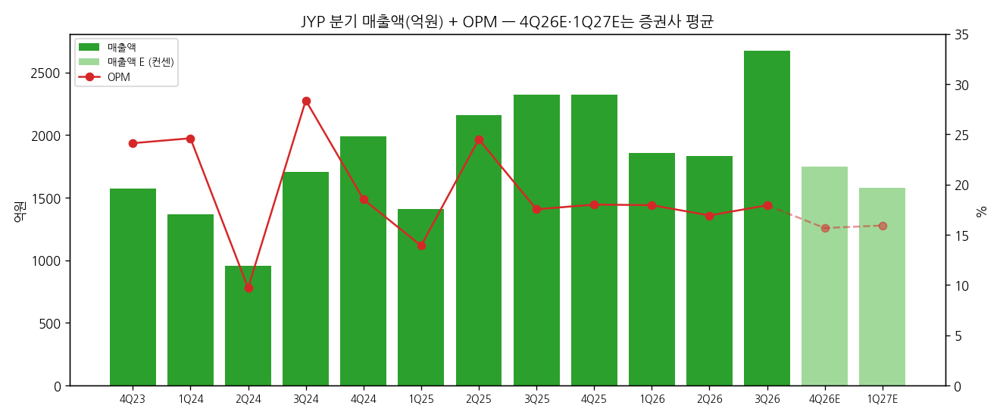
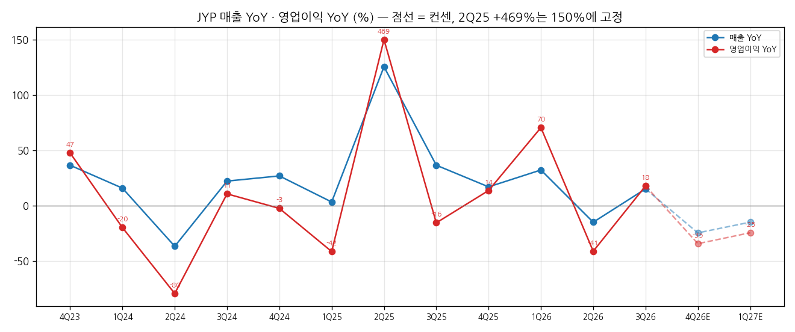
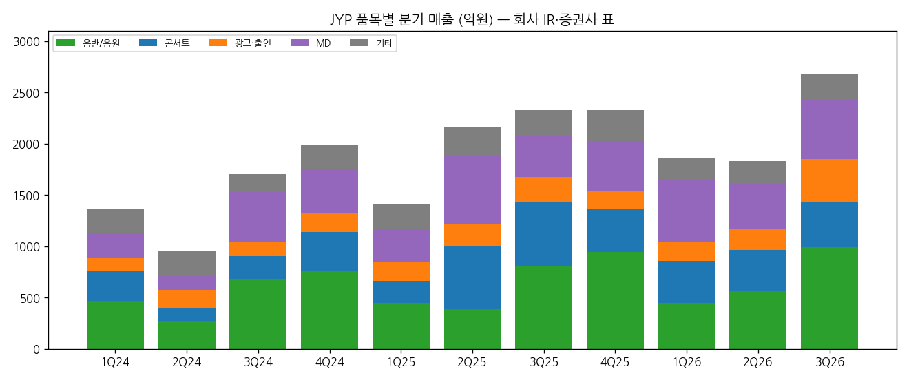

> 모드: 실적 리뷰 (v11)
> 종목: JYP Ent. (035900)
> 섹터: 엔터
> 서브섹터: 기획사
> 분기: 2026-Q3
> 발표일: 2026-11-11 (IR 잠정실적) / 분기보고서 2026-11-13 제출 (확정 — 매출 2,674.5억·영업이익 479.8억, OpenDART)
> 작성 시각: 2026-11-22 23:55 KST
> 분석 소스: JYP 2026년 3분기 실적발표 IR(2026-11-11) + OpenDART 분기 재무(company-data MCP `dart_financials`, 3Q26 분기보고서 접수 20261113001566) + 셀사이드 10건 — KB(11/12, 리뷰·요약 2건)·하나(11/12)·상상인(11/12)·삼성(11/12)·다올(11/12)·리딩(11/16)·교보(11/17) + 실적 전 외국계 HSBC(10/21, 섹터)·J.P. Morgan(11/01, 섹터) / 같은 폴더 `company-overview/JYP_기업개요.md` 시계열 재사용. 웹서치 보완 없음
> 리뷰 깊이: 풀 | 리서치 첨부 11건 (IR 1 + 증권사 10, KB 2건 포함)
> 비영업 요인: 저기저·고기저 왕복(2Q25 영업이익 +469% 고기저 → 2Q26 −41%, 3Q26 반등 일부는 기저 정상화) · 이벤트성 매출(3Q26 출연 매출 264억 — 스트레이키즈 자체 남미 페스티벌 STRAYCITY·Rock in Rio) · 영업외(3Q26 외화환산손실 등 영업외 −101억 → 순이익 −10.6%, 영업이익 판정과 무관) · 분류 변경(유튜브 매출 기타 → 음원 재분류, 음원 +48%에 일부 반영)

# JYP Ent. 3Q26 실적 리뷰

## 0. 한 줄 판정

> 성장 델타: 가속 | 내러티브: 약화 → 정점 경계 구간 (분기 최대 매출·영업이익 +17.6%로 반등했지만 4Q26 컨센이 바로 −35% YoY로 꺾이고, 스트레이키즈 군입대·TWICE 일부 멤버 이탈로 외국계 2곳이 실적 발표 전후 Hold·UW로 하향 — 다음 성장축은 아직 숫자가 없는 저연차 IP)

> ⚠ 비영업 요인 플래그: 2Q26 영업이익 YoY −41.4%는 2Q25 고기저(+469%, 2Q24 93억 저기저의 반동) 효과 — 3Q26 +17.6%의 직전 비교 대상이 비정상적으로 낮았다. 3Q26 이익 서프라이즈의 한 축인 출연 매출 264억(+138%)은 STRAYCITY 남미 5회·Rock in Rio 헤드라이너라는 이벤트성 매출. 순이익 243억(−10.6%)은 외화환산손실(영업외, 하나 116억) 때문으로 영업이익 판정과 무관

→ 숫자: 매출액 2,675억 (+15.0% YoY, +46.0% QoQ, 분기 최대), 영업이익 480억 (+17.6% YoY, OPM 17.9%). 매출 YoY −15.2%(2Q26) → **+15.0%**, 영업이익 YoY −41.4% → **+17.6%**
→ 컨센 대비: 매출 +14.7%, 영업이익 +14.0% (FnGuide 컨센 매출 2,332억·영업이익 421억, 다올·KB·상상인 인용) — 서프라이즈의 원천은 스트레이키즈 **서구권 음반(높은 판매단가)·MD(+46.7%)·출연(+138%)**
→ 쟁점 ①: **스트레이키즈 의존과 군입대** — 2027년 투어 46회·약 220만 명이 2027년 실적을 받치지만, 리노 1Q27 입대 시작으로 2028년 이후가 시험대
→ 쟁점 ②: **TWICE 일부 멤버 이탈** — 개별 활동을 외부 소속사에서(HSBC·JPM), 완전체 활동 재개는 빨라야 2027년 말\~2028년(HSBC)
→ 다음 분기 관건: 4Q26 영업이익 컨센 평균 274억(7사 228\~333억, YoY −35%) — 대형 공연 공백 분기라 델타 '꺾임' 판정이 유력. 2027년 1월 11일 신인 보이그룹 oftheblue 데뷔 초동이 리레이팅의 첫 확인점

## 1. 숫자

① 연결 분기 표 (억원, K-IFRS 영업이익. 3Q26은 분기보고서 확정, 4Q26E는 국내 증권사 7곳 평균, 1Q27E는 분기 추정을 낸 다올·리딩 2곳 평균)

| 항목 (억원) | 4Q23 | 1Q24 | 2Q24 | 3Q24 | 4Q24 | 1Q25 | 2Q25 | 3Q25 | 4Q25 | 1Q26 | 2Q26 | **3Q26** | 4Q26E (7사 평균) | 1Q27E (2사 평균) |
|---|---|---|---|---|---|---|---|---|---|---|---|---|---|---|
| 매출액 | 1,571 | 1,365 | 957 | 1,705 | 1,991 | 1,408 | 2,158 | 2,326 | 2,326 | 1,860 | 1,831 | 2,675 | 1,750 | 1,578 |
| 영업이익 | 379 | 336 | 93 | 484 | 369 | 196 | 529 | 408 | 419 | 334 | 310 | 480 | 274 | 252 |
| OPM | 24.1% | 24.6% | 9.7% | 28.4% | 18.5% | 13.9% | 24.5% | 17.5% | 18.0% | 18.0% | 16.9% | 17.9% | 15.7% | 15.9% |
| 매출 YoY | +36.4% | +15.7% | -36.9% | +22.0% | +26.7% | +3.2% | +125.5% | +36.4% | +16.8% | +32.1% | -15.2% | +15.0% | -24.8% | -15.1% |
| 영업이익 YoY | +47.5% | -20.0% | -79.6% | +10.5% | -2.6% | -41.7% | +468.8% | -15.7% | +13.6% | +70.4% | -41.4% | +17.6% | -34.5% | -24.7% |
| **매출 YoY 델타** | n.m. | -20.7%p | -52.6%p | +59.0%p | +4.7%p | -23.6%p | +122.3%p | -89.1%p | -19.6%p | +15.3%p | -47.3%p | +30.2%p | -39.8%p | +9.6%p |
| **영업이익 YoY 델타** | n.m. | -67.5%p | -59.6%p | +90.2%p | -13.1%p | -39.0%p | +510.5%p | -484.5%p | +29.3%p | +56.9%p | -111.8%p | +59.0%p | -52.2%p | +9.8%p |

→ 영업이익 YoY 경로: 2Q25 +469%(저기저) → 3Q25 −15.7% → 4Q25 +13.6% → 1Q26 +70.4% → 2Q26 −41.4% → 3Q26 **+17.6%** — 1년 내내 ±40%p 안팎으로 출렁이는 투어·컴백 사이클형 이익. 3Q26 YoY 델타 +59.0%p로 판정상 가속
→ [판단] 컨센이 그리는 경로는 4Q26 −34.5%, 1Q27 −24.7%로 **YoY 정점은 3Q26**. 2027년 영업이익 컨센 약 1,500억(7사 평균, +7%)은 2Q\~3Q27 스트레이키즈 서구권 스타디움 투어에 몰려 있어, 다음 가속 구간은 2Q27 이후
→ OPM: 17.9%(+1.0%p QoQ, +0.4%p YoY). 2019\~2023년 28\~31% 구간에서 2024년부터 17\~19%로 한 단계 낮아진 수준이 유지 중 (기업 개요). GPM 35.0%(+1.8%p YoY) — 대규모 국내 공연(총매출 인식)·MD 원가 증가에도 음반 판매단가 상승이 상쇄 (IR)

→ (출처: OpenDART 분기 재무·기업 개요 시계열 4Q22\~3Q26, 3Q26 분기보고서, 4Q26E·1Q27E 증권사 평균 [계산])

→ (출처: 같은 자료로 계산. 점선 = 컨센)

② 품목별 매출 (억원, 회사 IR — 사업부별 영업이익은 분기 미공시)

| 품목 | 3Q25 | 2Q26 | **3Q26** | QoQ | YoY | 비중 |
|---|---|---|---|---|---|---|
| 음반 | 670 | 370 | 792 | +114.1% | +18.2% | 29.6% |
| 음원 | 134 | 197 | 198 | +0.5% | +48.0% | 7.4% |
| 콘서트 | 633 | 399 | 436 | +9.3% | −31.1% | 16.3% |
| 광고 | 128 | 136 | 160 | +17.6% | +25.0% | 6.0% |
| 출연 | 111 | 70 | 264 | +277.1% | +138.4% | 9.9% |
| MD | 400 | 438 | 586 | +33.8% | +46.7% | 21.9% |
| 기타 | 251 | 221 | 239 | +8.1% | −5.0% | 8.9% |
| 합계 | 2,326 | 1,831 | 2,675 | +46.0% | +15.0% | 100% |
→ (출처: JYP 3Q26 IR, 3Q25·2Q26은 KB·상상인 실적표. YoY는 IR 공시값)
→ 델타를 끈 것: **음반**(스트레이키즈 3Q 앨범 판매 409만 장 — 미니 'THIS & THAT' 328만 장, 서구권 출하 비중 확대 — 상상인·삼성), **MD**(팬미팅 온라인 MD·응원봉·SKZOO 팝업, 자회사 블루개러지 매출 563억·OPM 한 자릿수 후반 — KB), **출연**(STRAYCITY 남미 3개 지역 5회 27만 명 + Rock in Rio 10만 명 — IR). 꺾인 것: **콘서트**(−31%, 공연 36회·관객 약 67만 명 — 하나)
→ 지역: 국내 1,311억(+29.5%, 역대 최대 — 총매출로 인식되는 대규모 국내 공연 포함), 기타 지역 760억(−3.4%, 전년 고기저에도 서구권 음반·남미 페스티벌로 유지) (IR)

→ (출처: 1Q24\~3Q26 회사 IR·삼성·KB 실적표. 광고·출연은 합산)

③ 연간 (억원)

| 항목 | 2022 | 2023 | 2024 | 2025 | 2026E (7사 평균) | 2027E (7사 평균) |
|---|---|---|---|---|---|---|
| 매출액 | 3,459 | 5,665 | 6,018 | 8,219 | 8,115 | 8,318 |
| 영업이익 | 967 | 1,694 | 1,283 | 1,552 | 1,398 | 1,497 |
| OPM | 28.0% | 29.9% | 21.3% | 18.9% | 17.2% | 18.0% |
| 매출 YoY | — | +63.8% | +6.2% | +36.6% | −1.3% | +2.5% |
| 영업이익 YoY | — | +75.2% | −24.3% | +21.0% | −9.9% | +7.1% |
→ (출처: OpenDART·기업 개요, 컨센은 KB·하나·상상인·삼성·다올·리딩·교보 평균 [계산]. 외국계 실적 전 추정은 HSBC 2026E 1,350억·2027E 1,600억, JPM 2027E 1,330억)
→ 발표 전 → 후 연간 컨센: 하나 리포트의 컨센(발표 전 FnGuide) 2026E 1,400억·2027E 1,498억 → 발표 후 7사 평균 1,398억·1,497억으로 **사실상 변화 없음**. 3Q 서프라이즈(+59억)만큼 2026E가 오르지 않은 건 4Q26E가 함께 내려갔기 때문 (예: 다올 4Q26E 267 → 299억 상향, 1Q27E 227 → 203억 하향)

## 2. 시장 쟁점

① 지난 분기 체크
→ 첫 리뷰 — 직전 체크 없음

② 이번 분기 쟁점 (리포트 10건 기준)

(1) **스트레이키즈 서구권 레버리지 vs 군입대** — 10건 전부 언급. 2027년 투어가 군백기 우려를 덮을 수 있나
(2) **TWICE 일부 멤버 이탈과 완전체 활동 가시성** — 7건. 두 번째 메가 IP의 이익 기반이 줄어드나
(3) **저연차 IP(oftheblue·NMIXX·킥플립·NEXZ)가 다음 성장축이 될 수 있나** — 10건
(4) **4Q26 공백과 2027년 실적 경로** — 7건. 2027E 영업이익 1,330억(JPM)\~1,616억(다올)
(5) **3Q 서프라이즈의 질** — 6건. 출연·MD 이벤트 매출과 영업외 손실

③ 쟁점별 분해

(1) **스트레이키즈 서구권 레버리지 vs 군입대**

(1-1) 회사 설명: 2027년 서구권 스타디움 1차 발표 — 2Q27 북미 14개 도시(직전 투어 대비 +4개), 3Q27 유럽 7개 도시(+1개), 회차당 4만 명 이상 모객 계획, 2Q27 일본 스타디움 추가. 주요 도시 투어 연계 팝업으로 MD 고도화 지속. 8월 미니 앨범으로 '빌보드 200' 9연속 1위 (IR)

(1-2) 증권사별 해석 편차

| 증권사 | 핵심 가정·추정 | 논리 |
|---|---|---|
| 하나 | 2027년 투어 총 46회·약 220만 명, 2027E 영업이익 1,468억 | 7월까지 일정 + 추가 공연 감안 시 2027년 영업이익 1,500억 내외 재반등. 리노 1분기 입대 결정 |
| 리딩 | 2027F 콘서트 3,200억 (2026F 2,662억) | 대형 투어가 군백기 우려를 완충, 공개 투어 일정 유지로 단기 공백 우려 낮아짐 |
| 상상인 | 2027E 콘서트 2,500억 (2026E 1,530억) | 북미 14·유럽 7개 도시 추가 — 남미가 페스티벌로 대체된 점·회차 추가 가능성 감안 시 직전 투어와 유사 규모 |
| KB | 2027E 영업이익 −7.7% 하향 | 최근 성과는 예상 상회지만 2027년 콘서트 규모는 예상 하회. 리노 1Q27 입대로 Peak-out 우려 |
| HSBC (실적 전) | 2028년 동시 입대 시나리오 | 순차 입대가 아니라 BTS식 동시 입대면 2028년 스트레이키즈 기여 급감, 하이브보다 IP 분산이 약해 충격이 더 크다 |
| JPM (실적 전) | 입대 사이클 2027년 말 시작 (기존 2028년) | 마지막 월드투어가 2027년까지 버텨 주지만 '2028E가 진짜 시험대' — 2028E 영업이익 −17% YoY |

(1-3) 공통 결론 vs 갈리는 지점: 2027년 상반기\~3분기까지는 스트레이키즈 투어가 실적을 받친다는 데 전원 동의. 갈리는 변수는 **2027년 투어 체급**(KB는 예상 하회, 상상인·리딩은 확대)과 **2028년 입대 방식**(순차 vs 동시)
(1-4) [판단] 3Q26 숫자는 스트레이키즈 코어 팬덤이 오히려 커지고 있다는 쪽(음반 409만 장, MD +47%)을 지지한다. 결론을 바꿀 변수는 2027년 공연 회차의 실제 확정(46회 → 추가)과 다음 입대 멤버 공지 — 후자가 나오기 전까지 2028년 이익은 셀사이드마다 ±20% 폭으로 갈릴 수밖에 없다

(2) **TWICE 일부 멤버 이탈과 완전체 활동 가시성**

(2-1) 회사 설명: 10월 투어 피날레 라이브 바이닐, 11월 나연 솔로 싱글, 데뷔 11주년 팬파티·신규 캐릭터 '트둥즈' 팝업 (IR). 계약 관련 언급은 IR에 없음

(2-2) 증권사별 해석 편차

| 증권사 | 핵심 가정·추정 | 논리 |
|---|---|---|
| 하나 | 3명 재계약 무산, 2\~3년에 1번 완전체 가정 | 2026년 전체 투어의 약 40%(81회)를 진행한 TWICE의 성장 모멘텀 제한 |
| 삼성 | 일부 멤버 개별 계약 종료, 그룹 활동 지속 | 단기적으로 개별 활동에 무게 → 2027년 완전체 가시성 낮음 |
| 리딩 | 완전체 주기 장기화 가능성 | 그룹 활동 자체는 지속 — 할인 요인으로만 반영 |
| HSBC (실적 전, 10/21) | 9명 중 1명 외부 소속사, 8명 협상 중 | 협상이 2026년 말\~2027년 초 끝나도 앨범·공연장 준비 6\~12개월 → 완전체 재개 빨라야 2027년 말\~2028년 |
| JPM (실적 전, 11/01) | 'BLACKPINK 모델' — 개인 계약은 외부, 그룹 활동은 원소속사 | 2028E에 TWICE 복귀를 가정하되 활동 강도·JYP 몫이 이전보다 약할 것, 2028E 매출 가정 약 −50% |

(2-3) 공통 결론 vs 갈리는 지점: "그룹은 유지되지만 완전체 활동 빈도·강도는 줄어든다"에 공통. 갈리는 지점은 **이탈 규모**(1명 vs 3명 — 시점 차이로 보이며 최신 리포트인 하나 11/12가 3명)와 **JYP 수익 배분 축소 폭**
(2-4) [판단] 2026년 공연의 약 40%가 TWICE였다는 점(하나)을 감안하면, 2027년은 스트레이키즈 단독 체제(JPM "2026 둘 다, 2027 스트레이키즈만, 2028 TWICE만")가 숫자와 맞다. 회사가 재계약 결과를 공식화하는 시점이 멀티플 하단을 정하는 이벤트

(3) **저연차 IP가 다음 성장축이 될 수 있나**

(3-1) 회사 설명: 본사 SQU4D 산하 4인조 보이그룹 oftheblue 2027년 1월 11일 정식 데뷔(11/11 선공개 음원, 11/12 팝업). NMIXX 11월 일본 데뷔(워너 재팬 협업), 킥플립 매 앨범 자체 최고 기록·2027년 첫 투어, NEXZ 미니 초동 43만 장·남미 첫 진출 (IR)

(3-2) 증권사별 해석 편차

| 증권사 | 핵심 가정 | 논리 |
|---|---|---|
| KB | 저연차 팬덤이 천천히 커지는 JYP 패턴 | 엔믹스·킥플립 팬덤 상승 + oftheblue — 현 P/E 13배에서 저연차 확대 시 가파른 주가 상승 |
| 리딩 | oftheblue가 리레이팅의 열쇠 | 초기 판매·스트리밍·공연 지표 확인 시 멀티플 재평가 계기 |
| 교보 | 신인 성장 가시성 = 할인 요인 해소 | 그동안 밸류에이션 할인 요인 중 하나가 신인 성장 우려 — 가시성 확보 시 리레이팅 가능 |
| 다올 | 1H27 4사 신인 보이그룹 데뷔 집중 | 성수기 경쟁이 오히려 K-POP 팬덤 유입 확대에 긍정적, oftheblue 성과가 관건 |
| 하나 | 흥행 확인 시 의견 재검토 | 동세대와 경쟁 가능한 신인이 필요 — 빠르면 연내 신인 여자 그룹 데뷔도 예상 |
| JPM (실적 전) | 신인 흥행은 '히트 의존형' | JYP 저연차는 초동·Spotify 리스너에서 경쟁사 대비 열위, NMIXX는 비슷한 장르 반복으로 모멘텀 상실 — 2028E 공백을 메우기 어렵다 |

(3-3) 공통 결론 vs 갈리는 지점: 저연차 IP가 '숫자로 아직 증명되지 않았다'는 데 전원 동의. 갈리는 지점은 **JYP의 신인 육성 패턴을 믿느냐** — 국내 증권사는 "천천히 커지는 패턴"(KB), JPM은 "신인 시장 과밀로 구조적으로 어렵다"
(3-4) [판단] 숫자상 저연차 기여는 아직 작다(3Q26 앨범 판매 2위 NEXZ 45만 장 vs 스트레이키즈 409만 장 — 삼성). oftheblue 초동이 킥플립 미니(53만 장, KB)를 넘는지가 첫 확인점이고, 그 전까지는 보수 쪽(JPM) 논리가 숫자와 더 맞다

(4) **4Q26 공백과 2027년 실적 경로**

(4-1) 사실: 4Q26 스트레이키즈 투어는 아시아 6회뿐, 콘서트 모객 약 43만 명(3Q 80만 명, KB 기준 — 페스티벌 포함 추정) — KB. 스트레이키즈·TWICE 앨범 부재(하나)
(4-2) 증권사별 4Q26E 영업이익: KB 333억 > 다올 299억 > 교보 291억 > 리딩 286억 > 삼성 243억 > 상상인 240억 > 하나 228억 — 평균 274억(YoY −34.5%)
(4-3) 2027E 영업이익: 다올 1,616억 > 교보 1,515억 > 리딩 1,500억 > KB 1,480억 > 상상인 1,470억 > 하나 1,468억 > 삼성 1,428억 (국내 평균 1,497억) vs 실적 전 외국계 HSBC 1,600억·JPM 1,330억 (JPM은 Street 대비 −14%, 2028E −31%)
(4-4) [판단] 2027년 국내 추정은 1,430\~1,620억으로 좁게 모여 있고, 이견은 2028년에 있다. 분기로는 4Q26·1Q27 두 분기 연속 YoY 마이너스가 컨센에 들어 있어 델타는 다음 분기 '꺾임'이 기본 시나리오

(5) **3Q 서프라이즈의 질**

(5-1) 사실: 출연 264억(+138%)은 스트레이키즈 첫 자체 브랜드 페스티벌 STRAYCITY와 Rock in Rio 헤드라이너가 반영된 이벤트성 매출(상상인·삼성). 음원 +48%에는 유튜브 매출 재분류 효과 포함(IR). 영업외 −101억(외화환산손실 116억 등, 하나)으로 순이익 243억은 컨센 하회(삼성 −21.5%)
(5-2) [판단] 이벤트 매출(출연 증가분 약 150억)을 빼도 영업이익은 컨센 수준을 넘었을 것으로 보이며 [추정], 음반 판매단가·MD는 반복 가능한 부분. 순이익 미스는 영업과 무관

④ 낙관 vs 보수

→ 가장 낙관: **교보**(TP 62,000원, 2027E 1,515억) — 기존 메가 IP의 꾸준한 성장에 신인 IP 가시성이 더해지면 리레이팅. **다올**(55,000원, 2027E 1,616억 — 가장 높은 이익 추정) — 스트레이키즈의 지속적 기대치 상회
→ 가장 보수: **J.P. Morgan**(30,000원, UW, 실적 전) — 메가 IP 사이클 이후 이익 리셋, 목표 P/E 11배. **HSBC**(42,000원, Hold, 실적 전) — TWICE·스트레이키즈·저연차 세 가지 불확실성. 국내에서는 **삼성**(50,000원, 2027E 1,428억 — 가장 낮음)
→ 다르게 가정한 것: 2028년 스트레이키즈 입대 방식·TWICE 완전체 복귀 시점 + 적용 멀티플(국내 P/E 16\~17배 vs JPM 11배)
→ 셀사이드 vs 시장: 실적 발표 후 주가 38,700원(11/11) → 43,500원(11/13, +12.4%) → 44,000원(11/16) 반등 — 외국계 하향에도 시장은 3Q 서프라이즈에 반응. 10/26 NEXROC 그룹의 JYP 지분 25\~50% 인수 검토 보도(JPM 인용)로 M&A 기대도 주가에 섞여 있다 (최대주주 지분 약 15.4%로 경쟁사 대비 낮음)

⑤ 추정치·TP 변화

| 증권사 | 직전 TP | 현재 TP | 4Q26E 영업이익 | 2026E / 2027E 영업이익 | 핵심 변화 한 줄 |
|---|---|---|---|---|---|
| 교보 (11/17) | 미기재 | **62,000 ↓** | 291 | 1,414 / 1,515 | Target P/E 조정으로 하향, 신인 가시성 시 리레이팅 |
| 하나 (11/12) | 49,000 [계산] | **55,000 ↑** | 228 | 1,351 / 1,468 | 2027E EPS 상향, 목표 P/E 17배 (+12%) |
| 다올 (11/12) | 55,000 | 55,000 | 299 | 1,423 / 1,616 | 4Q26E +12% 상향, 1Q27E −11% 하향 |
| 리딩 (11/16) | 100,000 (2024-11) | 55,000 ↓ | 286 | 1,410 / 1,500 | 2027F 지배순이익 1,137억 × P/E 17.2배 |
| 상상인 (11/12) | 52,000 | 52,000 | 240 | 1,360 / 1,470 | 12M fwd EPS 3,201원 × P/E 16.4배 유지 |
| KB (11/12) | 50,000 | 50,000 | 333 | 1,460 / 1,480 | 2026E +4.8%, 2027E −7.7% (콘서트 규모 하회) |
| 삼성 (11/12) | 50,000 | 50,000 | 243 | 1,366 / 1,428 | 2026E EPS −6.0%, 2027E +0.8% |
| HSBC (10/21, 실적 전) | 60,000 | 42,000 ↓ (Buy → Hold) | 346 [계산] | 1,350 / 1,600 | 2026\~28E 영업이익 −17%/−22%/−34% |
| J.P. Morgan (11/01, 실적 전) | 68,000 | 30,000 ↓ (OW → UW) | — | — / 1,330 | 2027/28E 영업이익 −33%/−40%, 목표 P/E 16 → 11배 |
→ (출처: 각 리포트. [계산]: 하나 직전 TP는 "+12% 상향"에서 역산, HSBC 4Q26E = 2026E − 1\~2Q26 실적 − HSBC 3Q26E 360억)
→ 국내 7사 현재 TP 평균 **54,100원**, 외국계 포함 9사 평균 50,100원. 직전 TP가 확인되는 국내 5사(KB·하나·상상인·삼성·다올) 평균 51,200원 → 52,400원(+2.3%). 상향 1·유지 4·하향 4(리딩·교보·HSBC·JPM) [계산]. 삼성 인용 FnGuide 컨센 TP 56,059원(17사)
→ TP 하향의 원인: 국내 하향(리딩·교보)은 **멀티플 조정**(2027E 영업이익은 1,500억대로 유지), 외국계 하향은 **실적 하향 + 멀티플 하향** 동시(JPM 2027E −33%·P/E 11배, HSBC 2027E −22%)

## 3. 내러티브 점검

→ 성장 스토리: **스트레이키즈·TWICE 두 메가 IP의 서구권·일본 팬덤 확장이 음반 판매단가·MD·투어로 레버리지를 만드는 기획사** — 2023\~2025년 JYP를 사는 이유
→ 이번 분기: 스트레이키즈 레버리지는 숫자로 다시 확인됐다(음반·MD·출연 사상 최대). 그러나 스토리의 두 기둥 중 TWICE는 일부 멤버 이탈로 약해졌고, 스트레이키즈는 군입대가 시작된다. 이를 메울 저연차 IP는 아직 숫자가 없다 → **델타 가속(3Q 단일 분기) + 내러티브 약화 → 정점 경계 구간**. 4Q26·1Q27 컨센 YoY가 모두 마이너스라 '가속'은 한 분기짜리일 가능성이 높다
→ 다시 강하게 만들 트리거: oftheblue 초동·스트리밍 흥행(2027-01) / TWICE 완전체 재계약·활동 일정 공식화 / 스트레이키즈 2027년 공연 회차 추가·입대 순차 진행 확인 / M&A(넥스로크 등) 구체화
→ 깨뜨릴 리스크: TWICE 추가 이탈 / 스트레이키즈 동시 입대 결정 / 저연차 IP 초동 부진으로 2028E 공백 확대

## 4. 향후 봐야 할 것

① **4Q26 영업이익 274억(컨센 평균, YoY −35%) 달성 여부와 델타 꺾임** — 330억 이상(KB 수준)이면 꺾임 폭 축소 / 4Q26 잠정실적 / 2027년 2월
② **TWICE 재계약 결과·완전체 일정** — 이탈 멤버 수(1명 vs 3명) 공식 확인, 2027년 그룹 활동 계획 / 회사 공시·IR·보도 / 2026년 말\~1Q27
③ **oftheblue 데뷔 초동** — 킥플립 미니 53만 장·NEXZ 43만 장 대비, 스트리밍 순위 / 써클차트·한터·Spotify / 2027년 1월 11일 이후
④ **스트레이키즈 2027년 투어 확정 규모와 입대 순서** — 46회·220만 명 → 추가 회차, 리노 이후 멤버 입대 공지 / 투어 공지·예매 / 1H27
⑤ **1Q27 영업이익 YoY** — 1Q26 334억 대비 (다올 203억·리딩 300억 추정) — 2Q27 서구권 스타디움 투어 전 바닥 확인 / 1Q27 잠정실적 / 2027년 5월
