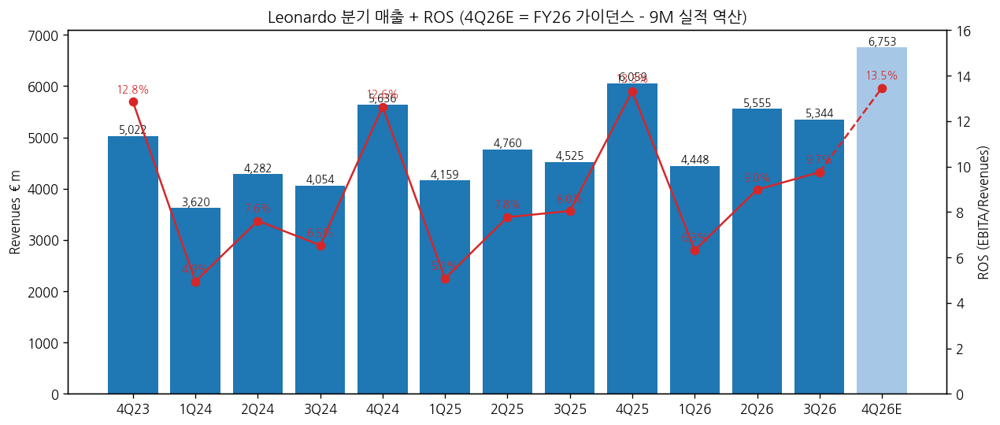
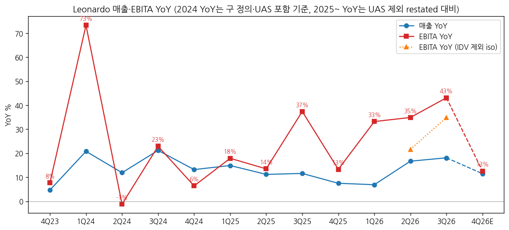
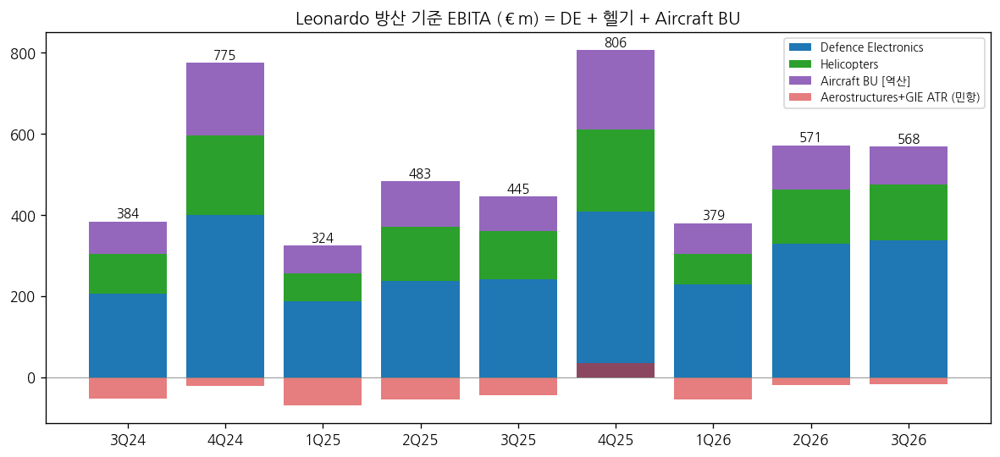

> 모드: 실적 리뷰 (v11)
> 종목: Leonardo (LDO)
> 섹터: 방산
> 서브섹터: 방산 글로벌
> 분기: 2026-Q3
> 발표일: 2026-11-05 (이사회 11-04, 보도자료 11-05 장 전·컨콜 당일 오후)
> 작성 시각: 2026-11-14 18:30 KST
> 분석 소스: 회사 9M2026 보도자료(2026-11-05, 3Q 단독 섹터 표 포함) + 1Q·1H 2026, 1Q·1H·9M·FY 2025 보도자료 + LDO 기업개요 v1.0. 셀사이드 리포트 첨부 없음 — 웹 기사 보완: Il Sole 24 Ore(11/5, Equita·Akros·Intermonte 코멘트·컨센), Börsen-Zeitung(11/5), Finimize(BofA), MF Milano Finanza(11/5 발표 전, Jefferies·Equita), Quartr 컨콜 요약(AI 요약 ⚠️). 컨콜 트랜스크립트 원문 미확보
> 다음 발표: **FY2026 + Industrial Plan 2027~2031 — 2027-03-03 이사회, 3-04 장 전 발표** (회사 2027 재무 캘린더)

# Leonardo 3Q26 실적 리뷰

## 0. 한 줄 판정

> 성장 델타: 가속 | 내러티브: 유지 → 숫자는 적극 구간이나 주가는 확인 대기 (4Q 가이던스 보수성·섹터 수급 약세)

→ 숫자: 3Q26 매출 €5,344m(+18.1% YoY), EBITA €521m(+43.1%), ROS 9.7%(+1.7%p). EBITA YoY가 1Q 33.2% → 2Q 34.9% → **3Q 43.1%**로 3분기 연속 확대. IDV 제외 동일범위로도 2Q 21.6% → 3Q 34.9% 가속 [계산]
→ 방산 기준(DE + 헬기 + Aircraft BU) 3Q EBITA €568m(+27.6%), 매출 €4,826m(+19.0%) — 그룹 가속과 같은 방향
→ 컨센 대비: 매출 +2.4%, EBITA +8.1%, 순이익 +24% (Il Sole 24 Ore 인용 컨센 €5.22bn·€482m·€271m). 그럼에도 수주 가이던스만 €28.2bn → €29.5bn 올리고 매출·EBITA는 유지 → 4Q 암묵 EBITA +12.6%로 급감속
→ 주가: 11/4 €51.12 → 11/5 €49.36(-3.5%) → 11/6 €48.07(-2.6%) [Yahoo]. "보수적 가이던스" + Rheinmetall 실적 경고 동반 약세
→ 다음 관건: 4Q 실제 EBITA가 암묵치 €909m를 넘는지(FY €2.21bn 상회), 2027-03 Industrial Plan의 2027~2031 EBITA 경로

## 1. 숫자

① 그룹 분기 표 (€m, EBITA = 회사 주 지표)

| 항목 | 4Q23 | 1Q24 | 2Q24 | 3Q24 | 4Q24 | 1Q25 | 2Q25 | 3Q25 | 4Q25 | 1Q26 | 2Q26 | **3Q26** | 4Q26E |
|---|---|---|---|---|---|---|---|---|---|---|---|---|---|
| 신규수주 | — | 5,710 | 4,542 | 4,397 | 6,129 | 6,886 | 4,357 | 6,965 | 5,574 | 9,002 | 7,257 | **7,011** | ~6,230 |
| 매출 | 5,022 | 3,620 | 4,282 | 4,054 | 5,636 | 4,159 | 4,760 | 4,525 | 6,059 | 4,448 | 5,555 | **5,344** | 6,753 |
| EBITA | 645 | 179 | 326 | 265 | 712 | 211 | 370 | 364 | 807 | 281 | 499 | **521** | 909 |
| ROS | 12.8% | 4.9% | 7.6% | 6.5% | 12.6% | 5.1% | 7.8% | 8.0% | 13.3% | 6.3% | 9.0% | **9.7%** | 13.5% |
| 매출 YoY | 4.7% | 20.8% | 11.9% | 21.2% | 13.2% | 14.9% | 11.2% | 11.6% | 7.5% | 6.9% | 16.7% | **18.1%** | 11.5% |
| EBITA YoY | 7.7% | 73.3% | -1.2% | 22.9% | 6.4% | 17.9% | 13.5% | 37.4% | 13.3% | 33.2% | 34.9% | **43.1%** | 12.6% |
| **매출 YoY 델타 (%p)** | — | +16.1 | -8.8 | +9.3 | -8.0 | +1.6 | -3.7 | +0.5 | -4.1 | -0.6 | +9.8 | **+1.4** | -6.6 |
| **EBITA YoY 델타 (%p)** | — | +65.7 | -74.6 | +24.1 | -16.5 | +11.5 | -4.4 | +23.9 | -24.0 | +19.8 | +1.7 | **+8.3** | -30.5 |

→ (출처: 각 분기 보도자료의 분기 단독 표. 4Q23 = FY2023 보도자료 4Q 단독(구 EBITA 정의). 2024 분기값은 2025 보도자료의 UAS 제외 restated 비교치, 단 2024 YoY는 2024 당시 공시 기준(구 정의·UAS 포함: 매출 3,664/4,321/4,091/5,687, EBITA 182/321/263/686) vs 2023. 2025 YoY는 UAS 제외 restated 대비 = 회사 공시 증가율과 일치. **4Q26E = FY2026 가이던스(매출 €22.1bn, EBITA €2.21bn, 수주 €29.5bn) − 9M 실적 [역산]**, 셀사이드 컨센 미확보)
→ 컨센 대비: 매출 +2.4%, EBITA +8.1%, 순이익 +24.0% (Il Sole 24 Ore 11/5가 인용한 3Q 컨센 매출 €5.22bn, 이익 €482m(기사 표기 "EBITDA" — EBITA로 해석), 순이익 €271m [계산])
→ IDV 효과 분리: 3Q26 IDV 기여 매출 약 €332m·EBITA 약 €30m [계산: 9M 연결 − 9M 동일범위 − 1H 차이]. **동일범위 3Q 매출 +10.8%, EBITA +34.9%** (2Q 동일범위 +9.2%, +21.6%) — 가속의 본체는 인수가 아니라 기존 사업 마진
→ YoY 정점: EBITA YoY는 3Q26(+43%)이 2024 이후 최고. 회사 가이던스 경로상 4Q26E +12.6%로 꺾이고, FY 기준 2026 +26% → 2027은 Industrial Plan 발표 전이라 경로 미확인. **가이던스대로면 정점은 3Q26** `[전망]` — 다만 Jefferies·BofA 모두 상단 초과 가능성을 제시해 실제 4Q는 이보다 높을 공산 `[판단]`

→ (출처: Leonardo 분기 보도자료, 4Q26E는 FY26 가이던스 역산)

→ (출처: Leonardo 분기 보도자료, 동일범위는 9M·1H 동일범위 KPI 표 차감 [계산])

② 섹터별 매출·EBITA (€m)

| 섹터 | 항목 | 3Q25 | 4Q25 | 1Q26 | 2Q26 | **3Q26** | QoQ | YoY |
|---|---|---|---|---|---|---|---|---|
| Defence Electronics | 매출 | 2,022 | 2,533 | 1,965 | 2,547 | **2,637** | +3.5% | +30.4% |
| | EBITA | 242 | 408 | 228 | 329 | **338** | +2.7% | +39.7% |
| | ROS | 12.0% | 16.1% | 11.6% | 12.9% | **12.8%** | -0.1%p | +0.8%p |
| Helicopters | 매출 | 1,306 | 1,738 | 1,307 | 1,597 | **1,413** | -11.5% | +8.2% |
| | EBITA | 118 | 203 | 76 | 134 | **137** | +2.2% | +16.1% |
| | ROS | 9.0% | 11.7% | 5.8% | 8.4% | **9.7%** | +1.3%p | +0.7%p |
| Aeronautics | 매출 | 886 | 1,439 | 966 | 1,038 | **998** | -3.9% | +12.6% |
| | EBITA | 41 | 230 | 20 | 88 | **76** | -13.6% | +85.4% |
| | ROS | 4.6% | 16.0% | 2.1% | 8.5% | **7.6%** | -0.9%p | +3.0%p |
| Cyber & Security | 매출 | 173 | 266 | 201 | 219 | **203** | -7.3% | +17.3% |
| | EBITA | 12 | 39 | 15 | 24 | **17** | | +41.7% |
| Space | 매출 | 266 | 305 | 227 | 272 | **278** | +2.2% | +4.5% |
| | EBITA | 13 | 29 | 8 | 10 | **20** | | +53.8% |
| 기타·내부거래 | EBITA | (62) | (102) | (66) | (86) | **(67)** | | |
| **그룹** | EBITA | 364 | 807 | 281 | 499 | **521** | +4.4% | +43.1% |

→ (출처: 9M2026 보도자료 3Q 단독 섹터 표 p.17, 1H2026 2Q 단독 표, 1Q2026·FY2025 보도자료. 1Q25~4Q25는 2026 보도자료의 restated 비교치)

(2-1) 방산 기준 합계 — 섹터 리뷰용

| 항목 (€m) | 3Q24 | 4Q24 | 1Q25 | 2Q25 | 3Q25 | 4Q25 | 1Q26 | 2Q26 | **3Q26** |
|---|---|---|---|---|---|---|---|---|---|
| Aircraft BU 매출 [역산] | 660 | 1,143 | 711 | 905 | 729 | 1,244 | 773 | 824 | **776** |
| Aircraft BU EBITA [역산] | 79 | 180 | 67 | 113 | 85 | 195 | 75 | 108 | **93** |
| **방산 기준 매출** | 3,651 | 5,182 | 3,813 | 4,387 | 4,057 | 5,515 | 4,045 | 4,968 | **4,826** |
| **방산 기준 EBITA** | 384 | 775 | 324 | 483 | 445 | 806 | 379 | 571 | **568** |
| ROS | 10.5% | 15.0% | 8.5% | 11.0% | 11.0% | 14.6% | 9.4% | 11.5% | **11.8%** |
| 매출 YoY | | | | | 11.1% | 6.4% | 6.1% | 13.2% | **19.0%** |
| EBITA YoY | | | | | 15.9% | 4.0% | 17.0% | 18.2% | **27.6%** |

→ **섹터 합산에 쓸 방산 기준 = Defence Electronics(유럽 전자 + DRS + IDV) + Helicopters + Aeronautics 중 Aircraft BU.** 제외: Aerostructures·GIE ATR(민항), Cyber & Security, Space, 기타. 헬기 민수(수주 기준 약 28%)는 분리 공시가 없어 포함. 3Q26 방산 기준이 그룹 매출의 90%, 그룹 EBITA의 109%(민항·기타 적자 상쇄) [계산]
→ (출처: Aircraft BU = 각 분기 보도자료 Aeronautics BU 누계표(1Q·1H·9M·FY) 차감 [역산]. 2024 Aircraft는 2025 보도자료의 GCAP 편입 restated 값)
→ 델타를 끄는 건 **Defence Electronics**(+€96m YoY, 그룹 증가분 €157m의 61%)와 **Aeronautics**(+€35m). 헬기는 +16%로 무난, 섹터 중 꺾이는 곳은 없다

(2-2) Defence Electronics 분해 (€m)

| | 3Q25 | **3Q26** | YoY |
|---|---|---|---|
| Electronics Europe 매출 (IDV 포함) | 1,205 | **1,719** | +42.7% |
| Electronics Europe EBITA | 156 | **228** | +46.2% |
| └ IDV 제외 매출 / EBITA [추정] | 1,205 / 156 | 1,387 / 198 | +15.1% / +26.9% |
| Leonardo DRS 매출 ($m) | 960 | **1,067** | +11.1% |
| Leonardo DRS EBITA ($m) | 100 | **127** | +27.0% |

→ (출처: 9M·1H 섹터 내 KPI 표 차감 [역산]. IDV 3Q 기여 약 €332m/€30m는 전량 Electronics Europe 귀속 가정 `[추정]`. DRS USD는 회사 DRS 표 차감 — MF가 인용한 DRS 3Q 매출 $1.066bn과 일치)
→ 유럽 전자 동일범위 9M 매출 +14.9%(회사), 9M 수주 Book-to-bill 약 1.7배. DRS는 USD 약세(9M 평균 €/$ 1.16 vs 1.12)로 유로 환산 기여가 깎였다

(2-3) 수주·잔고

| | 3Q25 | 4Q25 | 1Q26 | 2Q26 | **3Q26** |
|---|---|---|---|---|---|
| 신규수주 (분기) | 6,965 | 5,574 | 9,002 | 7,257 | **7,011** |
| 수주잔고 (기말) | 47,261 | 46,624 | 56,805 | 58,581 | **60,372** |
| 분기 Book-to-bill | 1.54 | 0.92 | 2.02 | 1.31 | **1.31** |

→ (출처: 분기 보도자료. 2Q26 잔고는 1H 섹터 잔고 합 [계산]. 1Q26 잔고 급증은 IDV 약 €6bn 편입)
→ 3Q 섹터 수주: Defence Electronics €4,053m(3Q25 €2,305m), 헬기 €1,705m(€1,485m), Aeronautics €1,011m(€2,805m — 전년 쿠웨이트 유로파이터 지원 대형 수주 기저) [9M2026 p.17]
→ 9M 주요 수주: 영국 NMH AW149 23대, 이중용도 헬기 131대, SAMP-T NG용 Kronos 레이더, BMD+ 레이더, 그리펜용 RAVEN AESA 수출, 쿠웨이트 함정 전투체계(ADSB 경유), 브라질 Centauro 8x8, 루마니아 전술트럭 860대(IDV), 스페인 SUPERAV 34대, M-346(오스트리아·이탈리아 PAN), 한국 KDDX 통합전력추진(DRS)

③ 연간 (€m)

| 항목 | 2023 | 2024 | 2025 | 2026G | 2027E |
|---|---|---|---|---|---|
| 신규수주 | 17,926 | 20,945 | 23,782 | ~29,500 | — |
| 매출 | 15,291 | 17,763 | 19,503 | ~22,100 | — |
| EBITA | 1,317 | 1,525 | 1,752 | ~2,210 | — |
| ROS | 8.6% | 8.6% | 9.0% | ~10.0% | — |
| 매출 YoY | 3.9% | 16.2% | 9.8% (동일범위 10.9%) | 13.3% | — |
| EBITA YoY | 8.1% | 15.8% | 14.9% (동일범위 18.2%) | 26.1% | — |

→ (출처: 연간 보도자료, 2026G = 2026-11-05 수정 가이던스(€/$ 1.18, €/£ 0.86 가정, Raft 인수 제외). 2027E 컨센 미확보 — 회사는 2027-03 Industrial Plan에서 제시)
→ 가이던스 이력: 2026-03 매출 €21bn·EBITA €2.03bn(IDV 제외) → 2026-07 IDV 포함 €22.1bn·€2.21bn(EBITA +€60m 상향) → **2026-11 수주만 +€1.3bn 상향**. BofA는 발표 후 2026~2030 매출·EBITA·EPS 추정을 소폭 하향(Finimize)

## 2. 시장 쟁점

① 2-0 지난 분기 체크

→ 첫 리뷰 — 직전 체크 없음

② 이번 분기 쟁점 4개

| # | 쟁점 | 언급 출처 |
|---|---|---|
| 1 | 가이던스 미상향 → 4Q 암묵 감속은 실제인가, 보수성인가 | Equita, BofA, Jefferies, Börsen-Zeitung, 회사 |
| 2 | 방산전자 서프라이즈의 질 — IDV·DRS·유럽 동일범위 | Akros, Jefferies, 회사 |
| 3 | 항공구조물 적자 축소와 Aeronautics 마진, Industrial Plan의 JV 재편 | Akros, BofA, 회사 |
| 4 | 수주 모멘텀 — Rheinmetall JV(LRMV) 이탈리아 발주 인식 시점과 섹터 심리 | Equita, Börsen-Zeitung, Il Sole 24 Ore |

③ 쟁점별 분해

(1) 쟁점 1 — 4Q 암묵 감속

(1-1) 회사 설명
→ 수주만 상향, 나머지 KPI는 7월 수정치 유지. Mariani CEO는 재상향을 하지 않은 이유로 시장에 대한 "진지한" 접근을 들었고, 견조한 잔고와 인도 가속이 봄에 발표할 전망의 기반이 될 것이라 언급 (Il Sole 24 Ore 11/5)
→ 4Q는 연중 최대 EBITA·현금 분기이나 예년만큼 예외적이진 않을 것 (Quartr 컨콜 요약 ⚠️)

(1-2) 해석 편차

| 출처 | 핵심 가정·추정 | 논리 |
|---|---|---|
| Equita (Il Sole 24 Ore) | 4Q 암묵 매출 +12%, EBITA +11%, FCF 약 €1.44bn | 9M +38%에서 4Q +11%로 "성장률 둔화", 4Q는 통상 연 EBITA의 45~50% |
| BofA (Finimize) | Buy 유지, PO €71. 2026~2030 추정 소폭 하향 | 4Q 컨센보다 약하나 경영진은 작은 변동에 가이던스를 안 바꾸는 성향 — 상단 초과 가능, 위험 신호 아님 |
| Jefferies (MF, 발표 전 / Börsen-Zeitung) | Buy, TP €68. EBITA 가이던스 €2.21bn 상단 초과·재상향 기대 | 발표 후 "전망이 너무 신중"하다고 평가 |

(1-3) 공통 vs 갈림
→ 공통: 9M 숫자는 컨센 상회, 가이던스는 보수적
→ 갈림: 보수성이 "숨은 쿠션"(BofA)인지, 4Q 실제 감속(Equita)인지

(1-4) `[판단]` 4Q25 ROS 13.3% 기저가 높고, 3Q까지 ROS +1.5%p 개선 흐름이 4Q에서 멈출 근거가 회사 설명에 없다. 4Q가 €909m(ROS 13.5%)를 €50m 이상 넘으면(FY €2.26bn 이상) 4Q YoY +19% 수준으로 감속 폭이 줄어 델타 "유지"로 볼 수 있다. €909m 근처면 2027년 컨센 하향 압력이 생긴다

(2) 쟁점 2 — 방산전자 서프라이즈의 질

(2-1) 회사 설명
→ 유럽 전자 동일범위 매출 +14.9%(9M), 잔고 덕분. DRS 매출 +9.2%(USD), 환율 역풍에도 EBITA 개선. MBDA·Hensoldt 지분법 기여 플러스 (9M2026 p.7)

(2-2) 해석 편차

| 출처 | 핵심 가정·추정 | 논리 |
|---|---|---|
| Akros (Il Sole 24 Ore) | 방산전자 컨센 상회 | IDV·DRS가 견인 |
| Jefferies (MF, 발표 전) | 방산전자 매출 +27% 예상 | 실제 3Q +30.4% — 예상 상회 [계산] |
| 숫자 [계산] | 3Q 유럽 전자 IDV 제외 EBITA +27%, DRS($) +27% | 인수 빼도 두 축 모두 이익 +25% 이상 |

(2-3) `[판단]` 서프라이즈는 인수 효과가 아니라 기존 사업 마진 개선이다. DE ROS 12.8%는 4Q 계절성 제외 시 사상 최고권. 다음 확인 포인트는 DRS 환산 역풍(가이던스 €/$ 1.18 가정)과 IDV 마진(9M 약 11.5% [계산])이 DE 평균을 희석하는지

(3) 쟁점 3 — 항공구조물과 Aeronautics 마진

(3-1) 회사 설명
→ Aerostructures 9M EBITA -€88m(9M25 -€135m), B787 동체 63섹션(51), ATR 동체 30대(17). ATR 인도 16대(11) — GIE ATR 손실 -€4m(-€34m). 2026 항공구조물 손실 약 €0.1bn 예상 (Quartr 요약 ⚠️)

(3-2) 해석 편차

| 출처 | 핵심 가정·추정 | 논리 |
|---|---|---|
| Akros | 항공 마진 예상 상회 | 증산 회복 |
| Jefferies (발표 전) | 항공 매출 +12%, 마진 +2.9%p | 실제 매출 +12.6%, ROS +3.0%p — 부합 |
| BofA | 2027-03 Industrial Plan의 항공구조물 JV 업데이트가 다음 촉매, 중기 EBITA 목표 한 자릿수 중반 % 상향 여지 | 구조 해결이 밸류 포인트 |

(3-3) `[판단]` 9M Aeronautics EBITA +€88m 중 ATR(+€30m)·항공구조물(+€47m)이 대부분 — 민항 회복 효과라 방산 기준 합계에는 반영되지 않는다. 섹터 리뷰 관점에선 Aircraft BU(9M ROS 11.6%, 이익 +4%)가 방산 몫이고 성장 기여는 작다

(4) 쟁점 4 — 수주 모멘텀과 섹터 심리

(4-1) 회사 설명
→ 2026 수주 가이던스 €29.5bn, 4Q 추가 진전 예상. 9M Book-to-bill 약 1.5배, 잔고 €60.4bn(생산 2.7년치)

(4-2) 해석 편차

| 출처 | 핵심 가정·추정 | 논리 |
|---|---|---|
| Equita (MF, 발표 전) | LRMV 이탈리아 €3.7bn 발주 중 Leonardo 50%를 2026에 인식 시 연 수주의 6%+ | 2027 잔고 반영 가능성이 더 높다고 봄 |
| Intermonte (MF) | 인도 경헬기 약 €1.9bn(200대, Adani 경유) 기회 = 연 수주의 약 7% | 헬기 수주 상방 |
| Börsen-Zeitung | 이탈리아군 Panther 48대 + Lynx 30대 옵션 약 €3.7bn 확정 발주(약 €23bn 패키지 일부) | 동시에 Rheinmetall 실적 경고·방산주 약세가 LDO 주가 압박 |

(4-3) `[판단]` 수주는 가이던스 상향으로 확인됐고 잔고 2.7년치라 2027 매출 가시성은 높다. 주가 약세는 실적보다 섹터 심리(Rheinmetall 경고 당일 -16%, Il Sole 24 Ore) 영향이 크다. 한국 방산의 이탈리아 지상장비 진입 여지는 LRMV 독점으로 사실상 닫혔다

④ 낙관 vs 보수

→ 낙관(BofA·Jefferies): 가이던스는 쿠션, FY 상단 초과 → 2027-03 Industrial Plan에서 중기 목표 상향. BofA PO €71(현 주가 대비 +42%)
→ 보수(Equita 해석): 4Q 성장률 +11%로 둔화, 현금흐름도 전년 수준 — 9M 가속이 연간 가속으로 이어지지 않는다
→ 바이사이드: 발표 당일 장중 상승 후 하락 마감, 이틀간 -6% — 숫자보다 "추가 상향 없음"에 반응 [Yahoo, Il Sole 24 Ore]

⑤ 추정치·TP 변화

| 출처 | 직전 TP | 현재 TP | 4Q26 EBITA E | 2026 / 2027 EBITA E | 핵심 변화 한 줄 |
|---|---|---|---|---|---|
| BofA (Finimize) | €71 | **€71 (Buy 유지)** | 미확보 | 2026~2030 소폭 하향 | 추정 하향에도 TP 유지 = 멀티플 상향 |
| Jefferies (MF, 11/5 발표 전) | — | €68 (Buy) | 미확보 | 2026 가이던스 상단 초과 | 발표 후 "신중한 전망" 평가 |
| Equita (MF, 11/5 발표 전) | — | €69 (Buy) | 4Q 암묵 +11% | 미확보 | 4Q 둔화 지적 |

→ 발표 후 TP 변경은 BofA 1건만 확인(유지). 상향·하향 건수 집계 불가 — 셀사이드 리포트 미첨부
→ TP 하향 원인 구분: 확인된 하향 없음. BofA는 이익 추정 하향 + 멀티플 상향(TP 유지)

## 3. 내러티브 점검

→ 성장 스토리: **유럽 재무장의 최대 수혜 이탈리아 국영 방산 — 방산전자·헬기 증산과 M&A(IDV·LRMV·Baykar·우주 통합)로 2026 ROS 10% 첫 돌파, 잔고 €60bn이 2027~2028 성장을 보장**
→ 이번 분기 숫자는 스토리를 강화했다: EBITA YoY 3분기 연속 가속, 동일범위로도 가속, ROS +1.7%p, 잔고 최대치
→ 그러나 시장 반응은 "유지": 가이던스 미상향과 4Q 암묵 감속, 섹터 심리 약화로 주가는 ATH(€66.26) 대비 -24% — 추정치·TP의 뚜렷한 상향이 없다 → 델타 가속 + 내러티브 유지
→ 스토리 강화 트리거: ① FY26 EBITA €2.21bn 상회 ② 2027-03 Industrial Plan의 중기 EBITA 목표 상향·항공구조물 JV ③ 우주 3사 통합·LRMV 대형 수주 인식
→ 훼손 리스크: ① 4Q 실제 감속(가이던스 수준) → 2027 성장률 하향 ② USD 약세에 따른 DRS 환산 역풍 확대 ③ 정부 지배 구조 하 경영 전략 변화(CEO 교체 첫해)

→ (출처: Leonardo 분기 보도자료, Aircraft BU 분기 [역산])

## 4. 향후 봐야 할 것

① **4Q26 EBITA vs 암묵치 €909m (FY €2.21bn)** — €960m+ (FY €2.26bn+)면 델타 "유지", €909m 근처면 "둔화" 전환. 4Q ROS 13.5% 달성 여부. *FY26 보도자료, 2027-03-04*

② **Industrial Plan 2027~2031 중기 목표** — 2027 EBITA 가이던스(2026G 대비 +15% 이상이면 가속 유지 `[판단]`), 항공구조물 JV·생산능력 증설 규모, 자본배분. *2027-03-03 이사회 / 3-04 발표*

③ **방산전자 마진·DRS 환율** — DE ROS 12.5% 유지, DRS 4Q 실적·2027 가이던스, €/$ 1.18 가정 대비 실제 환율. *Leonardo DRS 4Q 실적(2027-02), ECB 환율*

④ **LRMV·대형 수주 인식 시점** — 이탈리아 Panther·Lynx €3.7bn의 50% 2026 인식 여부, 인도 경헬기(€1.9bn), 2026 수주 €29.5bn 달성. *회사 수주 공시, 이탈리아 국방부·Rheinmetall 발표*

⑤ **우주 통합·FOCF** — Airbus·Thales 우주 통합 확정 구조, 4Q FOCF 약 €1.44bn(FY €1.37bn)·순부채 €2.2bn 달성. *회사 공시, FY26 보도자료*
