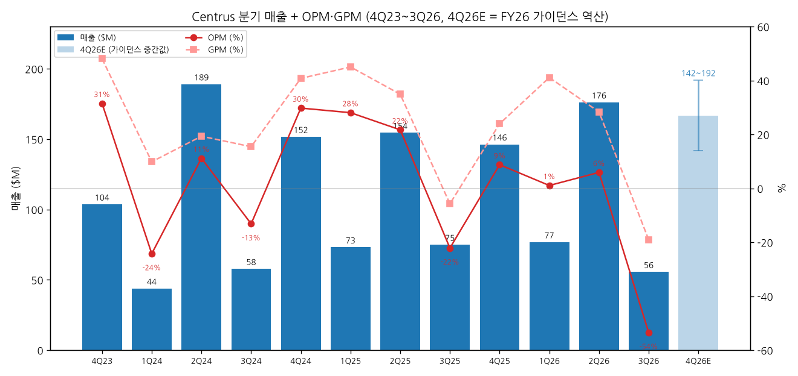
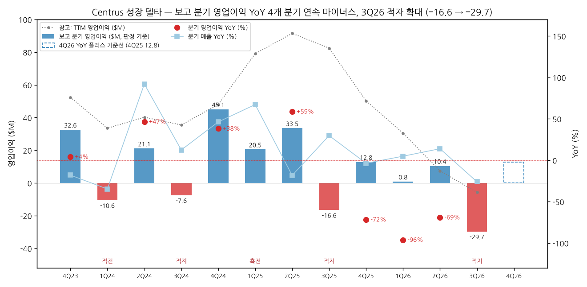
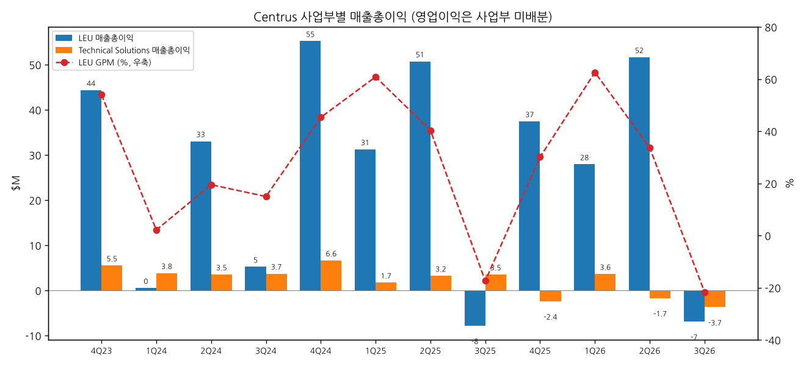
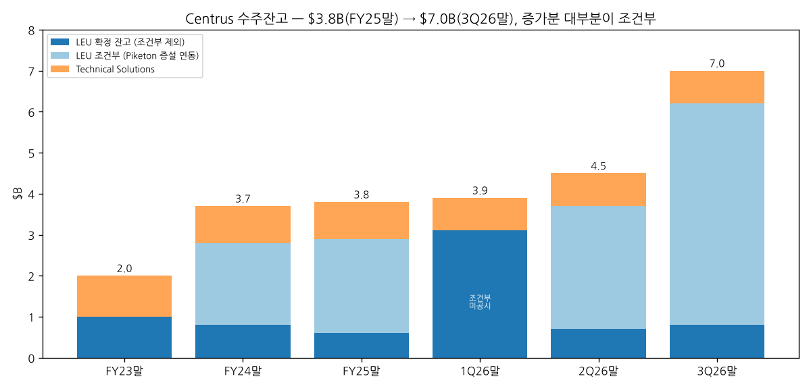

> 모드: 실적 리뷰 (v11)
> 종목: Centrus Energy (LEU, NYSE)
> 섹터: 원전
> 서브섹터: 원전 연료 글로벌
> 분기: 2026-Q3 (캘린더 = 회계 분기, 9/30 종료)
> 발표일: 2026-11-04 (수, 장 마감 후 보도자료 8-K) / 10-Q 2026-11-05 제출 / 컨퍼런스콜 2026-11-05
> 작성 시각: 2026-11-16 15:30 KST (16:00 수정 — 델타 판정 기준을 보고 분기 영업이익 YoY로 변경, BT 결정)
> 분석 소스: 회사 자료 — 10-Q 3Q26(SEC, 2026-11-05) MD&A 부문표·비GAAP 조정표·잔고·리스크 원문, 8-K 2026-10-19(Westerman 인수)·10-29(첫 원심분리기 출하)·11-04(실적 Item 2.02)·11-10(이사 선임)·11-12(Oklo 공급계약), 같은 폴더 `company-overview/LEU_기업개요.md`(55분기 사업부 시계열·잔고·자금조달, Oklo 10-Q 3Q26 교차확인) / 보도자료 Ex-99.1 원문은 SEC 403으로 미수집 → 보도자료 전재본(Finviz 2026-11-04)으로 대조 / 컨콜 원문 미확보(Motley Fool 미게재, StatementDog 유료) → 컨콜은 **비공식 요약**(StockStory "Top 5 Analyst Questions", StatementDog 공개분, Finviz 분석 기사)만 사용 / 컨센서스는 **비공식 집계**(Finviz·247WallSt·StockStory, 서로 다름) / 주가 Yahoo Finance LEU 일간
> 리뷰 깊이: 숫자 중심 | 리서치 첨부 0건 (1차 출처: SEC 10-Q·8-K, 보도 인용은 "보도", 컨콜 요약은 "비공식 요약" 표기)
> 다음 발표: 4Q26·FY26 — **2027-02-09 전후 추정** (회사 미공지, 전년 2026-02-10) / 이벤트: **2026-12-07 Investor Day**, **2026-12-31 Piketon 리스 장기 연장 목표일**

> **지표 정의**: 영업이익 = GAAP Operating income(loss). 회사 비GAAP "Adjusted Operating Income"은 워런트 발행비·증설 Growth Costs·주식보상을 뺀 값으로 병기만 한다. 분기 매출은 전력회사 연간 약정의 **인도 시점**에 따라 $44\~189M을 오가지만(분기 YoY가 ±90%까지 튐), **델타 판정은 v11 기준 그대로 보고 분기 영업이익(GAAP) YoY와 그 직전 분기 대비 변화**로 한다 (2026-11-16 BT 결정 — 이익이 들쭉날쭉한 종목은 보고 실적의 질·일관성으로 엄격하게 판정). TTM·조정 수치는 **참고** 행으로만 둔다. 사업부 영업이익은 회사가 배분하지 않아 **사업부 매출총이익**까지만 공시. 단위 $M
> 분기 영업이익 공시: ✓ → 섹터 합산 포함 가능 (보고 분기 영업이익 기준)

# Centrus Energy 3Q26 실적 리뷰 — 잔고는 $7.0B로 두 배, 분기 영업이익은 4개 분기 연속 역성장: "트레이더의 숫자"는 꺾이고 "농축 공장의 이야기"만 커졌다

## 0. 한 줄 판정

> 성장 델타: 꺾임 | 내러티브: 강화 → 델타 꺾임 + 내러티브 강화(2029년 이후 이야기) → 매매 제외 구간 (실적 델타가 아니라 12/7 Investor Day·12/31 Piketon 리스 연장 같은 마일스톤 이벤트로만 움직이는 종목)

→ **숫자**: 3Q26 매출 $55.5M(**−25.9% YoY**), 매출총이익 **−$10.6M**(GPM −19.1%), 영업이익 **−$29.7M**(OPM −53.5%). 판정 기준인 보고 분기 영업이익 YoY는 4Q25 **−71.6%** → 1Q26 **−96.1%** → 2Q26 **−69.0%** → 3Q26 **적자 확대**(−$16.6M → −$29.7M)로 **4개 분기 연속 마이너스**다. 2Q26의 소폭 개선(+27.1%p)도 마이너스 안의 움직임이라 이어지지 못했다. (참고: TTM 영업이익 $50.2M → $30.5M → $7.4M → −$5.7M, 회사 조정 영업이익 9M $48.2M → $32.9M(−32%) — 어느 기준으로도 방향은 같다) 순이익 $31.6M(희석 EPS $1.41)은 **워런트 평가이익 $46.4M**(비현금) 덕분이고, 이를 빼면 −$10.2M이다

→ **쟁점 ①**: 매출총손실의 원인은 두 갈래다. LEU 사업은 3Q가 원래 인도가 적은 분기(3Q25도 GP −$7.8M)라 계절성이 크지만, **SWU 단위원가 +28% vs 판매단가 +10%**(9M: +30% vs +12%)로 스프레드가 구조적으로 좁아지고 있다. Technical Solutions는 DOE HALEU 운영계약 매출이 −$10.2M 줄며 GP −$3.7M로 돌아섰다

→ **쟁점 ②**: 잔고는 $3.8B(FY25말) → **$7.0B**(2Q26말 $4.5B), 그중 LEU **조건부 $5.4B**(확정계약 $5.1B)는 Piketon 증설 완공·가동 마일스톤에 묶여 있다. 새 원심분리기 가동은 **2029년**이라 2028년까지의 손익에는 거의 들어오지 않는다. 지금 이익을 만드는 확정 LEU 잔고(RPO)는 **$0.8B**뿐이다

→ **쟁점 ③**: 증설 자금 — 현금 $2.24B, 9M CapEx $226M(3Q $132M, 컨콜 비공식 요약), 2026 자본배치 가이던스 $350\~500M, 2027 가속 예고. 9월 $500M 주식+워런트 공모, 보통주 워런트 699만주, 전환사채 2종까지 합친 **완전희석 잠재주식 약 37.3M주(현 발행 대비 +81%)** — 주가는 사상 최고 대비 −76%, 연초 대비 −57%

→ **다음 분기 관건**: ① 4Q26 매출 가이던스 내재 $142\~192M(FY $450\~500M 유지)와 **LEU GPM 30%대 회복** → **4Q26 영업이익이 4Q25 $12.8M을 넘어 YoY 플러스로 돌아서는지** ② **12/31 Piketon 리스 장기 연장**(실패 시 증설 지연·손상 처리 위험, 10-Q 명시) ③ 12/7 Investor Day의 2027 CapEx와 추가 자금조달 규모 ④ 2028년 러시아 LEU 수입 전면 금지 앞 TENEX 대체 경로

---

## 1. 숫자

① 연결 기준 분기 표 (단위: $M, %)

| 항목 | 4Q23 | 1Q24 | 2Q24 | 3Q24 | 4Q24 | 1Q25 | 2Q25 | 3Q25 | 4Q25 | 1Q26 | 2Q26 | **3Q26** | 4Q26 가이던스 내재 |
|---|---|---|---|---|---|---|---|---|---|---|---|---|---|
| 매출액 | 103.6 | 43.7 | 189.0 | 57.7 | 151.6 | 73.1 | 154.5 | 74.9 | 146.2 | 76.7 | 176.1 | **55.5** | 166.7 (141.7\~191.7) |
| 매출총이익 | 49.8 | 4.3 | 36.5 | 8.9 | 61.8 | 32.9 | 53.9 | −4.3 | 35.0 | 31.5 | 49.9 | **−10.6** | 미제시 |
| GPM | 48.1 | 9.8 | 19.3 | 15.4 | 40.8 | 45.0 | 34.9 | −5.7 | 23.9 | 41.1 | 28.3 | **−19.1** | — |
| 영업이익 (GAAP) | 32.6 | −10.6 | 21.1 | −7.6 | 45.1 | 20.5 | 33.5 | −16.6 | 12.8 | 0.8 | 10.4 | **−29.7** | 미제시 |
| OPM | 31.5 | −24.3 | 11.2 | −13.2 | 29.7 | 28.0 | 21.7 | −22.2 | 8.8 | 1.0 | 5.9 | **−53.5** | — |
| 매출 YoY | −17.9 | −34.7 | +92.1 | +12.5 | +46.3 | +67.3 | −18.3 | +29.8 | −3.6 | +4.9 | +14.0 | **−25.9** | +14.0 (−3.1\~+31.1) |
| **영업이익 YoY (판정 기준)** | +4.2 | 적전 | +46.5 | 적지 | +38.3 | 흑전 | +58.8 | 적지 | −71.6 | −96.1 | −69.0 | **적지 (−16.6 → −29.7)** | 4Q25 12.8 초과 시 플러스 |
| **매출 YoY 델타 (%p)** | −72.4 | −16.8 | +126.8 | −79.6 | +33.8 | +21.0 | −85.6 | +48.1 | −33.4 | +8.5 | +9.1 | **−39.9** | +39.9 |
| **영업이익 YoY 델타 (%p)** | n.m. | n.m. | n.m. | n.m. | n.m. | n.m. | n.m. | n.m. | n.m. | −24.5 | +27.1 | **n.m.** | — |
| (참고) TTM 매출 | 320.2 | 297.0 | 387.6 | 394.0 | 442.0 | 471.4 | 436.9 | 454.1 | 448.7 | 452.3 | 473.9 | **454.5** | FY26 475.0 (450\~500) |
| (참고) TTM 매출 YoY | +9.0 | −8.7 | +19.4 | +14.9 | +38.0 | +58.7 | +12.7 | +15.3 | +1.5 | −4.1 | +8.5 | **+0.1** | +5.9 (+0.3\~+11.4) |
| (참고) TTM 영업이익 | 52.4 | 33.5 | 40.2 | 35.5 | 48.0 | 79.1 | 91.5 | 82.5 | 50.2 | 30.5 | 7.4 | **−5.7** | — |
| (참고) TTM 영업이익 YoY | −12.2 | −53.1 | −2.4 | −30.5 | −8.4 | +136.1 | +127.6 | +132.4 | +4.6 | −61.4 | −91.9 | **적전** | — |
| (참고) TTM 영업이익 YoY 델타 (%p) | — | −40.9 | +50.7 | −28.1 | +22.1 | +144.5 | −8.5 | +4.8 | −127.8 | −66.0 | −30.5 | **적전** | — |
| (참고) TTM 매출총이익 YoY | −4.9 | −30.6 | +0.2 | −10.1 | −0.5 | +50.0 | +54.6 | +45.0 | +5.4 | −17.1 | −28.8 | **−26.7** | — |
| (참고) 조정 영업이익 (회사 비GAAP) | — | — | — | — | — | — | — | −14.9 | — | — | — | **−24.0** | — |

→ (출처: 분기 매출·매출총이익·영업이익은 10-Q 3개월 컬럼과 XBRL, 4Q = 연간 10-K − 9M [계산] — `company-overview/LEU_기업개요.md` 55분기 시계열과 동일. 4Q26 가이던스 내재 = FY26 매출 가이던스 $450\~500M(보도자료, Finviz 전재 — 유지) − 9M26 $308.3M [계산]. YoY·델타·TTM [계산]. 조정 영업이익은 10-Q 비GAAP 조정표: 3Q26 GAAP −29.7 + 워런트 발행비 4.6 + Growth Costs 2.4 − 주식보상 환입 1.3 = −24.0)

→ **컨센 대비 (비공식 집계, 출처마다 다름)**: 매출 $55.5M vs 컨센 $54.1M(Finviz 분석 기사 — +2.5%) / $55.6M(247WallSt — 부합) / $59.2M(StockStory — −6.3%). 조정 EPS −$0.46 vs 컨센 −$0.13(247WallSt·StockStory — **큰 미스**), GAAP 희석 EPS $1.41 vs 컨센 −$0.36(Finviz — 워런트 이익으로 "비트"). 매출은 대체로 부합, **본업 이익은 컨센보다 크게 나빴다**. 영업이익 컨센은 확보하지 못했다

→ **판정 기준 — 보고 분기 영업이익 YoY**: 분기 매출 YoY가 +92% → +13% → +46% → +67% → −18%처럼 인도 시점에 따라 부호가 바뀌고, 회사도 "LEU 고객은 분기가 아닌 연간 구매 약정을 갖는다 — 매출총이익은 계약 인도 시점에 따라 변한다"고 쓴다 (10-Q). 그래도 판정은 평활화하지 않고 보고 분기 숫자로 한다 — 이런 종목은 높은 델타의 분기가 **연속으로** 찍히기 전까지 실적이 아닌 이벤트·테마로 거래되고, 실적 리뷰는 보고 실적의 질과 일관성을 본다 (BT 결정 2026-11-16). TTM·조정 행은 참고용이다

→ **YoY 위치**: 보고 분기 영업이익 YoY의 마지막 플러스는 2Q25(+58.8%)다. 이후 3Q25 적자 확대 → 4Q25 −71.6% → 1Q26 −96.1% → 2Q26 −69.0% → 3Q26 적자 확대로 **5개 분기째 플러스가 없다**. 12개 분기 중 영업이익 YoY가 플러스였던 분기는 4개(4Q23·2Q24·4Q24·2Q25)뿐이고 두 분기 연속 플러스는 한 번도 없다 — "일관된 고델타 분기" 이력이 없다. 매출은 연 $450M 안팎에서 2년째 횡보(참고: TTM 매출 +0.1%)하고 내려간 것은 마진이다. FY26 가이던스 중간값($475M)도 매출 +5.9%에 그친다

→ **비용 구조 변화 (이익 꺾임의 절반은 "투자 비용")**: 9M26 영업이익 −$18.5M(9M25 +$37.4M) 하락폭 $55.9M의 분해 — 매출총이익 −$11.7M, Advanced technology costs +$26.4M(증설 Growth Costs $30.0M 포함), SG&A +$18.2M(주식보상 $16.8M·워런트 발행비 $4.6M 포함) [10-Q, 계산]. 회사 조정 기준(투자·주식보상 제외)으로도 9M 조정 영업이익 $48.2M → **$32.9M(−32%)**로 줄어 "투자 비용만의 문제"는 아니다

→ **[판단] 델타 = 꺾임**: 스킬 기준 "영업이익 YoY 마이너스 전환, 또는 2개 분기 연속 둔화"에 해당한다 — 보고 분기 영업이익 YoY가 4Q25부터 4개 분기 연속 마이너스이고 3Q26은 적자 폭이 커졌다(−$16.6M → −$29.7M, YoY 델타 n.m.). 판정이 바뀌려면 **4Q26 영업이익이 4Q25 $12.8M을 넘어 YoY 플러스로 돌아서야** 하고, 이어 1Q27(1Q26 $0.8M 대비)까지 2개 분기 연속 확대가 나와야 "가속"이다. FY26 가이던스는 매출만 있고 이익 가이던스가 없다. 9M 영업손실 −$18.5M을 메우려면 4Q 영업이익이 $18.5M 이상이어야 FY 흑자인데, Growth Costs가 늘어나는 구간이라 **4Q26 YoY 플러스 전환도, FY26 GAAP 흑자도 어려울 가능성이 높다** `[전망]` (참고: TTM·조정 기준으로도 같은 방향 — TTM 영업이익 적자전환, 9M 조정 영업이익 −32%)

→ (출처: 10-Q·10-K·XBRL. 4Q26E = FY26 매출 가이던스 역산 중간값 $166.7M, 오차막대 = $141.7\~191.7M [계산])

→ (출처: 동일. 막대 = 보고 분기 영업이익(판정 기준), 선 = 분기 영업이익 YoY(적자 전후 분기는 n.m.로 표시)·분기 매출 YoY, 점선 = 참고 TTM 영업이익 [계산])

② 사업부별 매출·매출총이익 (단위: $M, %) — 사업부 영업이익은 미공개

| 사업부 | 항목 | 4Q24 | 1Q25 | 2Q25 | 3Q25 | 4Q25 | 1Q26 | 2Q26 | **3Q26** | 9M25 | **9M26** |
|---|---|---|---|---|---|---|---|---|---|---|---|
| LEU | SWU 매출 | 48.7 | 51.3 | 125.7 | 10.7 | 111.0 | 41.6 | 100.0 | **14.1** | 187.7 | **155.7** |
| LEU | 우라늄 매출 | 73.2 | 0.0 | 0.0 | 34.1 | 13.4 | 3.0 | 53.4 | **17.7** | 34.1 | **74.1** |
| LEU | 매출 계 | 121.9 | 51.3 | 125.7 | 44.8 | 124.4 | 44.6 | 153.4 | **31.8** | 221.8 | **229.8** |
| LEU | 매출 YoY | +48.5 | +117.4 | −25.9 | +28.7 | +2.1 | −13.1 | +22.0 | **−29.0** | — | **+3.6** |
| LEU | 매출총이익 | 55.2 | 31.2 | 50.7 | −7.8 | 37.4 | 27.9 | 51.6 | **−6.9** | 74.1 | **72.6** |
| LEU | GPM | 45.3 | 60.8 | 40.3 | −17.4 | 30.1 | 62.6 | 33.6 | **−21.7** | 33.4 | **31.6** |
| Technical Solutions | 매출 | 29.7 | 21.8 | 28.8 | 30.1 | 21.8 | 32.1 | 22.7 | **23.7** | 80.7 | **78.5** |
| Technical Solutions | 매출 YoY | +38.1 | +8.5 | +48.5 | +31.4 | −26.6 | +47.2 | −21.2 | **−21.3** | — | **−2.7** |
| Technical Solutions | 매출총이익 | 6.6 | 1.7 | 3.2 | 3.5 | −2.4 | 3.6 | −1.7 | **−3.7** | 8.4 | **−1.8** |
| Technical Solutions | GPM | 22.2 | 7.8 | 11.1 | 11.6 | −11.0 | 11.2 | −7.5 | **−15.6** | 10.4 | **−2.3** |
| 매출 비중 | LEU / TS | 80 / 20 | 70 / 30 | 81 / 19 | 60 / 40 | 85 / 15 | 58 / 42 | 87 / 13 | **57 / 43** | 73 / 27 | **75 / 25** |

→ (출처: 10-Q MD&A 부문표 3개월·9개월 컬럼, 4Q = 연간 − 9M [계산]. 9M25 TS 매출 = 전사 $302.5M − LEU $221.8M [계산])

→ **LEU — 3Q 손실은 계절성 + 스프레드 압축의 합**: 3Q26 SWU 매출 +$3.4M(물량 +19%, 단가 +10%)인데 SWU 단위원가가 **+28%** 올랐다. 우라늄 매출은 물량 감소로 −$16.4M(−48%). 9M 기준으로 보면 SWU 물량 −26%, 단가 +12%, **단위원가 +30%** → LEU GPM 33.4% → 31.6% (10-Q). 3Q는 2년 연속 LEU 매출총손실(3Q25 −$7.8M, 3Q26 −$6.9M)이라 분기 손실 자체는 인도 일정의 계절성이다. 문제는 9M에서도 확인되는 **"판매가는 몇 년 전 계약가, 조달가는 지금 시세"**의 시차다 — 회사도 "청구 SWU 평균가는 공표 가격지표를 수년 시차로 따라간다"고 쓴다 (10-Q). 현물 SWU는 $203/SWU(9/30)로 고점에서 횡보 중이다

→ **Technical Solutions — DOE 운영계약 끝, 상업 전환의 공백**: HALEU 운영계약 매출 −$10.2M(YoY)로 TS 매출 −21%, GP −$3.7M. DOE는 Option 1b(3개월, 생산 없는 유지·보관, 고정가 $15.0M)만 행사했고 "추가 생산 옵션은 행사할 계획이 없다", FY27 예산안에도 캐스케이드 운영비가 없다 (10-Q). TS 잔고 $0.8B는 사실상 이 계약분이라 **소멸 위험** (Finviz 분석 기사 동일 해석)

→ (출처: 10-Q MD&A 부문표, 4Q = 연간 − 9M [계산])

(1) 수주잔고 — 선행지표 (단위: $B)

| 시점 | 총잔고 | LEU 잔고 | 그중 조건부 (Piketon 증설 연동) | 조건부 중 확정계약 | LEU 확정 잔고 (RPO) | TS 잔고 |
|---|---|---|---|---|---|---|
| FY24말 | 3.7 | 2.8 | 2.0 | 0.8 | 0.8 | 0.9 |
| FY25말 | 3.8 | 2.9 | 2.3 | 2.1 | 0.6 | 0.9 |
| 1Q26말 | 3.9 | 3.1 | 미공시 | — | — | 0.8 |
| 2Q26말 | 4.5 | 3.7 | 3.0 | — | 0.7 [계산] | 0.8 |
| **3Q26말** | **7.0** | **6.2** | **5.4** | **5.1** | **0.8** | **0.8** |

→ (출처: 10-K FY24·FY25, 10-Q 1Q26·2Q26·3Q26 잔고 원문. 2Q26 총잔고 $4.5B·조건부 $3.0B는 보도자료 비교 수치(Finviz 분석 기사). RPO = 10-Q 수익인식 주석 "확정 약정 잔여 이행의무", 2034년까지)

→ 3Q 한 분기에 총잔고 **+$2.5B**, 그 대부분(+$2.4B)이 조건부 LEU·HALEU다. 3Q에 X-energy(LEU+HALEU)·Radiant·Antares(HALEU) 장기계약이 체결됐고 **세 건 모두 선급금 포함** (10-Q). Oklo 공급계약(2026-09-30 체결, 최대 Aurora 5기, 2029 인도 개시)도 3Q말 잔고 시점과 겹친다 (8-K 11-12, Oklo 10-Q 교차확인 — 기업개요)

→ 반면 **지금 매출이 되는 확정 LEU 잔고는 $0.6B → $0.8B**로 소폭 증가에 그친다. 잔고 $7.0B ÷ TTM 매출 $454.5M = 15.4배지만 [계산], 그중 77%(5.4/7.0)는 2029년 이후 공장이 돌아야 발효된다

→ (출처: 10-K·10-Q 잔고 원문, 2Q26 조건부는 보도자료 비교 수치. 1Q26 조건부 미공시)

(2) 가이던스 (이전 → 이번)

| 항목 | 2Q26 발표 시 | 3Q26 발표 (11/4) | 변화 |
|---|---|---|---|
| FY26 매출 | $450\~500M | $450\~500M | 유지 ("reaffirmed, not raised", 보도) |
| FY26 자본배치 (CapEx 등) | $350\~500M | $350\~500M (Westerman 인수 제외, 비공식 요약) | 유지 |
| Piketon 순증 인력 | 100명+ | **175명+** | 상향 (보도자료) |
| Oak Ridge 순증 인력 | 100명+ | 100명+ | 유지 |
| 2027 CapEx | — | 미제시 — "2027년 가속", 12/7 Investor Day에 제시 | — |

→ (출처: 보도자료 전재(Finviz 2026-11-04), Finviz 분석 기사, StatementDog 공개 요약. 2Q26 발표 시 수치는 Finviz 분석 기사의 "reaffirmed" 서술 기준 — 원문 미확인)

→ 9M 자본배치 실적 CapEx $226.4M(전년 동기 $10.1M) → 가이던스 달성엔 4Q에 $124\~274M이 더 나가야 한다 [계산]. Westerman 인수 현금 $95M(10/16)은 별도다

③ 연간 (단위: $M, %)

| 항목 | 2021 | 2022 | 2023 | 2024 | 2025 | 9M26 | 2026E (가이던스) |
|---|---|---|---|---|---|---|---|
| 매출액 | 298.3 | 293.8 | 320.2 | 442.0 | 448.7 | 308.3 | 450\~500 |
| 매출총이익 | 114.5 | 117.9 | 112.1 | 111.5 | 117.5 | 70.8 | 미제시 |
| 영업이익 | 68.3 | 59.7 | 52.4 | 48.0 | 50.2 | −18.5 | 미제시 |
| OPM | 22.9 | 20.3 | 16.4 | 10.9 | 11.2 | −6.0 | — |
| 매출 YoY | +20.7 | −1.5 | +9.0 | +38.0 | +1.5 | +1.9 | +0.3\~+11.4 |
| 영업이익 YoY | +33.9 | −12.6 | −12.2 | −8.4 | +4.6 | 적전 (9M25 37.4) | — |

→ (출처: 10-K·XBRL, 9M26은 10-Q, 2026E는 보도자료 가이던스. YoY [계산])

→ OPM은 2021년 22.9% 정점 이후 **5년째 하향** — 매출은 2024년 +38%로 한 단계 올라섰지만 영업이익은 $50M 안팎에서 정체, 2026년 증설 비용이 더해지며 마이너스로 내려왔다. 연간 컨센서스(이익)는 확보하지 못했다

---

## 2. 시장 쟁점

① 지난 분기 체크

→ 첫 리뷰 — 직전 체크 없음 (2026-11-14 원전 글로벌 피어 편입, 직전 분기 리뷰·팔로업 없음)

② 이번 분기 쟁점 5개 (회사 설명 + 컨콜에서 반복된 질문 기준)

| # | 쟁점 | 근거 |
|---|---|---|
| (1) | 매출총손실 −$10.6M — 계약 믹스 일시인가, SWU 스프레드 압축인가 | 10-Q MD&A, 컨콜 회사 설명(비공식 요약) |
| (2) | 잔고 $7.0B — 조건부 $5.4B는 언제, 얼마나 이익이 되나 | 10-Q 잔고, TD Cowen 질문 |
| (3) | HALEU — DOE 계약 종료 후 상업 전환, Piketon 리스 2027-10 만료 | 10-Q, 8-K, 보도자료 |
| (4) | 증설 자금과 희석 — 현금 $2.2B로 충분한가, 추가 조달은 | 10-Q, Guggenheim·Evercore·Craig-Hallum 질문 |
| (5) | 러시아 TENEX 조달과 2028 절벽 + KHNP 연결 | 10-Q 리스크 원문, 8-K(2025) |

→ (컨콜 질문자: William Blair·TD Cowen·Guggenheim Securities·Evercore ISI·Craig-Hallum — StockStory 비공식 요약 기준. 트랜스크립트 원문 미확보)

③ 쟁점별 분해

(1) **매출총손실 −$10.6M — 계약 믹스 일시인가, SWU 스프레드 압축인가**

(1-1) 회사 설명

→ "*Our normalized results reflected the typical quarter-over-quarter shift in contractual mix*"

→ "정상화(normalized) 실적은 **분기마다 바뀌는 통상적인 계약 믹스 변화**를 반영한다" (CEO Amir Vexler, 컨콜 — StockStory 비공식 요약 인용)

→ 시사점: 회사는 **인도 시점·믹스** 문제로 설명 → 10-Q 원문도 "LEU 손실 감소는 분기 간 계약 구성 변화 때문"이라고만 씀 → 단가 대비 원가 **+28% vs +10%**의 스프레드 문제는 설명에 없다

(1-2) 숫자로 분해 `[판단]`

→ 계절성: 3Q는 2년 연속 LEU 매출총손실(3Q25 −$7.8M → 3Q26 −$6.9M)이고, 1Q26(GPM 62.6%)·2Q26(33.6%)는 높았다. 분기 손실만으로 구조 변화를 단정할 수 없다는 회사 설명은 숫자와 맞는다

→ 구조: 9개월로 넓혀도 SWU 단가 +12% vs 단위원가 +30%다. SWU 1단위의 판매가를 100, 원가를 70(GPM 30% 가정)으로 두면, 단가 112·원가 91로 **마진이 30 → 21로 30% 줄어드는 셈**이다 [계산 예시]. LEU GPM이 FY22 55.4% → FY24 26.8% → FY25 32.2% → 9M26 31.6%로 30% 근처에 머무는 이유다

→ 원가가 오르는 이유: TENEX 계약가는 "시장 연동 가격 + 기타 요소" 공식이고 (10-Q), 러시아 제재로 운송·결제 경로 비용이 붙는다. 판매가는 수년 전 계약가라 시세를 늦게 따라간다

→ **결론이 바뀌는 조건**: 4Q26(통상 인도 성수기) LEU GPM이 4Q25 30.1%를 넘으면 "믹스·계절성" 해석이 맞다. 25% 밑이면 스프레드 압축이 4Q에도 이어진다는 뜻이다

(2) **잔고 $7.0B — 조건부 $5.4B는 언제, 얼마나 이익이 되나**

(2-1) 회사 설명

→ 10-Q: "조건부 판매약정은 **운영 마일스톤 달성**과 연계된다." 조건부 $5.4B 중 $5.1B가 확정계약(definitive agreements)이며 "Piketon의 LEU·HALEU 생산설비 건설을 지원"한다. 잔고는 2040년까지 이어지고 "고객 운영 관련 위험 주문은 없다"

→ 컨콜(TD Cowen 질문): 잔고 대부분은 **가동 중인 원전용**이고, 신규 원전은 조기 연료 약정이 필요해 앞으로 추구하겠다 (StockStory 비공식 요약)

(2-2) 숫자로 분해 `[판단]`

→ 시점: 새 원심분리기 첫 가동은 2029년(10-Q) → 조건부 잔고의 첫 매출도 2029년 이후다. 첫 Oak Ridge 원심분리기는 10/29 출하(당초 "2026년 중")로 일정은 앞당겨졌고, 핵심 공급사 계약은 약 75% → 100%다 (보도자료·Finviz)

→ 규모 감각: 조건부 $5.4B를 2029\~2040년 12년에 고르게 나누면 연 $0.45B로 지금 연매출($0.45B)과 비슷한 규모가 추가된다 [계산 — 단순 균등 가정]. 다만 이는 자체 생산 SWU라 TENEX 조달 마진이 아니라 **설비 보유 농축사 마진**(Urenco형)이 붙는다는 것이 이 스토리의 핵심이다

→ 지금 숫자와의 관계: 2026\~2028년 이익은 RPO $0.8B + 신규 단기 계약 + TENEX·Orano 조달 스프레드에서만 나온다. **잔고 증가가 2028년까지의 이익 델타를 바꾸지 않는다**

(3) **HALEU — DOE 계약 종료 후 상업 전환, Piketon 리스**

(3-1) 회사 설명

→ "*because that supply chain is unobligated, we are able to serve both the national security and commercial markets*"

→ "그 공급망이 **비의무(unobligated, 외국 의무 없는 순수 미국산)**이기 때문에 **국가안보와 상업 시장 모두**에 공급할 수 있다" (CEO Vexler, 보도자료)

→ 시사점: 국방(NNSA) 수요까지 열어두는 포지셔닝 → William Blair도 NNSA 연계를 질문 → 다만 숫자로 확정된 정부 계약은 **DOE $900M HALEU task order**(2032-03까지 1MTU, 마일스톤 지급)뿐

(3-2) 진행 상황 (10-Q·8-K)

→ DOE 운영계약: 9/30 생산 옵션 종료 → 10/20 **HALEU Transfer Agreement**로 HALEU·재고·설비 책임이 Centrus 자회사 ACO로 이전, 16대 시범 캐스케이드는 상업 고객용 HALEU 농축 중

→ Piketon 리스: 10/19 개정으로 만료일 **2027-10-01 확정**, 대신 Centrus가 DOE의 해체(D&D) 책임을 인수(NRC 승인 조건). DOE는 "**2026-12-31 전까지** 장기 연장 완료에 성실히 협력"한다고 했지만 의무는 없다. 연장 실패 시 증설 "지연·축소·포기" 가능성과 **Piketon 자본화 개선비 손상**을 10-Q가 명시

→ 상업 고객: Oklo(Meta 자금, 2026-11-02 에스크로에서 Centrus로 직접 지급 — Oklo 10-Q, 기업개요), X-energy·Radiant·Antares(선급 포함). LEU 부문 선수금·이연수익은 $131.1M(FY25말) → $85.3M(3Q26말)로 오히려 줄었다 — 3Q 신규 선급의 금액은 공시되지 않았다

(3-3) **[판단]**

→ HALEU는 "DOE 용역 매출(cost-plus, GPM 한 자릿수)"에서 "상업 판매"로 넘어가는 과도기라 **2027년까지 TS 매출은 공백**이 생긴다. TS 분기 매출 $22\~32M 중 HALEU 운영계약분이 빠지면 4Q부터 TS 매출 YoY 마이너스 폭이 커질 가능성이 높다 `[전망]`

→ 결론이 바뀌는 조건: 12/31까지 리스 장기 연장 + DOE와 캐스케이드 상업 운영 추가 계약이 나오면 HALEU 스토리의 가장 큰 행정 리스크가 해소된다

(4) **증설 자금과 희석 — 현금 $2.2B로 충분한가**

(4-1) 회사 설명 (10-Q)

→ 현금 $2,236.1M(3Q26말), "향후 최소 12개월 영업에 충분한 유동성". 동시에 "추가 부채·지분 조달, 자산 기여·처분, 파트너 참여를 추구할 수 있다", 인수 리스크로 "희석"을 명시. **2026-11-02 신규 S-3(선반등록)** 제출

→ 컨콜: Guggenheim(원심분리기 일정 단축의 반복 가능성) → Palantir 협업 등 공정 개선, Evercore(Palantir 관련 잠재 절감 $300M) → "가치 대부분은 앞으로, Investor Day에 상세", Craig-Hallum(수직계열화) → Westerman은 공급망 리스크 해소 템플릿, 추가 통합 가능 (StockStory 비공식 요약)

(4-2) 숫자로 분해

| 항목 | 값 | 출처 |
|---|---|---|
| 현금 (3Q26말) | $2,236.1M | 10-Q |
| 전환사채 원금 | $1,207.5M (2.25% $402.5M 2030 만기 전환가 $97.50 / 0% $805M 2032 만기 전환가 $229.62) | 10-Q·기업개요 |
| 순현금 | 약 $1,029M → Westerman 현금 $95M 반영 시 약 $934M | [계산] |
| 9M 영업CF / CapEx / FCF | −$11.1M / $226.4M / −$237.5M | 10-Q, [계산] |
| 9M 투자수익 (이자) | $50.2M | 10-Q — 영업손실을 메우는 구조 |
| 2026-09 공모 | 보통주 50만주 + 사전납입 워런트 200.6만주 + 보통주 워런트 699.2만주, 순조달 $493.8M | 10-Q |
| 보통주 워런트 행사가 | $226.86 / $272.24 / $317.61 / $362.98 (4개 트랜치) — 전부 행사 시 약 $2B | 8-K 2026-09-11, 보도 |
| 완전희석 잠재주식 | 약 37.3M주 (발행 20.62M + 사전납입 2.01M + CB 7.64M + 보통주 워런트 6.99M) = **+81%** | [계산], 기업개요 |

→ **[판단]**: 현금 $2.2B는 2026\~27년 CapEx(2026 $350\~500M + 2027 "가속")를 감당하지만, Piketon "수십억 달러" 증설 전체에는 부족하다. 보통주 워런트 행사가($227\~363)는 현재가 $103.78의 2.2\~3.5배라 **행사 자금 $2B는 주가가 2\~3배 올라야만 들어오는 돈**이다. 그 전까지의 추가 자금은 신규 증자·전환사채·전략 파트너(KHNP·POSCO 등) 중 하나여야 한다. 3Q GAAP 순이익의 원천인 워런트 평가이익($46.4M)은 주가가 떨어져서 생긴 이익이라, 주가가 오르면 반대로 **평가손실**이 GAAP 이익을 깎는다

→ 결론이 바뀌는 조건: 12/7 Investor Day에서 2027 CapEx와 함께 정부 대출(DOE LPO 등)·전략 지분투자 같은 **비희석 조달**이 제시되면 희석 할인이 줄어든다

(5) **러시아 TENEX 조달과 2028 절벽 + KHNP 연결**

(5-1) 회사 설명 (10-Q 원문)

→ "*Through 2027, well over one-half of the LEU that we expect to deliver to customers was sourced under the TENEX Supply Contract. While we have other sources of supply, they are not sufficient to replace the TENEX supply.*"

→ "2027년까지 고객에게 인도할 LEU의 **절반을 훨씬 넘게** TENEX 계약으로 조달했다. 다른 조달원이 있지만 **TENEX를 대체하기엔 충분하지 않다**"

→ 시사점: 미국 수입 waiver는 **2024\~2027년 인도분**까지 확보 → 러시아 수출 허가령도 2027-12-31까지 → 2026\~27년 미래 판매용 3차 waiver 신청(2024-12)은 결과 미정 → **2028년부터 법상 전면 금지** → TENEX 계약 자체도 2028년까지 → 자체 공장 가동(2029)까지 **최소 1년의 조달 공백** 가능성

(5-2) 추가 변수

→ Graham Act(2026-09-18, 러시아 제재 법제화·최대 500% 관세 권한)는 행정명령으로 대부분 면제됐고 우라늄은 관세 대상 제외지만, 동반 운송 물품 관세와 **면제 철회 가능성**을 10-Q가 리스크로 새로 적시

→ **KHNP(한수원) 연결**: KHNP는 조건부 LEU 장기 고객(2025-02 $0.8B 확정계약 전환, 2025-08 물량 증액 — 전량 Piketon 신규 설비 자금 확보 조건부)이고, 2025-08 KHNP·POSCO인터내셔널과 Piketon 투자 검토 MOU(비구속)를 맺었다 (8-K 2025). **3Q26 10-Q에는 한국·KHNP·POSCO 언급이 없다** — 투자 집행은 미공시 상태다. 조건부 잔고 $5.4B 안에 KHNP 물량이 들어 있다는 점에서, 한국 원전의 연료 조달 다변화가 Centrus 증설 성패에 직접 걸려 있다 `[판단]`

(5-3) **[판단]**

→ 2026\~2027년 숫자는 waiver가 있어 버틴다. 리스크는 2028년 한 해 — TENEX 물량을 Orano·현물·재고로 메워야 하는데 회사 스스로 "충분하지 않다"고 썼다. 2028년 LEU 매출 YoY가 크게 꺾일 수 있다는 점이 기업개요의 분류 변경 조건 ②(TENEX 중단 시 LEU 매출 −30% 2개 연도)와 연결된다

④ 시장 반응 — 숫자

| 날짜 | 종가 ($) | 변화 | 이벤트 |
|---|---|---|---|
| 2025-12-31 | 242.76 | — | 연초 기준 |
| 2026-11-04 | 92.58 | — | 실적 발표일 (장 마감 후) |
| 2026-11-05 | 89.03 | −3.8% | 실적·10-Q 다음날, 장중 $84.86 52주 저점 |
| 2026-11-06 | 104.60 | +17.5% | Oklo 10-Q(Meta 자금 Centrus 직접 지급) 공개와 겹침 `[판단]` |
| 2026-11-09 | 117.34 | +12.2% | 반등 지속 |
| 2026-11-12 | 103.92 | −7.4% | Oklo 공급계약 8-K 발표일 (재료 소멸) |
| 2026-11-13 | 103.78 | −0.1% | 연초 대비 **−57.3%**, 사상 최고($436.00, 2025-10-15) 대비 −76% [계산] |

→ (출처: Yahoo Finance LEU 일간. 11/12 등락률은 Finviz 뉴스표 −7.35%와 일치)

→ 10월 증권사 TP 하향(Roth $188→$115·Barclays $207→$150·UBS $185→$120·JPM $180→$120, Westerman 인수 발표 후 — Motley Fool 보도, 기업개요)이 실적 전에 이미 나왔고, 실적 반응은 −3.8%로 작았다. 이후 주가는 실적이 아니라 **Oklo·Meta 헤드라인**으로 움직였다 → "꿈" 종목의 전형적 반응 `[판단]`

---

## 3. 내러티브 점검

① 성장 스토리 정의

→ "러시아산 농축우라늄을 되파는 트레이더가, 미국 유일의 자국 원심분리 기술로 **Piketon에 LEU·HALEU 농축 공장**을 지어 2029년부터 설비 보유 농축사(Urenco형)로 바뀐다. 그 수요는 SMR(Oklo·X-energy)·빅테크(Meta)·해외 전력사(KHNP)의 장기 선급 계약이 받쳐준다"

② 이번 분기 평가

→ **강화된 것 (수주·마일스톤)**: 잔고 $3.8B → $7.0B, 조건부 확정계약 $5.1B, HALEU 상업 고객 4곳(선급 포함), 첫 원심분리기 조기 출하, 핵심 공급사 100% 계약, Westerman 인수로 케이싱 내재화, DOE $900M task order 진행

→ **약화된 것 (돈·행정)**: DOE HALEU 운영계약 종료와 FY27 예산 미반영, Piketon 리스가 2027-10까지 "확정"됐을 뿐 장기 연장은 미정, 증설 자금의 희석, TENEX 2028 절벽

→ **숫자와의 관계**: 강화된 항목은 전부 2029년 이후 손익에 들어온다. 보고 분기 영업이익 YoY는 4개 분기 연속 마이너스이고, 2026\~2028년 손익은 TENEX·Orano 스프레드(압축 중) + HALEU 공백 + 증설 비용 증가라 **델타는 꺾임**이다. 이 종목은 지금 "실적 델타"와 "내러티브"가 **반대 방향**으로 움직인다 — BT 프레임(델타 꺾임 = 매매하지 않음)으로는 매매 제외, 주가는 마일스톤 헤드라인에만 반응하는 구간이다 `[판단]`

③ 스토리를 다시 강하게 만들 트리거

→ (1) **12/31 Piketon 리스 장기 연장** + DOE 캐스케이드 상업 운영 계약

→ (2) 12/7 Investor Day — 비희석 조달(정부 대출·전략 지분), Palantir $300M 절감 구체화, 2027 CapEx와 첫 캐스케이드 일정 재확인

→ (3) KHNP·POSCO 등 전략 투자자의 **실제 지분투자** 공시, 조건부 잔고의 무조건부 전환

④ 스토리를 깨뜨릴 리스크

→ (1) 리스 연장 실패 → 증설 지연·손상 처리 (10-Q 명시)

→ (2) TENEX 공급 중단·waiver 불허 → 2027\~28년 LEU 인도 차질

→ (3) 대규모 추가 증자 (현 주가 수준에서) 또는 증설 원가 초과

---

## 4. 향후 봐야 할 것 (우선순위 순)

① **4Q26 보고 영업이익 $12.8M 초과 — 영업이익 YoY 플러스 전환** (델타 판정 1순위)

→ 무엇을: 4Q 영업이익이 4Q25 $12.8M을 넘는지(판정 변경의 첫 조건, $18.5M+면 FY26 흑자), 4Q 매출 $142\~192M(중간 $167M), LEU GPM 4Q25 30.1% 이상, SWU 단가 vs 단위원가 상승률 격차(9M: +12% vs +30%) 축소

→ 어떤 데이터로: 4Q26 보도자료·10-K MD&A 부문표, SWU 현물 지표(TradeTech, 9/30 $203)

→ 언제: 2027-02-09 전후 (추정)

② **Piketon 리스 장기 연장 — 2026-12-31 목표**

→ 무엇을: DOE와 장기 리스 연장 체결 여부, 캐스케이드 상업 운영 추가 계약, 해체(D&D) 책임 인수의 NRC 승인

→ 어떤 데이터로: 8-K, DOE 발표, 뉴스 키워드 "Centrus Piketon lease extension"

→ 언제: 2026-12-31까지 (미체결 시 10-K 리스크·손상 검토 문구 확인)

③ **12/7 Investor Day — 2027 CapEx·자금조달·희석**

→ 무엇을: 2027 CapEx 규모, Piketon 증설 총비용과 단계별 일정(첫 캐스케이드 2029 유지 여부), 추가 증자·전환사채·정부 대출 계획, Palantir $300M 절감, HALEU 마진 구조

→ 어떤 데이터로: Investor Day 자료(8-K), 신규 S-3(2026-11-02) 활용 공시, ATM 판매 공시

→ 언제: 2026-12-07

④ **러시아 조달 — 2028 절벽 대체 경로**

→ 무엇을: 2026\~27 미래 판매용 3차 waiver 결과, TENEX 수출 허가 지속, Graham Act 면제 유지, 2028년 이후 Orano·기타 조달 계획

→ 어떤 데이터로: 10-K FY26 리스크 원문, DOE waiver 공지, 뉴스 키워드 "TENEX export license", "Russian uranium import waiver 2028"

→ 언제: 수시, 10-K(2027-02)

⑤ **HALEU·조건부 잔고의 질 — 확정 전환과 선급 규모**

→ 무엇을: 조건부 $5.4B 중 확정계약 비율(현재 $5.1B, 94%), 선수금·이연수익 증가(3Q말 $85.3M), DOE $900M task order 마일스톤 지급, Oklo·Meta 추가 선급, KHNP·POSCO 투자 집행

→ 어떤 데이터로: 10-K 잔고·이연수익 주석, Oklo 실적(같은 섹터 SMR 피어), 8-K, 한국 보도(한수원·포스코인터내셔널)

→ 언제: 2027-02 (10-K), 수시
